::: callout-tip
## **Content**

-   Earth's position in the solar system and the limits it sets for life.
-   Earth viewed as a system, and the role of the oceans.
-   Growth and redistribution of the human population from year 1 to 2100, shown with Worldmapper cartograms.
-   The links between population growth, poverty, urbanisation, education, health and nutrition.
-   Human impacts on the Earth system: greenhouse gas emissions, land-use change, untreated sewage and deforestation.
-   Planetary boundaries, and the consequences of exceeding them for all life on Earth, including plants.
:::

::: callout-tip
## **Aims**

This lecture places the rest of the module in context. We begin with Earth as the only known inhabited planet and the limits within which life persists, then examine human population growth, the social and economic conditions that accompany it, and the scale at which human activity now alters the Earth system. The lecture ends with the planetary boundaries framework, which links these human pressures to the environmental changes that plants experience. Climate change returns in [Lecture 4](L04-climate.qmd) and [Lecture 5](L05-carbon_cycle.qmd), and the planetary boundaries return in [Lecture 10](L10-plant_stress.qmd), where crossing them is treated as a source of plant stress. The point is to show why plant ecophysiology cannot be separated from global environmental change.
:::

::: callout-tip
## **Learning Outcomes**

By the end of this lecture, you will be able to:

1.  Explain why Earth's position in the solar system, and the presence of water as liquid, ice and vapour, set the limits within which life persists.
2.  Explain why plant ecophysiology must be studied in the context of the whole Earth system, using the oceans as an example.
3.  Describe how the size and geographical distribution of the human population have changed since year 1, and how they are projected to change to 2100.
4.  Explain the links between population growth, absolute poverty, female education, healthcare and undernourishment.
5.  Identify the main human sources of carbon dioxide, methane and nitrous oxide, and describe other human impacts on the environment such as deforestation and untreated sewage.
6.  Explain the concept of planetary boundaries and the safe operating space for humanity, and explain why exceeding the boundaries matters for plants.
:::

::: callout-note
## **Required Reading**

-   [Rockström, J., and others (2009). A safe operating space for humanity. Nature, 461, 472–475.](<../docs/Rockstrom et al (2009).pdf>)
-   [Richardson, K., Steffen, W., Lucht, W., and others (2023). Earth beyond six of nine planetary boundaries. Science Advances, 9(37), eadh2458.](../docs/Richardson_et_al_2023.pdf)
:::

## Introduction: Contextualising Plant Ecophysiology

This lecture explains why plant ecophysiology has to be studied at planetary scale. Plants do not operate in isolation. Their light environment, water supply, nutrient regimes, temperature, and disturbance patterns are all shaped by the Earth system, and increasingly by human activity.

That is why I call this lecture "The Limits to Life". Life persists within physical and biological bounds. When those bounds shift, plant function shifts with them.

## Earth's Place in the Solar System

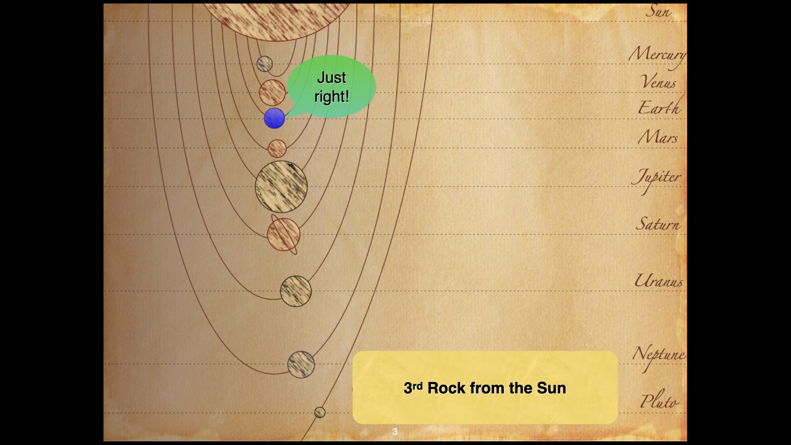

As you know, Earth is the third planet from the Sun, and that position is significant. The relevance of our position in the solar system, between Venus and Mars, is that it creates a perfect set of conditions where everything is just right for life to exist. This is not true for Venus, which is the second planet, nor Mars, the fourth planet from the Sun. Venus is closer to the Sun, so it is too hot; Mars is further away, and it is too cold. So, like Goldilocks, Earth is just right.

It is just right because water can exist in the three phases necessary for the existence of life: as a liquid, as ice, and as vapour (clouds). Without water present in all three phases, the hydrological cycle as we know it could not operate. This sets a series of limits within which life persists, with the range of temperatures on the planet being an important parameter. Even though water exists as a liquid between $0\,^\circ\mathrm{C}$ and $100\,^\circ\mathrm{C}$, life is constrained to a smaller subset of that temperature range.

## Shifting Limits: Anthropogenic Change

This particular set of limits is shifting; it is not constant. It has not been constant forever, but now, in more recent times (at least since the Industrial Revolution in the 1700s), the rate at which those limits are changing is accelerating. That is called climate change. We will return to it in [Lecture 4](L04-climate.qmd) and [Lecture 5](L05-carbon_cycle.qmd), with the self-study climate lecture on 13 October and the carbon cycle lecture on Thursday, 15 October 2026.

## Earth from Space

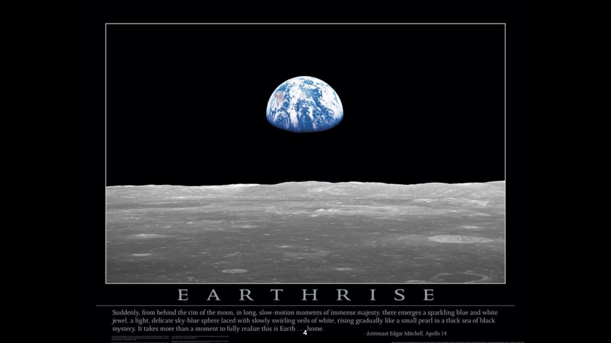

In 1990, Carl Sagan persuaded NASA to have the Voyager 1 spacecraft, then more than six billion kilometres from Earth, turn its camera back towards our planet. The result was the now-famous *Pale Blue Dot*. For the first time, humanity saw Earth not as a huge globe but as a single pixel of light suspended in the cosmic dark. That faint speck highlighted the planet's singularity: in all the vastness of the solar system, Earth was the only known home for life.

In the image, though Earth is almost imperceptible, we know what lies within it: water in all three of its states: clouds forming from vapour, oceans of liquid spanning the surface, and polar caps of ice. The vast Pacific occupies much of the visible face of the planet, with familiar landmasses like Australia positioned at its edge.

That perspective reshaped how people thought about our world. It revealed Earth as rare, fragile, and utterly irreplaceable, the only place where human life can exist. There is a beautiful video in which Carl Sagan himself speaks about this vision, reflecting on the fragility of life on our pale blue dot.

## Viewing Earth as a System

This module will focus on viewing Earth as a whole system, rather than on individual plants or animals. We will discuss how the Earth system sustains life, and the necessary conditions for life to persist. For instance, if you look down onto South Africa, with most of Africa visible on the top left and Antarctica below, you will see the swirling clouds of the large atmospheric gyres, which move water vapour and air around and constitute our climate systems.

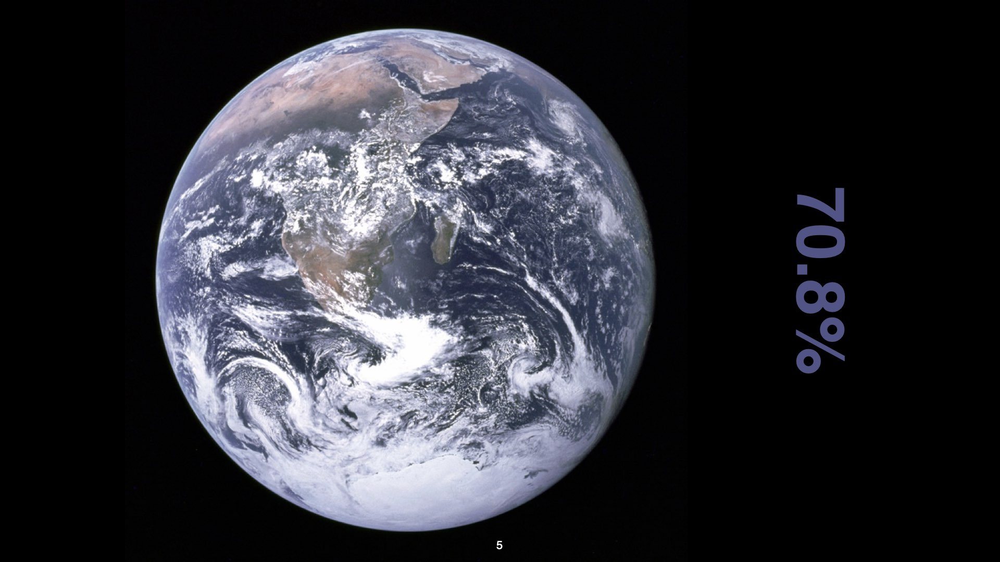

One critically important aspect of the Earth is the oceans. Without the oceans, life would not exist as we know it. $70.8\,\%$ of Earth's surface is covered in ocean water, and these oceans create the conditions that allow life to persist on the rest of the planet. The oceans produce about $50\,\%$ of the global supply of oxygen, and are crucial in maintaining an even temperature gradient across the planet. Without oceans, Earth would be far hotter and daily temperature fluctuations would be much more extreme.

Ideally, we should not call the planet "Earth" but rather "planet ocean", as it is predominantly covered by ocean water.

## Demographic Changes and Global Population

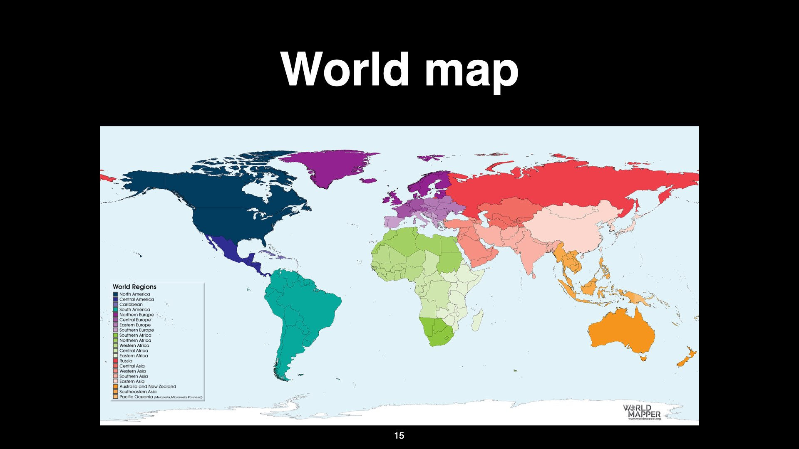

I want to show you some figures from a website called Worldmapper [@worldmapper], which creates interesting images of world maps distorted according to the density of certain processes, for example population density, education levels, or carbon emissions per capita.

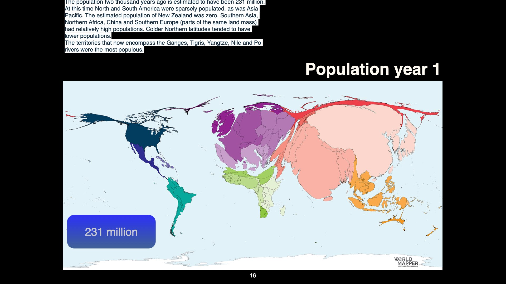

If we look back 2,000 years ago, in year one (according to our calendar), most people were in Southeast Asia and Europe. Some distortion in South America is due to Inca and Maya populations, but mostly, the bulk of the population was in Asia and Northern Europe. Very few people were in North America, and New Zealand was unpopulated.

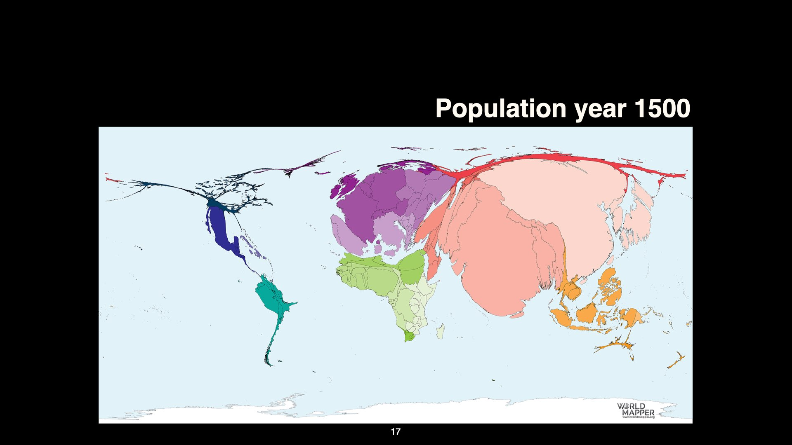

Moving forward 1,500 years, we see Asia and Northern Europe remain large, with Asia expanding. North America now grows in size, which shows that the population began to rise there. Later, during the last 500 years or so, Africa saw rapid population expansion.

This is very important, as continual population growth has a huge effect on biodiversity, both regionally and globally. Human impact is thus largely a consequence of very large numbers of people.

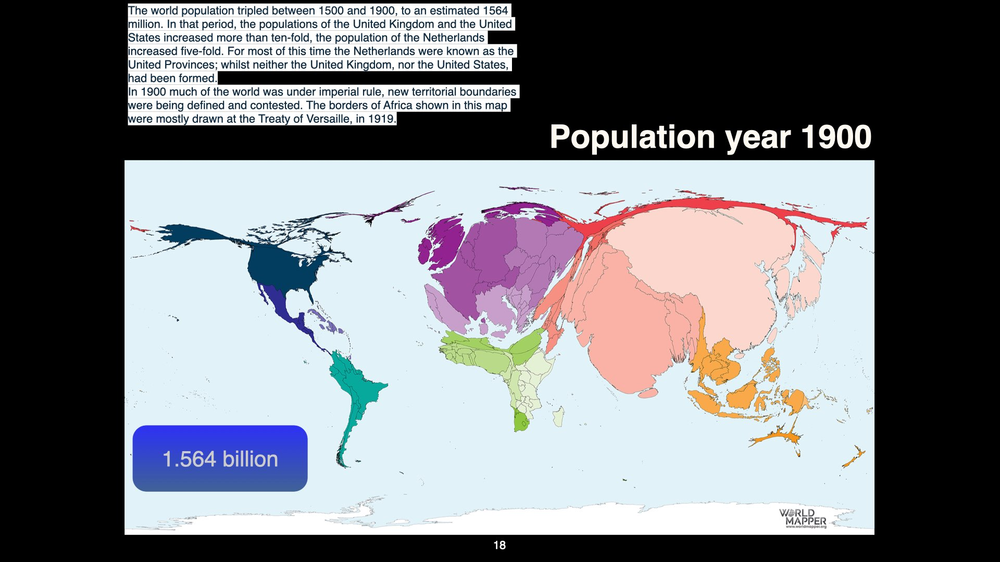

At the start of the previous century, in $1900$, there were $1.56$ billion people on the planet.

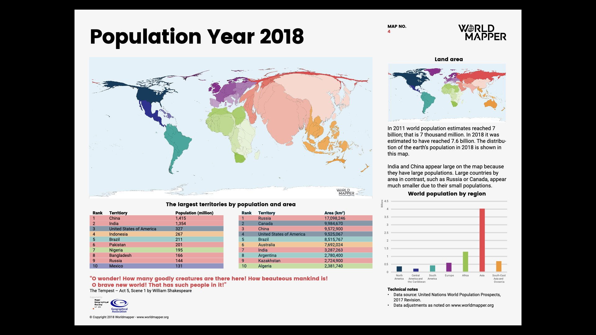

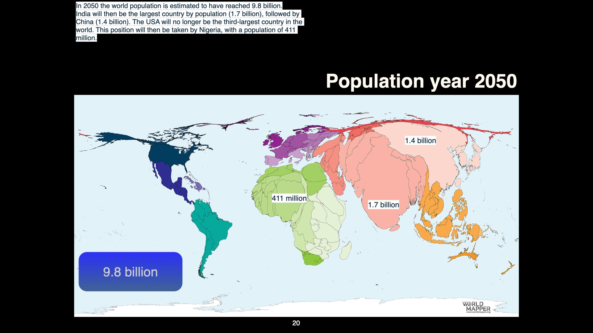

By $2050$, the world population is projected to approach $10$ billion, and much of the growth will be in Africa. Comparing the maps shows how Africa, previously relatively small, grows in population. Africa had about $1.5$ billion people in $2024$ and is projected to have about $2.5$ billion by $2050$ [@un2024world].

Why has Africa's population grown so rapidly? And can we explain this pattern?

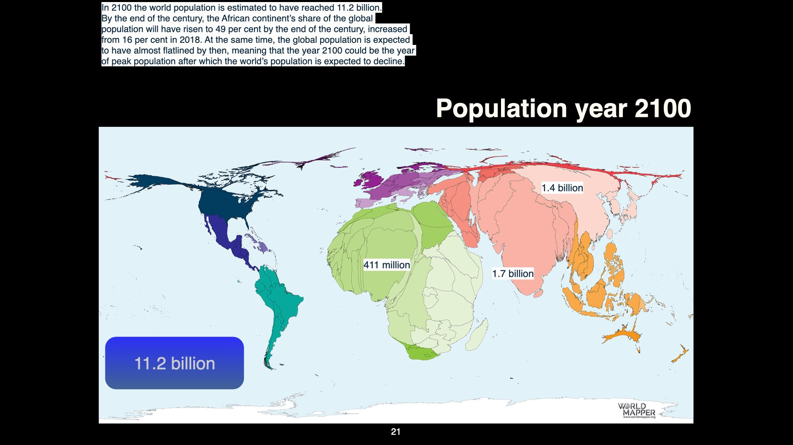

Extending to the year $2100$, Africa's population is projected to increase further, while Europe and North America are decreasing in size. Many countries, such as Canada, Australia, and New Zealand, now have negative population growth, while South Africa and some Southeast Asian countries experience continued growth.

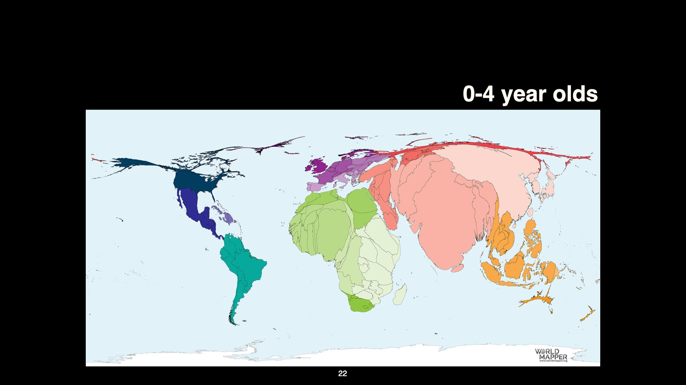

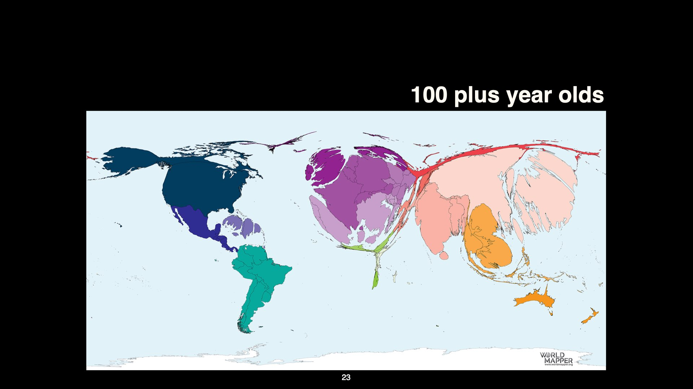

Examining demographics, Southeast Asia and Africa, regions experiencing rapid population growth, also have high proportions of very young people (aged $0$–$4$ years). These populations have fewer older people, while Northern Europe and North America have more elderly than young.

## Patterns of Poverty, Urbanisation, and Education

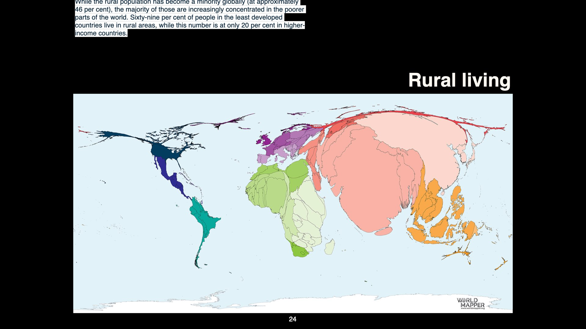

In Africa and Southeast Asia, most people still live in rural areas; urban development has not proceeded at the same pace as in Europe or North America. South Africa is an exception, with more people making their lives in cities, a trend that continues to generate environmental challenges.

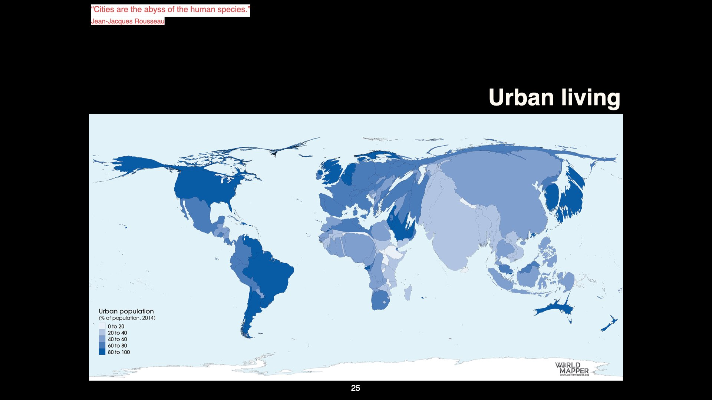

However, for much of Africa, people remain in rural settings. Industrial and urban development lags behind, and many areas remain undeveloped.

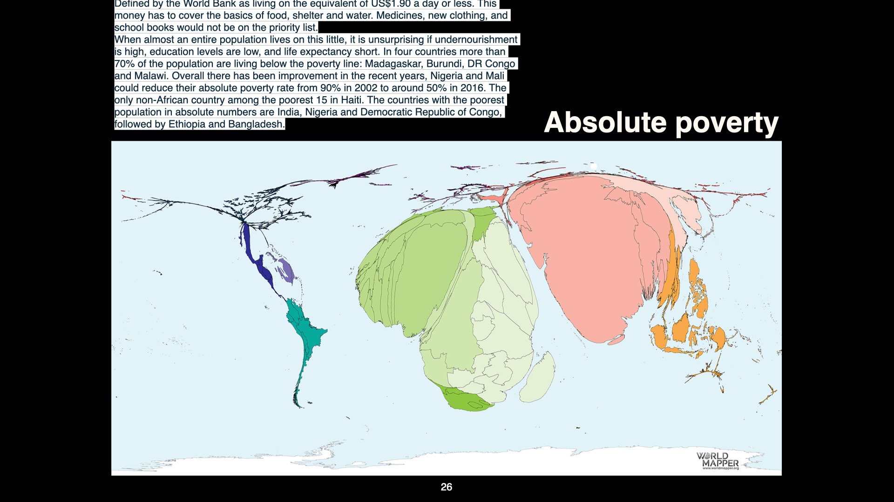

In Africa and Southeast Asia, the regions where population is growing most rapidly, the majority of people live in absolute poverty. The World Bank defines absolute poverty as income less than $1.9$ US dollars per day. Most people in these regions fall below this line.

Thus, the fastest-growing populations are also the poorest. This seems counterintuitive. If people are poor, why do they have more children?

## Education and Gender Disparity

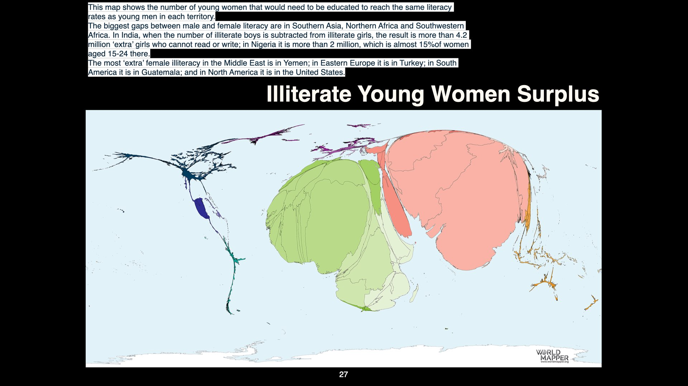

Another graph shows that the regions with high absolute poverty and high population growth also have the lowest education levels for women, compared to men. This is crucial: where women are uneducated, they tend to have more children. As education increases, women are empowered, and family size decreases.

But why is female education so much lower in these regions? This requires a deeper look.

## The Role of Religion and Historical Structure

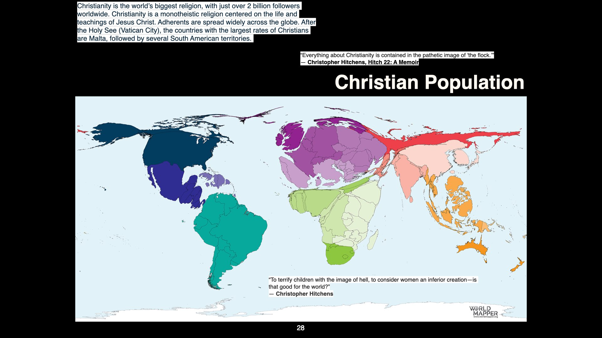

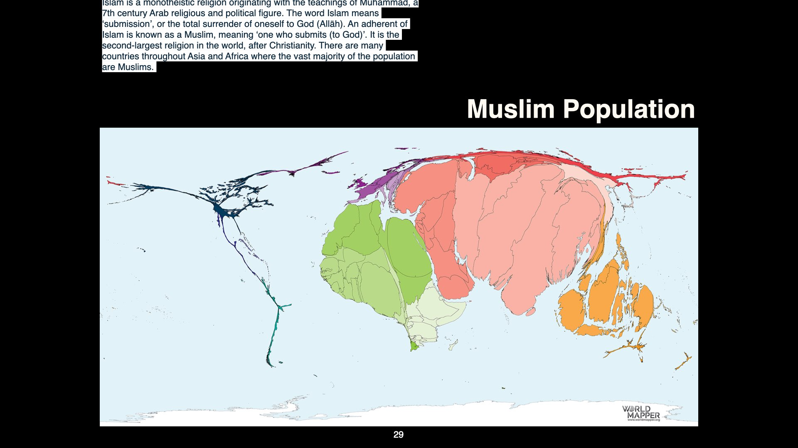

It is not the sole explanation, but religion plays a significant role. In large parts of Africa (particularly southern, sub-Saharan, and North Africa), Christianity is dominant, whilst in other areas, Islam has a major influence. Both Christianity and Islam, to varying degrees and in differing ways, have historically been associated with reduced access for women to education, sometimes through direct discouragement or outright prevention of female education. This disparity in education is, in my view, a central reason why population growth rates remain high in these regions.

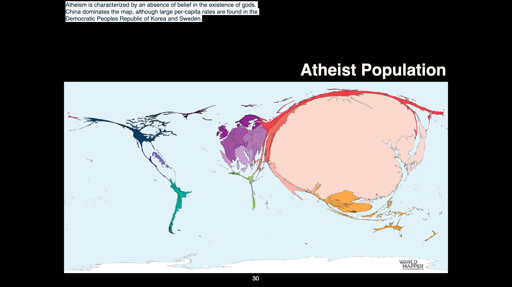

It is also interesting to look at regions in the world where religions are absent.

If you disagree or want to explore further, I encourage you to consult additional sources. As I always say, never take anything I say at face value; research and seek secondary sources.

Throughout history, many conflicts and ongoing strife in these regions have their roots in religious or cultural institutions, which more often than not have been sources of conflict rather than peace, prosperity, equality, or growth for all.

## Human Impact and the Industrial Revolution

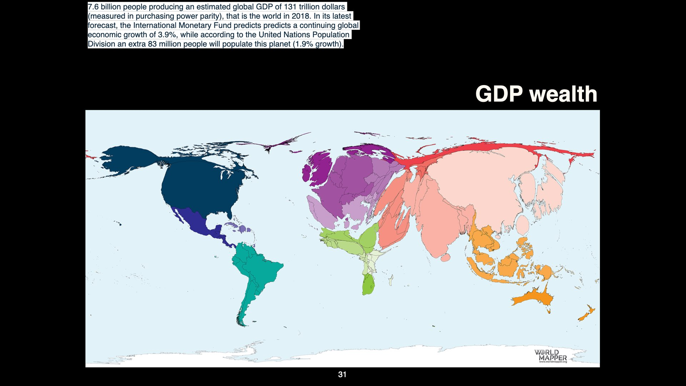

The reason for focusing so much on people is not to criticise religion, but to illustrate how having many people on the planet has created wide-ranging impacts on life on Earth. Whether we have too many people is a subject of much debate, and there is disagreement between people who make their argument on economic terms and those who make it on environmental terms.

Much of this began with the Industrial Revolution in North America and Europe, which led to the excessive combustion of fossil fuels. Coal, gas, and oil were consumed in vast quantities to grow the economies of these industrialised countries. This released excessive carbon dioxide into the atmosphere. Since the 1900s, the developed nations in the Global North have contributed the most, per capita, to climate change.

South Africa, although developing, is the most industrialised country in Africa, and it ranks among the world's top contributors to carbon emissions.

Countries that are now industrialising rapidly, such as those in Africa, North Africa, Saudi Arabia, the Middle East, China, Japan, and Southeast Asia, are increasing their carbon emissions at a faster rate than the Global North at present, as they attempt to close economic gaps.

## Trends in Carbon Emissions and Renewable Energy

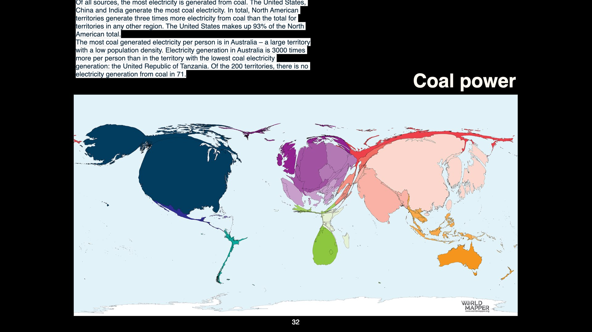

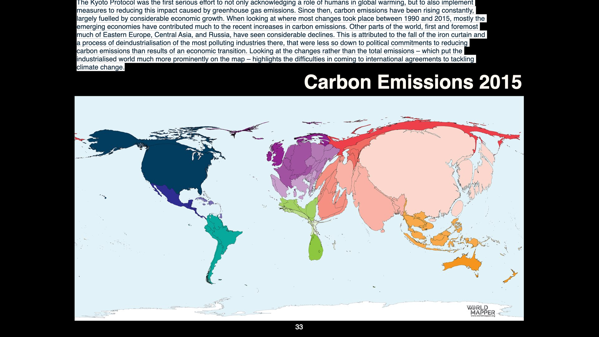

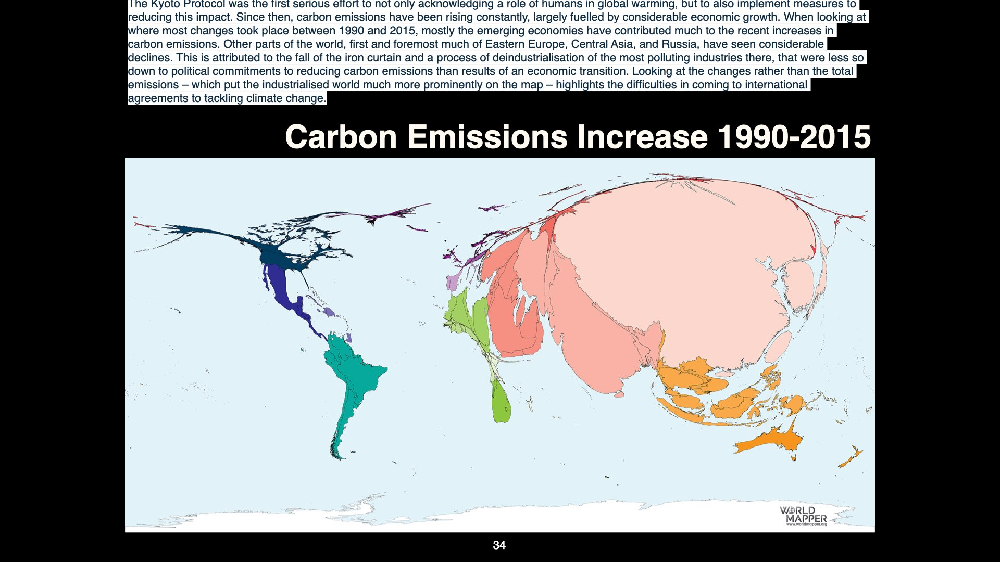

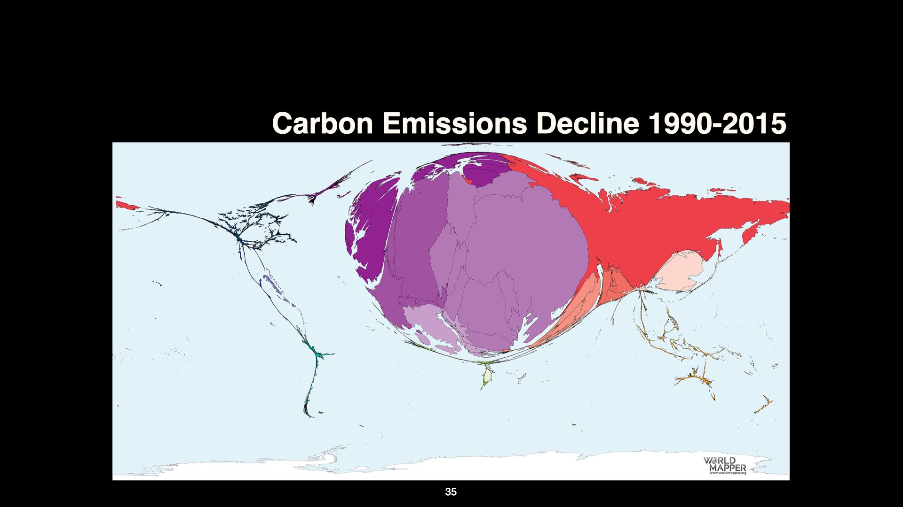

There has been a decline in Europe's carbon emissions, particularly among Scandinavian countries, which have shifted much of their energy supply to renewables. The United States has not decreased emissions as much, for various political reasons, yet still shows a downward trend.

## Healthcare and Environmental Disparities

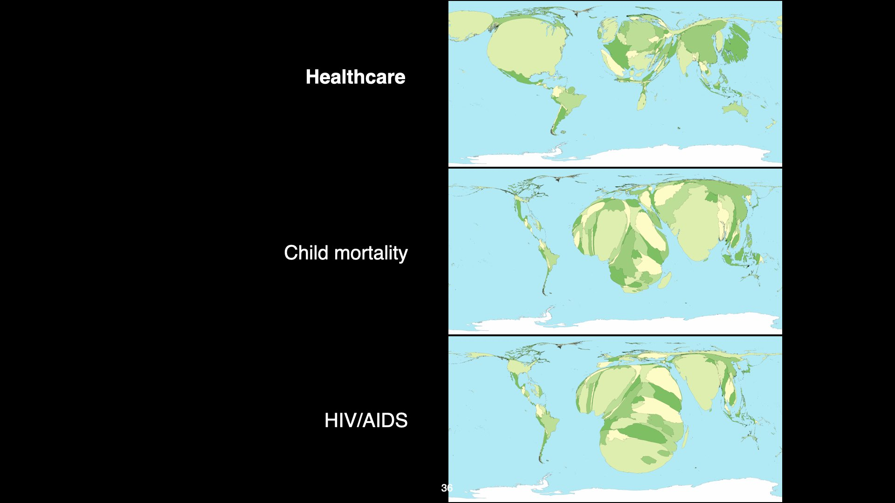

Poorer regions with the highest population growth have the lowest levels of healthcare, highest child mortality rates, and highest rates of HIV/AIDS.

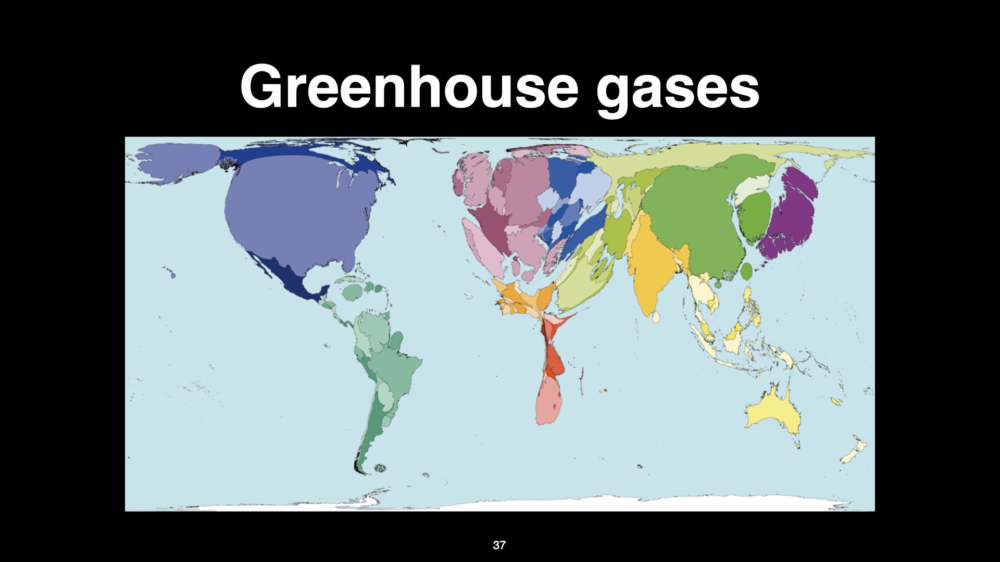

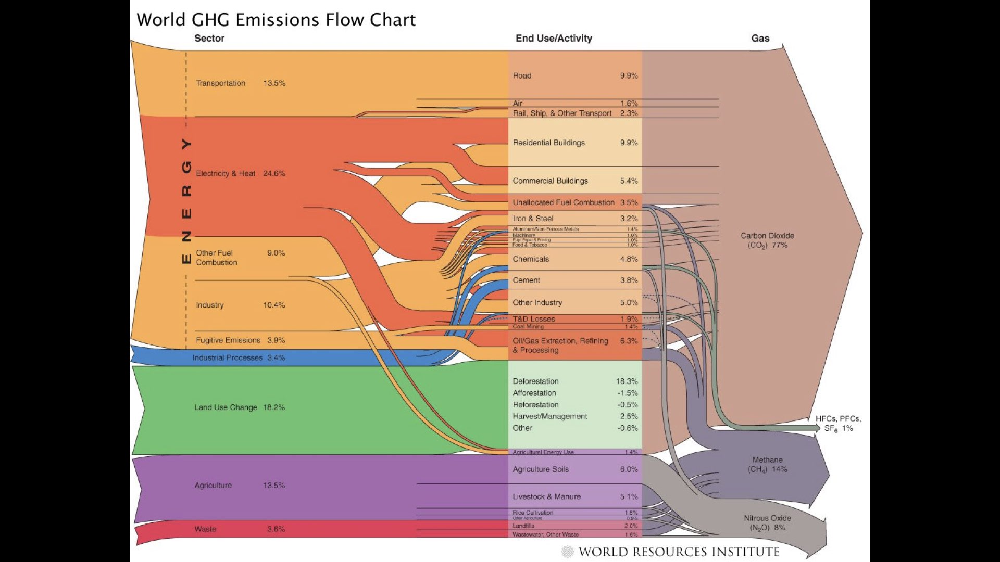

Greenhouse gas emissions remain highest in the most industrialised countries. Most carbon emissions originate from transportation, the generation of heat and electricity, industry, and other fuels. Land use changes, such as deforestation for agriculture, afforestation, reforestation and harvest management, can alter the flux of carbon dioxide.

Deforestation, in particular, leads to higher CO$_2$ emissions, as forests are important carbon sinks. Agriculture is also a significant contributor to emissions, not just via CO$_2$, but also due to methane ($\mathrm{CH}_4$) and nitrous oxide ($\mathrm{N}_2\mathrm{O}$), both potent greenhouse gases.

In developing countries, rapid population growth has meant that agriculture has expanded, leading to increased emissions of methane and nitrous oxide, often exacerbated by changes in land use. Waste recycling infrastructure is generally lacking, and more pollutants flow directly into the environment.

## Methane and Nitrous Oxide: Regional Patterns

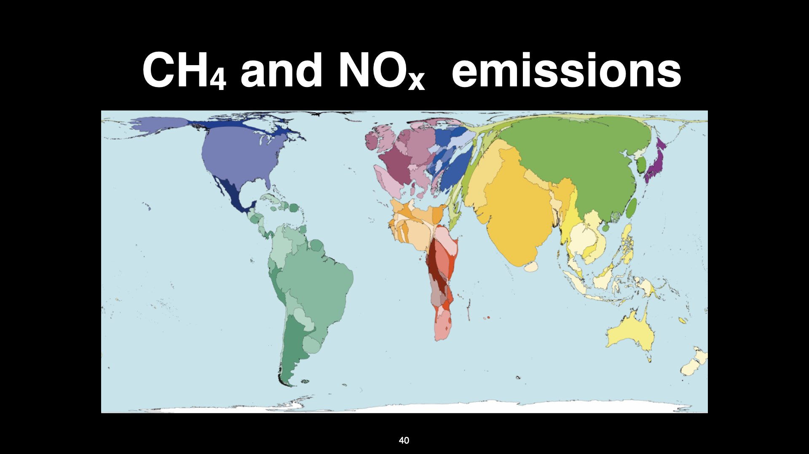

Looking at global patterns, Southeast Asia, South America, and China stand out for methane and nitrous oxide emissions. Livestock, mainly cattle, are the major methane source in South America. In Southeast Asia and China, the main sources are extensive rice farming (which under anaerobic conditions releases methane) and fertiliser use.

## Waste Management and Pollution

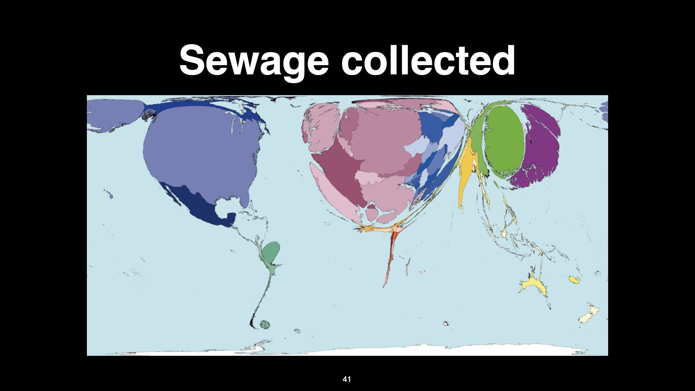

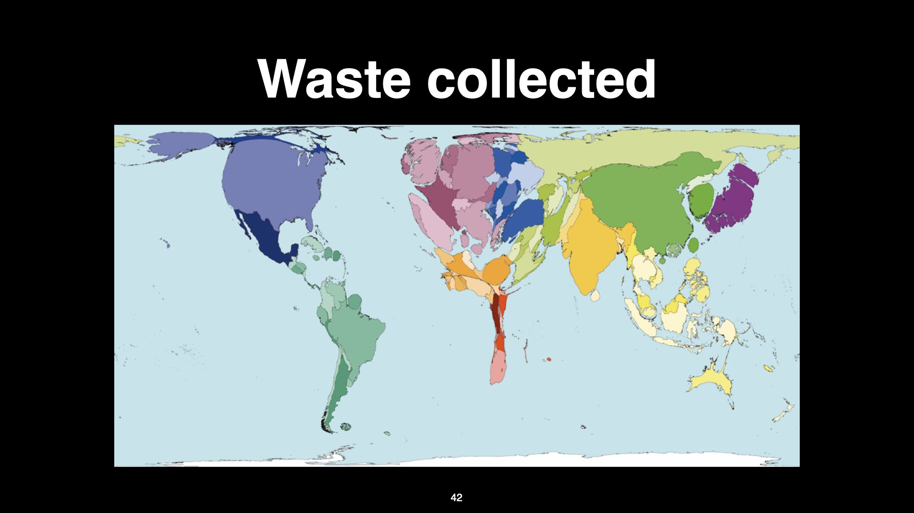

In the developing world (Africa and South America), most sewage is not collected, but instead flows directly into the environment, aggravating pollution. In contrast, Europe and North America invest substantially in infrastructure to treat and recycle waste, reducing environmental pollution.

## Undernourishment and Deforestation

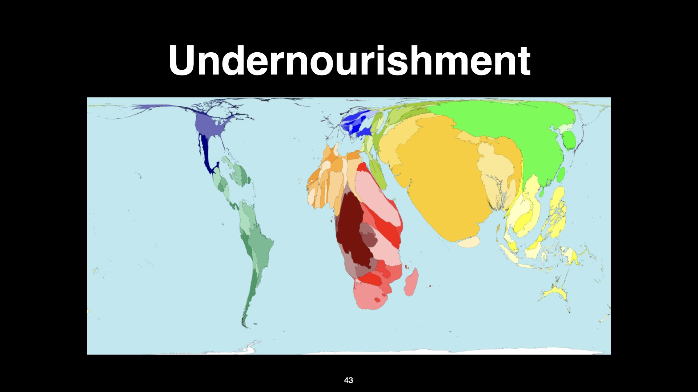

Undernourishment is highest in regions with the fastest population growth, due to a lack of resources to support large families. Again, this links back to poverty and education.

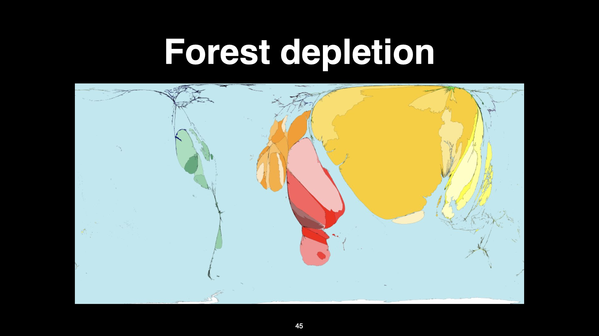

Deforestation is occurring rapidly in Southeast Asia, China, South Africa, North Africa, Brazil, Colombia, Panama, and elsewhere. Forests are cleared primarily for agriculture, agro-industry, expanding residential areas and cities, and, particularly in Africa, to supply fuelwood for heating and cooking.

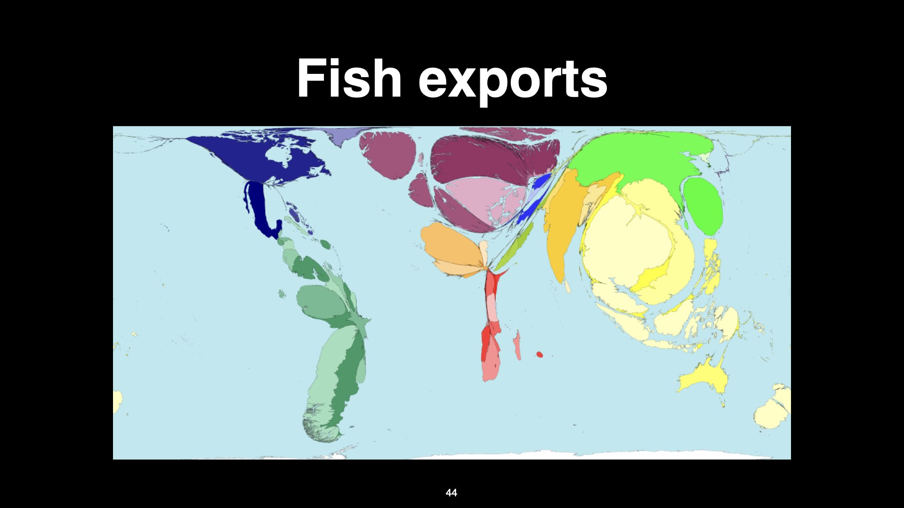

Sized by the value of fish exports, the map is dominated by Norway and other northern European countries, China and South-East Asia, Chile and Peru, and Canada. Most of Africa shrinks, apart from the southern African coast. Many of the large exporters harvest the productive coastal upwelling systems, such as the Humboldt Current off Chile and Peru and the Benguela Current off Namibia and South Africa, where wind-driven upwelling supplies the nutrients that support high phytoplankton production. Fish exports therefore move the products of marine primary production from these coasts to the countries that buy them.

## Science Research and GDP

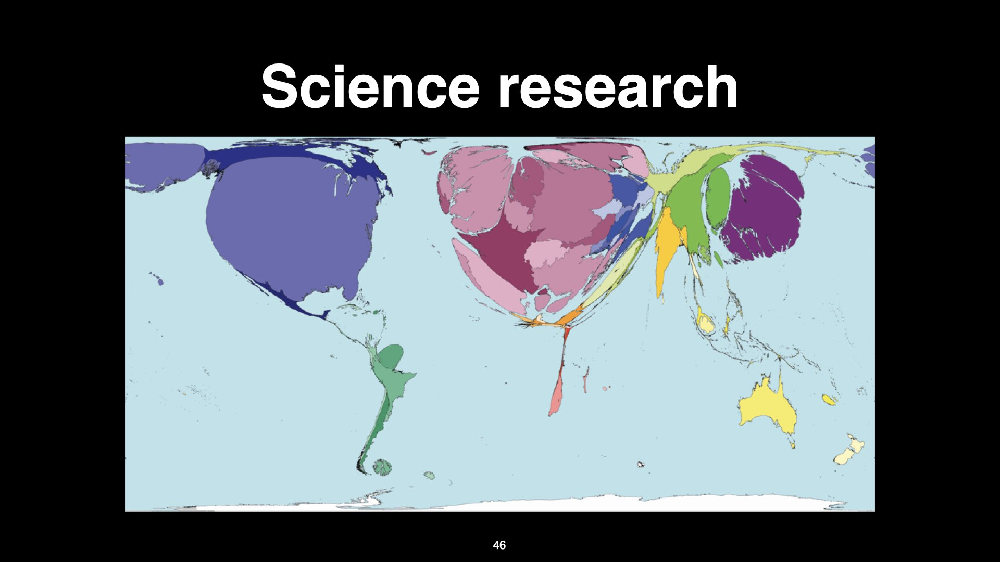

Scientific research is most intense in countries with the highest gross domestic product (GDP). South Africa is almost unique on the continent for its scientific output, but remains far behind countries in the Global North.

## Setting the Scene for the Module {#sec-planetary-boundaries}

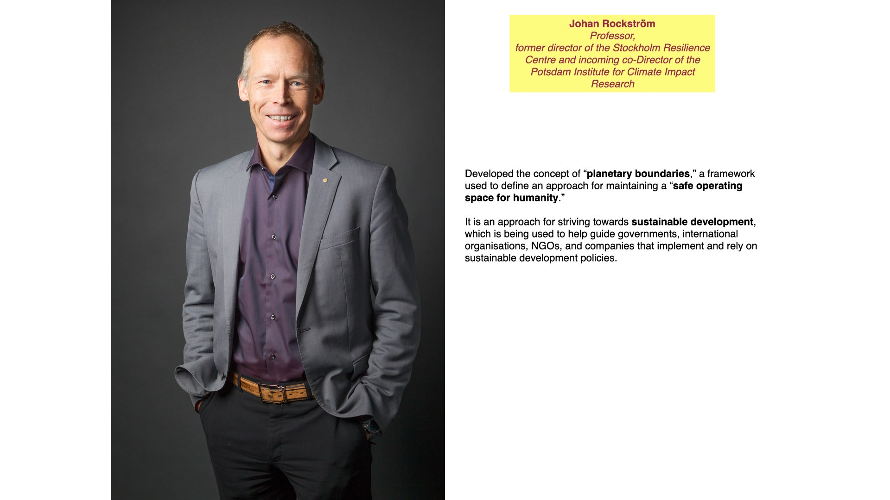

To prepare for the planetary boundaries lecture on Thursday, 8 October 2026, please read the paper "A Safe Operating Space for Humanity" by Johan Rockström and colleagues [@rockstrom2009safe]. I have posted the paper on iKamva; please have a look, as it discusses the boundaries that humanity must not exceed to maintain a habitable planet.

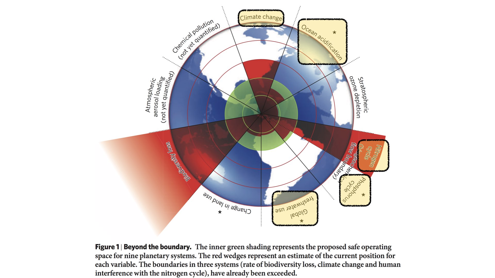

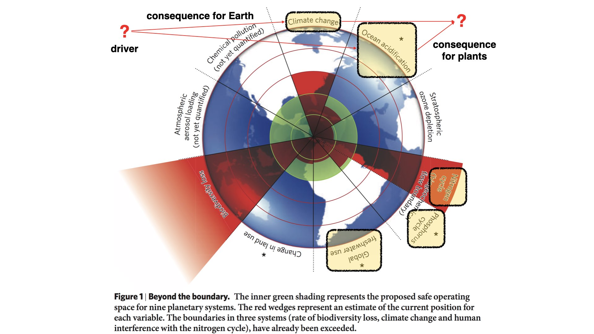

We have already described climate change in some detail, and its origins. The nitrogen and phosphorus cycles are also affected by waste management practices, and the safe limits for the nitrogen cycle have already been exceeded [@rockstrom2009safe; @richardson2023earth], moving us into dangerous territory there. The climate change boundary has also been crossed, and the greatest ongoing threat to the planet is biodiversity loss, which itself is a direct result of too many people, lack of education, and the other factors I have described.

## Looking Ahead

For the rest of the module, I will talk about climate change, ocean acidification, the nitrogen cycle, the phosphorus cycle, global freshwater use, and biodiversity loss. Each of these issues has major consequences for how stressed plants are within the environment, as human impacts on planetary boundaries indirectly produce the environmental stresses plants experience.

Thus, we will examine how plants perceive stress, the physiological and ecological effects of stress, and how plants cope with these challenges. That will be our focus for the rest of the module.

## Summary

-   Earth's position between Venus and Mars allows water to exist as liquid, ice and vapour, and this sets the limits, including a range of temperatures, within which life persists.
-   These limits have changed throughout Earth's history, but since the Industrial Revolution they have been changing at an accelerating rate, which is climate change.
-   Oceans cover 70.8% of Earth's surface, produce about 50% of the global supply of oxygen and moderate temperatures, so plant function has to be understood within the whole Earth system.
-   The human population grew from 1.56 billion in 1900 and is projected to approach 10 billion by 2050; Africa's population is projected to grow from about 1.5 billion in 2024 to about 2.5 billion.
-   The regions with the fastest population growth also have the highest absolute poverty, the lowest education levels for women, the poorest healthcare and the highest undernourishment.
-   People alter the atmosphere and the environment through fossil fuel combustion for transport, heat, electricity and industry, and through agriculture, land-use change, deforestation and untreated sewage.
-   Planetary boundaries define the safe operating space for humanity; the nitrogen cycle boundary has already been exceeded, and biodiversity loss is the greatest ongoing threat.
-   Exceeding the boundaries changes the environment in which plants grow, and so produces the stresses that plants experience, which is the focus of the rest of the module.

## Self-Test Questions

::: {.callout-note collapse="true"}
## 1. Why is Earth described as the "Goldilocks" planet?

Earth is the third planet from the Sun, between Venus and Mars. Venus is closer to the Sun and too hot, and Mars is further away and too cold. On Earth, water can exist as liquid, ice and vapour, which allows the hydrological cycle to operate and keeps temperatures within the range in which life can persist.
:::

::: {.callout-note collapse="true"}
## 2. Give three reasons from the lecture why the oceans matter for life on the rest of the planet.

The oceans cover 70.8% of Earth's surface. They produce about 50% of the global supply of oxygen. They maintain an even temperature gradient across the planet, so that without them Earth would be far hotter and daily temperature fluctuations would be much more extreme.
:::

::: {.callout-note collapse="true"}
## 3. What is a Worldmapper map, and what do the population maps show about Africa?

A Worldmapper map is a world map distorted so that the size of each region is proportional to some quantity, such as population, education level or carbon emissions per capita. In year 1 most people lived in Asia and Europe. Over the last 500 years Africa's population expanded rapidly, and the projections to 2100 show Africa growing further while Europe and North America shrink.
:::

::: {.callout-note collapse="true"}
## 4. The fastest-growing populations are also the poorest. Which explanation does the lecture give for this pattern?

The regions with high absolute poverty (income below 1.9 US dollars per day) and high population growth also have the lowest education levels for women compared with men. Where women are uneducated they tend to have more children; as education increases, women are empowered and family size decreases. The lecture proposes that historical restrictions on female education are a central reason why population growth rates remain high in these regions.
:::

::: {.callout-note collapse="true"}
## 5. Name the main sources of methane and nitrous oxide, and explain why they are high in South America, Southeast Asia and China.

Agriculture emits both gases, in addition to the CO₂ released when land is cleared for it. In South America the main methane source is livestock, mainly cattle. In Southeast Asia and China the main sources are extensive rice farming, which releases methane under anaerobic conditions, and fertiliser use.
:::

::: {.callout-note collapse="true"}
## 6. What is a planetary boundary, and what is the safe operating space for humanity?

A planetary boundary is a limit for an Earth-system process, such as climate change, the nitrogen cycle or biodiversity loss, that humanity must not exceed if Earth is to remain habitable [@rockstrom2009safe]. The safe operating space is the set of conditions within all the boundaries. The lecture notes that the safe limits for the nitrogen cycle have already been exceeded, that the climate change boundary has also been crossed, and that biodiversity loss is the greatest ongoing threat.
:::

::: {.callout-note collapse="true"}
## 7. Why does a module on plant ecophysiology begin with human impacts on the planet?

Plants cannot be separated from the Earth system: their light, water, nutrients, temperature and disturbance regimes are shaped by it, and increasingly by human activity. Exceeding the planetary boundaries, for example through climate change, ocean acidification and changes to the nitrogen and phosphorus cycles, changes the environment in which plants grow. Those changes produce the environmental stresses that plants experience, which the rest of the module examines.
:::

## Multiple-Choice Questions

Click an option to check your answer. A green tick marks the correct option, and its explanation then appears below the options.

::: {.mcq}
**1.** Which definition of a planetary boundary is most correct?

-   [A proposed limit for an Earth-system process, set to keep humanity within a safe operating space.]{.correct}
-   A physiological tolerance limit describing the most extreme conditions one plant species can endure.
-   A measured threshold beyond which every ecosystem on Earth collapses immediately and irreversibly.
-   A geographical border separating regions with different climates, soils and dominant vegetation.

::: {.mcq-explain}
Planetary boundaries are proposed limits for Earth-system processes such as climate change and the nitrogen cycle. They describe a safe operating space for humanity; they are not species tolerances, map borders or points of certain, immediate collapse.
:::
:::

::: {.mcq}
**2.** Which statement best describes the safe operating space for humanity?

-   The conditions in which atmospheric CO₂ alone remains below its pre-industrial concentration.
-   The conditions in which at least one Earth-system process remains below its boundary value.
-   The conditions in which human population growth and economic growth both remain near zero.
-   [The conditions in which all Earth-system processes remain within their proposed boundaries.]{.correct}

::: {.mcq-explain}
The safe operating space is defined by all the boundaries together. Staying within one boundary while crossing others does not keep the Earth system in the safe space, and the framework is not about population or economic growth as such.
:::
:::

::: {.mcq}
**3.** A planetary boundary is described as crossed. Which interpretation is least wrong?

-   The process can no longer change further, because it has reached its largest physical value.
-   [The risk of destabilising the Earth system has increased, although the outcome is not certain.]{.correct}
-   Every ecosystem affected by that process has already collapsed well beyond any possible recovery.
-   The boundary has stopped applying, so the other processes no longer need to be considered.

::: {.mcq-explain}
The boundaries are set at a precautionary distance from dangerous thresholds. Crossing one raises the risk of large-scale, possibly abrupt change; it does not mean that collapse has already happened, and the processes interact, so the other boundaries still matter.
:::
:::

::: {.mcq}
**4.** According to Richardson et al. (2023), which statement about the planetary boundaries is most correct?

-   [Six of the nine boundaries had been crossed, and the risk of destabilisation was increasing.]{.correct}
-   Only the climate change boundary had been crossed; all other processes remained in safe limits.
-   All nine boundaries had been crossed, so the safe operating space no longer exists at all.
-   None of the nine boundaries had been crossed, although several were approaching their limits.

::: {.mcq-explain}
Richardson et al. (2023) assessed six of the nine boundaries as transgressed. (A later assessment in 2025 added ocean acidification, making seven.)
:::
:::

::: {.mcq}
**5.** Why does the lecture stress that water exists on Earth as liquid, ice and vapour?

-   Water vapour is the only greenhouse gas, so its presence alone sets the temperature of Earth.
-   Ice reflects all incoming sunlight, so polar ice alone prevents Earth from overheating at noon.
-   Only liquid water can store heat, so ice and vapour play no part in regulating climate on Earth.
-   [All three phases allow a hydrological cycle that moves water and heat around the whole planet.]{.correct}

::: {.mcq-explain}
Evaporation, condensation, freezing and melting move water and heat around the planet. This hydrological cycle depends on all three phases being present, which in turn depends on Earth's temperature range.
:::
:::

::: {.mcq}
**6.** Liquid water exists between 0 and 100 °C at sea level. Which statement about the temperature range of active life is most correct?

-   Active life occurs mostly below 0 °C, because ice crystals protect enzymes from thermal damage there.
-   [Active life is limited to a narrower subset, because proteins and membranes fail at the extremes.]{.correct}
-   Active life occurs mostly above 100 °C, because high pressure in cells prevents water boiling.
-   Active life spans the full range, because liquid water is the only requirement for metabolism.

::: {.mcq-explain}
Liquid water is necessary but not sufficient. Most organisms function only within a narrower part of that range, because enzymes, membranes and other structures fail at the extremes.
:::
:::

::: {.mcq}
**7.** On a Worldmapper population cartogram, a country appears much larger than on an ordinary map. What does this show?

-   Its population density is lower than the average density of all the countries shown.
-   Its land area has been measured more accurately than the land areas of all the other countries.
-   Its population has grown faster than every other country over the last hundred years.
-   [Its share of the world's population is larger than its share of the world's land area.]{.correct}

::: {.mcq-explain}
A cartogram resizes each territory in proportion to the quantity mapped, here population. A territory that grows relative to the ordinary map holds a larger share of the population than of the land.
:::
:::

::: {.mcq}
**8.** A cartogram of total CO₂ emissions shows a populous country as very large. Which conclusion is justified?

-   Each person in that country emits more CO₂ than the average person in every other country.
-   [That country produces a large share of global emissions, whatever its emissions per person.]{.correct}
-   That country emits mainly methane and nitrous oxide, rather than carbon dioxide from fuel.
-   That country's emissions are growing faster than those of any other country shown on the map.

::: {.mcq-explain}
A map of totals cannot reveal emissions per person. A populous country can be a large total emitter with low emissions per capita, which is why per-capita and total emissions must be distinguished.
:::
:::

::: {.mcq}
**9.** Which statement about historical and current emissions is most consistent with the lecture?

-   [The Global North has emitted the most per person since 1900; industrialising emissions now rise fastest.]{.correct}
-   The Global North now emits nothing, so all current emissions come from industrialising countries.
-   Industrialising countries have emitted the most per person since 1900, and their rates now fall.
-   All countries have emitted equally per person since 1900, so present differences reflect only land area.

::: {.mcq-explain}
The Global North has contributed most per capita since the Industrial Revolution, while emissions in rapidly industrialising countries are currently increasing fastest.
:::
:::

::: {.mcq}
**10.** Which definition of absolute poverty, as used by the World Bank, is most correct?

-   Income lower than that of the richest tenth of households in the same region or province.
-   [Income below a fixed threshold, such as 1.9 US dollars per day, whatever other people earn.]{.correct}
-   Income below half the average income of the country in which the household happens to live.
-   Income that has fallen below the household's own previous level for at least two consecutive years.

::: {.mcq-explain}
Absolute poverty uses a fixed threshold of income needed for basic needs. Relative poverty, in contrast, compares a household with others in the same society.
:::
:::

::: {.mcq}
**11.** Maps show that regions with low female education also have high population growth. Which interpretation is most careful?

-   The maps prove that female education alone causes lower fertility in every one of the regions shown.
-   The maps prove that high population growth alone prevents girls from attending school.
-   [The maps show the two patterns coincide; testing a causal link requires further evidence.]{.correct}
-   The maps show the two patterns are unrelated, because both vary across the same regions.

::: {.mcq-explain}
Maps of co-occurring patterns show association. The lecture proposes a causal link from education to family size, but establishing it requires evidence that separates education from poverty, healthcare and other factors that vary together.
:::
:::

::: {.mcq}
**12.** A population has a large proportion of people aged 0 to 4 years. Which prediction is most correct?

-   Its total size will depend only on migration, because birth rates no longer matter there.
-   Its total size will fall soon, because young children cannot yet contribute to births.
-   Its total size will stay constant, because births and deaths are equal in young populations.
-   [Its total size will keep growing for decades, even if family size falls in the near future.]{.correct}

::: {.mcq-explain}
Many young people will reach reproductive age in the coming decades. Even if each family has fewer children, the number of parents rises, so the population keeps growing for a time.
:::
:::

::: {.mcq}
**13.** Why do flooded rice paddies release methane?

-   [Microbes decompose organic matter in waterlogged soil, where oxygen is scarce and CH₄ forms.]{.correct}
-   Fertiliser nitrogen reacts directly with irrigation water to produce methane at the surface.
-   Rice leaves synthesise methane in the light as a by-product of carbon fixation inside the leaf.
-   Sunlight splits carbon dioxide in the standing water, releasing methane into the atmosphere.

::: {.mcq-explain}
Water fills the soil pores and oxygen is used up, so decomposition becomes anaerobic. Methane-producing microbes (methanogens) then release CH₄, which is why the lecture links rice farming to anaerobic conditions.
:::
:::

::: {.mcq}
**14.** Which definition of a carbon sink is most correct?

-   [A reservoir that takes up more carbon than it releases over a stated period of time.]{.correct}
-   Any reservoir that contains a large amount of carbon, whatever its exchange with the air.
-   Any reservoir that contains carbon in organic form, rather than as carbonate or gas.
-   A reservoir that releases more carbon than it takes up over a stated period of time.

::: {.mcq-explain}
A sink is defined by its net flux, not by its size. A large store can be a sink, neutral or a source depending on whether uptake exceeds release over the period considered.
:::
:::

::: {.mcq}
**15.** Clearing a forest for agriculture increases atmospheric CO₂. Which explanation is most complete?

-   Clearing changes only albedo, so its effect on CO₂ depends entirely on the colour of the crop.
-   Clearing releases stored carbon, but uptake of CO₂ by the remaining landscape becomes larger.
-   [Clearing releases stored carbon and also removes vegetation that was taking up CO₂ from the air.]{.correct}
-   Clearing removes vegetation taking up CO₂, but none of the carbon stored in it ever reaches the air.

::: {.mcq-explain}
Deforestation acts twice: burning and decay return stored carbon to the atmosphere, and the cleared land no longer takes up as much CO₂ as the forest did.
:::
:::

::: {.mcq}
**16.** The lecture states that the oceans produce about half of the global supply of oxygen. Which process accounts for this?

-   Evaporation of seawater, which releases dissolved oxygen from the ocean into the atmosphere.
-   Breaking waves, which split water molecules into hydrogen and oxygen gas at the sea surface each day.
-   [Photosynthesis by phytoplankton and other marine primary producers in the sunlit surface ocean.]{.correct}
-   Respiration by marine animals, which converts dissolved carbon dioxide into free oxygen.

::: {.mcq-explain}
Oxygen is produced by photosynthesis. In the ocean, phytoplankton and other primary producers in the sunlit surface layer split water and release O₂.
:::
:::

::: {.mcq}
**17.** Why do the oceans moderate temperatures across the planet?

-   The ocean floor conducts heat from Earth's interior, which balances the sunlight at the surface.
-   Seawater absorbs no sunlight, so the ocean surface stays at a constant temperature throughout the year.
-   [Water has a high heat capacity, and ocean currents redistribute the heat it stores around Earth.]{.correct}
-   Salt in seawater releases heat as it dissolves, warming the poles in winter by a fixed amount.

::: {.mcq-explain}
Water warms and cools slowly because of its high heat capacity, and currents carry heat from the tropics towards the poles. Together these moderate seasonal and daily temperature changes.
:::
:::

::: {.mcq}
**18.** On a cartogram of fish exports, Chile and Peru appear large. Which explanation links this to primary production?

-   Warm, nutrient-poor water lies at the surface, which keeps phytoplankton production low but stable.
-   River floods carry freshwater to the coast, which lowers salinity and increases fish numbers there.
-   Ice cover protects the coastal water from wind and waves, which allows phytoplankton to accumulate there.
-   [Wind-driven upwelling brings nutrient-rich water to the surface, supporting high phytoplankton production.]{.correct}

::: {.mcq-explain}
Coastal upwelling, as in the Humboldt and Benguela systems, supplies nutrients to the sunlit surface. The resulting high primary production supports the fisheries whose products are exported.
:::
:::

::: {.mcq}
**19.** Untreated sewage flows directly into rivers and the sea. Which planetary boundary does this affect most directly?

-   Atmospheric aerosol loading, because airborne sewage droplets scatter sunlight over coastal regions.
-   [Biogeochemical flows of nitrogen and phosphorus, because sewage adds nutrients to water bodies.]{.correct}
-   Land-system change, because sewage converts forest directly into cropland near the outfall.
-   Stratospheric ozone depletion, because sewage releases chlorine compounds into the upper air.

::: {.mcq-explain}
Sewage is rich in nitrogen and phosphorus. Adding these nutrients to rivers and coastal waters contributes to eutrophication, which falls under the biogeochemical flows boundary.
:::
:::

::: {.mcq}
**20.** Why does a module on plant ecophysiology begin with planetary boundaries?

-   Plants are unaffected by the boundaries, so they provide a stable baseline for comparison.
-   The boundaries were defined using plant data alone, so they describe only plant physiology.
-   [Crossing the boundaries changes the conditions in which plants grow, which produces plant stress.]{.correct}
-   The boundaries set the optimum temperature of photosynthesis for every single plant species on Earth.

::: {.mcq-explain}
Climate change, altered nutrient cycles, freshwater change and the other processes alter light, temperature, water and nutrient supply. These changes are experienced by plants as stress, which the rest of the module examines.
:::
:::

## References

::: {#refs}
:::
