::: callout-tip
## This Lecture Is Accompanied by the Following Lab

-   [Lab 1: Surface Area to Volume (SA/V) Ratios in Biology](Lab1_SA_V.qmd)
:::

::: callout-tip
## **Content**

-   Surface area to volume ratio as a geometric constraint.
-   Fick's first law: the effects of size, shape, diffusion distance and mass diffusivity on exchange.
-   Links between exchange surfaces, resource demand, storage and support.
-   The Littler seaweed studies and the seagrass functional form model as the main teaching examples.
-   Similar functional relationships within and between terrestrial plant groups.
:::

::: callout-tip
## **Aims**

This lecture explains how surface area to volume ratio affects the way plants and algae function. The studies by Littler and colleagues on seaweeds, followed by the functional form comparisons in seagrasses, are our main teaching examples. We will use them to connect geometry with resource acquisition, tissue turnover and persistence, then examine similar relationships within and between hornworts, liverworts, mosses, ferns, gymnosperms and angiosperms. [Lecture 3: Photosynthetic Evolution](L03-photosynthetic-evolution.qmd) examines how particular structures arose and diversified in different lineages and environments.
:::

::: callout-tip
## **Learning Outcomes**

By the end of this lecture, you will be able to:

1.  Define SA:V, state its units, and predict how it changes with size and shape.
2.  Distinguish the surface and volume of a cell, organ and whole organism when making a functional comparison.
3.  Use Fick's first law to explain how exchange area, concentration gradient and mass diffusivity affect resource supply, distinguishing factors that change diffusivity from those that change diffusion distance.
4.  Relate SA:V to light capture, gas exchange, water and nutrient acquisition, thermal balance, storage and support.
5.  Interpret the Littler seaweed studies and the seagrass functional form model in terms of resource acquisition, tissue turnover and persistence.
6.  Apply the same broad relationships within and between terrestrial plant groups, specifying the organ or tissue being compared.
7.  Identify the additional information needed to predict physiological performance from morphology.
:::

::: callout-note
## **Required Reading**

-   [Littler, M. M., & Littler, D. S. (1980). The evolution of thallus form and survival strategies in benthic marine macroalgae: field and laboratory tests of a functional form model. The American Naturalist, 116(1), 25–44.](../docs/Littler%20and%20Littler%20(1980).pdf)
-   [Littler, M. M. (1980). Morphological form and photosynthetic performances of marine macroalgae: tests of a functional/form hypothesis. Botanica Marina, 23(3), 161–165.](../docs/Littler%20(1980b).pdf)
-   [Littler, M. M., & Arnold, K. E. (1982). Primary productivity of marine macroalgal functional-form groups from southwestern North America. Journal of Phycology, 18(3), 307–311.](../docs/Littler%20and%20Arnold%20(1982).pdf)
:::

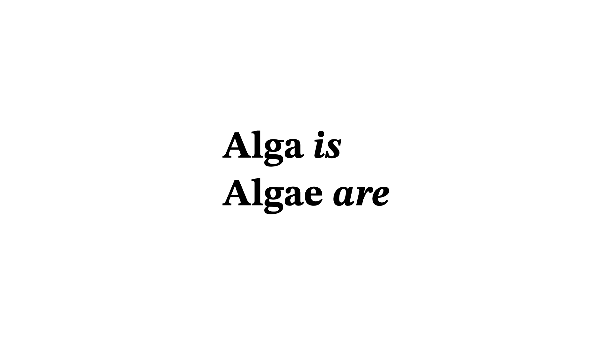

## Surface area, volume and function

A thin leaf exposes a large surface relative to the tissue inside it. A thick storage organ contains much more tissue behind each unit of exposed surface. These differences affect the movement of materials and heat, and the amount of light available to photosynthetic tissue. We can use SA:V to make predictions about those functions, provided we specify the structure and the conditions being compared.

**Surface area to volume ratio (SA:V)** is the area of a specified surface divided by the volume it encloses. If area is measured in cm² and volume in cm³, the ratio has units of cm⁻¹. A high value means that much surface is available per unit volume. It does not necessarily mean that the organism has a large total surface area.

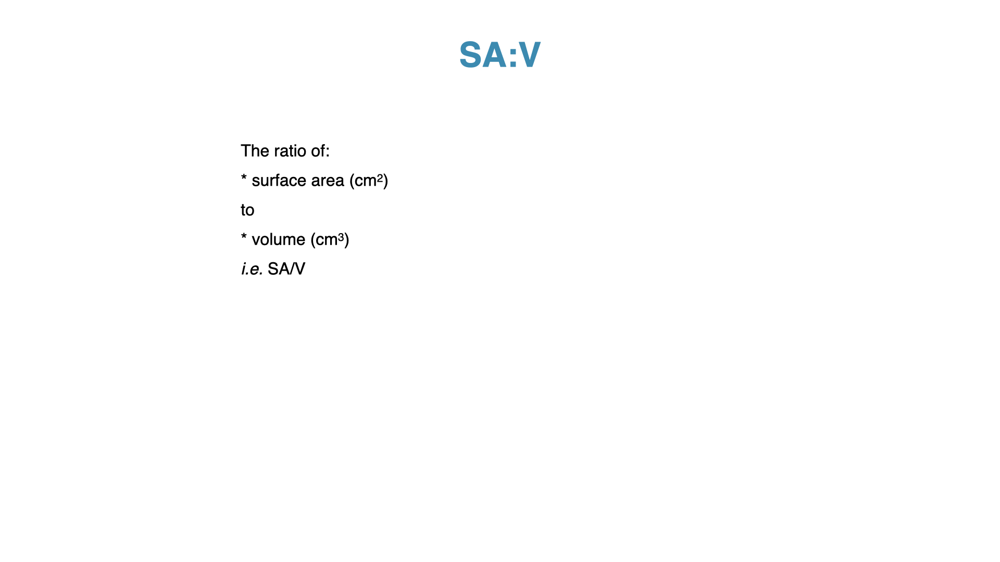

### Size and shape {#sec-sa-v-geometry}

When a body increases in size while retaining the same shape and proportions, its surface area increases with the square of a linear dimension and its volume with the cube. For a sphere of radius $r$,

$$
A=4\pi r^2,\qquad V=\frac{4}{3}\pi r^3,\qquad \frac{A}{V}=\frac{3}{r}.
$$

Doubling the radius gives four times the surface area and eight times the volume. SA:V halves. **The assumption of unchanged shape and proportions matters.** A blade can grow wider while retaining the same thickness, and a filament can lengthen while retaining the same radius.

For a long cylinder, ignoring its ends, $A/V\approx2/r$. For a broad, thin sheet, ignoring its edges, $A/V\approx2/t$, where $t$ is thickness. Lengthening the cylinder or widening the sheet adds surface and volume in approximately the same proportion. Thickening either structure reduces its SA:V.

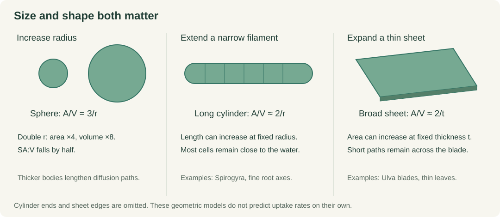{#fig-sa-v-geometry fig-alt="A sphere has SA:V of 3 divided by radius, a long cylinder approximately 2 divided by radius, and a thin sheet approximately 2 divided by thickness."}

[Lab 1](Lab1_SA_V.qmd) explores these relationships by changing size and shape separately. Keep track of what is held constant in each comparison, especially when an object is flattened without changing its volume.

### Which surface and which volume?

A tree has thick supporting axes, thin leaves and fine absorbing roots. The trunk has a low external SA:V, but that tells us little about the exchange surfaces of its leaves or roots. Much of the trunk's volume is also dead supporting tissue, whereas living cells require a continuing supply of resources. Volume is therefore a useful approximation of demand only when tissue composition and activity are comparable.

A leaf has an external surface and an internal surface where cells contact air spaces. Roots have surfaces in contact with the soil solution. For light interception, the area presented to incoming light matters. Specify the surface relevant to the process before calculating a ratio or comparing organisms.

## Exchange depends on area and distance {#sec-sa-v-exchange}

### Fick's first law {#sec-ficks-law}

A large exchange surface can increase the total transfer of a substance, but the rate across each unit of surface also matters. **Fick's first law** relates diffusive flux density to the concentration gradient. For diffusion along one spatial direction in a dilute medium,

$$
J_x=-D\frac{\mathrm{d}C}{\mathrm{d}x}.
$$

| Symbol | Meaning | SI units |
|---|---|---|
| $J_x$ | Net amount crossing a unit area per unit time in the $x$ direction: diffusive flux density. | mol m⁻² s⁻¹ |
| $D$ | Mass diffusivity, also called the molecular diffusion coefficient, for a substance in a specified medium. | m² s⁻¹ |
| $C$ | Amount of substance per unit volume: concentration. | mol m⁻³ |
| $x$ | Distance along the diffusion path. | m |
| $\mathrm{d}C/\mathrm{d}x$ | Change in concentration per unit distance: concentration gradient. | mol m⁻⁴ |

The minus sign means that net diffusion is towards lower concentration. Molecules move in both directions, but their net movement is down the gradient. Here concentration is expressed as amount per volume; using mass per volume instead gives a mass flux. See the [IUPAC definition of the diffusion coefficient](https://goldbook.iupac.org/terms/view/D01719).

Across a uniform layer of thickness $L$, with constant $D$ and an approximately linear concentration profile, the **magnitude** of the flux density is

$$
J\approx D\frac{\Delta C}{L},
$$

where $\Delta C$ is the higher concentration minus the lower concentration. The gradient depends on both this difference and the distance over which it occurs. Multiplying a uniform flux density by the effective exchange area $A$ gives the total transfer rate, $Q\approx AJ$, in mol s⁻¹. For a body with volume $V$,

$$
\frac{Q}{V}\approx\frac{A}{V}D\frac{\Delta C}{L}.
$$

This expresses the functional importance of SA:V. **With the other terms held constant, more exchange area per unit volume permits a greater transfer rate per unit volume.** A high SA:V offers little benefit if the surrounding water contains almost no nutrient, a surface is impermeable, or neighbouring tissues prevent it from contacting the external medium.

### What affects mass diffusivity? {#sec-mass-diffusivity}

The value of $D$ depends on the diffusing substance, its medium and the physical conditions. It describes molecular mobility within that medium.

| Factor | Expected effect on $D$, with other conditions held constant |
|---|---|
| Temperature | Warming generally increases $D$. In water, warming also reduces viscosity. |
| Viscosity of a liquid | Greater viscosity reduces molecular mobility and usually lowers $D$. |
| Molecular size and interactions | A larger effective molecular radius generally lowers $D$ in the same liquid. Shape and interactions with the solvent also matter. |
| Medium | Gases such as CO₂ and O₂ diffuse much faster through air than through water. Use the coefficient for the relevant substance–medium pair. |
| Pressure | In dilute gases at fixed temperature, increasing pressure lowers $D$, approximately as $D\propto1/P$. This gas relationship should not be applied to liquids. |

For an approximately spherical particle in a dilute liquid suspension, the **Stokes–Einstein relationship** illustrates the temperature, viscosity and size effects:

$$
D\approx\frac{k_{\mathrm B}T}{6\pi\eta r_{\mathrm h}},
$$

where $k_{\mathrm B}$ is Boltzmann's constant, $T$ is absolute temperature in kelvin, $\eta$ is dynamic viscosity, and $r_{\mathrm h}$ is the effective hydrodynamic radius. This radius describes how the particle moves through the solvent; molecular mass alone does not determine it. The equation is an approximation, especially for small molecules comparable in size to the solvent molecules. Use measured diffusivities for quantitative biological predictions. [IUPAC: Stokes–Einstein equation](https://goldbook.iupac.org/terms/view/12260).

In tissues or sediments, an **effective diffusivity** can account for restricted pore space and winding paths, or *tortuosity*. It differs from the molecular diffusivity in free water. Membrane permeability also depends on entry into and passage through the membrane; a solute's $D$ in water alone cannot predict transport across it. [Further explanation of diffusivity in fluids and porous media](https://www.comsol.com/multiphysics/diffusion-coefficient).

### Diffusion distance and moving water

Diffusion also takes longer over greater distances. The characteristic time increases with the square of the distance: $\tau\approx L^2/(2D)$ for a simple one-dimensional estimate. With an illustrative $D=10^{-9}$ m² s⁻¹, diffusion across 10 µm takes about 0.05 s, compared with about eight minutes across 1 mm and fourteen hours across 1 cm. These estimates describe a small dissolved molecule in an idealised medium. Membranes and tissue structure introduce additional restrictions in a plant.

The **boundary layer** is the region next to a surface where fluid movement is slowed. Within the thin diffusive part of this layer, movement of dissolved substances depends mainly on diffusion. Water motion around a seaweed or air movement around a leaf changes that transport environment. The same SA:V can therefore be associated with different exchange rates under different flow conditions.

For an *Ulva* blade, faster water movement can thin the diffusive boundary layer and replenish nutrients nearby. This can increase transfer by shortening $L$ or maintaining $\Delta C$, without changing molecular $D$ at the same temperature and water composition. Doubling exposed area increases total transfer $Q$, while halving $L$ doubles flux density $J$ if the other terms remain constant. Warming the water can change $D$ itself. These are distinct ways of changing the supply to the same thallus.

## Ecophysiological processes affected by SA:V

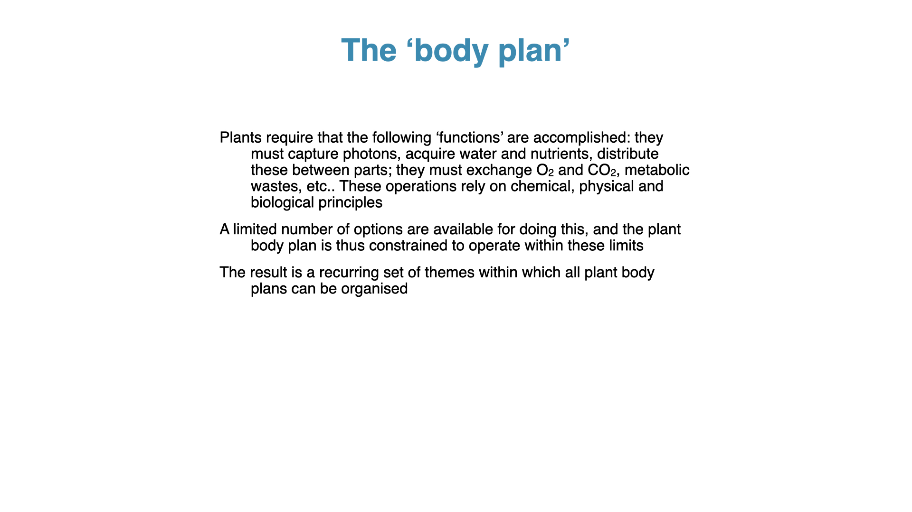

Plants need light and inorganic carbon for photosynthesis, water and mineral nutrients to maintain growth, and oxygen for respiration. Their surfaces also exchange heat with the surroundings. The area involved and the route through the body differ among these processes.

| Process | What surface area and volume help explain | What else must be considered? |
|---|---|---|
| Light capture | A broad, thin photosynthetic surface exposes tissue to light while keeping paths through the tissue short. | Leaf angle, overlap, shading, pigments and light intensity. |
| Gas exchange | More effective exchange area can increase CO₂ and O₂ transfer per unit tissue volume. | Stomatal opening, internal air spaces, boundary layers and concentration gradients. |
| Water and nutrient acquisition | Fine absorbing structures expose a large area relative to their volume. | Resource availability, water potential, membrane transport and contact with the surrounding medium. |
| Water storage and loss | A thick organ can hold a large water volume behind relatively little exposed surface. | Cuticle properties, stomata, tissue water content and atmospheric drying conditions. |
| Thermal balance | Exposed area affects heat exchange, while tissue volume contributes to heat storage. | Radiation, airflow, evaporation, shape and tissue properties. |
| Support and persistence | A thick axis provides space for supporting and storage tissues. | Material stiffness, tissue arrangement, length and the load it carries. |

Heat can move either into or out of a plant. High SA:V can permit rapid heat exchange per unit volume, so describing it simply as an advantage for cooling would miss the effect of a hot surrounding environment. Evaporative cooling also uses water. The functional consequence depends on the conditions.

## Comparing structures by function

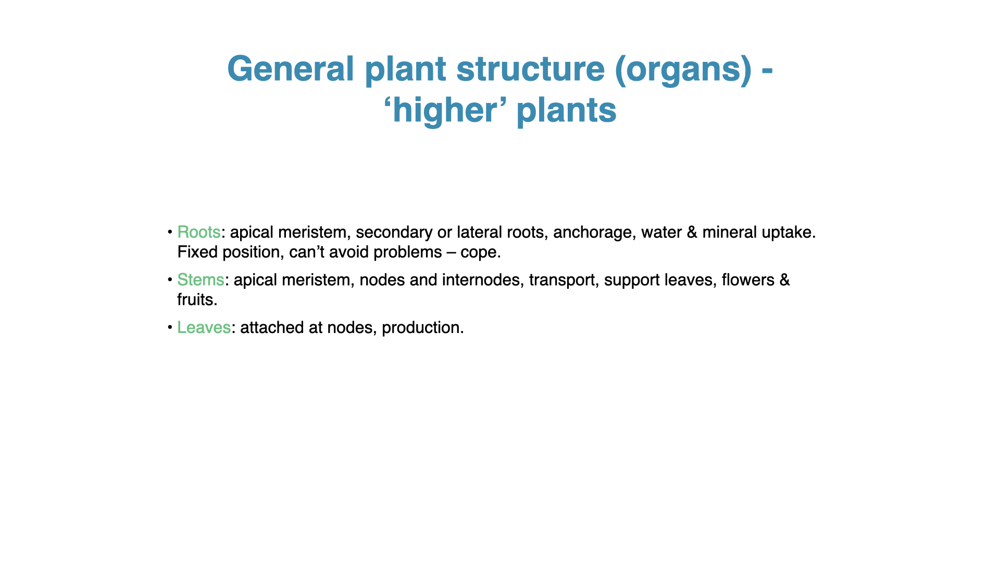

A broad, thin leaf provides a large light-intercepting surface and short internal diffusion paths. A thick succulent leaf stores more water relative to its exposed area, but carbon must still reach its photosynthetic cells. Neither leaf shape alone nor its SA:V tells us the rate of water loss. Stomatal regulation and the permeability of the surface matter too.

Fine roots and root hairs increase contact with the soil solution. Thicker roots contain tissues for transport, storage and anchorage. Within the same root system, these structures make different contributions, so a single whole-root-system SA:V can conceal the location of active uptake.

Thick stems support leaves and connect them to water and nutrient supplies. Mechanical strength depends on the diameter, material and arrangement of the tissues. Low SA:V accompanies thickening, but the ratio itself is not a measure of strength. A large stem can carry many thin leaves whose exchange surfaces remain extensive relative to their living volume.

These examples show why increasing exchange area and increasing storage or support can place different demands on the same body. Each comparison should identify the function being considered and the cost of the structure that performs it.

## Worked example 1: the Littler seaweed studies

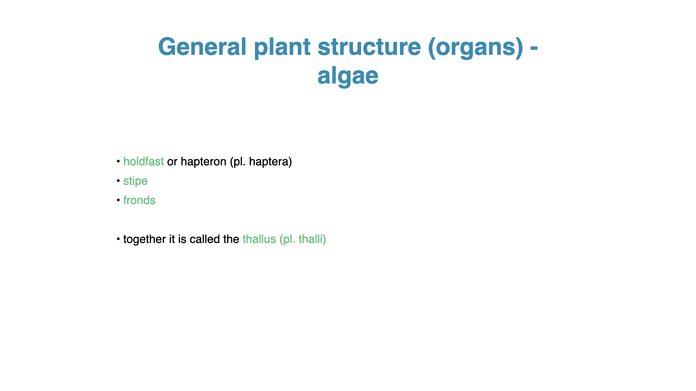

The body of a seaweed is called a **thallus** (plural **thalli**). In a kelp, a holdfast mainly provides attachment, a stipe positions the blades, and the blades provide much of the photosynthetic surface. Dissolved resources can be taken up across the thallus. A holdfast should therefore be compared with a root for anchorage without assuming that it also performs the root's main uptake functions.

Thin sheets such as *Ulva* and narrow filaments expose much of their tissue close to the surrounding water. Thick blades or coarse branches contain more volume behind each unit of outer surface. Folding, overlapping and packing many thalli together can reduce the area effectively exposed to light or moving water.

### Functional form groups

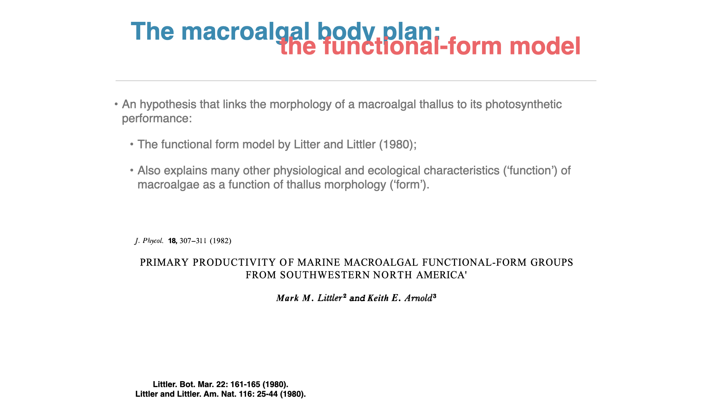

The studies by @Littler1980 and @Littler1982 group seaweeds by features of their form and tissue construction. Their functional form model relates those features to photosynthetic performance and persistence. Here we use the model to compare function. The evolutionary origins of similar forms are considered in [Lecture 3](L03-photosynthetic-evolution.qmd).

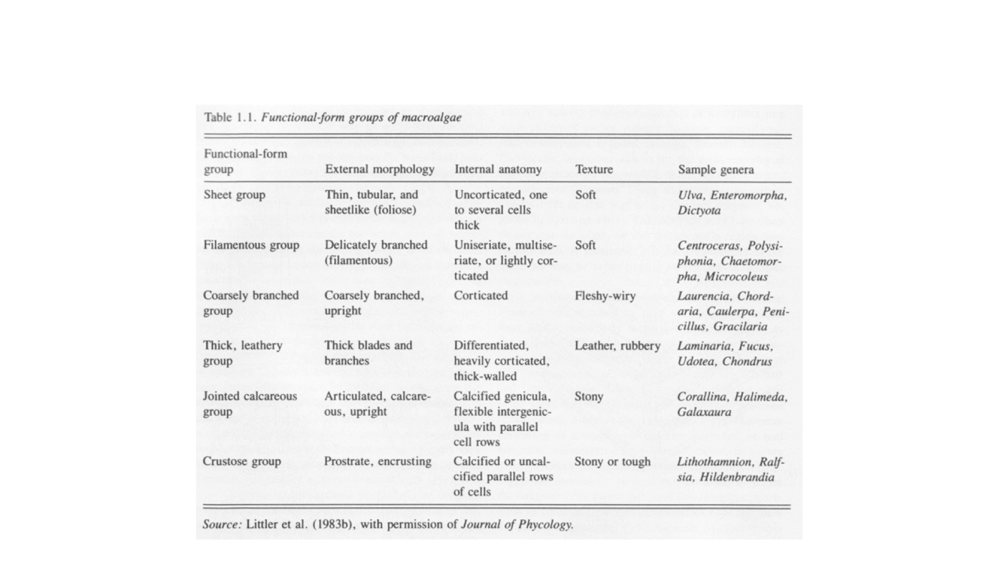

@Littler1982 compared six groups: sheets, filaments, coarsely branched forms, thick leathery forms, jointed calcareous forms and crusts. The groups differ in thickness, exposed area and investment in supporting or calcified material. They also contain variation within each group. In particular, the surface of a crust attached to rock is exposed differently from both faces of a free blade.

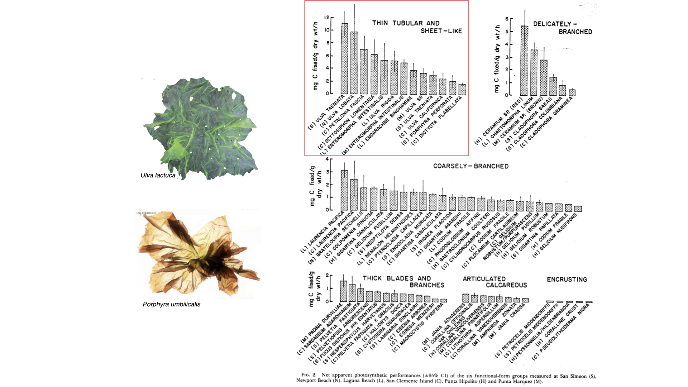

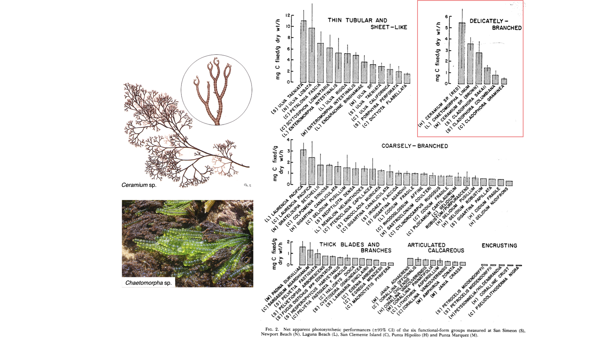

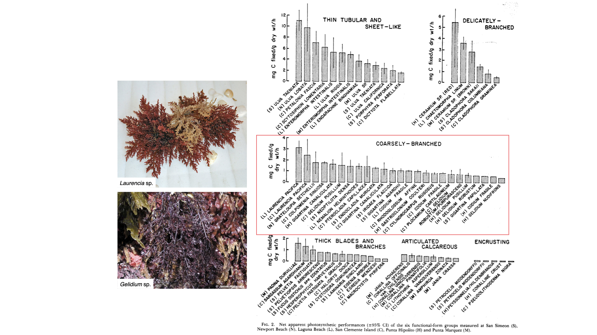

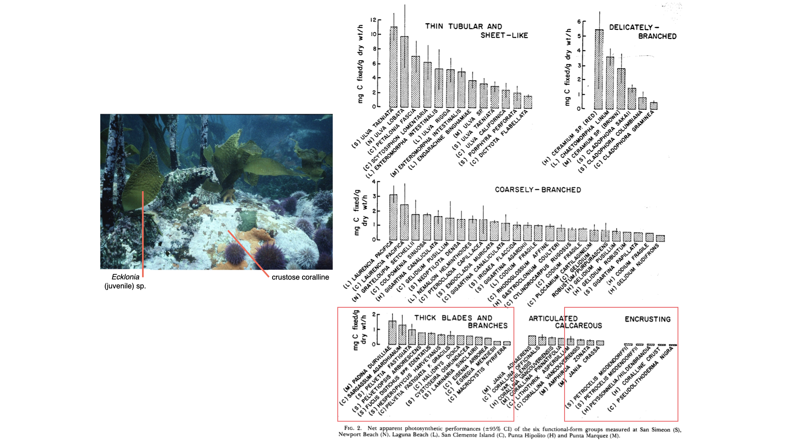

The plotted rates are expressed as milligrams of carbon fixed per gram dry mass per hour. In the 1982 study, apparent net photosynthesis was estimated from oxygen exchange and expressed as carbon fixation. The sheet group had the highest mean rate, 5.16 mg C g⁻¹ h⁻¹, and the crustose group the lowest, 0.07 mg C g⁻¹ h⁻¹ [@Littler1982]. The rates describe performance per unit dry mass under the study conditions. They are not measurements of photosynthetic efficiency per absorbed photon.

A thin thallus can expose a large exchange surface relative to its mass, while supporting or calcified tissues add mass with a different contribution to photosynthesis [@littler1980morphological]. SA:V helps interpret the pattern, but tissue composition and environmental conditions also vary among the groups. Carbon gain, grazing losses, damage and maintenance costs together influence growth and persistence. The model provides hypotheses that can be tested with those additional measurements.

## Worked example 2: the seagrass functional form model

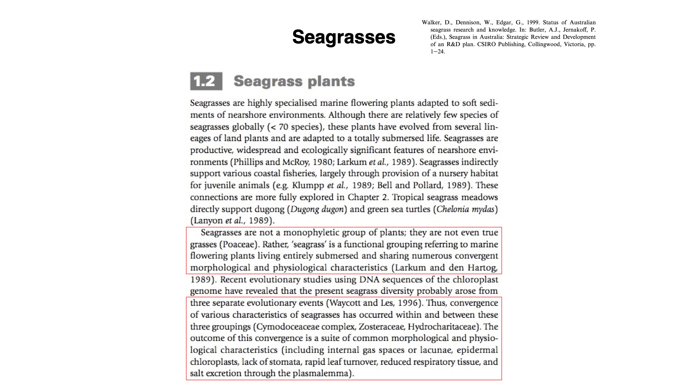

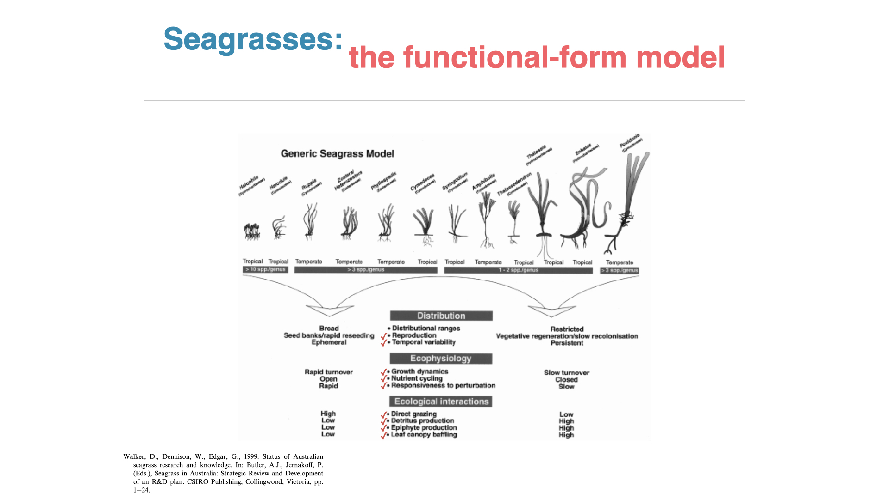

Seagrasses are marine flowering plants with leaves, roots and rhizomes. Their leaves intercept light and exchange with the water, while roots and rhizomes connect the canopy to the sediment and provide anchorage and storage. Nutrients can enter through leaves as well as roots, depending on the resource and its availability. As with terrestrial plants, the SA:V of a leaf and the allocation of tissue to the whole plant describe different aspects of function.

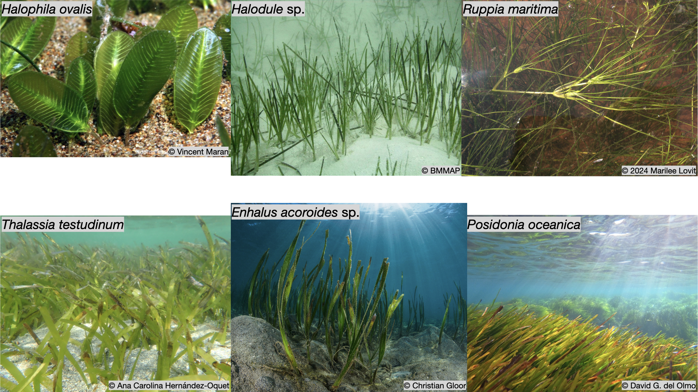

Compare a small *Halophila* shoot with the larger shoots and substantial rhizomes of *Thalassia* or *Posidonia*. These examples help us examine the balance between rapidly replacing exposed tissue and maintaining a persistent body with stored resources. Leaf thickness affects leaf SA:V. The amount of tissue held in rhizomes affects whole-plant storage and the cost of replacement. Plant height or leaf length alone is insufficient to establish the relevant ratio.

The generic seagrass model reproduced in the slides comes from @walker1999status. It compares tendencies in distribution, ecophysiology and ecological interactions across a range of plant forms. As in the seaweed studies, the useful question is how allocation to exposed tissue and persistent structures relates to performance.

| Functional relationship | Small forms with rapid tissue turnover | Larger forms with persistent structures |
|---|---|---|
| Growth and replacement | Relatively rapid production and replacement of tissue. | Slower turnover of established tissues. |
| Resource allocation | Less investment in substantial storage and supporting structures. | Greater investment in persistent roots and rhizomes. |
| Nutrient cycling | Rapid uptake and loss as tissues turn over. | Greater retention and reuse of nutrients within persistent tissues. |
| Grazing and detritus | A greater share of production may be consumed as living tissue. | More production may enter detrital pathways, depending on tissue properties and grazers. |
| Habitat and disturbance | Rapid responses to changed conditions, with recolonisation possible where propagules and suitable conditions remain. | Persistent structure provides habitat, but replacement after severe damage can be slow. |

The model's terms "open" and "closed" nutrient cycling describe relative differences in loss and retention. Every seagrass exchanges materials with its surroundings. Long-lived surfaces also provide time for epiphytes to accumulate, which can change light and exchange at the leaf surface. Tissue toughness, water movement and sediment conditions affect these relationships, so the rows describe tendencies to examine rather than fixed rules for each species.

Persistence through a disturbance and recovery after tissue has been lost are different properties. A plant may retain established structures for a long time yet replace them slowly after damage. Use the seagrass comparison to distinguish the functions of exposed leaf area, stored resources and the tissues that must be rebuilt.

## Applying the relationships to terrestrial plants

The Littler papers and the seagrass model give us a way to ask functional questions about plants on land. Thin tissues can maintain short diffusion paths, fine absorbing structures expose a large surface, and thick organs can allocate volume to storage or support. These relationships occur both within a plant group and between groups. Their consequences still depend on the tissue and its environment.

| Plant group | Forms or structures to compare within the group | Functional relationship to examine |
|---|---|---|
| Hornworts | Thin margins and thicker regions of the gametophyte thallus. | Tissue thickness changes exposed area per unit volume and the distance between cells and the surroundings. |
| Liverworts | Flattened thalli such as *Marchantia* and shoots of leafy liverworts. | Flattening and the arrangement of leaf-like structures affect exposure, overlap and access to water and gases. |
| Mosses | Loosely arranged shoots, upright turfs and dense cushions. | Packing changes exposed area and water retention at the colony scale, even when individual cell dimensions are similar. |
| Ferns | Thin and thicker fronds, with different degrees of division. | Thickness affects tissue SA:V, while frond division also changes exposure and boundary layers. |
| Gymnosperms | Needle leaves in pines, broad leaves in yellowwoods, and their supporting axes. | Leaf thickness and cross-sectional shape determine leaf SA:V. Leaf width or group membership alone cannot establish the ratio. |
| Angiosperms | Thin grass blades, fleshy aloe leaves and woody stems. | A single plant group includes extensive exchange surfaces, water-storage tissues and bulky supporting structures. |

For a comparison between groups, consider a thin fern frond and a thin angiosperm leaf under similar conditions. Both can place much of their photosynthetic tissue close to an exchange surface. A thin and a thick leaf within either group can differ substantially in that relationship. The measurement scale and tissue properties are more informative here than a ranking of entire phyla or divisions from "high" to "low" SA:V.

Use the same distinction when comparing a moss cushion with a tree crown. The outer dimensions describe the collective structure, while the arrangement and dimensions of individual shoots, leaves and cells determine much of the effective exchange area. [Lecture 3](L03-photosynthetic-evolution.qmd) returns to these groups to explain their evolutionary relationships and the origins of their particular structures.

## From functional principles to evolutionary history

For a functional explanation, identify the surface, the tissue it supplies and the route between them. Then consider the conditions under which exchange, storage or support might limit performance. [Lecture 3: Photosynthetic Evolution](L03-photosynthetic-evolution.qmd) builds on these principles to examine how inherited variation, environmental pressures and the history of different lineages contributed to the structures and plant diversity we see today.

## Summary

-   SA:V is the area of a specified surface divided by the volume it encloses, in units such as cm⁻¹. When shape stays the same, SA:V falls as size increases, and thickening a sheet or a cylinder lowers it.
-   A functional comparison must state which surface and which volume are meant, because the leaves, fine roots and trunk of one tree differ greatly, and living and dead tissues make different demands.
-   Fick's first law shows that transfer per unit volume depends on SA:V together with mass diffusivity, the concentration difference and the diffusion distance, so a high SA:V raises supply only when the other terms are held constant.
-   Mass diffusivity depends on the substance, the medium, temperature and viscosity. Water or air movement changes the boundary layer and the concentration difference instead, and diffusion time increases with the square of the distance.
-   SA:V helps explain light capture, gas exchange, water and nutrient acquisition, water storage, heat exchange and support, but each process also depends on other properties of the tissue and its environment.
-   In the Littler studies, thin sheet-like seaweeds had the highest net photosynthesis per unit dry mass (5.16 mg C g⁻¹ h⁻¹) and crusts the lowest (0.07 mg C g⁻¹ h⁻¹). The functional form model relates thick, tough and calcified forms to lower carbon gain per unit mass and greater persistence.
-   The seagrass functional form model contrasts small genera with rapid tissue turnover against large genera with persistent rhizomes, which differ in growth, nutrient retention, grazing and recovery after damage.
-   The same relationships occur within and between hornworts, liverworts, mosses, ferns, gymnosperms and angiosperms, and comparisons are most informative at a stated scale of organ or tissue.

## Self-Test Questions

::: {.callout-note collapse="true"}
## 1. A spherical cell has a radius of 10 µm. Calculate its SA:V, then calculate it again after the radius doubles. How have area and volume changed, and what assumption does this prediction require?

For a sphere, $A/V = 3/r$. At $r$ = 10 µm, SA:V = 3/10 = 0.3 µm⁻¹ (3,000 cm⁻¹). At $r$ = 20 µm, SA:V = 3/20 = 0.15 µm⁻¹, so the ratio halves. Area increases fourfold (2²) and volume eightfold (2³). The prediction assumes that the cell keeps the same shape and proportions as it grows.
:::

::: {.callout-note collapse="true"}
## 2. An *Ulva* blade becomes twice as broad but keeps the same thickness. Predict the change in SA:V when edge area is negligible. Why might its nutrient uptake per unit biomass still change?

For a thin sheet, $A/V \approx 2/t$, and $t$ has not changed, so SA:V stays approximately constant. Uptake per unit biomass can still change because a broader blade may fold or overlap, which reduces the area exposed to moving water. Water motion, boundary-layer thickness and the tissue's demand for nutrients also affect the transfer rate.
:::

::: {.callout-note collapse="true"}
## 3. In the Littler and Arnold study, sheet forms fixed more carbon per unit dry mass than crustose forms. How could exchange area and tissue allocation contribute to this result, and what measurements would help distinguish the two explanations?

A thin sheet exposes a large exchange surface per unit dry mass, whereas a crust has one attached face and much of its mass in supporting or calcified material that contributes little to photosynthesis. Measurements of surface area per unit mass and of tissue composition (for example, the calcified fraction), made alongside photosynthetic rates under comparable light and water flow, would help separate the effect of exposed area from that of allocation.
:::

::: {.callout-note collapse="true"}
## 4. Two seagrasses have leaves of similar thickness but differ greatly in the amount of tissue stored in persistent rhizomes. What can you predict about leaf SA:V, whole-plant allocation and the resources available after damage?

Under the thin-sheet approximation, similar leaf thickness gives similar leaf SA:V. Rhizome allocation is a separate property, so the species with large rhizomes has more stored reserves and a greater cost of replacing lost structure. Recovery after damage also depends on which tissues survive and on the environmental conditions afterwards.
:::

::: {.callout-note collapse="true"}
## 5. Compare a fern, a gymnosperm and an angiosperm. Why must you specify the leaf, supporting axis or absorbing structure before comparing their SA:V? Give an example of the same functional relationship occurring within one of these groups.

Each plant combines thin exchange surfaces with thick supporting axes, so a whole-plant value conceals very different organs. A thin fern frond and a thin angiosperm leaf can have similar SA:V, while a thick and a thin leaf within one group can differ substantially. Within the angiosperms, for example, a thin grass blade has a high SA:V for exchange, whereas a fleshy aloe leaf has a lower SA:V and stores water.
:::

::: {.callout-note collapse="true"}
## 6. Two thalli have the same SA:V but different nutrient uptake rates per unit volume. Use the exchange equation to identify two possible explanations.

In $Q/V \approx (A/V)\,D\,\Delta C/L$, equal $A/V$ leaves the other terms free to differ. A larger concentration difference ($\Delta C$), for example in nutrient-rich water, or a shorter diffusion path ($L$), for example a thinner boundary layer in faster flow, would each increase uptake. Surface permeability and active membrane transport also affect the uptake actually measured.
:::

::: {.callout-note collapse="true"}
## 7. A seaweed is exposed first to faster water flow and then to warmer water. Which terms in Fick's law could change in each case? Why does a higher transfer rate not by itself demonstrate a higher mass diffusivity?

Faster flow can thin the diffusive boundary layer (shorter $L$) and replenish nutrients near the surface (maintaining $\Delta C$), while molecular $D$ stays the same at fixed temperature and water composition. Warming generally raises $D$ and lowers water viscosity, but it can also change the seaweed's demand and the concentrations around it. An observed transfer rate combines all these influences, so it cannot identify a change in $D$ on its own.
:::

## Multiple-Choice Questions

Click an option to check your answer. A green tick marks the correct option, and its explanation then appears below the options.

::: {.mcq}
**1.** A thallus has a high SA:V. Which statement is most correct?

-   It has a small volume per unit area, so it must lose water faster than any other thallus.
-   It has a large total surface area, so it must also have a large total tissue volume.
-   [It has a large surface area per unit volume, though its total surface area may be small.]{.correct}
-   It has a large total surface area, so its exchange rate per unit volume must also be large.

::: {.mcq-explain}
SA:V is a ratio. A small filament can have a very high SA:V but a small total area; the ratio describes surface per unit volume, not the absolute size of either.
:::
:::

::: {.mcq}
**2.** Surface area is measured in cm² and volume in cm³. What are the units of SA:V?

-   [cm⁻¹, because dividing cm² by cm³ leaves one reciprocal unit of length.]{.correct}
-   cm⁵, because the units of area and volume are multiplied when combined.
-   cm, because the area is divided by a volume and one unit of length remains.
-   None, because SA:V compares two quantities and is therefore dimensionless.

::: {.mcq-explain}
cm² / cm³ = cm⁻¹. SA:V therefore has units of reciprocal length, so its value depends on the unit used (1 µm⁻¹ = 10,000 cm⁻¹).
:::
:::

::: {.mcq}
**3.** A spherical cell doubles its radius without changing shape. Which prediction is correct?

-   [Surface area increases fourfold, volume eightfold, and SA:V halves.]{.correct}
-   Surface area doubles, volume doubles, and SA:V stays the same.
-   Surface area increases eightfold, volume fourfold, and SA:V doubles.
-   Surface area increases fourfold, volume fourfold, and SA:V stays the same.

::: {.mcq-explain}
Area scales with r² (2² = 4) and volume with r³ (2³ = 8). For a sphere, SA:V = 3/r, so doubling r halves the ratio.
:::
:::

::: {.mcq}
**4.** A spherical cell and a long cylindrical filament both have a radius of 5 µm. Ignoring the ends of the cylinder, which comparison is correct?

-   The cylinder has the higher SA:V, 0.6 µm⁻¹ compared with 0.4 µm⁻¹ for the sphere.
-   [The sphere has the higher SA:V, 0.6 µm⁻¹ compared with 0.4 µm⁻¹ for the cylinder.]{.correct}
-   Both have the same SA:V, 0.6 µm⁻¹, because SA:V depends only on the radius of a body.
-   Both have the same SA:V, 0.4 µm⁻¹, because they have the same radius and diameter.

::: {.mcq-explain}
For a sphere SA:V = 3/r = 3/5 = 0.6 µm⁻¹. For a long cylinder SA:V ≈ 2/r = 2/5 = 0.4 µm⁻¹. Shape matters, not only radius.
:::
:::

::: {.mcq}
**5.** A thin, sheet-like blade is 100 µm thick. Ignoring its edges, what happens to its SA:V if it thickens to 200 µm?

-   It stays at 0.02 µm⁻¹, because the blade keeps the same width, length and outline as before.
-   It falls by a factor of four, from 0.04 to 0.01 µm⁻¹, because thickness enters as a square.
-   [It halves, from 0.02 to 0.01 µm⁻¹, because volume doubles while face area stays the same.]{.correct}
-   It doubles, from 0.01 to 0.02 µm⁻¹, because more tissue is now exposed at the surface.

::: {.mcq-explain}
For a thin sheet, SA:V ≈ 2/t. At t = 100 µm, SA:V = 0.02 µm⁻¹; at t = 200 µm, SA:V = 0.01 µm⁻¹. The face area is unchanged while the volume doubles.
:::
:::

::: {.mcq}
**6.** A ball of plasticine is flattened into a thin disc without changing its volume. What happens to its SA:V?

-   It stays the same, because the amount of material and therefore the volume are unchanged.
-   It decreases, because a disc has edges that a ball lacks, and edges add volume but no area.
-   [It increases, because the same volume now has a larger surface exposed to the surroundings.]{.correct}
-   It decreases, because flattening reduces the volume enclosed beneath each unit of surface.

::: {.mcq-explain}
Flattening increases the surface area while volume stays constant, so SA:V rises. Shape can change SA:V without any change in size.
:::
:::

::: {.mcq}
**7.** A tree has a thick trunk, thin leaves and fine roots. Which statement about its SA:V is most correct?

-   The trunk's low SA:V shows that its leaves and roots also have low SA:V for exchange.
-   [The trunk's low SA:V says little about the exchange surfaces of its leaves and roots.]{.correct}
-   The whole tree's SA:V gives the exchange capacity of each leaf and root accurately.
-   The leaves' high SA:V shows that the trunk also exchanges gases rapidly per volume.

::: {.mcq-explain}
Each organ must be assessed separately. A plant can combine a bulky, low-SA:V trunk with thin, high-SA:V leaves and fine roots. A single whole-plant value hides these differences.
:::
:::

::: {.mcq}
**8.** Why is volume only an approximate measure of a tissue's demand for resources?

-   Volume changes with temperature, so its value cannot be measured reliably in the field.
-   Volume is always smaller than surface area, so ratios based on it are unreliable.
-   Volume excludes water, so it underestimates the true demand of succulent tissues.
-   [Dead or inactive tissue occupies volume but needs little supply, unlike living cells.]{.correct}

::: {.mcq-explain}
Much of a trunk is dead supporting wood, while living cells need a continuing supply. Volume reflects demand only when tissue composition and activity are comparable.
:::
:::

::: {.mcq}
**9.** In Fick's first law, J = −D dC/dx. Which statement about J is correct?

-   J is the concentration change per unit distance along the path, in mol m⁻⁴.
-   J is the total amount crossing the whole surface per unit time, in mol s⁻¹.
-   J is the speed at which a single molecule moves along the path, in m s⁻¹.
-   [J is the amount crossing a unit area per unit time, in mol m⁻² s⁻¹.]{.correct}

::: {.mcq-explain}
J is the diffusive flux density: amount per unit area per unit time. The total transfer rate Q is J multiplied by the effective exchange area A, in mol s⁻¹.
:::
:::

::: {.mcq}
**10.** What does the minus sign in Fick's first law mean?

-   Molecules move only from low to high concentration, against the gradient.
-   [Net movement is towards lower concentration, though molecules move both ways.]{.correct}
-   The flux becomes zero whenever the concentration gradient becomes very steep.
-   The diffusion coefficient D is always a negative quantity for every solute.

::: {.mcq-explain}
Individual molecules move randomly in both directions. The minus sign means that the net flux runs down the concentration gradient, from higher to lower concentration.
:::
:::

::: {.mcq}
**11.** An Ulva blade doubles its exposed area, and separately its diffusive boundary layer is halved in thickness. Which statement is correct?

-   Doubling area and halving the layer both leave flux density J and transfer Q unchanged.
-   Doubling area doubles flux density J; halving the layer doubles total transfer Q only.
-   Doubling area halves flux density J; halving the layer halves total transfer Q as well.
-   [Doubling area doubles total transfer Q; halving the layer doubles flux density J.]{.correct}

::: {.mcq-explain}
Q ≈ A × J. Adding area raises the total transfer without changing the flux per unit area. Halving the diffusion distance L doubles J, and so also raises Q if area is unchanged.
:::
:::

::: {.mcq}
**12.** Water flowing faster past a seaweed increases its nutrient uptake. Which explanation is most correct?

-   Faster flow raises the mass diffusivity D of the nutrient in the water around the seaweed.
-   Faster flow lowers the water's viscosity, which is the only way uptake can increase.
-   [Faster flow thins the boundary layer and keeps the concentration high near the surface.]{.correct}
-   Faster flow raises the seaweed's SA:V by stretching the thallus in the moving water.

::: {.mcq-explain}
At a fixed temperature and water composition, molecular D does not change with flow. Flow shortens the diffusion distance L (a thinner boundary layer) and replenishes nutrients near the surface (maintaining ΔC).
:::
:::

::: {.mcq}
**13.** Seawater warms by 10 °C. With other conditions held constant, what happens to the mass diffusivity of a dissolved nutrient?

-   [It generally increases, because molecules move faster and the water becomes less viscous.]{.correct}
-   It stays the same, because mass diffusivity depends only on the size of the molecule.
-   It generally decreases, because warmer water holds more dissolved molecules in each litre.
-   It stays the same, because temperature changes only the boundary layer around a surface.

::: {.mcq-explain}
Warming raises molecular motion and lowers the viscosity of water, so D generally increases (as the Stokes–Einstein relationship illustrates).
:::
:::

::: {.mcq}
**14.** Two solutes diffuse through the same water at the same temperature. Which is expected to have the lower mass diffusivity?

-   The solute present at the lower concentration in that body of water.
-   [The solute with the larger effective hydrodynamic radius in that water.]{.correct}
-   The solute with the smaller effective hydrodynamic radius in that water.
-   The solute present at the higher concentration in that body of water.

::: {.mcq-explain}
In the Stokes–Einstein relationship, D is inversely related to the hydrodynamic radius. Concentration affects the gradient, not D itself, in a dilute solution.
:::
:::

::: {.mcq}
**15.** Which statement about pressure and mass diffusivity is least wrong?

-   In all media, pressure has no effect on D once the temperature is fixed.
-   In liquids, D falls in proportion to 1/P, exactly as it does in all gases.
-   In all media, raising pressure increases D by pushing molecules closer.
-   [In dilute gases at fixed temperature, D falls roughly in proportion to 1/P.]{.correct}

::: {.mcq-explain}
The approximate relationship D ∝ 1/P applies to dilute gases at a fixed temperature. It should not be applied to liquids, where pressure has a much smaller effect.
:::
:::

::: {.mcq}
**16.** With D = 10⁻⁹ m² s⁻¹, diffusion across 10 µm takes about 0.05 s. Using τ ≈ L²/(2D), about how long does diffusion across 100 µm take?

-   About 0.5 s, because the time increases in proportion to the distance.
-   [About 5 s, because the time increases with the square of the distance.]{.correct}
-   About 50 s, because the time increases with the cube of the distance.
-   About 0.05 s, because D is the same and so the time does not change.

::: {.mcq-explain}
τ ∝ L². Ten times the distance gives 10² = 100 times the time: 0.05 s × 100 = 5 s. Check: (10⁻⁴ m)² / (2 × 10⁻⁹ m² s⁻¹) = 5 s.
:::
:::

::: {.mcq}
**17.** Why is the effective diffusivity of a solute within tissue or sediment usually lower than its diffusivity in free water?

-   Tissue water is colder than free water, so molecular motion is always slower there.
-   Solutes within tissue have larger molecules than the same solutes in free water.
-   [Pore spaces restrict movement and the paths are winding, so transport is slower.]{.correct}
-   Concentration gradients cannot form inside tissues, so diffusion cannot occur there.

::: {.mcq-explain}
Restricted pore space and tortuous (winding) paths slow transport. The effective diffusivity accounts for this structure; the molecule and the water themselves are unchanged.
:::
:::

::: {.mcq}
**18.** Littler and Arnold (1982) reported 5.16 mg C g⁻¹ h⁻¹ for sheet-like seaweeds and 0.07 for crusts. Which interpretation is most correct?

-   [Sheets fixed far more carbon per unit dry mass under the study conditions than crusts did.]{.correct}
-   Sheets used each absorbed photon about 74 times more efficiently than crusts in the study.
-   Sheets will outgrow and replace crusts in every habitat because they fix more carbon.
-   Sheets fixed more carbon per unit area of rock covered, since crusts lie flat on rock.

::: {.mcq-explain}
The rates are per gram dry mass under the study conditions. They do not measure efficiency per absorbed photon, and the functional form model links low carbon gain in crusts to greater persistence, so crusts are not simply outcompeted.
:::
:::

::: {.mcq}
**19.** Which trade-off does the Littler functional form model emphasise?

-   Thin and tough forms persist equally long, and differ only in their rates of reproduction.
-   Fast-growing thin forms persist longest but gain carbon slowly; tough forms are easily grazed.
-   Thin and tough forms gain carbon at similar rates, and differ only in their pigment content.
-   [Fast-growing thin forms gain carbon quickly but are easily grazed; tough forms persist longer.]{.correct}

::: {.mcq-explain}
Thin sheets and filaments have high productivity per unit mass but are vulnerable to grazing and damage. Thick, tough and calcified forms gain carbon more slowly but resist grazing and disturbance and persist longer.
:::
:::

::: {.mcq}
**20.** A large seagrass with persistent rhizomes survives a storm, while a small fast-growing seagrass is removed. Which statement is most correct?

-   [The large form is more persistent; if its rhizomes are destroyed, it is likely to recover slowly.]{.correct}
-   The large form recovers fastest after any damage, because it holds the most stored resources.
-   The two forms are equivalent, because all seagrasses share the same functional form and life history.
-   The small form is more persistent, because rapid tissue turnover always prevents damage.

::: {.mcq-explain}
Persistence through disturbance and recovery after loss are different properties. Persistent structures resist disturbance, but if they are destroyed they are costly and slow to rebuild, whereas small forms with rapid turnover can recolonise faster where propagules remain.
:::
:::

## References

::: {#refs}
:::
