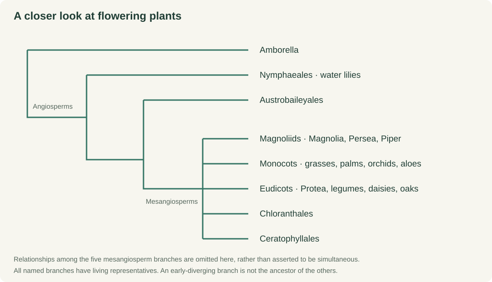

::: {.callout-note appearance="simple"}
## Lecture 3: From cells to canopies

**BDC223: Plant Ecophysiology.** This lecture takes place on Tuesday, 13 October 2026 and builds on the functional principles in [Lecture 2: SA:V](L02-SA_V.qmd). The photographs and comparison tables also support revision outside class.
:::

::: callout-tip
## **Content**

-   The phylogeny of oxygenic phototrophs: cyanobacteria, Archaeplastida, green algae and the land-plant lineages, with clades distinguished from grades.
-   Natural selection, evolutionary adaptation and phenotypic plasticity as explanations of plant form.
-   Cyanobacteria and algae: small cells, colonies, thin blades and kelps as different routes to larger size.
-   The move to land: cuticles, gas access, embryos, and the bryophytes and early branching sporophytes.
-   Vascular plants and seed plants: xylem, roots, leaves, wood, pollen and seeds, and the diversity of gymnosperms and angiosperms.
-   Terrestrial growth forms (trees, grasses, climbers, succulents, epiphytes and wetland plants) compared within and across branches, including convergence.
-   Using living organisms as functional comparisons for fossils, and the limits of that comparison.
:::

::: callout-tip
## **Aims**

This lecture asks how the forms examined in [Lecture 2](L02-SA_V.qmd) arose. It follows oxygenic phototrophs from cyanobacteria through the algae to the land plants and places each structural change on a phylogeny, together with the selective pressures that could have favoured it and the costs it imposed on other functions. The aim is to separate two kinds of explanation: what a structure does, which geometry and physiology can describe, and where and why it originated, which requires phylogenetic, fossil and developmental evidence. The organisms introduced here recur in the later lectures on light, pigments, photosynthesis, nutrient uptake and plant stress.
:::

::: callout-tip
## **Learning Outcomes**

By the end of this lecture, you will be able to:

1.  Place cyanobacteria, major algal groups and the principal land-plant lineages on a simplified phylogeny, and distinguish a clade from a grade.
2.  Explain how natural selection on heritable variation can change plant form, distinguishing evolutionary adaptation from a response within an individual plant.
3.  Relate the origins of embryos, vascular tissues, roots, leaves, wood, pollen and seeds to specific physiological or reproductive problems.
4.  Explain how environmental pressures, functional trade-offs and inherited structures contributed to different terrestrial growth forms, including cases of convergence.
5.  Interpret local and whole-organism SA:V for a named surface and function, and identify the cost that accompanies each structural change.
6.  Use an extant organism as a functional comparison with an extinct form, stating where that comparison breaks down.
:::

::: callout-note
## **Required Reading**

-   [Wernberg, T., Filbee-Dexter, K., de Bettignies, T., Leclerc, J.-C., Davoult, D., Lévêque, L., Christie, H. C., Dyer, D. C., Anderson, R. J., Rothman, M. D., Bolton, J. J., Norderhaug, K. M., & Smit, A. J. (2025). Smaller plants in warmer water could have implications for future kelp forests. Scientific Reports, 15, 28616.](<../docs/Wernberg et al (2025).pdf>)
-   [Coppin, R., Rautenbach, C., Ponton, T. J., & Smit, A. J. (2020). Investigating waves and temperature as drivers of kelp morphology. Frontiers in Marine Science, 7, 567.](<../docs/Coppin et al (2020).pdf>)
-   [Littler, M. M., & Littler, D. S. (1980). The evolution of thallus form and survival strategies in benthic marine macroalgae: field and laboratory tests of a functional form model. The American Naturalist, 116(1), 25–44.](<../docs/Littler and Littler (1980).pdf>) (revision of [Lecture 2](L02-SA_V.qmd))
:::

A forest tree must carry water from the soil to leaves many metres above it. A moss can absorb water across much of its surface, and a seaweed blade exchanges directly with the surrounding seawater. Each needs light, inorganic carbon, water and mineral nutrients, but the routes by which these resources reach its cells differ considerably.

[Lecture 2](L02-SA_V.qmd) dealt with the functional consequences of size and shape. Here we examine how those forms arose.

We will follow the branches from oxygenic bacteria to algae and land plants, considering the conditions under which particular structures could have improved survival or reproduction. A tall stem, for example, places leaves above competitors but also lengthens the water-supply path and requires support. Its evolution involved changes to an inherited architecture, with consequences for several functions at once. Fossils, phylogenies and living examples help us reconstruct that history and explain why such different forms persist in today's landscapes. Much of the second half concerns terrestrial plants, including ones that look nothing like a conventional leafy tree.

## History as a branching tree

Refer back to **BDC221: Plant Diversity** for the groups you studied as "lower" and "higher" plants. Use those examples to orient yourself on the tree below. The BDC221 materials are **not hosted on Tangled Bank**; consult the materials supplied through that module.

**Oxygenic photosynthesis** releases oxygen. The term photo-oxygenic photosynthesis is also used in this module. Cyanobacteria perform this process, whereas photosynthesis in other bacterial groups is anoxygenic.

Photosynthetic eukaryotes acquired oxygenic photosynthesis through endosymbiosis: a cyanobacterium was engulfed by a eukaryotic host and became a plastid [@poncetoledo2017early]. The descendants of that primary endosymbiosis form **Archaeplastida**, which comprises **Glaucophyta** (glaucophytes), **Rhodophyta** (red algae) and **Viridiplantae** (green algae and land plants). The tree separates this plastid history from the ancestry of the organisms carrying the plastids. Follow Viridiplantae into the lower panel to locate the land plants.

::: {.column-margin .evo-definition}
**Archaeplastida: three lineages**

**Glaucophyta**: glaucophytes, also called glaucocystophytes. A small group of freshwater unicellular algae, sometimes colonial. Their plastids retain conspicuous cyanobacterial features.

**Rhodophyta**: red algae. This lineage includes unicells and multicellular seaweeds; it also supplied the plastids inherited through endosymbiosis by several other algal groups.

**Viridiplantae**: green plants. This clade includes both green algae and land plants. “Green plants” therefore means more than terrestrial vegetation.
:::

{#fig-evo-tree fig-alt="One cyanobacterial primary endosymbiosis gives rise to the plastids of Archaeplastida: Glaucophyta, Rhodophyta and Viridiplantae. Glaucophytes are freshwater unicells with plastid peptidoglycan and phycobilisomes. Secondary endosymbiosis transfers a red-algal plastid to the host lineage containing brown algae and diatoms. Viridiplantae divides into Chlorophyta and Streptophyta. Within streptophytes, Zygnematophyceae are sister to Embryophyta, the land plants. Land plants comprise bryophytes and Tracheophyta, the vascular plants. Lycophytes, ferns and seed plants branch within vascular plants. Seed plants comprise living gymnosperms and angiosperms."}

::: {.column-margin .evo-definition}
**Following the green branch**

**Chlorophyta**: the green-algal clade containing *Chlamydomonas*, *Volvox* and *Ulva*.

**Streptophyta**: the other main green-plant branch, comprising streptophyte algae and land plants.

**Zygnematophyceae**: conjugating green algae, including *Spirogyra* and *Zygnema*; the closest living algal relatives of land plants.

**Embryophyta**: land plants, defined by retaining and nourishing a multicellular embryo on the parent. Includes bryophytes and vascular plants, even those that later returned to water.
:::

A **clade** contains a common ancestor and all its descendants. Green plants, vascular plants and angiosperms each meet that definition.

Several familiar names refer to other kinds of grouping. **Algae** includes organisms from different branches that share broad ecological and morphological features. The traditional **pteridophytes** are the seed-free vascular plants: lycophytes and ferns, including horsetails. Their common ancestor also gave rise to seed plants, so excluding those descendants makes pteridophytes a grade.

A brown kelp and a green seaweed can both form large thalli, although their multicellular forms evolved on separate eukaryotic branches. Within the green plants, appearance can be equally misleading. The branched *Chara* looks structurally elaborate, yet the closest living algal relatives of land plants are the Zygnematophyceae, which include the much simpler-looking *Zygnema* and *Spirogyra*. Establishing these relationships required phylogenomic evidence [@hess2022phylogenomically].

Liverworts, mosses and hornworts also form a bryophyte clade. Living mosses and ferns occupy separate branches, each with its own history [@li2020anthoceros].

::: {.evo-key}
**Use two questions throughout:** Where does this organism belong on the tree? How does its structure meet the physical demands of its environment? Similar answers to the second question can evolve on distant branches.
:::

### A few dates to orient the tree

These are approximate evidence points, rather than dates at which a modern group suddenly appeared. Fossils provide minimum ages and preserve some structures much better than others. Molecular estimates can extend further back and depend on calibration and analytical assumptions.

| Evidence point | Approximate age | What the evidence establishes |
|---|---:|---|
| First major atmospheric oxygenation | About 2.4 billion years ago | Oxygenic photosynthesis was operating by this interval. Atmospheric accumulation also depended on oxygen consumption and burial of reduced material. |
| Thylakoids in *Navifusa majensis* | About 1.75 billion years ago | Direct cellular evidence for an ancient oxygenic phototroph. This is younger than the origin of oxygenic photosynthesis. |
| Early land-plant cryptospores | About 470 million years ago | Evidence of early terrestrial plant reproduction, with uncertainty about the precise producers and their position on the tree. |
| Small branching axes such as *Cooksonia* | Silurian, roughly 430–420 million years ago | Early experiments in branched sporophytes bearing sporangia. Anatomical evidence differs among species. |
| Rhynie chert plants, including *Rhynia* and *Asteroxylon* | About 407 million years ago | Exceptional preservation of early land-plant anatomy and rooting structures. |
| Early seeds, including *Elkinsia* | Late Devonian, roughly 365 million years ago | Reproduction through ovules and seeds was established before modern conifer or flowering-plant communities. |
| Clear angiosperm fossil radiation | Early Cretaceous, roughly 135–125 million years ago | An expanding record of flowering plants. Their exact origin remains debated. |

Evidence and dating discussions: @demoulin2024oldest, @rubinstein2010early, @hetherington2018stepwise, @serbet1992characterizing and @smith2010uncorrelated.

## From functional advantage to evolutionary change

Keep your **BDC221: Plant Diversity** notes at hand for this section too. Draw on its examples of plant structure and diversity as you consider how a feature could affect survival or reproduction. You will need to access those notes outside Tangled Bank.

A thin leaf and a fine root both keep cells close to an exchange surface. A large plant can therefore retain short diffusion paths in its leaves and roots while investing substantial volume in supporting axes, as we saw in [Lecture 2](L02-SA_V.qmd#sec-sa-v-geometry). The surface relevant to a particular function may belong to a cell, an organ or the whole plant. Geometry helps explain the consequences of that structure. To reconstruct its origin, we also need phylogenetic, fossil and developmental evidence.

**Natural selection** occurs when heritable differences affect survival and reproductive success. Suppose a structural variant allows a plant to leave more descendants under the conditions it encounters. Over generations, the inherited traits associated with that variant can become more common. Mutation supplies new variation without regard to what the organism needs, and recombination reshuffles existing variation. Some changes are favourable, some harmful, and others have little effect under the prevailing conditions. Selection acts on these differences within the developmental and structural possibilities inherited by a lineage. A feature that is useful today may have arisen under different conditions, or initially served another function, so its present usefulness alone cannot establish its evolutionary origin.

An **evolutionary adaptation** is an inherited feature shaped by selection for a function. **Phenotypic plasticity** is a response within an individual's lifetime, such as producing different leaves in sun and shade.

The capacity for plasticity can itself evolve. Keep the individual's response and the evolution of that capacity separate.

Consider a photosynthetic surface exposed to dry air. A less permeable covering can conserve water, but it also restricts entry of CO₂. The outcome depends on the openings through that surface, the water supply and the conditions in which the plant grows. Competition for light introduces another set of demands: elevated foliage intercepts light above neighbours but needs stronger axes and longer transport paths. Mineral nutrient supply may favour finer roots or microbial associations, while reproductive success depends on protecting gametes and embryos and dispersing pollen, spores or seeds. These pressures act together on a plant, and a change that benefits one function can impose a cost elsewhere.

Similar structures can arise independently through **convergent evolution**. Others are inherited from a common ancestor and modified as descendants occupy different environments. Changes in gene flow and reproductive isolation contribute to the formation of distinct lineages, within which structures may be added, reduced or lost.

::: {.evo-key}
The **form–function boxes** extend the Littler comparisons in [Lecture 2](L02-SA_V.qmd#worked-example-1-the-littler-seaweed-studies). For each structural change, they connect a plausible selective pressure with gains and costs in particular functions. Treat the proposed drivers as evolutionary inferences unless the cited evidence establishes them.

Specify the surface and volume being compared. A tree's leaves and fine roots can retain high local SA:V while its trunk accounts for much of its volume.

[Fick's law](L02-SA_V.qmd#sec-ficks-law) helps explain the consequences: exposed area, diffusion distance, concentration gradients and the medium all affect supply. Surface permeability matters too. Increasing exposed area can improve acquisition and also increase water loss, so an SA:V value needs to be interpreted in relation to a named function and its environment.
:::

## Bacteria: oxygenic photosynthesis before roots or leaves

Purple bacteria such as *Rhodobacter sphaeroides* and green sulfur bacteria such as *Chlorobaculum tepidum* use electron donors other than water in anoxygenic photosynthesis. They are living, specialised organisms with their own evolutionary histories. Arranging them as successive ancestors of cyanobacteria would misrepresent those relationships.

Cyanobacteria use two photosystems to extract electrons from water. The oxygen released during photosynthesis comes from that water.

Carbon fixation uses the resulting chemical energy and reducing power to incorporate carbon from CO₂. These coupled processes are covered in [Pigments and Photosynthesis](L07a-pigments_photosynthesis.qmd).

In a small *Synechococcus* cell, dissolved resources cross the membrane and travel only short distances internally. Light-harvesting membranes provide an extensive internal surface. Even at this scale, however, carbon supply involves physiological control: cyanobacterial carbon-concentrating mechanisms accumulate inorganic carbon around Rubisco.

In *Nostoc*, cells remain linked in filaments within a mucilaginous matrix. Some differentiate into heterocysts, where nitrogen fixation is protected from oxygen. This allows neighbouring cells to perform different functions within the same filament, but the two processes must be distinguished. Nitrogen fixation converts N₂ to reduced nitrogen. Oxygenic photosynthesis releases O₂ from water, creating an oxygen-rich environment that nitrogen-fixing cells must contend with. Many cyanobacteria cannot fix nitrogen at all. [Gas-exchange experiments in *Nostoc punctiforme*](https://pmc.ncbi.nlm.nih.gov/articles/PMC383079/) show how these processes interact.

::: {.evo-photo}
.](images/evolution/nostoc.jpg){#fig-evo-nostoc fig-alt="A gelatinous Nostoc colony photographed against a white background."}
:::

Within a dense mat, cells shade one another and experience different conditions from those at the surface. Delivery from the surrounding water depends partly on flow. High cellular SA:V therefore gives little assurance of adequate supply to cells buried inside the colony.

::: {.evo-key .evo-function role="note"}
**Form and function: small cells, larger colonies**

A *Nostoc* colony becomes large by adding small cells. Each retains high cellular SA:V, and a filament can lengthen without increasing cell diameter. Linked cells, photosynthetic membranes and mucilage add internal surfaces, cohesion and water retention. Attachment, access to resources and intermittent drying could favour different arrangements of these structures.

Packing has a cost. Cells in the interior receive less light and exchange with water that neighbours have already modified. **Cellular SA:V and the exposed SA:V of a colony describe different constraints.** Protective material also takes resources to produce.
:::

## Algae: several ways to become large

Revisit the **Littler papers** assigned in [Lecture 2](L02-SA_V.qmd). Their comparisons of seaweed form, photosynthetic performance and persistence underpin this section. Keep those functional relationships in mind as we consider how similar forms arose in different algal lineages.

The three Archaeplastida lineages inherited plastids from primary endosymbiosis. Later endosymbioses transferred plastids into other eukaryotic hosts, including the red-algal plastids now carried by brown algae and diatoms [@sanchezbaracaldo2017early]. This history helps explain the pigment diversity discussed in [Chromatic Adaptation](L08-chromatic_adaptation.qmd).

Glaucophytes are rarely encountered in the field and have few described species. Their plastids, often called **cyanelles**, retain a **peptidoglycan** layer between the envelope membranes and **phycobilisomes**, pigment–protein complexes that collect light. These cyanobacterial features provide evidence about early plastid evolution. Retention and loss differ among the other lineages: red algae also retain phycobilisomes, and peptidoglycan has been demonstrated around moss chloroplasts. [Glaucophyte plastid genomes](https://pmc.ncbi.nlm.nih.gov/articles/PMC6330054/), [red-algal phycobilisomes](https://www.nature.com/articles/nature24278), [Hirano et al. (2016)](https://pubmed.ncbi.nlm.nih.gov/27325639/).

Compare the motile unicell *Chlamydomonas reinhardtii* with *Volvox carteri*, whose spherical colonies contain differentiated reproductive and somatic cells. Both are chlorophytes. The filamentous *Spirogyra* belongs to the streptophyte branch, close to land plants.

::: {.evo-pair}
.](images/evolution/spirogyra.jpg){fig-alt="Microscopic Spirogyra filaments showing cell boundaries and spiral green chloroplasts."}

.](images/evolution/ulva.jpg){fig-alt="Bright green sea lettuce sheets spread across intertidal rock."}
:::

An *Ulva* blade spreads photosynthetic cells across a thin sheet in direct contact with seawater. Dissolved inorganic carbon, water and mineral nutrients reach the thallus across its surface, without a terrestrial root-to-shoot supply system. Thickness still matters, but so does the water immediately around the blade. Slow flow allows a thicker diffusive boundary layer to develop, and an overlapping blade reduces both light and exposure to moving water. Measuring SA:V alone would miss these restrictions on uptake and productivity.

Within Rhodophyta, *Pyropia* forms thin blades, *Gracilaria* has thicker branching axes, and coralline algae invest in calcification. The functional contrasts described by Littler and colleagues [@Littler1980; @Littler1982] can thus occur within a single lineage.

A kelp partitions its thallus into a holdfast, stipe and blades. The holdfast anchors it. Dissolved nutrients are acquired mainly across the thallus, so a holdfast should be compared with a terrestrial root for attachment, rather than assumed to have the same role in uptake. Flexible stipes and buoyancy position the blades in the light, and gas-filled structures contribute in some kelps. The whole thallus moves with waves, exposing its surfaces to changing flow while also experiencing mechanical loading.

::: {.evo-photo}
. [Source](https://commons.wikimedia.org/wiki/File:Laminaria_pallida_%28top%29_and_Ecklonia_maxima_%28below%29_P3290141.JPG).](images/evolution/kelp-duiker-point.jpg){#fig-evo-kelp fig-alt="Laminaria pallida above Ecklonia maxima on a rocky reef at Duiker Point, showing broad blades and thicker stipes."}
:::

Experiments in *Macrocystis* traced photosynthate from source blades to growing sinks through specialised conducting cells. Long-distance redistribution therefore evolved in kelps as well as in vascular plants, although kelp conducting tissues and plant xylem and phloem have separate evolutionary origins [@schmitz1979long].

Two studies connect these Cape kelps with the [Lecture 2](L02-SA_V.qmd) functional form comparisons:

- @wernberg2025smaller, [*Smaller plants in warmer water could have implications for future Kelp forests*](https://doi.org/10.1038/s41598-025-13950-z), *Scientific Reports* **15**, 28616. In *Laminaria pallida* from southern Africa and *L. hyperborea* from Europe, kelps in warmer regions had shorter, thinner stipes and supported less epiphyte biomass. Such changes affect the three-dimensional habitat a kelp forest provides.
- @coppin2020investigating, [*Investigating Waves and Temperature as Drivers of Kelp Morphology*](https://doi.org/10.3389/fmars.2020.00567), *Frontiers in Marine Science* **7**, 567. Around the Cape Peninsula, wave exposure explained more of the morphological variation in *Ecklonia maxima* and *Laminaria pallida* than temperature did. The relationships differed between species and between shallow and deep populations.

Read these papers with **SA:V** in mind. Which measurements describe exchange surfaces, and which describe investment in support? A shorter kelp does not necessarily have a higher SA:V ratio. These field comparisons also leave open how much of the variation reflects phenotypic plasticity or inherited differences.

::: {.evo-key .evo-function role="note"}
**Form and function: thin exchange surfaces on larger thalli**

Thin sheets and narrow branches keep photosynthetic cells close to seawater. Kelps retain these exchange surfaces while adding thicker regions for attachment, support and transport.

The likely selective pressures differ among habitats. Competition for light can favour elevated blades, whereas grazing and wave disturbance may favour investment in tissues that persist. **High local SA:V** and short diffusion paths help carbon and nutrient acquisition, but broad exposed blades also experience drag and can lose water rapidly at low tide. Thickening or reinforcing tissue changes that balance by allocating more volume to support and lengthening paths from the surface to interior cells. Similar combinations have arisen on separate algal branches.

This is the Littler comparison placed on a phylogeny, with water movement and shading still needed to interpret performance.
:::

## Living on land separates the resource supplies

On land, light and CO₂ are available above the substrate, while most water and mineral nutrients must be obtained from within it. Air provides little buoyant support. A photosynthetic surface raised into the light is therefore exposed to drying and needs both support and a water supply, as well as protection from ultraviolet radiation and temperature extremes.

A cuticle limits water loss. It also restricts gas diffusion.

Openings through the surface admit CO₂, but their regulation differs among tissues and lineages. Turgor, cell walls and plant architecture determine whether the exposed tissue stays upright. As the distance from the substrate increases, supplying water to that tissue becomes a transport problem.

Land plants retained a multicellular embryo in parental tissue, the defining feature of embryophytes. This protected stage, together with resistant spores, protected reproductive structures and microbial associations, contributed to life on land. These changes concern reproduction and establishment as well as the geometry of resource exchange.

::: {.evo-key .evo-function role="note"}
**Form and function: protection with access to air**

Drying could favour less permeable surfaces, while access to atmospheric CO₂ favoured routes through those surfaces. Internal air spaces brought gases close to photosynthetic cells. Together, these structures allowed thin tissues with short diffusion paths to function in air, although their detailed anatomy and evolutionary origins differ among lineages. A high exposed **SA:V** increases the surface available for exchange and potential water loss, so protection and gas entry must be considered together.

Embryo retention added a reproductive benefit: offspring developed within parental tissue. Protection and provisioning required resources from the parent.
:::

### Bryophytes: small stature, varied internal organisation

::: {.column-margin .evo-definition}
**Liverwort, moss or hornwort?**

**Liverworts (Marchantiophyta)**: leafy shoots or flattened thalli, such as *Marchantia*. Their short-lived sporophytes bear a spore capsule. They lack stomata.

**Mosses (Bryophyta)**: leafy gametophyte shoots, often forming mats, turfs or cushions. A sporophyte usually has a capsule raised on a stalk (seta).

**Hornworts (Anthocerotophyta)**: thalloid gametophytes bearing elongated, horn-like sporophytes. A basal meristem allows the sporophyte to continue growing and producing spores.

All three have a dominant gametophyte and an attached sporophyte. **Bryophytes** collectively means all three lineages; **Bryophyta** here means mosses only.
:::

The conspicuous bryophyte plant is usually the haploid **gametophyte**. Its diploid **sporophyte** remains attached and depends on it nutritionally to varying degrees. In a vascular plant, the large independent plant is the sporophyte.

In the liverwort *Marchantia polymorpha*, a flattened, branching thallus lies close to the substrate. Rhizoids anchor it, while water moves across surfaces and through capillary spaces. Air chambers bring gases into contact with photosynthetic tissue beneath the surface. The pores opening into these chambers have no guard-cell mechanism for opening and closing, so they must be distinguished from stomata. This anatomy provides gas access within a low-growing thallus, but offers less control over the openings than a stomatal system.

::: {.evo-pair}
_9842.jpg).](images/evolution/marchantia.jpg){fig-alt="Green branching thalli of the liverwort Marchantia polymorpha."}

_7502.JPG).](images/evolution/marchantia-pores.jpg){fig-alt="Microscopic view of polygonal areas and air pores on a Marchantia thallus."}
:::

Mosses form creeping mats, upright turfs and dense cushions. In *Polytrichum*, leaf lamellae add photosynthetic surface, and specialised cells permit internal transport. Some mosses possess water-conducting hydroids and food-conducting leptoids, which provide conduction without the lignified xylem of tracheophytes. At the scale of the whole cushion, close packing retains capillary water and shelters shoots, although it also increases shading.

::: {.evo-photo}
.](images/evolution/moss.jpg){#fig-evo-moss fig-alt="A colony of haircap moss with leafy shoots and stalked sporophytes."}
:::

*Anthoceros* has a thalloid gametophyte with elongated sporophytes. Some hornworts house *Nostoc*, and many have pyrenoid-based carbon-concentrating mechanisms. Their associations and physiology can therefore differ considerably from those of a liverwort with a superficially similar thallus [@li2020anthoceros].

Liverworts lack stomata. Mosses and hornworts can possess them on the sporophyte, where their roles and responses differ from those usually taught for flowering-plant leaves.

Bryophytes persist in wet microsites and on bark, and desiccation-tolerant species also occupy exposed habitats. A dry moss may suspend much of its metabolism until it is wetted again.

::: {.evo-key .evo-function role="note"}
**Form and function: small plants with extensive exchange surfaces**

A moss leaf can have high SA:V while the cushion containing it exposes relatively little surface for its volume.

This difference helps explain the benefit and cost of shoot packing. Close neighbours retain capillary water and reduce exposure during drying, conditions that could favour a compact growth form. Yet they also shade one another. Thin leaves, lamellae and the air chambers of some thalloid bryophytes provide accessible photosynthetic surfaces over short diffusion distances, but external water films can impede CO₂ entry, as [gas-exchange measurements in mosses](https://pubmed.ncbi.nlm.nih.gov/28307731/) demonstrate. Small stature also leaves the plant below taller competitors. Desiccation tolerance permits survival through dry periods, with carbon gain resuming after wetting.
:::

### Early branching sporophytes: a fossil comparison

Fossils assigned to *Cooksonia* preserve small branching axes with terminal sporangia. They show that elevation and branching preceded broad leaves, although species differ in their size and preserved anatomy. Some of the smallest forms may have depended heavily on the gametophyte: after allowing space for other tissues, little room remains in their axes for photosynthetic tissue [@boyce2008how].

The green, repeatedly forked axes of *Psilotum nudum* provide a living comparison for this architecture. The whisk fern lacks true roots and has very small appendages, but **its simple form is secondarily derived within ferns**. Fossils such as *Rhynia* provide historical anatomical evidence. *Psilotum* shows how a living plant with a similar outline functions.

::: {.evo-photo}
.](images/evolution/psilotum.jpg){#fig-evo-psilotum fig-alt="Green repeatedly forked axes of the whisk fern Psilotum nudum."}
:::

::: {.evo-key .evo-function role="note"}
**Form and function: branching and elevating sporangia**

Branching gave early sporophytes multiple sites for sporangia, and elevation could improve dispersal by releasing spores above the near-ground boundary layer. Greater reproductive output and dispersal success are therefore plausible selective advantages. Narrow photosynthetic axes could retain relatively high **SA:V** as they branched. Supporting taller axes, however, required construction resources and a water supply, while thickening those axes reduced external SA:V. Fossil anatomy constrains these interpretations, including how much nutrition a sporophyte could obtain independently.
:::

## Vascular plants link exchange, transport and support

::: {.column-margin .evo-definition}
**Vascular branches**

**Tracheophyta**: vascular plants, with lignified water-conducting tracheary elements. Includes lycophytes, ferns and seed plants.

**Lycopodiophyta**: lycophytes, including clubmosses, spikemosses and quillworts. They are vascular plants, despite the “moss” names.

**Polypodiopsida**: ferns in the broad classification used here, including horsetails and whisk ferns. Lycophytes lie outside this clade.
:::

The lignified water-conducting cells of **tracheophytes** allowed water supply and photosynthesis to occur farther apart. Xylem conducts water and contributes to support. Phloem transports organic compounds between sources and sinks.

As water evaporates from leaves, it helps maintain a water-potential gradient from soil through roots and xylem to the atmosphere. Cohesion transmits tension through the water columns. Root cells expend energy on selective ion uptake, but the transpiration stream in a tall tree is driven mainly by this gradient. Height and hydraulic path length increase the resistance along the route and make embolism a concern. A leaf can remain thin, with short internal diffusion paths, while depending on water that has travelled many metres through conducting tissue.

At the other end of that route, fine roots, root hairs and fungal hyphae provide extensive absorbing surfaces. Mycorrhizal fungi can explore beyond the root surface in exchange for plant carbon, although the benefit depends on conditions. Other plants acquire nutrients through different associations or root specialisations. Roots themselves evolved in stages and on more than one vascular-plant branch.

The rooting axes of the fossil lycophyte relative *Asteroxylon mackiei*, for example, lacked a root cap [@hetherington2018stepwise].

### Lycophytes and ferns represent different branches

Clubmosses (*Lycopodium*), spikemosses (*Selaginella*) and quillworts (*Isoetes*) are lycophytes. They are vascular plants. Their **lycophylls**, or small leaves, usually contain a single unbranched vein.

*Selaginella* and *Isoetes* produce separate microspores and megaspores, a condition called **heterospory**. Its occurrence in water ferns and seed plants as well as lycophytes records repeated evolution of this reproductive feature.

::: {.evo-pair}
.](images/evolution/selaginella.jpg){fig-alt="Branching Selaginella shoots covered with small overlapping leaves."}

.](images/evolution/fern.jpg){fig-alt="Large divided green fronds of a royal fern."}
:::

The fern clade includes horsetails such as *Equisetum* and whisk ferns as well as familiar frond-bearing species. Within it, filmy ferns occupy humid shade, rock ferns can tolerate drought, *Azolla* floats, and tree ferns such as *Alsophila dregei* support elevated foliage on stems strengthened by tissues and a surrounding root mantle. Leaves or green axes capture light, while roots and rhizomes acquire and store resources. These structures allow fern sporophytes to occupy very different physical spaces, from a film of moist rock to an elevated crown. Reproduction places a separate constraint on that range of forms. In most familiar ferns, the small independent gametophyte still requires a film of water for sperm to reach an egg, even where the mature sporophyte occupies relatively exposed ground.

The lycophyte branch also once contained trees, including the Carboniferous *Lepidodendron*. Today's small clubmosses reveal only part of that lineage's former architecture. A tree fern's strengthened stem and root mantle, a conifer's woody trunk and an extinct lycophyte trunk represent different constructions for supporting height.

### What a leaf, a stem and a root contribute

A leaf presents photosynthetic tissue to light and connects it to a vein supply. Internal air spaces keep many cells close to a gas-exchange surface, while stomata regulate exchange with the atmosphere. Opening a stoma admits CO₂ and permits water loss. Photosynthesis and respiration both contribute to the measured net flux: an illuminated leaf may release O₂ overall, while its cells continue to respire.

Stems bear the weight of leaves and transmit loads towards the ground. Turgor supports young tissues, collenchyma provides flexible strengthening, and lignified walls add stiffness. Secondary growth in many seed plants produces wood, increasing both conducting and supporting capacity. The carbon invested in a taller stem must be considered alongside the gain from placing leaves in the light, the longer hydraulic path and the greater wind exposure. Much of that supporting tissue contributes little direct carbon gain, even when it is essential to the functioning of the crown.

Roots anchor the plant and acquire water and nutrients. Their cells also need oxygen for respiration, which can become limiting in waterlogged soil.

Root branching, root hairs, selective membrane transport and microbial associations all influence acquisition. We develop these relationships in [Nutrient Uptake](L09a-nutrient_uptake.qmd), where surface area must be considered together with nutrient availability and uptake kinetics.

::: {.evo-key .evo-function role="note"}
**Form and function: separating uptake, transport and support**

A thick trunk can support a crown of thin leaves and connect them to fine roots. **Local SA:V remains high in the exchange organs**, even though whole-plant SA:V falls as supporting volume accumulates. Lignified conduits move water over distances at which diffusion alone would be inadequate. Competition for light and the separation of soil water from atmospheric CO₂ could therefore favour greater stature, provided the gains covered the costs of constructing and supplying the elevated foliage. Roots and leaves developed on branches with different histories, including multiple origins.

Longer transport paths add resistance and expose water columns to embolism. Increasing leaf area also increases potential transpiration and self-shading. Closing stomata conserves water at the expense of CO₂ entry.
:::

## Seed plants: reproduction and terrestrial diversification

::: {.column-margin .evo-definition}
**Seed-plant branches**

**Spermatophyta**: seed plants, comprising gymnosperms and angiosperms. Reproduction involves pollen and ovules that can develop into seeds.

**Gymnospermae**: living gymnosperms include conifers, cycads, *Ginkgo* and gnetophytes. Their ovules are not enclosed within an ovary.

**Angiospermae**: flowering plants. Ovules are enclosed within carpels; the ovary contributes to the fruit after fertilisation.
:::

A pollen grain is the dispersal stage of the male gametophyte. The ovule retains the female gametophyte, and a seed protects and provisions the embryo.

These structures allow fertilisation without an external water film connecting two free-living gametophytes, extending the conditions under which reproduction can succeed. Cycads and *Ginkgo* still have motile sperm, but pollen delivery and fluid within the ovule provide the route to fertilisation. Their reproduction illustrates why the presence of swimming sperm alone does not establish dependence on free water outside the plant.

*Elkinsia polymorpha*, from the Late Devonian, combined fern-like foliage with ovules. The name "seed fern" covers several extinct combinations of characters. Leaf shape on its own is weak evidence of ancestry [@serbet1992characterizing].

::: {.evo-key .evo-function role="note"}
**Form and function: protecting and provisioning the next generation**

Unreliable surface water and hazards during establishment could favour protected reproduction. Pollen and ovules reduced dependence on external water for fertilisation, while seed coats and reserves protected offspring and supported early growth. Delayed germination could carry offspring through an unsuitable period.

Provisioning has a cost: for a fixed resource budget, investment in each seed can reduce the number produced. Enclosure can also restrict oxygen supply, as measured in [developing legume seeds](https://doi.org/10.1093/jexbot/53.371.1099). Larger seeds of comparable shape have lower external **SA:V**, but coat permeability and internal gas paths determine how that geometry affects exchange.

Here, SA:V helps interpret seed function. Explaining the origin of seeds also requires evidence about reproductive history.
:::

### Gymnosperm diversity

Conifers, cycads, *Ginkgo* and gnetophytes are living gymnosperms. Their ovules develop without enclosure in an angiosperm ovary. Genomic evidence has helped resolve relationships among these seed-plant branches, whose foliage and growth forms differ considerably.

| Lineage and extant example | Form to recognise | Ecophysiological connection |
|---|---|---|
| Conifers: *Pinus pinea*, *Podocarpus latifolius* | A pine has needle leaves, while yellowwoods have broad, flattened leaves. Many conifers form large woody trees. | Tracheids provide both conduction and support. Leaf form and hydraulic traits vary with climate and shade. Needles are one conifer strategy, not the definition of a gymnosperm. |
| Cycads: *Encephalartos* species | A stout axis with a crown of large divided leaves and reproductive cones. | Tough, persistent foliage, stored resources and specialised coralloid roots occur in this lineage. Cyanobacterial partners can fix nitrogen in the roots. The palm-like habit evolved independently of palms. |
| *Ginkgo biloba* | A deciduous tree with fan-shaped leaves and branching veins. | Seasonal leaf shedding limits exposure during unfavourable periods. Broad leaves and deciduousness occur outside angiosperms. |
| Gnetophytes: *Welwitschia*, *Ephedra*, *Gnetum* | Two persistent strap leaves in *Welwitschia*, green jointed shoots in *Ephedra*, and broad leaves in many *Gnetum*. | Contrasting solutions to aridity and forest life occur within one gymnosperm branch. Gnetophyte vessel elements also caution against treating vessels as uniquely angiosperm structures. |

::: {.evo-pair}
.](images/evolution/pine.jpg){fig-alt="A tall stone pine with a narrow trunk and spreading umbrella-shaped crown."}

.](images/evolution/cycad.jpg){fig-alt="Cones and stiff divided leaves of the South African cycad Encephalartos villosus."}
:::

*Welwitschia mirabilis* retains two foliage leaves that grow from their bases and split as they age. A mature plant can consequently appear to have many leaves. This low-growing Namib Desert plant belongs within the gnetophytes. [SANBI: *Welwitschia mirabilis*](https://pza.sanbi.org/welwitschia-mirabilis).

::: {.evo-photo}
.](images/evolution/welwitschia.jpg){fig-alt="Low Welwitschia plant with persistent strap-like leaves extending across the ground."}
:::

### Angiosperm phylogeny contains many different growth forms

Angiosperms have flowers and ovules enclosed within carpels. Fruits develop from the ovary, sometimes with contributions from other tissues.

The earliest-diverging living branches include *Amborella*, Nymphaeales, which contains water lilies, and Austrobaileyales. Beyond these lies the large mesangiosperm radiation: magnoliids, monocots, eudicots, Chloranthales and Ceratophyllales. Pollination and dispersal by animals, wind or water have contributed to variation in reproductive structures across these branches. Vegetative form also varies within them, as the examples below show.

Use **eudicots** for the clade containing proteas, legumes, daisies and many familiar trees. The older "dicots" category excludes monocots from a larger ancestral group and is therefore not a clade [@apg2016update].

{#fig-evo-angiosperms fig-alt="Amborella, water lilies and Austrobaileyales branch successively before the mesangiosperms, which include magnoliids, monocots, eudicots, Chloranthales and Ceratophyllales."}

| Branch | Examples for recognising diversity | Form and function to compare |
|---|---|---|
| Early-diverging angiosperm branches | *Amborella trichopoda*; water lilies such as *Nymphaea* | A terrestrial shrub and floating aquatic leaves occur on distinct early branches. The upper surface of a floating leaf has a very different gas-exchange environment from a submerged leaf. |
| Magnoliids | *Magnolia*, avocado (*Persea americana*), *Piper* | Trees, shrubs and climbing forms. Broad leaves and woody construction also occur outside eudicots. |
| Monocots | Grasses, sedges, restios, palms, orchids, aloes and seagrasses | Narrow blades, persistent sheaths, storage organs, succulent leaves and epiphytic roots. Palms attain tree stature without the ordinary vascular-cambium construction of an oak. |
| Eudicots | *Protea*, *Erica*, legumes, daisies, oaks, cacti and many mangroves | Woody and herbaceous forms, compound leaves, succulence, climbing stems and specialised nutrient-acquisition systems. No single leaf shape or growth form defines the clade. |

@boyce2009angiosperm measured substantially higher vein densities in their sample of angiosperms than in the other vascular-plant groups sampled. Dense veins shorten the route from the water supply to evaporating leaf tissues, linking anatomy to potential water flux and helping explain high rates of carbon gain in some flowering plants. Interpreting the result for a particular species still requires its vessel dimensions, stomatal regulation, leaf lifespan and environment. Some angiosperms, including *Amborella*, lack ordinary vessels.

::: {.evo-photo}
.](images/evolution/protea.jpg){#fig-evo-protea fig-alt="A king protea shrub at Kirstenbosch with broad leaves and large flower heads."}
:::

::: {.evo-key .evo-function role="note"}
**Form and function: supplying leaves and modifying reproduction**

Dense venation can supply extensive leaf surfaces while the thin mesophyll retains short CO₂ diffusion paths. Under adequate water supply, competition for carbon gain could favour this combination. The benefit concerns hydraulic supply and gas exchange within a leaf, with no requirement for high whole-plant **SA:V**. Building veins costs resources, and high water flux becomes difficult to sustain during drought.

Flowers, enclosed ovules and fruits affect mating, offspring protection and dispersal. Their advantages depend on reproductive conditions, including the availability of pollinators or dispersers where plants depend on them. These structures also require investment, but their origins need to be explained through reproduction rather than leaf geometry.
:::

## Terrestrial diversity: compare strategies within and across branches

A yellowwood, a grass, a succulent and an orchid are all vascular plants. Compare the surfaces through which each obtains resources and the structures that supply or support those surfaces.

### Trees, shrubs, grasses and climbers

The indigenous yellowwood *Podocarpus latifolius* and the oak *Quercus robur* both support elevated crowns on woody trunks, although one is a conifer and the other a eudicot. Branching spreads leaves through a three-dimensional light field, where neighbouring leaves and plants affect exposure. A smaller *Protea* or *Erica* shrub retains its crown closer to the ground and may experience different wind, drought and fire conditions. Height changes the light environment, but also the distance over which water must be supplied and the load borne by the stem.

A grass canopy is supported differently. In *Themeda triandra*, sheaths and culms hold narrow blades, parallel veins supply the long leaf surfaces, and basal growth regions allow regrowth after defoliation. Grasses can therefore build tall canopies with little conventional wood. Some bamboos reach tree height.

*Themeda* uses C₄ photosynthesis, while many other grasses use C₃. Neither a narrow blade nor membership of the monocots identifies the carbon-fixation pathway.

A grapevine (*Vitis vinifera*) transfers part of its supporting load to another structure as it climbs towards light. It must still maintain the vascular connection to its roots. A palm supports itself through dense fibrous tissues and a distinctive pattern of stem growth, without the usual ring-forming vascular cambium of many woody eudicots. These examples separate the functions that a trunk often combines: a plant may depend on its stem for transport while obtaining much of its support elsewhere, or build a tall self-supporting stem through a different developmental route.

::: {.evo-key .evo-function role="note"}
**Form and function: placing foliage in the light**

Competition for light can favour elevated foliage, but the supporting structure depends on ancestry and conditions. Woody crowns, grass culms and climbing stems all place thin leaves in the light while differing in the volume and type of tissue invested in support. Fine exchange surfaces retain high **SA:V** as the plant grows. Greater leaf area can nevertheless increase self-shading and transpiration, and a taller hydraulic pathway costs more to supply.

Repeated defoliation can favour protected basal growth regions such as those in grasses. Replacement still consumes reserves. Climbers reduce some self-support costs but depend on available supports.
:::

### Succulents and plants in dry habitats

An aloe stores water in thick leaves, whereas a cactus can store it in a thick stem. Both reduce exposed surface relative to stored volume. Similar succulence occurs in distant branches, including monocot aloes and eudicot cacti or euphorbias. Dryland plants also combine waxes, spines, sunken stomata, leaf shedding and changes in leaf orientation in different ways.

In CAM plants, stomata open mainly at night. Carbon taken up then is stored in organic acids for use the following day, reducing water loss under suitable conditions. CAM has evolved repeatedly, and a fleshy leaf alone cannot establish its presence.

The southern African quiver tree, *Aloidendron dichotomum*, combines succulent leaves with a branching, tree-like monocot form. [SANBI: *Aloidendron dichotomum*](https://pza.sanbi.org/aloidendron-dichotomum).

::: {.evo-photo}
.](images/evolution/quiver-tree.jpg){fig-alt="A small cultivated quiver tree with a thickened stem and a rosette of fleshy leaves."}
:::

::: {.evo-key .evo-function role="note"}
**Form and function: storing water behind less exposed surface**

Intermittent water supply could favour tissues that store water and lose it slowly. Thickening a leaf or stem lowers exposed **SA:V** relative to the storage volume. With other surface properties held comparable, this reduces the area through which that reserve can be lost and allows the tissue to remain hydrated between wet periods.

The same geometry lengthens internal diffusion paths and changes heat dissipation. Photosynthetic surface per unit volume can fall as storage tissue accumulates, and the storage organ itself costs resources to build. Stomatal behaviour and surface permeability remain necessary to explain the actual water-loss rate.
:::

### Epiphytes and specialised nutrient acquisition

An epiphytic orchid uses another plant for support, placing its leaves in the light without a trunk extending to the ground. Its roots must obtain water and nutrients from intermittent wetting, trapped debris and associated organisms. Absorbent root coverings, storage tissues and CAM occur in many orchids, with different combinations among species. Epiphytic ferns face related supply problems on a distant branch. The supporting plant need not be a source of nutrition: epiphytic attachment alone does not imply parasitism.

In phosphorus-poor soils, many Proteaceae produce cluster roots with densely packed short rootlets. Their effect depends on chemistry as well as surface area. [Experiments in *Hakea*](https://research-repository.uwa.edu.au/en/publications/developmental-physiology-of-cluster-root-carboxylate-synthesis-an) connect cluster-root development with carboxylate release and phosphorus mobilisation.

Other plants obtain nutrients through fungal exploration, prey digestion or nitrogen-fixing partners. *Drosera* supplements its mineral nutrition by digesting animals while continuing to fix carbon through photosynthesis. Legumes house nitrogen-fixing bacteria in nodules and supply carbon to sustain that association. The visible structures identify different routes to scarce nutrients, each with its own construction and maintenance costs.

::: {.evo-key .evo-function role="note"}
**Form and function: expanding access to scarce nutrients**

Fine rootlets and fungal hyphae provide high local **SA:V**, increasing contact with small resource patches. Patchy supply and poorly available phosphorus could favour greater exploration and specialised acquisition surfaces. However, adjacent roots may deplete overlapping volumes of soil, and bound nutrients must first be mobilised before extra surface can absorb them. Producing rootlets, releasing compounds and supplying microbial partners all consume carbon.

Epiphytic roots face a different supply pattern. Their position provides access to intermittent wetting and debris but leaves them exposed to drying and without reliable soil water. Storage and absorbent coverings can help, at further construction cost.
:::

### Flooded ground and the return to water

Flooded soil may contain ample water and too little oxygen for root respiration.

Internal air spaces provide gas pathways in many wetland plants. Mangroves such as *Avicennia marina* also expose aerial roots to the atmosphere above the sediment. Salinity adds a separate problem by lowering the water potential of the external medium, so a description of root architecture alone cannot explain tolerance of saline, waterlogged conditions. Osmotic adjustment and ion regulation must also be considered.

::: {.evo-photo}
.](images/evolution/mangrove.jpg){fig-alt="Upward-projecting roots along the edge of a black-mangrove stand beside shallow water."}
:::

A floating water-lily leaf exposes its upper surface to air. A submerged leaf exchanges through water. Seagrasses such as *Zostera capensis* retain roots and rhizomes while living fully submerged, having returned to the sea from within the monocot angiosperms. Place a seagrass blade beside an *Ulva* blade and the functional resemblance is clear, even though their positions on the phylogeny are far apart. Their shared environment helps explain the value of a thin exchange surface, while their different ancestry explains much of the remaining organisation.

Drought, flooding and salinity can therefore constrain different parts of the same plant. These examples recur in [Plant Stress](L10-plant_stress.qmd).

::: {.evo-key .evo-function role="note"}
**Form and function: maintaining exchange in flooded environments**

Root-zone oxygen shortage could favour **aerenchyma**, with connected internal air spaces, or aerial roots that exchange above the sediment. These structures bring oxygen to respiring tissues. Air spaces occupy volume that could otherwise contain storage or supporting tissue, and exposed roots require construction and remain vulnerable to damage.

In submerged leaves, thin flexible tissues retain high local **SA:V** and short diffusion paths. Slow gas diffusion in water could favour such forms, while buoyancy reduces some support demands. Flow-dependent boundary layers and limited underwater light can still restrict carbon gain. Salinity imposes additional regulatory costs.
:::

## Comparing forms across the phylogeny

::: {.evo-key .evo-function role="note"}
**Form and function: compare the same surface and function**

For each comparison below, name the surface and the function it serves. A thin blade provides light-intercepting and absorbing area, whereas a thick axis supplies support or storage. Both can occur in the same plant. Identify the structural change, the environmental pressure that could favour it and the cost paid elsewhere.

As in the Littler studies, specify whether performance is measured per unit area, volume or dry mass. Then use the phylogeny to distinguish shared ancestry from convergence.
:::

| Lineage or growth form | Staying upright | Water and mineral nutrients | Light and gas exchange | Limitation to keep in view |
|---|---|---|---|---|
| Cyanobacterial cell or narrow filament | Cell walls, turgor, attachment or suspension | Membrane uptake over short distances | Pigmented membranes and carbon concentration | Boundary layers, nutrient supply and self-shading in colonies |
| Thin algal blade | Flexible walls, attachment and buoyant support | Direct uptake across thallus | High exposed area, short paths through blade | Water motion, desiccation at low tide, drag and overlap |
| Kelp | Holdfast, stipe, buoyancy and flexible architecture | Thallus uptake plus internal redistribution | Blades distributed vertically | Storm loading and delivery across water boundary layers |
| Bryophyte mat, turf or thallus | Small stature, turgor and walls | Surface wetting, capillarity and some internal conduction | Thin tissues, chambers or lamellae | Dependence on hydration, with desiccation tolerance in some species |
| Lycophyte or fern sporophyte | Lignified tissues and supported axes | Roots and vascular transport | Veined leaves or green axes, stomata | Hydraulic constraints and water-dependent fertilisation in many species |
| Gymnosperm | Woody stems and branches in diverse growth forms | Roots, symbioses and xylem, mainly tracheids in conifers | Needles, scales or broad leaves with regulated exchange | Costs of long-lived tissues and hydraulic safety |
| Angiosperm | Herbs, wood, culms, climbing or aquatic support | Highly diverse roots, symbioses and vascular systems | Diverse leaves, venation and carbon-fixation pathways | Trade-offs depend on growth form, ancestry and habitat |

A kelp and a tree fern can both elevate photosynthetic tissue, yet their support and supply systems arose on distant branches. Comparisons such as this require both the functional descriptions in the table and evidence about the history of the structures being compared.

## Reading living examples alongside fossils

::: {.evo-key .evo-function role="note"}
**Form and function: separate evidence from inference**

A fossil can preserve tissue thickness, conducting cells or the position of sporangia. Those observations constrain a functional interpretation: elevating sporangia could improve dispersal, for example, while thickening an axis reduces its external SA:V and increases internal supply demands. A living comparison helps test the proposed function. Establishing the selective conditions at the time of origin requires further evidence about habitat, ancestry and timing, because similar outlines can conceal different permeability, physiology and reproductive performance.
:::

Use living examples to examine what an architecture can do. Use fossils to establish when and where that architecture occurred.

| Historical question | Fossil or ancestral feature | Extant comparison | What the comparison cannot establish |
|---|---|---|---|
| How could oxygenic cells form larger colonies or mats? | Ancient cyanobacterial cells and mats | *Nostoc* colonies and *Synechococcus* cells | The exact physiology or identity of the first oxygenic bacterium |
| What traits preceded land plants? | The shared ancestor of land plants and their closest algal relatives | *Zygnema*, *Spirogyra* and other streptophyte algae | A direct ancestor chosen from a modern genus |
| How could a low-growing terrestrial plant exchange with air? | Early terrestrial thalli and reproductive structures | Liverwort thalli, moss turfs and hornworts | The precise structure of the cryptospore-producing plants |
| How could branching axes function before broad leaves? | *Cooksonia* and *Rhynia* | Green axes of *Psilotum* | That whisk ferns preserved the ancestral vascular-plant condition unchanged |
| How did vascular plants explore soil? | Rooting structures of *Asteroxylon* | Lycophyte roots and shoots | That all living roots evolved once or have identical developmental histories |
| How did seed reproduction combine with foliage? | *Elkinsia* and other extinct seed plants | Cycads, conifers and other seed plants | That a cycad or conifer is an unchanged seed fern |
| What might early angiosperm diversity include? | Cretaceous flowers, pollen, leaves and whole-plant fossils | *Amborella*, water lilies and magnoliids | A single modern “first flowering plant” or one ancestral growth form |

## Questions for BDC223

1. An *Ulva* blade and a seagrass leaf both expose thin photosynthetic tissue to seawater. What can their shared form tell us about function, and what evidence would establish whether the structures share an evolutionary origin?
2. A cuticle can reduce water loss while restricting gas diffusion. Explain how selection on heritable variation could favour changes in surface protection and gas exchange under different moisture conditions. Distinguish this from a plant closing its stomata during one dry afternoon.
3. Compare a kelp, a tree fern and a yellowwood of similar height. Identify their supporting structures and resource pathways, then use their phylogenetic positions to explain why height alone is poor evidence of common ancestry.
4. Place a cycad, a palm and a tree fern on the phylogeny. Their crowns can look similar. Which features would you inspect to distinguish shared ancestry from convergence?
5. Compare a fynbos shrub, a CAM succulent and a wetland angiosperm. Relate their structures and physiology to the environmental pressures under which those traits could be advantageous. Explain why all three can persist in today's landscapes.
6. How did pollen and seeds change the conditions under which reproduction could succeed? Explain why their evolution requires a different argument from one based only on whole-plant SA:V.

::: {.callout-tip collapse="true"}
## Discussion guide

For question 1, locate *Ulva* within Chlorophyta and seagrasses within monocot angiosperms. Their thin blades provide a functional comparison across distant branches. Shared form alone does not establish shared structural origin.

In question 2, distinguish a response during an afternoon from a change in inherited traits over generations. Stomatal closure changes water loss and carbon access within the individual. Selection requires heritable differences that affect reproductive success, and the advantage of a particular surface covering depends on the moisture and gas-exchange conditions the plant encounters. The capacity to respond plastically can itself have an evolutionary history.

For question 3, trace the support and supply routes through each organism: a kelp's buoyancy and flexible axes, a tree fern's strengthened stem and root mantle, and a yellowwood's secondary wood.

For question 4, inspect reproductive structures as well as leaf and stem anatomy. Similar crowns conceal separate ancestry.

Question 5 requires an account of the limiting resource or stress in each habitat. Relate the shrub, succulent and wetland plant to water supply, nutrient availability or root-zone oxygen, and identify the cost of the structure that helps each persist. Question 6 concerns a different set of functions. Pollen delivery and internal fertilisation reduce dependence on external water, while seeds protect and provision embryos. Whole-plant geometry alone provides little information about the reproductive conditions under which these features arose.
:::

<!-- ### Suggested teaching route

Allow about eight minutes for the tree and its interpretation, six for selection and the distinction between function and evolutionary origin, seven for cyanobacteria and algal growth forms, ten for bryophytes and vascular plants, and ten for seed-plant diversity. Use the remaining four minutes for the cycad–palm–tree-fern comparison. The dates, extended terrestrial comparisons and photograph register can be read before or after class.

This lecture connects directly to SA:V and Lab 1, then provides a common set of organisms for later work on light, pigments, photosynthesis, nutrient uptake and environmental stress. It introduces no additional assessment or submission deadline. -->

## Summary

-   Oxygenic photosynthesis originated in cyanobacteria, and a primary endosymbiosis gave rise to the plastids of Archaeplastida: glaucophytes, red algae and the green plants, which include both green algae and land plants.
-   A clade contains an ancestor and all its descendants. "Algae" and "pteridophytes" are not clades, and the closest living algal relatives of land plants are the simple-looking Zygnematophyceae.
-   An evolutionary adaptation is an inherited feature shaped by selection on heritable variation, whereas phenotypic plasticity is a response within an individual's lifetime, and present usefulness alone does not establish how a structure originated.
-   Large algae, including *Ulva* and kelps, keep photosynthetic cells close to seawater with thin exchange surfaces, while kelps add thicker regions for attachment, support and long-distance transport.
-   On land, light and CO₂ are above the substrate and water and mineral nutrients are within it, so cuticles, gas openings, embryo retention, vascular tissue and roots address problems of drying, gas access, reproduction and supply.
-   Vascular plants separate exchange, transport and support: local SA:V stays high in leaves and fine roots while whole-plant SA:V falls as supporting volume accumulates.
-   Pollen, ovules and seeds reduced dependence on external water for fertilisation and protected and provisioned the embryo, so their origin must be explained through reproduction rather than leaf or whole-plant geometry.
-   Similar forms, such as succulence, tree stature or thin submerged blades, have evolved repeatedly on distant branches, and living organisms can test the function of a fossil architecture without establishing the conditions under which it originated.

## Self-Test Questions

::: {.callout-note collapse="true"}
## 1. Why are "algae" and "pteridophytes" not clades, whereas angiosperms are?

A clade contains a common ancestor and all its descendants. "Algae" groups organisms from separate eukaryotic branches that share broad ecological and morphological features, such as brown kelps and green seaweeds. The pteridophytes (lycophytes and ferns) share a common ancestor with seed plants, so leaving out the seed plants makes them a grade. Angiosperms include their common ancestor and all its descendants.
:::

::: {.callout-note collapse="true"}
## 2. A plant produces thinner leaves in shade than in sun. Is this an evolutionary adaptation? Explain.

The change in leaf thickness within one plant is phenotypic plasticity, a response during the individual's lifetime. An evolutionary adaptation is an inherited feature shaped by selection, which requires heritable differences that affect survival and reproduction over generations. The capacity to respond plastically can itself evolve, but the individual's response and the evolution of that capacity are separate questions.
:::

::: {.callout-note collapse="true"}
## 3. Why should a kelp holdfast not be treated as the equivalent of a terrestrial root?

A kelp acquires dissolved nutrients mainly across its thallus, so the holdfast's main role is attachment. A terrestrial root anchors the plant but also acquires water and mineral nutrients from the soil. Kelp conducting cells, which redistribute photosynthate from source blades to growing sinks, also arose separately from the xylem and phloem of vascular plants.
:::

::: {.callout-note collapse="true"}
## 4. What problem does a cuticle solve on land, what does it cost, and how do land plants deal with that cost?

A cuticle limits water loss from a photosynthetic surface exposed to dry air. It also restricts the diffusion of CO₂ into the tissue. Openings through the surface (stomata in many land plants, or the unregulated air pores of *Marchantia*) admit CO₂, and internal air spaces bring gases close to photosynthetic cells. Opening a stoma admits CO₂ but also permits water loss.
:::

::: {.callout-note collapse="true"}
## 5. A tall tree has a low whole-plant SA:V. Why does this not mean its leaves and roots are poorly suited to exchange?

The trunk and branches account for much of the tree's volume, so whole-plant SA:V falls as supporting tissue accumulates. Thin leaves and fine roots still have high local SA:V and short diffusion paths. Lignified xylem carries water over distances at which diffusion would be inadequate, connecting these exchange organs. SA:V must therefore be stated for a named surface and function.
:::

::: {.callout-note collapse="true"}
## 6. An aloe and a cactus are both succulent. What does this similarity show, and what does it not show?

Both store water in thick tissues (an aloe in its leaves, a cactus in its stem), which lowers exposed surface relative to stored volume. Aloes are monocots and cacti are eudicots, so their succulence is convergent rather than inherited from a shared succulent ancestor. A fleshy leaf also does not establish that a plant uses CAM, because CAM has evolved repeatedly and must be shown physiologically.
:::

::: {.callout-note collapse="true"}
## 7. *Psilotum nudum* has green, forked axes like *Cooksonia*. What can it tell us about *Cooksonia*, and what can it not?

*Psilotum* shows how a living plant with a similar outline functions, for example how narrow green axes exchange gases and bear sporangia. It cannot show that whisk ferns preserve the ancestral vascular-plant condition, because its simple form is secondarily derived within the ferns. Fossils such as *Cooksonia* and *Rhynia* provide the historical anatomical evidence, and the selective conditions at the time of origin need further evidence about habitat and timing.
:::

## Sources and photographs

Research papers are cited or linked beside the claims they support. Accounts of the named southern African species also draw on SANBI. The teaching phylogenies use the One Thousand Plant Transcriptomes Initiative ([2019](https://doi.org/10.1038/s41586-019-1693-2)), @hess2022phylogenomically, @li2020anthoceros, [PPG I (2016)](https://doi.org/10.1111/jse.12229) and @apg2016update. Geometry and idealised diffusion calculations are covered in [Lecture 2](L02-SA_V.qmd#sec-sa-v-geometry).

Photographs are public domain, carry a CC0 dedication or are used under the Creative Commons licence stated below. Local copies preserve the source composition, although Wikimedia thumbnailing may reduce resolution. Identifications follow those records. Captions distinguish genus-level identifications, cultivated specimens and living comparisons used to discuss fossils.

| Local photograph | Creator or source credit | Status | Original record |
|---|---|---|---|
| nostoc.jpg | Victor M. Vicente Selvas | Public domain | [Photograph and rights statement](https://commons.wikimedia.org/wiki/File:Nostoc_communis003.JPG) |
| spirogyra.jpg | en:User:Spicywalnut | Public domain | [Photograph and rights statement](https://commons.wikimedia.org/wiki/File:Spirogyra.JPG) |
| ulva.jpg | Pseudopanax at English Wikipedia | Public domain | [Photograph and rights statement](https://commons.wikimedia.org/wiki/File:Sea_lettuce_at_Curio_Bay.jpg) |
| kelp-duiker-point.jpg | Peter Southwood | [CC BY-SA 4.0](https://creativecommons.org/licenses/by-sa/4.0/) | [Photograph and rights statement](https://commons.wikimedia.org/wiki/File:Laminaria_pallida_%28top%29_and_Ecklonia_maxima_%28below%29_P3290141.JPG) |
| marchantia.jpg | HermannSchachner | CC0 | [Photograph and rights statement](https://commons.wikimedia.org/wiki/File:Marchantia_polymorpha_(a,_144712-474823)_9842.jpg) |
| marchantia-pores.jpg | HermannSchachner | CC0 | [Photograph and rights statement](https://commons.wikimedia.org/wiki/File:Marchantia_polymorpha_(d,_144722-474816)_7502.JPG) |
| moss.jpg | Loup-Anne | CC0 | [Photograph and rights statement](https://commons.wikimedia.org/wiki/File:Polytrichum_piliferum_female_colony.jpg) |
| selaginella.jpg | Suzanne ujen | CC0 | [Photograph and rights statement](https://commons.wikimedia.org/wiki/File:Peacock_fern_Selaginella_willdenowii.jpg) |
| psilotum.jpg | Daderot | CC0 | [Photograph and rights statement](https://commons.wikimedia.org/wiki/File:Psilotum_nudum_-_Longwood_Gardens_-_DSC01149.JPG) |
| fern.jpg | Jim Kingdon | Public domain | [Photograph and rights statement](https://commons.wikimedia.org/wiki/File:Royal_fern_closeup.jpg) |
| pine.jpg | Jebulon | CC0 | [Photograph and rights statement](https://commons.wikimedia.org/wiki/File:Pinus_pinea_Pompeii.jpg) |
| cycad.jpg | Rotational | Public domain | [Photograph and rights statement](https://commons.wikimedia.org/wiki/File:Encephalartos_villosus07.jpg) |
| protea.jpg | Andrew Massyn | Public domain | [Photograph and rights statement](https://commons.wikimedia.org/wiki/File:Protea_cynaroides.jpg) |
| welwitschia.jpg | Awinch1001 | CC0 | [Photograph and rights statement](https://commons.wikimedia.org/wiki/File:Welwitschia_mirabilis_3.jpg) |
| quiver-tree.jpg | The Fun Chronicles | CC0 | [Photograph and rights statement](https://commons.wikimedia.org/wiki/File:105_Aloidendron_Dichotomum,_AKA_Quiver_Tree,_Kokerboom.jpg) |
| mangrove.jpg | USDA NRCS Plant Materials Center | Public domain | [Photograph and rights statement](https://commons.wikimedia.org/wiki/File:Avicennia_germinans.jpg) |

The [machine-readable photograph register](images/evolution/photo-sources.json) records the original and downloaded image URLs, rights information, retrieval date and file checksums.

## References

::: {#refs}
:::
