::: callout-tip
## **Content**

-   The history of climate-change science, from early experiments to sustained atmospheric measurements.
-   Early estimates by Callendar and Plass compared with current global rates.
-   The carbon cycle, atmospheric CO~2~ accumulation and seasonal exchange.
-   Instrumental temperature records, palaeoclimate CO~2~ and future emissions scenarios.
-   Ocean uptake, ecological feedbacks and the consequences for plant ecophysiology.
:::

::: callout-tip
## **Aims**

This lecture explains how measurements and physical reasoning established the role of atmospheric CO~2~ in climate change. We follow the scientists who developed that understanding, compare their estimates with current evidence, and use the carbon cycle to interpret the trends. The African historical narrative and long scrolling graphic are in [Lecture 4](L04-climate.qmd#sec-africa-deep-time).
:::

::: callout-tip
## **Learning Outcomes**

By the end of this lecture, you will be able to:

1.  Explain the contributions of Fourier, Pouillet, Foote, Tyndall, Arrhenius, Callendar, Plass and Keeling to climate-change science.
2.  Compare historical estimates with modern measurements while distinguishing warming rates, temperature anomalies and climate sensitivity.
3.  Trace carbon among the atmosphere, plants, soils, oceans and geological stores, distinguishing stocks from fluxes.
4.  Explain the seasonal CO~2~ cycle and why it can coexist with long-term atmospheric accumulation.
5.  Read current CO~2~ and temperature records, stating their spatial coverage, reference periods and uncertainty.
6.  Relate ocean uptake, feedbacks and future emissions scenarios to plant function and environmental stress.
:::

::: callout-note
## **Required Reading**

-   [Callendar, G. S. (1938). The artificial production of carbon dioxide and its influence on temperature. Quarterly Journal of the Royal Meteorological Society, 64(275), 223–240.](../docs/Callendar%20(1938).pdf)
-   [Plass, G. N. (1956). The carbon dioxide theory of climatic change. Tellus, 8(2), 140–154.](https://doi.org/10.3402/tellusa.v8i2.8969)
-   [Forster, P. M., and others (2026). Indicators of Global Climate Change 2025: annual update of key indicators of the state of the climate system and human influence. Earth System Science Data, 18(6), 3889–3933.](https://doi.org/10.5194/essd-18-3889-2026) (optional)
:::

## Introduction to the Carbon Cycle

Photosynthesis connects light, inorganic carbon and water with the production of organic matter. Respiration and decomposition return much of that carbon to the environment. Some remains in biomass, soils, ocean waters or sediments for longer periods. The amount in each store depends on the balance of transfers into and out of it.

Industrial activity changes this balance by transferring carbon from geological stores into the atmosphere. Land-use change also alters carbon storage and exchange. Climate change is one consequence within the wider set of global changes introduced in [Lecture 1](L01-worldmapper.qmd).

## Historical Development of Climate Change Science {#sec-climate-science-history}

### Fourier and Pouillet

In the 1820s, **Joseph Fourier** considered Earth's temperature as a problem of incoming and outgoing energy and recognised the atmosphere's importance. In 1838, **Claude Pouillet** developed estimates of solar heating and atmospheric absorption. Their work established questions that later laboratory measurements and radiation calculations could address. The [American Institute of Physics history of the greenhouse effect](https://history.aip.org/climate/co2.htm) traces this development.

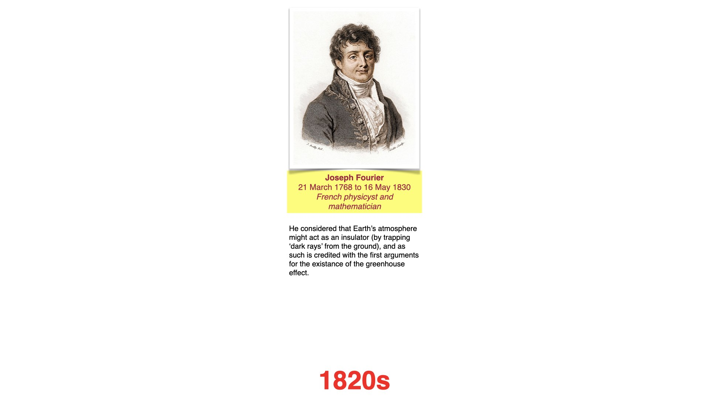{fig-alt="Historical teaching slide introducing Joseph Fourier and his work on Earth's atmospheric energy balance."}

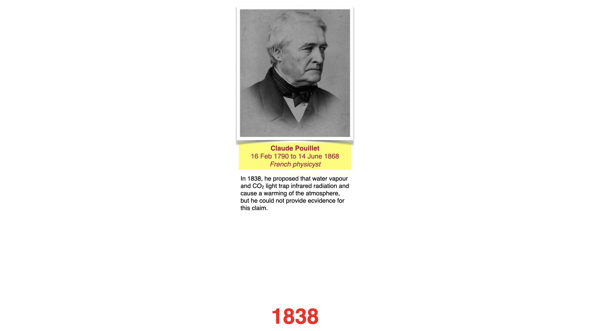{fig-alt="Historical teaching slide introducing Claude Pouillet and his nineteenth-century work on atmospheric absorption."}

### Eunice Foote

In **1856**, Eunice Newton Foote compared the warming of gases in glass cylinders exposed to sunlight. The cylinder containing CO~2~ warmed strongly, and she inferred that an atmosphere richer in that gas could be warmer [@foote1856circumstances]. Her experiment and inference preceded Tyndall's work. However, heating a sunlit cylinder involves several processes, so it should not be treated as an isolated measurement of the absorption of Earth's outgoing infrared radiation. See the [AIP comparison of Foote's and Tyndall's experiments](https://www.aip.org/sites/default/files/2022-02/Foote_vs_Tyndall_High_School.pdf).

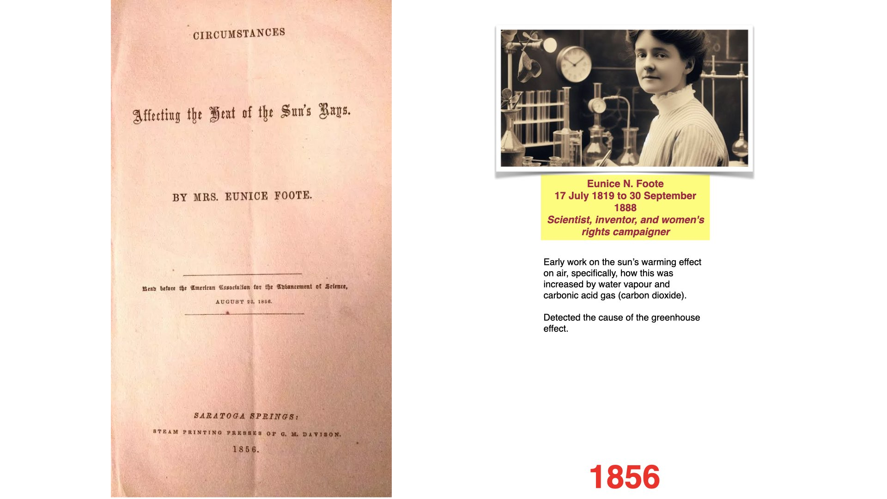{fig-alt="Historical teaching slide showing the title page of Eunice Foote's 1856 paper, Circumstances Affecting the Heat of the Sun's Rays, with her portrait and dates."}

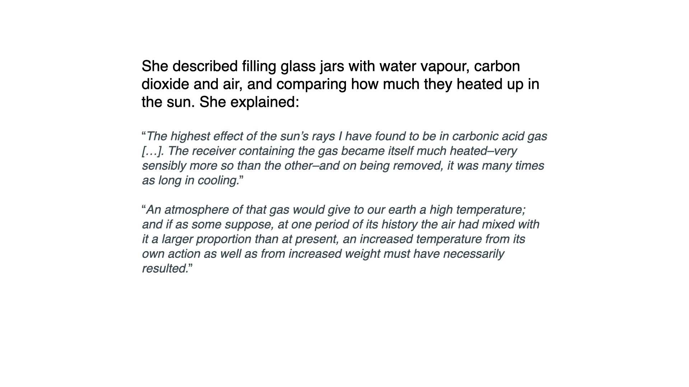{fig-alt="Historical teaching slide reproducing Foote's description of her sunlit gas-cylinder experiment and her inference about atmospheric warming."}

### John Tyndall

Tyndall's experiments, first reported in **1859** and developed in his **1861** paper, measured the absorption of thermal radiation by gases. Water vapour and CO~2~ absorbed strongly in relevant infrared bands, whereas the main atmospheric gases, nitrogen and oxygen, absorbed much less [@tyndall1861absorption]. This supplied a physical mechanism linking atmospheric composition with radiative energy exchange. His experiment differed from Foote's sunlit cylinders in both apparatus and the radiation being investigated.

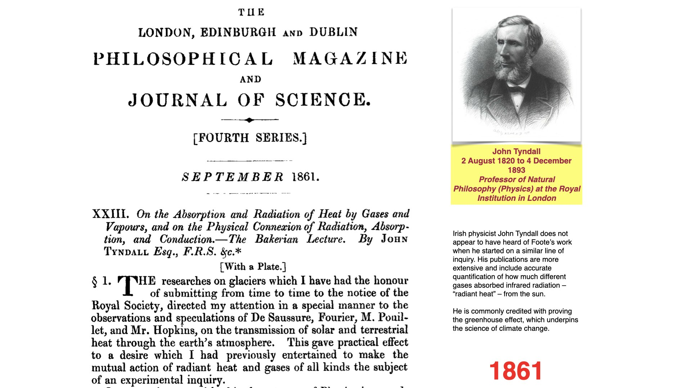{fig-alt="John Tyndall and the title page of his 1861 paper on absorption and radiation of heat by gases."}

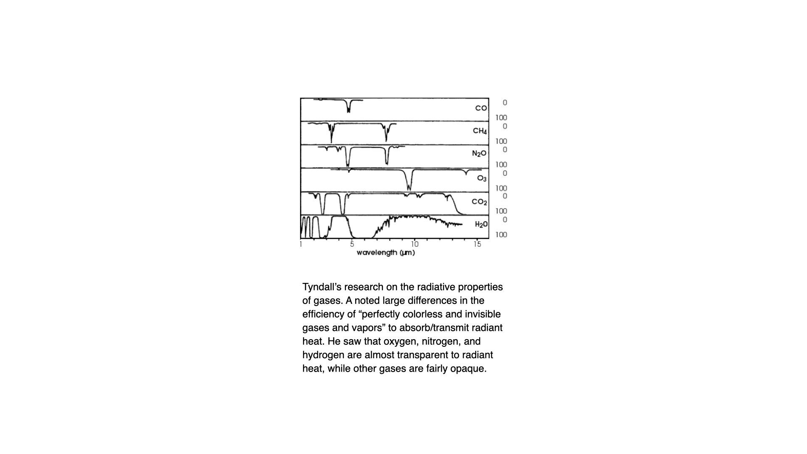{fig-alt="Infrared absorption spectra of carbon monoxide, methane, nitrous oxide, ozone, carbon dioxide and water vapour between 1 and 15 µm, with a note on Tyndall's finding that oxygen, nitrogen and hydrogen are almost transparent to radiant heat."}

Today an **infrared gas analyser**, or IRGA, uses absorption in selected wavelength bands to estimate gas concentration after calibration. In a leaf chamber, the difference in CO~2~ between incoming and outgoing air can be used to estimate gas exchange. This connects the history of atmospheric physics with the plant measurements used in ecophysiology.

### Svante Arrhenius

In **1896**, Arrhenius used radiation calculations to estimate how changing atmospheric CO~2~ could affect surface temperature. His estimate for doubled CO~2~ was roughly **5–6 °C**, with variation across his calculations [@arrhenius1896influence]. It was an early climate-sensitivity calculation, not a prediction of an annual warming rate. Modern calculations include better spectroscopy, ocean heat uptake and feedbacks. [NASA's account of early climate modelling](https://science.nasa.gov/earth/earth-observatory/an-introduction-to-climate-modeling/) explains the development.

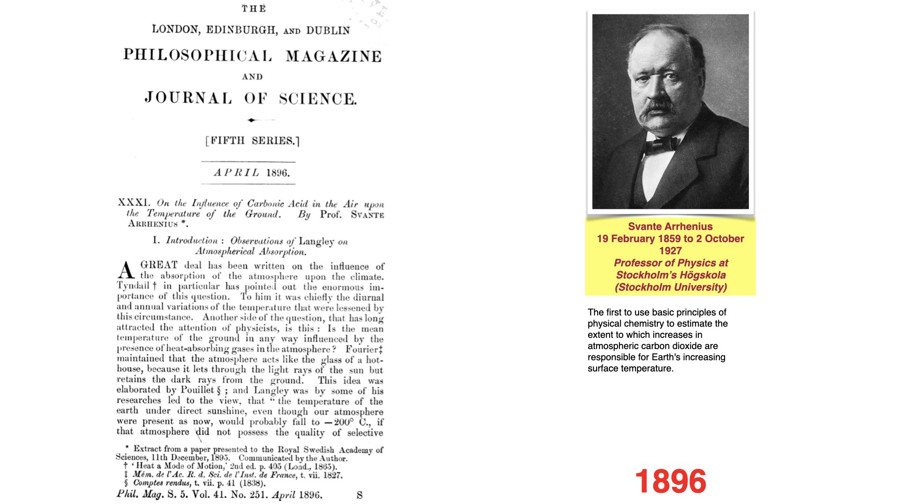{fig-alt="Svante Arrhenius and the first page of his 1896 paper estimating the effect of atmospheric carbon dioxide on ground temperature."}

The coal-burning connection also reached the public. The 1912 newspaper item below is a historical example of that discussion, rather than the beginning of the scientific understanding.

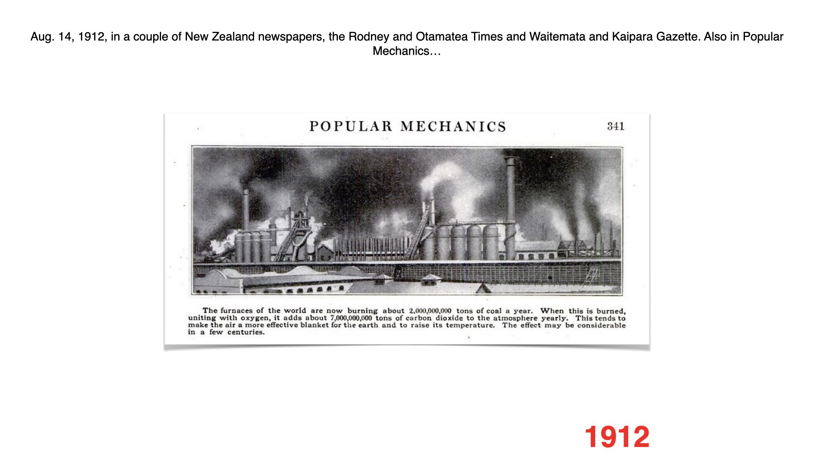{fig-alt="A 1912 newspaper item discussing coal combustion, atmospheric carbon dioxide and possible warming."}

### Guy Stewart Callendar

Callendar's **1938** paper combined temperature observations with a calculation of the radiative effect of fossil-fuel CO~2~. He reported an observed warming rate of about **0.005 °C per year** over the preceding half-century, and a separate estimated CO~2~-driven rate of **0.003 °C per year** at the time. Distinguish the measured trend from the calculated contribution: they were different quantities even within the same paper [@callendar1938artificial].

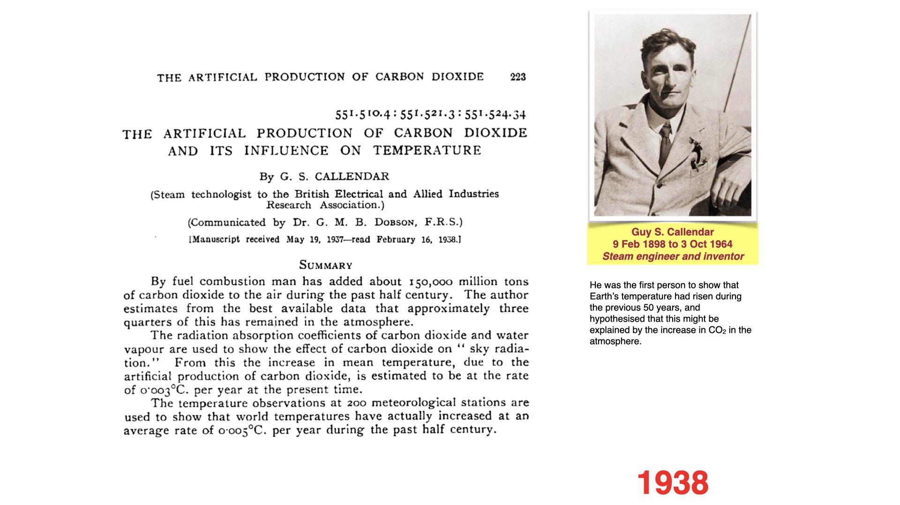{fig-alt="Guy Stewart Callendar and the summary of his 1938 paper, reporting separate observational and calculated warming rates."}

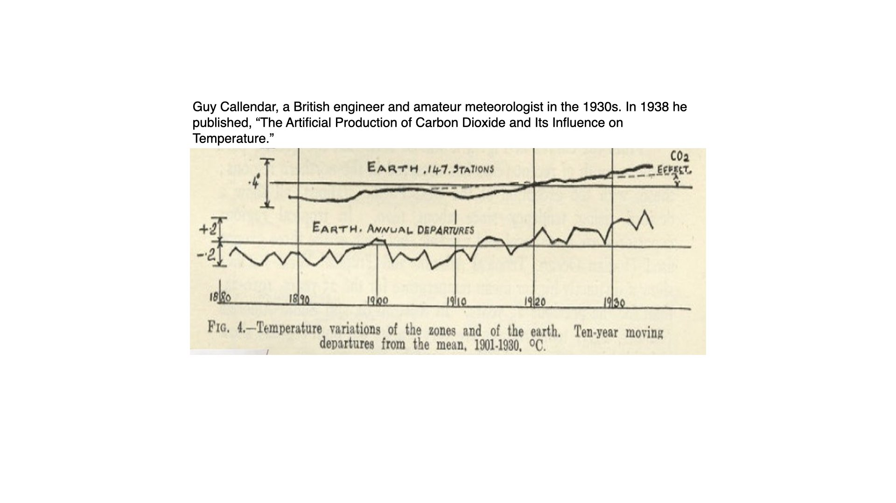{fig-alt="Callendar's historical land-station temperature reconstruction and calculated carbon dioxide contribution."}

### Gilbert Plass

Plass used improved infrared calculations in the **1950s**, including the effects of spectral lines and their overlap. In his **1956** paper he estimated **3.6 °C** warming for doubled CO~2~ under his stated assumptions. He also estimated a CO~2~ increase of nearly **30% per century** and warming of **1.1 °C per century** under the industrial conditions he considered. Those rate estimates depend on their emissions and uptake assumptions [@plass1956carbon]. The [original paper is available here](https://www.rescuethatfrog.com/wp-content/uploads/2017/02/Plass-1956e.pdf).

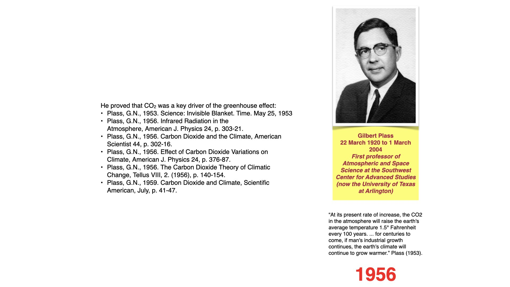{fig-alt="Historical teaching slide introducing Gilbert Plass and his 1950s calculations of carbon dioxide absorption and warming."}

### Charles David Keeling

Keeling began sustained high-precision CO~2~ measurements at **Mauna Loa in 1958**. The resulting record resolved both an annual cycle and a persistent increase. It made changes in atmospheric composition directly observable over successive decades. Today the Mauna Loa series is complemented by a global network, so a measurement at one station can be compared with a spatially averaged record. See the [Scripps history of the Keeling Curve](https://keelingcurve.ucsd.edu/2013/04/03/the-history-of-the-keeling-curve/).

{#fig-charles-keeling fig-alt="Historical teaching slide featuring a portrait of Charles David Keeling and a description of the Keeling Curve. The caption corrects the slide's start date and historical priority claim."}

## Early Estimates and Current Global Rates {#sec-historical-comparison}

Read the units and averaging periods before comparing the numbers. A rate describes change per unit time. A temperature anomaly describes a difference from a reference mean. Climate sensitivity describes a response to a specified forcing. The modern values below are the latest complete-year or assessed-period values available in the **15 October 2026** data snapshot.

| Quantity and early source | Early estimate in common units | Current global comparison | How to interpret the comparison |
|---|---|---|---|
| Observed warming, Callendar (1938) | **0.005 °C yr⁻¹**, or 0.05 °C per decade, over the preceding half-century | **0.0206 °C yr⁻¹**, or 0.206 °C per decade: an ordinary least-squares trend through NASA GISTEMP annual means for **1976–2025** | Both cover roughly 50 years, but Callendar's station coverage and the modern land–ocean index differ. |
| Calculated CO~2~-driven warming, Callendar (1938) | **0.003 °C yr⁻¹**, or 0.03 °C per decade, under then-current conditions | Assessed **human-induced warming: 0.027 °C yr⁻¹**, or **0.27 [0.20–0.40] °C per decade**, for **2016–2025** | The modern attribution includes human influences beyond CO~2~. It is not a direct measurement of the same simplified calculation. |
| Calculated warming, Plass (1956) | **0.011 °C yr⁻¹**, or 0.11 °C per decade, converted from 1.1 °C per century | The same **0.27 [0.20–0.40] °C per decade** assessed human-induced rate for **2016–2025** | Plass's industrial and uptake assumptions differ from the subsequent emissions pathway. This is a historical comparison, not a forecast-skill test. |
| Atmospheric CO~2~ increase, Plass (1956) | Nearly **30% per century**, equivalent to about 0.30% of his reference concentration per year on a linear basis | **2.06 ± 0.08 ppm yr⁻¹** in **2025**; about **0.48% yr⁻¹** when divided by that year's global mean, **425.62 ppm** | The modern percentage is an explicitly normalised annual increment. Plass's century-scale percentage is not a compound annual growth rate. |

: Historical rate estimates and modern comparisons. Historical values: @callendar1938artificial and @plass1956carbon. Modern values: [NASA GISTEMP](https://data.giss.nasa.gov/gistemp/), @forster2026indicators, and [NOAA global CO~2~ growth rates](https://gml.noaa.gov/ccgg/trends/gl_gr.html). The NASA trend is calculated for this lecture; NOAA reports the CO~2~ growth uncertainty as approximately one standard deviation. {#tbl-historical-climate-rates}

For a separate comparison of **CO~2~ doubling responses**, Arrhenius's roughly 5–6 °C, Callendar's approximately 2 °C and Plass's 3.6 °C can be set alongside the IPCC AR6 best estimate of **equilibrium climate sensitivity of 3 °C**, with a likely range of **2.5–4 °C**. The historical calculations used different treatments of radiation and feedbacks. None of these doubling-response values is an annual warming rate [@arias2021technical].

## Current Atmospheric Records {#sec-current-records}

### The Mauna Loa Record

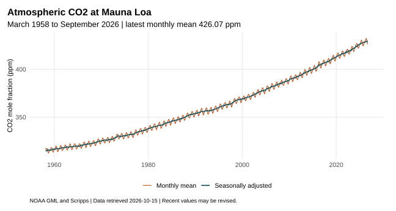{#fig-mlo-current fig-alt="Atmospheric carbon dioxide rises from about 315 ppm in 1958 to above 425 ppm in 2026. Monthly values oscillate around the seasonally adjusted record."}

The upward movement and the annual oscillation answer different questions. The long-term increase records net accumulation in the atmosphere. The oscillation reflects seasonal exchange, especially with Northern Hemisphere vegetation. A fall over several months does not establish a fall from one complete year to the next.

NOAA's series temporarily used observations from nearby **Maunakea** after the Mauna Loa eruption interrupted measurements in late November 2022; Mauna Loa measurements resumed in July 2023. This is documented in the [source file](https://gml.noaa.gov/webdata/ccgg/trends/co2/co2_mm_mlo.txt).

### A Station Record and a Global Mean

The global annual mean for **2025** was **425.62 ± 0.05 ppm**, from NOAA's marine boundary layer network. This differs from the Mauna Loa value because the station, spatial averaging and time interval differ. Use matched quantities when comparing sites or years. [NOAA annual global means](https://gml.noaa.gov/webdata/ccgg/trends/co2/co2_annmean_gl.txt).

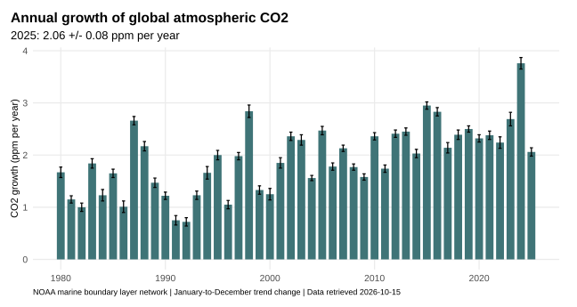{#fig-global-co2-growth fig-alt="Annual global carbon dioxide growth varies among years, reaching 3.76 ppm in 2024 and 2.06 ppm in 2025. The atmospheric increase remains positive."}

**Concentration and growth rate are different quantities.** NOAA's 2025 growth rate is the change in the seasonally adjusted trend across that year. It is not simply the difference between the 2024 and 2025 annual means. A smaller positive growth rate still means that atmospheric CO~2~ is increasing. It also need not mean emissions have fallen: changes in land and ocean uptake affect the atmospheric balance.

### Seasonal Exchange and Plant Activity {#sec-seasonal-co2}

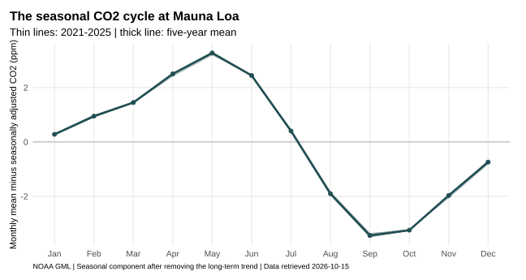{#fig-co2-seasonal fig-alt="After removing the long-term trend, Mauna Loa carbon dioxide is generally highest in late northern spring and lowest in early northern autumn."}

At Mauna Loa, CO~2~ usually reaches its seasonal maximum around **May** and its minimum around **September or October**. During the northern growing season, vegetation takes up carbon rapidly. Respiration and decomposition continue, but the seasonal balance shifts towards uptake. Later, reduced photosynthesis and continuing respiratory losses shift the balance towards atmospheric release. The phase and amplitude differ among stations, particularly between hemispheres. [NOAA CO~2~ records](https://gml.noaa.gov/ccgg/trends/).

The figure removes the long-term trend so that the within-year pattern can be examined directly. Its vertical axis is a seasonal departure in ppm, not the atmospheric concentration itself.

{#fig-co2-hemispheres fig-alt="Daily CO2 observations from 2014 to 2024 at two Northern Hemisphere and two Southern Hemisphere stations. Barrow and Mauna Loa show much larger seasonal oscillations than American Samoa and the South Pole, while all four records rise over time."}

Both hemispheres show a sustained increase, but the northern stations show much larger seasonal excursions. Seasonal plant exchange, the distribution of land and vegetation, and atmospheric transport help explain these differences. Global mixing connects the records without making every station's concentration identical.

::: callout-note
## Study Exercise

Using @fig-mlo-current and @fig-co2-seasonal, explain how seasonal plant activity can produce a recurring annual decline while the atmospheric concentration continues to rise over decades. State which months you are comparing and distinguish photosynthesis from net ecosystem carbon storage. This is a study exercise with no separate submission or continuous assessment mark. Assessed tasks and deadlines are in the [module timetable](BDC223_index.qmd#sec-syllabus).
:::

## Carbon Stocks and Fluxes

A **stock** is an amount of carbon in a defined store. A **flux** is a transfer per unit time. Atmospheric concentration is related to the atmospheric stock, whereas emissions, photosynthesis and ocean exchange are fluxes. The accounting can be written schematically as:

$$
\begin{aligned}
\text{atmospheric carbon change per year}
&= \text{fossil and land-use emissions}\\
&\quad - \text{net land uptake}\\
&\quad - \text{net ocean uptake}.
\end{aligned}
$$

Express every term in the same carbon units per year. Net uptake already subtracts the opposing release. Gross photosynthesis alone therefore cannot establish whether an ecosystem is a net carbon sink. Newly fixed carbon can be respired, decomposed, burned or exported. The system boundary and observation period matter, just as they do for nutrient budgets later in the module.

The ocean absorbs carbon through air–sea exchange, and circulation and biological processes redistribute it. Dissolved CO~2~ participates in carbonate chemistry, increasing hydrogen-ion concentration and lowering pH as more carbon is added. Ocean heat uptake also slows the rise in surface temperature while increasing ocean heat content. The WMO State of the Global Climate 2025 reports continuing ocean warming and acidification [@wmo2026state].

A short reduction in emissions does not necessarily make atmospheric concentration decline: inputs can still exceed net uptake. Likewise, reaching net zero CO~2~ emissions is different from eliminating all environmental change. Sustained net zero CO~2~ is expected to approximately stabilise CO~2~-driven warming, while sea level and other slow components can continue changing [@lee2021future].

## CO₂ in Palaeoclimate Context

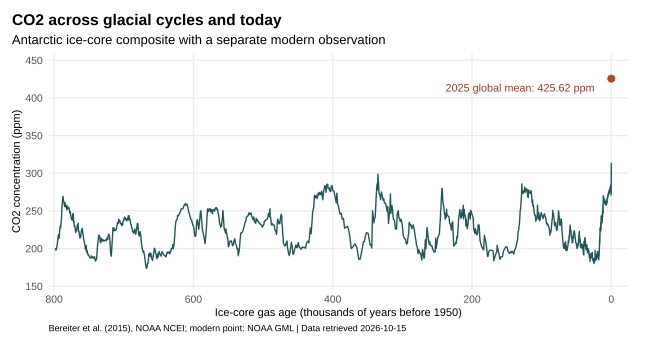{#fig-co2-800k fig-alt="Antarctic ice-core carbon dioxide varies through repeated glacial cycles, mostly between about 180 and 300 ppm, below the separate 2025 global mean of 425.62 ppm."}

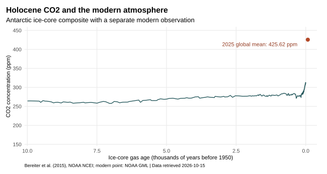{#fig-co2-holocene fig-alt="Holocene ice-core carbon dioxide concentrations are much lower than the separate modern atmospheric point. The horizontal axis is thousands of years before 1950."}

The ice-core curves use the revised composite assembled by @bereiter2015revision, [archived by NOAA NCEI](https://www.ncei.noaa.gov/access/paleo-search/study/17975). They reconstruct past air from bubbles in Antarctic ice. The modern point is a direct atmospheric observation, not an additional ice-core sample. The time resolution and dating differ, so the two should not be treated as one uniformly sampled record.

CO~2~ changed naturally during glacial cycles. Its present concentration is nevertheless well above the late-Quaternary range represented here. For the African vegetation and human histories associated with those intervals, return to [Lecture 4](L04-climate.qmd#sec-africa-deep-time).

## Current Temperature Records {#sec-temperature-records}

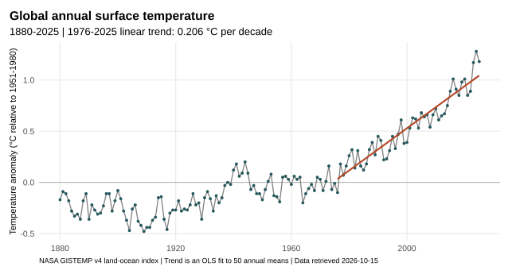{#fig-temperature-annual fig-alt="Global annual temperature anomalies increase over the instrumental record. A linear fit through 1976–2025 shows warming of about 0.206 degrees Celsius per decade."}

A **temperature anomaly** is a difference from a stated reference mean. NASA's figure uses **1951–1980**. The WMO multi-dataset assessment reports **2025 at 1.43 ± 0.13 °C above 1850–1900**. These numbers use different baselines and methods, so their numerical values should not be compared as if they shared a zero. A single warm year also differs from the long-term warming level used in the Paris Agreement [@wmo2026state].

The NASA 50-year trend in @tbl-historical-climate-rates is a descriptive fit to observations. The recent **human-induced** rate of 0.27 °C per decade is an attribution estimate over **2016–2025**. It addresses a different period and separates human influence from natural drivers and internal variability. A fitted rate depends on the interval selected [@forster2026indicators].

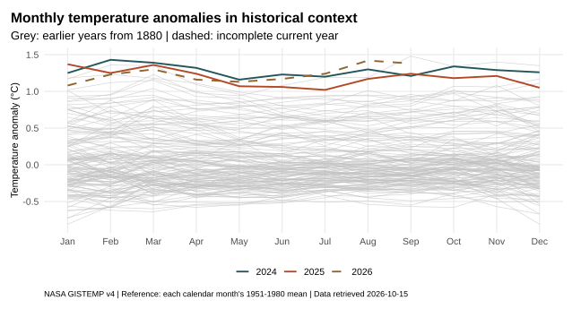{#fig-temperature-monthly fig-alt="Recent monthly global temperature anomalies lie above most earlier years. The incomplete 2026 curve ends in September rather than implying an annual value."}

The figure shows **monthly anomalies** relative to each calendar month's reference mean. The seasonal climate reference has already been subtracted month by month. Its month-to-month changes therefore describe departures from expected seasonal conditions. This differs from the CO~2~ seasonal cycle in @fig-co2-seasonal. [NASA GISTEMP data](https://data.giss.nasa.gov/gistemp/).

## Future Emissions Scenarios

Scenarios describe conditional futures under specified emissions and socioeconomic assumptions. They are not forecasts: each one asks what would follow if society developed in a particular way, and together they show the range of futures that depend on choices still to be made.

### Representative Concentration Pathways

The IPCC Fifth Assessment Report (AR5) was built on four **Representative Concentration Pathways (RCPs)** [@vanvuuren2011representative]. Each RCP is named after the radiative forcing it reaches in 2100, in watts per square metre: RCP2.6, RCP4.5, RCP6.0 and RCP8.5. Together they span the range of forcing in the published literature, from a pathway with strong mitigation (RCP2.6) to one with continued high emissions (RCP8.5). An RCP specifies greenhouse gas concentrations, emissions and land use over time; integrated assessment models then show what kind of energy system and economy could produce such a pathway.

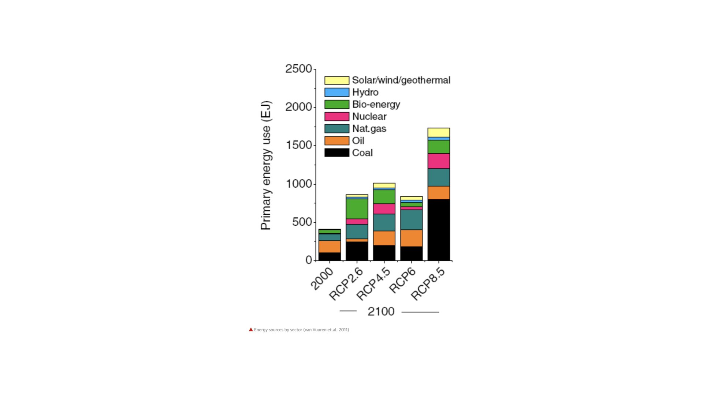{fig-alt="Stacked bar chart of global primary energy use in 2000 and in 2100 under RCP2.6, RCP4.5, RCP6 and RCP8.5, divided into coal, oil, natural gas, nuclear, bio-energy, hydro and solar, wind and geothermal."}

The energy systems behind the RCPs differ less in how much energy people use than in where it comes from. In all four pathways, global primary energy use in 2100 is about twice that of 2000 or more. In RCP8.5 it is roughly four times larger and is dominated by coal. In RCP2.6 the extra energy comes mostly from bio-energy, nuclear power and other low-carbon sources, with a much smaller share of coal and oil [@vanvuuren2011representative]. Low and high emission futures are therefore distinguished mainly by the carbon content of the energy supply.

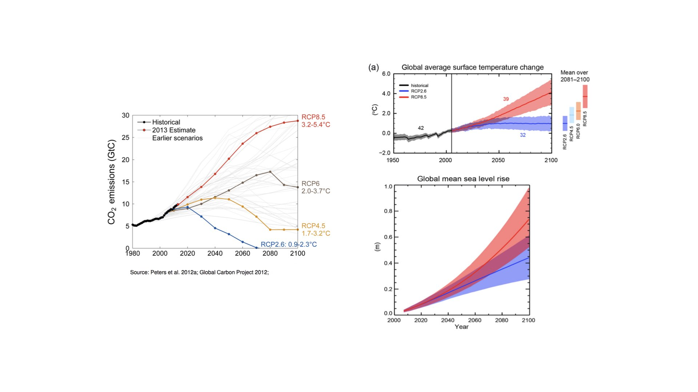{fig-alt="Left: global fossil CO2 emissions from 1980 to 2100, with observed emissions and the four RCP pathways, labelled with their warming ranges by 2100. Right: projected change in global average surface temperature and global mean sea-level rise to 2100 under RCP2.6 and RCP8.5."}

The left panel compares observed fossil CO~2~ emissions with the RCPs. By the early 2010s, emissions were following the upper end of the scenario range, close to RCP8.5, and the authors concluded that keeping warming below 2 °C would require immediate, large and sustained reductions in emissions [@peters2013challenge]. The warming ranges printed beside each pathway show how strongly the end-of-century outcome depends on the path taken, from about 0.9–2.3 °C for RCP2.6 to 3.2–5.4 °C for RCP8.5. The right panels show the AR5 projections for RCP2.6 and RCP8.5. For 2081–2100, relative to 1986–2005, the likely ranges of warming were 0.3–1.7 °C under RCP2.6 and 2.6–4.8 °C under RCP8.5, and of global mean sea-level rise 0.26–0.55 m and 0.45–0.82 m [@ipcc2013summary]. The two pathways differ little until about the 2040s and separate in the second half of the century, because warming over the next few decades is set largely by emissions that have already occurred and by the slow response of the oceans.

### Shared Socioeconomic Pathways

IPCC AR6 combined forcing levels with **Shared Socioeconomic Pathways (SSPs)**, which describe how population, economic growth, technology and policy might develop. A scenario name such as SSP5-8.5 joins a socioeconomic storyline (SSP5, fossil-fuelled development) with the forcing level reached in 2100 (8.5 W m⁻², as in RCP8.5), so the earlier RCPs map onto the newer framework [@vanvuuren2014climate]. The table gives selected assessed global surface warming levels; it does not assign probabilities to the scenarios.

| Scenario | 2041–2060 warming | 2081–2100 warming |
|---|---|---|
| SSP1-2.6, low emissions | 1.7 °C [1.3–2.2] | 1.8 °C [1.3–2.4] |
| SSP2-4.5, intermediate emissions | 2.0 °C [1.6–2.5] | 2.7 °C [2.1–3.5] |
| SSP5-8.5, very high emissions | 2.4 °C [1.9–3.0] | 4.4 °C [3.3–5.7] |

: Selected IPCC AR6 assessed warming levels relative to **1850–1900**. Brackets give very likely ranges. Values are 20-year means from Table 4.5 of @lee2021future, not the temperature of one particular future year. {#tbl-ssp-warming}

Emissions choices affect the later warming level. Regional changes in rainfall, extremes and ocean conditions require regional evidence as well as a global mean. An African drought projection, for example, needs a place, season, scenario and time horizon; it cannot be inferred from one global temperature value.

## Consequences for Plant Ecophysiology

Climate change alters the conditions under which plants acquire resources and maintain their tissues. Temperature affects metabolism and respiratory losses. Water availability and atmospheric drying demand affect stomatal opening and carbon gain. Marine plants also face changes in water temperature, carbonate chemistry, mixing and nutrient supply.

Rising CO~2~ can stimulate photosynthesis under some conditions, but water, nutrients, temperature and losses can restrict the resulting growth or storage. Drought, fire, mortality and decomposition can return carbon to the atmosphere. These responses connect plant physiology with the carbon cycle rather than providing an automatic increase in ecosystem carbon storage.

Mitigation changes the drivers, for example by reducing emissions or protecting carbon stores. Adaptation changes how people and ecosystems respond to the conditions they encounter. Keep these societal uses of the word *adaptation* distinct from inherited evolutionary adaptation and within-individual acclimatisation. [Lecture 10](L10-plant_stress.qmd) develops the physiological stress responses.

## Summary

-   Laboratory experiments and radiation calculations established the role of atmospheric CO~2~ in Earth's energy balance long before sustained measurements began. Foote found that sunlit CO~2~ warmed strongly, and Tyndall measured the absorption of thermal radiation by CO~2~ and water vapour. Arrhenius, Callendar and Plass then estimated the warming that more CO~2~ would cause.
-   Keeling's Mauna Loa record, begun in 1958, made the rise in atmospheric CO~2~ directly observable. The global mean reached 425.62 ppm in 2025, and the 2025 growth rate was 2.06 ppm yr⁻¹.
-   Warming rates, temperature anomalies and climate sensitivity are different quantities. Callendar's observed 0.005 °C yr⁻¹ compares with a modern NASA trend of 0.206 °C per decade for 1976–2025, whereas the 5–6 °C, 3.6 °C and 3 °C values of Arrhenius, Plass and IPCC AR6 are responses to doubled CO~2~.
-   A stock is an amount of carbon in a store and a flux is a transfer per unit time. Atmospheric CO~2~ rises whenever fossil and land-use emissions exceed net uptake by land and ocean.
-   The seasonal CO~2~ cycle, largest at Northern Hemisphere stations, reflects the balance between photosynthesis and respiration through the year, and it is superimposed on a long-term increase.
-   Antarctic ice cores show CO~2~ mostly between about 180 and 300 ppm over the last 800,000 years, well below the present concentration.
-   Scenarios (the RCPs of AR5 and the SSPs of AR6) are conditional futures, not forecasts; low and high emission pathways differ mainly in the carbon content of the energy supply.
-   Future warming depends on the emissions pathway, from 1.8 °C under SSP1-2.6 to 4.4 °C under SSP5-8.5 for 2081–2100 relative to 1850–1900.
-   Rising CO~2~, temperature and drought alter photosynthesis, respiration and water use, but they do not automatically increase ecosystem carbon storage.

## Self-Test Questions

::: {.callout-note collapse="true"}
## 1. What did Foote, Tyndall and Keeling each contribute to climate-change science, and how did Foote's experiment differ from Tyndall's?

Foote (1856) showed that a sunlit glass cylinder containing CO~2~ warmed strongly, and inferred that an atmosphere with more CO~2~ could be warmer. Tyndall (1859, 1861) measured the absorption of thermal radiation by gases, showing that water vapour and CO~2~ absorb strongly in infrared bands while nitrogen and oxygen absorb much less. Keeling began sustained high-precision CO~2~ measurements at Mauna Loa in 1958, which recorded both the annual cycle and the long-term increase. Foote's sunlit cylinders involved several heating processes, whereas Tyndall isolated the absorption of thermal radiation by each gas.
:::

::: {.callout-note collapse="true"}
## 2. Callendar (1938) reported an observed warming of 0.005 °C yr⁻¹. Convert this to °C per decade and compare it with the NASA GISTEMP trend for 1976–2025. Why is this comparison only approximate?

0.005 °C yr⁻¹ × 10 = 0.05 °C per decade. The modern trend is 0.206 °C per decade, so 0.206 / 0.05 ≈ 4.1 times faster. Both rates cover roughly 50 years, but Callendar used land stations available in the 1930s, whereas GISTEMP is a global land–ocean index with different coverage and methods.
:::

::: {.callout-note collapse="true"}
## 3. Classify each value as a warming rate, a temperature anomaly or a climate sensitivity: (a) Plass's 3.6 °C; (b) 0.27 °C per decade for 2016–2025; (c) 1.43 °C above 1850–1900 in 2025.

(a) Climate sensitivity: Plass's estimated warming for doubled CO~2~, comparable with the IPCC AR6 best estimate of 3 °C. (b) A warming rate: the assessed human-induced warming per decade over a stated period. (c) A temperature anomaly: the 2025 temperature as a difference from the 1850–1900 reference mean. Only values of the same kind, with the same reference period, can be compared directly.
:::

::: {.callout-note collapse="true"}
## 4. Atmospheric CO~2~ at Mauna Loa falls from about May to September or October each year. Why does the concentration still rise from one decade to the next, and why is the seasonal cycle larger at Barrow than at the South Pole?

During the northern growing season, photosynthesis by Northern Hemisphere vegetation takes up carbon faster than respiration and decomposition release it, so atmospheric CO~2~ falls. Later in the year, photosynthesis declines while respiration continues, and CO~2~ rises again. Over a whole year, fossil and land-use emissions exceed net uptake by land and ocean, so the seasonally adjusted concentration keeps rising. Barrow is in the Northern Hemisphere, which has most of the land and seasonal vegetation, whereas the South Pole is far from large areas of seasonal plant growth.
:::

::: {.callout-note collapse="true"}
## 5. The global CO~2~ growth rate was 3.76 ppm in 2024 and 2.06 ppm in 2025, when the global mean was 425.62 ppm. Express the 2025 growth as a percentage of the concentration, and explain whether the lower growth rate shows that atmospheric CO~2~ fell or that emissions fell.

2.06 / 425.62 × 100 ≈ 0.48% yr⁻¹. The growth rate was positive, so atmospheric CO~2~ still increased in 2025, only more slowly than in 2024. The growth rate is the balance of emissions and net land and ocean uptake, so a smaller increase can come from greater uptake in that year without any fall in emissions.
:::

::: {.callout-note collapse="true"}
## 6. Rising CO~2~ can stimulate photosynthesis. Why does this not guarantee that ecosystems will store more carbon?

Water, nutrients and temperature can limit the growth that extra photosynthesis would otherwise support. Newly fixed carbon can be respired, decomposed, burned or exported, so gross photosynthesis does not establish net storage. Drought, fire and mortality can also return stored carbon to the atmosphere.
:::

::: {.callout-note collapse="true"}
## 7. RCP2.6 and RCP8.5 project almost the same warming until about the 2040s but very different warming by 2100. Why, and what does RCP8.5 assume about the energy system?

Warming over the next few decades is set largely by emissions that have already occurred and by the slow response of the oceans, so the pathways separate only later in the century. RCP8.5 assumes continued high emissions from an energy system that, by 2100, uses about four times the primary energy of 2000 and relies heavily on coal; RCP2.6 assumes a supply dominated by bio-energy, nuclear and other low-carbon sources.
:::

## Figure Data and Sources

The current figures use data retrieved on **15 October 2026**. The monthly observational records extend through **September 2026**; complete annual comparisons end in **2025**. Recent observations remain subject to their providers' quality control and revision.

- [NOAA and Scripps Mauna Loa monthly CO~2~](https://gml.noaa.gov/webdata/ccgg/trends/co2/co2_mm_mlo.txt).
- [NOAA global annual CO~2~ means](https://gml.noaa.gov/webdata/ccgg/trends/co2/co2_annmean_gl.txt) and [global growth rates](https://gml.noaa.gov/ccgg/trends/gl_gr.html).
- [NASA GISTEMP v4](https://data.giss.nasa.gov/gistemp/), with the [land–ocean temperature table](https://data.giss.nasa.gov/gistemp/tabledata_v4/GLB.Ts+dSST.csv).
- [Bereiter et al. (2015), revised Antarctic ice-core CO~2~ composite](https://www.ncei.noaa.gov/access/paleo-search/study/17975).
- [Forster et al. (2026), Indicators of Global Climate Change 2025](https://doi.org/10.5194/essd-18-3889-2026).
- [WMO State of the Global Climate 2025](https://wmo.int/publication-series/state-of-global-climate/state-of-global-climate-2025).

## References

::: {#refs}
:::
