::: callout-tip
## **Content**

-   Light as an energy source, a signal and a stress for plants; its variation in space and time; light quantity and light quality.
-   Wavelength, frequency and photon energy; ultraviolet, photosynthetically active and infrared radiation.
-   Photochemical equivalence and the definition of photosynthetically active radiation (PAR).
-   Light in the atmosphere and under plant canopies, including the Monsi–Saeki equation and the red to far-red ratio.
-   Light in water: absorption by water, the Beer–Lambert law, the euphotic depth, the light zones of the ocean, and coastal versus open-ocean water.
-   Measuring light: photon flux density, the daily light integral, light sensors, and quantum, radiometric and photometric units.
-   The effects of different wavebands on plants.
:::

::: callout-tip
## **Aims**

This lecture treats light as both a physical quantity and a biological resource. We cover wavelength, frequency, energy, photons, photosynthetically active radiation, and the ways in which the atmosphere, plant canopies and water change the quantity and quality of light available to plants. These ideas are used throughout the rest of the module: in [Lecture 7a](L07a-pigments_photosynthesis.qmd), on how pigments capture light and how photosynthesis responds to it; in [Lecture 7b](L07b-measuring_photosynthesis.qmd), on measuring photosynthesis; in [Lecture 8](L08-chromatic_adaptation.qmd), on how seaweeds respond to the colour of light at depth; and in [Lecture 10](L10-plant_stress.qmd), where excess light is treated as a stress.
:::

::: callout-tip
## **Learning Outcomes**

By the end of this lecture, you will be able to:

1.  Explain how the wavelength, frequency and energy of light are related, and calculate the energy of a photon and of a mole of photons of a given wavelength.
2.  Describe the ultraviolet, photosynthetically active, far-red and infrared parts of the solar spectrum, and the effect of each on plants.
3.  Distinguish light quantity from light quality, and explain why a reading from a quantum sensor says nothing about light quality.
4.  Define PAR and explain, using the principle of photochemical equivalence, why light for photosynthesis is measured in quantum units.
5.  Calculate a daily light integral from a photon flux density, distinguish quantum, radiometric and photometric units, and choose a suitable light sensor for a given measurement.
6.  Explain how sun angle, the atmosphere and plant canopies change the quantity and quality of light, and use the Monsi–Saeki equation to calculate light beneath a canopy.
7.  Use the Beer–Lambert law to calculate the light at a given depth, the diffuse attenuation coefficient and the euphotic depth, and interpret light profiles plotted on linear and logarithmic axes.
8.  Explain why red light is lost first in water, describe the light zones of the ocean, and explain how phytoplankton, CDOM and suspended particles change the depth and colour of light in coastal water.
:::

::: callout-note
## **Required Reading**

-   [Kirk, J. T. O. (2011). *Light and Photosynthesis in Aquatic Ecosystems* (3rd ed.). Cambridge University Press.](https://doi.org/10.1017/CBO9781139168212)
-   [McCree, K. J. (1972). The action spectrum, absorptance and quantum yield of photosynthesis in crop plants. *Agricultural Meteorology*, 9, 191–216.](https://doi.org/10.1016/0002-1571(71)90022-7)
-   [Monsi, M., & Saeki, T. (2005). On the factor light in plant communities and its importance for matter production. *Annals of Botany*, 95(3), 549–567. (English translation of the 1953 original.)](https://doi.org/10.1093/aob/mci052)
:::

## Introduction: Light as a Resource and a Stress

For plants, light is the energy source that drives photosynthesis. It is also a signal that plants use to time their development, and in excess it is a stress. To understand plant ecophysiology, you need to know what light is physically, how we measure it, and how the atmosphere, plant canopies and water change it before it reaches a leaf or an alga.

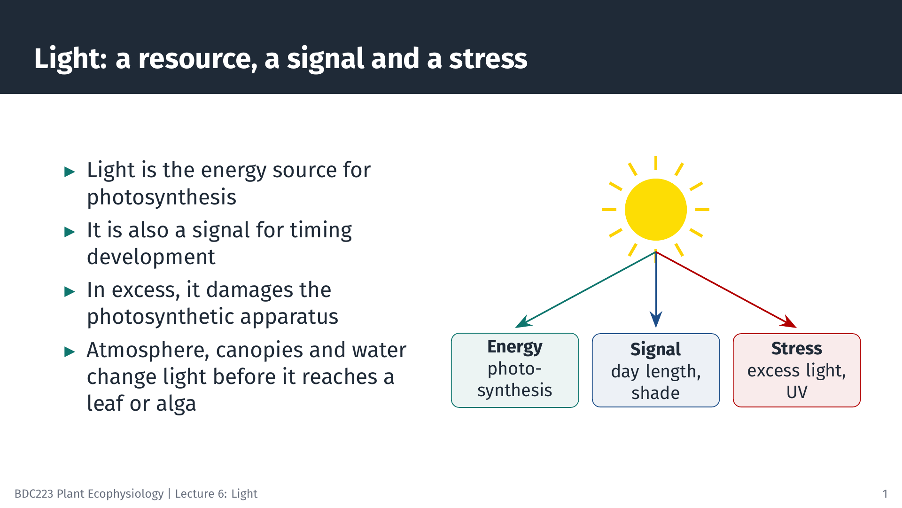

In this lecture we deal with the quantity and the quality of light, and with what happens to light on land and in the sea. The lectures that follow build on this: how plants capture light with pigments, how photosynthesis responds to light, how to design experiments that measure photosynthesis, and how photosynthesis relates to plant growth.

## Why Light Is Important to Plants

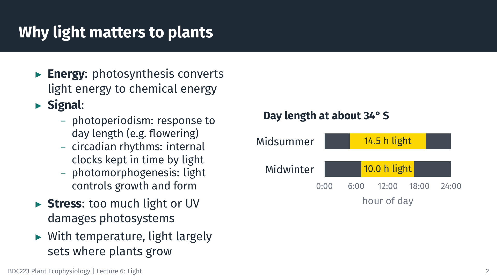

Light and temperature are probably the two environmental factors with the widest influence on plants. Light acts in three ways.

-   **As an energy source.** Photosynthesis converts the energy of absorbed light into chemical energy, which the plant then uses for growth and maintenance.
-   **As a signal.** Plants detect the length of the day, the direction of light and its spectral composition, and adjust their development accordingly. *Photoperiodism* is a response to day length, such as the onset of flowering in long-day or short-day plants. Plants also have internal *circadian rhythms* of roughly 24 hours, and the daily cycle of light and darkness keeps these rhythms in time. *Photomorphogenesis* is the control of growth and form by light, for example the greening of a seedling when it first reaches light, or the elongation of a stem growing in shade.
-   **As a stress.** Too much light, especially at high ultraviolet doses, damages the photosynthetic apparatus. We return to this in the lecture on plant stress.

Light also shapes ecological interactions, such as competition between plants for light in a forest canopy. Together with temperature, it largely determines where plants can grow, both across the land surface and with depth in the ocean.

## Global and Temporal Variability of Light

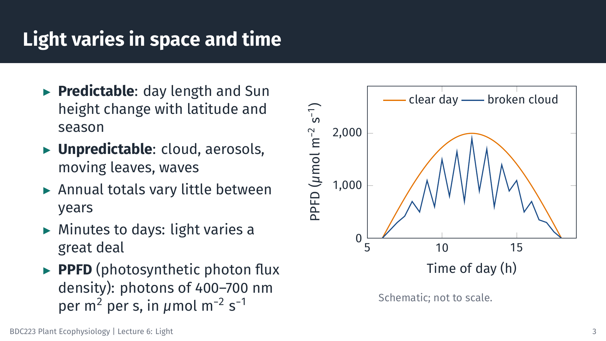

Light varies greatly across the Earth's surface and over time scales from seconds to seasons. Part of this variation is predictable, because it follows from the Earth's rotation and its orbit around the Sun: day length and the maximum height of the Sun change regularly with latitude and season. The other part is unpredictable, because it depends on cloud, aerosols, the movement of leaves in the wind, or waves at the sea surface. Averaged over a whole year, the light received at a given place changes little from one year to the next. Over minutes, hours and days, it changes a great deal.

The graph on the slide shows light as *photosynthetic photon flux density* (PPFD). PPFD is the number of photons with wavelengths between 400 and 700 nm (the band we define below as PAR) that fall on one square metre each second. It is given in micromoles of photons per square metre per second ($\mu\mathrm{mol\,m^{-2}\,s^{-1}}$). On a clear day, PPFD rises and falls smoothly with the height of the Sun. Under broken cloud, it can change several-fold within minutes. We return to PPFD and how it is measured in the section on measuring light.

### Quantity and quality of light

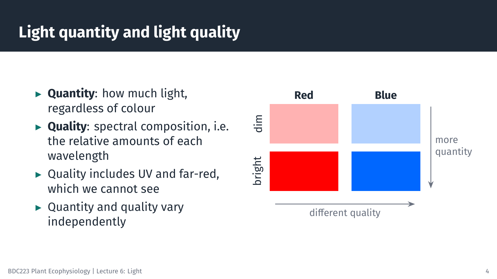

Light has a *quantity* and a *quality*, and the two must be kept apart. Light quantity is the amount of light, regardless of its colour. Light quality is its spectral composition: the relative amounts of the different wavelengths, including ultraviolet and far-red wavelengths that we cannot see. You can have dim or bright red light, and dim or bright blue light. Brightness describes quantity and colour describes quality, and the two vary independently.

## Wavelength, Frequency, and Energy Relationships

Visible light is a small portion of the electromagnetic spectrum. Human eyes are sensitive to wavelengths between about 390 and 750 nanometres (nm). The range that drives photosynthesis is similar, as we will see when we define PAR.

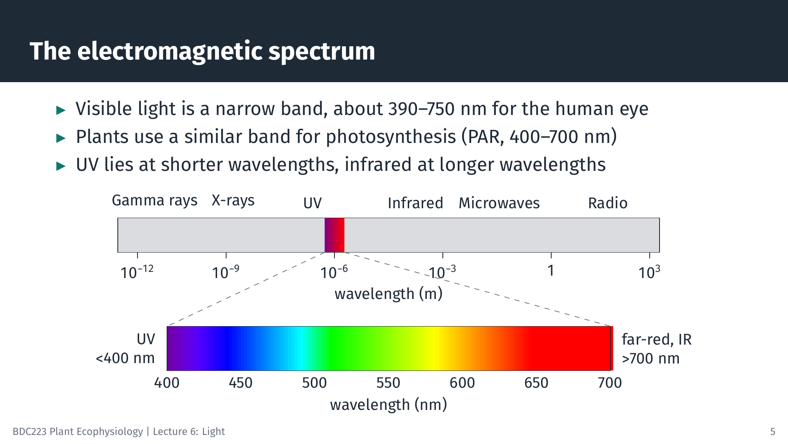

Light behaves both as a wave and as a stream of particles, called photons. The wavelength ($\lambda$) and frequency ($\nu$) of light are related through the speed of light ($c$):

$$
c = \lambda \nu
$$

Short-wavelength light, such as violet, has a high frequency. Red light, at around 700 nm, has a lower frequency.

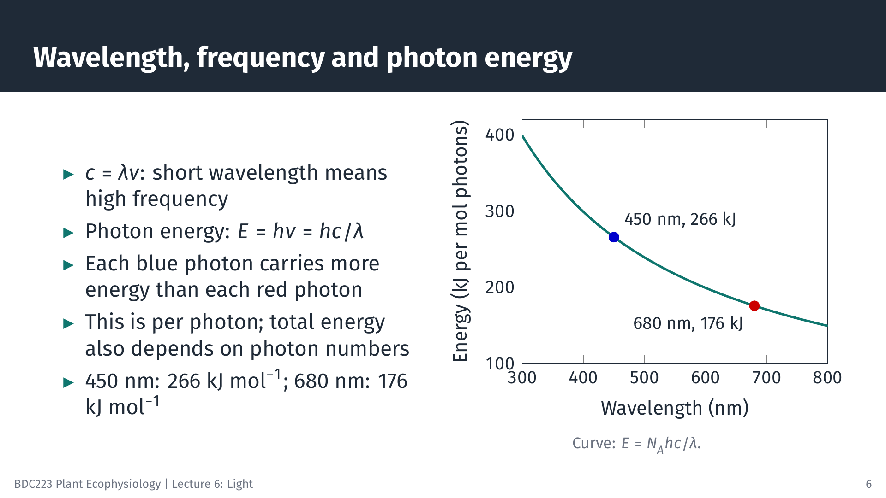

The energy of a single photon depends on its frequency, and so on its wavelength:

$$
E = h\nu = \frac{hc}{\lambda}
$$

where $h$ is Planck's constant ($6.626 \times 10^{-34}\,\mathrm{J\,s}$) and $c = 2.998 \times 10^{8}\,\mathrm{m\,s^{-1}}$. Each photon of blue, violet or ultraviolet light therefore carries more energy than each photon of red or infrared light. Note that this is a statement about single photons. It does not mean that sunlight contains more energy in the blue than in the red, because that also depends on how many photons of each wavelength arrive.

**Worked example.** A blue photon of 450 nm carries

$$
E = \frac{(6.626 \times 10^{-34})(2.998 \times 10^{8})}{450 \times 10^{-9}} = 4.4 \times 10^{-19}\,\mathrm{J},
$$

and a red photon of 680 nm carries $2.9 \times 10^{-19}\,\mathrm{J}$. Multiplying by Avogadro's number ($6.022 \times 10^{23}$) gives the energy of one mole of photons: about $266\,\mathrm{kJ}$ for blue light and $176\,\mathrm{kJ}$ for red light. As a check, the ratio of the two energies (1.51) equals the inverse ratio of the wavelengths (680/450 = 1.51). You may be asked to do this calculation in a test or class exercise.

### Ultraviolet radiation

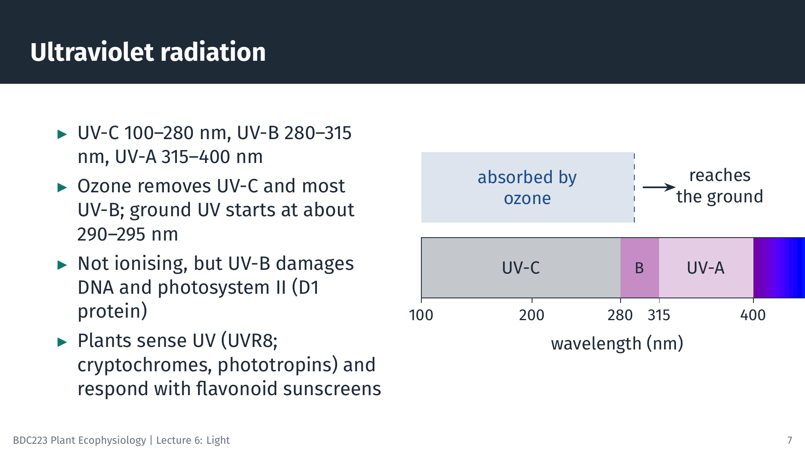

Ultraviolet (UV) radiation has wavelengths shorter than visible light. It is divided into UV-C (100–280 nm), UV-B (280–315 nm) and UV-A (315–400 nm). Ozone in the stratosphere absorbs all UV-C and most UV-B, so the shortest wavelengths reaching the ground are about 290–295 nm.

UV radiation at the ground is not ionising: ionisation needs wavelengths shorter than about 100 nm. It is nevertheless harmful. DNA absorbs UV-B directly, which joins adjacent bases together (forming pyrimidine dimers) and causes mutations. UV-B also damages photosystem II, particularly its D1 protein, and so reduces photosynthesis. Single-celled algae and the surface cells of leaves are the most exposed.

Plants also sense UV. The photoreceptor UVR8 detects UV-B, and cryptochromes and phototropins detect UV-A and blue light. In response, plants make UV-absorbing flavonoids that act as sunscreens in the outer cell layers of leaves, and they repair damaged DNA and D1 protein. UV is therefore relevant to plant physiology even though it contributes little to photosynthesis.

### Infrared radiation

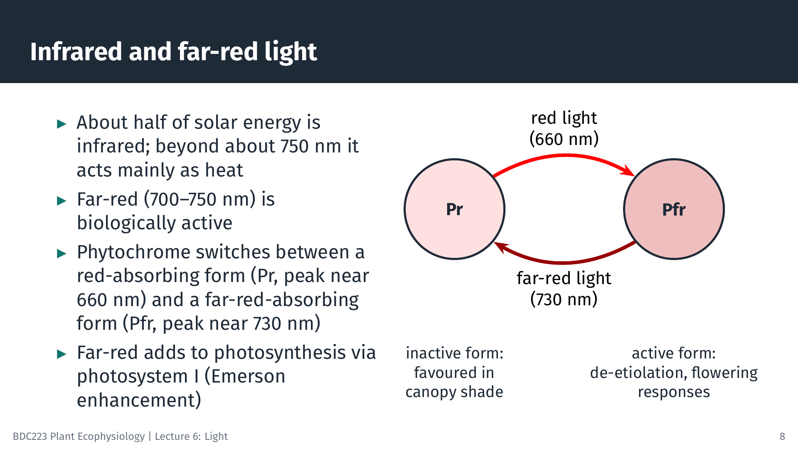

Infrared (IR) radiation has wavelengths longer than about 700 nm, and the solar infrared that reaches the ground extends to about 3,000 nm. About half of the energy in sunlight arrives as infrared. When it is absorbed it warms surfaces, which is why you feel heat on your skin in sunshine.

The first part of the infrared, from about 700 to 750 nm, is called *far-red* light, and plants respond to it strongly. The plant photoreceptor phytochrome exists in two forms that absorb red light (peak near 660 nm) and far-red light (peak near 730 nm). The balance between the two forms tells a plant whether it is being shaded by other leaves, as we discuss below. Far-red photons also contribute to photosynthesis: photosystem I absorbs at around 700 nm, and far-red light increases photosynthesis when it is given together with shorter wavelengths (the Emerson enhancement effect) [@emerson1957some]. Some cyanobacteria use chlorophylls *d* and *f* to photosynthesise with far-red light alone. Beyond about 750 nm, oxygenic photosynthetic organisms absorb little, and the radiation acts mainly as heat.

## Photosynthetically Active Radiation (PAR)

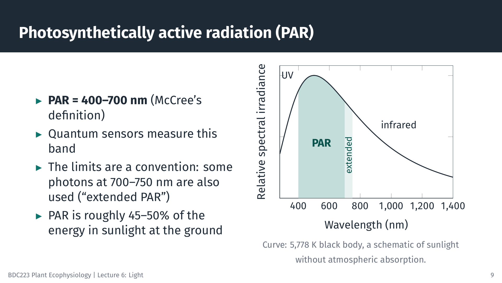

Photosynthetically active radiation (PAR) is defined as radiation between **400 and 700 nm**. This is the standard definition, proposed by McCree in the early 1970s [@mccree1972action], and quantum sensors are designed to measure this band. Photons in this range can drive the photochemical reactions of photosynthesis, including the splitting of water and the release of oxygen.

The 400–700 nm band is a convention, not a sharp biological limit. Plants absorb and use some photons between 700 and 750 nm (see the section on infrared above), and some researchers now use an "extended PAR" of 400–750 nm. In this module, PAR means 400–700 nm.

PAR makes up roughly 45–50% of the energy in sunlight at the Earth's surface. The rest is mostly infrared, with a few per cent of ultraviolet.

## Photochemical Equivalence

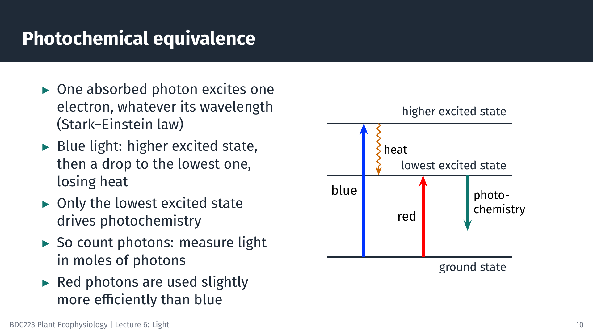

Why do we count photons rather than measure energy when we study photosynthesis? The answer is the principle of *photochemical equivalence* (the Stark–Einstein law): each absorbed photon excites one electron, whatever the wavelength of that photon.

Consider what happens when chlorophyll absorbs a blue photon and a red photon. The blue photon lifts an electron to a higher energy level than the red photon does. Within a tiny fraction of a second, however, the electron excited by the blue photon drops to the same lower excited state reached by the red photon, and the energy difference is lost as heat. Only this lower excited state passes energy on to photochemistry. So a blue photon and a red photon drive the same amount of photochemistry, even though the blue photon carried about 50% more energy.

The rate of photosynthesis therefore depends on the number of photons absorbed per unit time, not on their energy. This is why quantum units (moles of photons) are the appropriate measure of light for photosynthesis. In practice, the equivalence is approximate. Leaves use red photons slightly more efficiently than blue photons, partly because some blue light is absorbed by pigments that pass energy to the reaction centres less efficiently. McCree's measurements of this efficiency across wavelengths are one reason for the 400–700 nm definition of PAR.

## Light in the Atmosphere and on Land

Before sunlight reaches a leaf, the atmosphere and, often, other leaves change both its quantity and its quality.

### Sun angle, day length and the atmosphere

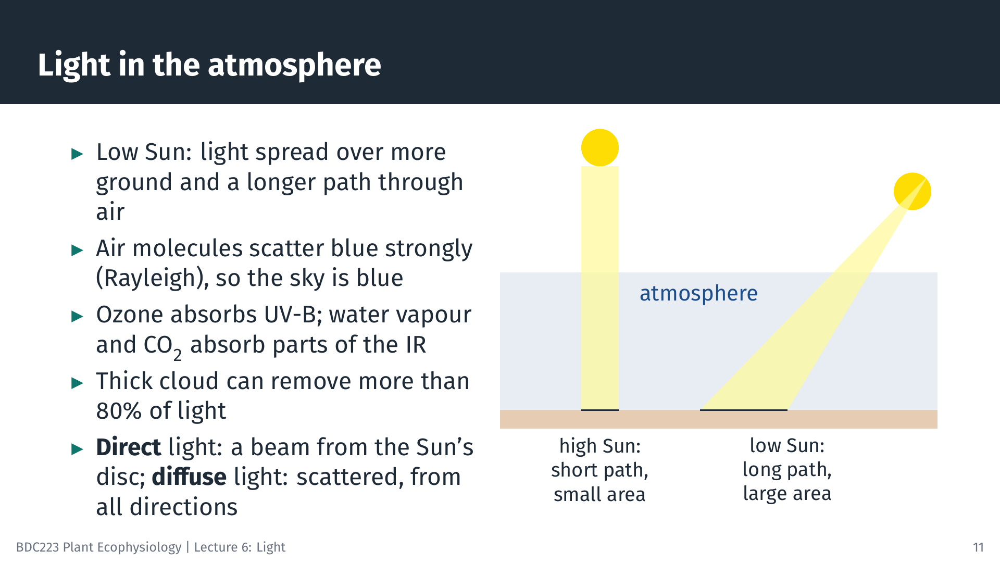

The amount of light reaching the ground depends first on the height of the Sun above the horizon. When the Sun is low, its light is spread over a larger area of ground, and it travels through a longer path of atmosphere, which absorbs and scatters more of it. This is why light is weaker in the early morning, in the late afternoon, in winter, and at high latitudes. Day length also changes with season and latitude. At Cape Town (about 34° S), the day is about 14.5 hours long in midsummer and about 10 hours long in midwinter.

As light passes through the atmosphere:

-   gas molecules scatter short wavelengths much more strongly than long wavelengths (Rayleigh scattering), which is why the sky is blue;
-   ozone absorbs most UV-B, and water vapour and carbon dioxide absorb parts of the infrared;
-   clouds and aerosols (dust, smoke and sea salt) reflect and scatter light, and can reduce the light at the ground by more than 80% under thick cloud.

Light therefore reaches a plant in two forms. *Direct* light comes in a beam from the Sun's disc and casts sharp shadows. *Diffuse* light has been scattered by the sky and clouds and arrives from all directions. On a clear day, most light is direct; under overcast skies, nearly all of it is diffuse. Diffuse light penetrates plant canopies more evenly, because it reaches leaves that are shaded from the direct beam.

### Light under plant canopies

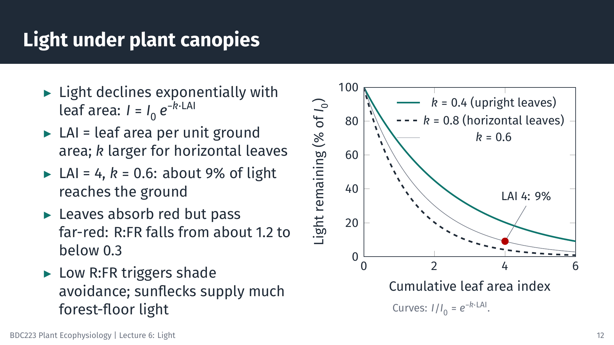

Within a forest or a dense crop, leaves absorb most of the light before it reaches the ground. The decline in light through a canopy follows the same exponential form as the decline with depth in water (see the Beer–Lambert law below), with the cumulative leaf area replacing depth:

$$
I = I_0\,e^{-k \cdot \mathrm{LAI}}
$$

Here $I_0$ is the light above the canopy, LAI is the leaf area index (the one-sided area of leaves above a point, per unit of ground area, which is dimensionless), and $k$ is the canopy extinction coefficient. Canopies with horizontal leaves have larger values of $k$ than canopies with upright leaves, because horizontal leaves intercept more light per unit leaf area. This relationship is often called the Monsi–Saeki equation [@monsi2005factor].

**Worked example.** For a canopy with LAI = 4 and $k = 0.6$, the light reaching the ground is $e^{-2.4} = 0.09$, or about 9% of the light above the canopy.

Canopies also change the quality of light. Chlorophyll absorbs red and blue light strongly but absorbs little far-red light, which leaves mostly transmit or reflect. The ratio of red to far-red light (R:FR) is about 1.2 in full sunlight, but it can fall below 0.3 under a dense canopy. Plants detect this change with phytochrome. Many species respond to a low R:FR by elongating their stems and petioles, a response known as *shade avoidance*, which raises their leaves towards the light. On land, therefore, the spectral changes that matter most to plants occur within vegetation, not in the open air.

Light under a canopy is also highly variable in time. Brief patches of direct sunlight, called *sunflecks*, pass through gaps in the canopy and can supply a large part of the daily light received by plants on the forest floor.

## Light in Water

Water changes light much more strongly than air does, both in quantity and in quality.

### Why red light disappears first

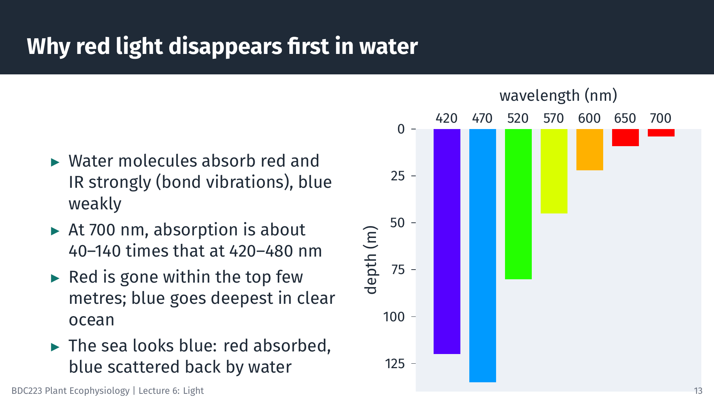

Water molecules absorb red and infrared light strongly. At 700 nm, pure water absorbs light between about 40 and 140 times more strongly than it does in the blue, at 420–480 nm [@pope1997absorption]. This difference is a property of the water molecule (it arises from the vibrations of the bonds between hydrogen and oxygen), not of the photon energy. So red light is removed within the top few metres, while blue light travels furthest in clear ocean water.

The sea looks blue for two reasons. Red light is absorbed, and blue light is scattered back towards the surface by the water molecules themselves. This is also why a white plate or a piece of white paper looks blue when you take it underwater to 5 or 10 m in clear water: the light still reaching it is mainly blue and green.

@fig-spectrum-sea follows sunlight from the top of the electromagnetic spectrum into the sea. In the top metre, water absorbs most of the infrared and some of the red light, so the spectrum at 1 m has already lost its long-wavelength tail. By 10 m, little red or orange light remains, and the spectrum peaks in the blue-green. By 100 m, only a narrow band of blue light is left, carrying a few per cent of the PAR that entered at the surface. The sequence (red first, then orange and yellow, then green, with blue last) is the reason that underwater photographs taken without a flash look blue.

![Sunlight in the electromagnetic spectrum and its attenuation with depth in clear ocean water. Top: types of electromagnetic radiation by wavelength. Middle: the solar spectrum at the sea surface, shown as a 5,778 K black body, with the visible colours marked. Bottom: the spectrum remaining at 1, 10 and 100 m, and the proportion of surface PAR remaining at each depth (about 87%, 46% and 4%). Colour bars fade where each colour falls to 1% of its surface value. Attenuation uses approximate diffuse attenuation coefficients for very clear ocean water; the depth axis is linear to 1 m and logarithmic below.](images/L06_light/fig-spectrum-sea.png){#fig-spectrum-sea fig-alt="Diagram linking the electromagnetic spectrum, the solar spectrum, and spectra at 1, 10 and 100 m depth in the sea, showing red light lost first and blue light reaching deepest."}

### The Beer–Lambert law

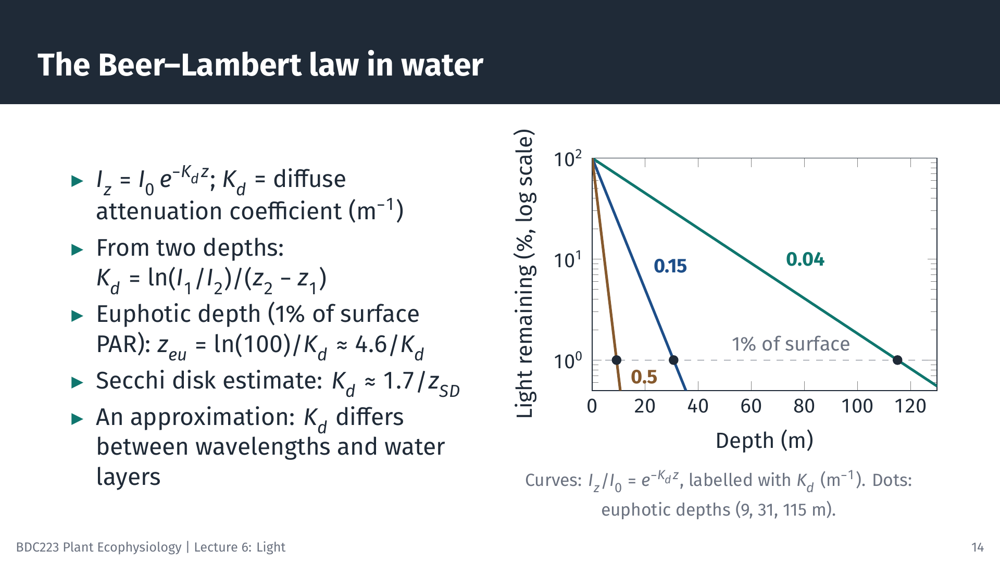

The decline of light with depth is called *attenuation*. It is described by the Beer–Lambert law:

$$
I_z = I_0\,e^{-K_d z}
$$

where $I_0$ is the light just below the water surface, $I_z$ is the light at depth $z$ (in metres, measured downwards), and $K_d$ is the *diffuse attenuation coefficient* (units $\mathrm{m^{-1}}$). $I_0$ and $I_z$ must be in the same units, for example $\mu\mathrm{mol\,m^{-2}\,s^{-1}}$. $K_d$ combines the effects of absorption and scattering by the water and everything dissolved or suspended in it [@kirk2011light].

**Worked example.** If the light just below the surface is $2{,}000\,\mu\mathrm{mol\,m^{-2}\,s^{-1}}$ and $K_d = 0.1\,\mathrm{m^{-1}}$, the light at 10 m is $2{,}000 \times e^{-1} = 736\,\mu\mathrm{mol\,m^{-2}\,s^{-1}}$, which is 37% of the surface value.

**Calculating $K_d$ from measurements.** If you measure light at two depths, rearranging the equation gives

$$
K_d = \frac{\ln(I_1 / I_2)}{z_2 - z_1}
$$

For example, $1{,}000\,\mu\mathrm{mol\,m^{-2}\,s^{-1}}$ at 2 m and $400\,\mu\mathrm{mol\,m^{-2}\,s^{-1}}$ at 8 m give $K_d = \ln(2.5)/6 = 0.15\,\mathrm{m^{-1}}$.

**The euphotic depth.** The depth at which 1% of the surface PAR remains is called the *euphotic depth*, $z_{eu}$. Setting $I_z/I_0 = 0.01$ gives

$$
z_{eu} = \frac{\ln(100)}{K_d} \approx \frac{4.6}{K_d}
$$

So water with $K_d = 0.15\,\mathrm{m^{-1}}$ has a euphotic depth of about 31 m. Clear oceanic water with $K_d = 0.04\,\mathrm{m^{-1}}$ has a euphotic depth of about 115 m, and turbid coastal water with $K_d = 0.5\,\mathrm{m^{-1}}$ has a euphotic depth of only about 9 m.

**Linear and logarithmic axes.** How you plot a light profile changes what you see (@fig-beer-lambert). On a linear light axis, the profiles curve sharply: most of the light is lost in the upper part of the water column, and all the light below the euphotic depth is squeezed against the zero line, where it cannot be read. On a logarithmic light axis, each exponential profile becomes a straight line. The slope of that line is set by $K_d$, so water with a larger $K_d$ gives a steeper line, and a change in slope with depth shows that $K_d$ changes between water layers. The logarithmic axis also spreads out the low light levels that matter for deep-water photosynthesis, such as the 1% level that defines the euphotic depth. When you plot your own light measurements in the practical, try both axes.

{#fig-beer-lambert fig-alt="Two panels of light remaining against depth: curved exponential profiles on a linear light axis, and straight lines on a logarithmic light axis."}

**A simple field method.** A Secchi disk is a white disk lowered into the water until it disappears from view. The depth at which this happens, $z_{SD}$, gives a rough estimate of attenuation: $K_d \approx 1.7 / z_{SD}$. This approximation varies between water types, but it is useful where no light meter is available.

The Beer–Lambert law strictly applies to a parallel beam of light passing through a uniform medium. In natural waters it is an approximation. $K_d$ differs between wavelengths, so the attenuation of broadband PAR changes with depth as the spectrum narrows towards blue or green. $K_d$ also changes where the water is layered, for example where a phytoplankton bloom sits below clearer surface water.

You will certainly be assessed on the Beer–Lambert law, both in written assessments and in practicals where you apply it to real data.

### Light zones in the ocean

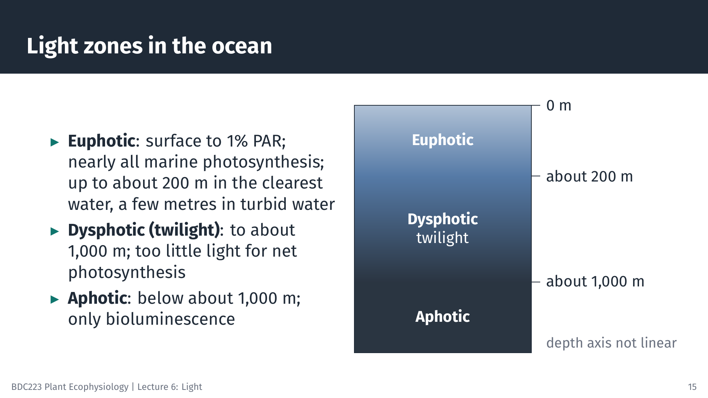

As light penetrates clear ocean water, its intensity decreases and its spectrum narrows. Red light is largely gone within the top 5–10 m. Orange and yellow light reach a few tens of metres. Below that, mainly blue and blue-green light remains.

The water column is divided into zones according to the light available:

-   **Euphotic (photic) zone:** from the surface to the depth of 1% surface PAR. Nearly all marine photosynthesis takes place here. In the clearest ocean water, where $K_d$ for PAR is about 0.03 m⁻¹, it extends to about 150 m; in the clear oceanic example above ($K_d$ = 0.04 m⁻¹) it reaches about 115 m. In turbid coastal water it may be only a few metres deep.
-   **Dysphotic (twilight) zone:** from the bottom of the euphotic zone to about 1,000 m. There is enough light for animals to see, but too little for net photosynthesis.
-   **Aphotic zone:** below about 1,000 m. No sunlight reaches it, and the only light comes from bioluminescent organisms.

The zones used by biological oceanographers combine depth and light (@fig-ocean-zones). The pelagic zones divide the open water into depth layers, and the benthic zones divide the sea floor from the shore to the deep trenches. The light zones are defined by the light available, and their depths depend on how clear the water is. In the clear ocean water of @fig-ocean-zones, red light falls to 1% of its surface value within about 12 m, whereas blue light falls to 1% only at about 240 m, and traces of blue light reach the twilight zone below.

![Zones of the ocean. (a) Biological zones of the open water (pelagic) and the sea floor (benthic), with the neritic zone over the continental shelf and the oceanic zone beyond it; boundaries follow one common convention. (b) Light zones, with the depth to which each colour of light penetrates in clear ocean water: solid lines end where each colour falls to 1% of its surface value, dotted lines where it falls to 0.01%. Attenuation uses approximate diffuse attenuation coefficients for very clear ocean water. Depth axes are not to the same scale.](images/L06_light/fig-ocean-zones.png){#fig-ocean-zones fig-alt="Cross-section of the ocean showing pelagic and benthic zones, and a column showing euphotic, dysphotic and aphotic zones with the depth reached by UV-A, red, yellow, green and blue light."}

### Light and the warm surface layer

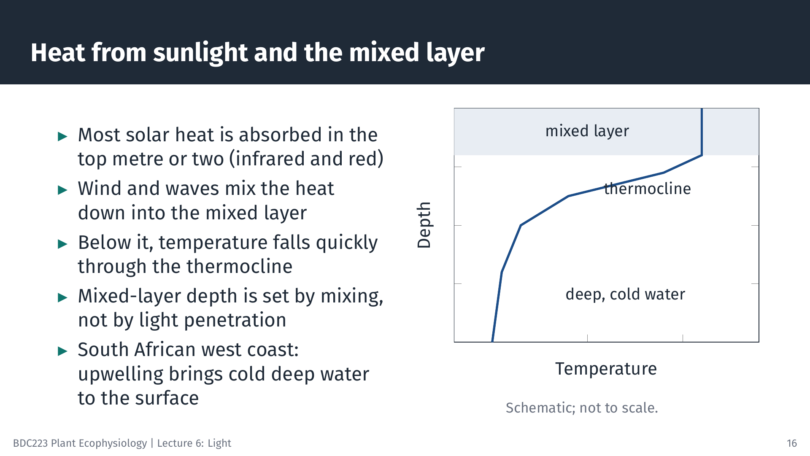

Most of the Sun's heat is absorbed in the top metre or two of the ocean, mainly from infrared and red light. Wind and waves mix this heat downwards, forming a warm, well-mixed surface layer that is a few metres to more than 100 m deep. Below this *mixed layer*, temperature falls quickly through the *thermocline*. The depth of the warm layer is therefore set mainly by mixing, not by how deep light penetrates. On the South African west coast, the water is also cold because of upwelling, in which wind brings cold, deep water to the surface.

## Coastal vs. Open Ocean Light Penetration

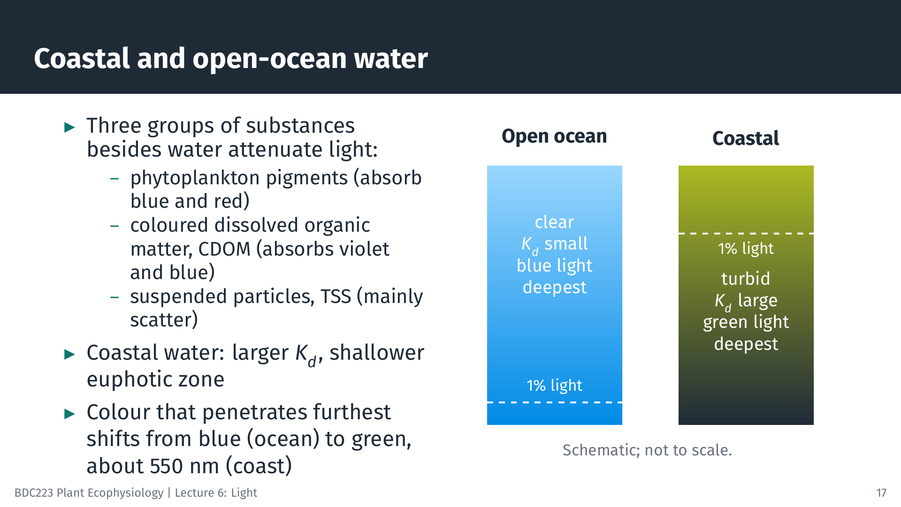

Besides water itself, three groups of substances absorb and scatter light in the sea:

-   **Phytoplankton**, whose chlorophyll and other pigments absorb blue and red light;
-   **Coloured dissolved organic matter** (CDOM, also called gelbstoff or yellow substance), which comes mostly from rivers and decaying plant material and absorbs violet and blue light strongly;
-   **Suspended particles** (total suspended solids, TSS), such as sediment from rivers, erosion and resuspension by waves, which mainly scatter light.

Coastal waters contain much more of all three than the open ocean, so $K_d$ is larger and light reaches shallower depths. In a turbid estuary or bay, the euphotic zone may be less than a few metres deep. The spectrum also changes. Because phytoplankton and CDOM absorb blue light, the colour that penetrates furthest in coastal water shifts from blue to green, around 550 nm. This is why coastal water often looks green or brown rather than blue. Seaweeds and seagrasses living on the coast, therefore, receive light that is not only dimmer but also greener than the light in the open ocean, a point we return to in the lecture on chromatic adaptation.

## Measuring Light

### Quantum measurements

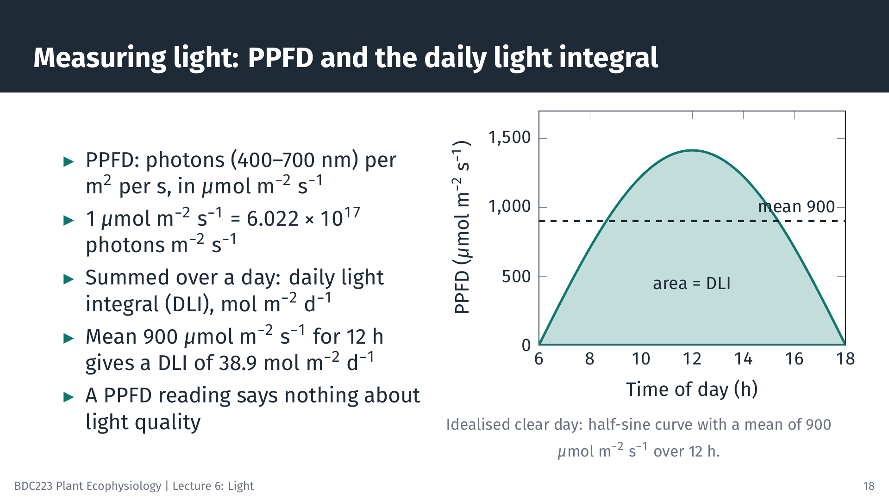

For plant work, we measure light as the number of photons in the PAR band falling on a surface per unit area and per unit time. This is the photosynthetic photon flux density (PPFD) introduced earlier. Its unit is the micromole of photons per square metre per second ($\mu\mathrm{mol\,m^{-2}\,s^{-1}}$). One mole is Avogadro's number ($6.022 \times 10^{23}$) of photons, so $1\,\mu\mathrm{mol\,m^{-2}\,s^{-1}}$ means $6.022 \times 10^{17}$ photons arriving on each square metre every second.

Because PPFD is a rate, you can add it up over time to get the total number of photons received. If $10\,\mu\mathrm{mol\,m^{-2}\,s^{-1}}$ falls for two seconds, the surface receives $20\,\mu\mathrm{mol\,m^{-2}}$. Summed over a whole day, this total is called the *daily light integral* (DLI), usually given in $\mathrm{mol\,m^{-2}\,d^{-1}}$.

**Worked example.** If the average PPFD over a 12-hour day is $900\,\mu\mathrm{mol\,m^{-2}\,s^{-1}}$, the DLI is $900 \times 10^{-6} \times 12 \times 3{,}600 = 38.9\,\mathrm{mol\,m^{-2}\,d^{-1}}$.

Energy measurements can be added up over time in the same way (watts summed over seconds give joules). The reason we prefer photon units for photosynthesis is photochemical equivalence, explained above.

A quantum sensor counts photons in the PAR band without regard to their colour: every photon between 400 and 700 nm counts equally. A PPFD reading therefore tells you nothing about light quality. Two light sources with the same PPFD can have very different spectra.

### Typical values

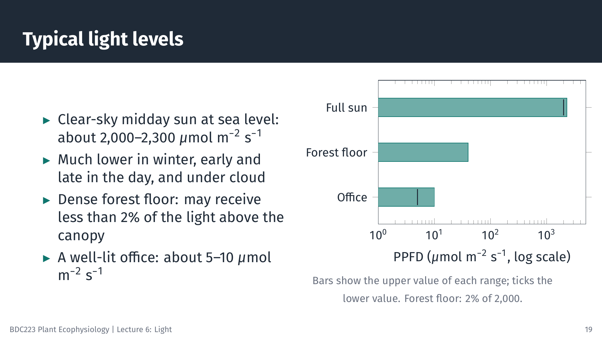

Full midday sunlight under a clear sky at sea level gives a PPFD of about $2{,}000\text{–}2{,}300\,\mu\mathrm{mol\,m^{-2}\,s^{-1}}$. Values like this occur close to the tropics and, in summer, at our latitude. In winter, in the early morning and late afternoon, and under cloud, the values are much lower. Higher readings can occur briefly at the edges of bright clouds and at high altitude. By comparison, the floor of a dense forest may receive less than 2% of the light above the canopy, and a well-lit office receives only about $5\text{–}10\,\mu\mathrm{mol\,m^{-2}\,s^{-1}}$.

### Light sensors

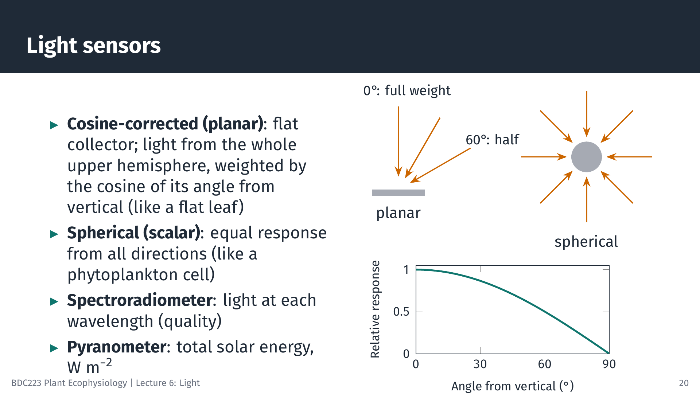

Quantum sensors differ in the shape of their collector, which determines how they respond to light arriving from different directions.

-   **Cosine-corrected (planar) sensors** have a flat, upward-facing collector. They measure the light falling on a flat surface from the whole hemisphere above it. Light arriving at an angle is weighted by the cosine of the angle from the vertical, just as it would be for a flat leaf. Light arriving at 60° from the vertical, for example, counts half as much as the same light arriving from directly overhead. These sensors suit measurements of light on leaves, canopies and the sea floor.
-   **Spherical (scalar) sensors** have a ball-shaped collector that responds equally to light from all directions. They measure the light available to an object that can absorb light from any direction, such as a phytoplankton cell suspended in the water. They are widely used in aquatic research.

Other instruments measure different properties of light:

-   **Spectroradiometers** measure the amount of light at each wavelength. They are needed to measure light quality, for example the R:FR ratio under a canopy or the spectrum at depth in the sea.
-   **Pyranometers** measure the total energy of solar radiation in $\mathrm{W\,m^{-2}}$, and are used in weather stations and energy-balance studies.

We will use some of these instruments in the practicals.

### Other units

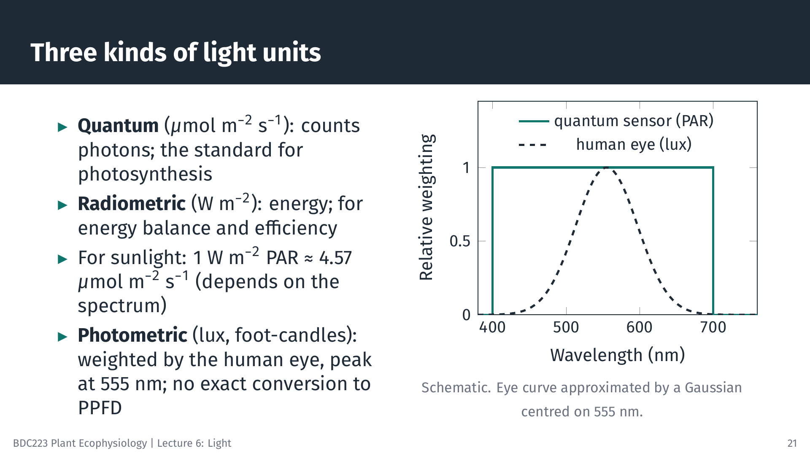

Light can be measured in three kinds of units, and it helps to know which is which.

-   **Quantum units** ($\mu\mathrm{mol\,m^{-2}\,s^{-1}}$) count photons. They are the standard for photosynthesis.
-   **Radiometric units** ($\mathrm{W\,m^{-2}}$) measure energy. They are needed for energy-balance calculations, such as leaf heating, and for calculating the efficiency with which plants convert light energy into chemical energy. For sunlight, $1\,\mathrm{W\,m^{-2}}$ of PAR corresponds to about $4.57\,\mu\mathrm{mol\,m^{-2}\,s^{-1}}$. This conversion factor depends on the spectrum, so it differs between light sources.
-   **Photometric units** (lux and foot-candles) weight light according to the sensitivity of the human eye, which peaks in the green at 555 nm. They are designed for human lighting, not for plants. There is no exact conversion from lux to PPFD, because the conversion depends on the spectrum of the light source.

## Effects of Different Wavelengths on Plants

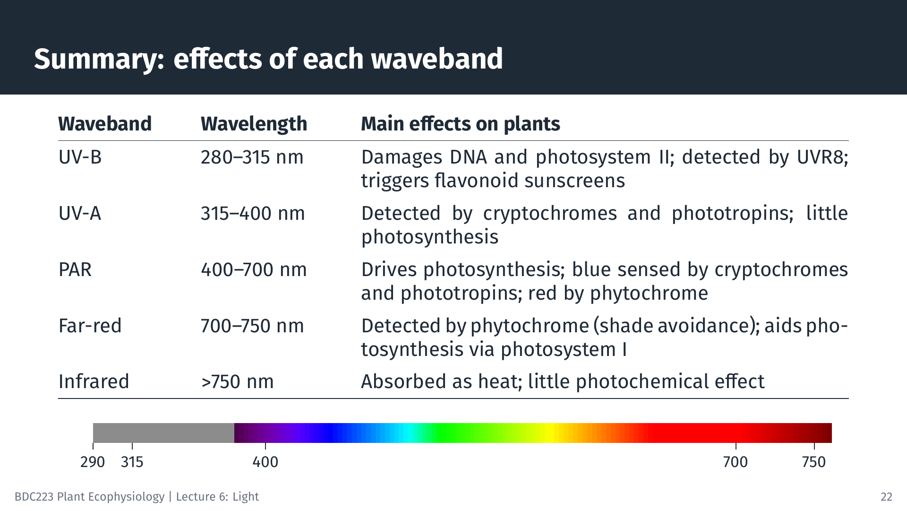

Each waveband acts on plants in a different way. UV-B damages DNA and photosystem II and triggers protective responses through UVR8. UV-A and blue light are sensed by cryptochromes and phototropins. PAR drives photosynthesis, and its red portion is also sensed by phytochrome. Far-red light is sensed by phytochrome and contributes to photosynthesis through photosystem I. Beyond about 750 nm, infrared radiation is absorbed mainly as heat.

The definition to remember is that of PAR: radiation between 400 and 700 nm, measured as a photon flux density in $\mu\mathrm{mol\,m^{-2}\,s^{-1}}$. This definition recurs throughout the lectures that follow.

## Summary

-   Light is the energy source for photosynthesis, a signal that controls plant development, and, in excess, a stress.
-   The energy of a photon is inversely proportional to its wavelength, so a mole of blue photons at 450 nm carries about 1.5 times the energy of a mole of red photons at 680 nm.
-   By the principle of photochemical equivalence, each absorbed photon excites one electron whatever its wavelength, so photosynthesis depends on the number of photons absorbed, and light for photosynthesis is measured as a photon flux density in µmol m⁻² s⁻¹.
-   PAR is radiation between 400 and 700 nm. A quantum sensor counts all photons in this band equally and so measures light quantity, not light quality.
-   Sun angle, day length, cloud and aerosols set the light reaching vegetation. Within a canopy, light declines exponentially with cumulative leaf area, and the red to far-red ratio falls, which plants detect with phytochrome.
-   In water, light declines exponentially with depth according to the Beer–Lambert law, $I_z = I_0 e^{-K_d z}$, and the euphotic depth, where 1% of surface PAR remains, is about $4.6/K_d$.
-   Water absorbs red light much more strongly than blue light, so red light disappears within the top few metres of clear ocean water and blue light penetrates furthest.
-   Phytoplankton, CDOM and suspended particles raise $K_d$ in coastal water, which makes the euphotic zone shallower and shifts the most penetrating light from blue towards green.

## Self-Test Questions

::: {.callout-note collapse="true"}
## 1. Calculate the energy of one mole of photons at 450 nm and at 680 nm. If a blue photon carries more energy, why does it not drive more photosynthesis than a red photon?

For one photon, $E = hc/\lambda$. At 450 nm, $E = (6.626 \times 10^{-34})(2.998 \times 10^{8}) / (450 \times 10^{-9}) = 4.4 \times 10^{-19}$ J, and at 680 nm, $E = 2.9 \times 10^{-19}$ J. Multiplying by Avogadro's number ($6.022 \times 10^{23}$) gives about 266 kJ mol⁻¹ for blue light and 176 kJ mol⁻¹ for red light. By photochemical equivalence, each absorbed photon excites one electron. The electron excited by a blue photon falls within a fraction of a second to the same lower excited state reached by a red photon, and the extra energy is lost as heat, so both photons drive the same amount of photochemistry.
:::

::: {.callout-note collapse="true"}
## 2. Distinguish light quantity from light quality. Can a quantum sensor tell you whether a plant is growing under a dense canopy or in the open?

Light quantity is the amount of light, regardless of its colour; light quality is its spectral composition. A quantum sensor counts every photon between 400 and 700 nm equally, so it measures quantity only. It shows that less light reaches the forest floor, but it cannot show the fall in the red to far-red ratio from about 1.2 in full sunlight to below 0.3 under a dense canopy. A spectroradiometer is needed for that.
:::

::: {.callout-note collapse="true"}
## 3. The average PPFD over a 12-hour day is 900 µmol m⁻² s⁻¹. What is the daily light integral?

DLI = PPFD × time = $900 \times 10^{-6}$ mol m⁻² s⁻¹ × 12 h × 3,600 s h⁻¹ = 38.9 mol m⁻² d⁻¹. The factor $10^{-6}$ converts µmol to mol, and the DLI is given in mol m⁻² d⁻¹.
:::

::: {.callout-note collapse="true"}
## 4. A crop canopy has an extinction coefficient $k = 0.6$. What fraction of the light above the canopy reaches the ground when LAI = 2, and when LAI = 4?

From the Monsi–Saeki equation, $I/I_0 = e^{-k \cdot \mathrm{LAI}}$. For LAI = 2, $I/I_0 = e^{-1.2} = 0.30$, so about 30% reaches the ground. For LAI = 4, $I/I_0 = e^{-2.4} = 0.09$, or about 9%. Doubling the leaf area does not halve the light at the ground; it reduces the transmitted fraction from 0.30 to $0.30^2$.
:::

::: {.callout-note collapse="true"}
## 5. The light just below the sea surface is 2,000 µmol m⁻² s⁻¹. Calculate the light at 10 m and the euphotic depth for water with $K_d = 0.15$ m⁻¹ and for turbid coastal water with $K_d = 0.5$ m⁻¹.

From the Beer–Lambert law, $I_z = I_0 e^{-K_d z}$. With $K_d = 0.15$ m⁻¹, $I_{10} = 2{,}000 \times e^{-1.5} = 2{,}000 \times 0.223 = 446$ µmol m⁻² s⁻¹ (22% of the surface value), and $z_{eu} = 4.6 / 0.15 \approx 31$ m. With $K_d = 0.5$ m⁻¹, $I_{10} = 2{,}000 \times e^{-5} = 13.5$ µmol m⁻² s⁻¹ (0.7% of the surface value), and $z_{eu} = 4.6 / 0.5 \approx 9$ m, so 10 m lies below the euphotic zone in the turbid water.
:::

::: {.callout-note collapse="true"}
## 6. You measure 1,000 µmol m⁻² s⁻¹ at 2 m and 400 µmol m⁻² s⁻¹ at 8 m. Calculate $K_d$. How would these two measurements look on a logarithmic light axis?

$K_d = \ln(I_1/I_2)/(z_2 - z_1) = \ln(1{,}000/400)/(8 - 2) = \ln(2.5)/6 = 0.92/6 = 0.15$ m⁻¹. On a logarithmic light axis, an exponential profile with constant $K_d$ plots as a straight line whose slope is set by $K_d$. If measurements at further depths fell off this line, $K_d$ would differ between water layers.
:::

::: {.callout-note collapse="true"}
## 7. Why does coastal water often look green, whereas clear ocean water looks blue?

In clear ocean water, water molecules absorb red light strongly and scatter blue light back towards the surface, so the water looks blue and blue light penetrates furthest. Coastal water contains more phytoplankton, coloured dissolved organic matter (CDOM) and suspended particles. Phytoplankton pigments and CDOM absorb blue light, so the most penetrating light shifts to green, around 550 nm, and suspended particles scatter light and raise $K_d$. Seaweeds on the coast therefore receive light that is both dimmer and greener than in the open ocean.
:::

## Multiple-Choice Questions

Click an option to check your answer. A green tick marks the correct option, and its explanation then appears below the options.

::: {.mcq}
**1.** Why is light for photosynthesis measured in quantum units rather than energy units? Which explanation is most correct?

-   Each absorbed photon carries the same energy, so counting photons gives the same result as measuring their energy directly.
-   Each blue photon excites two electrons and each red photon one, so photon counts must be weighted by wavelength.
-   Energy cannot be summed over time, whereas photon counts can be added up to give a total for the whole day.
-   [Each absorbed photon excites one electron, and the extra energy of a blue photon is lost as heat before photochemistry.]{.correct}

::: {.mcq-explain}
By photochemical equivalence, the electron excited by a blue photon drops to the same lower excited state reached by a red photon, losing the difference as heat. Photosynthesis therefore depends on the number of photons absorbed. Energy can also be summed over time (watts over seconds give joules), so that is not the reason.
:::
:::

::: {.mcq}
**2.** Which definition of the euphotic depth is the one used in this lecture?

-   [The depth at which PAR falls to 1% of its value just below the surface.]{.correct}
-   The depth at which red light falls to 1% of its value just below the surface.
-   The depth below which no sunlight reaches and only bioluminescence occurs.
-   The depth at which PAR falls to 37% of its value just below the surface.

::: {.mcq-explain}
The euphotic depth is where 1% of surface PAR remains, z_eu = ln(100)/Kd ≈ 4.6/Kd. The 37% level (1/e) is reached at z = 1/Kd, the bioluminescence-only region is the aphotic zone, and red light reaches 1% far shallower than broadband PAR does.
:::
:::

::: {.mcq}
**3.** Which statement best explains why red light is removed within the top few metres of clear ocean water?

-   Red photons carry less energy, so they are used up sooner as they pass through water.
-   Phytoplankton in clear ocean water absorb the red light before it reaches deeper water.
-   [Water molecules absorb red light strongly because of the vibrations of their O–H bonds.]{.correct}
-   Water molecules scatter red light back towards the surface more strongly than blue light.

::: {.mcq-explain}
At 700 nm pure water absorbs about 40 to 140 times more strongly than at 420 to 480 nm, a property of the bond vibrations in the water molecule, not of photon energy. Water scatters blue light more, which is one reason the sea looks blue.
:::
:::

::: {.mcq}
**4.** Which statement about photosynthetically active radiation (PAR) is most correct?

-   It is defined as 390–750 nm because that range matches the sensitivity of the human eye.
-   [It is defined as 400–700 nm by convention, although photons at 700–750 nm also contribute.]{.correct}
-   It is defined as 400–700 nm and carries about 90% of the energy in sunlight at the ground.
-   It is defined as 400–700 nm because no plant pigment absorbs photons outside this band.

::: {.mcq-explain}
The 400–700 nm band (McCree) is a convention. Photosystem I absorbs near 700 nm, far-red enhances photosynthesis (Emerson effect), and some researchers use an extended 400–750 nm PAR. PAR carries roughly 45–50% of solar energy, not 90%.
:::
:::

::: {.mcq}
**5.** Why can a lux reading not be converted exactly to a PPFD?

-   Lux measures light from all directions, whereas PPFD counts only light falling on a flat surface.
-   [Lux weights light by the sensitivity of the human eye, so the factor depends on the spectrum.]{.correct}
-   Lux counts photons from 300 to 1,100 nm, so it includes too much ultraviolet and infrared light.
-   Lux measures energy rather than photons, so it always needs the fixed factor of 4.57 to convert.

::: {.mcq-explain}
Photometric units weight light by human eye sensitivity, which peaks at 555 nm. Two sources with the same lux can differ in PPFD, so any conversion depends on the spectrum of the source. The 4.57 factor converts W m⁻² of PAR in sunlight, not lux.
:::
:::

::: {.mcq}
**6.** On an overcast day, the PPFD above a crop is lower than on a clear day. Which statement about light within the canopy is best supported?

-   [Nearly all the light is diffuse, so it reaches shaded lower leaves more evenly than a direct beam.]{.correct}
-   Diffuse light comes only from the Sun's disc, so it penetrates less evenly than direct light does.
-   Diffuse light has a lower PPFD, so the fraction reaching lower leaves must also be lower than usual.
-   Nearly all the light is direct, so it casts sharp shadows and reaches only the uppermost leaves.

::: {.mcq-explain}
Under overcast skies nearly all light is diffuse, arriving from all directions. It therefore reaches leaves shaded from the direct beam, and penetrates canopies more evenly, even though the total PPFD is lower.
:::
:::

::: {.mcq}
**7.** Which statement about ultraviolet radiation reaching the ground is least wrong?

-   [It is not ionising, but UV-B damages DNA and the D1 protein of photosystem II.]{.correct}
-   It is ionising, because all wavelengths shorter than 400 nm can ionise molecules.
-   It includes UV-C, because ozone absorbs only UV-B and lets UV-C reach the ground.
-   It is harmless to plants, because UV contributes so little to their photosynthesis.

::: {.mcq-explain}
Ionisation needs wavelengths shorter than about 100 nm, and the shortest wavelengths at the ground are about 290–295 nm. UV-B still forms pyrimidine dimers in DNA and damages the D1 protein, and plants respond through UVR8 by making flavonoid sunscreens.
:::
:::

::: {.mcq}
**8.** Using h = 6.626 × 10⁻³⁴ J s, c = 2.998 × 10⁸ m s⁻¹ and Avogadro's number 6.022 × 10²³ mol⁻¹, what is the energy of one mole of photons at 400 nm and at 700 nm?

-   [About 299 kJ at 400 nm and 171 kJ at 700 nm, so violet carries 1.75 times more.]{.correct}
-   About 171 kJ at 400 nm and 299 kJ at 700 nm, so red carries 1.75 times more.
-   About 4.97 × 10⁻¹⁹ J at 400 nm and 2.84 × 10⁻¹⁹ J at 700 nm, so violet carries more.
-   About 299 J at 400 nm and 171 J at 700 nm, so violet carries 1.75 times more.

::: {.mcq-explain}
E = hc/λ = (6.626 × 10⁻³⁴ × 2.998 × 10⁸)/(400 × 10⁻⁹) = 4.97 × 10⁻¹⁹ J per photon; × 6.022 × 10²³ = 299 kJ mol⁻¹. At 700 nm the values are 2.84 × 10⁻¹⁹ J and 171 kJ mol⁻¹. The ratio 1.75 equals 700/400. The per-photon values do not answer a question about a mole.
:::
:::

::: {.mcq}
**9.** A grower wants a daily light integral of 17.28 mol m⁻² d⁻¹ from LED lamps giving a constant PPFD of 300 µmol m⁻² s⁻¹ at the plant tops, with no daylight. For how many hours per day must the lamps run?

-   24 h, because a daily light integral is always summed over a full 24 hours.
-   [16 h, because 300 µmol m⁻² s⁻¹ over 3,600 s gives 1.08 mol m⁻² per hour.]{.correct}
-   0.016 h, because 300 µmol m⁻² s⁻¹ over 3,600 s gives 1,080 mol m⁻² per hour.
-   960 h, because 300 µmol m⁻² s⁻¹ over 60 s gives 0.018 mol m⁻² per hour.

::: {.mcq-explain}
Per hour: 300 × 10⁻⁶ mol m⁻² s⁻¹ × 3,600 s = 1.08 mol m⁻². Hours needed = 17.28/1.08 = 16 h. Using 60 s per hour gives 960 h, and converting µmol with 10⁻³ instead of 10⁻⁶ gives 0.016 h.
:::
:::

::: {.mcq}
**10.** Two crop canopies both have LAI = 3. Canopy A has nearly horizontal leaves (k = 0.8); canopy B has upright leaves (k = 0.4). Given e⁻²·⁴ = 0.091 and e⁻¹·² = 0.301, which statement is correct?

-   About 9% of the light reaches the ground under both, because the two canopies have the same leaf area index.
-   About 30% of the light reaches the ground under A and 9% under B; horizontal leaves let more light pass down.
-   About 9% of the light reaches the ground under A and 18% under B, because halving k doubles the transmission.
-   [About 9% of the light reaches the ground under A and 30% under B; upright leaves let more light pass down.]{.correct}

::: {.mcq-explain}
From I/I₀ = e^(−k·LAI): A gives e^(−0.8 × 3) = 0.091 and B gives e^(−0.4 × 3) = 0.301. Horizontal leaves intercept more light per unit leaf area, hence the larger k. Halving k does not double transmission, because the relationship is exponential.
:::
:::

::: {.mcq}
**11.** A diver records a PPFD of 900 µmol m⁻² s⁻¹ at 1 m and 300 µmol m⁻² s⁻¹ at 6 m in a kelp forest. Assume a uniform Kd. Given ln(3) = 1.099, log₁₀(3) = 0.477, ln(10) = 2.303 and ln(100) = 4.605, what are Kd and the euphotic depth?

-   Kd = 0.18 m⁻¹ and the euphotic depth is about 25 m.
-   Kd = 0.095 m⁻¹ and the euphotic depth is about 48 m.
-   Kd = 0.22 m⁻¹ and the euphotic depth is about 10 m.
-   [Kd = 0.22 m⁻¹ and the euphotic depth is about 21 m.]{.correct}

::: {.mcq-explain}
Kd = ln(900/300)/(6 − 1) = 1.099/5 = 0.22 m⁻¹, and z_eu = 4.605/0.22 ≈ 21 m. Dividing by 6 m instead of the 5 m depth difference gives 0.18 m⁻¹; using log₁₀ gives 0.095 m⁻¹; using ln(10) finds the 10% depth (about 10 m), not the 1% depth.
:::
:::

::: {.mcq}
**12.** A pyranometer reads 800 W m⁻² of total solar radiation at noon. Assume that PAR makes up 45% of this energy and that 1 W m⁻² of PAR in sunlight corresponds to 4.57 µmol m⁻² s⁻¹. What is the approximate PPFD?

-   About 175 µmol m⁻² s⁻¹, from 800 W m⁻² of radiation divided by 4.57.
-   [About 1,645 µmol m⁻² s⁻¹, from 360 W m⁻² of PAR multiplied by 4.57.]{.correct}
-   About 79 µmol m⁻² s⁻¹, from 360 W m⁻² of PAR divided by the factor of 4.57.
-   About 3,656 µmol m⁻² s⁻¹, from 800 W m⁻² of radiation multiplied by 4.57.

::: {.mcq-explain}
PAR energy = 0.45 × 800 = 360 W m⁻²; PPFD ≈ 360 × 4.57 = 1,645 µmol m⁻² s⁻¹. Applying 4.57 to the total radiation ignores the infrared and UV, which a quantum sensor does not count.
:::
:::

::: {.mcq}
**13.** A seagrass bed lies at 12 m. Before dredging, Kd = 0.10 m⁻¹; during a dredging plume, Kd = 0.30 m⁻¹. Surface PPFD is unchanged. Given e⁻¹·² = 0.301 and e⁻³·⁶ = 0.027, which statement is correct?

-   Light at the bed falls from about 70% to 2.7% of the surface value, a 26-fold decrease.
-   Light at the bed falls from about 30% to 27% of the surface value, only a slight decrease.
-   [Light at the bed falls from about 30% to 2.7% of the surface value, an 11-fold decrease.]{.correct}
-   Light at the bed falls from about 30% to 10% of the surface value, a threefold decrease.

::: {.mcq-explain}
I_z/I₀ = e^(−0.10 × 12) = 0.301 before and e^(−0.30 × 12) = 0.027 during the plume; 0.301/0.027 ≈ 11. Tripling Kd does not cut the light threefold, because Kd sits in the exponent. 70% is the fraction removed, not the fraction remaining.
:::
:::

::: {.mcq}
**14.** A leaf disc with an area of 1 cm² is held under a PPFD of 500 µmol m⁻² s⁻¹. Using Avogadro's number (6.022 × 10²³ mol⁻¹), about how many PAR photons strike the disc each second?

-   3.0 × 10²⁰, because 1 µmol is 10⁻⁶ mol and the PPFD applies as given.
-   [3.0 × 10¹⁶, because 1 cm² is 10⁻⁴ m² and 1 µmol is 10⁻⁶ mol.]{.correct}
-   3.0 × 10²², because 1 cm² is 10⁻⁴ m² and the PPFD is in mol.
-   3.0 × 10¹⁸, because 1 cm² is 10⁻² m² and 1 µmol is 10⁻⁶ mol.

::: {.mcq-explain}
500 × 10⁻⁶ mol m⁻² s⁻¹ × 6.022 × 10²³ = 3.0 × 10²⁰ photons m⁻² s⁻¹; × 10⁻⁴ m² = 3.0 × 10¹⁶ photons s⁻¹. The distractors forget the area conversion, use 10⁻² for cm² to m², or omit the micro prefix.
:::
:::

::: {.mcq}
**15.** A student grows two matched cultures of *Ulva* under narrow-band LEDs, one at 450 nm and one at 680 nm. A radiometer shows that both lamps deliver the same 10 W m⁻² at the culture surface, an irradiance at which photosynthesis is light-limited. Temperature, nutrients, biomass and incubation time are matched. The red culture produces more oxygen, and the student concludes that red photons are used far more efficiently than blue photons. Which evaluation is best supported?

-   The red lamp delivers about 1.5 times more energy per photon; therefore each red photon drives more photochemistry than a blue one.
-   Both lamps deliver the same number of photons; therefore the whole difference must reflect a higher efficiency per absorbed red photon.
-   The blue lamp delivers about 1.5 times as many photons; therefore red photons must be used at least 1.5 times more efficiently per photon.
-   [The red lamp delivers about 1.5 times as many photons; therefore much of the difference follows from photon supply, not efficiency per photon.]{.correct}

::: {.mcq-explain}
At equal energy, photon number is proportional to wavelength, so the 680 nm lamp supplies 680/450 ≈ 1.5 times as many photons. By photochemical equivalence, light-limited photosynthesis tracks photon number, so the comparison should have been matched in µmol m⁻² s⁻¹. Red photons carry less energy, not more.
:::
:::

::: {.mcq}
**16.** Seedlings of one species are grown in two plots that receive the same PPFD of 60 µmol m⁻² s⁻¹, measured with a quantum sensor. Plot A lies under neutral grey shade cloth, which lowers all wavelengths about equally. Plot B lies beneath a dense leafy canopy. Water, nutrients and temperature are matched. After four weeks, seedlings in plot B have much longer stems and petioles. Which interpretation is best supported?

-   [The canopy lowered the R:FR ratio, which phytochrome detects; therefore the elongation is a shade-avoidance response to light quality.]{.correct}
-   The shade cloth lowered the R:FR ratio, which phytochrome detects; therefore the seedlings in plot A should have grown the tallest of all.
-   The canopy lowered PPFD below that in plot A; therefore the elongation is a response to a smaller quantity of photosynthetic light.
-   The canopy raised the R:FR ratio, which cryptochrome detects; therefore the elongation is a response to the extra blue light present.

::: {.mcq-explain}
PPFD is matched, so quantity cannot explain the difference. Leaves absorb red but transmit far-red, so R:FR falls under a canopy (from about 1.2 to below 0.3), whereas neutral shade cloth leaves it close to that of sunlight. Phytochrome detects the low R:FR and triggers shade avoidance.
:::
:::

::: {.mcq}
**17.** A student measures PPFD every 2 m from the surface to 20 m in a coastal bay and plots the values on a logarithmic light axis against depth. The points fall on one straight line from the surface to 10 m, then on a second, steeper straight line from 10 to 20 m. A fluorometer shows a dense layer of phytoplankton chlorophyll below 10 m, while the surface water is clear. Which interpretation is best supported?

-   Kd changes continuously throughout the whole profile; therefore the Beer–Lambert law cannot be applied to any part of these data.
-   Kd is constant within each layer but smaller below 10 m; therefore the deeper water is clearer than the surface layer lying above it in the bay.
-   Kd is identical in both layers of the profile; therefore the change in slope is an artefact of plotting light on a logarithmic axis.
-   [Kd is constant within each layer but larger below 10 m; therefore the phytoplankton layer is the likely cause of the extra attenuation.]{.correct}

::: {.mcq-explain}
On a logarithmic axis an exponential profile with constant Kd is a straight line whose slope is set by Kd. A steeper line below 10 m means a larger Kd there, consistent with the absorption by phytoplankton pigments in a subsurface bloom.
:::
:::

::: {.mcq}
**18.** Two quantum sensors are mounted side by side at 5 m depth: a flat, upward-facing cosine-corrected sensor and a spherical sensor. In turbid water under a bright sky, the spherical sensor consistently reads higher. One researcher studies phytoplankton suspended in the water column; another studies seagrass leaves lying flat on the sea floor. Which conclusion is best supported?

-   The spherical sensor also counts photons outside 400–700 nm; therefore its higher reading is an error, and the planar sensor suits both studies.
-   The spherical sensor measures light quality as well as its quantity; therefore it suits both studies, and the planar sensor is not needed here.
-   [The spherical sensor responds equally to light from all directions; therefore it suits the phytoplankton study and the planar sensor the seagrass study.]{.correct}
-   The planar sensor gives oblique light more weight than overhead light; therefore it suits the phytoplankton study and the spherical the seagrass.

::: {.mcq-explain}
A cosine-corrected sensor weights light by the cosine of its angle from the vertical, as a flat leaf would, so oblique and scattered light counts for less. A spherical sensor collects light from all directions, matching a suspended cell that can absorb light from any direction. Neither measures spectral quality.
:::
:::

::: {.mcq}
**19.** A spectroradiometer is lowered at two sites on the same day. Offshore, the most penetrating light is near 480 nm and the euphotic depth is about 70 m. Near a river mouth, the water is brown, the most penetrating light is near 550 nm and the euphotic depth is about 6 m. Water samples from the river mouth contain much CDOM, phytoplankton and suspended sediment. Which interpretation is best supported?

-   CDOM and phytoplankton absorb green light and particles scatter blue; therefore seaweeds at the river mouth receive dimmer, bluer light overall.
-   Water itself absorbs blue light more strongly near river mouths; therefore seaweeds at the river mouth receive dimmer, greener light.
-   [CDOM and phytoplankton absorb blue light and particles scatter light; therefore seaweeds at the river mouth receive dimmer, greener light.]{.correct}
-   Suspended sediment absorbs red light more strongly than water; therefore seaweeds at the river mouth receive brighter, greener light.

::: {.mcq-explain}
CDOM absorbs violet and blue strongly, phytoplankton pigments absorb blue and red, and suspended particles mainly scatter. Together they raise Kd and shift the most penetrating band from blue to green (around 550 nm). The absorption properties of water itself do not change near rivers.
:::
:::

::: {.mcq}
**20.** A data logger records PPFD every 10 s on a forest floor for one day. Shade light is about 15 µmol m⁻² s⁻¹, but sunflecks reach 800 µmol m⁻² s⁻¹; although they last only about 30 minutes in total, they supply more than half of the day's photons. A second student estimates the daily light integral by multiplying a single noon reading, taken in shade, by the day length. Which evaluation is best supported?

-   The DLI is set by the peak PPFD reached; therefore the logger overestimates it by counting the bright but brief sunflecks.
-   The DLI is set by the noon value alone; therefore the single shade reading is a good estimate, since the sunflecks are brief.
-   [The DLI is the sum of PPFD over the day; therefore the single shade reading misses the sunflecks and underestimates the DLI.]{.correct}
-   The DLI is the sum of PPFD over the day; therefore the single shade reading overestimates it, since noon is the brightest.

::: {.mcq-explain}
The DLI integrates PPFD over time. A shade reading scaled to the day length counts only the background light and omits the sunflecks, which here supply over half the photons, so it underestimates the DLI by more than a factor of two.
:::
:::

## References

::: {#refs}
:::
