::: callout-tip
## This Theory Accompanies the Following Lab

- [Lab 3: PI Curves (Jassby and Platt)](Lab3_PI_curves.qmd)
:::

::: callout-tip
## **Content**

-   Chlorophyll *a* and the accessory pigments (chlorophylls *b* and *c*, carotenoids and phycobilins), their absorption spectra, and the green gap.
-   The transfer of energy from accessory pigments to chlorophyll *a*.
-   Pigments as indicators of algal groups.
-   The photosynthesis–irradiance (P–I) curve: α, P~max~, I~k~, photoinhibition, respiration, the light compensation point, and net and gross photosynthesis.
-   Models of the P–I curve: the hyperbolic tangent model of Jassby and Platt, with and without respiration, and the model of Platt and colleagues with photoinhibition, fitted to simulated kelp data.
-   How habitat and environmental stress change the P–I parameters.
-   Absorption spectra and action spectra.
:::

::: callout-tip
## **Aims**

[Lecture 6](L06-light.qmd) described the light available to plants on land and in water. This lecture explains how plants and algae capture that light with pigments, and how the rate of photosynthesis responds to the amount of light, summarised by the P–I curve and its parameters. You will fit the same models to data in [Lab 3](Lab3_PI_curves.qmd). The self-study [Lecture 7b](L07b-measuring_photosynthesis.qmd) follows on directly and explains how the photosynthetic rates used to build a P–I curve are measured. The pigments introduced here return in [Lecture 8](L08-chromatic_adaptation.qmd), which asks whether seaweeds match their pigments to the colour of light at depth.
:::

::: callout-tip
## **Learning Outcomes**

By the end of this lecture, you will be able to:

1.  Describe the absorption spectra of chlorophylls *a* and *b*, and explain the green gap and why leaves look green.
2.  Name the three classes of photosynthetic pigments, give examples of each, and explain why the pigments in a water sample can indicate which groups of algae are present.
3.  Explain how accessory pigments extend the range of wavelengths used in photosynthesis and how they pass absorbed energy to chlorophyll *a*.
4.  Draw and label a P–I curve, and define α, P~max~, I~k~, the light compensation point, photoinhibition, and net and gross photosynthesis.
5.  Write the hyperbolic tangent model of Jassby and Platt with and without a respiration term, calculate I~k~ from P~max~ and α, and explain how the parameters are estimated by non-linear regression.
6.  Explain how the model of Platt and colleagues represents photoinhibition, and when it is needed.
7.  Explain how P–I parameters differ between intertidal and subtidal seaweeds and how environmental stress affects P~max~.
8.  Distinguish an absorption spectrum from an action spectrum, and explain why the two differ between about 450 and 500 nm.
:::

::: callout-note
## **Required Reading**

-   [Saffo, M. B. (1987). New light on seaweeds. *BioScience*, 37(9), 654–664.](../docs/Saffo_1987.pdf)
-   [Haxo, F. T., & Blinks, L. R. (1950). Photosynthetic action spectra of marine algae. *Journal of General Physiology*, 33(4), 389–422.](<../docs/Haxo and Blinks (1950).pdf>)
-   [Jassby, A. D., & Platt, T. (1976). Mathematical formulation of the relationship between photosynthesis and light for phytoplankton. *Limnology and Oceanography*, 21(4), 540–547.](https://doi.org/10.4319/lo.1976.21.4.0540)
:::

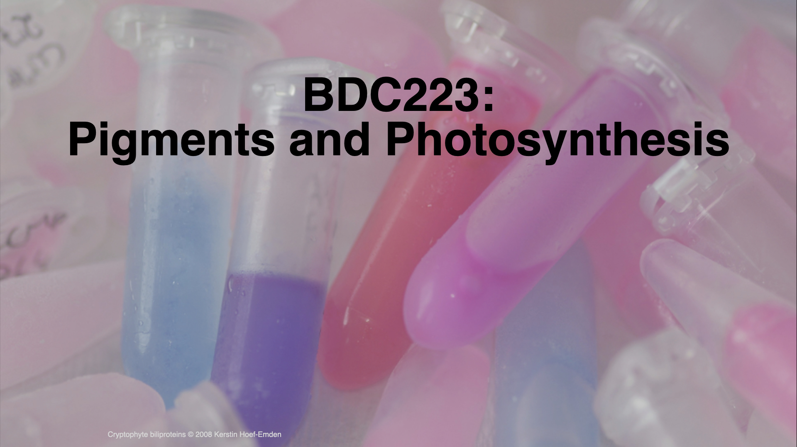

## Introduction: Pigments and Photosynthesis

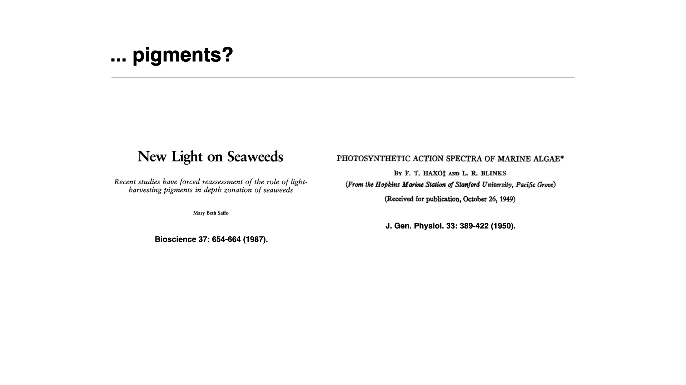

This lecture follows on from the lecture on light and deals with pigments and photosynthesis. Much of it, and of the lecture on chromatic adaptation that follows, is based on two papers that you need to read, namely @saffo1987new on the pigments of seaweeds and @haxo1950photosynthetic on the photosynthetic action spectra of marine algae. Both are on iKamva and are linked under Required Reading above. Please read them while you work through these lectures, because they explain the material covered here in much greater detail.

## Overview of Pigments in Photosynthetic Organisms

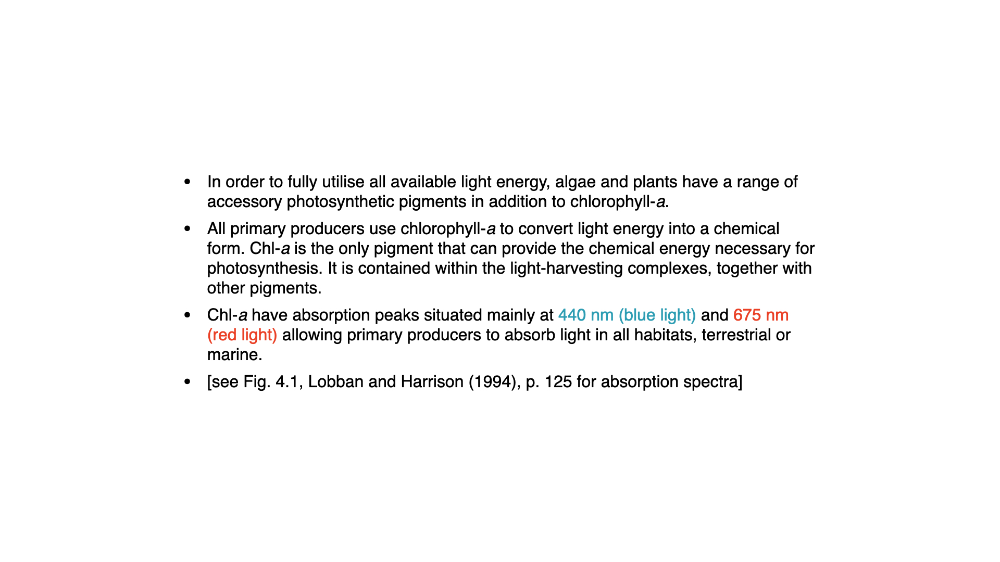

To exploit the light available in the environment, plants and algae (indeed, all oxygenic photosynthetic organisms) rely on a range of pigments that extract energy from light and convert it into chemical potential energy in the process of photosynthesis.

The predominant pigment in all oxygenic photosynthesis on Earth, and in all plants, algae, and cyanobacteria, is a molecule called chlorophyll-*a*. The chlorophyll-*a* pigment takes light energy and converts it into chemical energy. It is the only pigment that plays such a central role in photosynthesis. There are many other pigments called accessory pigments; they do not directly drive photosynthesis but support light harvesting.

## Absorption Properties of chlorophyll-*a* and Accessory Pigments

Chlorophyll-*a* absorbs light mainly in the blue and red regions. In the previous lecture you saw that photosynthetically active radiation (PAR) is defined as the band between $400$ and $700$ nm. Within that band, not all light is equally effective at driving photosynthesis. This is because chlorophyll-*a* in living cells absorbs most strongly at about $435$ nm (blue light) and $675$ nm (red light).

Regardless of where these primary producers are (on land, in water, or elsewhere), they are sensitive to blue and red light. If they do not have sufficient light at precisely those wavelengths, their rate of photosynthesis will be impaired.

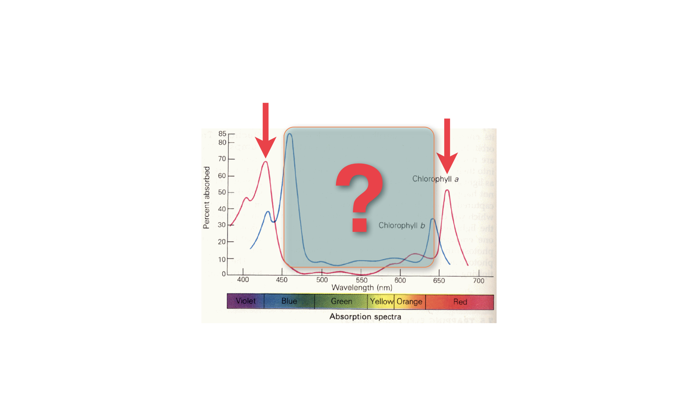

The graph on the slide shows the absorption spectra of chlorophyll-*a* and chlorophyll-*b* extracted into an organic solvent. In solvent, chlorophyll-*a* (the red line) has two main peaks, one near $430$ nm (blue) and one near $663$ nm (red). In the living cell, where the chlorophyll is bound to proteins, both peaks lie at slightly longer wavelengths, about $435$ and $675$ nm, which are the values given above. Chlorophyll-*b* has similar peaks but they are shifted: the blue peak sits nearer to $460$ nm, closer to green, and the red peak falls slightly toward the orange region.

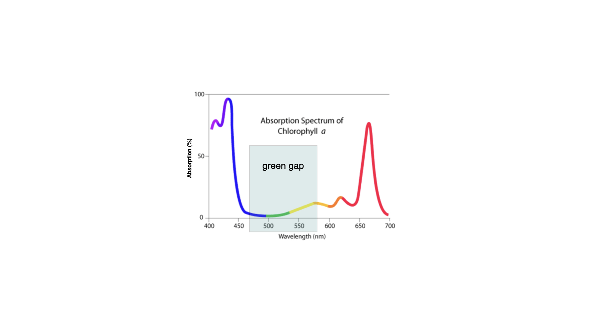

Chlorophyll-*b* (in fact, none of the accessory pigments) does not drive photosynthesis directly, but it can harvest light and pass that energy to chlorophyll-*a*, thus broadening the range of light absorbed and utilised for photosynthesis. You will notice that, in the middle of these spectra, there is a gap, a region where light is available yet not absorbed by chlorophyll-*a* or *b*. This is often referred to as the "green gap" and is the reason why plants appear green: green light is not absorbed by the major photosynthetic pigments in most leaves, so it is reflected back into the environment and to our eyes.

::: callout-note
## How Do Accessory Pigments Pass on Energy to the Reaction Centers?

Accessory pigments transfer the energy they capture from light to chlorophyll-*a* through a mechanism known as resonance energy transfer (more precisely, Förster resonance energy transfer, or FRET, in biophysical terms). This is a non-radiative process, meaning that the energy is not emitted as light and then reabsorbed, but is instead conveyed directly through electromagnetic interactions between the excited accessory pigment and the chlorophyll-*a* molecule. When a photon excites an accessory pigment, its electrons are elevated to a higher energy state; as this energy relaxes, it is transferred to a neighbouring chlorophyll-*a* molecule if the two pigments are sufficiently close (usually within 2–6 nanometres) and their electronic energy levels are appropriately aligned. At distances below ~1–2 nanometers, excitonic coupling can take place, wherein the excited states of neighbouring pigments become quantum-mechanically delocalised across multiple molecules rather than localising on discrete donors and acceptors.

The thylakoid membrane in chloroplasts is not a disordered soup of pigments but a carefully arranged molecular architecture known as the light-harvesting complex (LHC). Within these complexes, accessory pigments (such as chlorophyll-*b* and various carotenoids) are embedded in protein scaffolds alongside chlorophyll-*a* in spatial configurations that maximise energy transfer efficiency. The proteins hold pigments at precise orientations and distances that facilitate resonance coupling between excited states. The energy "hops" from pigment to pigment down an energetic gradient, ultimately funnelling to the reaction centre chlorophyll-*a*, where the photochemical conversion (electron transfer) occurs. This funnel-like arrangement of pigments and the efficiency of resonance transfer together allow plants and algae to capture a broad spectrum of solar radiation and direct it toward the relatively narrow photochemical core without significant loss.
:::

## The Green Gap and Accessory Pigments

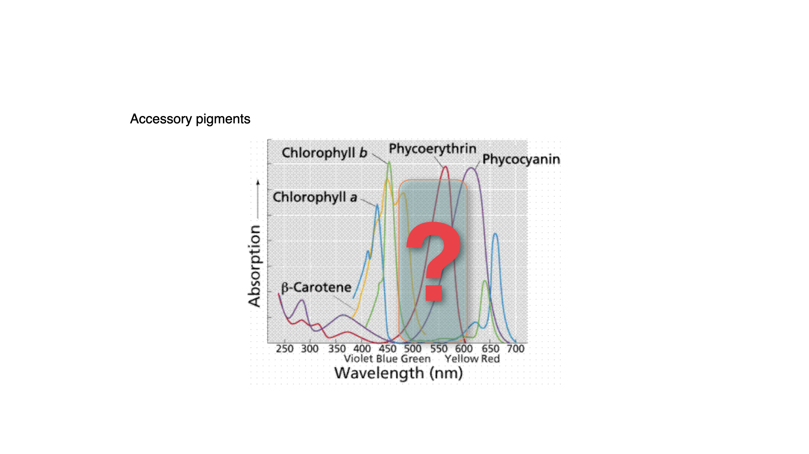

Plants have evolved various pigments to fill that green gap. Among the most notable of these are carotenoids, which include beta-carotene, and the phycobilins, such as phycoerythrin and phycocyanin. Carotenoids are also the pigments responsible for the orange colour in carrots, as indicated by the orange line on many absorption spectra.

The carotenoids and phycobilins absorb light in the green gap and pass that energy on to chlorophyll-*a*, enabling photosynthesis that would otherwise not occur at those wavelengths. These are called accessory pigments because they complement the absorption range of chlorophyll-*a* and make photosynthesis more effective in sub-optimal light conditions.

At first glance, the diversity of accessory pigments appears as vast as the diversity of light climates in the ocean, on land, and in freshwater. However, experiments by Engelmann in the 1880s and, later, by Haxo and Blinks in 1950 (discussed in your papers) [@engelmann1883farbe; @haxo1950photosynthetic; @saffo1987new] demonstrate that the diversity of accessory pigments does not necessarily correspond to the diversity of environmental light conditions.

## Classification and Function of Pigments

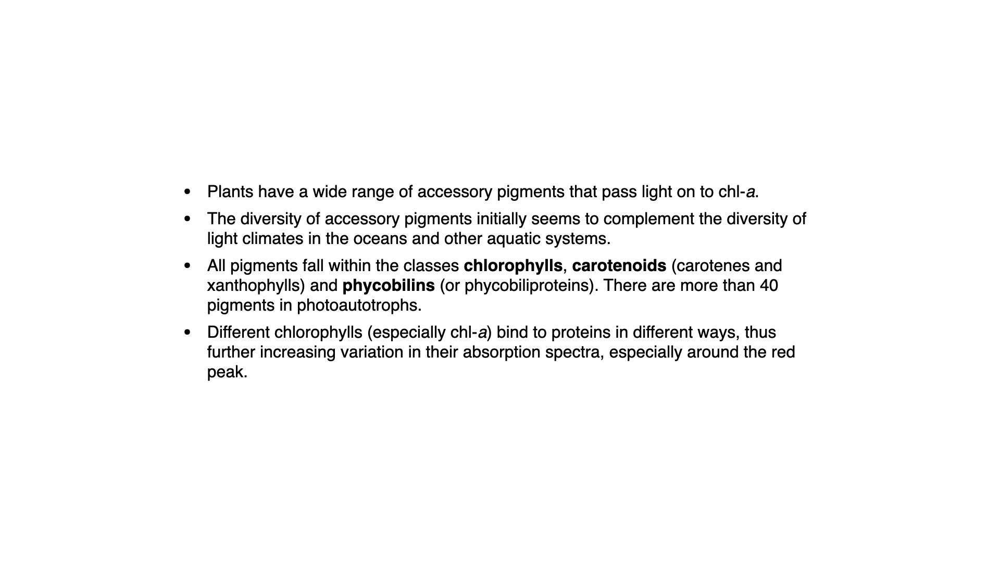

There are three main pigment classes:

1.  **Chlorophylls** – The major photosynthetic pigments. chlorophyll-*a* is primary, with chlorophylls-b and -c acting as accessory pigments that transfer absorbed energy to chlorophyll-*a*.
2.  **Carotenoids** – Includes beta-carotene and xantho-phylls, which also serve as accessory pigments.
3.  **Phycobilins** – Reddish or purplish pigments, including phycocyanin and phycoerythrin, mainly found in certain algae and cyanobacteria.

Across all photoautotrophs, there are more than forty pigments involved. They bind differently to the proteins making up the photosynthetic machinery, expanding the plant's ability to absorb different wavelengths, especially in the green gap, and maintain high photosynthetic efficiency in a range of environments.

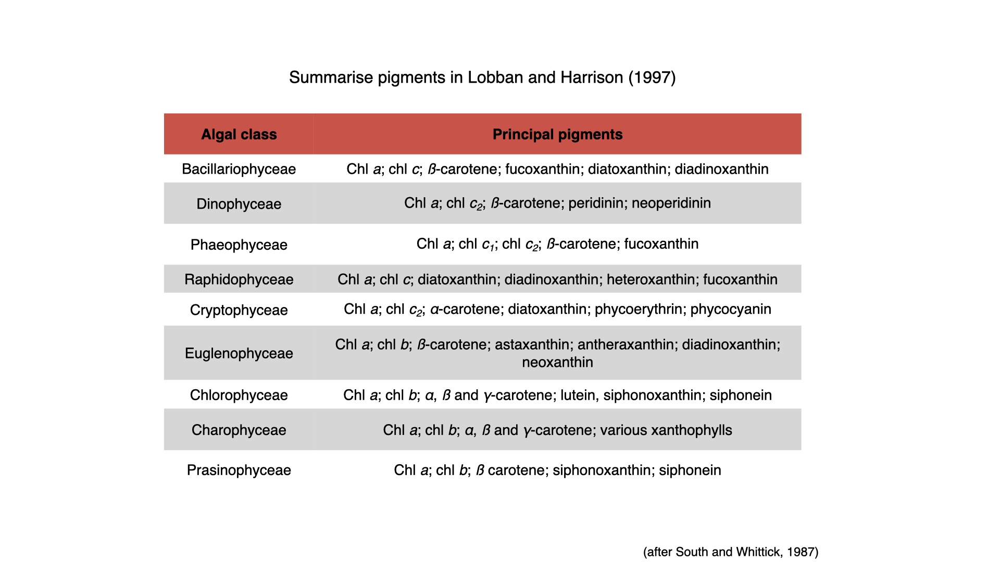

Especially in algae, the types of pigments present can indicate taxonomic relationships and phylogenetic heritage. By extracting pigments from a seawater sample, for example, one can deduce the classes of algae present. Similar underpinnings occur in terrestrial plants, with certain pigments associated with specific plant types.

::: {.callout-note collapse="false"}
## Box 1: Borrowed colour. Carotenoids in animals

::: {layout-ncol=2}
.jpg), CC0.](images/L07a/flamingo.jpg){fig-alt="A pink flamingo standing on a dry, pale lake bed."}

, public domain.](images/L07a/booby.jpg){fig-alt="Close-up of the bright turquoise webbed feet of a blue-footed booby standing on a rock."}
:::

Carotenoids are made by plants, algae, photosynthetic bacteria and some fungi. Animals cannot make them from scratch, so the carotenoids found in animals come from their food, sometimes chemically modified after they are eaten [@maoka2019carotenoids]. The pink of flamingos, the orange flesh of salmon and the yellow of goldfinches are all pigments that began in algae or plants and passed up the food chain to the animal. A flamingo kept without carotenoids in its diet loses its pink colour.

Many animals do more than store what they eat. Birds with red feathers, beaks or legs eat yellow carotenoids and convert them into red ketocarotenoids. The enzyme responsible, a cytochrome P450 called CYP2J19, was identified in red siskins, canaries and zebra finches [@lopes2016genetic; @mundy2016red], and together with a second enzyme (BDH1L) it is enough to carry out the conversion [@toomey2022mechanism]. The same enzyme colours the red oil droplets in the cone cells of the bird retina, so the pigment a bird displays and the pigment it uses to see red are made in the same way [@lopes2016genetic].

Because carotenoids must be eaten, and because they also act as antioxidants and support the immune system, carotenoid colours are thought to be honest signals of condition. Across 88 bird species, the intensity of carotenoid colour and the concentration of carotenoids in the blood were both positively, although modestly, related to immune response [@simons2012what]. Whether this works through a trade-off between display and health is still debated [@koch2018carotenoid]. In the blue-footed booby, foot colour changes quickly with the bird's condition, and females paired with males whose feet had been experimentally dulled laid smaller second eggs [@dentressangle2008maternal].

There are exceptions to the rule that animals cannot make carotenoids. Pea aphids, spider mites and gall midges carry carotenoid-synthesis genes that their ancestors acquired from fungi by lateral gene transfer, and red pea aphids owe their colour to one of these genes [@moran2010lateral; @altincicek2012horizontally; @cobbs2013carotenoids].

The link to this lecture is direct. In photosynthetic organisms, carotenoids harvest light in the green gap and protect the photosynthetic machinery against excess light by quenching harmful excited states. Animals that eat them borrow the same chemistry for colour, vision and antioxidant protection. For a popular account, see [Why are some animals so colorful? (Popular Science)](https://www.popsci.com/science/why-animals-are-colorful-carotenoids/).
:::

## What Is Photosynthesis?

Photosynthesis is the conversion of light energy (radiant energy) into chemical potential energy. In the light reactions, which take place in photosystems I and II in the thylakoid membranes, absorbed light energy splits water, releases oxygen as a byproduct, and produces ATP and NADPH. Carbon fixation follows in the Calvin cycle, in the stroma of the chloroplast, where the ATP and NADPH are used to fix $\mathrm{CO}_2$ taken up from the environment into sugars.

As a function of light intensity, photosynthesis responds with an increased rate, up to a point. This relationship is described by the photosynthesis-irradiance (PI) curve.

::: {.callout-note collapse="false"}
## Box 2: Animals that run on borrowed photosynthesis

::: {layout-ncol=2}
.png), public domain.](images/L07a/symsagittifera_graff.png){fig-alt="Nineteenth-century drawing of a long, slender flatworm, with the front part coloured green and the rest white."}

, CC0.](images/L07a/elysia_crispata.jpg){fig-alt="A sea slug with frilly, ruffled green and white body folds resting on coral sand."}
:::

Some animals photosynthesise by taking over the photosynthetic machinery of algae. There are two quite different ways of doing this.

**Housing whole algae.** The "mint-sauce worm" *Symsagittifera roscoffensis* (formerly *Convoluta roscoffensis*) is a small acoel flatworm, not a mollusc, that lives on sandy beaches of the north-east Atlantic. Its green colour comes from many living cells of the green alga *Tetraselmis convolutae* held beneath its skin. Young worms hatch without algae and must take them up from the surrounding water; without them they die, so the partnership is obligatory [@bailly2014chimerical]. Adult worms do not feed: photosynthesis by their algae was estimated to supply carbon equal to about 174% of the worm's body carbon each day [@thomas2022environmental]. At low tide the worms gather in large numbers at the sunlit surface of wet sand. The algae inside the worm photosynthesise less efficiently than free-living cells and show signs of chronic stress, so the relationship may be closer to farming than to an equal partnership [@androuin2020better].

**Keeping only the chloroplasts.** Some sacoglossan sea slugs go further. *Elysia chlorotica* pierces the filaments of the yellow-green alga *Vaucheria litorea*, sucks out the contents, digests everything else, and keeps the chloroplasts inside the cells lining its digestive gland. These stolen chloroplasts, called kleptoplasts, keep photosynthesising for most of the slug's roughly ten-month life, so that the slug can live on light and air. They do not divide and are not passed to the eggs, so each generation must steal its own [@rumpho2011making]. Among animals, long-term retention of functional chloroplasts is known almost only from this group of sea slugs [@handeler2009functional].

The puzzle is how the chloroplasts survive. A chloroplast depends on hundreds of proteins encoded in the algal nucleus, which the slug has digested. Explanations include unusually robust chloroplasts, long-lived proteins and support from the slug itself; there is no clear evidence that algal genes were transferred into the slug genome [@cruz2022kleptoplasty]. Recent work shows that the slug encloses each chloroplast in its own membrane-bound compartment, which keeps the chloroplast working and, when the slug is starved, digests it as food [@allard2025host].

Both cases connect to [Lecture 3](L03-photosynthetic-evolution.qmd). The chloroplast itself began as a free-living cyanobacterium taken up by a host cell. The worm and the sea slug show, within living animals, earlier and incomplete versions of the same process.
:::

## The Photosynthesis-Irradiance (PI) Curve

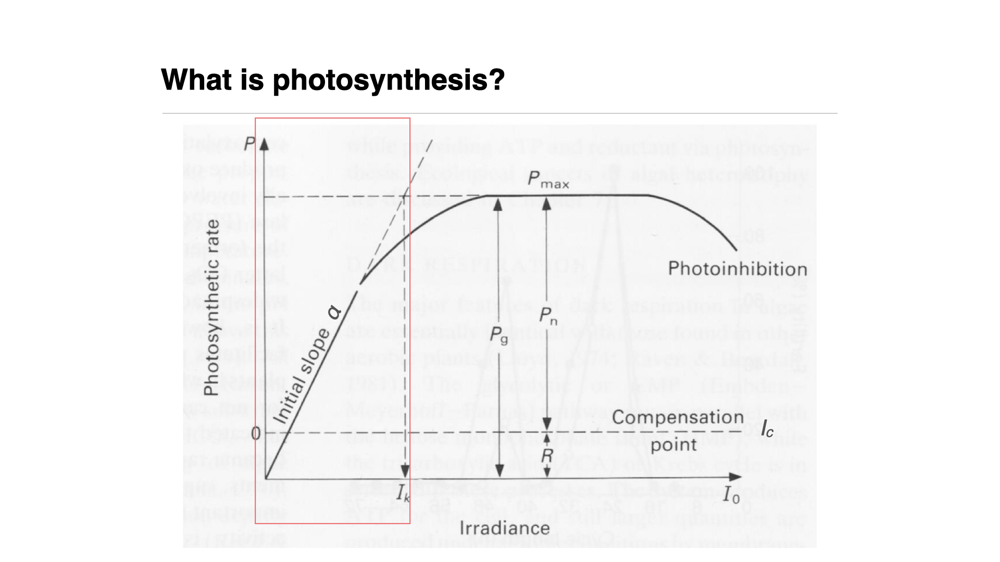

The axes of the PI curve are as follows.

-   **Y-Axis**: Rate of photosynthesis, measured by carbon incorporation (e.g., mg C m$^{-2}$ s$^{-1}$, mg C m$^{-2}$ hr$^{-1}$, or mg C m$^{-2}$ day$^{-1}$).
-   **X-Axis**: Irradiance (light intensity).

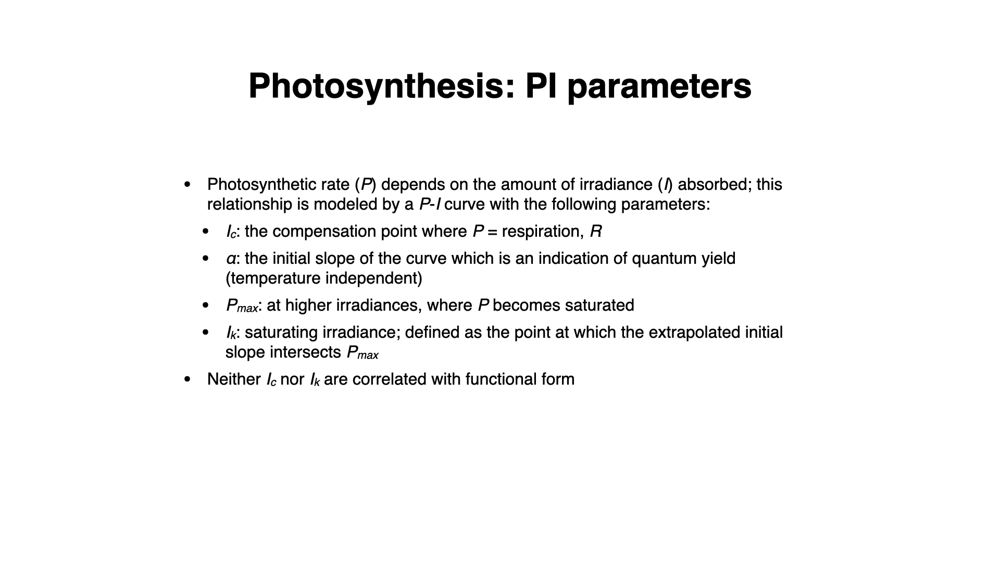

Initially, the PI curve is linear: as irradiance increases, photosynthesis increases at a rate defined by the slope $\alpha$ (alpha). Alpha reflects the plant's sensitivity to changes in irradiance. A steep alpha (steep slope) means more sensitivity to small changes in light; a shallow slope indicates less sensitivity and a need for greater changes in light intensity to affect photosynthesis rate.

As irradiance increases further, the rate levels off at the maximum rate, $P_{max}$. The saturation irradiance, $I_k$, marks the onset of saturation. It is the irradiance where the initial linear slope, extended upwards, meets the horizontal line at $P_{max}$, so that $I_k = P_{max}/\alpha$. Well above $I_k$, more light does not increase the photosynthetic rate. The reaction centres then receive more energy than electron transport and carbon fixation (Rubisco in particular) can process, so these steps set the maximum rate.

Should irradiance keep increasing, photosynthesis can decline, a phenomenon called photoinhibition. Here, excessive light can damage the photosynthetic apparatus (particularly the reaction centre of photosystem II), or trigger protective mechanisms that dissipate the excess absorbed energy as heat. Both lower the rate of photosynthesis.

Respiration occurs at all times, consuming oxygen, while photosynthesis (in the presence of light) produces it. At low light, the rate of oxygen production by photosynthesis is less than the rate of consumption by respiration, resulting in net negative oxygen production. The light compensation point is the irradiance where net oxygen production is zero.

**Net photosynthesis**: Above the compensation point: positive net oxygen evolution.\
**Gross photosynthesis**: Total oxygen produced, regardless of respiration.

We return to these parameters (the light compensation point, $\alpha$, $P_{max}$, $I_k$, etc.) in the practical sessions, where you will fit models to real data.

What we saw above is the standard textbook interpretation and formulation of a PI curve. Several mathematical models describe its shape, and two of the most widely used are the hyperbolic tangent model of @jassby1976mathematical and the model of @platt1980photoinhibition, which includes photoinhibition.

### The hyperbolic tangent model

The hyperbolic tangent model was proposed by @jassby1976mathematical. It has become one of the most widely used models for describing the relationship between photosynthetic rate and irradiance (light intensity) in aquatic photosynthetic organisms, including algae ranging from kelp to phytoplankton. The model captures the core dynamics of photosynthesis, in which the rate of photosynthesis initially increases with light intensity but eventually saturates as the photosynthetic machinery reaches its maximum rate. This is a simple model, but it is effective because the biologically meaningful parameters can be directly interpreted to assess plant or algal productivity in various light environments.

The hyperbolic tangent model is expressed as:

$$ P(I) = P_{\text{max}} \times \tanh\left(\frac{\alpha I}{P_{\text{max}}}\right) $$

Where:

- $P(I)$ represents the photosynthetic rate at a given irradiance $I$ (light intensity),
- $P_{\text{max}}$ is the maximum photosynthetic rate (also referred to as the light-saturated rate),
- $\alpha$ is the initial slope of the curve, which reflects the photosynthetic efficiency at low light levels,
- $I$ is the irradiance (light intensity),

The saturation irradiance, $I_{\text{k}}$, follows from the two parameters as $I_{\text{k}} = P_{\text{max}}/\alpha$. It is the irradiance at which the initial linear slope, extended upwards, meets the horizontal line at $P_{\text{max}}$. The curve itself approaches $P_{\text{max}}$ gradually, and at $I_{\text{k}}$ the modelled rate is about 76% of $P_{\text{max}}$, since $\tanh(1) \approx 0.76$.

The hyperbolic tangent function $\tanh$ is used to smoothly describe the transition between the linear increase in photosynthesis at low light intensities and the eventual plateau at higher intensities, where photosynthesis becomes light-saturated. The light compensation point, the point at which photosynthesis equals respiration (i.e., net photosynthesis is zero), can also be derived from this model once a respiration term is added (see below).

The model describes the essential processes of photosynthesis with just two parameters: $P_{\text{max}}$ and $\alpha$. Both parameters are biologically meaningful and tell us how efficiently an organism can convert light into chemical energy under different light conditions. For example, higher values of $P_{\text{max}}$ indicate a greater potential for photosynthesis under optimal light conditions, while the value of $\alpha$ indicates how quickly photosynthesis responds to low light.

Applications of the hyperbolic tangent model are numerous. It is commonly used to estimate the photosynthetic performance of marine and freshwater algae, seagrasses, and macroalgae under varying environmental conditions. In kelp forests, for instance, we may use this model to assess how different species adapt to light intensities at various depths or how photosynthetic performance shifts in response to seasonal changes in light availability. Looking at phytoplankton, the model helps estimate productivity across different layers of the water column, where light intensity decreases with depth.

Below are a few lines of data taken from a hypothetical P-I experiment. The data are for five replicate experiments with the same light intensities (independent variable), representing conditions typically encountered by kelp at latitudes between 36° S and 23° S.

```{r tbl-library-minpack-lm-for}
#| echo: false
#| messages: false
#| warning: false

# Load necessary libraries
library(minpack.lm) # For non-linear least squares fitting
library(ggplot2) # For plotting
library(knitr)

# Set seed for reproducibility
set.seed(666)

# Define parameters based on typical kelp conditions
Pmax_true <- 13 # True maximum photosynthetic rate (e.g., mg C m^-2 h^-1)
alpha_true <- 0.05 # True initial slope (photosynthetic efficiency)

# Light intensities typically encountered by kelp (μmol photons m^-2 s^-1)
light_intensities <- seq(0, 550, by = 50)

# Number of replicates
n_replicates <- 5

# Generate data for each replicate
data_list <- lapply(1:n_replicates, function(rep) {
    # Simulate true photosynthetic rates using the hyperbolic tangent model
    P_true <- Pmax_true * tanh(alpha_true * light_intensities / Pmax_true)

    # Add random noise to simulate experimental variability
    noise <- rnorm(length(P_true), mean = 0, sd = 0.5) # Adjust sd for noise level
    P_observed <- round(P_true + noise, 2)

    # Create a data frame for the replicate
    data.frame(
        Replicate = rep,
        Light = light_intensities,
        Photosynthesis = P_observed
    )
})

# Combine all replicates into one data frame
data_all <- do.call(rbind, data_list)

# View 9 randomly selected rows from the data
random_rows <- data_all[sample(nrow(data_all), 9), ]

kable(
    random_rows,
    format = "markdown",
    digits = 2,
    col.names = c(
        "Replicate",
        "Light (μmol photons m⁻² s⁻¹)",
        "Photosynthesis (mg C m⁻² h⁻¹)"
    )
)
```

```{r fn-fit-results-lapply-n-replicates-function}
#| echo: false
#| messages: false
#| warning: false

# Fit the hyperbolic tangent model to each replicate
fit_results <- lapply(1:n_replicates, function(rep) {
    # Subset data for the replicate
    data_rep <- subset(data_all, Replicate == rep)

    # Define the model function
    model_formula <- Photosynthesis ~ Pmax * tanh(alpha * Light / Pmax)

    # Provide initial parameter estimates
    start_params <- list(Pmax = 10, alpha = 0.03)

    # Fit the model using non-linear least squares
    fit <- nlsLM(
        formula = model_formula,
        data = data_rep,
        start = start_params,
        control = nls.lm.control(maxiter = 1000)
    )

    # Return the fit object
    return(fit)
})
```

```{r code-for-i-in-n-replicates}
#| echo: false
#| messages: false
#| warning: false
#| results: hide

# Summarise fit results for each replicate
for (i in 1:n_replicates) {
    cat("\n--- Replicate", i, "Fit Summary ---\n")
    print(summary(fit_results[[i]]))
}
```

```{r fig-jassby-platt}
#| echo: false
#| messages: false
#| warning: false
#| fig.cap: "Nonlinear regression Jassby and Platt (1976) model fitted to simulated P-I data for a hypothetical kelp."

# Plot the data and fitted curves for all replicates
ggplot(
    data_all,
    aes(x = Light, y = Photosynthesis, color = factor(Replicate))
) +
    geom_point() +
    stat_function(
        fun = function(x) {
            coef(fit_results[[1]])["Pmax"] *
                tanh(
                    coef(fit_results[[1]])["alpha"] *
                        x /
                        coef(fit_results[[1]])["Pmax"]
                )
        },
        color = "black",
        size = 1,
        linetype = "dashed"
    ) +
    labs(
        title = "Photosynthesis-Irradiance Curves for Kelp (All Replicates)",
        x = "Light Intensity (μmol photons m⁻² s⁻¹)",
        y = "Photosynthetic Rate (mg C m⁻² h⁻¹)",
        color = "Replicate"
    ) +
    theme_minimal()
```

After fitting the model to the data, we can determine the values for $P_{\text{max}}$ and $\alpha$ for each replicate and determine the average value across the five fits. The combined plot (@fig-jassby-platt) displays the observed data points for all replicates and the fitted curve from the first replicate.

The average model fit values of the estimated parameters across all replicates are as follows:

- **$P_{\text{max}}$:** `r round(mean(sapply(fit_results, function(fit) coef(fit)['Pmax'])), 2)` mg C m⁻² h⁻¹
- **$\alpha$:** `r round(mean(sapply(fit_results, function(fit) coef(fit)['alpha'])), 2)` mg C m⁻² h⁻¹ (μmol photons m⁻² s⁻¹)⁻¹

### Considering the light compensation point

The **light compensation point** ($I_c$) is the irradiance level at which the rate of photosynthesis equals the rate of respiration, resulting in a net photosynthetic rate of zero. Below this point, the organism consumes more energy (via respiration) than it produces through photosynthesis, leading to a net loss of energy. Estimating $I_c$ is important for determining the minimum light intensity required for the survival of photosynthetic organisms, after compensation for the effect of cellular respiration.

In the context of the **Jassby and Platt hyperbolic tangent model**, $I_c$ can be estimated by solving for the irradiance $I$ when the net photosynthetic rate $P(I)$ equals zero:

$$
0 = P_{\text{max}} \times \tanh\left(\frac{\alpha I_c}{P_{\text{max}}}\right)
$$

Since $\tanh(0) = 0$, the net photosynthetic rate is zero when $I = 0$. However, due to respiration, the net photosynthesis can be negative at zero light intensity. To account for respiration, we can modify the model to include **dark respiration rate** ($R$):

$$
P(I) = P_{\text{max}} \times \tanh\left(\frac{\alpha I}{P_{\text{max}}}\right) - R
$$

Now, $I_c$ is the irradiance at which $P(I) = 0$:

$$
0 = P_{\text{max}} \times \tanh\left(\frac{\alpha I_c}{P_{\text{max}}}\right) - R
$$

Rearranging gives a closed-form solution:

$$
I_c = \frac{P_{\text{max}}}{\alpha}\,\operatorname{artanh}\left(\frac{R}{P_{\text{max}}}\right)
$$

The code below finds $I_c$ numerically instead (with `uniroot()`), which gives the same value and works for any model, including those without a closed-form solution.

```{r tbl-set-seed}
#| echo: false
#| messages: false
#| warning: false

# Set seed for reproducibility
set.seed(13)

# Define parameters based on typical kelp conditions
Pmax_true <- 13 # True maximum photosynthetic rate (e.g., mg C m^-2 h^-1)
alpha_true <- 0.05 # True initial slope (photosynthetic efficiency)
R_true <- 2 # True respiration rate (mg C m^-2 h^-1)

# Light intensities including finer increments around expected LCP
light_intensities <- seq(0, 550, by = 50)

# Number of replicates
n_replicates <- 5

# Generate data for each replicate
data_list <- lapply(1:n_replicates, function(rep) {
    # Simulate true net photosynthetic rates using the modified hyperbolic tangent model
    P_true <- Pmax_true *
        tanh(alpha_true * light_intensities / Pmax_true) -
        R_true

    # Add random noise to simulate experimental variability
    noise <- rnorm(length(P_true), mean = 0, sd = 0.5) # Adjust sd for noise level
    P_observed <- P_true + noise

    # Create a data frame for the replicate
    data.frame(
        Replicate = rep,
        Light = light_intensities,
        Photosynthesis = P_observed
    )
})

# Combine all replicates into one data frame
data_all <- do.call(rbind, data_list)

# View 9 randomly selected rows from the data
random_rows <- data_all[sample(nrow(data_all), 9), ]

# Display the random rows in a nicely formatted table using kable
kable(
    random_rows,
    format = "markdown",
    digits = 2,
    col.names = c(
        "Replicate",
        "Light (μmol photons m⁻² s⁻¹)",
        "Photosynthesis (mg C m⁻² h⁻¹)"
    )
)
```

```{r fn-fit-results2-lapply-n-replicates-function}
#| echo: false
#| messages: false
#| warning: false

# Fit the modified hyperbolic tangent model to each replicate and estimate LCP
fit_results2 <- lapply(1:n_replicates, function(rep) {
    # Subset data for the replicate
    data_rep <- subset(data_all, Replicate == rep)

    # Define the modified model function including respiration
    model_formula <- Photosynthesis ~ Pmax * tanh(alpha * Light / Pmax) - R

    # Provide initial parameter estimates
    start_params <- list(Pmax = 10, alpha = 0.03, R = 1)

    # Fit the model using non-linear least squares
    fit <- nlsLM(
        formula = model_formula,
        data = data_rep,
        start = start_params,
        lower = c(0, 0, 0), # Parameters should be non-negative
        control = nls.lm.control(maxiter = 1000)
    )

    # Estimate the Light Compensation Point (LCP)
    # Solve for I when Photosynthesis = 0
    coef_fit <- coef(fit)
    Pmax_fit <- coef_fit["Pmax"]
    alpha_fit <- coef_fit["alpha"]
    R_fit <- coef_fit["R"]

    # Define the function to find the root (Photosynthesis = 0)
    lcp_function <- function(I) Pmax_fit * tanh(alpha_fit * I / Pmax_fit) - R_fit

    # Use uniroot to find the LCP
    LCP <- uniroot(lcp_function, interval = c(0, 200))$root

    # Add LCP to the fit object
    fit$LCP <- LCP

    # Return the fit object
    return(fit)
})
```

```{r code-for-i-in-n-replicates-2}
#| echo: false
#| messages: false
#| warning: false
#| results: hide

# Summarise fit results for each replicate
for (i in 1:n_replicates) {
    cat("\n--- Replicate", i, "Fit Summary ---\n")
    fit <- fit_results2[[i]]
    print(summary(fit))
    cat(sprintf(
        "Estimated Light Compensation Point (LCP): %.2f μmol photons m⁻² s⁻¹\n",
        fit$LCP
    ))
}
```

```{r fig-jassby-platt2}
#| echo: false
#| messages: false
#| warning: false
#| fig.cap: "Nonlinear regression Jassby and Platt (1976) model fitted to simulated P-I data for a hypothetical kelp. This model includes the effect of the light compensation point."

# Plot the data, fitted curves, and LCP for all replicates
ggplot(
    data_all,
    aes(x = Light, y = Photosynthesis, color = factor(Replicate))
) +
    geom_point() +
    stat_function(
        fun = function(x) {
            Pmax <- coef(fit_results2[[1]])["Pmax"]
            alpha <- coef(fit_results2[[1]])["alpha"]
            R <- coef(fit_results2[[1]])["R"]
            Pmax * tanh(alpha * x / Pmax) - R
        },
        color = "black",
        size = 1,
        linetype = "dashed"
    ) +
    geom_vline(
        xintercept = fit_results2[[1]]$LCP,
        color = "red",
        linetype = "dotdash",
        show.legend = TRUE
    ) +
    geom_hline(yintercept = 0, color = "red", linetype = "dotted") +
    labs(
        title = "Photosynthesis-Irradiance Curves with Light Compensation Point",
        x = "Light Intensity (μmol photons m⁻² s⁻¹)",
        y = "Net Photosynthetic Rate (mg C m⁻² h⁻¹)",
        color = "Replicate"
    ) +
    annotate(
        "text",
        x = fit_results2[[1]]$LCP,
        y = min(data_all$Photosynthesis) + 5,
        label = paste0(
            "LCP = ",
            round(mean(sapply(fit_results2, function(fit) fit$LCP)), 2)
        ),
        angle = 90,
        vjust = -0.5,
        color = "red"
    ) +
    theme_minimal()
```

The model fit to the data is in @fig-jassby-platt2. The average model fit values of the estimated parameters across all replicates are as follows:

- **$P_{\text{max}}$:** `r round(mean(sapply(fit_results2, function(fit) coef(fit)['Pmax'])), 2)` mg C m⁻² h⁻¹
- **$\alpha$:** `r round(mean(sapply(fit_results2, function(fit) coef(fit)['alpha'])), 2)` mg C m⁻² h⁻¹ (μmol photons m⁻² s⁻¹)⁻¹
- **$I_c$:** `r round(mean(sapply(fit_results2, function(fit) fit$LCP)), 2)` μmol photons m⁻² s⁻¹

### Platt et al. (1980) model with photoinhibition

Let us now look at the model of @platt1980photoinhibition, which incorporates photoinhibition into the photosynthesis-irradiance (P-I) relationship. This model extends the understanding of photosynthesis by accounting for the decrease in photosynthetic efficiency at high light intensities due to photoinhibition, a phenomenon where excessive light damages the photosynthetic apparatus, leading to reduced photosynthetic rates.

The model is expressed mathematically as:

$$
P(I) = P_{\text{max}} \left(1 - \exp\left(-\frac{\alpha I}{P_{\text{max}}}\right)\right) \exp\left(-\frac{\beta I}{P_{\text{max}}}\right) - R
$$

Where:

- $P_{\text{max}}$ is the maximum photosynthetic rate in the absence of photoinhibition.
- $\alpha$ is the initial slope of the curve, as in the hyperbolic tangent model.
- $\beta$ is the photoinhibition parameter (rate of decrease in photosynthesis at high light).
- $R$ is the dark respiration rate, as in the modified hyperbolic tangent model above, so $P(I)$ is the net photosynthetic rate.
- $\exp$ denotes the exponential function.

This model combines the positive effect of light on photosynthesis at low irradiance with the negative effect of photoinhibition at high irradiance, providing a comprehensive description of the photosynthetic response across a wide range of light intensities.

```{r tbl-set-seed-2}
#| echo: false
#| messages: false
#| warning: false

set.seed(7)

# Define parameters based on typical kelp conditions
Pmax_true <- 13 # True maximum photosynthetic rate (e.g., mg C m^-2 h^-1)
alpha_true <- 0.05 # True initial slope (photosynthetic efficiency)
beta_true <- 0.0005 # True photoinhibition parameter
R_true <- 2 # True respiration rate (mg C m^-2 h^-1)

# Light intensities ranging to capture photoinhibition effects (μmol photons m^-2 s^-1)
light_intensities <- seq(0, 1600, by = 100)

# Number of replicates
n_replicates <- 5

# Generate data for each replicate
data_list <- lapply(1:n_replicates, function(rep) {
    # Simulate true net photosynthetic rates using the Platt et al. model
    P_true <- Pmax_true *
        (1 - exp(-alpha_true * light_intensities / Pmax_true)) *
        exp(-beta_true * light_intensities / Pmax_true) -
        R_true

    # Add random noise to simulate experimental variability
    noise <- rnorm(length(P_true), mean = 0, sd = 0.5) # Adjust sd for noise level
    P_observed <- P_true + noise

    # Create a data frame for the replicate
    data.frame(
        Replicate = rep,
        Light = light_intensities,
        Photosynthesis = P_observed
    )
})

# Combine all replicates into one data frame
data_all <- do.call(rbind, data_list)

# View 9 randomly selected rows from the data
random_rows <- data_all[sample(nrow(data_all), 9), ]

# Display the random rows in a nicely formatted table using kable
kable(
    random_rows,
    format = "markdown",
    digits = 2,
    col.names = c(
        "Replicate",
        "Light (μmol photons m⁻² s⁻¹)",
        "Photosynthesis (mg C m⁻² h⁻¹)"
    )
)
```


```{r fn-fit-results-lapply-n-replicates-function-2}
#| echo: false
#| messages: false
#| warning: false

# Fit the Platt et al. model to each replicate
fit_results <- lapply(1:n_replicates, function(rep) {
    # Subset data for the replicate
    data_rep <- subset(data_all, Replicate == rep)

    # Define the model function including respiration
    model_formula <- Photosynthesis ~
        Pmax * (1 - exp(-alpha * Light / Pmax)) * exp(-beta * Light / Pmax) - R

    # Provide initial parameter estimates
    start_params <- list(Pmax = 10, alpha = 0.03, beta = 0.0001, R = 1)

    # Fit the model using non-linear least squares
    fit <- nlsLM(
        formula = model_formula,
        data = data_rep,
        start = start_params,
        lower = c(0, 0, 0, 0), # Parameters should be non-negative
        control = nls.lm.control(maxiter = 1000)
    )

    # Return the fit object
    return(fit)
})
```

```{r code-for-i-in-n-replicates-3}
#| echo: false
#| messages: false
#| warning: false
#| results: hide

# Summarise fit results for each replicate
for (i in 1:n_replicates) {
    cat("\n--- Replicate", i, "Fit Summary ---\n")
    fit <- fit_results[[i]]
    print(summary(fit))
}
```

```{r fig-jassby}
#| echo: false
#| messages: false
#| warning: false
#| fig.cap: "Nonlinear regression Platt et al. (1980) model fitted to simulated P-I data for a hypothetical kelp. This model includes the effect of photoinhibition."

# Plot the data and fitted curves for all replicates
ggplot(
    data_all,
    aes(x = Light, y = Photosynthesis, color = factor(Replicate))
) +
    geom_point() +
    stat_function(
        fun = function(x) {
            Pmax <- coef(fit_results[[1]])["Pmax"]
            alpha <- coef(fit_results[[1]])["alpha"]
            beta <- coef(fit_results[[1]])["beta"]
            R <- coef(fit_results[[1]])["R"]
            Pmax * (1 - exp(-alpha * x / Pmax)) * exp(-beta * x / Pmax) - R
        },
        color = "black",
        size = 1,
        linetype = "dashed"
    ) +
    geom_hline(yintercept = 0, color = "red", linetype = "dotted") +
    labs(
        title = "Photosynthesis-Irradiance Curves with Photoinhibition",
        x = "Light Intensity (μmol photons m⁻² s⁻¹)",
        y = "Net Photosynthetic Rate (mg C m⁻² h⁻¹)",
        color = "Replicate"
    ) +
    theme_minimal()
```

## Effects of Environmental Stress

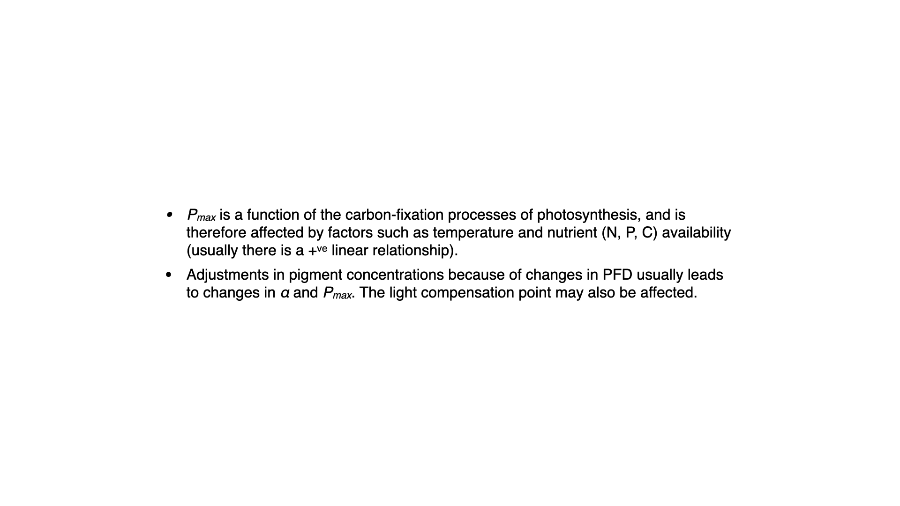

$P_{max}$ represents the maximum photosynthetic capacity, which is influenced by many stresses, including thermal stress, nutrient stress, and light stress. Any of these can reduce a plant's capacity to sustain $P_{max}$, and a reduction in this parameter is often the first sign of environmental stress. Measuring these rates gives insights into how and when plants become stressed.

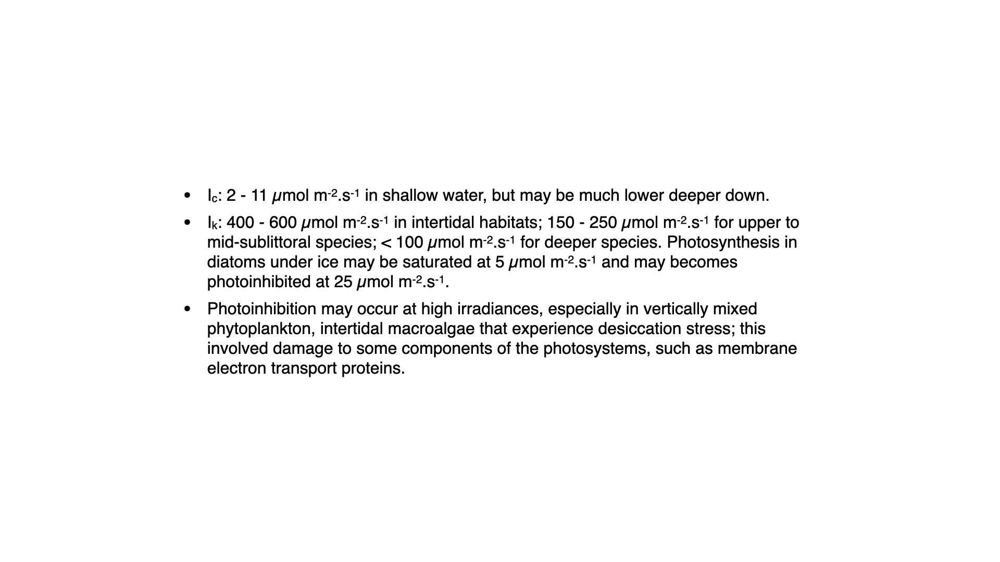

Some indicative saturation irradiances for seaweeds are listed below.

-   Intertidal environments: light saturation might occur at $400$–$600\;\mu\mathrm{mol}\,\mathrm{m}^{-2}\,\mathrm{s}^{-1}$
-   Sublittoral species (deeper): saturated at $150$–$250\;\mu\mathrm{mol}\,\mathrm{m}^{-2}\,\mathrm{s}^{-1}$
-   As depth increases, saturation occurs at progressively lower irradiances.
-   Some deep-water plants can become photoinhibited at what would seem to us like relatively dim light.

These values ($I_C$, $I_K$, $P_{max}$, $\alpha$) vary among species, being determined both by environmental adaptation and genetic heritage, and thus serve as good indicators of a plant's typical habitat and stress response.

## Absorption Spectrum Vs Action Spectrum

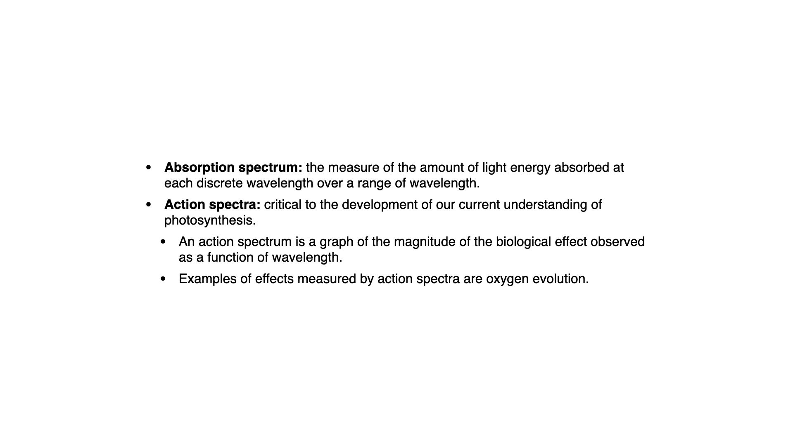

Before moving on, we need to distinguish the absorption spectrum from the action spectrum.

-   **Absorption spectrum**: Measures the amount of light absorbed by all pigments at every wavelength; essentially, how much light is not reflected or transmitted.
-   **Action spectrum**: For each wavelength, measures the biological effect (the rate of oxygen evolution) that results from absorption.

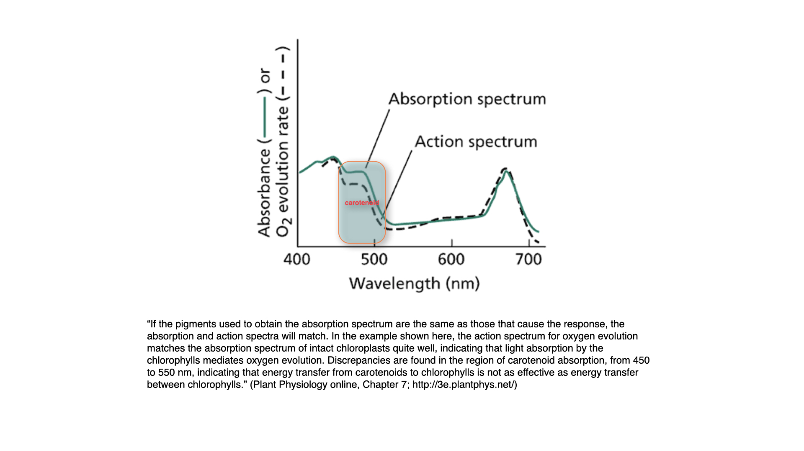

Typically, the action and absorption spectra match well, but not perfectly. For instance, between about $450$ and $500$ nm, there is a mismatch. This occurs because, beyond the optimal absorption peak of chlorophyll-*a*, carotenoids start absorbing light. While they can capture light within this region, they are less efficient at passing the energy to chlorophyll-*a*, resulting in a lower action than absorption value.

This demonstrates that the ability of accessory pigments to pass energy to chlorophyll-*a* is not perfectly efficient; some energy is lost in the process. Nonetheless, the presence of carotenoids extends the range in which photosynthesis can be driven by chlorophyll-*a*.

In summary, accessory pigments are essential in harvesting a broader range of light and making photosynthesis effective under varied light environments, even if energy transfer from accessory to primary pigments is not perfectly efficient.

## Summary

-   Chlorophyll *a* is the pigment that converts light energy into chemical energy in all plants, algae and cyanobacteria; it absorbs mainly blue and red light.
-   Accessory pigments (chlorophylls *b* and *c*, carotenoids and phycobilins) absorb at other wavelengths, including the green gap, and pass the energy to chlorophyll *a* by resonance energy transfer within the light-harvesting complexes.
-   Leaves look green because chlorophylls *a* and *b* absorb little green light, which is reflected or transmitted.
-   The P–I curve rises linearly at low irradiance with slope α, saturates at P~max~ above the saturation irradiance I~k~, and may decline at high irradiance because of photoinhibition.
-   Respiration continues in the light, so net photosynthesis is negative below the light compensation point and gross photosynthesis is net photosynthesis plus respiration.
-   The hyperbolic tangent model of Jassby and Platt describes the P–I curve with P~max~ and α, a respiration term allows the compensation point to be estimated, and the model of Platt and colleagues adds a photoinhibition parameter, β. All are fitted to data by non-linear regression.
-   P–I parameters differ among species and habitats: intertidal seaweeds saturate at higher irradiances than subtidal species, and a fall in P~max~ is often an early sign of environmental stress.
-   An action spectrum matches the absorption spectrum closely but not exactly, because some accessory pigments, such as carotenoids absorbing between about 450 and 500 nm, transfer energy to chlorophyll *a* less efficiently.

## Self-Test Questions

::: {.callout-note collapse="true"}
## 1. Why do most leaves look green?

Chlorophylls *a* and *b* absorb strongly in the blue and the red but absorb little light in the middle of the visible spectrum, the green gap. The green light that is not absorbed is reflected or transmitted, and this is the light that reaches our eyes.
:::

::: {.callout-note collapse="true"}
## 2. What do accessory pigments do, and how does the energy they absorb reach the reaction centre?

Accessory pigments (chlorophylls *b* and *c*, carotenoids and phycobilins) absorb light at wavelengths where chlorophyll *a* absorbs poorly, which broadens the range of light used in photosynthesis. They do not drive photochemistry themselves. The energy passes to chlorophyll *a* by resonance energy transfer, a non-radiative process that requires the pigments to lie close together (usually within 2–6 nm) in the protein scaffolds of the light-harvesting complexes. Energy moves from pigment to pigment towards the reaction centre chlorophyll *a*, where electron transfer occurs.
:::

::: {.callout-note collapse="true"}
## 3. The average fit of the Jassby and Platt model to the simulated kelp data gives P~max~ = 13.05 mg C m⁻² h⁻¹ and α = 0.05 mg C m⁻² h⁻¹ (µmol photons m⁻² s⁻¹)⁻¹. Calculate I~k~ and compare it with the indicative values for intertidal and subtidal seaweeds.

I~k~ is the irradiance at which the initial linear slope meets the level of P~max~, so I~k~ = P~max~/α = 13.05/0.05 = 261 µmol photons m⁻² s⁻¹. This is below the range of 400–600 µmol photons m⁻² s⁻¹ given for intertidal seaweeds and just above the range of 150–250 µmol photons m⁻² s⁻¹ given for sublittoral species, so the simulated kelp resembles a plant from shallow subtidal water.
:::

::: {.callout-note collapse="true"}
## 4. Why does the hyperbolic tangent model need a respiration term to estimate the light compensation point?

Without a respiration term, $P(I) = P_{max} \tanh(\alpha I / P_{max})$ is zero only at $I = 0$, so the curve passes through the origin and cannot show a compensation point. Respiration consumes oxygen at all times, so at low irradiance net photosynthesis is negative. Subtracting the dark respiration rate gives $P(I) = P_{max} \tanh(\alpha I / P_{max}) - R$, and the light compensation point I~c~ is the irradiance at which this net rate equals zero, found numerically from the fitted parameters.
:::

::: {.callout-note collapse="true"}
## 5. When would you fit the model of Platt and colleagues rather than the hyperbolic tangent model?

When the measured rates decline at high irradiance. The hyperbolic tangent model rises to P~max~ and then stays level, so it cannot describe photoinhibition. The model of Platt and colleagues multiplies the light-limited rise by a term containing the photoinhibition parameter β, which makes the predicted rate fall at high irradiance.
:::

::: {.callout-note collapse="true"}
## 6. Distinguish an absorption spectrum from an action spectrum. Why do they differ between about 450 and 500 nm?

An absorption spectrum shows the amount of light absorbed by all the pigments at each wavelength. An action spectrum shows the biological effect, here the rate of oxygen evolution, produced by light of each wavelength. Between about 450 and 500 nm much of the light is absorbed by carotenoids, which pass energy to chlorophyll *a* less efficiently than chlorophyll does, so the action spectrum lies below the absorption spectrum there.
:::

## References

::: {#refs}
:::
