::: callout-important
## **Self-study lecture**

Work through this lecture on your own after [Lecture 7a: Pigments & Photosynthesis](L07a-pigments_photosynthesis.qmd). It prepares you for [Lab 3: Photosynthesis](Lab3_PI_curves.qmd), in which you calculate photosynthetic rates from oxygen data and fit a P–I curve. Each section opens with a summary slide; the text below the slide explains it. Three short animations show the main procedures. The self-test questions at the end have expandable answers.
:::

::: callout-tip
## **Content**

-   What we can measure when we measure photosynthesis: CO₂ uptake, O₂ release, carbon fixation and electron transport.
-   Gross photosynthesis, net photosynthesis and respiration; the photosynthetic quotient; how rates are normalised.
-   The design of a photosynthesis–irradiance (P–I) experiment.
-   Oxygen methods: light and dark bottles, oxygen electrodes and optodes.
-   CO₂ methods: infrared gas analysis of leaves.
-   Tracer methods: ¹⁴C, ¹³C and ¹⁸O.
-   Chlorophyll fluorescence: PAM fluorometry, quantum yields, electron transport rates and rapid light curves.
-   Processing raw data into rates, P–I curves and their parameters.
-   Choosing a method for terrestrial plants, seaweeds and microalgae.
:::

::: callout-tip
## **Learning Outcomes**

1.  Distinguish gross photosynthesis, net photosynthesis and respiration, and explain which of these each method measures.
2.  Describe the experimental set-up and design of the main methods used to measure photosynthesis in terrestrial plants, seaweeds and microalgae.
3.  Convert raw measurements (oxygen slopes, CO₂ differences, radioactivity counts and fluorescence yields) into photosynthetic rates with correct units.
4.  Construct a P–I curve from these rates and estimate α, P~max~, R, I~k~ and I~c~.
5.  Evaluate the strengths and limitations of each method, and choose an appropriate method for a given organism and question.
:::

All numerical examples in this lecture are **illustrative data**, simulated from stated models so that you can follow every calculation. They are not measurements of a particular species. The scripts that generate them, the slides and the animations are linked at the end.

## What Can We Measure?

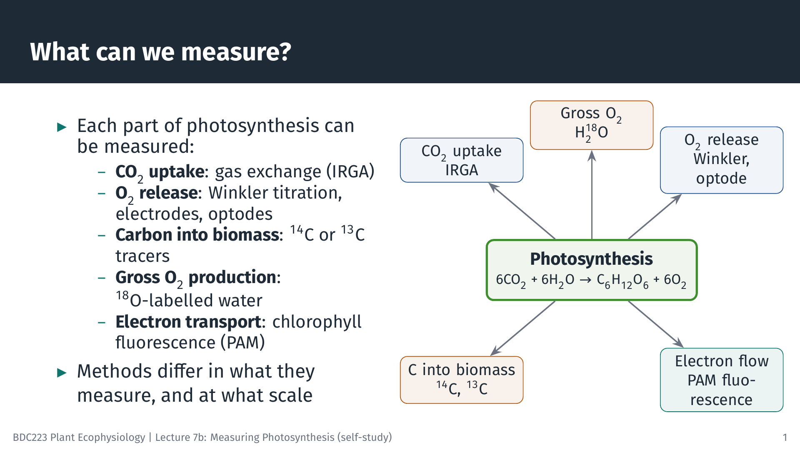

Photosynthesis can be summarised as

$$
6\,\text{CO}_2 + 6\,\text{H}_2\text{O} \xrightarrow{\text{light}} \text{C}_6\text{H}_{12}\text{O}_6 + 6\,\text{O}_2
$$

The equation hides many steps, but it shows the four kinds of change we can follow. CO₂ is taken up, O₂ is released, carbon is built into organic matter, and, before any of this, light energy drives electrons through photosystem II (PSII). Every method in this lecture measures one of these. Gas-exchange systems measure the CO₂ taken up by a leaf. Oxygen electrodes, optodes and the Winkler titration measure O₂ released into water. Radioactive (¹⁴C) or stable (¹³C) carbon tracers measure the carbon fixed into organic matter, and ¹⁸O-labelled water measures the total O₂ produced. Chlorophyll fluorescence measures the efficiency of electron transport through PSII.

Because the methods follow different parts of the process, they do not always give the same answer, even for the same sample. Knowing which part each method sees is the key to interpreting the results [@hunt2003measurements].

## Gross, Net and Respiration

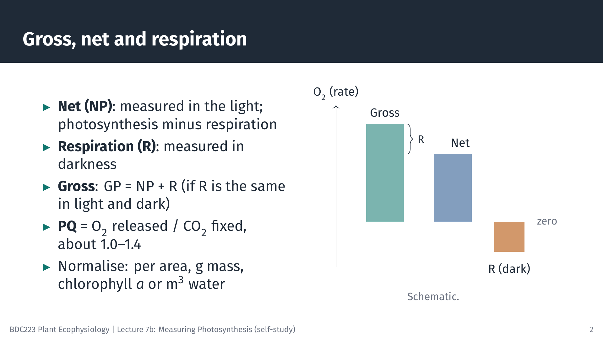

A plant respires all the time, in the light and in the dark. What we measure in the light is therefore **net photosynthesis** (NP): the O₂ produced by photosynthesis minus the O₂ used in respiration (or, for CO₂, the uptake by photosynthesis minus the release by respiration). In darkness photosynthesis stops, and we measure **respiration** (R) alone. **Gross photosynthesis** (GP) is the total:

$$
GP = NP + R
$$

This simple addition assumes that respiration in the light is the same as in the dark. That is not strictly true: respiration and photorespiration can be higher in the light. We return to this when discussing the ¹⁸O method.

Oxygen and carbon rates can be converted into each other using the **photosynthetic quotient**, PQ = moles of O₂ released per mole of CO₂ fixed. If all fixed carbon became carbohydrate, PQ would be exactly 1. Because some electrons are used for other products (for example, to reduce nitrate), PQ is usually somewhat above 1; values of about 1.0–1.4 are typical.

A rate is only meaningful once it is **normalised**: expressed per unit of the material doing the photosynthesis. Leaves are usually expressed per square metre of leaf area, seaweeds and seagrasses per gram of fresh or dry mass (or per unit area of thallus), microalgae per unit of chlorophyll *a* or per cell, and natural phytoplankton per cubic metre of water. Always state the basis, because a rate per gram of fresh mass cannot be compared directly with one per gram of dry mass.

## Designing a P–I Experiment

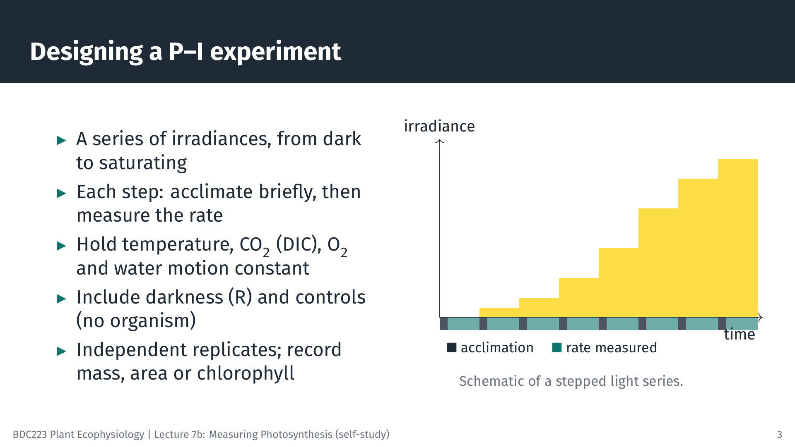

The most common photosynthesis experiment measures the rate at a series of irradiances to build the photosynthesis–irradiance (P–I) curve introduced in [Lecture 7a](L07a-pigments_photosynthesis.qmd). Whatever the method, a good P–I experiment has the same features.

-   **A range of irradiances**, from darkness through the light-limited part of the curve to light saturation, with several points at low light where the curve is steep.
-   **Acclimation at each step.** After the light changes, photosynthesis takes some time to settle at its new rate (seconds for fluorescence, a minute or more for oxygen and CO₂). Data from this period are discarded.
-   **Constant conditions**, apart from light. Temperature, CO₂ (or dissolved inorganic carbon, DIC, in water), O₂ concentration and water movement all affect the rate, so they must be controlled and recorded.
-   **Controls**: a dark measurement for respiration and, for aquatic incubations, a chamber or bottle without the organism to check for drift or for activity of bacteria in the water.
-   **Replication** with independent samples (different plants or thalli, not repeated readings on one sample), and a record of the mass, area or chlorophyll used for normalisation.

## Oxygen Methods

### Light and dark bottles (Winkler titration)

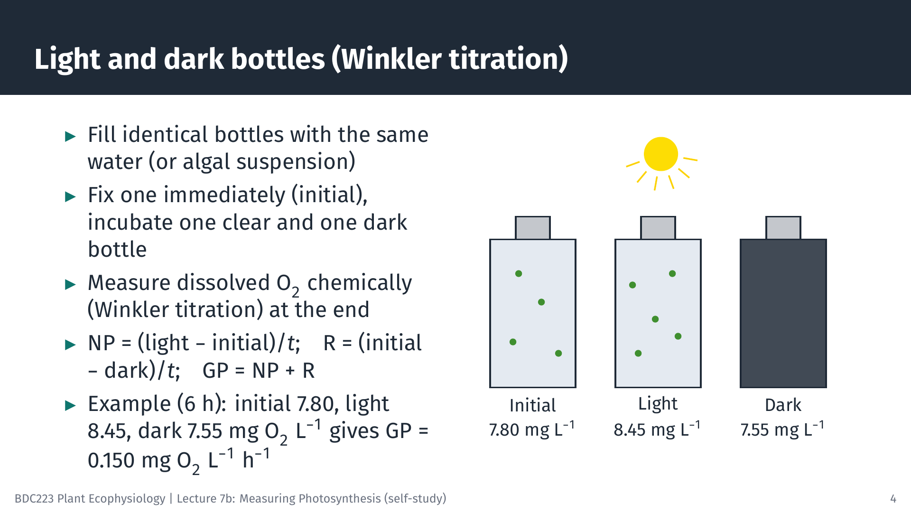

The oldest method for aquatic photosynthesis, still used for plankton, compares bottles of the same water. One bottle is "fixed" with chemicals at the start to record the initial O₂ concentration. A clear bottle and a dark bottle are incubated, either at the depth the water came from or in an incubator, for several hours. At the end, dissolved O₂ is measured by the Winkler titration, a chemical method in which the O₂ in the sample is converted into an equivalent amount of iodine that is then titrated.

**Worked example.** After 6 h, the initial bottle holds 7.80 mg O₂ L⁻¹, the light bottle 8.45 mg O₂ L⁻¹ and the dark bottle 7.55 mg O₂ L⁻¹.

-   NP = (8.45 − 7.80) / 6 = 0.108 mg O₂ L⁻¹ h⁻¹
-   R = (7.80 − 7.55) / 6 = 0.042 mg O₂ L⁻¹ h⁻¹
-   GP = 0.108 + 0.042 = 0.150 mg O₂ L⁻¹ h⁻¹

To express GP as carbon, convert mass of O₂ to mass of C (× 12/32) and divide by the PQ: with PQ = 1.2, GP = 0.150 × 12/32 / 1.2 = 0.047 mg C L⁻¹ h⁻¹, or 47 mg C m⁻³ h⁻¹.

The method is simple and cheap, but the change in O₂ in unproductive water is small compared with the precision of the titration. Long incubations are then needed, and the water in a closed bottle gradually becomes less like the natural water.

### Oxygen electrodes and optodes

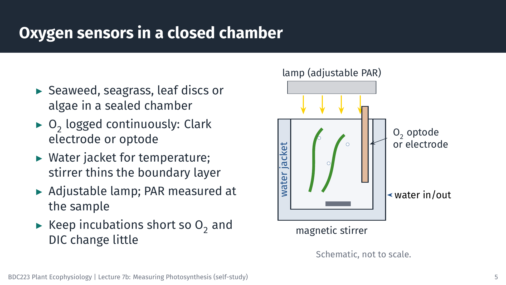

For seaweeds, seagrasses, aquatic plants, leaf discs and algal cultures, O₂ is usually measured continuously in a sealed chamber. Two kinds of sensor are used. A **Clark-type electrode** measures the current produced when O₂ is reduced at a cathode behind a gas-permeable membrane. An **optode** contains a dye whose fluorescence is quenched by O₂; it consumes no O₂ and does not need stirring to read correctly, so optodes have largely replaced electrodes in many laboratories. Small optode spots can be read in the wells of a microplate, which allows many small samples, such as the early life stages of seaweeds, to be measured at once [@veenhof2024novel].

The chamber has a water jacket connected to a water bath to hold the temperature constant, and a magnetic stirrer. Stirring matters for aquatic organisms. A layer of almost still water, the diffusive boundary layer, surrounds every submerged surface, and CO₂ and bicarbonate must diffuse through it. Without stirring this layer thickens, and the measured rate may reflect the supply of carbon through the boundary layer rather than the capacity of photosynthesis. A lamp with adjustable output provides the light, and PAR is measured at the position of the sample with a quantum sensor ([Lecture 6](L06-light.qmd)).

Incubations should be short. As O₂ accumulates and DIC is used up, the conditions in the chamber drift away from those at the start, and very high O₂ can increase photorespiration and form bubbles.

### From an oxygen trace to a rate

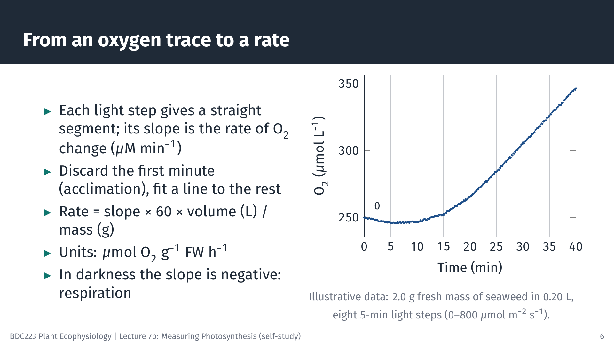

The animation below shows a complete oxygen P–I experiment, from the raw trace to the fitted curve.

<video controls preload="metadata" playsinline width="100%" poster="animations/measuring_photosynthesis/oxygen_to_PI_poster.jpg" aria-label="Animation: from an oxygen trace to a P-I curve">
<source src="animations/measuring_photosynthesis/oxygen_to_PI.mp4" type="video/mp4">
Your browser cannot play this video. <a href="animations/measuring_photosynthesis/oxygen_to_PI.mp4">Download the animation</a>.
</video>

In this illustrative experiment, 2.0 g fresh mass (FM) of seaweed sits in 0.20 L of seawater, and the irradiance is raised in eight 5-min steps from 0 to 800 µmol photons m⁻² s⁻¹. The O₂ trace consists of straight segments. Each slope (µmol O₂ L⁻¹ min⁻¹, i.e. µM min⁻¹) is fitted to minutes 1–5 of its step, discarding the first minute as acclimation. The slope becomes a rate per gram per hour:

$$
P = \text{slope}\,(\mu\text{M min}^{-1}) \times 60\ (\text{min h}^{-1}) \times \frac{V\,(\text{L})}{m\,(\text{g})}
$$

The units work out as µmol O₂ L⁻¹ min⁻¹ × min h⁻¹ × L g⁻¹ = µmol O₂ g⁻¹ h⁻¹. At 200 µmol photons m⁻² s⁻¹ the slope is 3.796 µM min⁻¹, so P = 3.796 × 60 × 0.20 / 2.0 = 22.8 µmol O₂ g⁻¹ FM h⁻¹.

| PAR (µmol photons m⁻² s⁻¹) | Slope (µM min⁻¹) | Net rate (µmol O₂ g⁻¹ FM h⁻¹) |
|---:|---:|---:|
| 0 | −0.838 | −5.03 |
| 25 | 0.236 | 1.42 |
| 50 | 1.193 | 7.16 |
| 100 | 2.579 | 15.48 |
| 200 | 3.796 | 22.78 |
| 400 | 4.206 | 25.24 |
| 600 | 4.220 | 25.32 |
| 800 | 4.186 | 25.12 |

: Slopes and rates for the illustrative oxygen experiment. {#tbl-o2-rates}

## From Rates to a P–I Curve

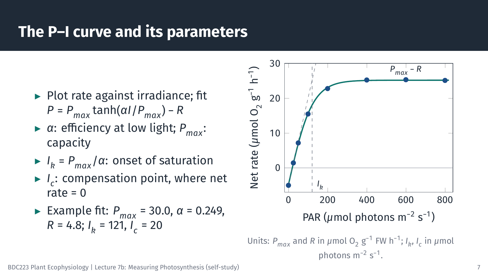

Plotting the rates in @tbl-o2-rates against irradiance gives the P–I curve. We fit the modified Jassby and Platt model [@jassby1976mathematical], the same model you use in Lab 3:

$$
P = P_{max} \tanh\!\left(\frac{\alpha I}{P_{max}}\right) - R
$$

Fitting means finding the values of P~max~, α and R that make the curve pass as close as possible to the points (non-linear least squares; spreadsheet Solver, R and Python can all do this). For the data above, P~max~ = 30.0 µmol O₂ g⁻¹ FM h⁻¹, α = 0.249 µmol O₂ g⁻¹ FM h⁻¹ (µmol photons m⁻² s⁻¹)⁻¹ and R = 4.8 µmol O₂ g⁻¹ FM h⁻¹. Two further parameters follow from these:

-   the **saturation irradiance**, I~k~ = P~max~ / α = 121 µmol photons m⁻² s⁻¹, where the initial slope meets the level of P~max~;
-   the **compensation irradiance**, I~c~, where net photosynthesis is zero: I~c~ = (P~max~ / α) × artanh(R / P~max~) = 20 µmol photons m⁻² s⁻¹.

Note that P~max~ in this model is the maximum *gross* rate. The highest *net* rate, at which the curve levels off on the graph, is P~max~ − R = 25.2 µmol O₂ g⁻¹ FM h⁻¹. Where the data show a decline at high irradiance (photoinhibition), a model with a photoinhibition term, such as that of @platt1980photoinhibition, is used instead.

## Gas Exchange in Terrestrial Leaves

### The open system

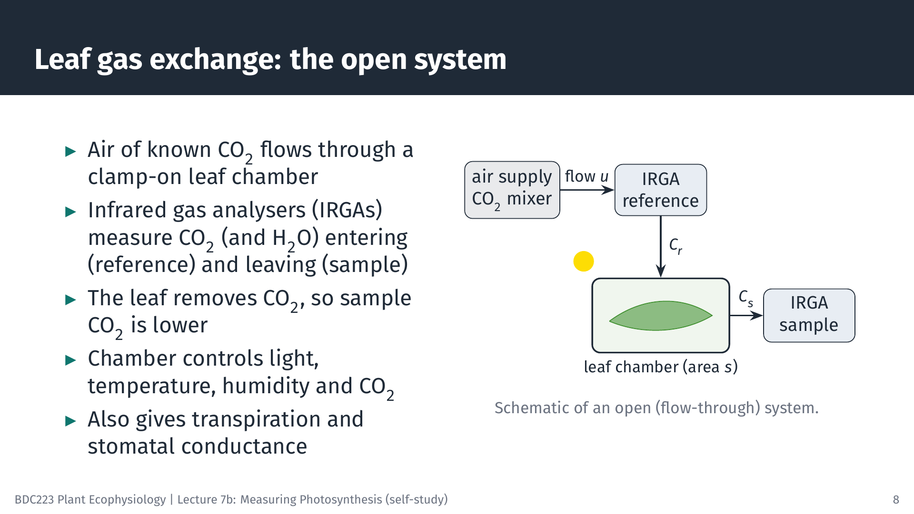

For leaves in air, photosynthesis is measured as CO₂ uptake with infrared gas analysers (IRGAs). CO₂ absorbs infrared radiation at characteristic wavelengths, so the amount of infrared absorbed by a gas sample gives its CO₂ concentration. Most modern instruments are **open (flow-through) systems** [@long2003gas; @busch2024guide]. Air with a controlled CO₂ concentration flows at a known rate through a small chamber clamped onto an attached leaf. One analyser measures the air before it enters the chamber (the reference), and another measures it as it leaves (the sample). Because the leaf takes up CO₂, the sample air contains less CO₂ than the reference. The chamber also controls light, leaf temperature and humidity, and water vapour is measured as well, so the same measurement gives transpiration and stomatal conductance.

The short animation shows what happens inside the chamber. The CO₂ parcels removed by the leaf are exaggerated about threefold so that the uptake is visible.

<video controls preload="metadata" playsinline width="100%" poster="animations/measuring_photosynthesis/leaf_chamber_poster.jpg" aria-label="Animation: air flowing through an open leaf gas-exchange chamber">
<source src="animations/measuring_photosynthesis/leaf_chamber.mp4" type="video/mp4">
Your browser cannot play this video. <a href="animations/measuring_photosynthesis/leaf_chamber.mp4">Download the animation</a>.
</video>

### From CO₂ differences to a light response curve

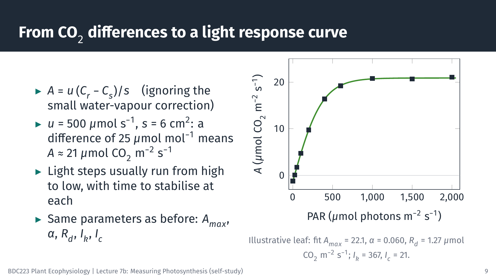

The net CO₂ assimilation rate, A, is the flow of air multiplied by the drop in CO₂ concentration, per unit leaf area:

$$
A = \frac{u\,(C_r - C_s)}{s}
$$

where u is the molar flow rate of air (mol s⁻¹), C~r~ and C~s~ are the CO₂ mole fractions of the reference and sample air (µmol CO₂ mol⁻¹ air), and s is the leaf area in the chamber (m²). The full equation used by commercial instruments also corrects for the water vapour that the leaf adds to the air, which dilutes the CO₂ slightly; we ignore that correction here.

**Worked example.** With u = 500 µmol s⁻¹ = 5.00 × 10⁻⁴ mol s⁻¹, s = 6 cm² = 6.0 × 10⁻⁴ m², C~r~ = 420 and C~s~ = 394.75 µmol mol⁻¹ (a difference of 25.25), A = 5.00 × 10⁻⁴ × 25.25 / 6.0 × 10⁻⁴ = 21.0 µmol CO₂ m⁻² s⁻¹.

A **light response curve** repeats this at several irradiances. Instruments usually step the light from high to low, because leaves adjust to decreasing light faster than to increasing light, and they wait at each step until the CO₂ difference is stable. The illustrative leaf in the slide gives A~max~ = 22.1 µmol CO₂ m⁻² s⁻¹, α = 0.060 mol CO₂ mol⁻¹ photons, R~d~ = 1.27 µmol CO₂ m⁻² s⁻¹, I~k~ = 367 and I~c~ = 21 µmol photons m⁻² s⁻¹. The same instruments also measure the response of A to the CO₂ concentration inside the leaf (A/C~i~ curves), which separates the limitation of photosynthesis by Rubisco from that by electron transport [@long2003gas]; that analysis is beyond this module.

Gas exchange works in air. For submerged plants and algae, the equivalent carbon measurements use changes in DIC, pH or alkalinity of the water, or the tracer methods below.

## Isotopic and Radioactive Methods

### The ¹⁴C method

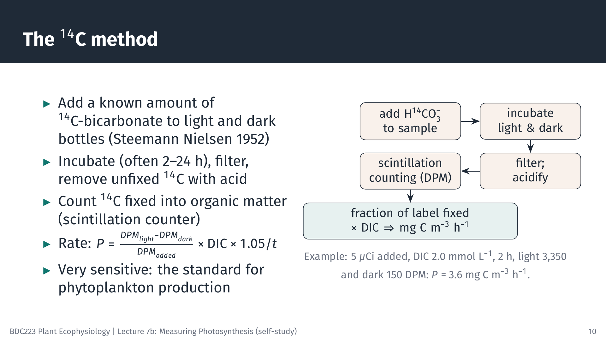

@steemannnielsen1952use introduced radioactive carbon (¹⁴C) to measure the production of marine phytoplankton, and it remains the standard method for low-productivity waters because it is very sensitive [@peterson1980aquatic]. A known amount of ¹⁴C-labelled bicarbonate is added to light and dark bottles of sample water. Because the algae cannot distinguish ¹⁴C from ordinary carbon (apart from a small isotope effect), they fix the label in the same proportion as the total DIC. After incubation (from 2 h for P–I curves to 24 h for daily production), the cells are filtered, unfixed ¹⁴C is removed by acidifying the filter, and the radioactivity fixed into organic matter is counted in a liquid scintillation counter as disintegrations per minute (DPM).

$$
P = \frac{DPM_{light} - DPM_{dark}}{DPM_{added}} \times \text{DIC} \times 1.05 \,\big/\, t
$$

The fraction of the added label that was fixed equals the fraction of the DIC that was fixed. The factor 1.05 corrects for the slightly slower uptake of ¹⁴C than ¹²C, and the dark bottle corrects for non-photosynthetic uptake and adsorption of label.

**Worked example.** 5 µCi of ¹⁴C (1 µCi = 2.22 × 10⁶ DPM, so 1.11 × 10⁷ DPM) is added to a bottle. DIC is 2.0 mmol L⁻¹, i.e. 24 mg C L⁻¹ or 24,000 mg C m⁻³. After 2 h, the filtered cells give 3,350 DPM (light) and 150 DPM (dark). Fraction fixed = (3,350 − 150) / 1.11 × 10⁷ = 2.88 × 10⁻⁴, so P = 2.88 × 10⁻⁴ × 24,000 × 1.05 / 2 = 3.6 mg C m⁻³ h⁻¹.

For P–I curves, many small vials of the same sample are incubated together at different irradiances in a "photosynthetron", a block lit from below with filters that give a range of light levels (slide 18).

### Stable isotopes: ¹³C and ¹⁸O

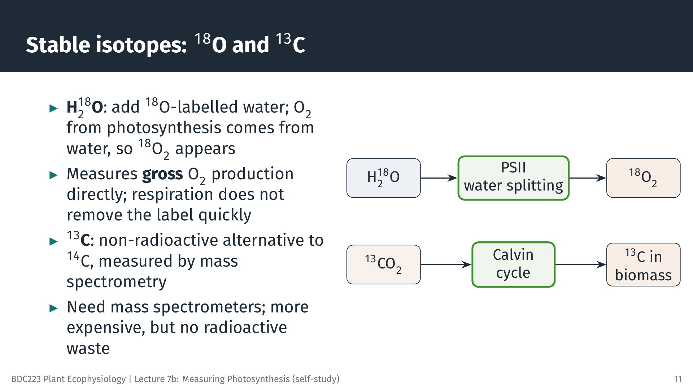

The stable isotope ¹³C can replace ¹⁴C. It is measured with a mass spectrometer rather than a scintillation counter, so no radioactive material is needed. The principle and the calculation are the same.

The ¹⁸O method measures **gross** oxygen production directly. The O₂ released in photosynthesis comes from water, not from CO₂. If water labelled with ¹⁸O is added to a sample, the O₂ produced by photosynthesis carries the label, and its accumulation is measured by mass spectrometry. Respiration removes O₂ from the dissolved pool, but in a short incubation it removes very little of the newly labelled O₂, so the labelled O₂ that accumulates measures gross O₂ production, including O₂ that respiration in the light would otherwise have hidden.

### Which rate does each method measure?

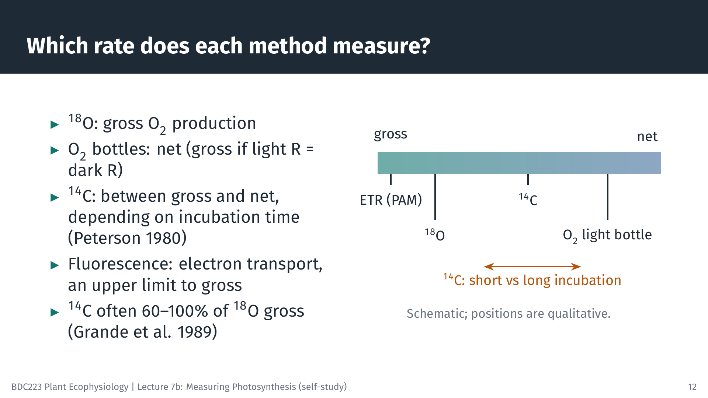

Comparing methods on the same water samples shows how their results relate. In the oligotrophic North Pacific, ¹⁴C production was about 60–100% of the gross O₂ production measured with ¹⁸O, while O₂ light and dark bottles incubated in situ gave rates similar to ¹⁸O [@grande1989primary]. In estuaries, ¹⁴C and O₂ bottle rates did not differ significantly, but ¹⁸O gave lower rates, possibly because labelled oxygen was recycled inside the cells; the authors advise caution when using ¹⁸O in nutrient-rich, low-oxygen water [@gazeau2007planktonic]. In lakes, comparisons with continuous oxygen sensors in the open water support the view that ¹⁴C measures a rate somewhere between gross and net production [@lottig2021estimating].

The general pattern is that ¹⁸O approximates gross O₂ production, and ¹⁴C lies between gross and net carbon fixation. Short ¹⁴C incubations are closer to gross, because little of the newly fixed ¹⁴C has yet been respired; long incubations are closer to net. Fluorescence (next section) measures electron transport, which sets an upper limit to gross photosynthesis. When you read a published rate, check which method was used and what it measures before comparing it with another study.

## Chlorophyll Fluorescence

### Three fates of absorbed light

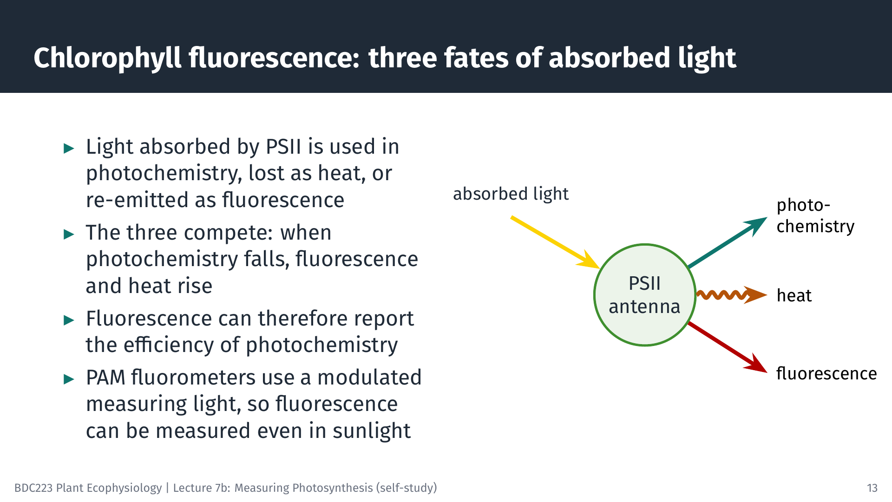

Light energy absorbed by the chlorophyll of PSII has three possible fates. It can drive photochemistry (electron transport), it can be dissipated as heat, or it can be re-emitted as red fluorescence. The three compete for the same energy, so a change in one changes the others. When PSII reaction centres are able to accept energy, most of it goes to photochemistry and fluorescence is low. When the reaction centres are closed (busy, or blocked), more energy goes to fluorescence and heat. Measuring fluorescence under the right conditions therefore tells us how efficiently PSII is using light [@maxwell2000chlorophyll; @murchie2013chlorophyll].

Fluorescence from a leaf is very weak compared with the reflected light in sunshine. A pulse-amplitude modulated (PAM) fluorometer solves this by using a weak, rapidly pulsed **measuring light** and recording only the fluorescence that pulses at the same frequency. This allows fluorescence to be measured in full sunlight, in the field and under water.

### The saturating pulse

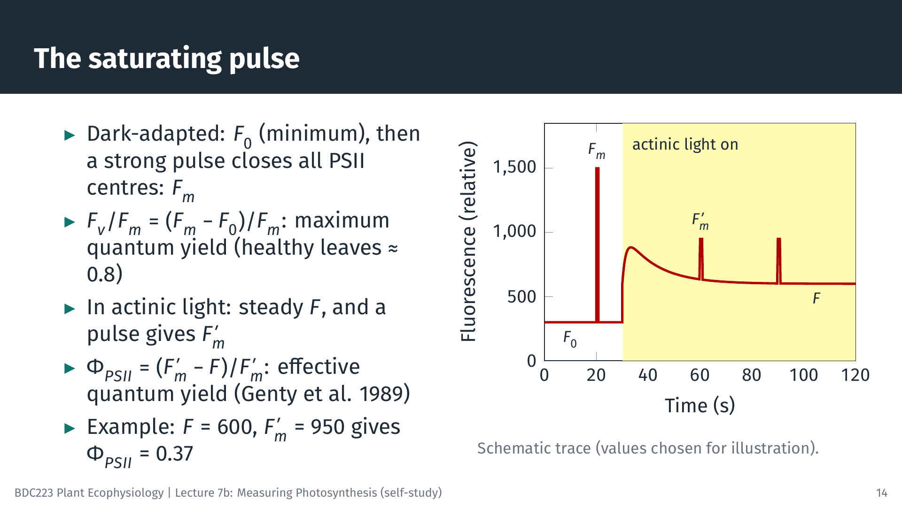

The key technique is the **saturating pulse**: a very bright flash, lasting less than a second, that briefly closes all PSII reaction centres. The animation shows the sequence.

<video controls preload="metadata" playsinline width="100%" poster="animations/measuring_photosynthesis/saturating_pulse_poster.jpg" aria-label="Animation: the saturating pulse, quantum yields and a rapid light curve">
<source src="animations/measuring_photosynthesis/saturating_pulse.mp4" type="video/mp4">
Your browser cannot play this video. <a href="animations/measuring_photosynthesis/saturating_pulse.mp4">Download the animation</a>.
</video>

1.  After a period in darkness (typically 15–30 min), all reaction centres are open. The measuring light gives the minimum fluorescence, F~0~.
2.  A saturating pulse closes all centres and gives the maximum fluorescence, F~m~. The difference, F~v~ = F~m~ − F~0~, is the variable fluorescence. The **maximum quantum yield of PSII** is F~v~/F~m~ = (F~m~ − F~0~)/F~m~. In the example, (1,500 − 300) / 1,500 = 0.80. Healthy, unstressed leaves of most species give values close to 0.8; lower values indicate stress or photoinhibition.
3.  In actinic light (light that drives photosynthesis), fluorescence settles at a steady level, F. A saturating pulse now gives F~m~′, which is lower than F~m~ because some energy is being dissipated as heat. The **effective quantum yield of PSII** is Φ~PSII~ = (F~m~′ − F)/F~m~′ [@genty1989relationship]. In the example, (950 − 600) / 950 = 0.37: 37% of the light absorbed by PSII is used in photochemistry at this irradiance.

### Electron transport rate and rapid light curves

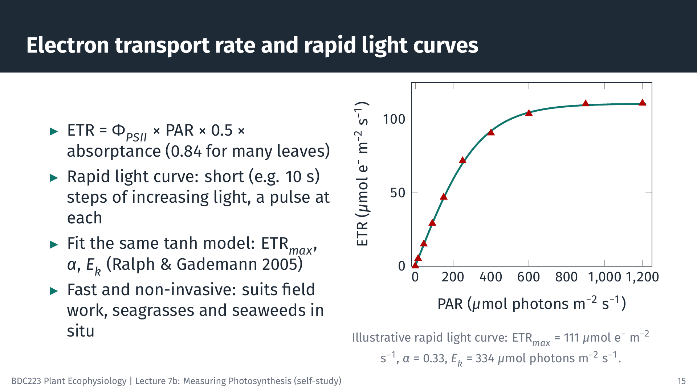

Multiplying the quantum yield by the rate at which PSII absorbs photons gives the **electron transport rate**:

$$
\text{ETR} = \Phi_{PSII} \times \text{PAR} \times 0.5 \times a
$$

The factor 0.5 assumes that absorbed light is shared equally between PSII and photosystem I, and *a* is the absorptance of the leaf, the fraction of incident PAR it absorbs (often taken as 0.84 for green leaves). At 400 µmol photons m⁻² s⁻¹: ETR = 0.37 × 400 × 0.5 × 0.84 = 62 µmol electrons m⁻² s⁻¹.

A **rapid light curve** (RLC) exposes the sample to a series of increasing irradiances, each lasting only about 10 s, with a saturating pulse at the end of each step [@ralph2005rapid]. A complete curve takes a minute or two. ETR plotted against PAR has the same shape as a P–I curve and is fitted with the same model (without a respiration term, because fluorescence does not measure respiration). The illustrative curve in the slide gives ETR~max~ = 111 µmol e⁻ m⁻² s⁻¹, α = 0.33 electrons per incident photon and E~k~ = ETR~max~/α = 334 µmol photons m⁻² s⁻¹.

Because each step is so short, an RLC does not show the steady-state response of the plant. It describes the current state of the photosynthetic apparatus, which depends on the light the sample received in the minutes to hours beforehand.

### Strengths and cautions

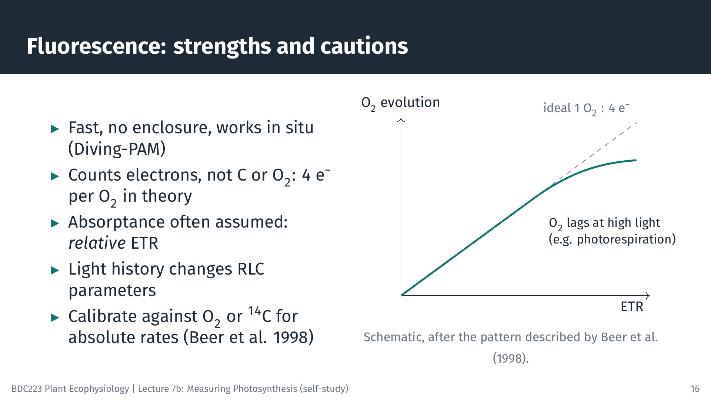

Fluorescence is fast, non-invasive and needs no enclosure, so it is ideal for field work and for comparing many samples. Submersible instruments such as the Diving-PAM measure seagrasses and seaweeds in situ [@ralph1998situ]. Its results need careful interpretation, however.

-   **Electrons are not carbon.** In theory four electrons are transported for each O₂ released. In seagrasses, O₂ evolution and ETR were linearly related over a range of irradiances, with a molar ratio of about 0.3 O₂ per electron for *Cymodocea nodosa*, close to the theoretical 0.25; in other species O₂ evolution fell behind ETR at high irradiance, probably because of photorespiration [@beer1998measuring].
-   **Absorptance is often assumed.** If *a* is not measured, ETR is a *relative* ETR (rETR), useful for comparisons within a study but not as an absolute rate. Comparing α between seasons or sites can be misleading when absorptance differs, and plotting ETR against absorbed rather than incident light avoids this problem [@saroussi2006alpha].
-   **Light history matters.** RLC parameters change during the day and with the recent light environment of the sample.

When absolute rates of carbon fixation or oxygen production are needed, fluorescence should be calibrated against O₂ or ¹⁴C measurements on the same material.

## Applying the Methods to Different Organisms

### Seaweeds and seagrasses

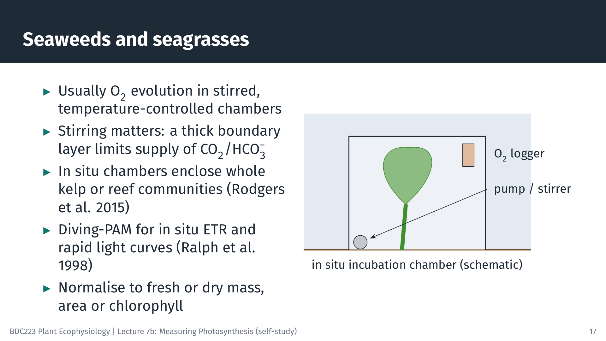

Seaweeds and seagrasses are usually measured by O₂ evolution in stirred, temperature-controlled chambers in the laboratory, with pieces of thallus or leaf normalised to fresh or dry mass, area or chlorophyll. Large seaweeds such as kelps are difficult to measure in the laboratory without cutting them. In situ systems enclose an entire kelp in a bag or chamber fitted with an O₂ logger. For the kelp *Ecklonia radiata*, the maximum rates of P–I curves measured in the laboratory were 42–55% lower than those measured in situ, which suggests that laboratory measurements underestimate kelp forest productivity [@rodgers2015novel]. Larger benthic chambers enclose whole patches of reef, and PAM fluorometry adds rapid in situ measurements. For *E. radiata*, chamber O₂ fluxes and fluorescence ETR were well correlated, but ETR may overestimate O₂ production, so the two methods need to be calibrated against each other [@randall2019situ].

### Microalgae and phytoplankton

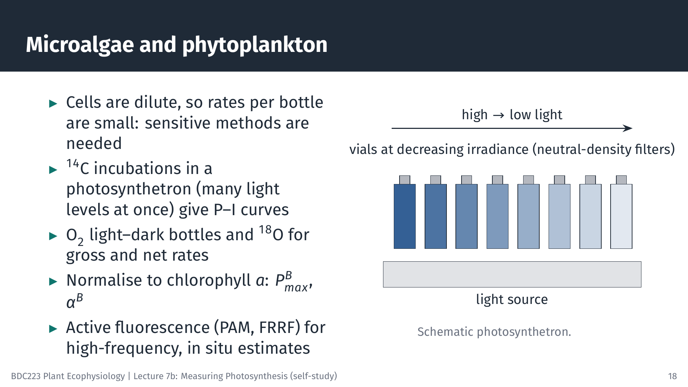

Phytoplankton occur as dilute suspensions, so the change in O₂ or carbon in a bottle is small, and sensitive methods are needed. ¹⁴C incubations in a photosynthetron give P–I curves from many light levels at once. For natural phytoplankton, rates are often normalised to chlorophyll *a*, and the parameters are then written with a superscript B (for biomass): P^B^~max~ in mg C (mg Chl *a*)⁻¹ h⁻¹ and α^B^. Light and dark O₂ bottles and the ¹⁸O method give gross and net rates. Active fluorescence instruments (PAM, and fast repetition rate fluorometers, FRRF) measure continuously from ships and moorings, but, as for macrophytes, converting electron transport into carbon fixation requires calibration.

### Terrestrial plants: from leaf to canopy

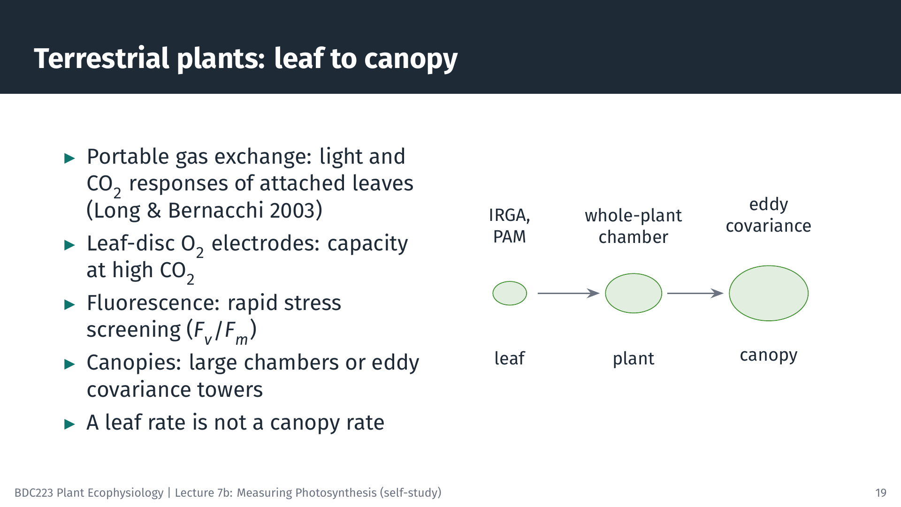

For terrestrial plants, portable gas-exchange systems are the standard tool: they measure light and CO₂ response curves on attached leaves in the field [@long2003gas]. Leaf-disc O₂ electrodes measure the light-saturated capacity of leaf pieces at high CO₂. Fluorescence (often F~v~/F~m~) is widely used for rapid screening of stress and photoinhibition [@murchie2013chlorophyll]. Whole plants can be enclosed in larger chambers. For whole canopies, towers above the vegetation measure the CO₂ exchange of the entire ecosystem from rapid fluctuations of wind speed and CO₂ concentration (eddy covariance). Remember that each scale has its own value: the rate of a sunlit leaf at the top of the canopy is not the rate of the canopy.

## Choosing a Method

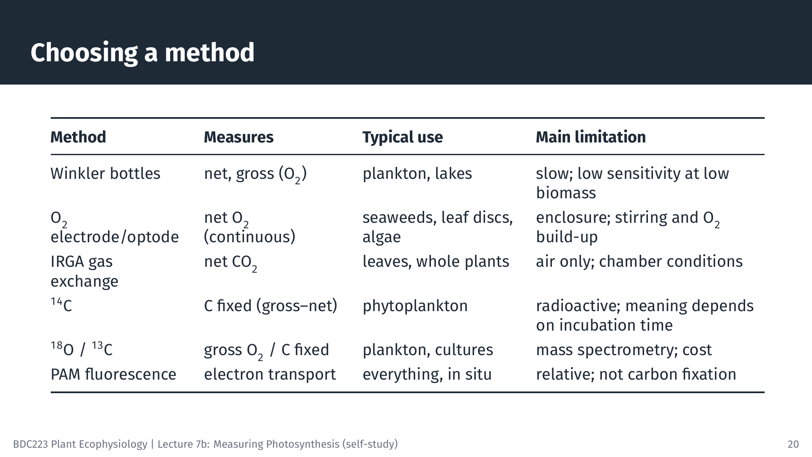

No method is best for every purpose. The choice depends on the organism (in air or in water, large or microscopic, at high or low biomass), the scale (a leaf, a thallus, a bottle of water or an ecosystem), the rate you need (gross, net, carbon or electrons) and practical matters such as cost, radioactivity licensing and whether the work must be done in the field. Many studies combine methods: for example, PAM fluorometry for many quick measurements, calibrated against O₂ evolution on a subset of samples. A guide such as @hunt2003measurements is a useful overview of the options and their limitations.

## Summary

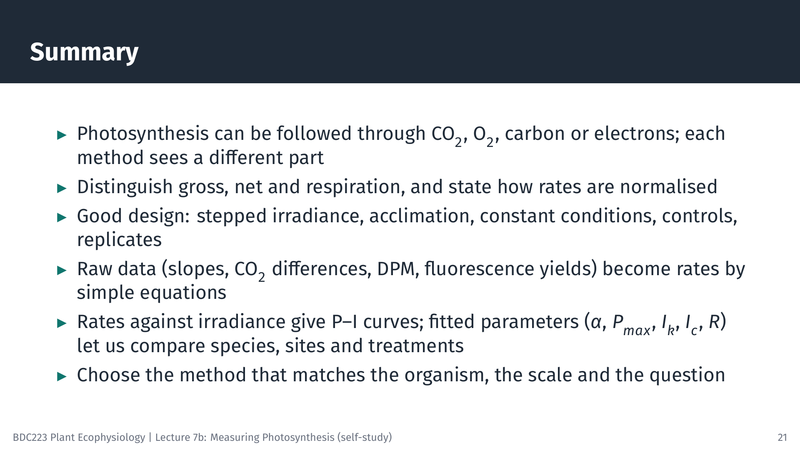

## Self-Test Questions

::: {.callout-note collapse="true"}
## 1. A seaweed in a 0.25 L chamber has a mass of 1.5 g FM. In darkness O₂ falls by 0.60 µM min⁻¹; at 300 µmol photons m⁻² s⁻¹ it rises by 3.00 µM min⁻¹. Calculate R, NP and GP at this irradiance.

R = 0.60 × 60 × 0.25 / 1.5 = 6.0 µmol O₂ g⁻¹ FM h⁻¹. NP = 3.00 × 60 × 0.25 / 1.5 = 30.0 µmol O₂ g⁻¹ FM h⁻¹. GP = NP + R = 36.0 µmol O₂ g⁻¹ FM h⁻¹ (assuming respiration in the light equals respiration in the dark).
:::

::: {.callout-note collapse="true"}
## 2. In an open gas-exchange system, u = 600 µmol s⁻¹, s = 6 cm², C~r~ = 410 and C~s~ = 390 µmol mol⁻¹. What is A?

A = 6.0 × 10⁻⁴ mol s⁻¹ × 20 µmol mol⁻¹ / 6.0 × 10⁻⁴ m² = 20 µmol CO₂ m⁻² s⁻¹ (ignoring the water-vapour correction).
:::

::: {.callout-note collapse="true"}
## 3. A dark-adapted leaf gives F~0~ = 250 and F~m~ = 1,000. In light of 600 µmol photons m⁻² s⁻¹, F = 500 and F~m~′ = 700. Calculate F~v~/F~m~, Φ~PSII~ and ETR (absorptance 0.84).

F~v~/F~m~ = (1,000 − 250) / 1,000 = 0.75. Φ~PSII~ = (700 − 500) / 700 = 0.29. ETR = 0.29 × 600 × 0.5 × 0.84 = 72 µmol e⁻ m⁻² s⁻¹.
:::

::: {.callout-note collapse="true"}
## 4. Why do ¹⁴C rates from 24-h incubations tend to be lower than those from 2-h incubations of the same water?

Over 24 h, part of the ¹⁴C fixed early in the incubation is respired again (by the algae and by organisms that consume their products) and some is released as dissolved organic carbon that does not stay on the filter. Long incubations therefore approach net production, whereas short incubations are closer to gross production.
:::

::: {.callout-note collapse="true"}
## 5. You want to compare the photosynthesis of a kelp at 5 m and 15 m depth. Which methods would you use, and why?

In situ O₂ incubation chambers give absolute rates of whole thalli under natural light and water movement, and PAM fluorometry (rapid light curves with a Diving-PAM) allows many quick measurements at both depths. Using both lets you calibrate ETR against O₂ evolution. Laboratory incubations of excised pieces are simpler, but rates measured in the laboratory may not represent those in the field.
:::

::: {.callout-note collapse="true"}
## 6. Why must aquatic incubation chambers be stirred?

A diffusive boundary layer of almost still water surrounds submerged surfaces. Without stirring it becomes thicker, and the supply of CO₂ and bicarbonate (and the removal of O₂) by diffusion through it can limit the measured rate, so the experiment measures the transport through the boundary layer rather than the capacity of photosynthesis.
:::

## Sources of the Figures and Animations

The slides were made with LaTeX (Beamer and TikZ); the illustrative datasets, fits and worked examples come from `slides/L07b-measuring-photosynthesis/models.py`. The oxygen and fluorescence animations were made with Manim (`animations/measuring_photosynthesis/films.py`), and the leaf-chamber animation with Blender (`animations/measuring_photosynthesis/blender_leaf_chamber.py`).

## References

::: {#refs}
:::
