::: callout-tip
## **Content**

-   How the theory of complementary chromatic adaptation arose: Ørsted, Engelmann, and Haxo and Blinks.
-   Action spectra and absorption spectra, and what they show about accessory pigments in green, brown and red algae.
-   Field evidence on the depth distribution of seaweeds.
-   Acclimation of seaweed pigments and photosynthesis to depth (Ramus and co-workers), and the role of thallus structure in light capture.
:::

::: callout-tip
## **Aims**

This lecture follows a hypothesis from its origin to its rejection. You should be able to state the theory of complementary chromatic adaptation, explain the experiments that supported it, and explain why field surveys and transplant experiments led to its rejection as an explanation of seaweed depth zonation. You should also be able to explain how seaweeds acclimate to low light by changing the amount of pigment, the ratio of accessory pigments to chlorophyll-*a*, and, through the structure of the thallus, the fraction of light they absorb.
:::

::: callout-tip
## **Learning Outcomes**

By the end of this lecture, you will be able to:

1.  State the theory of complementary chromatic adaptation and the predictions it makes about the depth distribution of green, brown and red seaweeds.
2.  Distinguish an absorption spectrum from an action spectrum, and interpret where the two differ in green, brown and red algae.
3.  Explain Engelmann's and Haxo and Blinks's experiments and what each could and could not show.
4.  Explain the Emerson enhancement effect and why the action spectrum of a red alga follows phycoerythrin rather than chlorophyll-*a*.
5.  Summarise the field and experimental evidence that led to the rejection of chromatic adaptation as an explanation of seaweed zonation.
6.  Distinguish intensity adaptation from chromatic adaptation, and explain how *Ulva* acclimates its pigments to depth.
7.  Explain how thallus structure makes *Codium* optically black, and why this reduces its need to change its pigments.
:::

::: callout-note
## **Required Reading**

-   [Saffo, M. B. (1987). New light on seaweeds. BioScience, 37(9), 654–664.](../docs/Saffo_1987.pdf)
-   [Haxo, F. T., & Blinks, L. R. (1950). Photosynthetic action spectra of marine algae. Journal of General Physiology, 33(4), 389–422.](<../docs/Haxo and Blinks (1950).pdf>)
-   [Ramus, J., Beale, S. I., & Mauzerall, D. (1976). Correlation of changes in pigment content with photosynthetic capacity of seaweeds as a function of water depth. Marine Biology, 37(3), 231–238.](../docs/Ramus_et_al_1976a.pdf)
-   [Ramus, J., Beale, S. I., Mauzerall, D., & Howard, K. L. (1976). Changes in photosynthetic pigment concentration in seaweeds as a function of water depth. Marine Biology, 37(3), 223–229.](../docs/Ramus_et_al_1976b.pdf)
:::

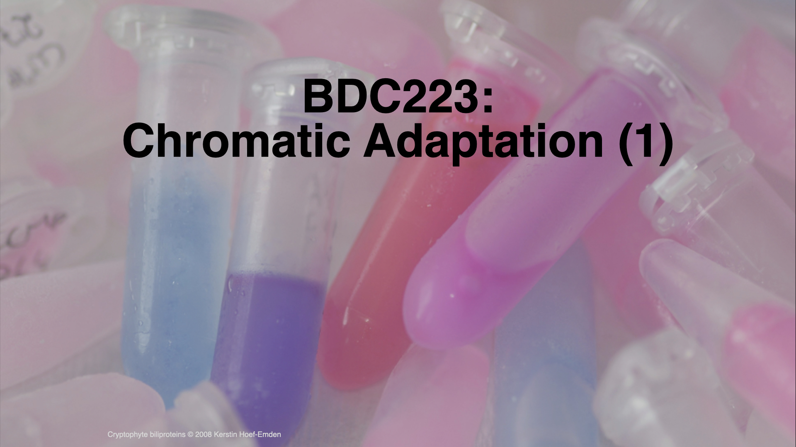

## Introduction: A Hypothesis and Its Testing

Today we follow the history of one idea: that the colour of a seaweed fits it to the colour of the light at the depth where it lives. The idea is about 140 years old. It was reasonable, it was supported by elegant experiments, and it was taught as fact for most of the 20th century [@saffo1987new]. It was then tested in the field and largely rejected. The story shows how a hypothesis can rest on sound laboratory results and still fail as an explanation of what happens in nature, and how new methods and new kinds of evidence change our understanding.

Two terms recur throughout. An **absorption spectrum** shows how much light a pigment, or a whole thallus, absorbs at each wavelength. An **action spectrum** shows how fast photosynthesis proceeds at each wavelength when the alga receives the same number of photons at every wavelength. If every absorbed photon were used equally well, the two spectra would have the same shape. Where they differ, some of the absorbed light is not being used for photosynthesis. You met both ideas in [Lecture 7a](L07a-pigments_photosynthesis.qmd).

## Early Observations: Anders Ørsted

The Danish botanist Anders Sandøe Ørsted studied the seaweeds of the Øresund, the strait between Denmark and Sweden. In an 1844 treatise on marine ecology he described a vertical sequence: green algae in the shallowest water, brown algae at intermediate depths and red algae deepest [@orsted1844regionibus; @saffo1987new]. Today we place these seaweeds in the Chlorophyta (green algae), Phaeophyceae (brown algae) and Rhodophyta (red algae). Ørsted described the pattern; he did not test what caused it.

## Theodor Engelmann and the Chromatic Adaptation Hypothesis

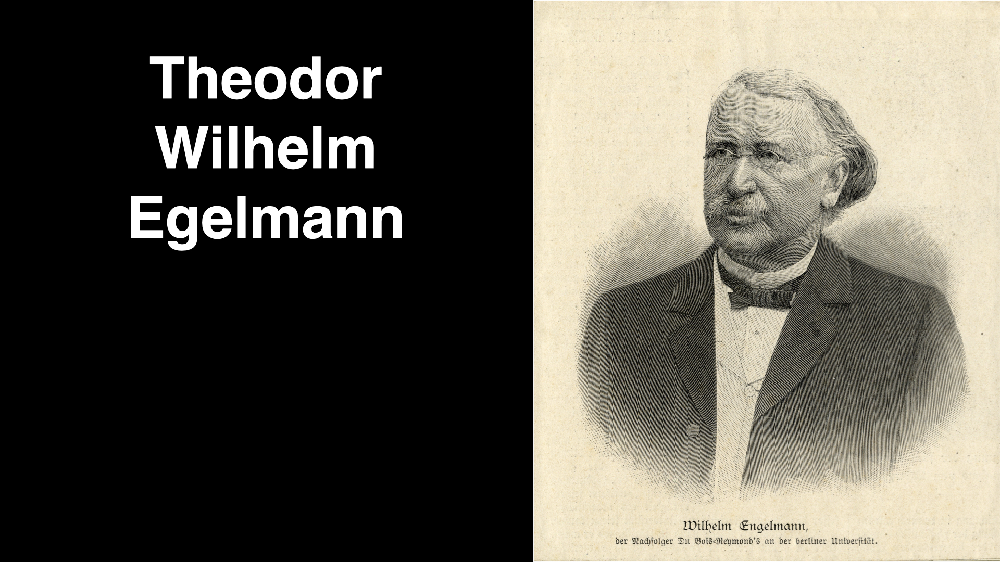

The German physiologist Theodor Wilhelm Engelmann proposed a cause in 1883 [@engelmann1883farbe]. He knew that light changes with depth in two ways. Its **quantity** falls, because water absorbs and scatters light. Its **quality** (spectral composition) changes, because water absorbs red light much more strongly than green or blue light. In clear oceanic water the light that remains at depth is blue; in the coastal water where most seaweeds grow, it is green, because dissolved and particulate material also absorbs the blue [@saffo1987new].

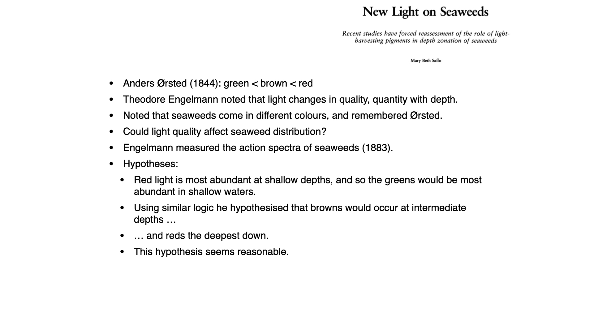

Engelmann asked whether the colour of the light could explain Ørsted's sequence. Chlorophyll-*a* absorbs most strongly in the blue and red and weakly in the green. Green algae, with little more than chlorophyll to harvest light, should therefore do best near the surface, where red light is still present. Red algae contain phycoerythrin, which absorbs green light strongly, so they should do best in deep coastal water, where green light dominates. Brown algae, whose fucoxanthin absorbs some green light, should fall in between. Because the colour of the alga is complementary to the colour of the light it uses, this idea became known as **complementary chromatic adaptation**. It is a reasonable hypothesis, and it is easy to see why it was accepted.

## Engelmann's Experiment

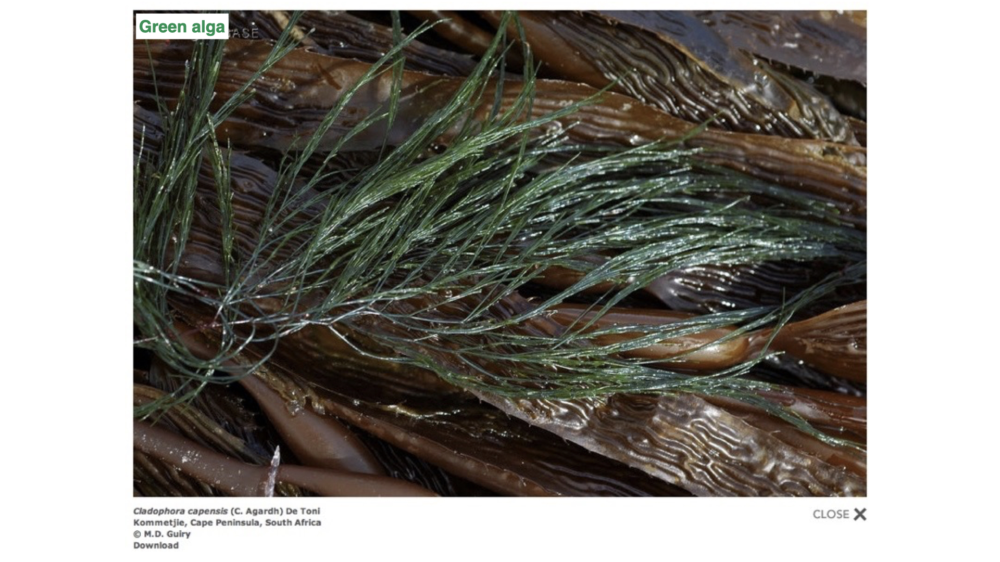

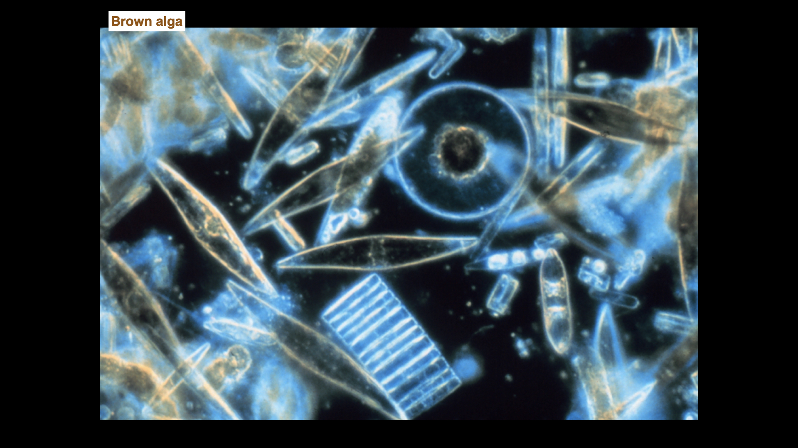

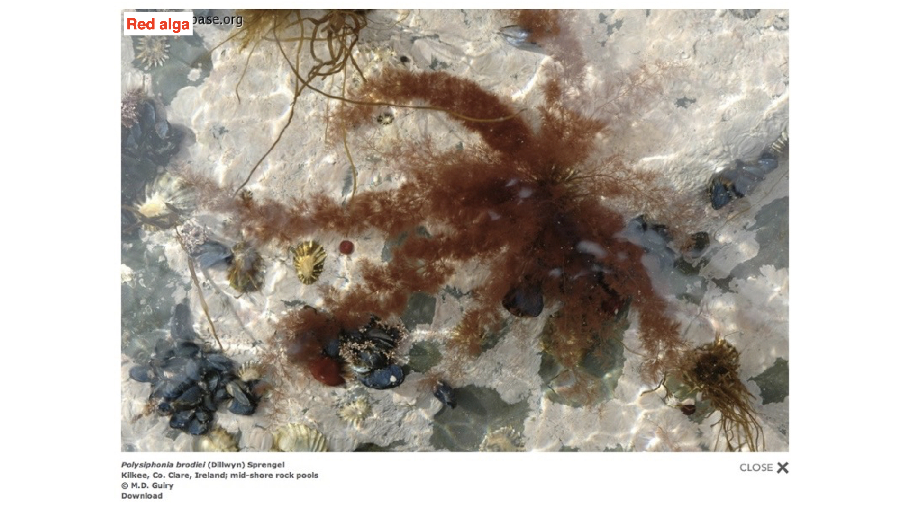

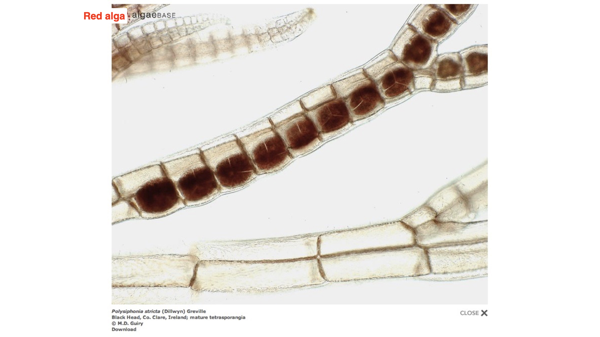

Engelmann tested the idea with a clever experiment [@engelmann1882ueber; @engelmann1883farbe]. A prism made for him by Carl Zeiss split white light into a small spectrum, which he projected through algal cells on a microscope slide. The slides show the kinds of algae involved: a green alga (*Cladophora*), diatoms (which carry fucoxanthin and stand in for the brown algae) and a filamentous red alga (*Polysiphonia* is shown here). Engelmann worked mostly with small algae, many of them from freshwater, because they had to fit on a microscope slide [@saffo1987new].

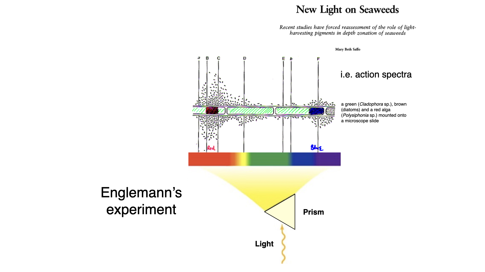

Oxygen meters did not exist, so Engelmann added aerotactic bacteria to the water around the algae. These bacteria swim towards higher oxygen concentrations. Where a part of the alga photosynthesised fastest, it released the most oxygen and the bacteria gathered most densely. The filament marked the wavelength axis, and the clusters of bacteria formed a living graph of photosynthetic rate against wavelength.

### The first action spectrum

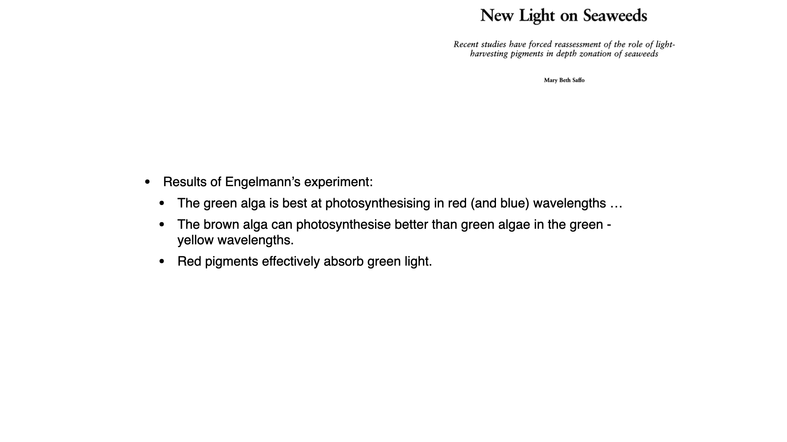

With the green alga *Cladophora*, the bacteria gathered in the red and the blue parts of the spectrum and were sparse in the green. This was the first action spectrum: it showed that the wavelengths absorbed by chlorophyll are the ones that drive photosynthesis. With the diatoms, activity was greatest in the red and yellow-green, and with the red algae it was greatest in the green to yellow-green, the region that chlorophyll absorbs poorly [@saffo1987new]. The accessory pigments were therefore doing photosynthetic work.

## Implications and Predictions

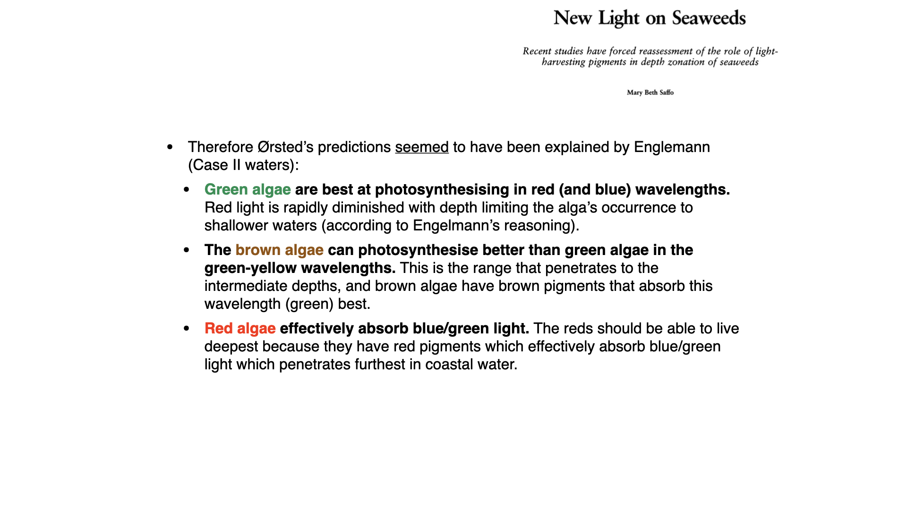

Engelmann's results seemed to explain Ørsted's pattern. Green algae photosynthesise best in red and blue light; red light is lost in the first few metres, so green algae should be restricted to shallow water. Brown algae can also use green-yellow light and should extend to intermediate depths. Red algae use green light, which penetrates furthest in coastal water, and should live deepest.

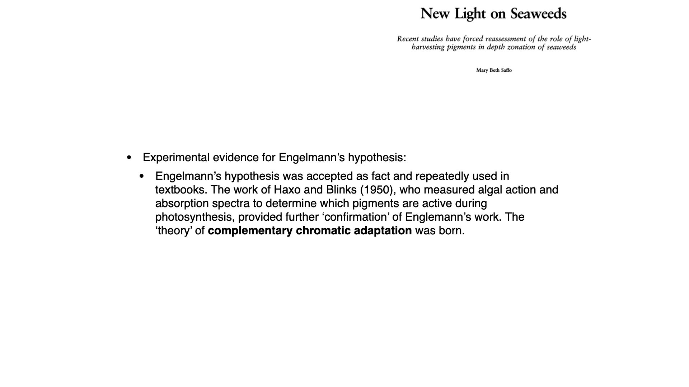

The hypothesis was attractive because it linked biochemistry (the absorption spectra of pigments) with ecology (where seaweeds live) through one simple mechanism. It appeared, presented as fact, in at least eight introductory biology and plant physiology textbooks in the 1980s [@saffo1987new]. The work of Haxo and Blinks was later read as confirming it, as we discuss next.

## Haxo and Blinks: Action and Absorption Spectra

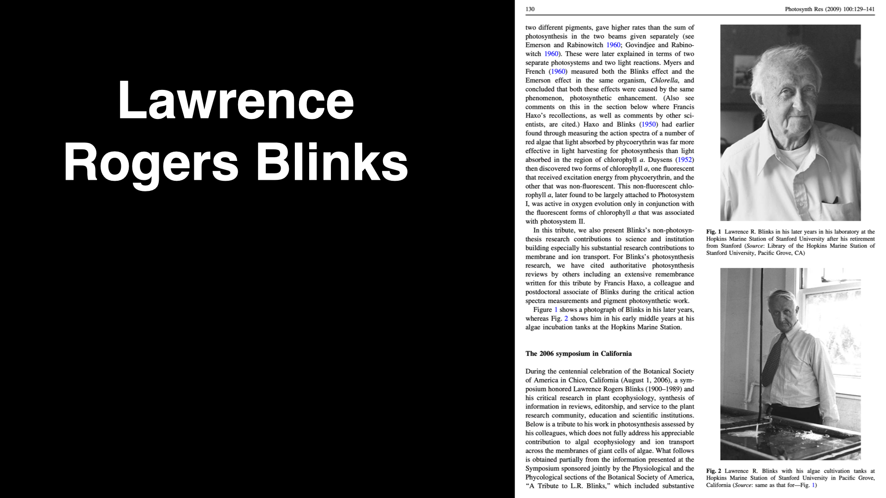

About 70 years after Engelmann, Francis Haxo and Lawrence Blinks, at the Hopkins Marine Station in California, repeated his work on seaweeds with better tools [@haxo1950photosynthetic]. A monochromator gave them narrow bands of light at some 35 wavelengths across the visible spectrum. They measured oxygen production directly, with a platinum electrode in contact with the thallus (the polarographic method), instead of inferring it from bacteria.

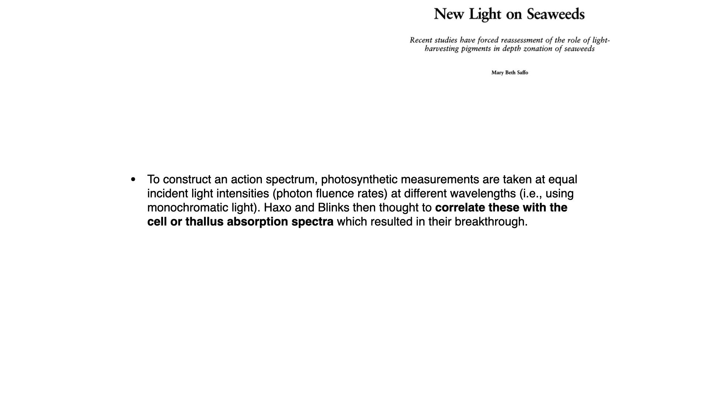

They also added a step that Engelmann could not make. For each seaweed they measured the action spectrum, the absorption spectrum of the intact thallus, and the absorption spectra of pigment extracts. Comparing the three shows which pigments absorb light at each wavelength and whether that absorbed light is used for photosynthesis.

### Green algae

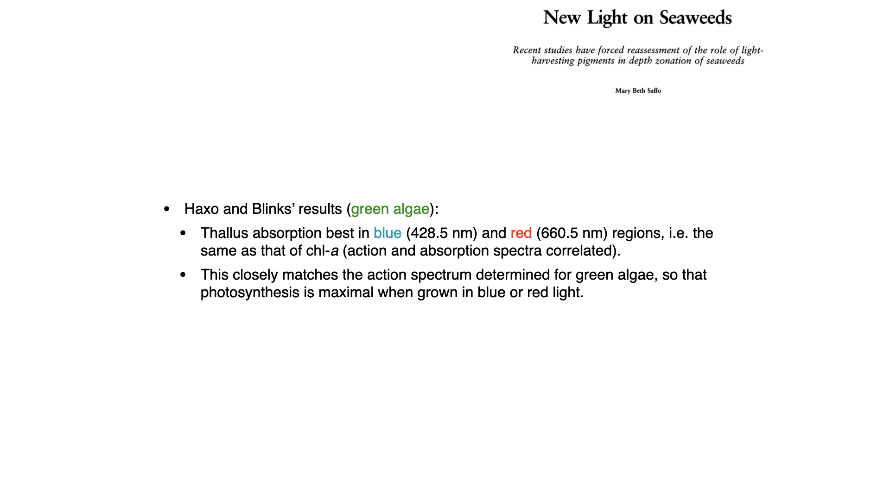

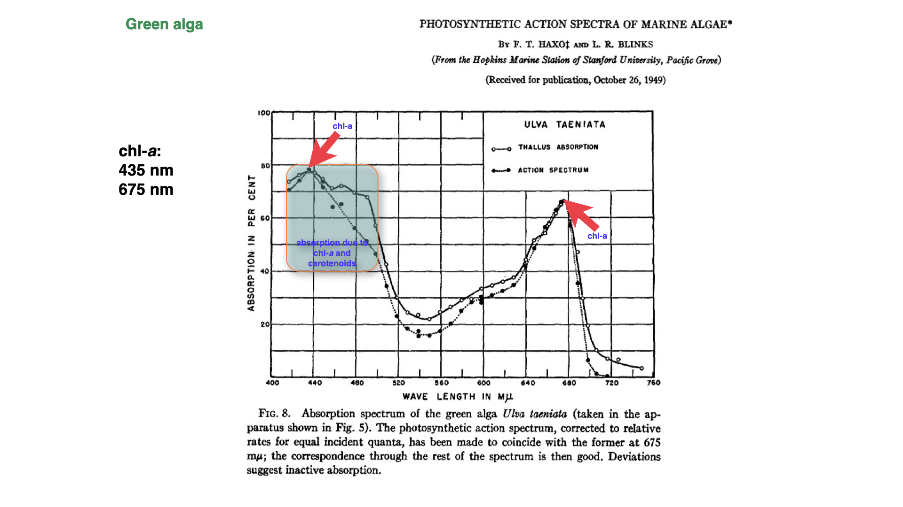

In the green alga *Ulva taeniata*, the thallus absorbed most strongly in the blue (near 435 nm) and the red (near 675 nm), the absorption peaks of chlorophyll-*a*. Absorption was lowest in the green, at about 22% near 550 nm. In the figure, the open circles show thallus absorption and the closed circles the action spectrum. The two curves were scaled to agree at 675 nm, and the rest of the action spectrum then follows the absorption spectrum closely. Most of the light that *Ulva* absorbs is therefore used for photosynthesis.

There is one clear discrepancy. Between about 450 and 510 nm, where carotenoids absorb alongside chlorophyll, the action spectrum lies 10 to 15 units below the absorption spectrum [@haxo1950photosynthetic]. Some of the light absorbed by carotenoids in this region is not passed on to chlorophyll-*a*, so it does not drive photosynthesis. Haxo and Blinks called this **inactive absorption**. Not all carotenoids are inactive, however; the action spectrum stays high at 440 nm, where carotenoids absorb almost as much light as chlorophyll does.

### Brown algae

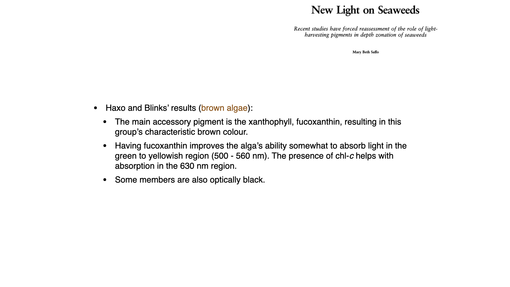

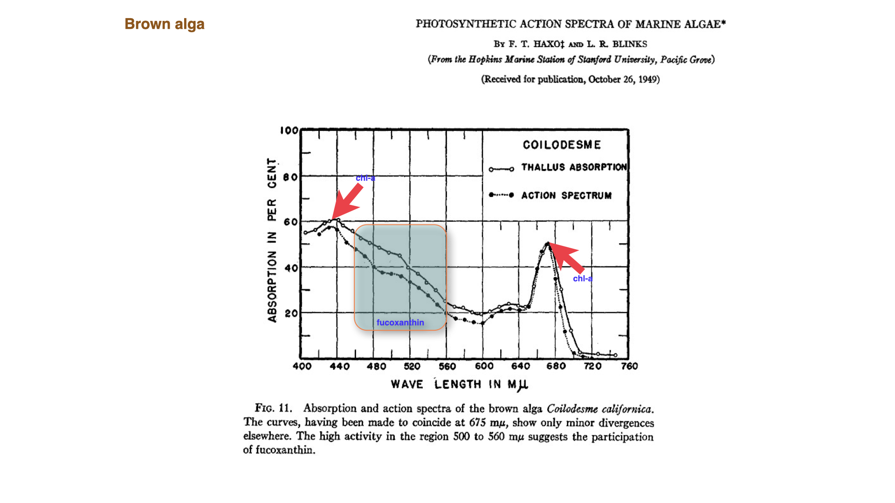

In the brown alga *Coilodesme californica*, the blue and red chlorophyll peaks are again present, but absorption stays high from 500 to 560 nm. This is the contribution of fucoxanthin, the xanthophyll that gives brown algae their colour. The action spectrum follows this extra absorption closely, so the light absorbed by fucoxanthin is used efficiently. Brown algae also contain chlorophyll-*c*, which adds a small absorption band near 630 nm. Fucoxanthin fills part of the "green gap" that chlorophyll leaves, and so widens the range of wavelengths available for photosynthesis.

### Red algae and the Emerson enhancement effect

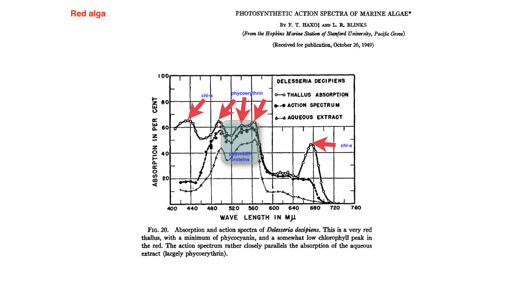

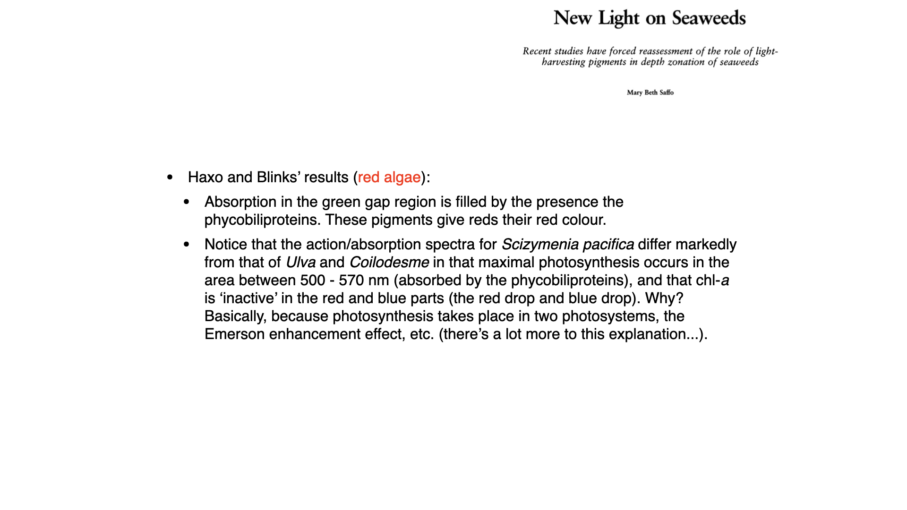

In red algae such as *Delesseria decipiens*, the phycobiliproteins (mainly phycoerythrin, with some phycocyanin) absorb strongly between about 500 and 570 nm, so the green gap is largely filled. Here the action spectrum differs markedly from those of the green and brown algae. Photosynthesis is fastest in the green, where phycoerythrin absorbs, and it follows the absorption spectrum of the water-soluble pigment extract (largely phycoerythrin). In the blue and red, where the thallus still absorbs strongly through chlorophyll-*a*, photosynthesis is low [@haxo1950photosynthetic]. Light absorbed by chlorophyll-*a* in these separate wavelength bands is therefore used poorly for oxygen production. These depressions in the action spectrum are sometimes called the "blue drop" and "red drop".

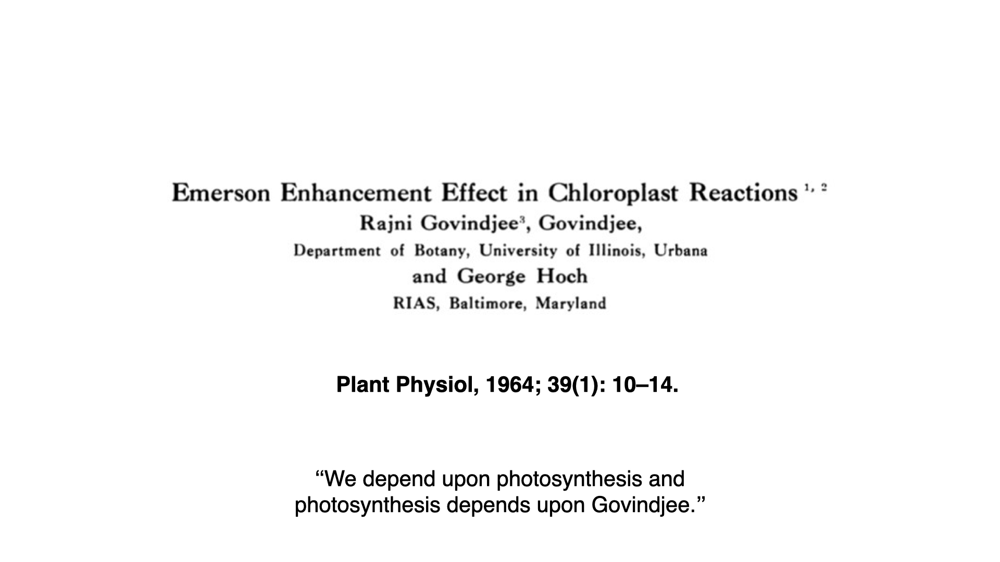

The explanation came from the discovery that photosynthesis uses two photosystems working in series. Emerson and co-workers showed in the 1950s that far-red light, which on its own drives photosynthesis poorly, becomes more effective when shorter-wavelength light is added at the same time. The combined rate is greater than the sum of the two rates measured separately [@emerson1957some]. This is the **Emerson enhancement effect**. It occurs in all oxygen-producing photosynthetic organisms, including green algae such as *Chlorella*; it is not restricted to red algae. It shows that two light reactions must both be driven for photosynthesis to proceed at full speed, a point confirmed in chloroplasts by @govindjee1964emerson.

Green and brown algae have a different light-harvesting arrangement. Both photosystems have substantial chlorophyll-containing antennae: chlorophylls *a* and *b* in green algae, and chlorophylls *a* and *c* with fucoxanthin in brown algae. Light absorbed by these antennae can therefore supply both photosystems, helping explain why their action spectra follow chlorophyll absorption more closely [@yamazaki2005stoichiometry; @demartino2000antenna]. This does not mean that chlorophyll is divided equally between the two photosystems. Their relative abundance and antenna sizes vary with species and light conditions, and some green algae also have greater light-harvesting capacity in photosystem I [@yamazaki2005stoichiometry].

In red algae, most chlorophyll-*a* is associated with photosystem I, while the phycobiliproteins pass their energy mainly to photosystem II. Chlorophyll-*a* absorbs strongly in both the blue and the red, so either band supplied alone can excite photosystem I much more than photosystem II. Around the blue chlorophyll absorption peak, near 435--440 nm, phycoerythrin absorbs relatively weakly and supplies little excitation to photosystem II. The same imbalance therefore helps explain both drops: insufficient excitation of photosystem II limits electron flow and oxygen production. Some blue light is also absorbed by carotenoids whose energy is used poorly for oxygen production, further widening the difference between absorption and photosynthetic action [@haxo1950photosynthetic].

Green light, absorbed by phycoerythrin, supplies excitation mainly to photosystem II and can relieve this imbalance in either blue or red light. When even a small amount of green (546 nm) light is added to red light, the anomaly in the red algal action spectrum disappears [@saffo1987new]. Experiments with green background illumination also removed the apparent inactivity of chlorophyll-*a* in the blue [@fork1963observations]. The blue drop therefore does not mean that blue photons have too little energy; it reflects how the absorbed energy is distributed and used.

The blue and red drops reveal an imbalance in excitation between the two photosystems. When adding green light produces a photosynthetic rate greater than the sum of the rates under the two lights separately, this is the **Emerson enhancement effect**. In these red-algal examples, the complementary combinations are blue plus green and red plus green; the explanation does not require red and blue light to be supplied together.

The action spectra shown here were measured using one narrow wavelength band at a time. During a measurement in blue or red light, no green light was supplied to the same tissue, so enhancement by green light could not occur. To demonstrate enhancement, we must compare blue or red light alone, green light alone, and the chosen band together with green light, keeping each beam at the same intensity as in its separate measurement. The combined photosynthetic rate exceeds the sum of the two separate rates. The weak response to blue or red light in the action spectrum therefore describes its effect when supplied alone; it does not mean that light absorbed by chlorophyll-*a* contributes little when green light is also present.

You do not need the details of this mechanism for this module, but you should be able to explain why the action spectrum of a red alga measured under separate wavelength bands follows phycoerythrin and not chlorophyll-*a*.

## From Engelmann to Haxo and Blinks: Confirmation and Caution

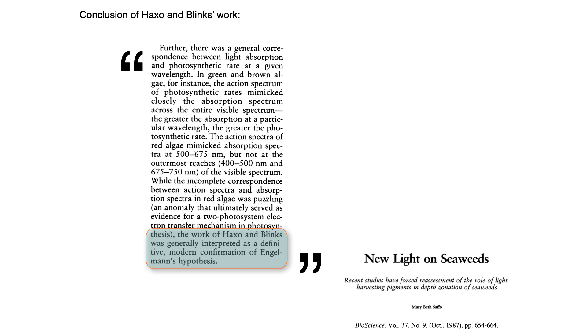

Overall, Haxo and Blinks found a general correspondence between absorption and photosynthesis at each wavelength, and their work was widely read as a modern confirmation of Engelmann's hypothesis [@saffo1987new]. Red algae absorbed more green light, and photosynthesised faster in green light, than green algae did.

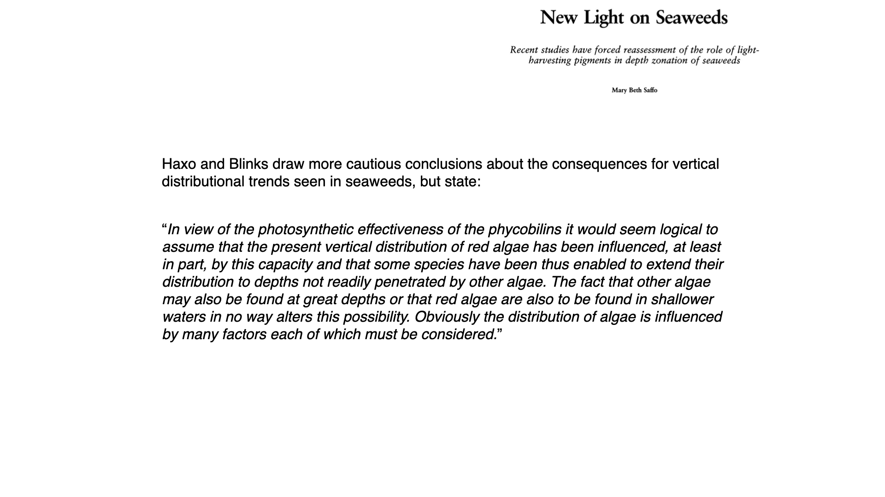

Haxo and Blinks themselves were more careful. They argued that the effectiveness of the phycobilins makes it logical to assume that the vertical distribution of red algae "has been influenced, at least in part" by this capacity. But they also noted that other algae occur at great depths, that red algae also grow in shallow water, and that "the distribution of algae is influenced by many factors each of which must be considered" [@haxo1950photosynthetic]. Notice that their experiments measured what the pigments can do in monochromatic light in the laboratory. They did not measure where seaweeds live or how they perform in the natural light field. Those questions require field evidence.

## Chromatic Adaptation and Vertical Distribution: Theory and Reality

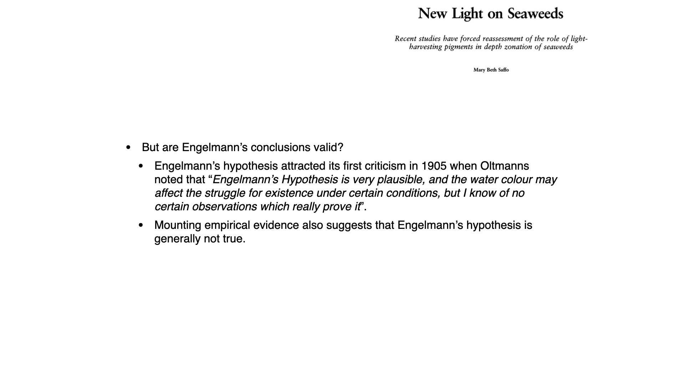

Engelmann's hypothesis was questioned from the start. Friedrich Oltmanns (1892, 1923) argued that Ørsted and Engelmann had overstated the differences in depth distribution among green, brown and red algae, since red algae often grow beside green and brown ones. When he grew seaweeds under different irradiances and behind coloured filters, their growth and form responded to the amount of light but not to its colour. He concluded that depth distribution depends on irradiance, not on spectral quality [@oltmanns1892ueber; @saffo1987new]. This alternative became known as **intensity adaptation**.

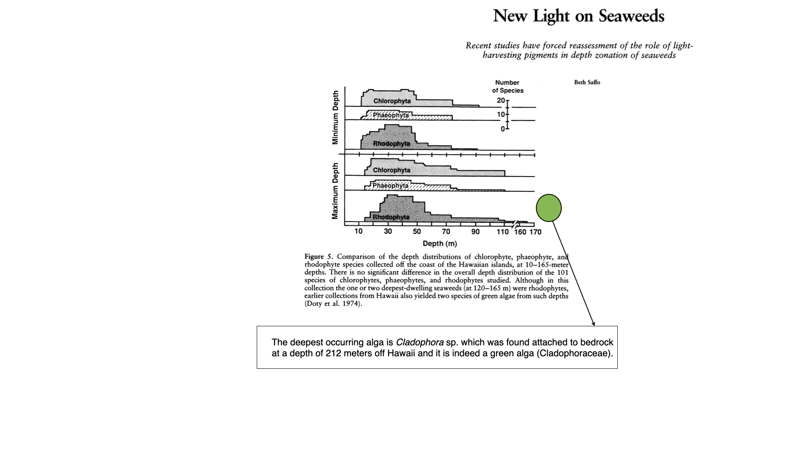

Field surveys later tested the first assumption of the hypothesis: that the deepest seaweeds are red. Doty et al. (1974) surveyed Hawaiian seaweeds from 10 to 165 m and found no significant difference in the minimum or maximum depths of green, brown and red algal species (the figure on the slide). Below 90 m the ratio of red to green species was lower than in shallower water [@doty1974hawaiian; @saffo1987new]. Surveys in the tropical Atlantic and Pacific, the Mediterranean, the Sea of Japan and the Arctic found green algae among the deepest seaweeds. In the Mediterranean, green algae dominated the algal biomass between 15 and 75 m, where the light was mostly blue, while red algae contributed little at any depth. Conversely, red algae grow high on the shore; in central California, some of the species highest in the intertidal are red algae [@saffo1987new].

Red algae do hold the depth record. Crustose coralline red algae were found growing at 268 m on a seamount off San Salvador Island in the Bahamas, where they received about 0.0005% of the surface irradiance [@littler1985deepest]. But earlier Hawaiian collections also yielded green algae from 120 to 165 m [@saffo1987new], so a red pigment is not required to live deep.

Together these data show that the three groups overlap broadly in depth. Pigmentation does not predict where a seaweed lives.

## Towards an Explanation

Why, then, do seaweeds live where they do? Part of the answer is that light is only one of many factors. Desiccation, temperature, salinity, nutrients, the availability of hard substratum, grazing and competition for space all set upper and lower limits on seaweed distributions [@saffo1987new]. But the laboratory results of Engelmann and of Haxo and Blinks were real, so we still need to know how seaweeds of different colours actually perform in the underwater light field. Joseph Ramus and his co-workers tested this directly in the sea.

## *In Situ* Experiments on Seaweed Acclimation

Ramus and colleagues worked in Great Harbor, Woods Hole (Massachusetts, USA) in the summers of 1974 and 1975 [@ramus1976changes; @ramus1976correlation]. They asked whether red algae really use the light at depth better than green algae, when both are tested in the same place under the same light.

### The light field

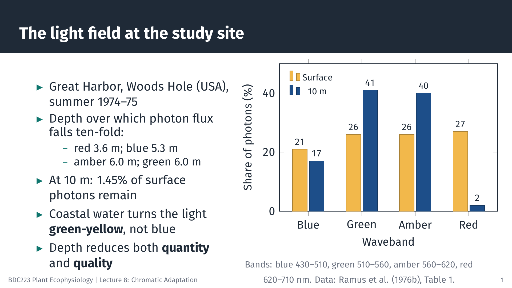

First they measured the light. The water was well mixed by tidal currents and turbid, so light was attenuated quickly. Red light (620 to 710 nm) fell ten-fold every 3.6 m, blue light every 5.3 m, and green and amber light every 6.0 m. At 10 m only about 1.45% of the surface photon flux remained, and about 80% of it was green or amber (510 to 620 nm) [@ramus1976changes]. This is the coastal light field that Engelmann had in mind: deep water is both dim and green.

### Experimental design

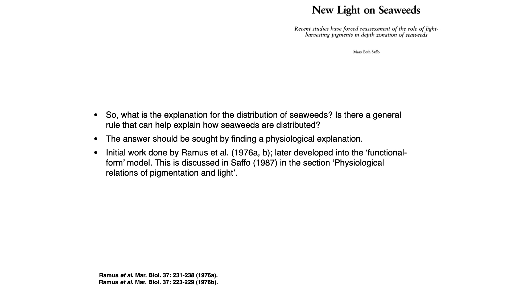

Seaweeds were tied into a vertical line held between a float and a weight, so that each plant stayed at a fixed distance below the surface as the tide rose and fell. Plants were held at 0.5 m or at 10 m for 7 days, long enough to adjust (acclimate) their pigments to the local light. In some experiments the lines were then turned upside down, so shallow plants became deep plants and the reverse, and left for another 7 days. Photosynthesis was measured as oxygen production in sealed bottles suspended at 0.5, 3.5, 6.5 and 9.5 m, with a shallow-acclimated and a deep-acclimated sample hung side by side at each depth [@ramus1976correlation].

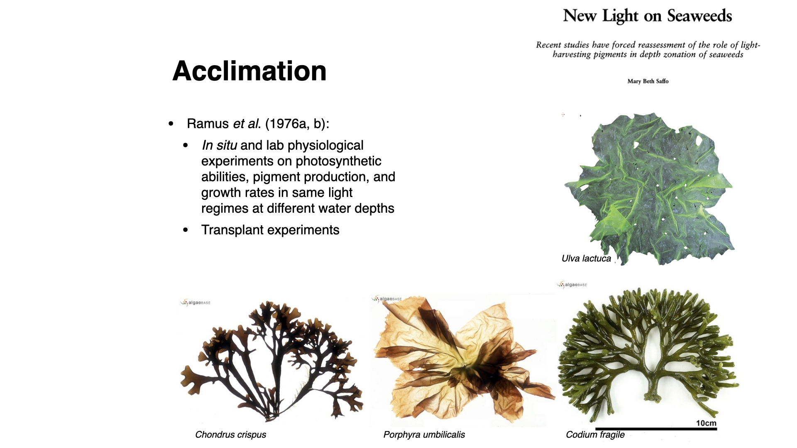

Four species were chosen to separate the effect of pigment type from the effect of thallus form:

| Species | Pigment group | Thallus form |
|------------------------|------------------------|------------------------|
| *Ulva lactuca* | green (chlorophyll-*a* and *b*) | membranous, two cells thick |
| *Porphyra umbilicalis* | red (chlorophyll-*a* and phycobiliproteins) | membranous, one cell thick |
| *Codium fragile* | green (chlorophyll-*a* and *b*) | thick, spongy, coarsely branched |
| *Chondrus crispus* | red (chlorophyll-*a* and phycobiliproteins) | thick, coarsely branched |

The membranous species are **optically thin**: much of the light that reaches them passes straight through. The thick species are **optically thick**: little light passes through them. Because each pigment group is represented by one thin and one thick species, the design allows us to ask whether colour or form matters more.

### Comparing pigment groups and forms

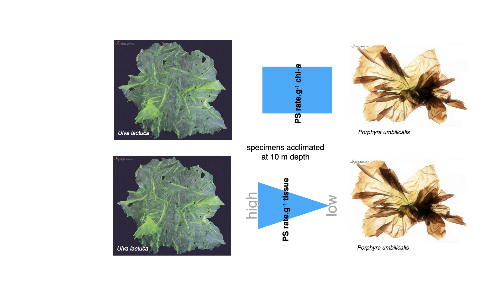

Consider first the two membranous species acclimated at 10 m. Expressed per unit of chlorophyll-*a*, the photosynthetic rate of green *Ulva* was comparable with that of red *Porphyra*. Expressed per gram of tissue, *Ulva* photosynthesised faster [@saffo1987new]. The red alga, with its phycobiliproteins, showed no advantage in the green light at 10 m.

Notice that the answer depends on how the rate is expressed. A rate per gram of tissue tells us how productive the seaweed is. A rate per unit of chlorophyll-*a* tells us how much photosynthesis each unit of chlorophyll supports, which depends on how much light reaches that chlorophyll and how much enzyme capacity stands behind it. Always check which basis a study uses before comparing numbers.

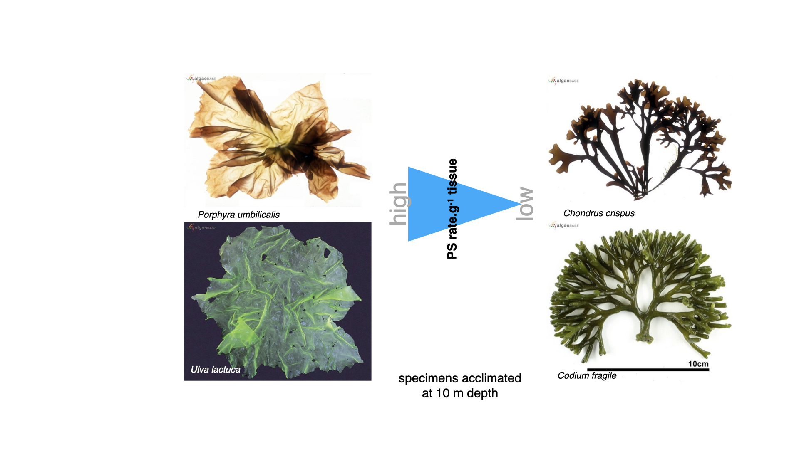

Per gram of tissue, the thin seaweeds photosynthesised faster than the thick ones at every depth, in the order *Ulva* \> *Porphyra* \> *Chondrus* \> *Codium* [@ramus1976correlation]. In a thin thallus almost every cell is exposed to light, whereas in a thick thallus much of the tissue is shaded by the cells above it or does not photosynthesise at all. This is the same reasoning as the functional-form model: rates per unit biomass decrease as the surface area to volume ratio decreases. Thallus form explained more of the difference among species than colour did.

### Transplant experiments: *Ulva*

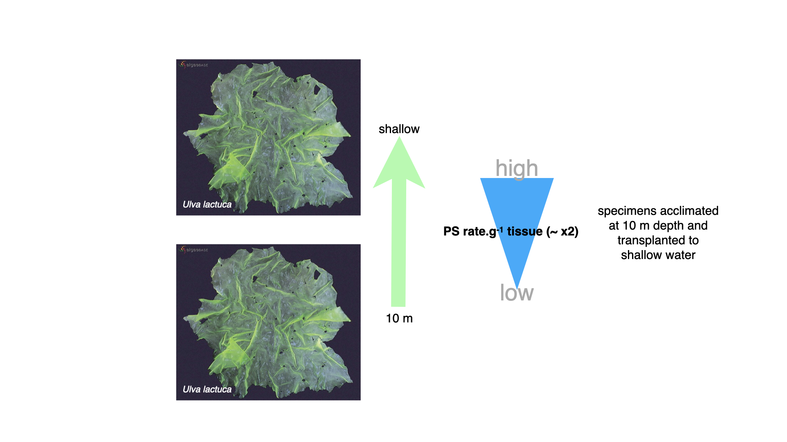

When *Ulva* and the other species were compared at the same depth, plants acclimated to 10 m photosynthesised faster per gram of tissue than plants acclimated to 0.5 m, usually by a factor of about two [@ramus1976correlation]. Deep plants carried more pigment, so they captured more of the available light.

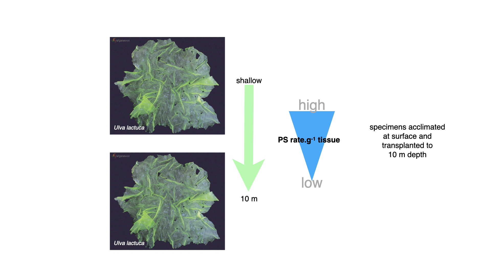

When surface-acclimated *Ulva* was moved to 10 m, its photosynthetic rate dropped sharply. This is the immediate effect of less light: the plant is now working on the lower, light-limited part of its P–I curve.

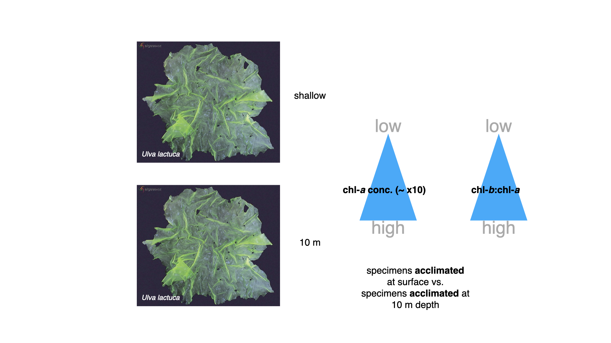

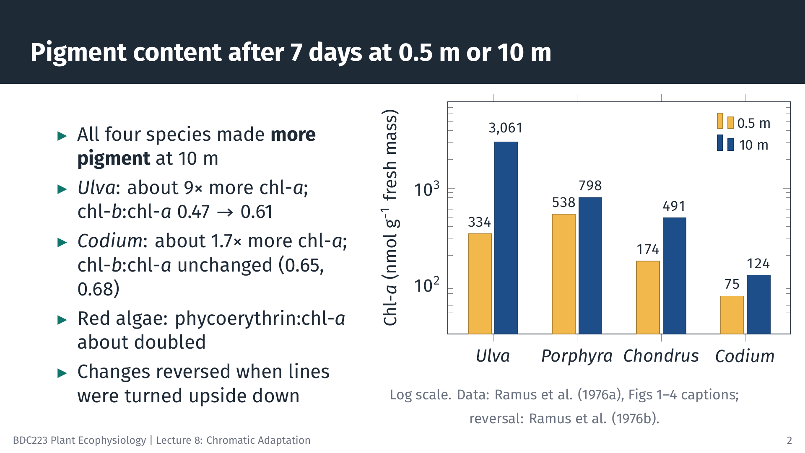

Over the following week, the transplanted plants changed their pigments. All four species contained more pigment after 7 days at 10 m than at 0.5 m. *Ulva* at 10 m contained about nine times as much chlorophyll-*a* per gram of fresh mass as *Ulva* at 0.5 m (3061 against 334 nmol g⁻¹), and its chlorophyll-*b* to chlorophyll-*a* ratio rose from 0.47 to 0.61 [@ramus1976correlation]. In the red algae, the ratio of phycoerythrin to chlorophyll-*a* roughly doubled. When the lines were reversed, these changes reversed. They took place without cell division, so existing cells built or broke down pigment [@ramus1976changes].

Two kinds of change are involved. An increase in **total pigment** is intensity adaptation: the plant enlarges its light-harvesting antennae because light is scarce. A shift in the **ratio of accessory pigment to chlorophyll-*a*** is a change in pigment composition towards forms that absorb the green light available at depth, which is chromatic adaptation within the lifetime of one plant. Ramus and colleagues found both, and concluded that under natural conditions the two cannot be separated, because depth changes the amount and the colour of light together [@ramus1976changes]. Notice that this is a different claim from Engelmann's. Engelmann proposed that each algal group is fixed by evolution to a particular depth by its pigments. Ramus showed that individual seaweeds of every colour adjust their pigments to the depth at which they grow.

### Transplant experiments: *Codium*

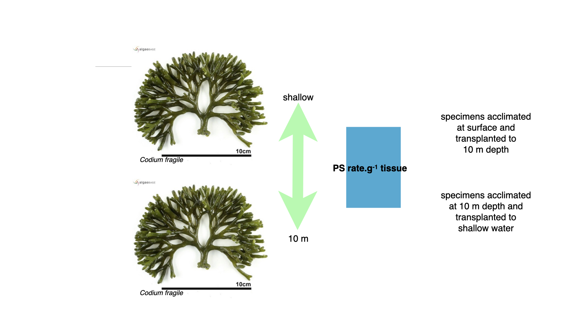

*Codium*, the thick green alga, behaved differently. Its photosynthetic rate per gram of tissue hardly changed when it was transplanted from the surface to 10 m or from 10 m to the surface.

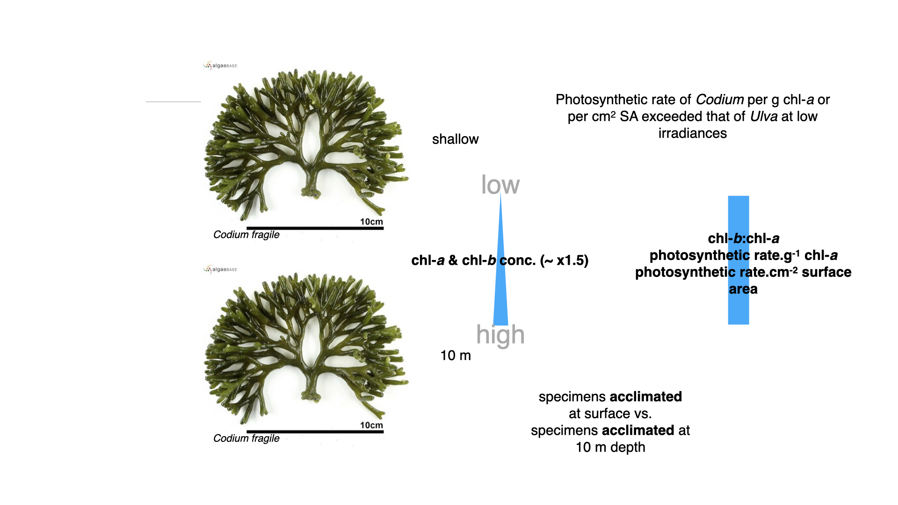

*Codium* at 10 m contained only about 1.5 to 1.7 times as much chlorophyll-*a* as *Codium* at the surface (124 against 75 nmol g⁻¹ fresh mass), and its chlorophyll-*b* to chlorophyll-*a* ratio hardly changed (0.65 at 0.5 m and 0.68 at 10 m) [@ramus1976correlation; @saffo1987new]. Yet its photosynthetic rate per unit chlorophyll-*a*, and per square centimetre of surface, exceeded that of *Ulva* at low irradiance. *Codium* performs well in dim light without the large pigment changes that *Ulva* needs.

### Interpreting the *Ulva* results

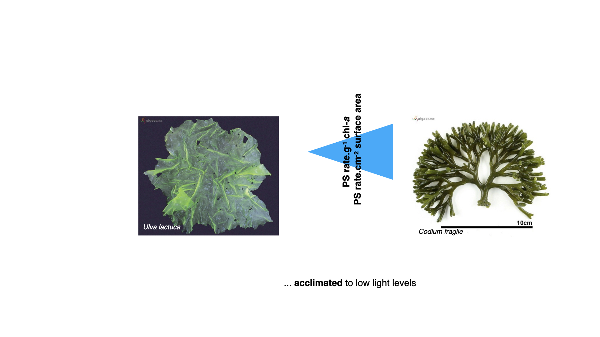

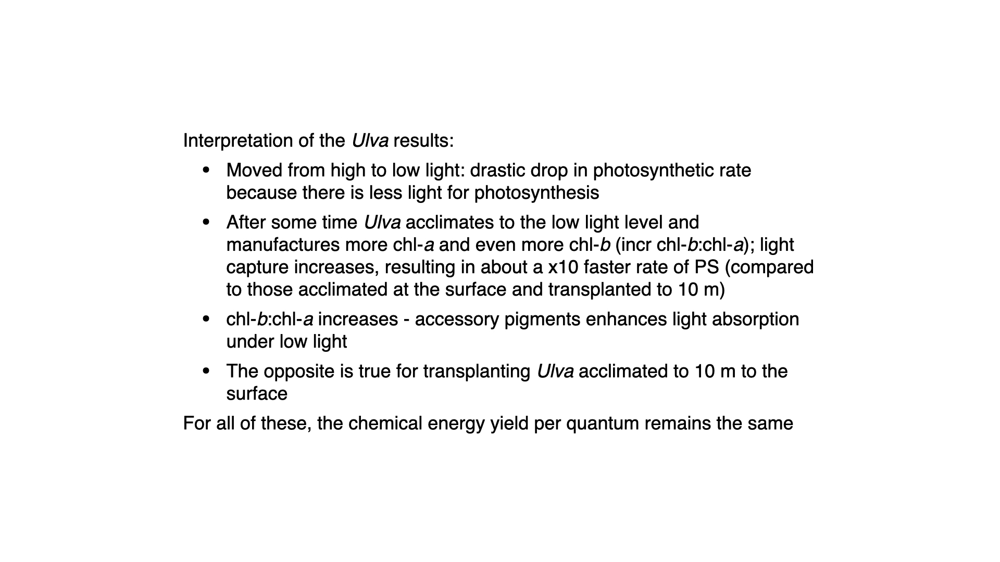

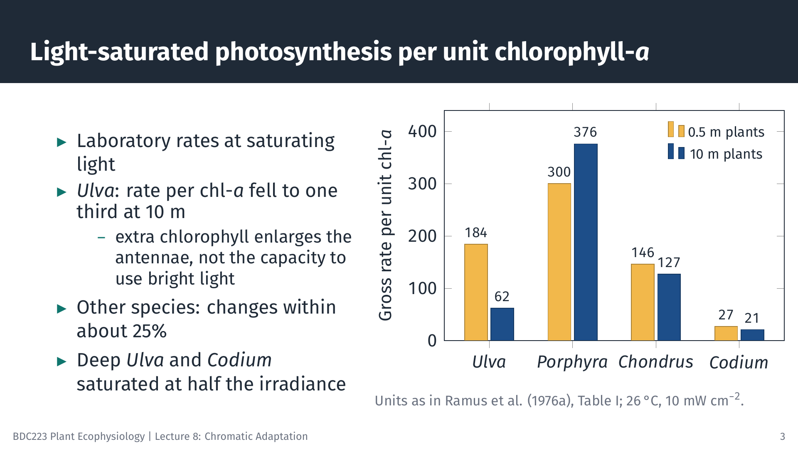

The *Ulva* results show **phenotypic plasticity**: the same genotype produces a different phenotype under different conditions. When *Ulva* is moved from bright to dim light, its photosynthetic rate falls at once because less light is available. Over about a week it makes more chlorophyll-*a* and, proportionally, even more chlorophyll-*b*, so it absorbs a larger fraction of the light that reaches it. Saffo (1987), summarising this work, notes that *Ulva* that has grown at 10 m for a week photosynthesises at about ten times the rate of surface-grown *Ulva* that has only just been moved there. When *Ulva* is moved from deep to shallow water, the reverse happens: the rate rises at once, and over time the plant breaks down pigment that it no longer needs.

What stays the same through these changes is the efficiency with which the photosynthetic machinery converts absorbed photons into chemical energy (the quantum yield). What changes is the size of the light-harvesting antennae. This has a consequence that is easy to miss. The light-saturated rate per unit chlorophyll-*a* does not stay constant. In the laboratory, at saturating light, surface-acclimated *Ulva* produced about three times as much oxygen per unit chlorophyll-*a* as deep-acclimated *Ulva* (184 against 62 in the units of Table I in @ramus1976correlation). The extra chlorophyll made at depth enlarges the antennae that collect light; it does not add the electron transport and Rubisco capacity needed to use bright light. Deep-acclimated *Ulva* and *Codium* were also saturated at about half the irradiance of surface-acclimated plants. This is the pattern you will see in P–I curves of sun and shade plants: shade plants have a steeper initial slope per unit biomass but a lower maximum rate per unit chlorophyll.

### Interpreting the *Codium* results

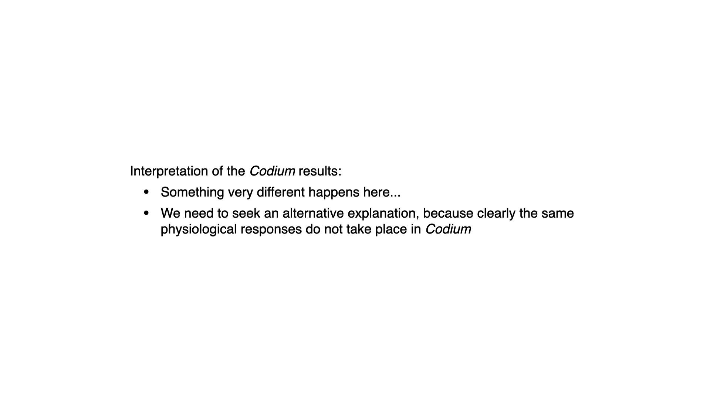

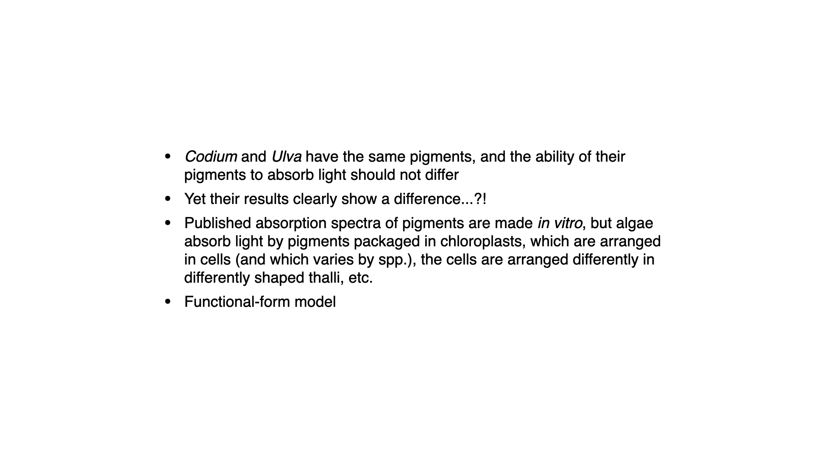

*Codium* has the same main pigments as *Ulva*, chlorophyll-*a* and *b*, yet it responds very differently. If pigments alone controlled light capture, the two should behave alike. The difference lies in how the pigments are packaged. Published absorption spectra are usually measured on pigments dissolved in a solvent. In a living seaweed the pigments sit in chloroplasts, the chloroplasts sit in cells, and the cells are arranged into a thallus of a particular shape and thickness. Each of these levels changes how much light is absorbed.

### Structural and optical differences between *Ulva* and *Codium*

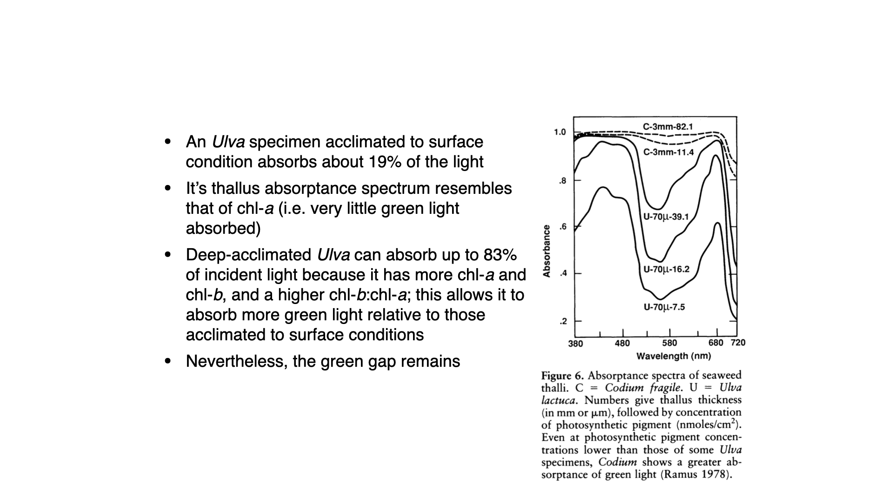

Ramus (1978) measured the absorptance (the fraction of incident light absorbed) of whole thalli [@ramus1978seaweed]. *Ulva* grown near the surface, with a thallus about 70 µm thick and little pigment, absorbed only about 19% of the incident light. Its absorptance spectrum resembled that of chlorophyll, with little green light absorbed. *Ulva* grown in deeper water absorbed up to 83% of the light, because it contained more chlorophyll-*a* and *b* and a higher chlorophyll-*b* to chlorophyll-*a* ratio [@saffo1987new]. It also absorbed more green light, but its spectrum still had a clear trough in the green. Even a well-pigmented *Ulva* is optically thin.

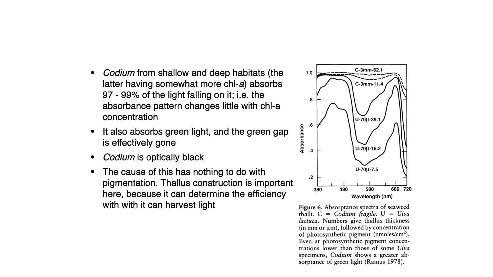

*Codium* was very different. Both surface-grown *Codium*, with little chlorophyll, and deep-grown *Codium*, with more, absorbed 97 to 99% of the incident light across the whole visible spectrum, including the green. In the figure, compare the *Codium* curve with 11.4 nmol cm⁻² of pigment with the *Ulva* curve with 16.2 nmol cm⁻²: *Codium* absorbs more green light even though it contains less pigment per unit area. *Codium* is **optically black** [@saffo1987new]. Because it already absorbs almost all the light that reaches it, adding more pigment cannot increase its light capture much. This explains why *Codium* showed little pigment response to depth. Ramus et al. (1976a) noted that if a seaweed is optically black, "it does not matter what color one is" [@ramus1976correlation]. They also observed that surface-acclimated *Codium* looks green, whereas deep-acclimated *Codium* looks black.

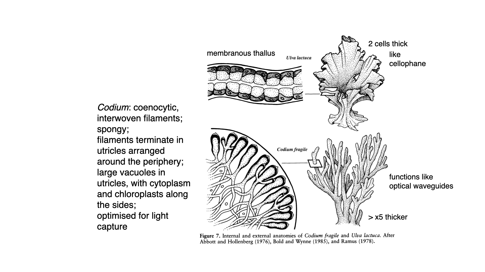

The cause is the anatomy of the thallus. *Codium* is coenocytic (siphonous): its body is a mass of interwoven tubular filaments with many nuclei and no cross-walls separating individual cells. The filaments end at the surface in tightly packed, club-shaped **utricles**. Each utricle has a large central vacuole, with a thin layer of cytoplasm and chloroplasts lining its walls. The branches of the thallus are about 3 mm thick in Ramus's measurements, compared with 70 µm for *Ulva*. Ramus suggested that the utricles work like optical light guides: light entering the tip of a utricle is reflected along the chloroplast-lined walls towards its base, so it passes many chloroplasts before it can escape [@ramus1978seaweed; @saffo1987new]. *Ulva*, by contrast, is a sheet two cells thick, like green cellophane, and much of the light passes through it.

::: callout-note
## How Can a Green Pigment Make a Black Seaweed?

Chlorophyll-*a* in solution absorbs only weakly near 550 nm, which is why a chlorophyll extract looks green. How, then, can *Codium*, whose main pigments are chlorophylls, absorb almost all the incident light, including the green? Two effects combine.

**Accessory pigments.** *Codium* contains chlorophyll-*b* and carotenoids, including siphonaxanthin, a carotenoid typical of siphonous green algae that absorbs blue-green and green light. These pigments narrow the green gap that chlorophyll-*a* leaves. Pigment chemistry alone cannot explain the result, however. Ramus found that the absorptance of *Codium* changed little with its pigment content, and that *Codium* absorbed more green light than *Ulva* even with less pigment per unit area.

**Path length.** The more important effect is structural. A photon entering a thin, transparent sheet such as *Ulva* crosses it once; if it is not absorbed on that single pass, it is lost. A photon entering *Codium* meets many surfaces where the refractive index changes: cell walls, cytoplasm, vacuoles and chloroplast membranes. At each one it may be scattered or reflected, so it follows a long, zigzag path through the pigmented tissue, and the utricles guide it along their chloroplast-lined walls. A green photon has only a small chance of being absorbed at each encounter with a chlorophyll molecule, but over many encounters the chance that it is eventually absorbed approaches one. The tissue is then **optically thick**.

This is the same reason a leaf absorbs far more green light than a chlorophyll extract of the same concentration would, and it is why the absorption spectrum of a pigment extract is a poor guide to the light absorbed by a whole plant. The pigments of *Codium* are green; the thallus behaves as an almost black absorber because, once a green photon enters it, the photon is unlikely to escape.
:::

## Phycoerythrin Put to the Test

The strongest form of Engelmann's hypothesis concerns red algae: phycoerythrin absorbs green light, so red algae should outperform other seaweeds in deep, green water. Two later experiments tested this directly [@saffo1987new].

-   **Colour mutants.** Ramus and van der Meer found green variants of the red alga *Gracilaria tikvahiae* that contained normal amounts of chlorophyll-*a* and phycocyanin but very little phycoerythrin. In bright sunlight, dim white light and dim green light (both dim treatments at 13% of sunlight), the phycoerythrin-deficient plants photosynthesised at the same rate as the normal red plants. The theory of complementary chromatic adaptation was not supported [@ramus1983physiologicalI].
-   **Light quantity versus quality.** Ramus grew seven species of green, brown and red seaweeds in bright white light, dim white light and dim green light. In almost every species, the response to dim green light was the same as the response to dim white light: pigment content, growth and photosynthesis responded to the amount of light, not to its colour [@ramus1983physiologicalII].

A theoretical analysis by @dring1981chromatic reached a similar conclusion. Combining published action spectra with the spectra of light in different water types, he predicted which algae should photosynthesise best at each depth. Actual depth distributions did not match these predictions, and he concluded that "the ecological significance of chromatic adaptation may be far more limited than has often been assumed" [@saffo1987new].

## Summary

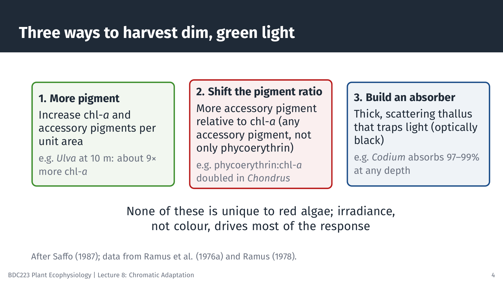

The field surveys and experiments described here overturned three assumptions behind Engelmann's hypothesis [@saffo1987new]:

1.  **The deepest seaweeds are not exclusively red.** Green, brown and red seaweeds overlap broadly in depth, and red algae also grow high on the shore. Depth ranges are not predicted by algal group or by the possession of particular pigments.
2.  **Light is one factor among many.** Emersion, temperature, salinity, nutrients, substratum, grazing and competition all affect where seaweeds live. Where light matters, seaweeds respond mainly to its amount, not to its colour.
3.  **Red seaweeds do not necessarily photosynthesise better at depth.** Seaweeds harvest dim light in three ways, none of them unique to red algae: making more pigment, making more accessory pigment relative to chlorophyll-*a* (any accessory pigment, not only phycoerythrin), and building a thallus whose structure absorbs light efficiently.

*Ulva* shows the first two mechanisms: it is plastic, and it acclimates to depth by changing how much pigment it makes and in what proportions. *Codium* shows the third: its thallus is optically black, so it absorbs nearly all the light that reaches it at any depth and has little need to change its pigments. The laboratory results of Engelmann and of Haxo and Blinks remain correct. Accessory pigments do absorb light that chlorophyll misses, and they do pass that energy on for photosynthesis. What failed was the step from what pigments can do in the laboratory to the claim that they determine where seaweeds live. Dring described the episode as a cautionary tale about "dressing up one form of adaptation to look like another" [@saffo1987new]. Here, adaptation to the amount of light was mistaken for adaptation to its colour.

## Self-Test Questions

::: {.callout-note collapse="true"}
## 1. What did the theory of complementary chromatic adaptation predict, and on what reasoning?

It predicted that green algae live in shallow water, brown algae at intermediate depths and red algae deepest. Water removes red light quickly, and coastal water at depth is mainly green. Chlorophyll-*a* absorbs green light poorly, whereas phycoerythrin absorbs it strongly, so red algae were expected to use the light at depth best and green algae to be confined to shallow water.
:::

::: {.callout-note collapse="true"}
## 2. In *Ulva*, the action spectrum lies 10 to 15 units below the absorption spectrum between about 450 and 510 nm. What does this mean?

Light absorbed in this region is not all used for photosynthesis. Some of it is absorbed by carotenoids that do not pass their energy on to chlorophyll-*a*, which Haxo and Blinks called inactive absorption.
:::

::: {.callout-note collapse="true"}
## 3. Why is photosynthesis in red algae low in red and blue light, even though the thallus absorbs these wavelengths through chlorophyll-*a*?

In red algae most chlorophyll-*a* is associated with photosystem I, while the phycobiliproteins supply energy mainly to photosystem II. Chlorophyll-*a* absorbs both blue and red light strongly, so either band supplied alone can excite photosystem I much more than photosystem II. Insufficient excitation of photosystem II then limits oxygen production, helping explain both the blue and red drops. Poor use of light absorbed by some carotenoids can further reduce efficiency in the blue. Adding green light, which phycoerythrin absorbs, can relieve the imbalance in either case. Enhancement requires simultaneous illumination and is therefore absent from measurements made with each wavelength band alone.
:::

::: {.callout-note collapse="true"}
## 4. Give two kinds of field evidence against chromatic adaptation as an explanation of seaweed depth zonation.

Surveys such as that of Doty et al. (1974) off Hawaii found no significant difference in the minimum or maximum depths of green, brown and red algal species, and green algae are among the deepest seaweeds in several regions. Red algae also grow high on the shore, which the theory does not predict.
:::

::: {.callout-note collapse="true"}
## 5. After 7 days at 10 m, *Ulva* contained about nine times as much chlorophyll-*a* per gram of fresh mass as *Ulva* at 0.5 m, and its chlorophyll-*b* to chlorophyll-*a* ratio rose from 0.47 to 0.61. Which of these changes is intensity adaptation and which is chromatic adaptation?

The increase in total pigment is intensity adaptation: the plant enlarges its light-harvesting antennae because light is scarce. The increase in the ratio of accessory pigment to chlorophyll-*a* shifts absorption towards the green light available at depth, which is chromatic adaptation within one plant.
:::

::: {.callout-note collapse="true"}
## 6. *Codium* and *Ulva* contain the same main pigments. Why does *Codium* absorb 97 to 99% of incident light at any depth, whereas *Ulva* grown near the surface absorbs only about 19%?

*Codium* has a thick, spongy thallus of interwoven siphons ending in chloroplast-lined utricles. Light is scattered and guided through the tissue, so each photon passes many chloroplasts before it can escape, and even weakly absorbed green light is eventually absorbed. *Ulva* is a sheet two cells thick that light crosses once, so much of it passes straight through.
:::

## Multiple-Choice Questions

Click an option to check your answer. A green tick marks the correct option, and its explanation then appears below the options.

::: {.mcq}
**1.** When an action spectrum is measured, the alga receives the same number of photons at every wavelength. Why is this condition necessary?

-   So that the action spectrum and the absorption spectrum have the same shape at every wavelength along the axis.
-   So that the pigments absorb the same fraction of incident light at every wavelength, which removes any spectral gap.
-   [So that differences in rate reflect how well each wavelength is absorbed and used, not how many photons arrive.]{.correct}
-   So that the same amount of energy reaches the thallus at every wavelength, since energy drives the oxygen output.

::: {.mcq-explain}
An action spectrum asks how effective each wavelength is per photon supplied. If photon supply varied, a high rate could simply mean more photons. Equal photon supply does not force the two spectra to match; where they differ, absorbed light is not being used.
:::
:::

::: {.mcq}
**2.** In the brown alga *Coilodesme californica*, thallus absorption stays high from 500 to 560 nm and the action spectrum follows this absorption closely. Which conclusion is best supported?

-   Chlorophyll-*a* absorbs strongly in this band in brown algae, so the accessory pigments contribute very little here.
-   [Fucoxanthin absorbs in this band and passes most of that energy on, so it widens the range of usable wavelengths.]{.correct}
-   Fucoxanthin absorbs in this band but passes little energy on, so this is inactive absorption like that in *Ulva*.
-   Chlorophyll-*c* absorbs most strongly in this band, so it is the main accessory pigment that fills the green gap.

::: {.mcq-explain}
Where the action spectrum tracks absorption, absorbed light is used. The extra absorption from 500 to 560 nm is due to fucoxanthin, which therefore fills part of the green gap. Chlorophyll-*c* adds only a small band near 630 nm.
:::
:::

::: {.mcq}
**3.** Which statement about the Emerson enhancement effect is most correct?

-   Far-red light given together with green light gives a lower rate, because the two wavelengths compete for chlorophyll.
-   [Far-red light and shorter-wavelength light given together give a rate greater than the sum of their separate rates.]{.correct}
-   Far-red light given alone gives a higher rate than shorter-wavelength light, but only in red algae with phycoerythrin.
-   Far-red light and shorter-wavelength light given together give a rate equal to the sum of their separate rates.

::: {.mcq-explain}
Enhancement means the combined rate exceeds the sum of the separate rates. It occurs in all oxygen-producing photosynthetic organisms, including *Chlorella*, and shows that two light reactions must both be driven for full-speed photosynthesis.
:::
:::

::: {.mcq}
**4.** Oltmanns grew seaweeds under different irradiances and behind coloured filters. Their growth and form responded to the amount of light but not to its colour. Which hypothesis do these results support?

-   Chromatic adaptation, because the coloured filters altered the spectral quality that each seaweed received.
-   Chromatic adaptation, because growth and form are fixed by the pigments each algal group has inherited.
-   Intensity adaptation, because the coloured filters showed that pigments cannot absorb any light that is green.
-   [Intensity adaptation, because depth distribution would then depend on irradiance rather than spectral quality.]{.correct}

::: {.mcq-explain}
If seaweeds respond to the quantity but not the quality of light, the relevant variable is irradiance. This is intensity adaptation, the alternative Oltmanns proposed to Engelmann's colour-based explanation.
:::
:::

::: {.mcq}
**5.** At 10 m, green *Ulva* and red *Porphyra* had comparable photosynthetic rates per unit chlorophyll-*a*, but *Ulva* had the higher rate per gram of tissue. What must be true?

-   *Ulva* absorbed more green light per unit chlorophyll-*a* than *Porphyra* did at 10 m.
-   *Ulva* contained less chlorophyll-*a* per gram of tissue than *Porphyra* did at 10 m.
-   [*Ulva* contained more chlorophyll-*a* per gram of tissue than *Porphyra* did at 10 m.]{.correct}
-   *Ulva* used each unit of chlorophyll-*a* more efficiently than *Porphyra* did at 10 m.

::: {.mcq-explain}
Rate per gram = rate per chlorophyll-*a* × chlorophyll-*a* per gram. If the first factor is about equal, the species with the higher rate per gram must carry more chlorophyll-*a* per gram. Equal rates per chlorophyll rule out greater efficiency per unit chlorophyll.
:::
:::

::: {.mcq}
**6.** Crustose coralline red algae hold the seaweed depth record at 268 m, yet green algae have been collected from 120 to 165 m off Hawaii. Which conclusion is best supported?

-   [A red alga holds the record, but green algae also live deep, so a red pigment is not required to grow at depth.]{.correct}
-   A red alga holds the record, so the deepest member of each group shows the depth limit set by its pigments.
-   A red alga holds the record, so green algae found below 120 m must have been carried there from shallow water.
-   A red alga holds the record, so phycoerythrin must be needed to photosynthesise below about 165 m of water.

::: {.mcq-explain}
One deepest record does not describe a whole group. Green algae living at 120 to 165 m show that red pigmentation is not a requirement for deep growth, consistent with the broad overlap among groups found in surveys.
:::
:::

::: {.mcq}
**7.** Ramus and co-workers chose *Ulva*, *Porphyra*, *Codium* and *Chondrus* for their transplant experiments. Why was this set of species useful?

-   Each species had the same pigments, so the effect of thallus form could be measured without any effect of colour.
-   Each species came from a different depth, so the effect of the original habitat could be measured in each one.
-   [Each pigment group had a thin and a thick species, so the effect of colour could be separated from that of form.]{.correct}
-   Each pigment group had two thin species, so the effect of colour could be measured without any effect of form.

::: {.mcq-explain}
The design crossed pigment group (green, red) with thallus form (membranous, thick). Comparing within and across these pairs showed that form explained more of the differences in rate per gram than colour did.
:::
:::

::: {.mcq}
**8.** Deep-acclimated *Ulva* has much more chlorophyll per gram than surface-acclimated *Ulva*, yet a lower light-saturated rate per unit chlorophyll-*a*. Which explanation is most correct?

-   The extra chlorophyll shades the Rubisco directly, so carbon fixation is light-limited even in bright light.
-   The extra chlorophyll is inactive like some carotenoids, so it absorbs light that is never used at all.
-   [The extra chlorophyll enlarges the antennae but adds no matching electron transport and Rubisco capacity.]{.correct}
-   The extra chlorophyll lowers the quantum yield, so each absorbed photon produces less oxygen than before.

::: {.mcq-explain}
Quantum yield stays about the same; what changes is antenna size. At saturating light, rate is limited by electron transport and Rubisco, so spreading the same capacity over more chlorophyll lowers the rate per unit chlorophyll-*a*.
:::
:::

::: {.mcq}
**9.** A student repeats the Ramus design with *Ulva* (green) and *Porphyra* (red), both membranous. After 7 days, plants acclimated at 10 m and at 0.5 m are hung side by side in bottles at 9.5 m. In both species, deep-acclimated plants produce about twice as much oxygen per gram as shallow-acclimated plants. At every depth, *Ulva* produces more oxygen per gram than *Porphyra*. Which conclusion is best supported?

-   Both species acclimate to depth by changing pigment content; the red alga's phycoerythrin gave it the advantage that chromatic adaptation predicts.
-   [Both species acclimate to depth by changing pigment content; the red alga showed no advantage in green light at depth, contrary to the hypothesis.]{.correct}
-   Neither species acclimates to depth by changing pigment content; the twofold difference arose because the deep plants grew more new cells.
-   Only the red species acclimates to depth by changing pigment content; the green alga's higher rate shows that it was never limited by light.

::: {.mcq-explain}
Doubling of rate in deep-acclimated plants of both colours shows acclimation in each. Since green *Ulva* outperformed red *Porphyra* per gram at all depths, the red pigment gave no advantage at 10 m, which contradicts the strong form of the hypothesis.
:::
:::

::: {.mcq}
**10.** Green variants of the red alga *Gracilaria tikvahiae* contain normal amounts of chlorophyll-*a* and phycocyanin but very little phycoerythrin. Normal red plants and green variants are grown in bright sunlight, in dim white light and in dim green light, both dim treatments at 13% of sunlight. In all three treatments the two forms photosynthesise at the same rate. Which interpretation is most defensible?

-   Lack of phycoerythrin raised photosynthesis in dim white light only; this result shows that phycoerythrin harms red algae in shallow water.
-   Lack of phycoerythrin did not lower photosynthesis in bright light only; this result supports complementary chromatic adaptation at depth.
-   Lack of phycoerythrin lowered photosynthesis only in dim green light; this result supports complementary chromatic adaptation at depth.
-   [Lack of phycoerythrin did not lower photosynthesis even in dim green light; this result does not support complementary chromatic adaptation.]{.correct}

::: {.mcq-explain}
The critical treatment is dim green light, where phycoerythrin should give the greatest advantage. Equal rates there show that phycoerythrin made no measurable difference, so the prediction of chromatic adaptation failed.
:::
:::

::: {.mcq}
**11.** A diver surveys a rocky reef. Red algae occur from the high intertidal to 35 m, green algae from the low intertidal to 30 m and brown algae from the low intertidal to 25 m. All three groups are common between 5 and 25 m, and below 25 m the substratum changes from rock to sand. A student argues that because red algae reach the greatest depth, the survey confirms complementary chromatic adaptation. Which evaluation is most correct?

-   The groups overlap broadly but reds extend five metres deeper; the lower limits reflect light colour, so the survey confirms the hypothesis well.
-   The groups are separated cleanly by depth and greens grow only in shallow water; the lower limits reflect the sand, so the survey confirms it.
-   The groups are separated cleanly by depth and reds grow only in deep water; the lower limits reflect light colour, so the survey confirms the hypothesis.
-   [The groups overlap broadly and reds also grow highest on the shore; the lower limits may reflect the sand, so the survey cannot confirm it.]{.correct}

::: {.mcq-explain}
The hypothesis predicts a sequence of groups with depth, not broad overlap and red algae high on the shore. A lower limit that coincides with a change in substratum may have nothing to do with light, so the survey cannot confirm a colour-based explanation.
:::
:::

::: {.mcq}
**12.** A red alga is given 680 nm light alone, and its oxygen production is 10 units. With a weak 546 nm beam alone it produces 30 units. With both beams together it produces 55 units. The thallus absorbs the 680 nm light strongly through chlorophyll-*a*. Which explanation fits these results best?

-   The combined rate equals 40 units; chlorophyll-*a* light mainly drives photosystem II, and phycoerythrin light supplies photosystem I.
-   [The combined rate exceeds 40 units; chlorophyll-*a* light mainly drives photosystem I, and phycoerythrin light supplies photosystem II.]{.correct}
-   The combined rate exceeds 40 units; chlorophyll-*a* in red algae absorbs little 680 nm light, so the thallus absorption was inactive.
-   The combined rate equals 40 units; chlorophyll-*a* light and phycoerythrin light both drive the same photosystem in red algae.

::: {.mcq-explain}
55 > 10 + 30, which is enhancement. In red algae most chlorophyll-*a* serves photosystem I, while phycobiliproteins feed photosystem II. Red light alone leaves photosystem II limiting; green light absorbed by phycoerythrin removes that limit.
:::
:::

::: {.mcq}
**13.** *Ulva* that has acclimated at 10 m for a week is moved to 0.5 m. Its oxygen production per gram rises within minutes. Over the next week its chlorophyll content per gram falls steadily, and the number of cells in the thallus does not change. Which interpretation is best supported?

-   [The quick rise reflects more light on the existing antennae; the later decline is pigment breakdown within existing cells.]{.correct}
-   The quick rise reflects new pigment made in the bright light; the later decline is dilution of pigment among new cells.
-   The quick rise reflects new pigment made in the bright light; the later decline is pigment breakdown within existing cells.
-   The quick rise reflects more light on the existing antennae; the later decline is dilution of pigment among new cells.

::: {.mcq-explain}
Rate responds immediately to irradiance, before pigment can change. Because cell number is constant, the fall in chlorophyll per gram cannot be dilution by growth; existing cells break down pigment they no longer need, as Ramus and colleagues found.
:::
:::

::: {.mcq}
**14.** Seven species of green, brown and red seaweeds are grown under three treatments: bright white light, dim white light, and dim green light. The dim white and dim green treatments supply the same photon flux. In almost every species, pigment content, growth and photosynthesis are the same in dim green as in dim white light, but differ from those in bright white light. Which interpretation is most correct?

-   [The dim white and dim green comparison isolates colour and showed no effect; the seaweeds responded mainly to the amount of light.]{.correct}
-   The bright white and dim white comparison isolates colour and showed an effect; the seaweeds responded mainly to the colour of light.
-   The dim white and dim green comparison isolates amount and showed no effect; the seaweeds responded mainly to the colour of light.
-   The bright white and dim green comparison isolates colour and showed an effect; the seaweeds responded mainly to the colour of light.

::: {.mcq-explain}
Dim white and dim green differ only in spectrum, so that comparison tests colour; bright and dim white differ only in amount. Responses differed with amount but not with colour, which supports intensity adaptation.
:::
:::

::: {.mcq}
**15.** At Great Harbor, Woods Hole, red light (620 to 710 nm) fell ten-fold for every 3.6 m of depth. What percentage of the surface red light remained at 10.8 m?

-   5.0%, because 10.8 m gives e⁻³ when using three steps.
-   72.9%, because each 3.6 m step removes 10% of the light.
-   [0.1%, because 10.8 m is three ten-fold steps of 3.6 m.]{.correct}
-   3.3%, because 10.8 m divided by 3.6 m gives 3 of 100%.

::: {.mcq-explain}
10.8 / 3.6 = 3 ten-fold steps, so the fraction remaining is 10⁻³ = 0.001 = 0.1%. Using e⁻³ treats each step as an e-fold step; 0.9³ = 72.9% confuses a ten-fold fall with a 10% loss.
:::
:::

::: {.mcq}
**16.** Green and amber light at Woods Hole fell ten-fold every 6.0 m. Using I(z) = I₀ exp(−kz) and ln(10) = 2.303, what is the attenuation coefficient k for this waveband?

-   13.8 m⁻¹, because k = ln(10) × 6.0 m here.
-   0.167 m⁻¹, because k = 1 / 6.0 m of depth.
-   2.61 m⁻¹, because k = 6.0 m / ln(10) here.
-   [0.384 m⁻¹, because k = ln(10) / 6.0 m.]{.correct}

::: {.mcq-explain}
A ten-fold fall means exp(−k × 6.0) = 0.1, so k × 6.0 = ln(10) = 2.303 and k = 2.303 / 6.0 = 0.384 m⁻¹. Using 1/6.0 omits ln(10); the other two invert or multiply the terms.
:::
:::

::: {.mcq}
**17.** After 7 days, *Ulva* at 0.5 m contained 334 nmol chlorophyll-*a* per gram fresh mass with a chlorophyll-*b* to chlorophyll-*a* ratio of 0.47. *Ulva* at 10 m contained 3061 nmol chlorophyll-*a* per gram with a ratio of 0.61. By what factor did chlorophyll-*b* per gram increase?

-   [About 11.9-fold, from about 157 to 1867 nmol g⁻¹.]{.correct}
-   About 1.3-fold, the same as the rise in the b:a ratio.
-   About 7.1-fold, the chlorophyll-*a* rise divided by 1.3.
-   About 9.2-fold, the same as the chlorophyll-*a* rise.

::: {.mcq-explain}
Chlorophyll-*b* = ratio × chlorophyll-*a*: 0.47 × 334 = 157 and 0.61 × 3061 = 1867 nmol g⁻¹. 1867 / 157 = 11.9, which is 9.16 × 1.30. Chlorophyll-*b* rose proportionally more than chlorophyll-*a*.
:::
:::

::: {.mcq}
**18.** Surface-grown *Ulva* absorbed about 19% of incident light and deep-grown *Ulva* up to 83%. Deep-grown *Ulva* had 9.16 times as much chlorophyll-*a* per gram. Assume both are measured under the same incident light and have the same mass per unit area. How does the light absorbed per unit chlorophyll-*a* in deep-grown *Ulva* compare with that in surface-grown *Ulva*?

-   About 0.11 times, because each unit of chlorophyll-*a* is diluted among 9.2 times more.
-   [About 0.48 times, as absorption rose 4.4-fold while chlorophyll-*a* rose 9.2-fold.]{.correct}
-   About 2.1 times, because chlorophyll-*a* rose 9.2-fold while absorption rose 4.4-fold.
-   About 4.4 times, because deep-grown *Ulva* absorbs 83% instead of 19% of the light.

::: {.mcq-explain}
Absorbed light rose by 83 / 19 = 4.37; chlorophyll-*a* rose 9.16-fold. Per unit chlorophyll-*a*: 4.37 / 9.16 = 0.48. Each extra unit of pigment captures less light than the first, because pigments increasingly shade one another.
:::
:::

::: {.mcq}
**19.** At saturating light, surface-acclimated *Ulva* produced 184 units of oxygen per unit chlorophyll-*a* and deep-acclimated *Ulva* 62 units. Chlorophyll-*a* per gram fresh mass was 334 nmol in surface plants and 3061 nmol in deep plants. Assuming these values apply to the same plants, how does the light-saturated rate per gram of deep plants compare with that of surface plants?

-   [About 3.1 times higher, because 62 × 3061 exceeds 184 × 334.]{.correct}
-   About 9.2 times higher, because deep plants have more pigment.
-   About 27 times higher, because 184 / 62 is multiplied by 9.16.
-   About 0.34 times as high, because 62 is about a third of 184.

::: {.mcq-explain}
Rate per gram = rate per chlorophyll-*a* × chlorophyll-*a* per gram. (62 × 3061) / (184 × 334) = 189,782 / 61,456 = 3.1. The lower rate per chlorophyll is outweighed by the much greater pigment content.
:::
:::

::: {.mcq}
**20.** Suppose surface-grown *Codium* absorbs 97% of incident light and deep-grown *Codium*, with about 1.65 times as much chlorophyll-*a* per gram, absorbs 99%. Under the same incident light, by how much does the light absorbed by the deep-grown plant exceed that of the surface-grown plant?

-   About 0%, since a thallus that is optically black absorbs no more.
-   About 200%, since the light not absorbed falls from 3% to just 1%.
-   About 65%, since the light absorbed rises with chlorophyll-*a* content.
-   [About 2%, since 99 / 97 = 1.02, so extra pigment gains very little.]{.correct}

::: {.mcq-explain}
Absorbed light rises from 97 to 99 units, a 2% increase (99 / 97 = 1.021). The fall in unabsorbed light from 3% to 1% is real but small in absolute terms. This is why *Codium* gains little from making more pigment.
:::
:::

## References

::: {#refs}
:::
