::: callout-tip
## **Content**

-   What plant stress is: stressor, strain and response; tolerance curves; the phases of a stress response.
-   The main abiotic and biotic stressors.
-   Why many different stresses act through photosynthesis: the energy balance of the chloroplast and reactive oxygen species.
-   How plants respond: avoidance, tolerance (through acclimation) and susceptibility, and the timescales on which they act.
-   Case studies: seaweeds on the shore, a marine heatwave, crop yields, forest die-off and multiple stresses.
:::

::: callout-tip
## **Aims**

This lecture draws together the earlier lectures on light, photosynthesis and nutrients, and returns to the planetary boundaries of [Lecture 1](L01-worldmapper.qmd#sec-planetary-boundaries). Each boundary that humanity has crossed changes some property of the environment, and plants experience that change as stress. The lecture asks what happens when the environment moves outside the range a plant can cope with. You will learn a vocabulary and a framework for describing stress, see how stress is detected inside the cell, and compare the ways plants and seaweeds escape, endure or fail under stress. The case studies connect this framework to climate change.
:::

::: callout-tip
## **Learning Outcomes**

By the end of this lecture, you will be able to:

1.  Define stress, stressor and strain, and explain why stress is relative to the organism.
2.  Draw and interpret a tolerance curve and the time course of a stress response.
3.  List the main abiotic and biotic stressors, give a marine and a terrestrial example of each, and link each to the planetary boundary whose transgression drives it.
4.  Explain how an imbalance between light absorbed and energy used leads to photoprotection or to oxidative damage, and how chlorophyll fluorescence detects it.
5.  Distinguish stress avoidance, stress tolerance and susceptibility, and give examples of each from land plants and seaweeds.
6.  Distinguish regulation, acclimation and adaptation by their timescale and mechanism.
7.  Use the case studies to explain how climate change alters the stresses that plants experience.
:::

::: callout-note
## **Required Reading**

-   [Lichtenthaler, H. K. (1996). Vegetation stress: an introduction to the stress concept in plants. Journal of Plant Physiology, 148, 4–14.](https://doi.org/10.1016/S0176-1617(96)80287-2)
-   [Wernberg, T., Filbee-Dexter, K., de Bettignies, T., et al. (2025). Smaller plants in warmer water could have implications for future kelp forests. Scientific Reports, 15, 28616.](<../docs/Wernberg et al (2025).pdf>)
-   [Coppin, R., Rautenbach, C., Ponton, T. J., & Smit, A. J. (2020). Investigating waves and temperature as drivers of kelp morphology. Frontiers in Marine Science, 7, 567.](<../docs/Coppin et al (2020).pdf>)
:::

## What Is Plant Stress?

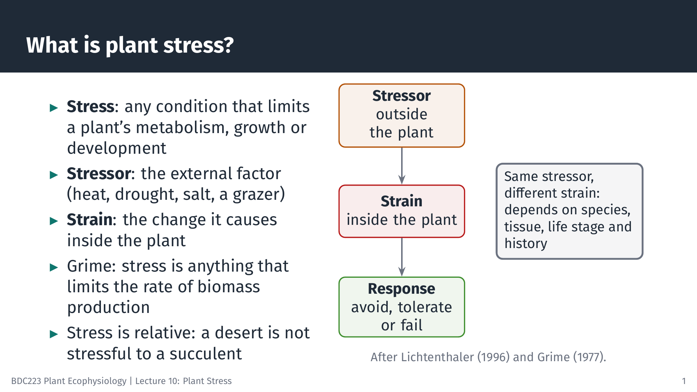

Plants cannot walk away from bad conditions. A plant that germinates in a place must cope with whatever that place delivers for the rest of its life, and so must a seaweed attached to a rock. This is why stress is a central idea in plant ecophysiology.

**Stress** is any unfavourable condition or substance that affects or blocks a plant's metabolism, growth or development [@lichtenthaler1996vegetation]. It helps to separate three terms. The **stressor** is the external factor: a heatwave, a drought, a rise in salinity, a grazing snail. The **strain** is the change the stressor causes inside the plant: dehydrated cells, damaged proteins, a slower Calvin cycle. The **response** is what the plant does about it. The same stressor can cause very different strains in different species, tissues and life stages, and in plants with different histories.

Ecologists often use a broader definition. @grime1977evidence defined stress as the external constraints that limit the rate of dry-matter production of all or part of the vegetation, and separated it from disturbance, which destroys biomass that has already been produced. Low light under a forest canopy and low nutrients in fynbos soils are stresses in this sense, even though no tissue is damaged.

Stress is relative. Conditions that are lethal to one species are normal for another: a hot, dry desert is not stressful to a succulent adapted to it, and the high shore is not stressful to a seaweed that lives nowhere else. Any plant moved outside the range of conditions to which it is adapted will experience stress. A Venus flytrap adapted to nutrient-poor soil can be killed by fertiliser, and an alpine plant adapted to dry summers can die in waterlogged soil.

## The Tolerance Curve

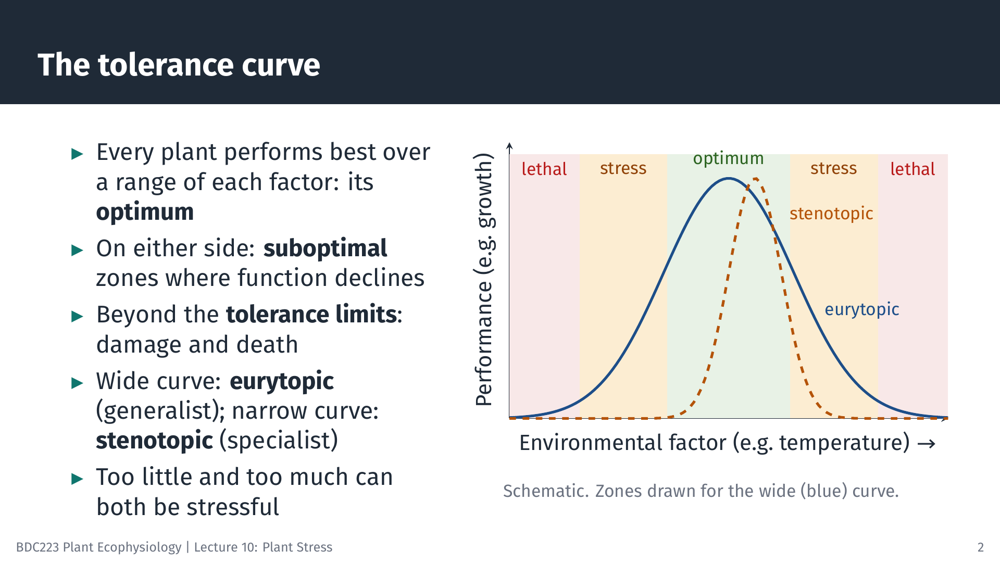

For any environmental factor, such as temperature, salinity or light, a plant's performance follows a curve. Performance is greatest over a range of values, the **optimum**. On either side lies a **suboptimal** zone in which the plant survives but grows more slowly. Beyond the **tolerance limits** the plant is injured and eventually dies. Stress therefore begins wherever conditions push function below the optimum, and it can be caused by too little of a factor (too little light, water or nitrogen) as well as by too much.

The width of the curve varies among species. A species with a wide tolerance range is **eurytopic** (a generalist); one with a narrow range is **stenotopic** (a specialist). For temperature specifically we use the terms eurythermal and stenothermal, and for salinity euryhaline and stenohaline. Specialists can perform very well within their range, but they have little margin when conditions change. The tolerance curve is the physiological basis of the **unimodal model** of species distributions that you will meet in BDC334 ([Lecture 3: Ecological Gradients, Niches, and Neutral Theory, Section "The Unimodal Response Model"](../BDC334/Lec-03-gradients.qmd#sec-unimodal); published at <https://tangledbank.netlify.app/BDC334/Lec-03-gradients.html#sec-unimodal>). There, the abundance of a species along an environmental gradient peaks at its optimum and declines towards both ends of its tolerance range. The two curves describe the same idea at different levels. The tolerance curve describes the performance of an individual plant measured under controlled conditions, which corresponds to its fundamental niche. The unimodal curve describes where the species is found in nature, and competitors, grazers and dispersal narrow it to the realised niche. Where many species with different optima are lined up along one gradient, their overlapping unimodal curves make up a coenocline, and the turnover of species along the gradient follows from the tolerance curves of the individual species.

The planetary boundaries of [Lecture 1](L01-worldmapper.qmd#sec-planetary-boundaries) apply the same logic to the whole Earth system. Rockström and colleagues defined a "safe operating space for humanity" for nine Earth-system processes [@rockstrom2009safe], much as a tolerance curve defines a safe operating range for one organism. Crossing a boundary moves the environment of many species towards the edges of their tolerance curves at the same time.

Two cautions apply. First, the curve is not fixed. Acclimation can shift it, which is why a plant hardened by a mild cold spell survives a frost that would kill an unhardened plant. Second, curves for different factors interact. A seaweed may tolerate high temperature when submerged but not when it is also drying out at low tide.

## Stress Unfolds in Time

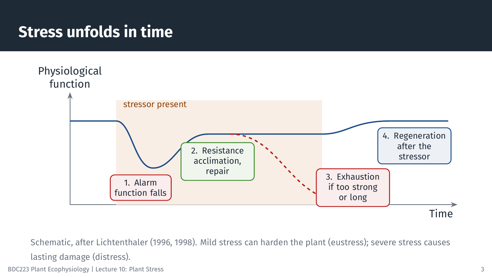

A stress response is a process, not a single event. The scheme used in plant physiology was adapted from the "general adaptation syndrome" that Hans Selye described for animals [@lichtenthaler1998stress; @kranner2010what]. It has four phases:

1.  **Alarm.** When the stressor arrives, function falls: photosynthesis slows, growth stops, and damage begins.
2.  **Resistance.** The plant switches on protection and repair. Function recovers partly or fully to a new, stable level. This is **acclimation**, or hardening.
3.  **Exhaustion.** If the stress is too strong or lasts too long, protection and repair are overwhelmed. Damage accumulates, and the plant may die.
4.  **Regeneration.** If the stressor is removed before exhaustion, the plant recovers its former level of function.

The phases show why the dose and the duration of a stress matter as much as the kind of stress. Mild stress that a plant overcomes can leave it better prepared for the next event; this is sometimes called **eustress**. Severe stress causes lasting damage, or **distress** [@lichtenthaler1998stress].

## The Stressors

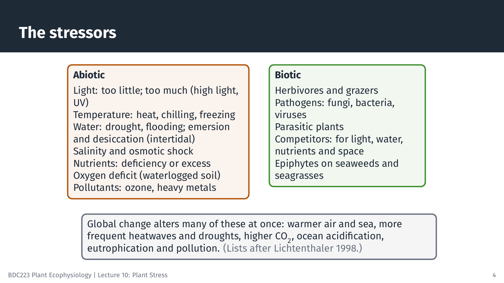

Stressors are usually divided into abiotic (physical and chemical) and biotic (living) factors. Many abiotic stressors are the same environmental factors you have studied in this module, at values that are too high or too low: light ([Lecture 6](L06-light.qmd)), temperature, water, and nutrients ([Lecture 9](L09a-nutrient_uptake.qmd)). Intertidal seaweeds face a set of stressors that land plants and subtidal seaweeds do not: at every low tide they are exposed to air, where they can dry out, heat up or freeze, receive full sunlight, and experience salinity changes as they dry or as rain falls on them [@davison1996stress].

## Stressors and the Planetary Boundaries

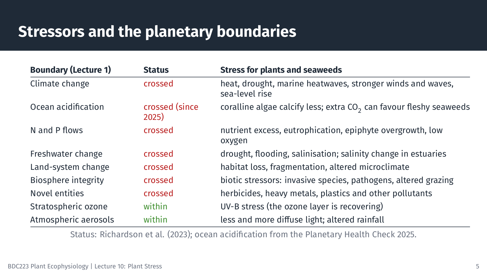

In [Lecture 1](L01-worldmapper.qmd#sec-planetary-boundaries) we asked, for each planetary boundary, what drives it, what the consequence is for the Earth system, and what the consequence is for plants. This lecture answers the last question. Each boundary describes an Earth-system process, and crossing it changes a property of the environment that a plant experiences directly: its temperature, its water and nutrient supply, the chemistry of the water around it, the light it receives, or the organisms it lives with. In other words, the boundaries are the global-scale causes, and the stressors in this lecture are their local, physiological consequences.

| Planetary boundary | Status | Stressor for plants and seaweeds | Where in this module |
|----------------------|----------------------|----------------------|----------------------|
| Climate change | crossed | heat, drought, marine heatwaves, stronger winds and waves, shifted seasons, sea-level rise | [Lecture 4](L04-climate.qmd), [Lecture 5](L05-carbon_cycle.qmd); case studies below |
| Ocean acidification | crossed (since 2025) | lower carbonate saturation: coralline algae calcify less; more CO~2~ can favour fleshy seaweeds | [Lecture 5](L05-carbon_cycle.qmd) |
| Biogeochemical flows (N and P) | crossed | nutrient excess, eutrophication, epiphyte overgrowth, low oxygen; nutrient imbalance | [Lecture 9](L09a-nutrient_uptake.qmd) |
| Freshwater change | crossed | drought, flooding, salinisation; salinity change in estuaries | crop and forest case studies |
| Land-system change | crossed | habitat loss and fragmentation, altered microclimate | forest case study |
| Biosphere integrity | crossed | biotic stressors: invasive species, pathogens, altered grazing | kelp case study |
| Novel entities | crossed | herbicides, heavy metals, plastics and other pollutants | multiple-stress case study |
| Stratospheric ozone depletion | within (recovering) | UV-B radiation | [Lecture 6](L06-light.qmd) |
| Atmospheric aerosol loading | within | less light, a larger diffuse fraction, altered rainfall | [Lecture 6](L06-light.qmd) |

: The nine planetary boundaries and the plant stressors they produce. Status from @richardson2023earth; the ocean acidification boundary was assessed as crossed in the Planetary Health Check 2025 [@pik2025planetary]. {#tbl-pb-stress}

By 2023, six of the nine boundaries had been crossed [@richardson2023earth]. In 2025 ocean acidification was assessed as crossed as well, making seven, while only stratospheric ozone and aerosol loading remained within their safe limits [@pik2025planetary]. For plant ecophysiology this has two consequences. First, every crossed boundary adds a stressor, or makes an existing one more frequent or more severe. Second, the boundaries are crossed together, so plants experience their stressors in combination; we return to this at the end of the lecture.

Ocean acidification shows how a boundary becomes a stressor for seaweeds in particular. As the ocean takes up CO~2~, the concentration of carbonate ions falls, and organisms that build skeletons of calcium carbonate find it harder to do so. Coralline red algae, including the crustose corallines that hold the depth record for seaweeds ([Lecture 8](L08-chromatic_adaptation.qmd)), are among the most sensitive: in most experiments their calcification, abundance and recruitment decline under acidified conditions [@cornwall2021understanding]. Fleshy seaweeds, which do not calcify, may instead grow faster because more CO~2~ is available for photosynthesis [@johnson2014contrasting]. The same boundary is therefore a stress for one functional group and a resource for another, and it can shift the balance between them.

These changes affect plants directly, through their physiology, and indirectly, through changes in herbivores, pathogens and competitors.

## A Common Currency: The Energy Balance of Photosynthesis

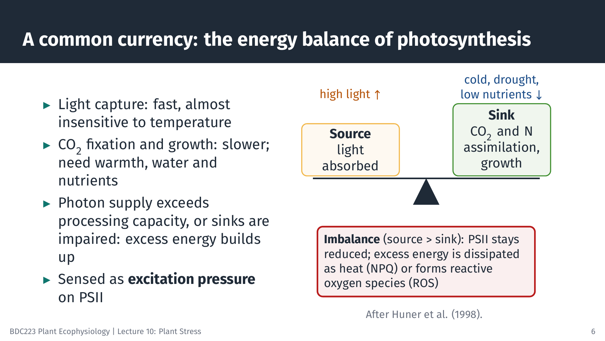

Why do so many different stresses damage photosynthesis? The answer lies in a mismatch of speeds. The capture of light by the antennae and the primary photochemistry in the reaction centres are extremely fast, and they hardly depend on temperature. The reactions that use the products, namely the Calvin cycle, nitrogen assimilation and growth, are slower, and they depend on temperature, on CO~2~ supply through open stomata, and on nutrients.

When the two sides are in balance, absorbed energy is used. The balance is lost in two ways. The **source** (the rate at which photons are supplied, i.e. the light intensity) can increase beyond what the photosynthetic machinery can process, as in high light. Or the **sinks** can be impaired, so that even a normal supply of photons cannot be used effectively: cold reduces the activity of the Calvin cycle enzymes; drought closes stomata and cuts the CO~2~ supply; nitrogen deficiency limits the synthesis of the proteins that use the products of the light reactions. In both cases, energy is absorbed faster than it can be used. Electrons accumulate in the electron transport chain, and the first electron acceptor of photosystem II stays reduced. This condition is called high **excitation pressure** [@huner1998energy]. A useful consequence is that low temperature has much the same effect on the chloroplast as high light. In both cases the plant absorbs more energy than it can use, and plants respond to both by adjusting their light-harvesting antennae.

Excess energy has two fates. It can be dissipated harmlessly as heat by non-photochemical quenching (NPQ), driven in plants and green and brown algae by the xanthophyll cycle. Or it can be passed to oxygen, forming reactive oxygen species. The chloroplast therefore acts as a sensor of environmental stress as well as an energy converter.

## Reactive Oxygen Species: Signal and Danger

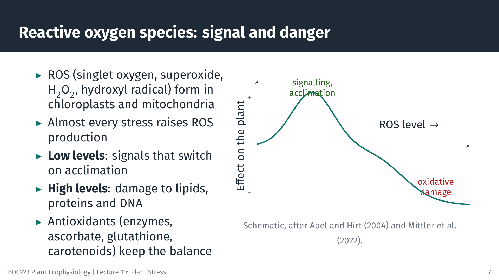

Reactive oxygen species (ROS) include singlet oxygen (¹O~2~), the superoxide radical (O~2~•⁻), hydrogen peroxide (H~2~O~2~) and the hydroxyl radical (•OH). They are formed continuously in chloroplasts, mitochondria and peroxisomes as by-products of normal metabolism, and almost every stress increases their production [@apel2004reactive].

At low concentrations, ROS act as signals: they switch on genes for antioxidant enzymes, heat-shock proteins and other protective mechanisms, and so they start acclimation. When production exceeds what the cell can remove, ROS accumulate and cause damage: they oxidise membrane lipids, proteins and DNA, and they can trigger cell death [@mittler2022reactive]. The outcome depends on the balance between ROS production and ROS removal by antioxidants: enzymes such as superoxide dismutase, catalase and ascorbate peroxidase, and molecules such as ascorbate, glutathione and carotenoids. Stress becomes damaging when production overwhelms removal.

## Measuring Stress with Chlorophyll Fluorescence

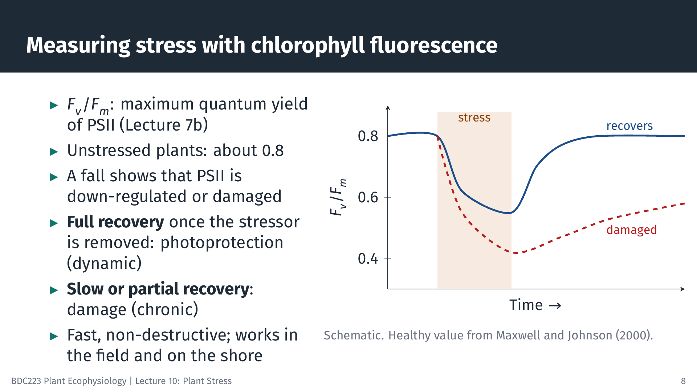

Because so many stresses act on photosystem II, chlorophyll fluorescence is one of the most widely used tools for detecting stress [@lichtenthaler1996vegetation]. You learnt how a PAM fluorometer measures the maximum quantum yield of PSII, F~v~/F~m~, in [Lecture 7b](L07b-measuring_photosynthesis.qmd). In healthy, dark-adapted leaves of most plants F~v~/F~m~ is about 0.8 [@maxwell2000chlorophyll]. Values differ among algal groups, so compare a stressed sample with an unstressed control of the same species.

A fall in F~v~/F~m~ shows that PSII is less efficient. What happens next tells you why. If F~v~/F~m~ recovers fully within minutes to hours once the stressor is removed, the fall was mostly photoprotection: NPQ that relaxes when the excess energy no longer needs to be dissipated. This is sometimes called dynamic photoinhibition. If recovery is slow or incomplete, PSII reaction centres were damaged and must be repaired, which is chronic photoinhibition. The measurement takes seconds, does not harm the plant, and works in the field and on the shore, so it is widely used to compare tolerance among species or to follow recovery after a heatwave or emersion.

## Three Outcomes: Avoidance, Tolerance and Susceptibility

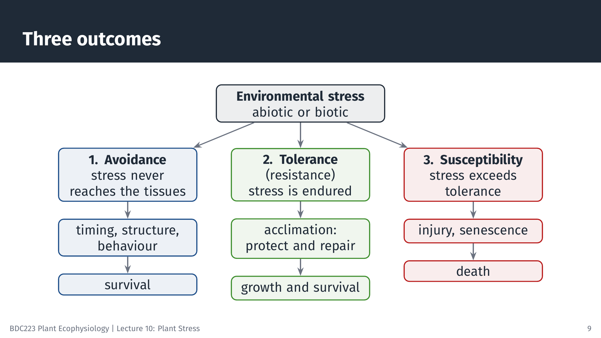

When a stressor arrives, a plant can respond in one of three broad ways:

1.  **Avoidance.** The stress never reaches the tissues, or never reaches them at a sensitive stage. The plant avoids it by its timing, its structure or its behaviour.
2.  **Tolerance** (also called resistance). The stress reaches the tissues, and the plant endures it by protecting and repairing them. Tolerance is often achieved by acclimation, which allows growth and survival to continue.
3.  **Susceptibility.** The stress exceeds what the plant can tolerate. The tissues are injured, the plant senesces, and it may die.

The terms are used loosely in the literature, and "resistance" and "tolerance" in particular are often treated as synonyms [@lichtenthaler1998stress]. In this module, resistance means the overall ability to survive and grow under stress, which a plant can achieve by avoidance, by tolerance, or by both.

## Avoidance in Time

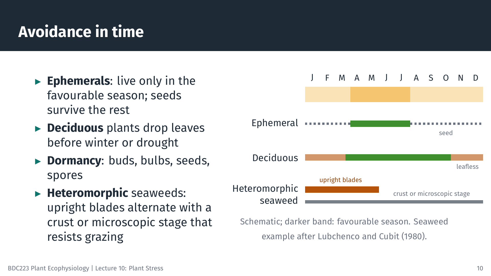

The simplest way to avoid a stress is to be absent, or inactive, when it occurs.

-   **Ephemeral plants** complete their life cycle in the short favourable season. Namaqualand annuals germinate after winter rain, flower in spring, and survive the dry summer as seeds.
-   **Deciduous plants** drop their leaves before the unfavourable season, whether a cold winter or a dry season, and so avoid freezing or water loss through the leaves.
-   **Dormant structures** (seeds, bulbs, buds and resting spores) are far more tolerant than active tissues.

Many seaweeds of the middle and upper shore have **heteromorphic life histories**: an upright, fast-growing blade alternates with a crust or a microscopic stage. It is tempting to interpret the crust as the stage that avoids harsh summer conditions. But when @lubchenco1980heteromorphic removed grazers from shores in New England and Oregon, the upright stages appeared in summer, when they are normally absent. The physical conditions of summer did not exclude them; grazers did. The upright stage grows and reproduces quickly when grazing is light, and the tough crust survives when grazing is heavy. This is avoidance of a biotic stress, and it is a good example of why a plausible explanation should be tested before it is accepted (compare [Lecture 8](L08-chromatic_adaptation.qmd)).

## Avoidance by Structure and Physiology

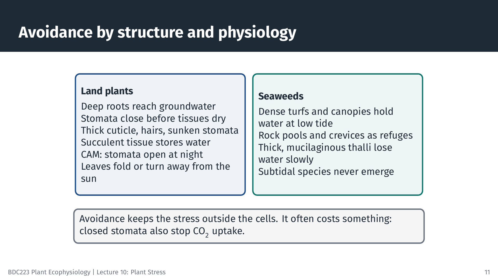

Plants can also avoid stress through their structure or by regulating their physiology. Deep roots reach water that shallow-rooted plants cannot. Stomata close before the tissues lose too much water. A thick cuticle, hairs and sunken stomata slow water loss. Succulents store water in their tissues, and CAM plants open their stomata at night, when the air is cooler and more humid. Some leaves fold or turn edge-on to the sun at midday, reducing both heat load and excess light.

Seaweeds use similar principles. Dense turfs and canopies hold water at low tide, so the plants beneath them dry out more slowly; rock pools and crevices are refuges; and thick, mucilaginous thalli lose water more slowly than thin ones.

Avoidance usually has a cost. Closed stomata keep water in, but they also keep CO~2~ out, so a plant that avoids drought by closing its stomata stops photosynthesising and draws on its reserves. This trade-off between protection and productivity runs through all stress responses.

## Tolerance: The Cellular Toolkit

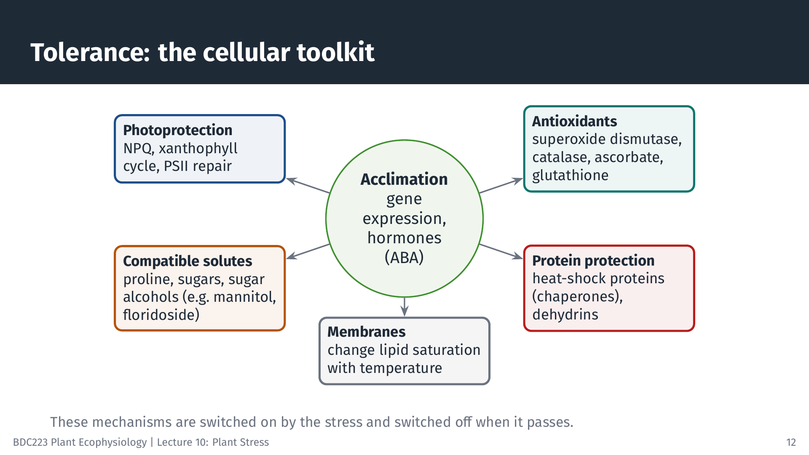

When stress reaches the cells, tolerance depends on a common set of mechanisms. Most of them are switched on by the stress, through hormones such as abscisic acid (ABA) and through ROS and other signals, and switched off again when the stress passes:

-   **Photoprotection.** NPQ and the xanthophyll cycle dissipate excess light energy as heat, and damaged PSII reaction centres (especially the D1 protein) are continuously replaced.
-   **Antioxidants.** Enzymes and small molecules remove ROS before they cause damage.
-   **Compatible solutes.** Proline, sugars and sugar alcohols (such as mannitol in brown algae and floridoside in red algae) accumulate in the cytoplasm. They balance osmotic potential during drought, salinity stress and freezing without interfering with enzymes.
-   **Protein protection.** Heat-shock proteins act as molecular chaperones that refold or remove damaged proteins, and dehydrins protect proteins and membranes during drying.
-   **Membrane adjustment.** Plants change the saturation of their membrane lipids with growth temperature, keeping membranes fluid in the cold and stable in the heat.

These mechanisms cost energy and nitrogen. A plant that maintains a high tolerance capacity all the time pays for it in slower growth, which is one reason why fast-growing species are often less stress-tolerant [@grime1977evidence].

## Responses on Four Timescales

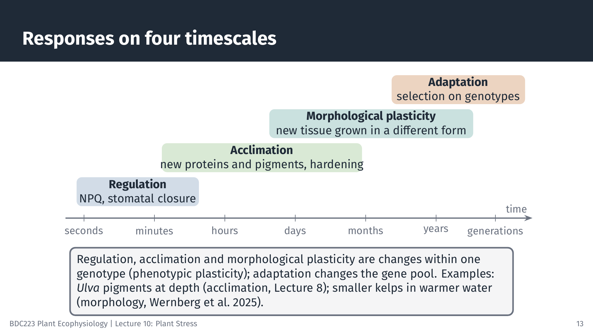

The responses in this lecture act on four timescales, and confusing them is a common error.

-   **Regulation** takes seconds to minutes and uses the machinery already present. Examples: NPQ switching on when a cloud passes, stomata closing in the afternoon.
-   **Acclimation** takes hours to weeks and involves new gene expression: new proteins and pigments, new membrane lipids, hardening. It is reversible and occurs within the lifetime of one individual. This is phenotypic plasticity. The changes in *Ulva* pigments after transplantation to 10 m depth ([Lecture 8](L08-chromatic_adaptation.qmd)) are acclimation.
-   **Morphological plasticity** takes weeks to years, because only new tissue can take a different form. Example: kelps growing in warmer water are smaller, with shorter, thinner stipes [@wernberg2025smaller].
-   **Adaptation** takes generations. Natural selection favours genotypes that perform better under the prevailing conditions, and the genetic make-up of the population changes. The upper-shore and lower-shore *Fucus* species in the next section differ by adaptation.

## Case Study: Stress and Zonation on the Shore

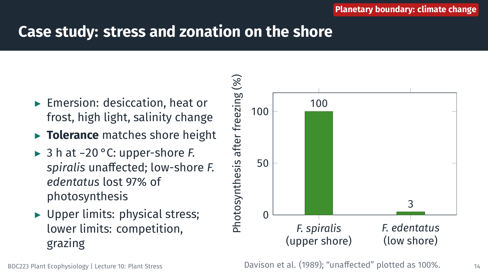

The rocky shore compresses a steep stress gradient into a few vertical metres. Climate change acts on this gradient directly: warmer air and more frequent heatwaves at low tide push upper-shore seaweeds towards the hot, dry end of their tolerance curves. Seaweeds high on the shore spend hours in air at every low tide, and those low on the shore spend only minutes. Laboratory studies show that tolerance of emersion stresses generally matches the height at which a species grows [@davison1996stress]. In one experiment, seaweeds from the Gulf of Maine were frozen for 3 h at −20 °C. Photosynthesis in the upper-shore *Fucus spiralis* was unaffected, whereas that of the low-shore *Fucus edentatus* fell by 97%. About the same proportion of tissue water froze in all species, so the difference lay in tolerance, not avoidance [@davison1989effect]. Similarly, upper-shore species tend to have higher activities of antioxidant enzymes during desiccation than low-shore species [@floresmolina2014desiccation].

A useful generalisation follows, with exceptions: the upper limit of a species on the shore is often set by physical stress, whereas the lower limit is often set by biological interactions such as competition and grazing. @davison1996stress emphasise that laboratory correlations are not enough. Field experiments are needed to show that stress actually sets these limits, particularly where sublethal stress weakens a species in competition.

## Case Study: A Marine Heatwave and a Kelp Forest

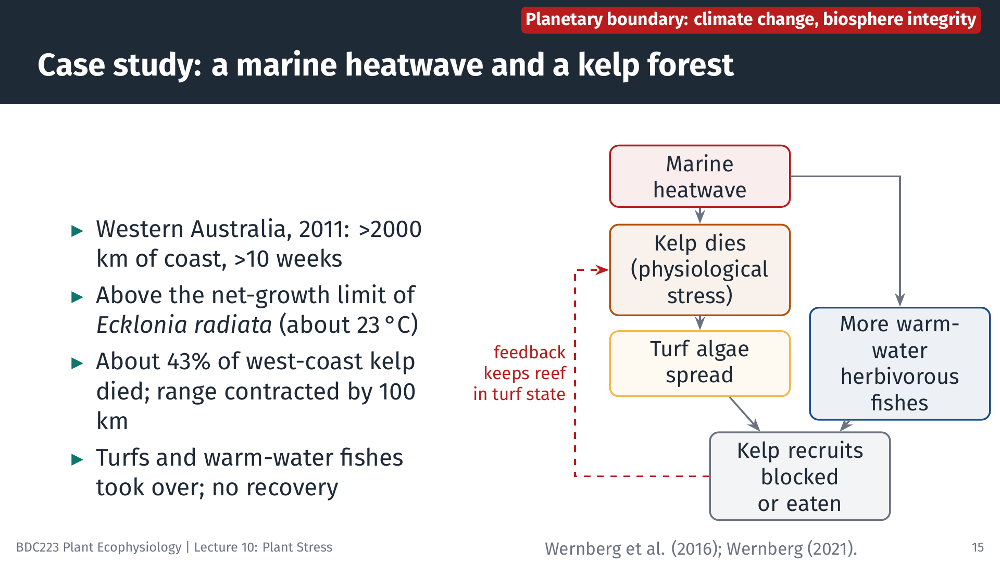

In 2011 a marine heatwave struck Western Australia. It affected more than 2000 km of coastline for more than 10 weeks, and water temperatures exceeded the threshold for net growth of the kelp *Ecklonia radiata* (about 23 °C) along large stretches of coast [@wernberg2021marine]. Kelp disappeared from the northern 100 km of its range, and about 43% of the kelp along the west coast died. Turf-forming seaweeds took over, and warm-water fishes, invertebrates and corals increased [@Wernberg2016].

The physiological stress lasted weeks, but its effects have lasted years. The turfs block the settlement of kelp spores, and the warm-water herbivorous fishes eat young kelp. Together these feedbacks keep the reefs in a turf-dominated state, and eight years after the event the kelp forests had still not recovered, although water temperatures had long since returned to normal [@wernberg2021marine]. This shows that stress on a foundation species can change the whole ecosystem, and that recovery depends on ecological feedbacks as well as physiology. It is the ecosystem-level equivalent of exhaustion without regeneration. Two planetary boundaries are involved. The climate change boundary supplied the physical stressor, and the resulting loss of kelp, together with the arrival of warm-water herbivores, is an erosion of biosphere integrity, which in turn prevents recovery.

## Case Study: Smaller Kelps, and Coasts That Are Cooling

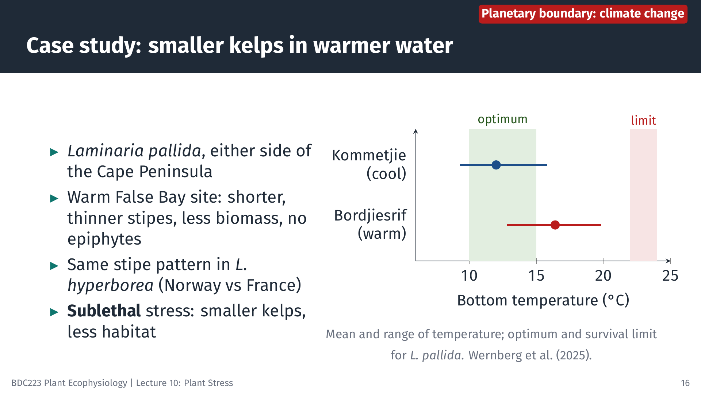

Not all effects of warming are lethal. Most of a species' range lies well inside its tolerance limits, and there warming makes conditions less favourable without killing anything. @wernberg2025smaller compared the kelp *Laminaria pallida* on either side of the Cape Peninsula. At Kommetjie, on the cool Atlantic coast, the mean bottom temperature was 12.0 °C, within the species' growth optimum of 10 to 15 °C. At Bordjiesrif, on the warmer False Bay side, it was 16.4 °C, above that optimum but well below the survival limit of 22 to 24 °C. Kelps at the warm site had shorter, thinner stipes, a different blade shape and less biomass, and they carried no epiphytes. *Laminaria hyperborea* had shorter, thinner stipes in warmer France than in cooler Norway. These kelps sit in the warm, suboptimal half of their tolerance curves, and the stress appears as smaller plants. Because kelps are habitat-forming species, smaller plants mean a lower canopy, less three-dimensional habitat and less food for the organisms that live on and around them. Whether such differences are plastic or genetic cannot be decided from comparisons between sites.

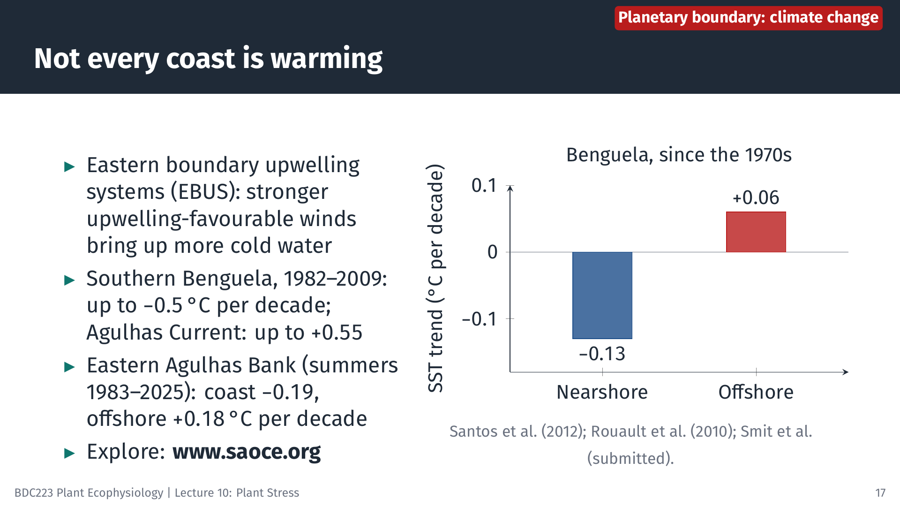

Crossing the climate change boundary does not warm every coast equally. In the four eastern boundary upwelling systems (EBUS), namely the Benguela, Canary/Iberian, California and Humboldt systems, winds along the coast drive cold, nutrient-rich water to the surface. Stronger upwelling-favourable winds have been proposed as a consequence of global warming, because land warms faster than the ocean and the pressure difference between them increases [@bakun1990global]. Off South Africa, the southern Benguela cooled by up to 0.5 °C per decade between January and August over 1982 to 2009, while the Agulhas Current system warmed by up to 0.55 °C per decade [@rouault2010coastal]. Along the Benguela since the 1970s, nearshore waters cooled by 0.13 °C per decade while offshore waters warmed by 0.06 °C per decade, consistent with stronger upwelling [@santos2012differences]. Globally, nearshore waters in EBUS have warmed less than the rest of the coastal ocean, although the effect is stronger in the Pacific than in the Atlantic systems [@seabra2019reduced], and more than 80% of EBUS coastal areas remained cool between 2002 and 2022 [@garciareyes2023most]. Coastal cooling is not limited to the Benguela. On the eastern Agulhas Bank, between St Francis Bay and East London, coastal waters cooled by 0.19 °C per decade in summer between 1983 and 2025, while waters offshore, beside the Agulhas Current, warmed by 0.18 °C per decade. Over the same period the proportion of summer days colder than the 1991–2020 cold threshold increased by 5.8 days per 100 summer days per decade [@smit2026coastal]. Cold-water events of this kind are a stress in their own right for warm-water species living on that coast. Such coasts may act as thermal refugia for cool-water species such as *L. pallida*. Satellite records can miss these nearshore patterns, because they differ substantially from temperatures measured in situ at the coast [@smit2013coastal]. You can explore how the ocean around southern Africa is changing, including marine heatwaves and cold spells, with the Southern African Ocean Conditions and Extremes (SAOCE) tracker at <https://www.saoce.org>.

For plants and seaweeds, the lesson is that a global boundary is experienced locally. On the same peninsula, one kelp population may be held near its optimum by upwelling while another, a few tens of kilometres away, grows in water that is warming. Predicting stress therefore requires the local temperature record and the tolerance curve of the species, not the global average.

## Case Study: Waves, Swell and Kelp Form

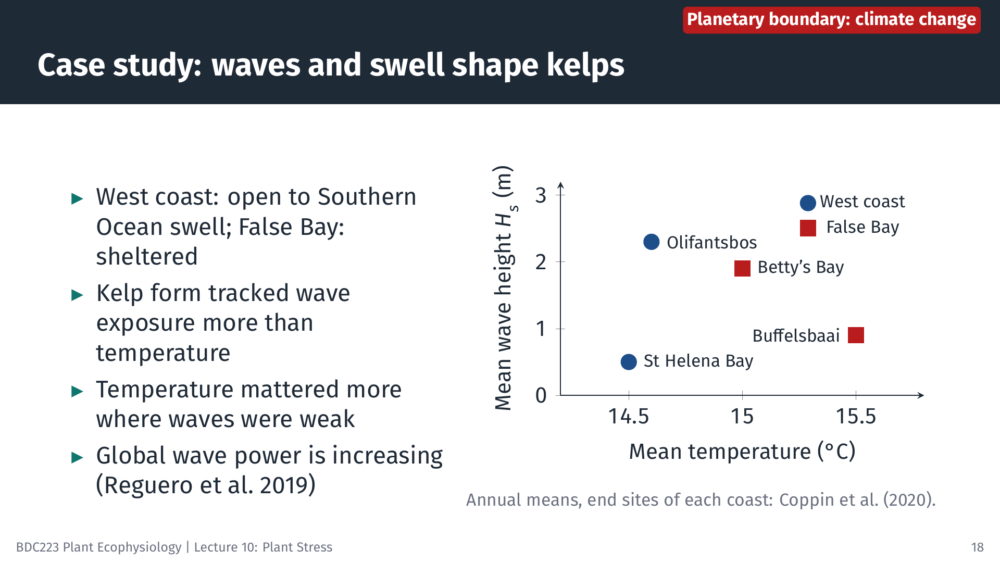

Temperature is not the only part of the physical environment that climate change alters. Wind drives upwelling, as the previous case study showed, and it also generates waves. Waves exert drag on seaweeds, and large waves during storms can break or dislodge whole plants, so wave exposure is a mechanical stress. Kelps respond to it by changing their form: plants on wave-exposed coasts tend to be smaller and stronger, with features that reduce drag, whereas plants in sheltered water can grow larger and longer.

@coppin2020investigating used a three-dimensional numerical wave model, together with in situ temperature records, to separate the effects of waves and temperature on two South African kelps, *Ecklonia maxima* and *Laminaria pallida*, between St Helena Bay and Betty's Bay. The west side of the Cape Peninsula faces the south-westerly swell that is generated by storms in the Southern Ocean. Mean significant wave height there reached 2.3 m at Olifantsbos, compared with 0.5 m in sheltered St Helena Bay. The western shore of False Bay lies in the shadow of the peninsula and receives much less wave energy. The two coasts also differ in temperature: mean annual temperatures were 15.0 to 15.5 °C in False Bay, compared with 14.5 to 14.6 °C on the west side. Wave exposure explained more of the variation in kelp morphology than temperature did, and the response depended on how strong the waves were. At low exposure the kelps developed traits that increase strength. At moderate exposure they had longer, more flexible stipes that move with the water, a "go-with-the-flow" tactic. At high exposure, *L. pallida* was smaller overall. Temperature had a larger effect on kelp form where waves were weak, as in False Bay. This is an example of morphological plasticity in response to a mechanical stress.

The study also carries a lesson about gradients. Around the Cape Peninsula the cooler coast is also the more wave-exposed coast, so temperature and wave exposure vary together. A size difference between the two coasts, as in the previous case study, therefore cannot be attributed to temperature alone until the effects of temperature and waves have been separated. Environmental factors seldom change one at a time along a gradient (see the [unimodal model in BDC334](../BDC334/Lec-03-gradients.qmd#sec-unimodal)), and separating them requires measurements of each factor at each site.

The link to the climate change boundary runs through the wind. Global wave power, the rate at which wind energy is transferred into ocean waves, has increased by about 0.4% per year since 1948, in step with upper-ocean warming, and the high southern latitudes are the most energetic region of the global ocean [@reguero2019recent]. In the Southern Ocean, mean wave height has increased by 1 to 3 cm per year, and it is projected to increase by a further 5 to 10% by 2100 [@casasprat2024wind]. The swell that reaches the Cape coast is generated there. More energetic swell would expose kelps to greater drag and more frequent dislodgement, and it would shift the balance between the morphological responses described above. Here the same planetary boundary acts on seaweeds through two physical routes from the same wind: upwelling, which changes temperature and nutrients, and waves, which change the mechanical environment.

## Extremes Are Becoming More Common

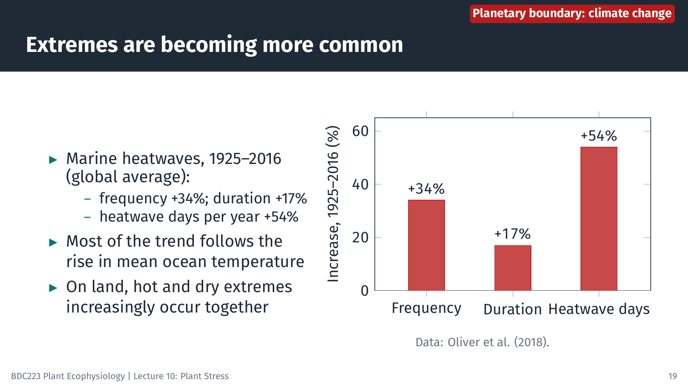

Marine heatwaves are becoming more frequent and longer. Between 1925 and 2016 their global average frequency increased by 34% and their duration by 17%, giving a 54% increase in the number of marine heatwave days each year. Most of this trend follows the rise in mean ocean temperature [@Oliver2018]. Satellite records show that the number of marine heatwave days doubled between 1982 and 2016, and models project much larger increases with further warming [@frolicher2018marine]. For plants and seaweeds this matters because an extreme event can push organisms past their tolerance limits in days, leaving no time for acclimation. Crossing the climate change boundary therefore changes the variability of the environment as well as its average, and it is often the extremes that kill.

## Stress and Food: Crop Yields in a Warmer World

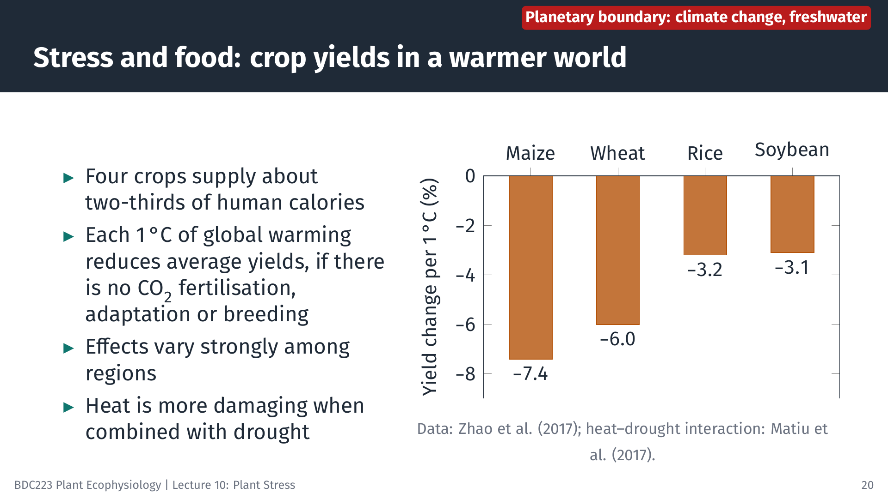

Wheat, rice, maize and soybean provide about two-thirds of the calories that people eat. Combining four independent methods (global crop models, local crop models, statistical analyses and field-warming experiments), @zhao2017temperature estimated that each degree Celsius of global warming would reduce average global yields of maize by 7.4%, wheat by 6.0%, rice by 3.2% and soybean by 3.1%. These estimates assume no CO~2~ fertilisation, no adaptation and no genetic improvement, and the effects differ greatly among regions; some estimates are even positive.

Stresses also interact. Between 1961 and 2014, high temperature reduced yields more in dry years than in normal years, and combined heat and drought reduced the yields of maize, soybean and wheat by 11.6%, 12.4% and 9.2% [@matiu2017interactions]. Hot, dry conditions raise evaporative demand while the soil supplies less water, so the plant closes its stomata and loses its main means of cooling at the same time. Here two boundaries, climate change and freshwater change, act on the same plant, and the farmers and people who depend on these crops feel the consequences directly.

## Stress and Forests: Hotter Droughts

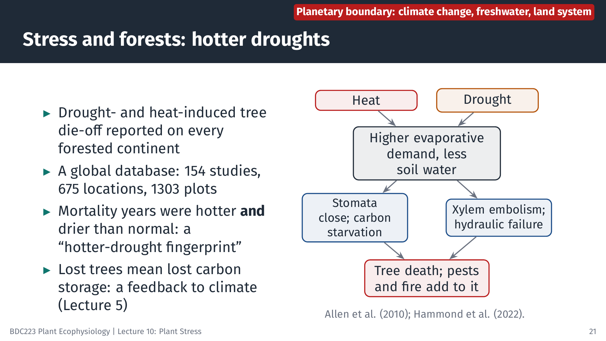

Forests show similar effects. @allen2010global compiled the first global overview of tree mortality caused by drought and heat, and found it on every forested continent, including in forests not normally thought of as water-limited. A later database of 154 studies covering 675 locations and 1303 plots showed that the years in which trees died were consistently hotter and drier than normal, a "hotter-drought fingerprint" [@hammond2022global]. Trees die mainly by two routes: hydraulic failure, when air bubbles (embolisms) block the xylem, and carbon starvation, when stomata stay closed so long that the tree uses up its reserves. Insect outbreaks and fire often finish off weakened trees. Dying forests release carbon, which feeds back on climate ([Lecture 5](L05-carbon_cycle.qmd)). Forest die-off links three boundaries: climate change and freshwater change cause it, and the loss of forest is itself land-system change, which releases more CO~2~ and pushes the climate boundary further.

## Many Small Stresses Add Up

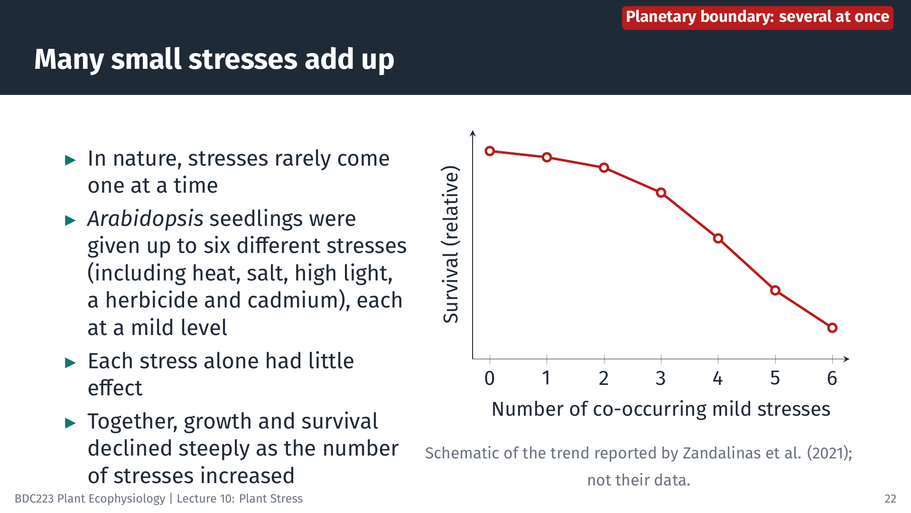

Most experiments apply one stress at a time, but in nature plants experience several together. @zandalinas2021impact exposed seedlings of *Arabidopsis thaliana* to up to six different stresses, each at a level so mild that on its own it had little effect. As the number of stresses applied together increased, growth and survival declined sharply. The response to the combination differed from the responses to the individual stresses, so it could not be predicted from them. The authors warn that warming, climate change and pollution together are creating exactly these multifactorial stress combinations [@zandalinas2021global]. A plant on a tolerance curve for each factor can still fail when it sits near the edge of several curves at once.

This is the most important link between this lecture and the planetary boundaries of [Lecture 1](L01-worldmapper.qmd#sec-planetary-boundaries). The boundaries are usually presented one at a time, but they are crossed together, and a plant does not experience them separately. A seaweed on a South African shore may face warmer water and more frequent heatwaves (climate change), lower carbonate saturation (ocean acidification), nutrient-rich run-off (biogeochemical flows) and new pollutants (novel entities) at once. Each may be tolerable on its own. Combined, they can exceed what the plant can withstand. Seven crossed boundaries therefore mean far more than seven separate stresses.

## Summary

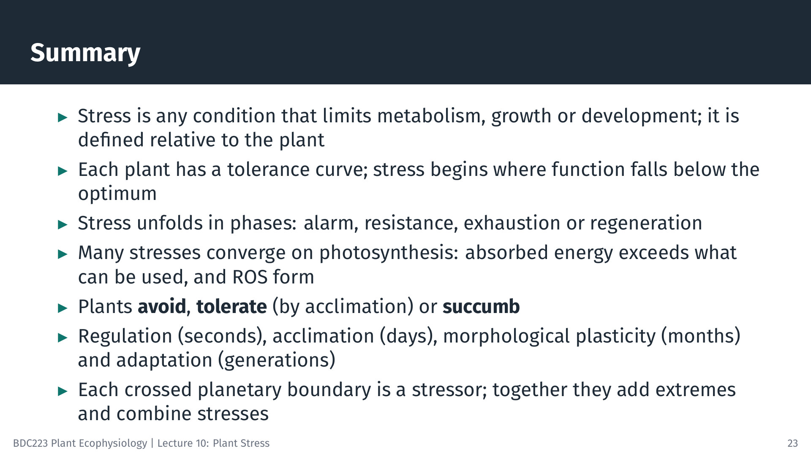

-   Stress is any condition that limits a plant's metabolism, growth or development. It is defined relative to the plant, and it can be caused by too little as well as too much of a factor.
-   Tolerance curves describe the range over which a plant functions; stress responses unfold through alarm, resistance, and either exhaustion or regeneration.
-   Many stresses act through photosynthesis. When absorbed energy exceeds what can be used, plants dissipate it as heat or form ROS. At low levels ROS signal the need to acclimate; at high levels they cause oxidative damage.
-   Plants avoid stress, tolerate it through acclimation, or succumb. Avoidance and tolerance both have costs.
-   Regulation, acclimation, morphological plasticity and adaptation act on timescales of seconds to minutes, hours to weeks, weeks to years, and generations.
-   Each crossed planetary boundary produces stressors that plants experience directly: heat and drought from climate change, nutrient excess from the nitrogen and phosphorus cycles, reduced calcification from ocean acidification, pollutants from novel entities, and new biotic pressures from the loss of biosphere integrity.
-   The boundaries are crossed together, so plants increasingly experience combinations of stresses that are more harmful than any one alone. The case studies show the consequences for seaweeds, crops and forests, and for the ecosystems and people that depend on them.

## Self-Test Questions

::: {.callout-note collapse="true"}
## 1. Distinguish a stressor from strain, using drought as the example.

The stressor is the shortage of water in the soil or air (the external factor). The strain is the change it causes inside the plant: lower water potential in the cells, loss of turgor, stomatal closure and a slower rate of photosynthesis. The response is what the plant does about it, for example accumulating compatible solutes or shedding leaves.
:::

::: {.callout-note collapse="true"}
## 2. Why does low temperature cause symptoms in the chloroplast similar to those caused by high light?

Light capture and primary photochemistry hardly depend on temperature, but the capacity of the Calvin cycle and other metabolic sinks is reduced in the cold. In the cold, as in high light, the chloroplast absorbs more energy than it can use. The electron transport chain becomes reduced (high excitation pressure), excess energy must be dissipated by NPQ, and ROS formation increases.
:::

::: {.callout-note collapse="true"}
## 3. F~v~/F~m~ of a seaweed falls from 0.75 to 0.50 at midday low tide. How would you find out whether it was damaged?

Relieve the stress (for example, re-immerse the seaweed in seawater in low light), measure F~v~/F~m~ again after dark adaptation at intervals, and compare it with an unstressed control. Full recovery within minutes to hours shows that the fall was mainly photoprotection (NPQ). Slow or incomplete recovery shows damage to PSII that requires repair.
:::

::: {.callout-note collapse="true"}
## 4. Classify each as avoidance or tolerance: (a) a desert annual; (b) heat-shock proteins; (c) CAM; (d) floridoside accumulation in a red alga.

(a) Avoidance in time: the plant is present as a seed during the dry season. (b) Tolerance: chaperones protect proteins once the heat has reached the cells. (c) Avoidance: opening stomata at night avoids water loss during the hot day. (d) Tolerance: the compatible solute protects cells that are already experiencing osmotic or desiccation stress.
:::

::: {.callout-note collapse="true"}
## 5. Is a seaweed that builds more pigment after two weeks at depth showing adaptation or acclimation? Explain.

Acclimation. The change occurs within one individual, takes days to weeks, involves gene expression, and is reversible when the plant is moved back. Adaptation would require a change in the genetic make-up of a population over generations.
:::

::: {.callout-note collapse="true"}
## 6. Why did the kelp forests in Western Australia not recover after the water cooled?

The heatwave killed the kelp, but the ecosystem then changed. Turf algae covered the reefs and blocked the settlement of kelp spores, and more warm-water herbivorous fishes ate young kelp. These feedbacks maintain the turf-dominated state even after the physiological stress has passed.
:::

::: {.callout-note collapse="true"}
## 7. Choose three crossed planetary boundaries and name the stressor each produces for a seaweed.

For example: climate change produces marine heatwaves and higher emersion temperatures; ocean acidification lowers carbonate saturation, which reduces calcification in coralline algae; altered nitrogen and phosphorus flows produce eutrophication, which favours fast-growing epiphytes and reduces light reaching the seaweed; novel entities add pollutants such as heavy metals and herbicides. Because the boundaries are crossed together, a seaweed may experience several of these at once.
:::

## Multiple-Choice Questions

Click an option to check your answer. A green tick marks the correct option, and its explanation then appears below the options.

::: {.mcq}
**1.** During a hot midday low tide, an upper-shore *Fucus* thallus loses water, its Calvin cycle slows, and it accumulates mannitol. Which assignment of stressor, strain and response is correct?

-   Stressor: heat and drying in air; strain: mannitol accumulation; response: water loss and a slower Calvin cycle.
-   Stressor: water loss and a slower Calvin cycle; strain: heat and drying in air; response: accumulation of mannitol.
-   [Stressor: heat and drying in air; strain: water loss and a slower Calvin cycle; response: mannitol accumulation.]{.correct}
-   Stressor: mannitol accumulation; strain: heat and drying in air; response: water loss and a slower Calvin cycle.

::: {.mcq-explain}
The stressor is the external factor (heat and drying in air). The strain is the change it causes inside the plant (water loss, a slower Calvin cycle). Accumulating the compatible solute mannitol is what the plant does about it, namely the response.
:::
:::

::: {.mcq}
**2.** Grime defined stress as an external constraint on the rate of dry-matter production and separated it from disturbance. Which situation is a stress but not a disturbance in this sense?

-   A winter storm tears the blades off kelp plants, removing the biomass already produced there.
-   A fire burns the standing shoots of a grassland, removing most of that season's new growth.
-   Grazing snails remove most of the upright thalli that grew on the shore that spring.
-   [A fynbos shrub grows slowly in nutrient-poor soil, although none of its tissue is damaged.]{.correct}

::: {.mcq-explain}
In Grime's sense, stress limits the rate of production (low nutrients slow growth without destroying tissue). Storms, fire and grazing destroy biomass that has already been produced, which is disturbance.
:::
:::

::: {.mcq}
**3.** Which statement about a stenothermal seaweed, compared with a eurythermal one, is most correct?

-   It has a wide temperature range and may perform very well within it, but has little margin when conditions change.
-   It has a narrow temperature range and therefore performs worse than a eurythermal species at every temperature.
-   It has a narrow temperature range, so warming can affect its performance only once temperatures pass its survival limit.
-   [It has a narrow temperature range and may perform very well within it, but has little margin when conditions change.]{.correct}

::: {.mcq-explain}
Stenothermal species are temperature specialists with a narrow tolerance curve. Within their range they can perform very well, but they have little margin. Stress begins as soon as conditions leave the optimum, not only at the survival limit.
:::
:::

::: {.mcq}
**4.** A kelp grows best at 10 to 15 °C in laboratory culture, but in the field it is most abundant where the water is 8 to 11 °C. Which interpretation is best supported?

-   [The culture curve reflects the fundamental niche; competitors, grazers or dispersal can shift the field pattern.]{.correct}
-   The culture curve reflects the realised niche; the field pattern shows the fundamental niche set by physiology alone.
-   The field pattern shows that 8 to 11 °C is the true optimum, so the culture conditions were stressful.
-   The two results conflict, because field abundance should peak exactly at the optimum measured in culture.

::: {.mcq-explain}
The tolerance curve measured under controlled conditions corresponds to the fundamental niche. In nature, competitors, grazers and dispersal narrow and shift it to the realised niche, so the field peak need not match the laboratory optimum.
:::
:::

::: {.mcq}
**5.** A seaweed is grown at its usual light intensity and temperature but with severe nitrogen deficiency. Why can its PSII experience high excitation pressure?

-   The source increases: nitrogen deficiency raises the light absorbed by the antennae, so more photons arrive than the photosynthetic machinery can process.
-   [The sinks are impaired: too little protein is made to use the products of the light reactions, so energy is absorbed faster than it is used.]{.correct}
-   Primary photochemistry slows: without nitrogen the reaction centres cannot trap photons, so the first PSII acceptor stays oxidised.
-   The sinks are enhanced: nitrogen deficiency speeds up the Calvin cycle, so the electron transport chain is drained and becomes oxidised.

::: {.mcq-explain}
Excitation pressure rises whenever absorption outpaces use. Here the light supply is unchanged, but nitrogen deficiency limits the proteins that use the products of the light reactions, so electrons accumulate and the first PSII acceptor stays reduced.
:::
:::

::: {.mcq}
**6.** Which statement about reactive oxygen species (ROS) in a stressed plant is most correct?

-   [At low concentrations ROS signal the start of acclimation; damage follows when production exceeds removal by antioxidants.]{.correct}
-   At low concentrations ROS cause damage; at high concentrations they signal acclimation by switching on antioxidant genes.
-   ROS form only under stress, so any detectable ROS shows that oxidative damage to membranes has already begun in the cell.
-   ROS damage is set by the rate of ROS production alone, so the antioxidant capacity of a cell has little effect on the outcome.

::: {.mcq-explain}
ROS form continuously in normal metabolism. At low levels they switch on protective genes and start acclimation; damage depends on the balance between production and removal by antioxidants such as superoxide dismutase, catalase and ascorbate.
:::
:::

::: {.mcq}
**7.** Which pairing of a response with its timescale category is correct?

-   NPQ switching on within seconds when a cloud uncovers the sun: acclimation over hours to weeks.
-   Membrane lipids becoming more unsaturated after weeks of cold: adaptation over many generations.
-   [Kelps in warmer water growing shorter, thinner stipes: morphological plasticity over weeks to years.]{.correct}
-   Upper- and lower-shore *Fucus* species differing in freezing tolerance: acclimation within one lifetime.

::: {.mcq-explain}
A new stipe form requires new tissue, so it is morphological plasticity (weeks to years). NPQ is regulation, the *Fucus* species differ by adaptation, and lipid adjustment within weeks is acclimation.
:::
:::

::: {.mcq}
**8.** During a long, hot drought, a pine keeps its stomata closed for months. When it dies, its xylem shows few embolisms, but its stored starch and sugars are nearly used up. Which mortality route fits best?

-   Hydraulic failure, because the reserves were spent refilling the xylem and could no longer support growth.
-   [Carbon starvation, because closed stomata stopped CO₂ uptake while respiration used up the reserves.]{.correct}
-   Hydraulic failure, because closed stomata stopped water flow so that air bubbles blocked the xylem.
-   Carbon starvation, because closed stomata trapped CO₂ in the leaf and the excess blocked the Calvin cycle.

::: {.mcq-explain}
Few embolisms rule out hydraulic failure as the main cause. Prolonged stomatal closure stops photosynthesis while respiration continues, so the tree exhausts its reserves, which is carbon starvation.
:::
:::

::: {.mcq}
**9.** The ocean acidification boundary was assessed as crossed in 2025. Which statement about it as a stressor for seaweeds is most correct?

-   It raises the pH of seawater, reducing calcification in coralline algae, while fleshy seaweeds are hardly affected at all.
-   It raises carbonate saturation, increasing calcification in coralline algae, while extra CO₂ slows fleshy seaweed growth.
-   [It lowers carbonate saturation, reducing calcification in coralline algae, while extra CO₂ may help fleshy seaweeds grow.]{.correct}
-   It lowers carbonate saturation, reducing calcification in coralline algae and in fleshy seaweeds to about the same degree.

::: {.mcq-explain}
Uptake of CO₂ lowers carbonate ion concentration and pH, so calcifying corallines suffer. Fleshy seaweeds do not calcify and may gain from more CO₂, so one boundary is a stress for one functional group and a resource for another.
:::
:::

::: {.mcq}
**10.** Two red algae are collected from one shore: species U from the upper shore and species L from the low shore. Discs of each are frozen for 3 h at −15 °C beside unfrozen controls held at 10 °C. Calorimetry shows that about 70% of tissue water froze in both species. After thawing, photosynthesis of U is 95% of its control value, whereas that of L is 20% of its control value. Which interpretation is best supported?

-   U avoids freezing better than L; the equal ice fraction shows that U kept ice out of its living cells more effectively.
-   U avoids freezing better than L; its higher photosynthesis shows that less of its tissue water turned to ice.
-   [U tolerates freezing better than L; the equal ice fraction shows that U did not avoid ice formation in its tissues.]{.correct}
-   U tolerates freezing better than L; the equal ice fraction shows that the low-shore L avoided freezing instead.

::: {.mcq-explain}
The same proportion of tissue water froze in both species, so neither avoided ice formation. The difference in photosynthesis after thawing is therefore a difference in tolerance, as in the Gulf of Maine *Fucus* experiment.
:::
:::

::: {.mcq}
**11.** A seagrass is held at 32 °C for 14 days beside controls at 22 °C. In the heated tanks Fv/Fm falls from 0.78 to 0.55 over the first two days, then rises to a stable 0.70 by day 6 while heat-shock proteins accumulate. Returned to 22 °C on day 14, the plants regain an Fv/Fm of 0.78 within a week. A second group held at 36 °C shows a continuing fall in Fv/Fm to 0.20, followed by leaf death. Which description of the stress phases is most correct?

-   At 32 °C: resistance, then alarm, then exhaustion after removal; at 36 °C: alarm leading straight on to full regeneration.
-   [At 32 °C: alarm, then resistance (acclimation), then regeneration after removal; at 36 °C: alarm leading to exhaustion.]{.correct}
-   At 32 °C: alarm, then regeneration by day 6, then resistance after removal; at 36 °C: alarm leading to exhaustion.
-   At 32 °C: alarm, then exhaustion, then regeneration after removal; at 36 °C: alarm leading to resistance (acclimation).

::: {.mcq-explain}
The initial fall is alarm, the partial recovery to a new stable level during exposure is resistance (acclimation), and full recovery after the stressor is removed is regeneration. At 36 °C protection is overwhelmed, which is exhaustion.
:::
:::

::: {.mcq}
**12.** Five years after a marine heatwave removed kelp from a reef, water temperatures are back to normal, but the reef is still covered by turf algae and warm-water herbivorous fishes are common. Researchers set up four plot types: turf cleared or not cleared, each either fenced against fishes or left open. Juvenile kelps from a nearby healthy forest are outplanted into all plots. After a year, juveniles survive and grow well only in plots that were both cleared and fenced. Which interpretation is best supported?

-   Present temperatures no longer prevent kelp growth; outplants succeeded only because they had adapted to the heat.
-   [Present temperatures no longer prevent kelp growth; turf and herbivorous fishes together block recovery of the forest.]{.correct}
-   Present temperatures still prevent kelp growth; turf and herbivorous fishes only add to a stress that is physiological.
-   Present temperatures no longer prevent kelp growth; turf alone blocks recovery, and grazing by fishes has little effect.

::: {.mcq-explain}
Kelp grows well at present temperatures once both turf and fishes are removed, so physiology is no longer limiting. Open cleared plots and fenced uncleared plots both failed, so each feedback alone is enough to prevent recovery.
:::
:::

::: {.mcq}
**13.** On a South African shore, a red alga alternates between an upright blade, present in winter, and a crust, the only stage seen in summer. A student proposes that the crust lets the alga avoid summer heat and drying. She fences plots to exclude grazing limpets and leaves unfenced controls; the fences shade the rock by less than 5%. In fenced plots, upright blades appear and grow through summer; in the controls only crusts persist. Which conclusion is best supported?

-   Summer conditions do exclude the upright stage; grazers removed only those blades already killed by heat and drying.
-   Summer conditions do not exclude the upright stage; the crust is better read as tolerance of heat than avoidance.
-   Summer conditions do exclude the upright stage; the fences protected the blades by reducing heat and drying.
-   [Summer conditions do not exclude the upright stage; the crust is better read as avoidance of grazing than of heat.]{.correct}

::: {.mcq-explain}
Upright blades grew through summer wherever grazers were excluded, and the fences barely changed the physical conditions. The physical environment does not exclude the upright stage; grazers do, so the crust is avoidance of a biotic stress, as Lubchenco and Cubit found.
:::
:::

::: {.mcq}
**14.** A student compares *Laminaria pallida* at two sites. At a west-coast site, mean bottom temperature is 12 °C and mean significant wave height is 2.3 m. At a False Bay site, mean temperature is 16 °C and mean significant wave height is 0.6 m. Stipe length, thickness and biomass differ between the sites. She concludes that the difference is an acclimation response to temperature. Which assessment of her conclusion is most correct?

-   [Temperature and wave exposure vary together between sites; nor can a site comparison separate plastic from genetic causes.]{.correct}
-   Only temperature differs in a way that matters; waves affect kelp form mainly where exposure is low, as in False Bay.
-   Only wave exposure differs in a way that matters; temperature has no detectable effect on kelp form anywhere on this coast.
-   Temperature and wave exposure vary together between the sites; even so, the comparison shows the difference to be acclimation.

::: {.mcq-explain}
Around the Cape Peninsula the cooler coast is also the more wave-exposed coast, so the two factors are confounded. Comparisons between sites also cannot show whether the differences are plastic or genetic, so acclimation is not demonstrated.
:::
:::

::: {.mcq}
**15.** Seedlings are exposed to four mild stresses: slightly raised temperature, mild salinity, a low herbicide dose and mild nitrogen deficiency. Alone, each reduces growth by 3 to 5% relative to unstressed controls. Applied together, the four reduce growth by 55%, and some seedlings die. Which interpretation is most correct?

-   The combined effect far exceeds the sum of the single effects; the herbicide is probably responsible for most of the loss.
-   The combined effect is smaller than the sum of the single effects; the stresses appear to protect seedlings from each other.
-   [The combined effect far exceeds the sum of the single effects; tolerance of each factor alone does not predict the outcome.]{.correct}
-   The combined effect roughly equals the sum of the single effects; tolerance of each factor alone predicts the outcome well.

::: {.mcq-explain}
The single effects sum to only 12 to 20%, far less than the observed 55%. As in Zandalinas et al., a combination of mild stresses can produce a response that cannot be predicted from the individual stresses.
:::
:::

::: {.mcq}
**16.** Zhao et al. estimated yield losses per °C of global warming of 7.4% for maize, 6.0% for wheat, 3.2% for rice and 3.1% for soybean. A region produces 10 Mt of wheat and 4 Mt of maize per year. Assuming losses scale linearly, with no CO₂ fertilisation or adaptation, what is the expected annual loss after 2 °C of warming?

-   [1.79 Mt, about 12.8% of the combined harvest]{.correct}
-   1.88 Mt, about 13.4% of the combined harvest
-   1.96 Mt, about 14.0% of the combined annual harvest
-   0.90 Mt, about 6.4% of the combined harvest

::: {.mcq-explain}
Wheat: 10 × 0.060 × 2 = 1.20 Mt. Maize: 4 × 0.074 × 2 = 0.592 Mt. Total 1.79 Mt, or 1.79 / 14 = 12.8%. Swapping the crop rates gives 1.96 Mt, using 1 °C gives 0.90 Mt, and applying the mean rate of 6.7% to both crops gives 1.88 Mt.
:::
:::

::: {.mcq}
**17.** On the eastern Agulhas Bank, coastal waters cooled by 0.19 °C per decade in summer between 1983 and 2025, while offshore waters warmed by 0.18 °C per decade. Assuming linear trends, by how much did the offshore-minus-coastal temperature difference change over these 42 years?

-   About 15.5 °C, with the offshore water becoming warmer relative to the coast
-   About 0.04 °C, with offshore water becoming warmer relative to the coast
-   About 0.37 °C, with offshore water becoming warmer relative to the coast
-   [About 1.55 °C, with offshore water becoming warmer relative to the coast]{.correct}

::: {.mcq-explain}
The trends have opposite signs, so they add: 0.18 − (−0.19) = 0.37 °C per decade. Over 42 years (4.2 decades), 0.37 × 4.2 = 1.55 °C. Forgetting the time span gives 0.37 °C, ignoring the sign gives 0.04 °C, and treating the rates as per year gives 15.5 °C.
:::
:::

::: {.mcq}
**18.** Between 1925 and 2016 the global number of marine heatwave days per year increased by 54%. A coastal site experienced exactly this increase and now records 77 marine heatwave days per year. How many did it record at the start of the period?

-   23 days, because 77 − 54 = 23
-   [50 days, because 77 ÷ 1.54 = 50]{.correct}
-   39 days, because 77 ÷ 2 = 38.5
-   35 days, because 77 × 0.46 = 35

::: {.mcq-explain}
A 54% increase multiplies the starting value by 1.54, so the start was 77 / 1.54 = 50 days. Subtracting 54% of the final value (77 × 0.46) uses the wrong base, and halving applies the satellite-era doubling instead of the 54% increase.
:::
:::

::: {.mcq}
**19.** A PAM fluorometer gives dark-adapted readings for a control seaweed of F0 = 300 and Fm = 1500, and for a stressed thallus of the same species of F0 = 350 and Fm = 1000 (arbitrary units). Using Fv = Fm − F0, what is Fv/Fm of the stressed thallus, and how does it compare with the control?

-   0.65; about 15% below the control value of 0.80
-   0.35; about 75% above the control value of 0.20
-   1.86; about 54% below the control value of 4.00
-   [0.65; about 19% below the control value of 0.80]{.correct}

::: {.mcq-explain}
Stressed: (1000 − 350) / 1000 = 0.65. Control: (1500 − 300) / 1500 = 0.80. Relative decline = 0.15 / 0.80 = 19%. Reporting the 0.15 difference as 15% confuses absolute and relative change; 0.35 is F0/Fm, and 1.86 is Fv/F0.
:::
:::

::: {.mcq}
**20.** At Bordjiesrif in False Bay the mean bottom temperature was 16.4 °C, compared with 12.0 °C at Kommetjie. *Laminaria pallida* has a growth optimum of 10 to 15 °C and a survival limit of 22 to 24 °C. By how much does Bordjiesrif exceed the upper end of the optimum, and how far is it below the lower end of the survival limit?

-   [1.4 °C above the optimum and 5.6 °C below the survival limit]{.correct}
-   1.4 °C above the optimum and 7.6 °C below the survival limit
-   4.4 °C above the optimum and 5.6 °C below the survival limit
-   6.4 °C above the optimum and 7.6 °C below the survival limit

::: {.mcq-explain}
16.4 − 15 = 1.4 °C above the optimum, and 22 − 16.4 = 5.6 °C below the survival limit, so the kelp lies in the warm suboptimal zone. The 4.4 °C figure is the difference from Kommetjie, 7.6 °C uses the upper survival limit, and 6.4 °C uses the lower end of the optimum.
:::
:::

## References

::: {#refs}
:::
