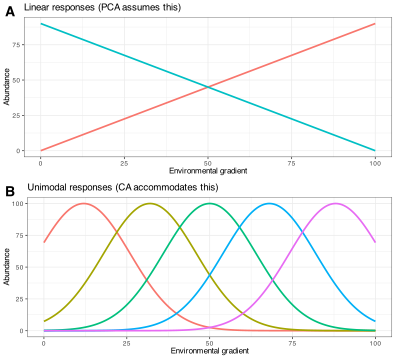
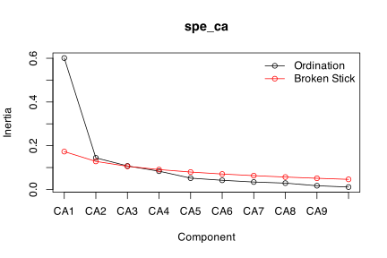
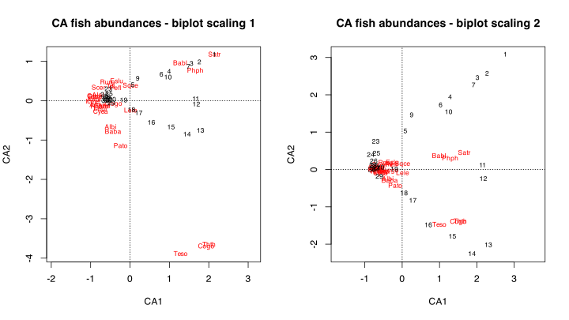
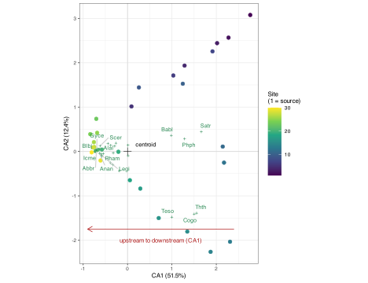
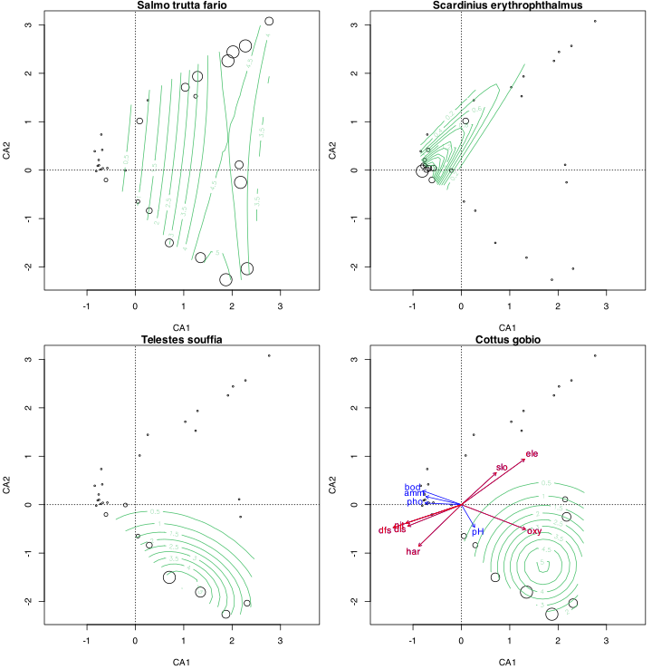
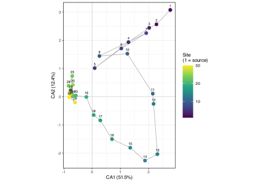

> **TIP:**
>
> | Type | Name | Link |
> |:---|:---|:---|
> | **Theory** | Numerical Ecology with R | See pages 132-140 |
> | **Slides** | CA lecture slides | [💾 `BCB743_09_CA.pdf`](../slides/BCB743_09_CA.pdf) |
> | **Data** | The Doubs River data | [💾 `Doubs.RData`](../data/BCB743/NEwR-2ed_code_data/NeWR2-Data/Doubs.RData) |

> **IMPORTANT:**
>
> - [Task D 1–6](../BCB743/tasks/Task_D.llms.md)

Correspondence Analysis (CA) is an eigenvector-based ordination method that handles non-linear species responses more effectively than Principal Component Analysis (PCA). PCA relies on linear relationships and maximises variance explained using a covariance or correlation matrix, while CA applies a singular-value decomposition to a $\chi^2$-standardised table with row and column weights. This makes it more appropriate for species count and presence/absence data.

## 1 Why not just use PCA?

The PCA chapter worked cleanly because the Doubs environmental variables change along the river in a roughly linear way. Elevation falls, discharge rises, and a straight arrow captures each trend. Species behave differently. A fish species thrives within a limited stretch of the river and is absent elsewhere, so its abundance climbs to a peak somewhere along the gradient and falls away on either side. This is a **unimodal** response, and the normal shape for species along environmental gradients ([Figure 1](#fig-ca-responses)).

Code

``` numberSource
g <- seq(0, 100, length.out = 200)

linear_resp <- bind_rows(
  tibble(grad = g, abund = pmax(0, 0.9 * g), species = "Species 1"),
  tibble(grad = g, abund = pmax(0, 90 - 0.9 * g), species = "Species 2")
)

gauss <- function(opt, h = 100, w = 14) h * exp(-((g - opt)^2) / (2 * w^2))
optima <- c(12, 32, 50, 68, 88)
unimodal_resp <- bind_rows(lapply(seq_along(optima), function(i) {
  tibble(grad = g, abund = gauss(optima[i]), species = paste("Species", i))
}))

panel_lin <- ggplot(linear_resp, aes(grad, abund, colour = species)) +
  geom_line(linewidth = 0.8) +
  labs(
    title = "Linear responses (PCA assumes this)",
    x = "Environmental gradient",
    y = "Abundance"
  ) +
  theme(legend.position = "none")

panel_uni <- ggplot(unimodal_resp, aes(grad, abund, colour = species)) +
  geom_line(linewidth = 0.8) +
  labs(
    title = "Unimodal responses (CA accommodates this)",
    x = "Environmental gradient",
    y = "Abundance"
  ) +
  theme(legend.position = "none")

ggarrange(panel_lin, panel_uni, ncol = 1, labels = "AUTO")
```

[](CA_files/figure-html/fig-ca-responses-1.svg "Figure 1: Two ways a species’ abundance can change along an environmental gradient. (A) Linear responses, the shape PCA assumes: abundance rises or falls steadily. (B) Unimodal responses, the usual ecological shape: each species peaks at its own preferred position and is absent elsewhere. Different species replace one another along the gradient, so no straight line describes the whole community.")

Figure 1: Two ways a species’ abundance can change along an environmental gradient. **(A)** Linear responses, the shape PCA assumes: abundance rises or falls steadily. **(B)** Unimodal responses, the usual ecological shape: each species peaks at its own preferred position and is absent elsewhere. Different species replace one another along the gradient, so no straight line describes the whole community.

A student naturally asks *why not just run PCA on the species abundances?* Two problems rule it out. PCA fits straight lines through humped data, so when species turn over along a long gradient it bends the ends of that gradient back on themselves, producing the horseshoe seen in the [PCA chapter](../BCB743/PCA.llms.md#sec-horseshoe-effect). Species data are also full of zeros, since most species are absent from most sites. PCA treats two shared absences as evidence of similarity, so two species that never occur anywhere together can look alike simply because they are jointly absent. These shared absences are the *double zeros*, and they mislead Euclidean methods. CA avoids both traps. The table sets the two methods side by side:

| Feature                     | PCA                     | CA                |
|:----------------------------|:------------------------|:------------------|
| Distance preserved          | Euclidean               | $\chi^2$          |
| Assumed species response    | linear                  | unimodal          |
| Best suited to              | environmental variables | species abundance |
| Sensitivity to double zeros | high                    | low               |

CA represents the correspondence between species scores and sample scores by preserving $\chi^2$ distances between sites in a species-by-site matrix rather than Euclidean distances. The $\chi^2$ distance metric is insensitive to [double zeros](https://www.davidzeleny.net/anadat-r/doku.php/en:similarity), which suits it to data where many species are absent from several sites. CA performs a Singular Value Decomposition (SVD) on the standardised data matrix, then reports the eigenvalues and associated scores.

CA ordination diagrams present species and sites as points within a reduced-dimensional space, and their relative positions encode the strength and structure of their associations. The distances between these points approximate the $\chi^2$ distances between the rows (sites) or columns (species) of the original contingency or abundance matrix. They preserve a measure of compositional dissimilarity sensitive to the distributional asymmetries characteristic of ecological data. The ordination provides a geometric framework for inferential questions such as *Which sites have compositional affinities with particular species assemblages?* or *Which species distributions align with which site characteristics?*

The species scores are weighted averages of the site scores, and reciprocally the site scores are weighted averages of the species scores. This reciprocal averaging is the core computation of CA. The scores represent the dispersion of species configurations along successive ordination axes, so they capture dominant gradients and patterns of variation that may reflect underlying ecological processes. PCA provides a linear mapping of variables onto ordination axes, whereas CA better approximates species’ nonlinear, often unimodal or skewed, responses to latent environmental factors. This nonlinear structure is why species points in CA biplots appear as points rather than as vectors radiating from the origin, the form they take in PCA, where linear monotonic gradients predominate. CA instead suits visualisations of curved response surfaces, where species occurrence or abundance may peak at intermediate positions along gradients rather than increasing or decreasing uniformly across the ordination space.

The row and column weighting can give rare species a large influence on the configuration, since their contributions to the $\chi^2$ statistic can be disproportionately large. This downside is treatable, as appropriate transformations or down-weighting of rare species mitigate it. CA also produces an artefact of its own, the *arch effect*, which I take up once I have an ordination to look at (see [The Arch Effect](#sec-arch-effect), below).

CA produces at most one axis fewer than the smaller dimension of the table, i.e. $\min(n - 1, p - 1)$ axes for *n* sites and *p* species, with fewer if the matrix rank is lower. Like PCA, CA produces orthogonal axes ranked in decreasing order of importance. The variation represented is total inertia, the weighted $\chi^2$ dispersion of the table. As in PCA, the total inertia is the sum of the eigenvalues, and each eigenvalue gives the inertia of that axis. Individual eigenvalues in CA lie between 0 and 1 (each is a squared correlation in the reciprocal-averaging sense), and they are interpreted relative to total inertia rather than as standalone tests of significance.

The scaling of ordination plots in CA is similar to that in PCA. Scaling 1 (site scaling) means that sites close together in the plot have similar species relative frequencies, and any site near a species point will have a large abundance of that species. Scaling 2 (species scaling) means that species points close together will have similar abundance patterns across sites, and any species close to a site point is more likely to have a high abundance at that site.

As with all ordination techniques, interpret CA results with caution and alongside additional ecological knowledge and statistical tests, since the ordination axes do not always have a clear ecological interpretation. Please supplement your reading by referring to [GUSTA ME](https://sites.google.com/site/mb3gustame/indirect-gradient-analysis/ca) and David Zelený’s writing on the topic in [Analysis of community ecology data in R](https://www.davidzeleny.net/anadat-r/doku.php/en:ca_dca).

## 2 Set-up the analysis environment

``` numberSource
library(tidyverse)
library(vegan)
library(viridis)
library(ggrepel) # for tidy biplot labels
library(ggpubr) # for arranging panels

# Files will be referenced using here::here() for absolute paths
```

## 3 The Doubs River data

In the PCA chapter I analysed the environmental data. This time I work with the species data.

``` numberSource
load(here::here(
  "data",
  "BCB743",
  "NEwR-2ed_code_data",
  "NEwR2-Data",
  "Doubs.RData"
))
head(spe, 8)
```

    R>   Cogo Satr Phph Babl Thth Teso Chna Pato Lele Sqce Baba Albi Gogo Eslu Pefl
    R> 1    0    3    0    0    0    0    0    0    0    0    0    0    0    0    0
    R> 2    0    5    4    3    0    0    0    0    0    0    0    0    0    0    0
    R> 3    0    5    5    5    0    0    0    0    0    0    0    0    0    1    0
    R> 4    0    4    5    5    0    0    0    0    0    1    0    0    1    2    2
    R> 5    0    2    3    2    0    0    0    0    5    2    0    0    2    4    4
    R> 6    0    3    4    5    0    0    0    0    1    2    0    0    1    1    1
    R> 7    0    5    4    5    0    0    0    0    1    1    0    0    0    0    0
    R> 8    0    0    0    0    0    0    0    0    0    0    0    0    0    0    0
    R>   Rham Legi Scer Cyca Titi Abbr Icme Gyce Ruru Blbj Alal Anan
    R> 1    0    0    0    0    0    0    0    0    0    0    0    0
    R> 2    0    0    0    0    0    0    0    0    0    0    0    0
    R> 3    0    0    0    0    0    0    0    0    0    0    0    0
    R> 4    0    0    0    0    1    0    0    0    0    0    0    0
    R> 5    0    0    2    0    3    0    0    0    5    0    0    0
    R> 6    0    0    0    0    2    0    0    0    1    0    0    0
    R> 7    0    0    0    0    0    0    0    0    0    0    0    0
    R> 8    0    0    0    0    0    0    0    0    0    0    0    0

## 4 Do the CA

The **vegan** function `cca()` can be used for CA and Constrained Correspondence Analysis (CCA). When I do not specify constraints, as I do here, I will do a simple CA:

``` numberSource
spe_ca <- cca(spe)
```

    R> Error in `cca.default()`:
    R> ! all row sums must be >0 in the community data matrix

There is a problem. The error message says that at least one of the rows sums to 0. Which one?

``` numberSource
apply(spe, 1, sum)
```

    R>  1  2  3  4  5  6  7  8  9 10 11 12 13 14 15 16 17 18 19 20 21 22 23 24 25 26 
    R>  3 12 16 21 34 21 16  0 14 14 11 18 19 28 33 40 44 42 46 56 62 72  4 15 11 43 
    R> 27 28 29 30 
    R> 63 70 87 89

I see that the offending row is row 8, so I can omit it. This function will omit any row that sums to zero (or less):

``` numberSource
spe <- spe[rowSums(spe) > 0, ]
head(spe, 8)
```

    R>   Cogo Satr Phph Babl Thth Teso Chna Pato Lele Sqce Baba Albi Gogo Eslu Pefl
    R> 1    0    3    0    0    0    0    0    0    0    0    0    0    0    0    0
    R> 2    0    5    4    3    0    0    0    0    0    0    0    0    0    0    0
    R> 3    0    5    5    5    0    0    0    0    0    0    0    0    0    1    0
    R> 4    0    4    5    5    0    0    0    0    0    1    0    0    1    2    2
    R> 5    0    2    3    2    0    0    0    0    5    2    0    0    2    4    4
    R> 6    0    3    4    5    0    0    0    0    1    2    0    0    1    1    1
    R> 7    0    5    4    5    0    0    0    0    1    1    0    0    0    0    0
    R> 9    0    0    1    3    0    0    0    0    0    5    0    0    0    0    0
    R>   Rham Legi Scer Cyca Titi Abbr Icme Gyce Ruru Blbj Alal Anan
    R> 1    0    0    0    0    0    0    0    0    0    0    0    0
    R> 2    0    0    0    0    0    0    0    0    0    0    0    0
    R> 3    0    0    0    0    0    0    0    0    0    0    0    0
    R> 4    0    0    0    0    1    0    0    0    0    0    0    0
    R> 5    0    0    2    0    3    0    0    0    5    0    0    0
    R> 6    0    0    0    0    2    0    0    0    1    0    0    0
    R> 7    0    0    0    0    0    0    0    0    0    0    0    0
    R> 9    0    0    0    0    1    0    0    0    4    0    0    0

Now I am ready for the CA:

``` numberSource
spe_ca <- cca(spe)
spe_ca
```

    R> 
    R> Call: cca(X = spe)
    R> 
    R>               Inertia Rank
    R> Total           1.167     
    R> Unconstrained   1.167   26
    R> 
    R> Inertia is scaled Chi-square
    R> 
    R> Eigenvalues for unconstrained axes:
    R>    CA1    CA2    CA3    CA4    CA5    CA6    CA7    CA8 
    R> 0.6010 0.1444 0.1073 0.0834 0.0516 0.0418 0.0339 0.0288 
    R> (Showing 8 of 26 unconstrained eigenvalues)

The more verbose [`summary()`](https://rdrr.io/r/base/summary.html) output:

``` numberSource
summary(spe_ca)
```

    R> 
    R> Call:
    R> cca(X = spe) 
    R> 
    R> Partitioning of scaled Chi-square:
    R>               Inertia Proportion
    R> Total           1.167          1
    R> Unconstrained   1.167          1
    R> 
    R> Eigenvalues, and their contribution to the scaled Chi-square 
    R> 
    R> Importance of components:
    R>                         CA1    CA2     CA3     CA4     CA5     CA6     CA7
    R> Eigenvalue            0.601 0.1444 0.10729 0.08337 0.05158 0.04185 0.03389
    R> Proportion Explained  0.515 0.1237 0.09195 0.07145 0.04420 0.03586 0.02904
    R> Cumulative Proportion 0.515 0.6387 0.73069 0.80214 0.84634 0.88220 0.91124
    R>                           CA8     CA9     CA10     CA11     CA12     CA13
    R> Eigenvalue            0.02883 0.01684 0.010826 0.010142 0.007886 0.006123
    R> Proportion Explained  0.02470 0.01443 0.009278 0.008691 0.006758 0.005247
    R> Cumulative Proportion 0.93594 0.95038 0.959655 0.968346 0.975104 0.980351
    R>                           CA14     CA15     CA16     CA17     CA18     CA19
    R> Eigenvalue            0.004867 0.004606 0.003844 0.003067 0.001823 0.001642
    R> Proportion Explained  0.004171 0.003948 0.003294 0.002629 0.001562 0.001407
    R> Cumulative Proportion 0.984522 0.988470 0.991764 0.994393 0.995955 0.997362
    R>                           CA20      CA21      CA22      CA23      CA24
    R> Eigenvalue            0.001295 0.0008775 0.0004217 0.0002149 0.0001528
    R> Proportion Explained  0.001110 0.0007520 0.0003614 0.0001841 0.0001309
    R> Cumulative Proportion 0.998472 0.9992238 0.9995852 0.9997693 0.9999002
    R>                            CA25      CA26
    R> Eigenvalue            8.949e-05 2.695e-05
    R> Proportion Explained  7.669e-05 2.310e-05
    R> Cumulative Proportion 1.000e+00 1.000e+00

The output looks similar to that of a PCA. The important things to note are the **inertia** (unconstrained and total inertia are the same), the **Eigenvalues for the unconstrained axes**, the **Species scores**, and the **Site scores**. Their interpretation is the same as before, but I can reiterate. Let me calculate the total inertia:

``` numberSource
round(sum(spe_ca$CA$eig), 5)
```

    R> [1] 1.16691

> **NOTE:**
>
> These three terms name the same underlying idea at different stages, and they are easy to confuse:
>
> | Term           | What it measures here                           |
> |:---------------|:------------------------------------------------|
> | Variance (PCA) | spread among environmental measurements         |
> | Inertia (CA)   | spread in species composition among sites       |
> | Eigenvalue     | the amount of that spread held by a single axis |
>
> In CA, **inertia measures the overall heterogeneity of species composition**. A river whose fish community turns over completely from source to mouth has high inertia, whereas one with the same few species at every site has low inertia. The total inertia here (about 1.17) is that whole heterogeneity, and the eigenvalue of CA1 is the share of it the first axis accounts for.

The inertia for the first axis (CA1) is:

``` numberSource
round(spe_ca$CA$eig[1], 5)
```

    R>     CA1 
    R> 0.60099

The inertia of CA1 *and* CA2 is:

``` numberSource
round(sum(spe_ca$CA$eig[1:2]), 5)
```

    R> [1] 0.74536

The fraction of the variance explained by CA1 and CA2 is:

``` numberSource
round(sum(spe_ca$CA$eig[1:2]) / sum(spe_ca$CA$eig) * 100, 2) # result in %
```

    R> [1] 63.87

Above, the value is the same one as in **Cumulative Proportion** in the `summary(spe_ca)` output under the CA2 column.

``` numberSource
# make a scree plot using the vegan function:
screeplot(spe_ca, bstick = TRUE, type = "lines")
```

[](CA_files/figure-html/fig-ca-screeplot-1.svg "Figure 2: Scree plot of the Doubs River fish species CA.")

Figure 2: Scree plot of the Doubs River fish species CA.

The scree plot ([Figure 2](#fig-ca-screeplot)) shows the eigenvalues of the CA axes, which helps me decide how many axes to retain. I retain the first two axes, since they explain the most variance in the data.

Species scores are *actual* species scores now, since they relate to the species data (in the PCA the environmental variables were in the columns, so the species scores there referred to the environment). A species with a large positive or large negative score on an axis is the one most strongly **associated with that end of the axis**, namely the part of the gradient where it peaks. That differs from being the most abundant or most important species overall, and interpreting a large score as “dominance” is a common error. CA1, for instance, places Satr and Cogo at one extreme (scores of about 1.66 and 1.50), the brown trout and bullhead of the cool upper river. Lowland species such as Abbr and Blbj fall at the other extreme. A large score therefore tells me where a species lies along the gradient, not how dominant it is.

Site scores work as they did in PCA. The highest positive or negative loadings mark sites dispersed far apart on the biplot (in ordination space), and these sites have large differences in fish community composition.

Please see *Numerical Ecology with R* (pp. 133 to 140). There you will find explanations for how to interpret the ordinations and the ordination diagrams shown below.

## 5 Ordination diagrams

The biplots for the above ordination are given in [Figure 3](#fig-ca-biplots).

``` numberSource
opar <- par(no.readonly = TRUE)
par(mfrow = c(1, 2))
plot(spe_ca, scaling = 1, main = "CA fish abundances - biplot scaling 1")
plot(spe_ca, scaling = 2, main = "CA fish abundances - biplot scaling 2")
par(opar)
```

[](CA_files/figure-html/fig-ca-biplots-1.svg "Figure 3: CA ordination plot of the Doubs River species data showing site scaling (left) and species scaling (right).")

Figure 3: CA ordination plot of the Doubs River species data showing site scaling (left) and species scaling (right).

**Scaling 1:** This is site scaling, which *emphasises relationships between rows* accurately in low-dimensional ordination space. Distances among objects (samples or sites) in the biplot are approximations of their $\chi^{2}$ distances in multidimensional space. Objects found near a point representing a species are likely to contain a high contribution of that species. *Site scaling means that sites close together in the plot have similar species relative frequencies, and any site near a species point will have a large abundance of that species.*

**Scaling 2:** Species scaling. This *emphasises relationships between columns* accurately in low-dimensional ordination space. Distances among objects (samples or sites) in the biplot are not approximations of their $\chi^{2}$ distances in multidimensional space, but the distances among species are. *Species scaling means that species points close together will have similar abundance patterns across sites, and any species close to a site point is more likely to have a high abundance at that site.*

### 5.1 How to read this CA

The base **vegan** plots are dense, so [Figure 4](#fig-ca-interp) redraws the same ordination with the sites coloured by their position along the river and the most distinctive species labelled. Interpreting it is the point of the whole analysis.

Code

``` numberSource
ca_pct <- round(100 * spe_ca$CA$eig / sum(spe_ca$CA$eig), 1)

ca_sites <- as.data.frame(scores(spe_ca, display = "sites", choices = 1:2))
ca_sites$site <- as.integer(rownames(ca_sites))
ca_spp <- as.data.frame(scores(spe_ca, display = "species", choices = 1:2))
ca_spp$lab <- rownames(ca_spp)
ca_spp$d <- sqrt(ca_spp$CA1^2 + ca_spp$CA2^2)
ca_lab <- ca_spp[ca_spp$d > quantile(ca_spp$d, 0.45), ] # label the outer species

ggplot(ca_sites, aes(CA1, CA2)) +
  geom_hline(yintercept = 0, colour = "grey85") +
  geom_vline(xintercept = 0, colour = "grey85") +
  annotate("point", x = 0, y = 0, shape = 3, size = 3, colour = "black") +
  annotate(
    "text",
    x = 0.18,
    y = 0.16,
    label = "centroid",
    size = 2.6,
    hjust = 0
  ) +
  geom_point(aes(colour = site), size = 2) +
  scale_colour_viridis_c(name = "Site\n(1 = source)") +
  geom_point(
    data = ca_spp,
    aes(CA1, CA2),
    colour = "seagreen4",
    shape = 3,
    size = 0.8
  ) +
  geom_text_repel(
    data = ca_lab,
    aes(CA1, CA2, label = lab),
    colour = "seagreen4",
    size = 2.5,
    max.overlaps = Inf,
    segment.colour = "grey80"
  ) +
  annotate(
    "segment",
    x = 2.4,
    y = -1.75,
    xend = -0.9,
    yend = -1.75,
    arrow = arrow(length = unit(2.5, "mm")),
    colour = "firebrick"
  ) +
  annotate(
    "text",
    x = 0.75,
    y = -2.0,
    label = "upstream to downstream (CA1)",
    colour = "firebrick",
    size = 2.7
  ) +
  labs(
    x = paste0("CA1 (", ca_pct[1], "%)"),
    y = paste0("CA2 (", ca_pct[2], "%)")
  ) +
  coord_equal()
```

[](CA_files/figure-html/fig-ca-interp-1.svg "Figure 4: An annotated CA of the Doubs fish data. Points are sites, coloured from the source (dark) to the mouth (yellow). Green crosses are species, labelled where they sit away from the crowded centre. The black cross marks the centroid (the average composition). CA1 orders sites along the river, as the arrow shows.")

Figure 4: An annotated CA of the Doubs fish data. Points are sites, coloured from the source (dark) to the mouth (yellow). Green crosses are species, labelled where they sit away from the crowded centre. The black cross marks the centroid (the average composition). CA1 orders sites along the river, as the arrow shows.

The ordination shows a clear ecological pattern:

- **CA1 accounts for 51.5% of the inertia**, far more than any other axis, so it is the dominant pattern.
- **The sites line up along CA1 in river order.** Source sites lie at one end and mouth sites at the other, so CA1 recovers the upstream-to-downstream sequence from species composition alone.
- **The species split into two faunas.** The cool upper river has brown trout (`Satr`), grayling (`Thth`), bullhead (`Cogo`), and minnow (`Phph`); the warmer lower river has bream (`Abbr`), silver bream (`Blbj`), ruffe (`Gyce`), and eel (`Anan`). A site’s colour predicts which group occurs there.
- **CA1 is therefore the primary river gradient**, the same upstream-to-downstream gradient that the [PCA of the environmental data](../BCB743/PCA.llms.md) recovered, now seen through the fish rather than the measurements. The `envfit` arrows added below confirm it. Elevation and oxygen point towards the trout end, and distance from source and discharge towards the lowland end.
- **CA2 (12.4%) is a weaker, harder-to-interpret contrast.** As the arch discussion below shows, much of it is a geometric by-product of the strong first axis rather than a separate ecological gradient.

Below I provide biplots with site and species scores for four selected species ([Figure 5](#fig-ca-ordisurf2)). The bubble size on the site scores scales with the observed abundance of the selected species, so the larger the bubble, the greater the abundance at that site. The species point is a weighted-average position, or centre of abundance, not a literal maximum from which abundance must decrease evenly in every direction. I augment the plots with response surfaces from the `ordisurf()` function. This function fits models to predict the abundance of the species *Salmo trutta fario* (Brown Trout), *Scardinius erythrophthalmus* (Rudd), *Telestes souffia* (Souffia, or Western Vairone), and *Cottus gobio* (Bullhead) using a Generalised Additive Model (GAM) of the Correspondence Analysis (CA) site scores on axes 1 and 2 as the predictor variables. The response surfaces show where the species are most abundant and the direction of their response.

I used the `envfit()` function to project biplot arrows for the continuous environmental variables into the ordination space. Each arrow points in the direction of the maximum increase of the variable. The length of the arrow is proportional to the correlation between the variable and the ordination axes. The significance of the correlation is tested by permutation, with significant vectors shown in red. The environmental variables are the same as those used in the PCA.

``` numberSource
palette(viridis(8))
opar <- par(no.readonly = TRUE)
par(mar = c(4, 4, 0.9, 0.5) + .1, mfrow = c(2, 2))

invisible(ordisurf(
  spe_ca ~ Satr,
  data = spe,
  bubble = 3,
  family = quasipoisson,
  knots = 2,
  col = 6,
  display = "sites",
  main = "Salmo trutta fario"
))
abline(h = 0, v = 0, lty = 3)

invisible(ordisurf(
  spe_ca ~ Scer,
  data = spe,
  bubble = 3,
  family = quasipoisson,
  knots = 2,
  col = 6,
  display = "sites",
  main = "Scardinius erythrophthalmus"
))
abline(h = 0, v = 0, lty = 3)

invisible(ordisurf(
  spe_ca ~ Teso,
  data = spe,
  bubble = 3,
  family = quasipoisson,
  knots = 2,
  col = 6,
  display = "sites",
  main = "Telestes souffia"
))
abline(h = 0, v = 0, lty = 3)

invisible(ordisurf(
  spe_ca ~ Cogo,
  data = spe,
  bubble = 3,
  family = quasipoisson,
  knots = 2,
  col = 6,
  display = "sites",
  main = "Cottus gobio"
))
abline(h = 0, v = 0, lty = 3)

env <- env[-8, ] # because we removed the eighth site in the spp data

# A posteriori projection of environmental variables in a CA.
# envfit() fits vectors to the ordination scores; the plot controls scaling.
spe_ca_env <- envfit(spe_ca, env)
plot(spe_ca_env)

# Plot significant variables with a different colour
plot(spe_ca_env, p.max = 0.05, col = "red")
par(opar)
```

[](CA_files/figure-html/fig-ca-ordisurf2-1.svg "Figure 5: CA ordination plots with species response surfaces of the Doubs River species data emphasising four species of fish: A) Satr, B) Scer, C) Teso, and D) Cogo. D) additionally has the environmental vectors projected on the plot, with the significant vectors shown in red.")

Figure 5: CA ordination plots with species response surfaces of the Doubs River species data emphasising four species of fish: A) Satr, B) Scer, C) Teso, and D) Cogo. D) additionally has the environmental vectors projected on the plot, with the significant vectors shown in red.

The species response surfaces in [Figure 5](#fig-ca-ordisurf2) show how species abundance changes across the ordination space, and the vectors indicate how species distribution and abundance relate to the predominant environmental gradients. Seen this way, the biplot is a simplification of [coenospaces](../BDC334/Lec-03-gradients.llms.md).

## 6 The arch effect

With an ordination in front of me, the arch effect is easy to see. [Figure 6](#fig-ca-arch) redraws the site scores and joins the sites in river order, from the source (site 1) to the mouth. Rather than falling on a straight line along CA1, the sites bow into an arch, rising on CA2 in the middle of the river and falling again towards each end.

Code

``` numberSource
arch_sites <- as.data.frame(scores(spe_ca, display = "sites", choices = 1:2))
arch_sites$site <- as.integer(rownames(arch_sites))
arch_pct <- round(100 * spe_ca$CA$eig / sum(spe_ca$CA$eig), 1)

ggplot(arch_sites[order(arch_sites$site), ], aes(CA1, CA2)) +
  geom_hline(yintercept = 0, colour = "grey85") +
  geom_vline(xintercept = 0, colour = "grey85") +
  geom_path(colour = "grey70", linewidth = 0.4) +
  geom_point(aes(colour = site), size = 2.4) +
  scale_colour_viridis_c(name = "Site\n(1 = source)") +
  geom_text(aes(label = site), size = 2, vjust = -0.8) +
  labs(
    x = paste0("CA1 (", arch_pct[1], "%)"),
    y = paste0("CA2 (", arch_pct[2], "%)")
  ) +
  coord_equal()
```

[](CA_files/figure-html/fig-ca-arch-1.svg "Figure 6: The arch effect. The Doubs sites, joined in order from source to mouth, do not lie on a straight line along CA1 but bend into an arch. CA2 here is largely a geometric by-product of the strong first axis, not a separate ecological gradient.")

Figure 6: The arch effect. The Doubs sites, joined in order from source to mouth, do not lie on a straight line along CA1 but bend into an arch. CA2 here is largely a geometric by-product of the strong first axis, not a separate ecological gradient.

The arch is a mathematical artefact, not an ecological pattern. Once CA1 has captured the strong source-to-mouth gradient, the requirement that CA2 be uncorrelated with it forces the mid-river sites, which are average on CA1, to take extreme values on CA2. The second axis curves the gradient back on itself rather than describing a genuine second gradient. This is the CA counterpart of the [horseshoe effect in PCA](../BCB743/PCA.llms.md#sec-horseshoe-effect), and the milder of the two. The sites keep their correct order along CA1, so the primary gradient is still recovered correctly, but CA2 should not be interpreted as a second ecological axis.

The arch can be straightened with a [Detrended Correspondence Analysis (DCA)](../BCB743/DCA.llms.md), a variant of CA that removes the trend from the later axes. The next chapter takes that up.

## 7 References

## Reuse

[CC BY-NC-SA 4.0](https://creativecommons.org/licenses/by-nc-sa/4.0/)

## Citation

BibTeX citation:

``` quarto-appendix-bibtex
@online{smit2026,
  author = {Smit, A. J.},
  title = {8. {Correspondence} Analysis {(CA)}},
  date = {2026-11-06},
  url = {https://tangledbank.netlify.app/BCB743/CA.html},
  langid = {en}
}
```

For attribution, please cite this work as:

Smit AJ (2026) 8. Correspondence analysis (CA). [https://tangledbank.netlify.app/BCB743/CA.html.](https://tangledbank.netlify.app/BCB743/CA.html)
