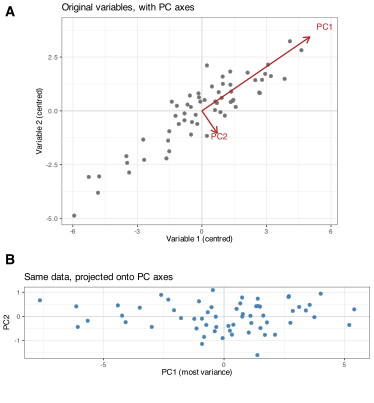
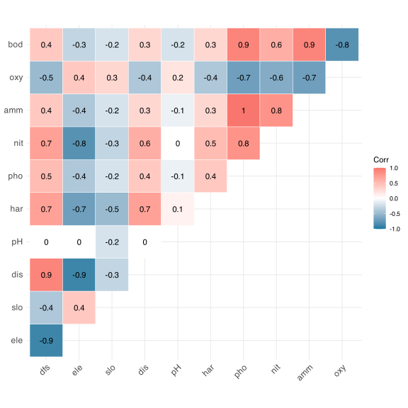
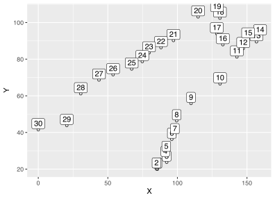
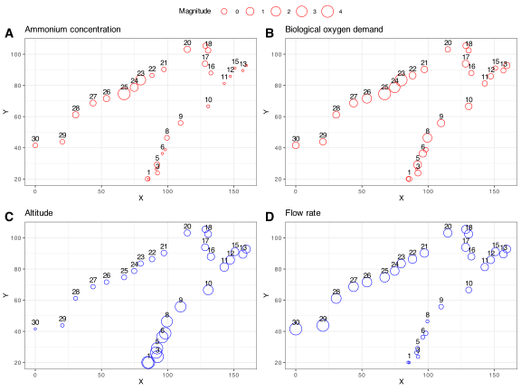
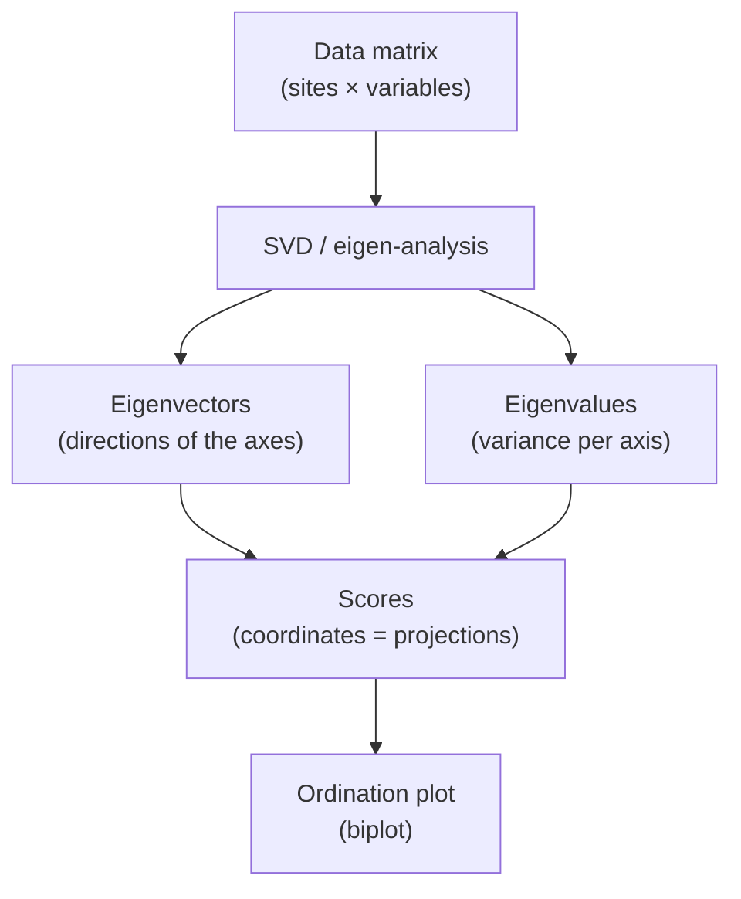
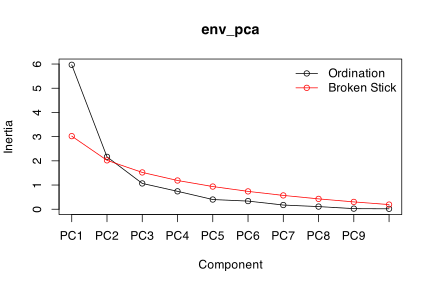
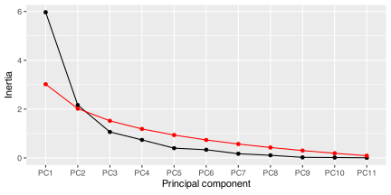
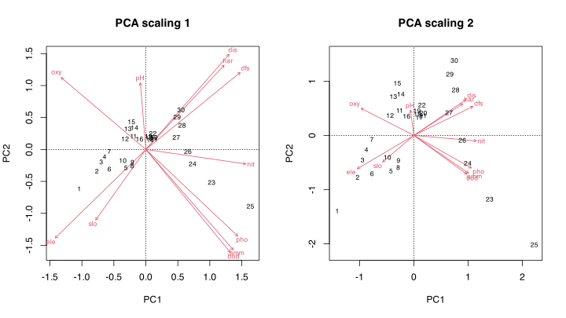
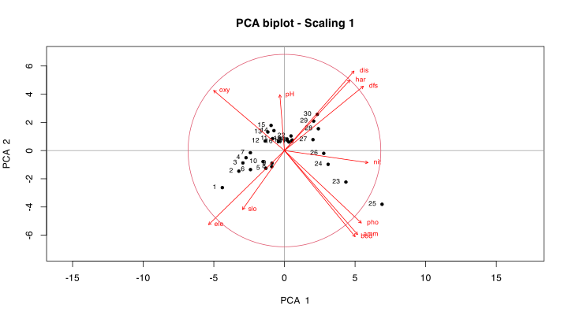
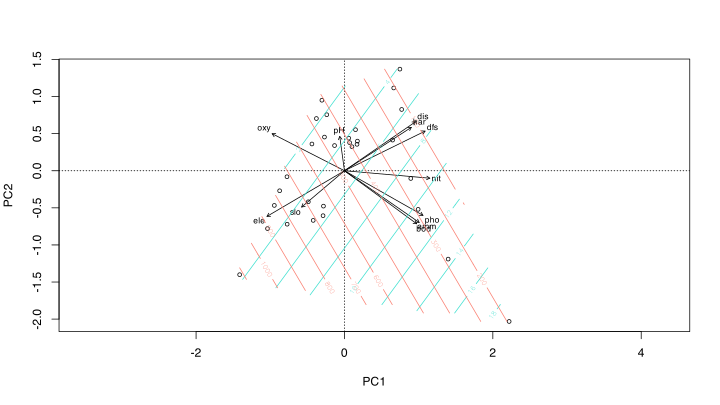

> **TIP:**
>
> | Type | Name | Link |
> |:---|:---|:---|
> | **Theory** | Numerical Ecology with R | See pages 117-132 |
> | **Slides** | PCA lecture slides | [💾 `BCB743_08_PCA.pdf`](../slides/BCB743_08_PCA.pdf) |
> | **Data** | The Doubs River data | [💾 `Doubs.RData`](../data/BCB743/NEwR-2ed_code_data/NeWR2-Data/Doubs.RData) |
> | **R function** | A function for ordination plots | [💾 `cleanplot.pca.R`](../data/BCB743/NEwR-2ed_code_data/NeWR2-Functions/cleanplot.pca.R) |

> **IMPORTANT:**
>
> - [Task B 1–6](../BCB743/tasks/Task_B.llms.md)

> **IMPORTANT:**
>
> Thoroughly understanding PCA is a prerequisite for understanding more complex ordination techniques. Master this chapter before moving on to CA, PCoA, RDA, and CCA. Much of the same terminology and concepts are used in these techniques.

> **NOTE:**
>
> The chapter follows one sequence from start to finish. Keep it in view as a map:
>
> 1.  Examine the correlations among variables.
> 2.  Standardise the variables to a common scale.
> 3.  Run the PCA.
> 4.  Examine the eigenvalues (how much variation each axis accounts for).
> 5.  Decide how many axes to retain.
> 6.  Plot the ordination (the biplot).
> 7.  Interpret the ecological gradients.

## 1 Geometric projection of high-dimensional data

Ordination refers to a suite of multivariate techniques that reduces a high-dimensional dataset into a lower-dimensional space, typically 2D or 3D, in such a way that any intrinsic structure in the data forms visually-discernible patterns (Pielou, 1984). In ecology, ordination techniques are used to describe relationships between community structure patterns and underlying environmental gradients. They allow me to determine the relative importance of different gradients and visualise species-environment relationships.

Principal Component Analysis (PCA) is one of the commonly used ordination techniques in ecology. It is a dimensionality reduction technique that transforms the original set of variables into a new set of uncorrelated variables called principal components. PCA is performed on a data matrix containing species abundances or environmental variables across multiple sites or samples.

Although PCA is often introduced as a method for reducing dimensionality, it is more accurately understood as a geometric re-expression of the data. Rather than discarding variables, the method rotates the original coordinate system so that new, mutually orthogonal (independent) axes align with directions of maximal variance, then projects the data onto these axes. This rotation-projection viewpoint becomes explicit later when I examine how PCA is computed in R, though the same idea applies throughout, namely that PCA reorganises variation by changing the basis in which the data are represented.

[Figure 1](#fig-pca-concept) shows the idea on two correlated variables. The cloud of points has most of its spread along one diagonal direction. PCA finds that direction and makes it the first axis (PC1), with the second axis (PC2) at right angles to it. Rotating the data onto these new axes leaves the points unchanged but concentrates the variation onto PC1, so that a single axis now accounts for most of the variation the two variables shared.

Code

``` numberSource
set.seed(42)
n <- 60
x1 <- rnorm(n)
x2 <- 0.85 * x1 + rnorm(n, sd = 0.5)
demo <- data.frame(V1 = x1 * 2 + 6, V2 = x2 * 1.5 + 5)
demo_c <- scale(demo, scale = FALSE) # centre only
pc <- prcomp(demo_c)

# the sign of a PC axis is arbitrary; flip so PC1 points up-right
if (pc$rotation[1, 1] < 0) {
  pc$rotation[, 1] <- -pc$rotation[, 1]
  pc$x[, 1] <- -pc$x[, 1]
}
arr <- data.frame(
  lab = c("PC1", "PC2"),
  xend = pc$rotation[1, ] * pc$sdev * 2.2,
  yend = pc$rotation[2, ] * pc$sdev * 2.2
)

panel_a <- ggplot(as.data.frame(demo_c), aes(V1, V2)) +
  geom_hline(yintercept = 0, colour = "grey85") +
  geom_vline(xintercept = 0, colour = "grey85") +
  geom_point(colour = "grey45", size = 1.4) +
  geom_segment(
    data = arr,
    aes(x = 0, y = 0, xend = xend, yend = yend),
    colour = "firebrick",
    arrow = arrow(length = unit(2.5, "mm")),
    linewidth = 0.6
  ) +
  geom_text(
    data = arr,
    aes(x = xend * 1.14, y = yend * 1.14, label = lab),
    colour = "firebrick",
    size = 3
  ) +
  labs(
    title = "Original variables, with PC axes",
    x = "Variable 1 (centred)",
    y = "Variable 2 (centred)"
  ) +
  coord_equal()

panel_b <- ggplot(as.data.frame(pc$x), aes(PC1, PC2)) +
  geom_hline(yintercept = 0, colour = "grey85") +
  geom_vline(xintercept = 0, colour = "grey85") +
  geom_point(colour = "steelblue", size = 1.4) +
  labs(
    title = "Same data, projected onto PC axes",
    x = "PC1 (most variance)",
    y = "PC2"
  ) +
  coord_equal()

ggarrange(panel_a, panel_b, ncol = 1, labels = "AUTO", heights = c(1.6, 1))
```

[](PCA_files/figure-html/fig-pca-concept-1.svg "Figure 1: PCA on two correlated variables. (A) The original variables, with the PC axes overlaid: PC1 follows the direction of greatest spread, PC2 lies at right angles to it. (B) The same points after rotation onto the PC axes; the variation is now concentrated along PC1. No data are lost, the cloud is only viewed from a more informative angle.")

Figure 1: PCA on two correlated variables. **(A)** The original variables, with the PC axes overlaid: PC1 follows the direction of greatest spread, PC2 lies at right angles to it. **(B)** The same points after rotation onto the PC axes; the variation is now concentrated along PC1. No data are lost, the cloud is only viewed from a more informative angle.

PCA calculates the **eigenvectors** and **eigenvalues** of the covariance or correlation matrix of the data. The eigenvectors represent the directions of maximum variance in the data, and the corresponding eigenvalues represent the amount of variance explained by each eigenvector. The new axes, called principal components, are linear combinations of the original variables, ordered by the amount of variance they explain.

PCA seeks a low-dimensional representation that retains as much of the Euclidean structure among samples as possible. The full set of axes reproduces the original Euclidean distances exactly, while the first two or three axes that I actually plot retain only an approximation, namely as much of that structure as the retained axes can represent. This makes PCA well suited to environmental data, where Euclidean distances between samples are meaningful and interpretable. For species data, often counts or frequencies, Euclidean distance can misrepresent the dissimilarity between samples.

Let me work through a PCA to show the ideas.

## 2 Set-up the analysis environment

``` numberSource
library(tidyverse)
library(vegan)
library(ggcorrplot) # for the correlations
library(ggpubr)
```

## 3 The Doubs River data

``` numberSource
load(here::here(
  "data",
  "BCB743",
  "NEwR-2ed_code_data",
  "NEwR2-Data",
  "Doubs.RData"
))
head(env)
```

    R>    dfs ele  slo  dis  pH har  pho  nit  amm  oxy bod
    R> 1  0.3 934 48.0 0.84 7.9  45 0.01 0.20 0.00 12.2 2.7
    R> 2  2.2 932  3.0 1.00 8.0  40 0.02 0.20 0.10 10.3 1.9
    R> 3 10.2 914  3.7 1.80 8.3  52 0.05 0.22 0.05 10.5 3.5
    R> 4 18.5 854  3.2 2.53 8.0  72 0.10 0.21 0.00 11.0 1.3
    R> 5 21.5 849  2.3 2.64 8.1  84 0.38 0.52 0.20  8.0 6.2
    R> 6 32.4 846  3.2 2.86 7.9  60 0.20 0.15 0.00 10.2 5.3

## 4 First do a correlation

``` numberSource
# computing a correlation matrix
corr <- round(cor(env), 1)

# visualisation of the correlation matrix
ggcorrplot(
  corr,
  type = 'upper',
  outline.col = "white",
  colors = c("#1679a1", "white", "#f8766d"),
  lab = TRUE
)
```

[](PCA_files/figure-html/code-pca-correlation-1.svg "Pairwise correlations among the environmental variables included with the Doubs River study.")

Pairwise correlations among the environmental variables included with the Doubs River study.

Some variables are strongly correlated, and they might be omitted from the subsequent analyses. I say that these variables are **collinear**. Collinear variables cannot be separated to determine which one most influences community structure. More advanced methods identify collinear variables (e.g., Variance Inflation Factors, VIF), and these let me exclude such variables systematically from the PCA. See Graham ([2003](#ref-graham2003confronting)) for a discussion on collinearity.

I proceed with all the variables, a deliberate decision for this analysis. In PCA, collinearity does not cause instability in estimated coefficients in the way it does in multiple regression, because PCA does not estimate regression parameters. Instead, correlated variables jointly determine the orientation of the ordination axes, i.e., strongly collinear variables tend to load in similar directions and contribute collectively to the same components. While this can complicate interpretation (by making it harder to disentangle the influence of individual variables), the axes themselves remain well defined. For teaching purposes, retaining collinear variables makes the structure of the data explicit and allows me to see how shared variance is redistributed across components. As I shall see later, in the constrained analyses where coefficients are interpreted directly, collinearity becomes a more serious inferential (statistical) issue and is addressed explicitly through diagnostics such as variance inflation factors and variable selection.

## 5 See the spatial context

The patterns in the data and the correlations between them will make more sense if I can visualise a spatial context. Thankfully spatial data are available:

``` numberSource
head(spa)
```

    R>        X      Y
    R> 1 85.678 20.000
    R> 2 84.955 20.100
    R> 3 92.301 23.796
    R> 4 91.280 26.431
    R> 5 92.005 29.163
    R> 6 95.954 36.315

``` numberSource
ggplot(spa, aes(x = X, y = Y, label = rownames(spa))) +
  geom_point(shape = 1) +
  geom_label(vjust = 0, nudge_y = 0.5, check_overlap = TRUE)
```

[](PCA_files/figure-html/fig-pca-map1-1.svg "Figure 2: The spatial configuration of the Doubs River sites.")

Figure 2: The spatial configuration of the Doubs River sites.

These site numbers correspond approximately to the ones in Verneaux ([1973](#ref-verneaux1973cours)), but some of the numbers may have shifted slightly in the example Doubs dataset used here relative to Verneaux’s thesis and the subsequent publication. This should not affect the interpretation. I can also scale the symbol size by the magnitude of the environmental variables. Let us look at two pairs of variables that are strongly correlated with one another:

``` numberSource
# We scale the data first so as to better represent the full
# magnitude of all variables with a common symbol size
env_std <- decostand(env, method = "standardize")

# positive correlations
plt1 <- ggplot(spa, aes(x = X, y = Y, label = rownames(spa))) +
  geom_point(shape = 1, col = "red", aes(size = env_std$amm, shape = 3)) +
  geom_text(vjust = -0.5, nudge_y = 0.5, check_overlap = TRUE) +
  labs(size = "Magnitude", title = "Ammonium concentration")

plt2 <- ggplot(spa, aes(x = X, y = Y, label = rownames(spa))) +
  geom_point(shape = 1, col = "red", aes(size = env_std$bod)) +
  geom_text(vjust = -0.5, nudge_y = 0.5, check_overlap = TRUE) +
  labs(title = "Biological oxygen demand")

# inverse correlations
plt3 <- ggplot(spa, aes(x = X, y = Y, label = rownames(spa))) +
  geom_point(shape = 1, col = "blue", aes(size = env_std$ele)) +
  geom_text(vjust = -0.5, nudge_y = 0.5, check_overlap = TRUE) +
  labs(title = "Altitude")

plt4 <- ggplot(spa, aes(x = X, y = Y, label = rownames(spa))) +
  geom_point(shape = 1, col = "blue", aes(size = env_std$dis)) +
  geom_text(vjust = -0.5, nudge_y = 0.5, check_overlap = TRUE) +
  labs(title = "Flow rate")

ggarrange(
  plt1,
  plt2,
  plt3,
  plt4,
  nrow = 2,
  ncol = 2,
  common.legend = TRUE,
  labels = "AUTO"
)
```

[](PCA_files/figure-html/fig-pca-map2-1.svg "Figure 3: Four different representations of the site configuration (spatial context) of the Doubs River sampling layout. Symbols are scaled relative to A) ammonium concentration, B) BOD, C) Altitude, and D) Flow rate.")

Figure 3: Four different representations of the site configuration (spatial context) of the Doubs River sampling layout. Symbols are scaled relative to A) ammonium concentration, B) BOD, C) Altitude, and D) Flow rate.

## 6 Do the PCA

I use the function `rda()` to do the PCA, but it can also be performed in base R with the functions `prcomp()` and `princomp()`. `rda()` is the same function that I will use later for a Redundancy Analysis, but when used without specifying constraints (as I do here) it amounts to simply doing a PCA. Typically I standardise environmental data to unit variance, and `rda()` accomplishes this step when `scale = TRUE`. When applied to environmental data (as I typically do with a PCA) it works with correlations amongst the scaled variables. PCA is built on Euclidean distance and the relationships it detects are linear, so it applies to species data only after suitable transformations. In this module I will seldom apply a PCA to species data.

``` numberSource
env_pca <- rda(env, scale = TRUE)
env_pca
```

    R> 
    R> Call: rda(X = env, scale = TRUE)
    R> 
    R>               Inertia Rank
    R> Total              11     
    R> Unconstrained      11   11
    R> 
    R> Inertia is correlations
    R> 
    R> Eigenvalues for unconstrained axes:
    R>   PC1   PC2   PC3   PC4   PC5   PC6   PC7   PC8   PC9  PC10  PC11 
    R> 5.969 2.164 1.065 0.739 0.400 0.336 0.173 0.108 0.024 0.017 0.006

``` numberSource
# same ...
# env_std <- scale(env)
# env_pca <- rda(env_std, scale = FALSE)
# env_pca
```

In ordination I use the term **inertia** as a synonym for ‘variation’, but some PCA software (such as R’s `prcomp()` and `princomp()`) simply uses the term `sdev` for standard deviations. In PCA, when I use a correlation matrix (as I do here), the inertia is the sum of the diagonal values of the correlation matrix, which is simply the number of variables (11 in this example). When a PCA uses a covariance matrix the inertia is the sum of the variances of the variables.

You will also see in the output the mention of the term **unconstrained**. In a PCA the analysis is always unconstrained (i.e., not influenced by some *a priori* defined variables I hypothesise to explain the between site patterns in the multivariate data).

The section headed **Eigenvalues for unconstrained axes** shows the relative importance of the resultant reduced axes, and they can be used to determine the proportion of the total inertia (sum of the eigenvalues) captured by any one of the axes. They can be accessed with the function `eigenvals()` (the preferred function, see `?rda` for help), but an alternative method is given below. The first eigenvalue (the one associated with PC1) always explains the most variation (the largest fraction), and each subsequent one explains the largest proportion of the **remaining** variance. I say the axes are **orthogonal** and ranked in decreasing order of importance. The sum of all eigenvalues is the total inertia, so collectively they can in theory explain all of the variation in the dataset (but they **should not** be used to explain **all** the variance).

Statistical adequacy and ecological sufficiency are distinct properties. A principal component that explains a large proportion of the variance is effective at compressing the data, but this does not by necessity imply that it represents the most influential ecological process. Variance explained measures how much information is retained under dimensional reduction, not causal dominance or biological importance. Ecologically meaningful gradients may account for little variance, while strong variance components may reflect broad-scale structure, measurement scale, or correlated responses rather than interpretable mechanisms. Here is where your knowledge as an ecologist will (or should) guide you.

To extract the first eigenvalue I can do:

``` numberSource
round(eigenvals(env_pca)[1], 3)
```

    R>   PC1 
    R> 5.969

``` numberSource
# or

round(env_pca$CA$eig[1], 3)
```

    R>   PC1 
    R> 5.969

The total inertia is:

``` numberSource
sum(eigenvals(env_pca))
```

    R> [1] 11

``` numberSource
# or

sum(env_pca$CA$eig)
```

    R> [1] 11

So the proportion of variation explained by the first PC is:

``` numberSource
round(env_pca$CA$eig[1] / sum(env_pca$CA$eig) * 100, 1) # result in %
```

    R>  PC1 
    R> 54.3

I can show the same information as part of a more verbose summary. Here I see the pre-calculated **Proportion Explained** and **Cumulative Proportion** (it should be obvious what this is). The output also includes other information, namely **Scaling 2 for species and site scores**, **Species scores**, and **Site scores**.

``` numberSource
summary(env_pca)
```

    R> 
    R> Call:
    R> rda(X = env, scale = TRUE) 
    R> 
    R> Partitioning of correlations:
    R>               Inertia Proportion
    R> Total              11          1
    R> Unconstrained      11          1
    R> 
    R> Eigenvalues, and their contribution to the correlations 
    R> 
    R> Importance of components:
    R>                          PC1    PC2     PC3     PC4     PC5     PC6     PC7
    R> Eigenvalue            5.9687 2.1639 1.06517 0.73875 0.40019 0.33563 0.17263
    R> Proportion Explained  0.5426 0.1967 0.09683 0.06716 0.03638 0.03051 0.01569
    R> Cumulative Proportion 0.5426 0.7393 0.83616 0.90332 0.93970 0.97022 0.98591
    R>                            PC8      PC9     PC10     PC11
    R> Eigenvalue            0.108228 0.023701 0.017083 0.005983
    R> Proportion Explained  0.009839 0.002155 0.001553 0.000544
    R> Cumulative Proportion 0.995748 0.997903 0.999456 1.000000

> **NOTE:**
>
> The block is long, but only a few numbers give the message you need. Find the **Proportion Explained** and **Cumulative Proportion** rows near the top and read across the first two columns:
>
> - PC1 explains about 54% of the variation.
> - PC2 explains about 20%.
> - Together they account for about 74%.
>
> Everything else (the species and site scores, the scaling note) is detail I extract separately below. For deciding how far the ordination compresses the data, those three percentages are the whole story.

Newer versions of the ordinations’ `summary()` method no longer shows the species and site scores. To access these scores, I use the `scores()` function:

The species scores can be extracted from the ordination object by:

``` numberSource
# extract species scores for first three PCA axes:
scores(env_pca, display = "species", choices = 1:3)
```

    R>             PC1        PC2         PC3
    R> dfs  1.08657429  0.5342463 -0.27333233
    R> ele -1.04396094 -0.6147742  0.20711738
    R> slo -0.57702931 -0.4892811 -0.63490306
    R> dis  0.95843365  0.6608150 -0.32456247
    R> pH  -0.06364143  0.4629373  1.01316786
    R> har  0.90118054  0.5849982  0.06448776
    R> pho  1.05820606 -0.6013982  0.13865996
    R> nit  1.15013343 -0.1004908 -0.05166769
    R> amm  1.00678966 -0.6969288  0.14076555
    R> oxy -0.97458581  0.4990886 -0.09017454
    R> bod  0.97315389 -0.7148470  0.15145231
    R> attr(,"const")
    R> [1] 4.226177

Similarly, for the site scores, do:

``` numberSource
# extract the site scores for axes 1 and 2
scores(env_pca, display = "site", choices = 1:3) |>
  head() # truncate to save space in this example
```

    R>          PC1        PC2         PC3
    R> 1 -1.4127388 -1.4009788 -2.03483870
    R> 2 -1.0372473 -0.7795535  0.24400009
    R> 3 -0.9450700 -0.4676536  1.25042488
    R> 4 -0.8737116 -0.2698849  0.19304045
    R> 5 -0.4208759 -0.6694396  0.83190665
    R> 6 -0.7722358 -0.7206662 -0.07357441

The `scores()` method also applies to other ordination methods.

> **IMPORTANT:**
>
> I am dealing with environmental variables here, so why do I call them “species scores”?

## 7 Terminology

The geometric ideas introduced earlier (rotation of axes and projection of data into a reduced space) are formalised in ordination methods through a singular-value decomposition (SVD). In **vegan**, ordination functions such as `rda()` for PCA/RDA and `cca()` for CA/CCA implement this decomposition directly. The whole pipeline reduces to one sentence: **eigenvectors define the directions of the new axes, and scores are the data projected onto those directions** ([Figure 4](#fig-pca-pipeline)). Several labels attach to the steps along the way, and the schematic keeps them in order.



Figure 4: From data to ordination plot. The SVD turns the data matrix into directions (eigenvectors) and their importances (eigenvalues); scaling the eigenvectors gives the scores that are plotted.

The mathematics behind the first two boxes is given below for completeness. It can be skimmed on a first reading. The terms it defines are gathered in the table that follows, which is the part to return to.

> **NOTE:**
>
> Once the data matrix $X$ has been centred (and, where necessary, scaled or $\chi^2$-transformed), the SVD computes:
>
> $$X = U \,\Sigma \,V^{\mathsf T},$$
>
> with orthonormal *left-singular vectors* $U$, orthonormal *right-singular vectors* $V$, and positive singular values on the diagonal of $\Sigma$. From here, all the components of my ordination can be extracted. How do these relate to my data?
>
> - **Eigenvectors** are the directions in the original variable space along which the variance in the data is maximised. They relate to my original data in two ways:
>   - $V$ is the matrix of right singular vectors; they are the *eigenvectors of the columns* (species or variables). The quantities can be accessed by `env_pca$CA$v`.
>   - $U$ is the matrix of left singular vectors; *i.e.*, the *eigenvectors of the rows* (sites). The left singular vectors can be accessed by `env_pca$CA$u`
> - $\Sigma$ is a diagonal matrix of singular values $d$, and the **eigenvalues** are the square of these singular values, $eig=d^ 2$. Eigenvalues represent the amount of variance explained by each corresponding eigenvector (or principal component), represented in PCA (and other unconstrained ordinations such as CA) by `env_pca$CA$eig`. Higher eigenvalues indicate that the corresponding principal component explains a larger portion of the total variance in the data. The sum of all eigenvalues is equal to the total variance in the data.

Let me map these directly to my `env_pca` object, which I will assume was created with the `rda()` function. Looking inside the `env_pca` object, I will see a structure with a component named $CA$ or $CCA$. This holds the results for the constrained or correspondence analysis. For a simple PCA, all the results are in $CA$. The eigenvectors (`env_pca$CA$v` for variables, `env_pca$CA$u` for sites) define the direction of the new axes rather than the final coordinates for ordination plots. (The eigenvalues, the variance explained by each axis, are in `env_pca$CA$eig`.) *Projection* is the process of mapping the original data points onto the new reduced axes (principal components). What I plot are actually these *scores*.

- **Scores** are the coordinates of the original sites and species projected onto the new ordination axes. They are calculated by scaling the eigenvectors. These scores are what I actually plot to create a biplot or triplot.
  - The **Site Scores** tell me where each site (sample) is located along the new ordination axes. Sites that are close together in the ordination plot have similar variable (or species) compositions. I obtain the site scores as `scores(env_pca, display = "site", ...)`.
  - The **Species Scores** (more accurately, **variable scores** in this context) describe how the columns of the data matrix, whatever they represent ecologically, relate to the ordination axes. Sometimes I call the species scores *loadings*. In a PCA biplot, these are represented by arrows (but not in CA, where that reduced space is no longer linear). An arrow pointing strongly towards PCA1 means that species or variable is a major contributor to that axis of variation. So, species scores represent the contributions of the original variables to the principal components. They indicate the strength and direction of the correlation between the original variables and the new principal components. Species scores are obtained with `scores(env_pca, display = "species", ...)`. Larger positive values indicate a stronger positive correlation, while larger negative values indicate a stronger negative correlation. It is worth considering the terminology “species scores”. The label “species scores” is structural, inherited from a general ordination framework in which columns of the data matrix often correspond to species abundances. In PCA applied to environmental data, those columns contain variables, not taxa. The software does not “know” what the columns represent, so it treats them as abstract descriptors whose interpretation is supplied entirely by the analyst. Confusing function names with ontological claims may be a common source of error in multivariate analysis, so interpret ordination output as a mathematical (or conceptual, if maths is not your strong point) representation first, and only later as an ecological one.

Here is the direct mapping:

| Mathematical Concept | `vegan` Term | Where to Find It in the `rda` Object | Description |
|:---|:---|:---|:---|
| **Eigenvalues** | Eigenvalues | `env_pca$CA$eig` | The amount of variance explained by each axis (component). `summary(env_pca)` shows this clearly. |
| **Eigenvectors of Variables** | Species Scores | `env_pca$CA$v` | The raw eigenvectors for the columns of the data (the variables). These are scaled to become the “species scores” that you plot as arrows. |
| **Eigenvectors of Sites** | Site Scores | `env_pca$CA$u` | The raw eigenvectors for the rows of the data (the sites). These are scaled to become the “site scores” that you plot as points. |
| **Plottable Coordinates** | Scores | `scores(env_pca)` | The function `scores()` extracts and properly scales the raw eigenvectors (`$u` and `$v`) to give the coordinates ready for plotting. |

When interpreting a PCA biplot (see below), the species scores (loadings) indicate the contributions of the original variables to the principal components, while the site scores represent the positions of the sites in the reduced-dimensional space defined by those principal components. The direction and length of the species score vectors (arrows) provide information about the relationships between the original variables and the principal components, while the positions of the site points reflect the similarities or differences between sites based on the environmental gradients represented by the principal components.

## 8 How many axes to retain?

The number of axes to retain is a difficult question to answer. The first few axes will always explain the most variation, but how do I know how many reduced axes are influential and should be kept? Commonly recommended is the **broken stick** method, namely keep the principal components whose eigenvalues are higher than corresponding random broken stick components:

``` numberSource
# make a scree plot using the vegan function:
screeplot(env_pca, bstick = TRUE, type = "lines")
```

[](PCA_files/figure-html/code-pca-screeplot-1.svg "Scree plot of the Doubs River environmental data PCA.")

Scree plot of the Doubs River environmental data PCA.

Or I can make a scree plot using **ggplot2**, which is more flexible:

``` numberSource
scree_dat <- data.frame(
  eigenvalue = as.vector(eigenvals(env_pca)),
  bstick = bstick(env_pca)
)
scree_dat$axis <- rownames(scree_dat)
rownames(scree_dat) <- NULL
scree_dat <- scree_dat |>
  mutate(axis = factor(axis, levels = paste0(rep("PC", 11), seq(1:11))))

ggplot(data = scree_dat, aes(x = axis, y = eigenvalue)) +
  geom_point() +
  geom_line(aes(group = 1)) +
  geom_point(aes(y = bstick), colour = "red") +
  geom_line(aes(y = bstick, group = 1), colour = "red") +
  labs(x = "Principal component", y = "Inertia")
```

[](PCA_files/figure-html/fig-pca-scree-ggplot-1.svg "Figure 5: Scree plot of the Doubs River environmental data PCA made in ggplot2.")

Figure 5: Scree plot of the Doubs River environmental data PCA made in **ggplot2**.

In the plot above, the red line is the broken-stick components and the black line the eigenvalues for the different PCs. The plot suggests retaining the first two PC axes, which together account for ca. 74% of the total inertia and capture most of the large-scale variance in the dataset, though not necessarily all ecologically relevant structure. This distinction will be important in constrained ordination and model-based approaches, where axes are evaluated by variance accounted for and by their relationship to explicitly hypothesised environmental drivers. See Numerical Ecology with R pp. 121-122 for more information about how to decide how many PCs to retain.

## 9 Ordination diagrams

I provide some examples of ordination diagrams scattered throughout the module content (e.g., [here](../BCB743/PCA_examples.llms.md#a-ggplot-biplot)), but you may also refer to the step-by-step walk throughs provided by [Roeland Kindt](https://rpubs.com/Roeland-KINDT/694016). Also see David Zelený’s [excellent writing on the topic](https://www.davidzeleny.net/anadat-r/doku.php/en:ordiagrams).

Let me look at examples. In a PCA ordination diagram, following the tradition of scatter diagrams in Cartesian coordinate systems, objects are represented as points and variables are displayed as arrows. I first use the standard **vegan** `biplot()` function:

``` numberSource
opar <- par(no.readonly = TRUE)
par(mfrow = c(1, 2))
biplot(env_pca, scaling = 1, main = "PCA scaling 1", choices = c(1, 2))
biplot(env_pca, scaling = 2, main = "PCA scaling 2", choices = c(1, 2))
```

[](PCA_files/figure-html/code-pca-biplots-1.svg "Ordination plot of the Doubs River environmental data showing site scaling (left) and species scaling (right).")

Ordination plot of the Doubs River environmental data showing site scaling (left) and species scaling (right).

``` numberSource
par(opar)
```

### 9.1 How to read this PCA

Interpretation is a skill worth seeing modelled. The scaling 2 biplot above, with its variable arrows, shows the following about the Doubs River:

- **PC1 accounts for 54% of the variation**, far more than any other axis, so it is the dominant pattern in the data.
- **The sites spread along PC1 in river order.** The low-numbered sites near the source gather at one end, and the high-numbered sites towards the mouth gather at the other. PC1 recovers the source-to-mouth sequence without any information about where each site lies on the river.
- **The variable arrows split into two opposing groups.** Elevation (`ele`), slope (`slo`), and dissolved oxygen (`oxy`) point towards the headwater end. Distance from source (`dfs`), discharge (`dis`), hardness (`har`), the nutrients (`nit`, `pho`, `amm`), and biological oxygen demand (`bod`) point towards the lowland end.
- **PC1 is an upstream-to-downstream gradient.** One end is the cool, steep, oxygen-rich headwaters. The other is the warmer, harder, nutrient-rich and organically loaded lower river.
- **PC2 (20%) is a weaker secondary contrast**, separating sites with high discharge and oxygen from those with high organic load, and it is harder to interpret cleanly. This is common, since lower axes often mix several minor influences.

The ecological interpretation and the [correlation matrix](../BCB743/correlations.llms.md) agree. Variables whose arrows point the same way are the collinear groups seen earlier, and PC1 is the single gradient that their shared variance was expressing all along.

## 10 Scaling

The choice of scaling in a PCA biplot helps me to make the right inferences about my data. Each scaling answers a different question, and the interpretation of distances, angles, and vector lengths depends on which question is being asked. The table is the short version to memorise:

| Scaling | Interpret best | Use when the question is about |
|:---|:---|:---|
| Scaling 1 | distances among sites | which sites resemble which |
| Scaling 2 | correlations among variables | how variables relate to each other and to the axes |

**Scaling 1** should be used when the primary question concerns how *sites relate to one another across environmental gradients*. Distances among objects (samples or sites, whatever is contained in the data table’s rows) in the biplot are approximations of their Euclidean distances in multidimensional space. Objects positioned further apart show a greater degree of environmental dissimilarity. The angles among descriptor vectors should not be interpreted as indicating the degree of correlation between the variables.

**Scaling 2** should be used when the primary question concerns how *variables relate to the ordination axes and to one another*. This is the content of the data table’s columns. Distances among objects (samples or sites) in the biplot are not approximations of their Euclidean distances in multidimensional space. The angles among descriptor vectors can be interpreted as indicating the degree of correlation between the variables.

Now I create biplots using the `cleanplot.pca()` function that comes with the *Numerical Ecology with R* book. The figures are much the same, except that the scaling 1 plot adds a *circle of equilibrium contribution* (see *Numerical Ecology with R*, p. 125).

The circle has a precise meaning. If a variable contributed equally to every ordination axis, its arrow would have a predictable length in the two-dimensional plane I plot, namely the radius of the circle. For a plot of two axes built from $p$ variables, that radius is $\sqrt{2/p}$. A variable whose arrow reaches beyond the circle therefore contributes more than its equal share to the two displayed axes, and one whose arrow falls short contributes less. The circle is a reference length and not a significance test, so it tells me which variables are well represented in the plane on view, not which are statistically significant. It also applies only to scaling 1, where arrow lengths are directly comparable. Under scaling 2 the arrows encode correlations rather than contributions, and the circle is not drawn. With those caveats, I judge importance from the arrows that extend beyond the radius ([Figure 6](#fig-pca-cleanplot)):

``` numberSource
# we need to load the function first from its R file:
source(here::here(
  "data",
  "BCB743",
  "NEwR-2ed_code_data",
  "NEwR2-Functions",
  "cleanplot.pca.R"
))
cleanplot.pca(env_pca, scaling = 1)
```

[](PCA_files/figure-html/fig-pca-cleanplot-1.svg "Figure 6: Ordination plot of the Doubs River environmental data made with the cleanplot.pca() function.")

Figure 6: Ordination plot of the Doubs River environmental data made with the `cleanplot.pca()` function.

**You must refer to *Numerical Ecology with R* (pp. 118 to 126) for help with interpreting the ordination diagrams.**

## 11 Fitting environmental response surfaces

The `ordisurf()` function in **vegan** is used to visualise underlying environmental gradients on an ordination plot. This function fits a smooth surface (usually a generalised additive model GAM fitted to the site scores of PC axes of interest) to the ordination plot based on a specified environmental variable. It highlights how that variable changes across the ordination space so that I may interpret the spatial structure of the data in relation to the environmental gradient more easily.

For more about `ordisurf()`, see Gavin Simpson’s blog post [What is `ordisurf()` doing?](https://fromthebottomoftheheap.net/2011/06/10/what-is-ordisurf-doing/).

I plot the response surfaces for elevation and biological oxygen demand:

``` numberSource
biplot(env_pca, type = c("text", "points"), col = c("black", "black"))
invisible(ordisurf(
  env_pca ~ bod,
  env,
  add = TRUE,
  col = "turquoise",
  knots = 1
)) # <1>
invisible(ordisurf(env_pca ~ ele, env, add = TRUE, col = "salmon", knots = 1))
```

1.  `invisible()` is used to suppress the output of the `ordisurf()` function; only the figure is returned.

[](PCA_files/figure-html/code-pca-ordisurf-1.svg "Ordination plot of the Doubs River environmental data fitted with a smooth response surface for elevation and biological oxygen demand.")

Ordination plot of the Doubs River environmental data fitted with a smooth response surface for elevation and biological oxygen demand.

## 12 When PCA fails: the horseshoe effect

Having run, plotted, and interpreted a PCA, I can see where it breaks down. On the Doubs environmental data, PCA performed well, since the variables relate to the river gradient in a roughly linear way. On species data the picture often changes, and the most common sign is the horseshoe.

The **horseshoe effect** (sometimes called the Guttman effect) is an artefact often seen with PCA when applied to species data, especially when using species abundance data for communities along environmental gradients. It distorts the data points in the ordination space. A less severe version of the horseshoe effect is called the ‘arch effect’ and is seen in [Correspondence Analysis (CA)](../BCB743/CA.llms.md).

The horseshoe effect occurs because PCA assumes linear relationships between variables, while species data often exhibit unimodal responses to environmental gradients. The unimodal model was discussed in [BDC334](../BDC334/Lec-03-gradients.llms.md#sec-unimodal). When species have unimodal distributions along a gradient, PCA tends to fold the ends of the gradient towards each other.

From a geometric perspective, the horseshoe effect indicates a mismatch between the structure of the data and the space into which PCA forces it. Species responding unimodally to an underlying gradient occupy a curved configuration in multivariate space. PCA, however, seeks a linear subspace that maximises variance under Euclidean geometry. In doing so, it approximates this curved structure with straight axes, causing the ends of the gradient to bend back towards one another in the reduced ordination. The horseshoe, visible on the ordination diagram, is not a peculiarity of the data but a consequence of representing a non-linear manifold using a linear projection.

This distortion can lead to several issues:

1.  The horseshoe shape can make it appear that sites at opposite ends of the gradient are more similar than they really are.
2.  The folding of the gradient ends compresses the data and potentially obscures important ecological patterns.
3.  The second PCA axis (the most affected axis) often does not represent a meaningful ecological gradient, making interpretation challenging.
4.  Unlike the arch effect in CA, the horseshoe effect in PCA can lead to incorrect ordering of samples along the gradient.

These distortions are informative, because they reveal the limits of PCA’s linear and Euclidean assumptions when confronted with non-linear ecological structure. To address these issues, I prefer to use [non-metric Multidimensional Scaling (nMDS)](../BCB743/nMDS.llms.md) or a distance-based method (like [Principal Coordinates Analysis, PCoA](../BCB743/PCoA.llms.md)) that are not constrained to linear projections. Alternatively, I may use techniques specifically designed to handle unimodal species responses, such as [Correspondence Analysis (CA)](../BCB743/CA.llms.md), which uses $\chi^2$-distance and not Euclidean distance, or its detrended version ([Detrended Correspondence Analysis, DCA](../BCB743/DCA.llms.md)), but these come with their own set of considerations.

PCA is best understood as an exploratory and diagnostic method rather than a catch-all solution for ecological ordination. Its strength lies in revealing broad structure in multivariate data, i.e., dominant gradients, major axes of covariation, and large-scale patterns that organise samples and variables in a reduced space. When applied to environmental data, PCA can provide a clear initial orientation to highlight correlated drivers, identify major contrasts among sites, and offer a coherent global summary of variation. Its limitations arise from the scope of a PCA. It is constrained to linear relationships under Euclidean geometry, and cannot represent non-linear ecological responses without distorting them. PCA can establish a baseline against which alternative ordination methods can be evaluated and guide you towards approaches such as CA, CCA, nMDS, or distance-based methods that are better aligned with specific response forms and inferential goals.

> **WARNING:**
>
> A few errors recur often enough to name. Each undoes part of what the chapter has built:
>
> - **Interpreting variance explained as ecological importance.** A large eigenvalue means an axis compresses the data well, not that it represents the dominant ecological process. The two can differ.
> - **Treating a PC axis as a measured variable.** An axis is a composite of many variables. It has no units and is interpreted through the loadings, not taken directly from the plot.
> - **Ignoring scaling.** Distances among sites are interpretable under scaling 1, correlations among variables under scaling 2. Taking the wrong quantity from the wrong biplot is a common slip.
> - **Running PCA on raw species counts.** Euclidean geometry and unimodal species responses do not match, and the result is a horseshoe. Use CA, nMDS, or a distance-based method, or transform the data first.

## 13 References

Graham MH (2003) Confronting multicollinearity in ecological multiple regression. Ecology 84:2809–2815.

Verneaux J (1973) Cours d’eau de Franche-Comté (Massif du Jura). Recherches écologiques sur le réseau hydrographique du Doubs.

## Reuse

[CC BY-NC-SA 4.0](https://creativecommons.org/licenses/by-nc-sa/4.0/)

## Citation

BibTeX citation:

``` quarto-appendix-bibtex
@online{smit2026,
  author = {Smit, A. J.},
  title = {5. {Principal} Component Analysis {(PCA)}},
  date = {2026-11-06},
  url = {https://tangledbank.netlify.app/BCB743/PCA.html},
  langid = {en}
}
```

For attribution, please cite this work as:

Smit AJ (2026) 5. Principal component analysis (PCA). [https://tangledbank.netlify.app/BCB743/PCA.html.](https://tangledbank.netlify.app/BCB743/PCA.html)
