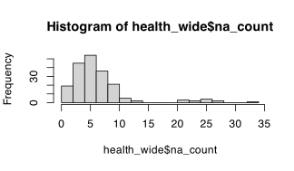
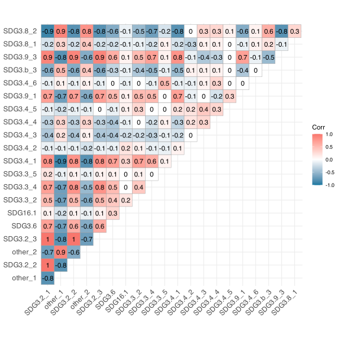
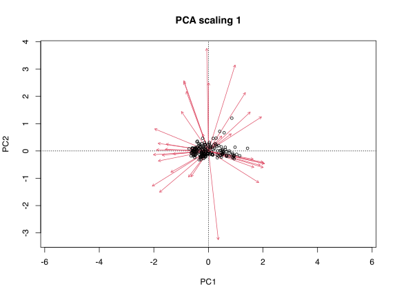
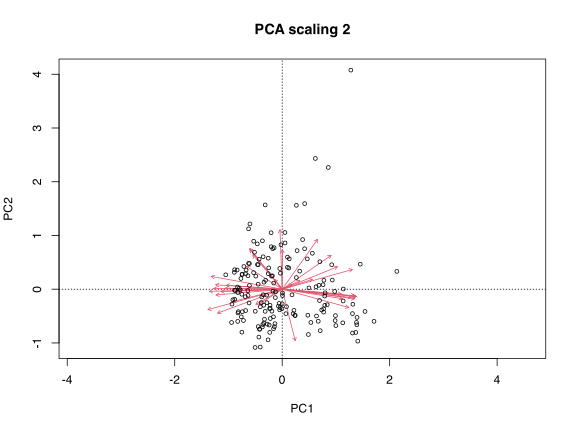
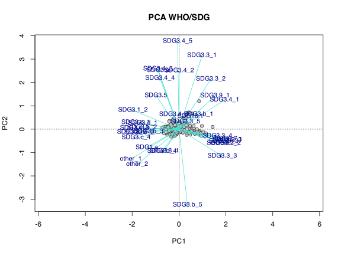
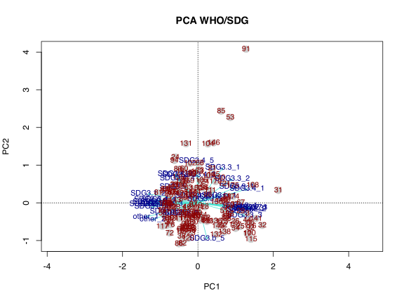
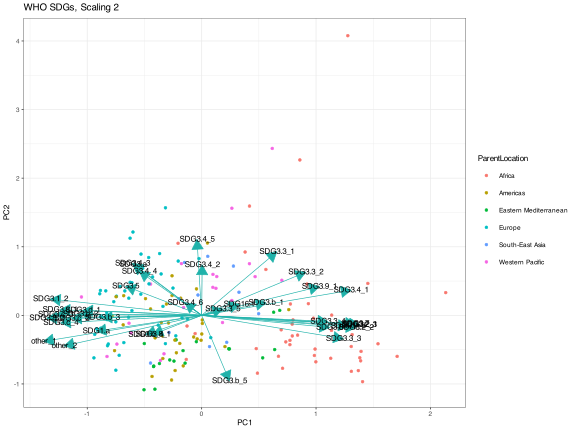

> **TIP:**
>
> | Type     | Name         | Link                                       |
> |:---------|:-------------|:-------------------------------------------|
> | **Data** | The WHO data | [💾 `WHO.zip`](../data/BCB743/WHO/WHO.zip) |

> **IMPORTANT:**
>
> - [Task C 1–6](../BCB743/tasks/Task_C.llms.md)

The United Nations adopted an agenda for sustainable development that lists 17 goals to achieve by 2030, the [Sustainable Development Goals (SDGs)](https://sdgs.un.org/goals). The World Health Organisation assembles a set of indicators to track how countries progress towards these goals, working towards “a world free of poverty, hunger, disease, and want” ([WHO](https://www.who.int/data/gho/data/themes/sustainable-development-goals)).

This chapter presents an ordination analysis of SDG 3, “Good Health, and Well-Being.”

## 1 Load packages

``` numberSource
library(tidyverse)
library(vegan)
library(missMDA) # to impute missing values
library(ggcorrplot) # for the correlations

# Files will be referenced using here::here() for absolute paths
```

## 2 Define and load the data

**Note** The combined data and SDG descriptors are in the zip file, named `SDG_complete.csv` and `SDG_description.csv`, respectively. There is no need to work through the entire process below, and you can start by loading the combined data. See the section *Scale and centre the data and do the PCA*, below.

SDG 1.a [Domestic general government health expenditure (GGHE-D) as percentage of general government expenditure (GGE) (%)](https://www.who.int/data/gho/data/indicators/indicator-details/GHO/domestic-general-government-health-expenditure-(gghe-d)-as-percentage-of-general-government-expenditure-(gge))

``` numberSource
# define base location of data files

SDG1.a <- read.csv(here::here(
  "data",
  "BCB743",
  "WHO",
  "WHO_SDG1.a_domestic_health_expenditure.csv"
)) %>%
  filter(Period == 2016) %>%
  select(Indicator, ParentLocation, Location, FactValueNumeric) %>%
  mutate(SDG = "SDG1.a")
```

SDG 3.1 [Maternal mortality ratio (per 100 000 live births)](https://www.who.int/data/gho/data/indicators/indicator-details/GHO/maternal-mortality-ratio-(per-100-000-live-births))

``` numberSource
SDG3.1_1 <- read.csv(here::here(
  "data",
  "BCB743",
  "WHO",
  "WHO_SDG3.1_maternal_mort.csv"
)) %>%
  filter(
    Period == 2016,
    Indicator == "Maternal mortality ratio (per 100 000 live births)"
  ) %>%
  select(Indicator, ParentLocation, Location, FactValueNumeric) %>%
  mutate(SDG = "SDG3.1_1")
```

SDG 3.1 [Births attended by skilled health personnel (%)](https://www.who.int/data/gho/data/indicators/indicator-details/GHO/births-attended-by-skilled-health-personnel-(-))

``` numberSource
SDG3.1_2 <- read.csv(here::here(
  "data",
  "BCB743",
  "WHO",
  "WHO_SDG3.1_skilled_births.csv"
)) %>%
  filter(Period == 2016) %>%
  select(Indicator, ParentLocation, Location, FactValueNumeric) %>%
  mutate(SDG = "SDG3.1_2")
```

SDG 3.2 [Number of neonatal deaths (Child mortality)](https://www.who.int/data/gho/data/indicators/indicator-details/GHO/number-of-neonatal-deaths)

``` numberSource
SDG3.2_1 <- read.csv(here::here(
  "data",
  "BCB743",
  "WHO",
  "WHO_SDG3.2_neonatal_deaths.csv"
)) %>%
  filter(Period == 2016, Dim1 == "Both sexes") %>%
  select(Indicator, ParentLocation, Location, FactValueNumeric) %>%
  mutate(SDG = "SDG3.2_1")
```

SDG 3.2 [Number of under-five deaths (Child mortality)](https://www.who.int/data/gho/data/indicators/indicator-details/GHO/number-of-under-five-deaths)

``` numberSource
SDG3.2_2 <- read.csv(here::here(
  "data",
  "BCB743",
  "WHO",
  "WHO_SDG3.2_under_5_deaths.csv"
)) %>%
  filter(Period == 2016, Dim1 == "Both sexes") %>%
  select(Indicator, ParentLocation, Location, FactValueNumeric) %>%
  mutate(SDG = "SDG3.2_2")
```

SDG 3.2 [Number of infant deaths (Child mortality)](https://www.who.int/data/gho/data/indicators/indicator-details/GHO/number-of-infant-deaths)

``` numberSource
SDG3.2_3 <- read.csv(here::here(
  "data",
  "BCB743",
  "WHO",
  "WHO_SDG3.2_infant_deaths.csv"
)) %>%
  filter(Period == 2016, Dim1 == "Both sexes") %>%
  select(Indicator, ParentLocation, Location, FactValueNumeric) %>%
  mutate(SDG = "SDG3.2_3")
```

SDG 3.3 [New HIV infections (per 1000 uninfected population)](https://www.who.int/data/gho/data/indicators/indicator-details/GHO/new-hiv-infections-(per-1000-uninfected-population))

``` numberSource
SDG3.3_1 <- read.csv(here::here(
  "data",
  "BCB743",
  "WHO",
  "WHO_SDG3.3_new_HIV_infections.csv"
)) %>%
  filter(Period == 2015, Dim1 == "Both sexes") %>%
  select(Indicator, ParentLocation, Location, FactValueNumeric) %>%
  mutate(SDG = "SDG3.3_1")
```

SDG 3.3 [Incidence of tuberculosis (per 100 000 population per year)](https://www.who.int/data/gho/data/indicators/indicator-details/GHO/incidence-of-tuberculosis-(per-100-000-population-per-year))

``` numberSource
SDG3.3_2 <- read.csv(here::here(
  "data",
  "BCB743",
  "WHO",
  "WHO_SDG3.3_TB.csv"
)) %>%
  filter(Period == 2016) %>%
  select(Indicator, ParentLocation, Location, FactValueNumeric) %>%
  mutate(SDG = "SDG3.3_2")
```

SDG 3.3 [Malaria incidence (per 1 000 population at risk)](https://www.who.int/data/gho/data/indicators/indicator-details/GHO/malaria-incidence-(per-1-000-population-at-risk))

``` numberSource
SDG3.3_3 <- read.csv(here::here(
  "data",
  "BCB743",
  "WHO",
  "WHO_SDG3.3_malaria.csv"
)) %>%
  filter(Period == 2016) %>%
  select(Indicator, ParentLocation, Location, FactValueNumeric) %>%
  mutate(SDG = "SDG3.3_3")
```

SDG 3.3 [Hepatitis B surface antigen (HBsAg) prevalence among children under 5 years](https://www.who.int/data/gho/data/indicators/indicator-details/GHO/hepatitis-b-surface-antigen-(hbsag)-prevalence-among-children-under-5-years)

``` numberSource
SDG3.3_4 <- read.csv(here::here(
  "data",
  "BCB743",
  "WHO",
  "WHO_SDG3.3_hepatitis_B.csv"
)) %>%
  filter(Period == 2015) %>%
  select(Indicator, ParentLocation, Location, FactValueNumeric) %>%
  mutate(SDG = "SDG3.3_4")
```

SDG 3.3 [Reported number of people requiring interventions against NTDs](https://www.who.int/data/gho/data/indicators/indicator-details/GHO/reported-number-of-people-requiring-interventions-against-ntds)

``` numberSource
SDG3.3_5 <- read.csv(here::here(
  "data",
  "BCB743",
  "WHO",
  "WHO_SDG3.3_NCD_interventions.csv"
)) %>%
  filter(Period == 2016) %>%
  select(Indicator, ParentLocation, Location, FactValueNumeric) %>%
  mutate(SDG = "SDG3.3_5")
```

SDG 3.4 [Adult mortality rate (probability of dying between 15 and 60 years per 1000 population)](https://www.who.int/data/gho/data/indicators/indicator-details/GHO/adult-mortality-rate-(probability-of-dying-between-15-and-60-years-per-1000-population))

``` numberSource
SDG3.4_1 <- read.csv(here::here(
  "data",
  "BCB743",
  "WHO",
  "WHO_SDG3.4_adult_death_prob.csv"
)) %>%
  filter(Period == 2016, Dim1 == "Both sexes") %>%
  select(Indicator, ParentLocation, Location, FactValueNumeric) %>%
  mutate(SDG = "SDG3.4_1")
```

SDG 3.4 [Number of deaths attributed to non-communicable diseases, by type of disease, and sex](https://www.who.int/data/gho/data/indicators/indicator-details/GHO/number-of-deaths-attributed-to-non-communicable-diseases-by-type-of-disease-and-sex)

``` numberSource
SDG3.4_2 <- read.csv(here::here(
  "data",
  "BCB743",
  "WHO",
  "WHO_SDG3.4_NCD_by_cause.csv"
)) %>%
  filter(Period == 2016, Dim1 == "Both sexes", Dim2 == "Diabetes mellitus") %>%
  mutate(Indicator = Dim2) %>%
  select(Indicator, ParentLocation, Location, FactValueNumeric) %>%
  mutate(SDG = "SDG3.4_2")

SDG3.4_3 <- read.csv(here::here(
  "data",
  "BCB743",
  "WHO",
  "WHO_SDG3.4_NCD_by_cause.csv"
)) %>%
  filter(
    Period == 2016,
    Dim1 == "Both sexes",
    Dim2 == "Cardiovascular diseases"
  ) %>%
  mutate(Indicator = Dim2) %>%
  select(Indicator, ParentLocation, Location, FactValueNumeric) %>%
  mutate(SDG = "SDG3.4_3")

SDG3.4_4 <- read.csv(here::here(
  "data",
  "BCB743",
  "WHO",
  "WHO_SDG3.4_NCD_by_cause.csv"
)) %>%
  filter(
    Period == 2016,
    Dim1 == "Both sexes",
    Dim2 == "Respiratory diseases"
  ) %>%
  mutate(Indicator = Dim2) %>%
  select(Indicator, ParentLocation, Location, FactValueNumeric) %>%
  mutate(SDG = "SDG3.4_4")
```

SDG 3.4 [Crude suicide rates (per 100 000 population) (SDG 3.4.2)](https://www.who.int/data/gho/data/indicators/indicator-details/GHO/crude-suicide-rates-(per-100-000-population))

``` numberSource
SDG3.4_5 <- read.csv(here::here(
  "data",
  "BCB743",
  "WHO",
  "WHO_SDG3.4_suicides.csv"
)) %>%
  filter(Period == 2016, Dim1 == "Both sexes") %>%
  select(Indicator, ParentLocation, Location, FactValueNumeric) %>%
  mutate(SDG = "SDG3.4_5")
```

SDG3.4 [Total NCD Deaths (in thousands)](https://www.who.int/data/gho/data/indicators/indicator-details/GHO/gho-ghe-ncd-deaths-in-thousands)

``` numberSource
SDG3.4_6 <- read.csv(here::here(
  "data",
  "BCB743",
  "WHO",
  "WHO_SDG3.4_NCD_data_total.csv"
)) %>%
  filter(Period == 2016, Dim1 == "Both sexes") %>%
  select(Indicator, ParentLocation, Location, FactValueNumeric) %>%
  mutate(SDG = "SDG3.4_6")
```

SDG 3.5 [Alcohol, total per capita (15+) consumption (in litres of pure alcohol) (SDG Indicator 3.5.2)](https://www.who.int/data/gho/data/indicators/indicator-details/GHO/total-(recorded-unrecorded)-alcohol-per-capita-(15-)-consumption)

``` numberSource
SDG3.5 <- read.csv(here::here(
  "data",
  "BCB743",
  "WHO",
  "WHO_SDG3.5_alcohol_consumption.csv"
)) %>%
  filter(Period == 2015, Dim1 == "Both sexes") %>%
  select(Indicator, ParentLocation, Location, FactValueNumeric) %>%
  mutate(SDG = "SDG3.5")
```

SDG 3.6 [Estimated road traffic death rate (per 100 000 population)](https://www.who.int/data/gho/data/indicators/indicator-details/GHO/estimated-road-traffic-death-rate-(per-100-000-population))

``` numberSource
SDG3.6 <- read.csv(here::here(
  "data",
  "BCB743",
  "WHO",
  "WHO_SDG3.6_traffic_deaths_prop.csv"
)) %>%
  filter(Period == 2016, Dim1 == "Both sexes") %>%
  select(Indicator, ParentLocation, Location, FactValueNumeric) %>%
  mutate(SDG = "SDG3.6")
```

SDG 3.7 [Adolescent birth rate (per 1000 women aged 15-19 years)](https://www.who.int/data/gho/data/indicators/indicator-details/GHO/adolescent-birth-rate-(per-1000-women-aged-15-19-years))

``` numberSource
SDG3.7 <- read.csv(here::here(
  "data",
  "BCB743",
  "WHO",
  "WHO_SDG3.7_adolescent_births.csv"
)) %>%
  filter(Period == 2016) %>%
  select(Indicator, ParentLocation, Location, FactValueNumeric) %>%
  mutate(SDG = "SDG3.7")
```

SDG 3.8 [UHC Index of service coverage (SCI)](https://www.who.int/data/gho/data/indicators/indicator-details/GHO/uhc-index-of-service-coverage)

``` numberSource
SDG3.8_1 <- read.csv(here::here(
  "data",
  "BCB743",
  "WHO",
  "WHO_SDG3.8_UHC_data_availability.csv"
)) %>%
  filter(Period == "2013-2017") %>%
  select(Indicator, ParentLocation, Location, FactValueNumeric) %>%
  mutate(SDG = "SDG3.8_1")
```

SDG 3.8 [Data availability for UHC index of essential service coverage (%)](https://www.who.int/data/gho/data/indicators/indicator-details/GHO/data-availability-for-uhc-index-of-essential-service-coverage-(-))

``` numberSource
SDG3.8_2 <- read.csv(here::here(
  "data",
  "BCB743",
  "WHO",
  "WHO_SDG3.8_UHC_index_of_service_coverage.csv"
)) %>%
  filter(Period == 2017) %>%
  select(Indicator, ParentLocation, Location, FactValueNumeric) %>%
  mutate(SDG = "SDG3.8_2")
```

SDG 3.8 [Population with household expenditures on health greater than 10% of total household expenditure or income (SDG 3.8.2) (%)](https://www.who.int/data/gho/data/indicators/indicator-details/GHO/population-with-household-expenditures-on-health-greater-than-10-of-total-household-expenditure-or-income-(sdg-3-8-2)-(-))

This additional household-expenditure indicator is excluded from the analysis below.

``` numberSource
# SDG3.8_3 <- read.csv(here::here("data", "BCB743", "WHO", "WHO_SDG3.8_UHC_percent_of_expenditure_1.csv")) %>%
#   filter(Period == 2016) %>%
#   select(Indicator, ParentLocation, Location, FactValueNumeric)
```

SDG 3.8 [Population with household expenditures on health greater than 25% of total household expenditure or income ( SDG indicator 3.8.2) (%)](https://www.who.int/data/gho/data/indicators/indicator-details/GHO/population-with-household-expenditures-on-health-greater-than-25-of-total-household-expenditure-or-income-(-sdg-indicator-3-8-2)-(-))

This additional household-expenditure indicator is excluded from the analysis below.

``` numberSource
# SDG3.8_4 <- read.csv(here::here("data", "BCB743", "WHO", "WHO_SDG3.8_UHC_percent_of_expenditure_2.csv")) %>%
#   filter(Period == 2016) %>%
#   select(Indicator, ParentLocation, Location, FactValueNumeric)
```

SDG 3.9 [Poison control and unintentional poisoning](https://www.who.int/data/gho/data/themes/topics/indicator-groups/poison-control-and-unintentional-poisoning)

``` numberSource
SDG3.9_1 <- read.csv(here::here(
  "data",
  "BCB743",
  "WHO",
  "WHO_SDG3.9_unintentional_poisoning_prop.csv"
)) %>%
  filter(Period == 2016, Dim1 == "Both sexes") %>%
  select(Indicator, ParentLocation, Location, FactValueNumeric) %>%
  mutate(SDG = "SDG3.9_1")
```

SDG 3.9 [Indicator 3.9.1: Mortality rate attributed to household and ambient air pollution (per 100 000 population)](https://www.who.int/data/gho/data/indicators/indicator-details/GHO/ambient-and-household-air-pollution-attributable-death-rate-(per-100-000-population))

Data in a format that is hard to use.

``` numberSource
# SDG3.9_2 <- read.csv(here::here("data", "BCB743", "WHO", "WHO_SDG3.9_ambient_air_pollution.csv")) %>%
#   filter(Period == 2016,
#          Dim1 == "Both sexes") %>%
#   select(Indicator, ParentLocation, Location, FactValueNumeric)
```

SDG 3.9 [Mortality rate attributed to exposure to unsafe WASH services (per 100 000 population) (SDG 3.9.2)](https://www.who.int/data/gho/data/indicators/indicator-details/GHO/mortality-rate-attributed-to-exposure-to-unsafe-wash-services-(per-100-000-population)-(sdg-3-9-2))

``` numberSource
SDG3.9_3 <- read.csv(here::here(
  "data",
  "BCB743",
  "WHO",
  "WHO_SDG3.9_WASH_mortalities.csv"
)) %>%
  filter(Period == 2016, Dim1 == "Both sexes") %>%
  select(Indicator, ParentLocation, Location, FactValueNumeric) %>%
  mutate(SDG = "SDG3.9_3")
```

SDG 16.1 [Estimates of rate of homicides (per 100 000 population)](https://www.who.int/data/gho/data/indicators/indicator-details/GHO/estimates-of-rates-of-homicides-per-100-000-population)

``` numberSource
SDG16.1 <- read.csv(here::here(
  "data",
  "BCB743",
  "WHO",
  "WHO_SDG16.1_homicides.csv"
)) %>%
  filter(Period == 2016, Dim1 == "Both sexes") %>%
  select(Indicator, ParentLocation, Location, FactValueNumeric) %>%
  mutate(SDG = "SDG16.1")
```

SDG 3.a [Prevalence of current tobacco use among persons aged 15 years and older (age-standardised rate)](https://www.who.int/data/gho/data/indicators/indicator-details/GHO/age-standardised-prevalence-of-current-tobacco-smoking-among-persons-aged-15-years-and-older)

``` numberSource
SDG3.a <- read.csv(here::here(
  "data",
  "BCB743",
  "WHO",
  "WHO_SDG3.a_tobacco_control.csv"
)) %>%
  filter(Period == 2016, Dim1 == "Both sexes") %>%
  select(Indicator, ParentLocation, Location, FactValueNumeric) %>%
  mutate(SDG = "SDG3.a")
```

SDG 3.b [Total net official development assistance to medical research and basic health sectors per capita (US\$), by recipient country](https://www.who.int/data/gho/data/indicators/indicator-details/GHO/total-net-official-development-assistance-to-medical-research-and-basic-health-sectors-per-capita)

``` numberSource
SDG3.b_1 <- read.csv(here::here(
  "data",
  "BCB743",
  "WHO",
  "WHO_SDG3.b_dev_assistence_for_med_research.csv"
)) %>%
  filter(Period == 2016) %>%
  select(Indicator, ParentLocation, Location, FactValueNumeric) %>%
  mutate(SDG = "SDG3.b_1")
```

SDG 3.b [Measles-containing-vaccine second-dose (MCV2) immunization coverage by the nationally recommended age (%)](https://www.who.int/data/gho/data/indicators/indicator-details/GHO/measles-containing-vaccine-second-dose-(mcv2)-immunization-coverage-by-the-nationally-recommended-age-(-))

``` numberSource
SDG3.b_2 <- read.csv(here::here(
  "data",
  "BCB743",
  "WHO",
  "WHO_SDG3.b_measles_vaccine.csv"
)) %>%
  filter(Period == 2016) %>%
  select(Indicator, ParentLocation, Location, FactValueNumeric) %>%
  mutate(SDG = "SDG3.b_2")
```

SDG 3.b [Diphtheria tetanus toxoid and pertussis (DTP3) immunization coverage among 1-year-olds (%)](https://www.who.int/data/gho/data/indicators/indicator-details/GHO/diphtheria-tetanus-toxoid-and-pertussis-(dtp3)-immunization-coverage-among-1-year-olds-(-))

``` numberSource
SDG3.b_3 <- read.csv(here::here(
  "data",
  "BCB743",
  "WHO",
  "WHO_SDG3.b_diphtheria_vaccine.csv"
)) %>%
  filter(Period == 2016) %>%
  select(Indicator, ParentLocation, Location, FactValueNumeric) %>%
  mutate(SDG = "SDG3.b_3")
```

SDG 3.b [Pneumococcal conjugate vaccines (PCV3) immunization coverage among 1-year-olds (%)](https://www.who.int/data/gho/data/indicators/indicator-details/GHO/pneumoccocal-conjugate-vaccines-(pcv3)-immunization-coverage-among-1-year-olds-(-))

``` numberSource
SDG3.b_4 <- read.csv(here::here(
  "data",
  "BCB743",
  "WHO",
  "WHO_SDG3.b_pneumococcal_vaccine.csv"
)) %>%
  filter(Period == 2016) %>%
  select(Indicator, ParentLocation, Location, FactValueNumeric) %>%
  mutate(SDG = "SDG3.b_4")
```

SDG 3.b [Girls aged 15 years old that received the recommended doses of HPV vaccine](https://www.who.int/data/gho/data/indicators/indicator-details/GHO/girls-aged-15-years-old-that-received-the-recommended-doses-of-hpv-vaccine)

``` numberSource
SDG3.b_5 <- read.csv(here::here(
  "data",
  "BCB743",
  "WHO",
  "WHO_SDG3.b_HPV_vaccine.csv"
)) %>%
  filter(Period == 2016) %>%
  select(Indicator, ParentLocation, Location, FactValueNumeric) %>%
  mutate(SDG = "SDG3.b_5")
```

SDG 3.b [Proportion of health facilities with a core set of relevant essential medicines available and affordable on a sustainable basis](https://www.who.int/data/gho/data/indicators/indicator-details/GHO/proportion-of-health-facilities-with-a-core-set-of-relevant-essential-medicines-available-and-affordable-on-a-sustainable-basis)

Full data not available.

SDG 3.c [SDG Target 3.c \| Health workforce: Substantially increase health financing and the recruitment, development, training, and retention of the health workforce in developing countries, especially in least developed countries and small island developing States](https://www.who.int/data/gho/data/themes/topics/indicator-groups/indicator-group-details/GHO/sdg-target-3.c-health-workforce)

``` numberSource
SDG3.c_1 <- read.csv(here::here(
  "data",
  "BCB743",
  "WHO",
  "WHO_SDG3.c_health_workforce.csv"
)) %>%
  filter(Period == 2016, Indicator == "Medical doctors (per 10,000)") %>%
  select(Indicator, ParentLocation, Location, FactValueNumeric) %>%
  mutate(SDG = "SDG3.c_1")

SDG3.c_2 <- read.csv(here::here(
  "data",
  "BCB743",
  "WHO",
  "WHO_SDG3.c_health_workforce.csv"
)) %>%
  filter(
    Period == 2016,
    Indicator == "Nursing and midwifery personnel (per 10,000)"
  ) %>%
  select(Indicator, ParentLocation, Location, FactValueNumeric) %>%
  mutate(SDG = "SDG3.c_2")

SDG3.c_3 <- read.csv(here::here(
  "data",
  "BCB743",
  "WHO",
  "WHO_SDG3.c_health_workforce.csv"
)) %>%
  filter(Period == 2016, Indicator == "Dentists (per 10,000)") %>%
  select(Indicator, ParentLocation, Location, FactValueNumeric) %>%
  mutate(SDG = "SDG3.c_3")

SDG3.c_4 <- read.csv(here::here(
  "data",
  "BCB743",
  "WHO",
  "WHO_SDG3.c_health_workforce.csv"
)) %>%
  filter(Period == 2016, Indicator == "Pharmacists  (per 10,000)") %>%
  select(Indicator, ParentLocation, Location, FactValueNumeric) %>%
  mutate(SDG = "SDG3.c_4")
```

SDG 3.d [SDG Target 3.d \| National and global health risks: Strengthen the capacity of all countries, in particular developing countries, for early warning, risk reduction, and management of national and global health risks](https://www.who.int/data/gho/data/themes/topics/indicator-groups/indicator-group-details/GHO/sdg-target-3.d-national-and-global-health-risks)

Data not available.

SDG 3.d [Average of 13 International Health Regulations core capacity scores, SPAR version](https://www.who.int/data/gho/data/indicators/indicator-details/GHO/-average-of-13-international-health-regulations-core-capacity-scores-spar-version)

``` numberSource
SDG3.d_1 <- read.csv(here::here(
  "data",
  "BCB743",
  "WHO",
  "WHO_SDG3.d_health_risks.csv"
)) %>%
  filter(Period == 2016) %>%
  select(Indicator, ParentLocation, Location, FactValueNumeric) %>%
  mutate(SDG = "SDG3.d_1")
```

Other [Life expectancy at birth (years)](https://www.who.int/data/gho/data/indicators/indicator-details/GHO/life-expectancy-at-birth-(years))

``` numberSource
other_1 <- read.csv(here::here(
  "data",
  "BCB743",
  "WHO",
  "WHO_Other_life_expectancy.csv"
)) %>%
  filter(
    Period == 2015,
    Dim1 == "Both sexes",
    Indicator == "Life expectancy at birth (years)"
  ) %>%
  select(Indicator, ParentLocation, Location, FactValueNumeric) %>%
  mutate(SDG = "other_1")
```

Other [Life expectancy at age 60 (years)](https://www.who.int/data/gho/data/indicators/indicator-details/GHO/life-expectancy-at-age-60-(years))

``` numberSource
other_2 <- read.csv(here::here(
  "data",
  "BCB743",
  "WHO",
  "WHO_Other_life_expectancy.csv"
)) %>%
  filter(
    Period == 2015,
    Dim1 == "Both sexes",
    Indicator == "Life expectancy at age 60 (years)"
  ) %>%
  select(Indicator, ParentLocation, Location, FactValueNumeric) %>%
  mutate(SDG = "other_2")
```

## 3 Rbind the data

``` numberSource
health_ls = sapply(.GlobalEnv, is.data.frame)
health <- do.call(rbind, mget(names(health_ls)[health_ls]))

write.csv(health, file = "WHO_health.csv")
```

## 4 Create list of SDGs used

``` numberSource
unique(health[, c(5, 1)])
# ...not shown
# write_csv(unique(health[, c(5, 1)]), file = here::here("data", "BCB743", "WHO", "SDG_description.csv"))
```

## 5 Pivot wider

``` numberSource
health_wide <- health %>%
  arrange(Location) %>%
  select(-Indicator) %>%
  pivot_wider(names_from = SDG, values_from = FactValueNumeric) %>%
  as_tibble()
health_wide <- health_wide[2:nrow(health_wide), -3]
```

## 6 Add world population data

``` numberSource
popl <- read_csv(here::here("data", "BCB743", "WHO", "WHO_population.csv")) %>%
  filter(Year == 2016) %>%
  rename(popl_size = `Population (in thousands) total`, Location = Country) %>%
  select(Location, popl_size) %>%
  mutate(popl_size = as.numeric(gsub("[[:space:]]", "", popl_size)) * 1000)

health_wide <- health_wide %>%
  left_join(popl)
```

## 7 Express some variables to unit of population size

``` numberSource
health_wide <- health_wide %>%
  mutate(
    SDG3.4_4 = SDG3.4_4 / popl_size * 100000,
    SDG3.4_3 = SDG3.4_3 / popl_size * 100000,
    SDG3.4_2 = SDG3.4_2 / popl_size * 100000,
    SDG3.4_6 = SDG3.4_6 / 100,
    SDG3.2_2 = SDG3.2_2 / popl_size * 100000,
    SDG3.2_3 = SDG3.2_3 / popl_size * 100000,
    SDG3.2_1 = SDG3.2_1 / popl_size * 100000
  )
```

## 8 Histograms of missing values, and correlations

``` numberSource
# calculate histograms
health_wide$na_count <- apply(
  health_wide[, 3:(ncol(health_wide) - 1)],
  1,
  function(x) sum(is.na(x))
)
hist(health_wide$na_count, breaks = 14, plot = TRUE)
```

[](PCA_SDG_example_files/figure-html/fn-health-wide-na-count-apply-health-wide-1.svg)

``` numberSource
# remove rows where there are more than 10 NAs
health_wide <- health_wide %>%
  dplyr::filter(na_count <= 10) %>%
  dplyr::select(-na_count)
```

``` numberSource
# calculate pairwise correlations
corr <- round(cor(health_wide[, 3:(ncol(health_wide) - 1)]), 1)

# visualisation of the correlation matrix
ggcorrplot(
  corr,
  type = 'upper',
  outline.col = "grey60",
  colors = c("#1679a1", "white", "#f8766d"),
  lab = TRUE
)
```

[](PCA_SDG_example_files/figure-html/code-corr-round-cor-health-wide-1.svg)

Some of the variables are multicollinear. See Graham ([2003](#ref-graham2003confronting)) for a discussion of collinearity in ecological data and how to address it.

## 9 Impute remaining NAs

Many NAs remain, and I impute them with the `imputePCA()` method in the **missMDA** package (see [Dray and Josse 2015](#ref-dray2015principal)).

``` numberSource
health_wide_complete <- imputePCA(health_wide[,
  3:(ncol(health_wide) - 1)
])$completeObs

# save for later use
# SGD_data <- cbind(health_wide[, 1:2], health_wide_complete)
# write_csv(SGD_data, file = here::here("data", "BCB743", "WHO", "SDG_complete.csv"))
```

## 10 Scale and centre the data and do the PCA

**Note** The analysis can continue from here using the `SDG_complete.csv` and `SDG_description.csv` files.

``` numberSource
health_wide_complete_std <- decostand(
  health_wide_complete,
  method = "standardize"
)
health_pca <- rda(health_wide_complete_std)
health_pca
```

    R> 
    R> Call: rda(X = health_wide_complete_std)
    R> 
    R>               Inertia Rank
    R> Total              37     
    R> Unconstrained      37   37
    R> 
    R> Inertia is variance
    R> 
    R> Eigenvalues for unconstrained axes:
    R>    PC1    PC2    PC3    PC4    PC5    PC6    PC7    PC8 
    R> 16.706  3.212  2.019  1.721  1.654  1.364  1.033  0.895 
    R> (Showing 8 of 37 unconstrained eigenvalues)

``` numberSource
# summary(health_pca)
```

## 11 Graphical displays

Make figure using the **vegan** `biplot.rda()` function:

``` numberSource
biplot(health_pca, scaling = 1, main = "PCA scaling 1", choices = c(1, 2))
```

[](PCA_SDG_example_files/figure-html/code-biplot-health-pca-scaling-main-1.svg)

``` numberSource
biplot(health_pca, scaling = 2, main = "PCA scaling 2", choices = c(1, 2))
```

[](PCA_SDG_example_files/figure-html/code-biplot-health-pca-scaling-main-2.svg)

Assemble the ordination plot using the **vegan** component functions:

``` numberSource
pl1 <- ordiplot(health_pca, type = "none", scaling = 1, main = "PCA WHO/SDG")
points(pl1, "sites", pch = 21, cex = 1.0, col = "grey20", bg = "grey80")
points(pl1, "species", pch = 21, col = "turquoise", arrows = TRUE)
text(pl1, "species", col = "blue4", cex = 0.9)
```

[](PCA_SDG_example_files/figure-html/code-pl1-ordiplot-health-pca-type-1.svg)

``` numberSource
# text(pl1, "sites", col = "red4", cex = 0.9)

pl2 <- ordiplot(health_pca, type = "none", scaling = 2, main = "PCA WHO/SDG")
points(pl2, "sites", pch = 21, cex = 1.75, col = "grey80", bg = "grey80")
points(pl2, "species", pch = 21, col = "turquoise", arrows = TRUE)
text(pl2, "species", col = "blue4", cex = 0.9)
text(pl2, "sites", col = "red4", cex = 0.9)
```

[](PCA_SDG_example_files/figure-html/code-pl1-ordiplot-health-pca-type-2.svg)

Here is another way to make an ordination plot. I use `ggplot()` to assemble the figure from pre-assembled dataframes containing the species (SDGs) and site (countries) scores. These dataframes also include labels for colour-coding the ParentLocation (major groupings of countries).

``` numberSource
site_scores <- tibble(
  ParentLocation = health_wide$ParentLocation,
  Location = health_wide$Location
)
site_scores <- tibble(cbind(
  site_scores,
  scores(health_pca, display = "sites", choices = c(1:7))
))
species_scores <- data.frame(scores(
  health_pca,
  display = "species",
  choices = c(1:7)
))
species_scores$species <- rownames(species_scores)
species_scores <- tibble(species_scores)

ggplot(data = site_scores, aes(x = PC1, y = PC2)) +
  geom_point(aes(col = ParentLocation)) +
  geom_segment(
    data = species_scores,
    aes(x = 0, y = 0, xend = PC1, yend = PC2),
    arrow = arrow(length = unit(0.4, "cm"), type = "closed"),
    colour = "lightseagreen",
    alpha = 1,
    linewidth = 0.3
  ) +
  geom_text(
    data = species_scores,
    aes(x = PC1, y = PC2, label = species),
    colour = "black"
  ) +
  xlab("PC1") +
  ylab("PC2") +
  ggtitle("WHO SDGs, Scaling 2")
```

[](PCA_SDG_example_files/figure-html/fig-site-scores-tibble-parentlocation-health-wide-1.svg "Figure 1: ")

Figure 1

Separate groups of colours (ParentLocation) appear, and certain countries group together in this ordination. This analysis would benefit from a cluster analysis.

## 12 References

Dray S, Josse J (2015) Principal component analysis with missing values: A comparative survey of methods. Plant Ecology 216:657–667.

Graham MH (2003) Confronting multicollinearity in ecological multiple regression. Ecology 84:2809–2815.

## Reuse

[CC BY-NC-SA 4.0](https://creativecommons.org/licenses/by-nc-sa/4.0/)

## Citation

BibTeX citation:

``` quarto-appendix-bibtex
@online{smit2026,
  author = {Smit, A. J.},
  title = {7. {PCA:} {WHO} {SDGs}},
  date = {2026-11-06},
  url = {https://tangledbank.netlify.app/BCB743/PCA_SDG_example.html},
  langid = {en}
}
```

For attribution, please cite this work as:

Smit AJ (2026) 7. PCA: WHO SDGs. [https://tangledbank.netlify.app/BCB743/PCA_SDG_example.html.](https://tangledbank.netlify.app/BCB743/PCA_SDG_example.html)
