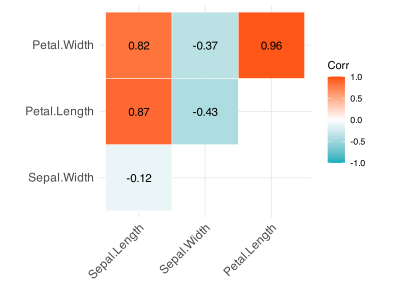
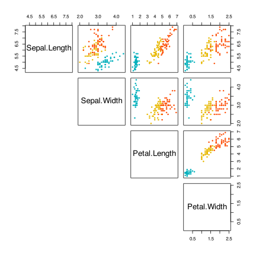
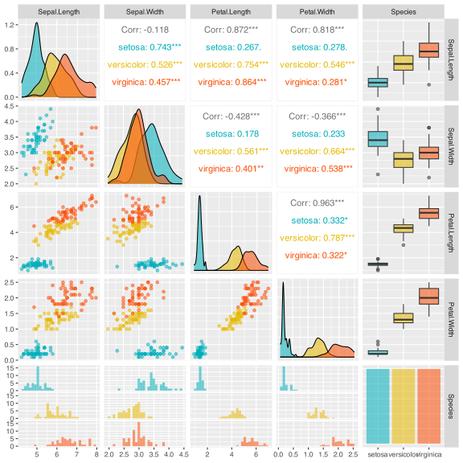
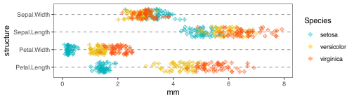
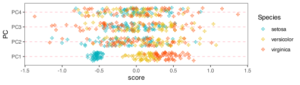
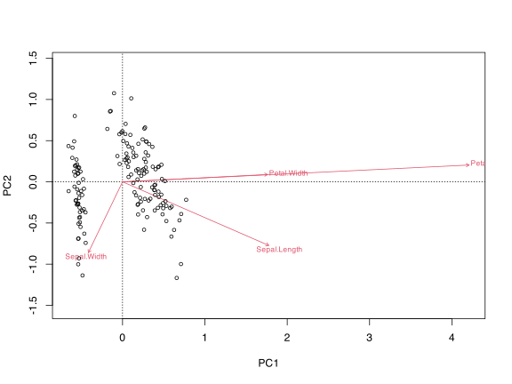
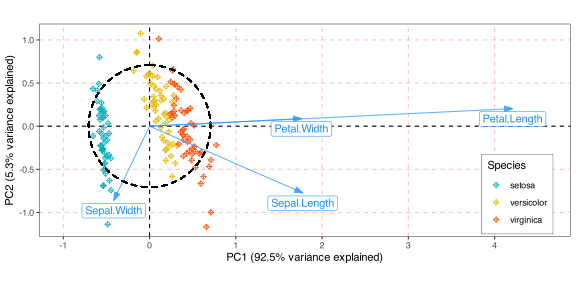

Below I offer a simple example of a Principal Component Analysis (PCA) on the *Iris* dataset. The measurements are morphological rather than ecological, yet they show the mechanics of PCA well.

## 1 The *Iris* data

``` numberSource
library(tidyverse)
library(vegan)
library(ggcorrplot) # for the correlations
library(ggpubr)
data("iris")
head(iris)
```

    R>   Sepal.Length Sepal.Width Petal.Length Petal.Width Species
    R> 1          5.1         3.5          1.4         0.2  setosa
    R> 2          4.9         3.0          1.4         0.2  setosa
    R> 3          4.7         3.2          1.3         0.2  setosa
    R> 4          4.6         3.1          1.5         0.2  setosa
    R> 5          5.0         3.6          1.4         0.2  setosa
    R> 6          5.4         3.9          1.7         0.4  setosa

The *Iris* dataset is a well-known set of measurements describing the morphology of three *Iris* species, namely *I. setosa*, *I. versicolor*, and *I. virginica*. The characteristics measured are sepal length and width and petal length and width.

The question I can address with a PCA is, “which of these variables (sepal length and width, and petal length and width) contributes most to the main morphological gradient separating the three species in this dataset?” PCA is descriptive rather than causal, so it identifies structure in the measurements rather than establishing what caused the species differences.

## 2 Visualise the raw data

A sensible first step after loading the data is to see how the variables correlate with one another, which a simple pairwise correlation shows. I give five ways of doing so below.

### 2.1 Method 1

``` numberSource
corr <- cor(iris[, 1:4])

ggcorrplot(
  corr,
  type = 'upper',
  outline.col = "white",
  colors = c("#00AFBB", "white", "#FC4E07"),
  lab = TRUE
)
```

[](PCA_examples_files/figure-html/code-corr-cor-iris-1.svg)

### 2.2 Method 2

``` numberSource
cols <- c("#00AFBB", "#E7B800", "#FC4E07")
pairs(
  iris[, 1:4],
  pch = 19,
  cex = 0.5,
  col = cols[iris$Species],
  lower.panel = NULL
)
```

[](PCA_examples_files/figure-html/code-cols-c-afbb-e7b800-1.svg)

### 2.3 Method 3

``` numberSource
library(GGally)
ggpairs(iris, aes(colour = Species, alpha = 0.4)) +
  scale_color_discrete(type = cols) +
  scale_fill_discrete(type = cols)
```

[](PCA_examples_files/figure-html/code-library-ggally-1.svg)

### 2.4 Method 4

``` numberSource
library(scatterPlotMatrix)
scatterPlotMatrix(iris, zAxisDim = "Species")
```

### 2.5 Method 5

``` numberSource
iris |>
  pivot_longer(
    cols = Sepal.Length:Petal.Width,
    values_to = "mm",
    names_to = "structure"
  ) |>
  ggplot(aes(x = structure, y = mm)) +
  geom_jitter(aes(colour = Species), shape = 9, width = 0.3, alpha = 0.6) +
  scale_color_discrete(type = cols) +
  coord_flip() +
  theme_bw() +
  theme(
    panel.grid.major.x = element_blank(),
    panel.grid.minor.x = element_blank(),
    panel.grid.major.y = element_line(colour = "grey60", linetype = "dashed")
  )
```

[](PCA_examples_files/figure-html/fig-iris-1.svg "Figure 1: ")

Figure 1

Examining all the plots above (particularly the simplest one in Method 5), what can I conclude about which morphological variable is **most** associated with the visual differences among species? The petal dimensions seem the most telling, because the three species overlap less there, particularly for petal length. The sepal dimensions seem less useful for distinguishing the species.

A PCA can reduce the complexity of the measurements and show which of the four variables contributes most to the dominant axis of variation. It condenses the four dimensions (sepal width and length, and petal width and length) into the main one or two rotated and scaled orthogonal dimensions (axes). Because the species labels are not used to fit the PCA, the result is an unsupervised summary of variation rather than a formal species classifier.

## 3 Do the PCA

``` numberSource
iris_pca <- rda(iris[, 1:4], scale = FALSE)
iris_pca
```

    R> 
    R> Call: rda(X = iris[, 1:4], scale = FALSE)
    R> 
    R>               Inertia Rank
    R> Total           4.573     
    R> Unconstrained   4.573    4
    R> 
    R> Inertia is variance
    R> 
    R> Eigenvalues for unconstrained axes:
    R>   PC1   PC2   PC3   PC4 
    R> 4.228 0.243 0.078 0.024

``` numberSource
summary(iris_pca, display = "sp") # omit display of site scores
```

    R> 
    R> Call:
    R> rda(X = iris[, 1:4], scale = FALSE) 
    R> 
    R> Partitioning of variance:
    R>               Inertia Proportion
    R> Total           4.573          1
    R> Unconstrained   4.573          1
    R> 
    R> Eigenvalues, and their contribution to the variance 
    R> 
    R> Importance of components:
    R>                          PC1     PC2     PC3      PC4
    R> Eigenvalue            4.2282 0.24267 0.07821 0.023835
    R> Proportion Explained  0.9246 0.05307 0.01710 0.005212
    R> Cumulative Proportion 0.9246 0.97769 0.99479 1.000000

## 4 Plot the PC scores as a normal panel of points

``` numberSource
PC1_scores <- as.data.frame(scores(
  iris_pca,
  choices = c(1, 2, 3, 4),
  display = "sites"
))
PC1_scores$Species <- iris$Species

PC1_scores |>
  pivot_longer(cols = PC1:PC4, values_to = "score", names_to = "PC") |>
  ggplot(aes(x = PC, y = score)) +
  geom_jitter(aes(colour = Species), shape = 9, width = 0.3, alpha = 0.6) +
  scale_color_discrete(type = cols) +
  coord_flip() +
  theme_bw() +
  theme(
    panel.grid.major.x = element_blank(),
    panel.grid.minor.x = element_blank(),
    panel.grid.major.y = element_line(colour = "pink", linetype = "dashed")
  )
```

[](PCA_examples_files/figure-html/fig-pc1-scores-as-data-frame-1.svg "Figure 2: ")

Figure 2

## 5 Make biplots

### 5.1 A default biplot

``` numberSource
biplot(iris_pca, type = c("text", "points"))
```

[](PCA_examples_files/figure-html/code-biplot-iris-pca-type-c-1.svg)

### 5.2 A `ggplot()` biplot

I can assemble a biplot in **ggplot2** from its components. This requires extracting all the needed parts from the `iris_pca` object and layering them one by one with `ggplot()`.

``` numberSource
library(ggforce) # for geom_circle

# species scores (actually morph properties here) for biplot arrows:
iris_spp_scores <- data.frame(scores(iris_pca, display = "species"))

# add centre point for arrows to start at:
iris_spp_scores$xy_start <- rep(0, 4)

# add the rownames as a column for plotting at the arrow heads:
iris_spp_scores$morph <- rownames(iris_spp_scores)
rownames(iris_spp_scores) <- NULL

# var explained along PC1 used for labelling the x-axis:
PC1_var <- round(iris_pca$CA$eig[1] / sum(iris_pca$CA$eig) * 100, 1)

# var explained along PC2 used for labelling the y-axis:
PC2_var <- round(iris_pca$CA$eig[2] / sum(iris_pca$CA$eig) * 100, 1)

# calculate the radius of the circle of equilibrium contribution
# (Num Ecol with R, p. 125):
r <- sqrt(2 / 4)

# site scores (the individual flowers here) for biplot points:
iris_site_scores <- data.frame(scores(iris_pca, display = "sites"))
iris_site_scores$Species <- iris$Species

ggplot(iris_site_scores, aes(x = PC1, y = PC2)) +
  geom_hline(aes(yintercept = 0), linetype = "dashed") +
  geom_vline(aes(xintercept = 0), linetype = "dashed") +
  geom_point(aes(colour = Species), shape = 9) +
  geom_circle(
    aes(x0 = 0, y0 = 0, r = r), # not yet correctly scaled!!
    linetype = 'dashed',
    lwd = 0.6,
    inherit.aes = FALSE
  ) +
  geom_segment(
    data = iris_spp_scores,
    aes(x = xy_start, y = xy_start, xend = PC1, yend = PC2),
    lineend = "butt",
    arrow = arrow(length = unit(3, "mm"), type = "closed", angle = 20),
    alpha = 0.7,
    colour = "dodgerblue"
  ) +
  geom_label(
    data = iris_spp_scores,
    aes(x = PC1, y = PC2, label = morph),
    nudge_y = -0.12,
    colour = "dodgerblue"
  ) +
  scale_color_discrete(type = cols) +
  coord_equal() +
  scale_x_continuous(limits = c(-1, 4.6)) +
  labs(
    x = paste0("PC1 (", PC1_var, "% variance explained)"),
    y = paste0("PC2 (", PC2_var, "% variance explained)")
  ) +
  theme_bw() +
  theme(
    panel.grid.major.x = element_line(colour = "pink", linetype = "dashed"),
    panel.grid.minor.x = element_blank(),
    panel.grid.major.y = element_line(colour = "pink", linetype = "dashed"),
    panel.grid.minor.y = element_blank(),
    legend.position = "inside",
    legend.position.inside = c(0.9, 0.2),
    legend.box.background = element_rect(colour = "black")
  )
```

[](PCA_examples_files/figure-html/fig-library-ggforce-for-geom-circle-1.svg "Figure 3: ")

Figure 3

What do I see in the biplot? PC1 explains most of the variation in the four morphological measurements, accounting for 92.5% of the total inertia. PC2 adds little (a further 5.3% of variance explained), so for this teaching example the two-dimensional summary is dominated by PC1. Among the ‘Species scores’ associated with PC1 (see `summary(iris_pca)`), the heaviest loading is petal length, which produces the long arrow in the positive PC1 direction. Petal length has almost no loading along PC2, shown by the arrow lying almost parallel to PC1 with little deflection towards PC2. The biplot arrow for petal width lies almost over the petal length arrow, which means that petal length and width are strongly correlated (the pairwise correlations give an *r*-value of 0.96).

## 6 References

## Reuse

[CC BY-NC-SA 4.0](https://creativecommons.org/licenses/by-nc-sa/4.0/)

## Citation

BibTeX citation:

``` quarto-appendix-bibtex
@online{smit2026,
  author = {Smit, A. J.},
  title = {6. {PCA:} Additional Examples},
  date = {2026-11-06},
  url = {https://tangledbank.netlify.app/BCB743/PCA_examples.html},
  langid = {en}
}
```

For attribution, please cite this work as:

Smit AJ (2026) 6. PCA: additional examples. [https://tangledbank.netlify.app/BCB743/PCA_examples.html.](https://tangledbank.netlify.app/BCB743/PCA_examples.html)
