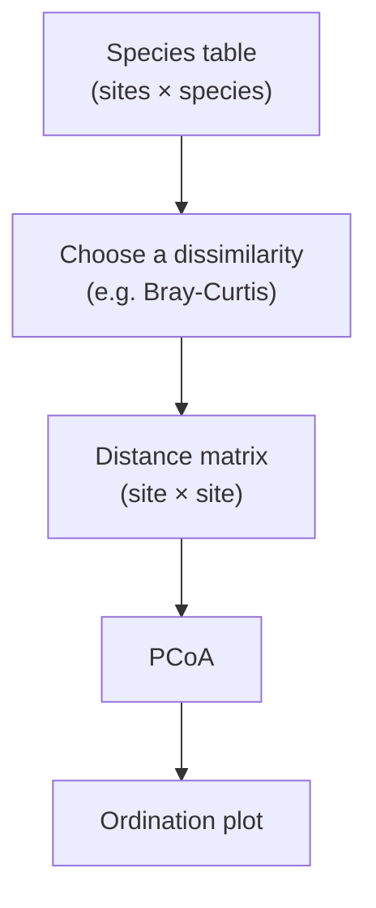
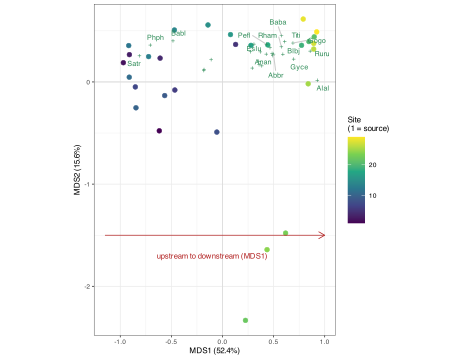
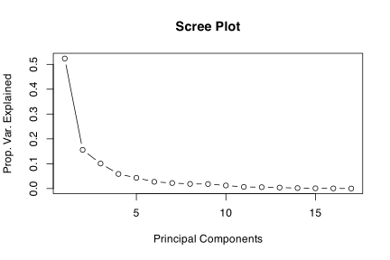
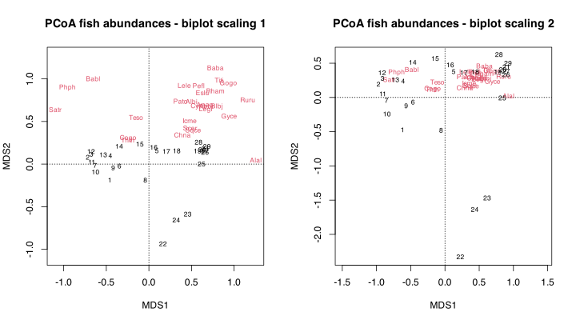
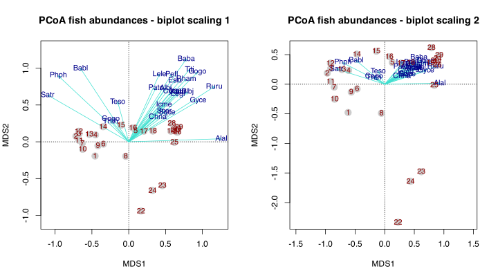
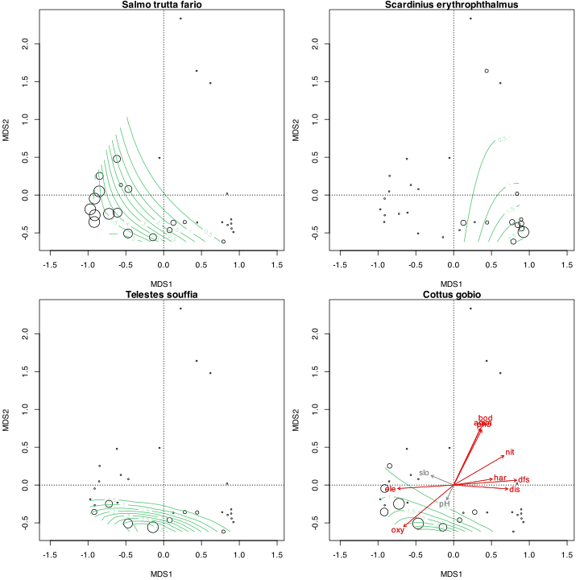
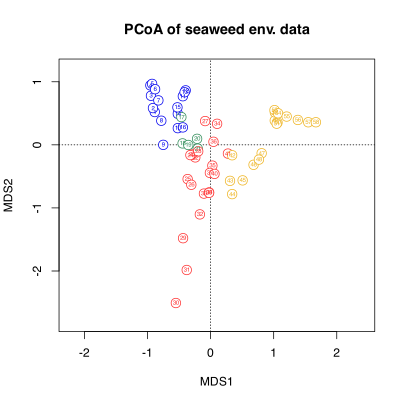

> **TIP:**
>
> | Type | Name | Link |
> |:---|:---|:---|
> | **Theory** | Numerical Ecology with R | See pages 140-145 |
> | **Slides** | CA lecture slides | [💾 `BCB743_10_PCoA.pdf`](../slides/BCB743_10_PCoA.pdf) |
> | **Data** | The Doubs River data | [💾 `Doubs.RData`](../data/BCB743/NEwR-2ed_code_data/NeWR2-Data/Doubs.RData) |
> |  | The seaweed environmental data | [💾 `SeaweedEnv.RData`](../data/BCB743/seaweed/SeaweedEnv.RData) |
> |  | The seaweed bioregion classification | [💾 `bioregions.csv`](../data/BCB743/seaweed/bioregions.csv). |

> **IMPORTANT:**
>
> - [Task F 1–6](../BCB743/tasks/Task_F.llms.md)

Suppose two river sites share not a single species. Ecologically they could hardly be more different, and a dissimilarity measure such as Bray-Curtis records that difference exactly. PCA cannot ordinate a Bray-Curtis matrix, because it is built on Euclidean distance, just as CA is built on $\chi^2$ distance. Each fixes the geometry in advance. Principal Coordinates Analysis (PCoA) removes that constraint. It takes a dissimilarity matrix, computed with whatever measure is ecologically appropriate, and finds the low-dimensional arrangement of sites that best preserves those dissimilarities. So, I shift from ordinating *variables* to ordinating *distances*, and that is the principle behind this chapter.

PCoA is also known as Classical Multidimensional Scaling (MDS). It analyses and represents multivariate data from a (dis)similarity matrix. I use PCoA when I need a dissimilarity measure other than the Euclidean distance of PCA or the $\chi^2$ distance of CA.

Unlike PCA and CA, which operate directly on the raw data matrix, PCoA takes a (dis)similarity matrix as input. This matrix can be calculated using various dissimilarity measures available in **vegan**’s `vegdist()` function, which may be necessary when my dataset includes quantitative, semi-quantitative, qualitative, and mixed variables. If the dissimilarities are Euclidean distances among centred observations, PCoA results are equivalent to those obtained from PCA, up to ordinary differences in scaling, signs, and rotation.

That flexibility is what gives PCoA its place among the ordination methods. The choice of method follows from the kind of difference between sites that is ecologically relevant:

| Situation                                    | Suitable method |
|:---------------------------------------------|:----------------|
| Continuous environmental variables           | PCA             |
| Species abundances under $\chi^2$ geometry   | CA              |
| Any ecological distance, such as Bray-Curtis | PCoA            |
| Rank-order dissimilarities                   | nMDS            |

The workflow is always the same, so I build a dissimilarity matrix from the data, then ordinate the matrix ([Figure 1](#fig-pcoa-workflow)). The first step is the ecological one, since that is where you choose how two sites are to be compared.



Figure 1: The PCoA workflow. The ecological decision is the choice of dissimilarity at the second step; everything after it is mechanical.

PCoA performs a dimensionality reduction on the (dis)similarity matrix, scaling the dissimilarities and returning a set of points in a lower-dimensional space (typically 2D or 3D). When plotted, the Euclidean distances between these points approximate the original dissimilarities, representing the dissimilarities between objects as Euclidean distances in a lower-dimensional space. This representation helps in visualising and interpreting complex relationships.

PCoA resembles PCA and CA in aiming to represent the relationships between objects in a lower-dimensional space, and it differs in how it preserves distances. PCA preserves Euclidean distances between objects and CA preserves $\chi^2$ distances, whereas PCoA starts from whichever (dis)similarity measure is provided as input. If that dissimilarity is Euclidean, the full set of real axes can reproduce it exactly. If it is not Euclidean, PCoA gives the best real-coordinate representation and may report negative eigenvalues for the part that cannot be embedded.

PCoA generalises the geometry of PCA, which is the cleanest way to see the relationship. PCA is the special case of PCoA obtained when the chosen dissimilarity is Euclidean:

| PCA                                   | PCoA                            |
|:--------------------------------------|:--------------------------------|
| starts with variables                 | starts with distances           |
| Euclidean distance only               | any dissimilarity measure       |
| needs the raw variables               | a distance matrix is enough     |
| a special case of distance ordination | the general distance ordination |

In PCoA, the eigenvalues represent the extent to which each principal coordinate axis captures the variability in the original dissimilarity matrix. The proportion of a given positive eigenvalue to the sum of positive eigenvalues indicates the relative importance of each real axis, but this proportion must be interpreted carefully when the dissimilarity is non-Euclidean and negative eigenvalues are present. Higher positive eigenvalues mark axes that capture more of the embeddable structure in the data, which helps identify the strongest gradients in the dataset.

When `capscale()` is given a raw community table and a distance method, it can add species scores as weighted averages of the site scores (wascores). If I instead supply only a precomputed dissimilarity matrix, that species information is no longer available from the input and the species scores are absent.

## 1 Set-up the analysis environment

``` numberSource
library(tidyverse)
library(vegan)
library(ggrepel) # for tidy biplot labels

# Files will be referenced using here::here() for absolute paths
```

## 2 The Doubs River data

I continue to use the species data:

``` numberSource
load(here::here(
  "data",
  "BCB743",
  "NEwR-2ed_code_data",
  "NEwR2-Data",
  "Doubs.RData"
))
# remove the 8th row because it sums to zero
spe <- dplyr::slice(spe, -8)
```

## 3 Calculate a suitable dissimilarity matrix

You can calculate a dissimilarity index upfront, or leave it to the function (see below). Here I calculate the Bray-Curtis dissimilarity, which suits abundance data:

``` numberSource
spe_bray <- vegdist(spe)
```

## 4 Do the PCoA

The book *Numerical Ecology with R* uses a built-in function [`cmdscale()`](https://rdrr.io/r/stats/cmdscale.html) or the function `pcoa()` in **ape** for its PCoA calculation. The **vegan** function `capscale()` can also be used for PCoA, and this is the approach I take here. The ‘CAP’ in `capscale()` stands for ‘Canonical Analysis of Principal Coordinates’. `capscale()` works differently from `rda()` or `cca()` in that I specify the input through a formula interface (see `?capscale`). To run a PCoA without constraints I put `1` on the right-hand side of the formula (the community data go on the left). The same interface also accepts predictors on the right, which is how `capscale()` performs *constrained* analysis (db-RDA).

The cleanest way to run it is to hand `capscale()` the **raw species table** and let it compute the dissimilarities. Supplying the raw table lets the function add species scores (as weighted averages of the site scores, or wascores), so the ordination places species as well as sites; a precomputed matrix carries no species information, and the scores are then missing. I built `spe_bray` above to make the dissimilarity-first logic clear, but `capscale()` can construct it internally, which is what I do here:

``` numberSource
spe_pcoa <- capscale(spe ~ 1, distance = "bray")
spe_pcoa
```

    R> 
    R> Call: capscale(formula = spe ~ 1, distance = "bray")
    R> 
    R>               Inertia Rank
    R> Total          6.7621     
    R> RealTotal      7.0583     
    R> Unconstrained  7.0583   17
    R> Imaginary     -0.2963     
    R> 
    R> Inertia is squared Bray distance
    R> 
    R> -- NOTE:
    R> Species scores projected from 'spe'
    R> 
    R> Eigenvalues for unconstrained axes:
    R>  MDS1  MDS2  MDS3  MDS4  MDS5  MDS6  MDS7  MDS8 
    R> 3.695 1.098 0.710 0.415 0.305 0.192 0.157 0.132 
    R> (Showing 8 of 17 unconstrained eigenvalues)

> **NOTE:**
>
> The printout reports a small **Imaginary** component (here about $-0.30$, against a real total of about $7.06$). This is expected, not a sign of error. Bray-Curtis, and most ecological dissimilarities, are not Euclidean, so they cannot be embedded perfectly in real coordinate space. PCoA represents the part that will not embed as negative eigenvalues. When the negative component is small relative to the leading positive axes, the ordination on the first two or three axes is usually still useful, but the proportions of variation need to be interpreted with that limitation in mind.
>
> If the negative component is large enough to affect interpretation, there are standard corrections. A square-root transformation of the dissimilarities can often make semi-metric distances closer to Euclidean. Cailliez and Lingoes corrections add constants so the corrected matrix has no negative eigenvalues. These are available through `ape::pcoa(correction = "cailliez")` or `ape::pcoa(correction = "lingoes")`, and base R’s `cmdscale(add = TRUE)` applies a Cailliez-style additive correction. The correction should be reported because it changes the geometry being analysed. One practical consequence of leaving negative eigenvalues in place is that the broken-stick test (`bstick()`) cannot be computed, which is why the scree plot below is drawn by hand.

The [`summary()`](https://rdrr.io/r/base/summary.html) now produces output that should look familiar from PCA and CA, with the **Species scores** present because the raw table was supplied:

``` numberSource
summary(spe_pcoa)
```

    R> 
    R> Call:
    R> capscale(formula = spe ~ 1, distance = "bray") 
    R> 
    R> Partitioning of squared Bray distance:
    R>               Inertia Proportion
    R> Total           7.058          1
    R> Unconstrained   7.058          1
    R> 
    R> Eigenvalues, and their contribution to the squared Bray distance 
    R> 
    R> Importance of components:
    R>                         MDS1   MDS2   MDS3    MDS4    MDS5    MDS6    MDS7
    R> Eigenvalue            3.6953 1.0985 0.7105 0.41497 0.30456 0.19179 0.15697
    R> Proportion Explained  0.5235 0.1556 0.1007 0.05879 0.04315 0.02717 0.02224
    R> Cumulative Proportion 0.5235 0.6792 0.7798 0.83862 0.88177 0.90894 0.93118
    R>                          MDS8    MDS9   MDS10    MDS11    MDS12   MDS13
    R> Eigenvalue            0.13191 0.12943 0.08668 0.046158 0.038645 0.02746
    R> Proportion Explained  0.01869 0.01834 0.01228 0.006539 0.005475 0.00389
    R> Cumulative Proportion 0.94987 0.96820 0.98048 0.987023 0.992498 0.99639
    R>                          MDS14    MDS15     MDS16     MDS17
    R> Eigenvalue            0.013065 0.007088 0.0040395 0.0013006
    R> Proportion Explained  0.001851 0.001004 0.0005723 0.0001843
    R> Cumulative Proportion 0.998239 0.999243 0.9998157 1.0000000

### 4.1 How to read this PCoA

The result itself comes first, the detailed plotting later. [Figure 2](#fig-pcoa-interp) redraws the ordination with the sites coloured from source to mouth and the most distinctive species labelled.

Code

``` numberSource
pos_eig <- spe_pcoa$CA$eig[spe_pcoa$CA$eig > 0]
pcoa_pct <- round(100 * pos_eig / sum(pos_eig), 1)

pcoa_sites <- as.data.frame(scores(spe_pcoa, display = "sites", choices = 1:2))
pcoa_sites$site <- as.integer(rownames(pcoa_sites))
pcoa_spp <- as.data.frame(scores(spe_pcoa, display = "species", choices = 1:2))
pcoa_spp$lab <- rownames(pcoa_spp)
pcoa_spp$d <- sqrt(pcoa_spp$MDS1^2 + pcoa_spp$MDS2^2)
pcoa_lab <- pcoa_spp[pcoa_spp$d > quantile(pcoa_spp$d, 0.45), ]

ggplot(pcoa_sites, aes(MDS1, MDS2)) +
  geom_hline(yintercept = 0, colour = "grey85") +
  geom_vline(xintercept = 0, colour = "grey85") +
  geom_point(aes(colour = site), size = 2) +
  scale_colour_viridis_c(name = "Site\n(1 = source)") +
  geom_point(
    data = pcoa_spp,
    aes(MDS1, MDS2),
    colour = "seagreen4",
    shape = 3,
    size = 0.8
  ) +
  geom_text_repel(
    data = pcoa_lab,
    aes(MDS1, MDS2, label = lab),
    colour = "seagreen4",
    size = 2.5,
    max.overlaps = Inf,
    segment.colour = "grey80"
  ) +
  annotate(
    "segment",
    x = -1.15,
    y = -1.5,
    xend = 1.0,
    yend = -1.5,
    arrow = arrow(length = unit(2.5, "mm")),
    colour = "firebrick"
  ) +
  annotate(
    "text",
    x = -0.1,
    y = -1.7,
    label = "upstream to downstream (MDS1)",
    colour = "firebrick",
    size = 2.7
  ) +
  labs(
    x = paste0("MDS1 (", pcoa_pct[1], "%)"),
    y = paste0("MDS2 (", pcoa_pct[2], "%)")
  ) +
  coord_equal()
```

[](PCoA_files/figure-html/fig-pcoa-interp-1.svg "Figure 2: An annotated PCoA (Bray-Curtis) of the Doubs fish data. Points are sites, coloured from the source (dark) to the mouth (yellow); green crosses are species, labelled where they sit away from the crowded centre. MDS1 orders the sites along the river, as the arrow shows.")

Figure 2: An annotated PCoA (Bray-Curtis) of the Doubs fish data. Points are sites, coloured from the source (dark) to the mouth (yellow); green crosses are species, labelled where they sit away from the crowded centre. MDS1 orders the sites along the river, as the arrow shows.

The ecological interpretation is the gradient seen throughout the module:

- **MDS1 has about 52% of the positive inertia**, so it is the dominant pattern.
- **The sites fall along MDS1 in river order**, from the source at one end to the mouth at the other. The Bray-Curtis ordination recovers the river sequence from species composition alone.
- **The two faunas separate along MDS1.** The upstream end has cool-water trout-zone species, brown trout (`Satr`) and minnow (`Phph`) among them; the downstream end has lowland species such as bleak (`Alal`), roach (`Ruru`), and ruffe (`Gyce`).
- **MDS1 is therefore the upstream-to-downstream river gradient**, the same gradient recovered by the [PCA of the environmental data](../BCB743/PCA.llms.md) and the [CA of the fish](../BCB743/CA.llms.md). Fitting the environmental vectors (below) confirms it. Dissolved oxygen points towards the trout end, and distance from source, nitrate, and organic load towards the lowland end.

The ecological pattern is the point of the analysis. Two other ways to call the function, and how to recover species scores when a precomputed matrix leaves them out, are given in a note further down.

### 4.2 Eigenvalues and how many axes to retain

I can look inside the results and access the eigenvalues, as I did for PCA and CA:

``` numberSource
str(spe_pcoa) # not shown due to length of output
```

The percentage inertia explained by the first three axes is:

``` numberSource
round(sum(spe_pcoa$CA$eig[1:3]) / sum(spe_pcoa$CA$eig) * 100, 2)
```

    R> [1] 77.98

``` numberSource
# The `bstick()` function is not compatible with PCoA
# when negative eigenvalues are present
# Plot the scree plot without the broken stick model

# Extract eigenvalues
eigenvalues <- spe_pcoa$CA$eig

# Calculate the proportion of positive ordination variance explained
pos_eig <- eigenvalues[eigenvalues > 0]
variance_explained <- pos_eig / sum(pos_eig)

# Create a scree plot
plot(
  variance_explained,
  type = "b",
  main = "Scree Plot",
  xlab = "Principal Components",
  ylab = "Prop. Var. Explained"
)
```

[](PCoA_files/figure-html/fig-pcoa-screeplot-1.svg "Figure 3: Scree plot of the Doubs River fish species PCoA.")

Figure 3: Scree plot of the Doubs River fish species PCoA.

The scree plot ([Figure 3](#fig-pcoa-screeplot)) shows the proportion of variation explained by the PC axes. I retain only the first two axes, since after the 2nd PC the proportion of variance explained by each additional PC is less than 10%, and the plot starts levelling off.

See *Numerical Ecology with R* (pp. 140 to 145) for information about the interpretation of a PCoA and the ordination diagrams shown below.

## 5 Ordination diagrams

I create the ordination diagrams as before:

``` numberSource
opar <- par(no.readonly = TRUE)
par(mfrow = c(1, 2))
plot(spe_pcoa, scaling = 1, main = "PCoA fish abundances - biplot scaling 1")
plot(spe_pcoa, scaling = 2, main = "PCoA fish abundances - biplot scaling 2")
par(opar)
```

[](PCoA_files/figure-html/fig-pcoa-biplots-1.svg "Figure 4: PCoA ordination plot of the Doubs River species data showing site scaling (left) and species scaling (right).")

Figure 4: PCoA ordination plot of the Doubs River species data showing site scaling (left) and species scaling (right).

Scaling 1 and scaling 2 are the same as in PCA and CA.

The plots above are serviceable, but I can improve them. The same improvements also apply to PCA and CA ordinations. Let me build plots from scratch:

``` numberSource
opar <- par(no.readonly = TRUE)
par(mfrow = c(1, 2))
pl1 <- ordiplot(
  spe_pcoa,
  type = "none",
  scaling = 1,
  main = "PCoA fish abundances - biplot scaling 1"
)
points(pl1, "sites", pch = 21, cex = 1.75, col = "grey80", bg = "grey80")
points(pl1, "species", pch = 21, col = "turquoise", arrows = TRUE)
text(pl1, "species", col = "blue4", cex = 0.9)
text(pl1, "sites", col = "red4", cex = 0.9)

pl2 <- ordiplot(
  spe_pcoa,
  type = "none",
  scaling = 2,
  main = "PCoA fish abundances - biplot scaling 2"
)
points(pl2, "sites", pch = 21, cex = 1.75, col = "grey80", bg = "grey80")
points(pl2, "species", pch = 21, col = "turquoise", arrows = TRUE)
text(pl2, "species", col = "blue4", cex = 0.9)
text(pl2, "sites", col = "red4", cex = 0.9)
```

[](PCoA_files/figure-html/code-pcoa-ordiplots-1.svg "PCoA ordination plot made with ordiplot() of the Doubs River species data showing site scaling (left) and species scaling (right).")

PCoA ordination plot made with `ordiplot()` of the Doubs River species data showing site scaling (left) and species scaling (right).

``` numberSource
par(opar)
```

I can also fit response surfaces using `ordisurf()`:

``` numberSource
require('viridis')
palette(viridis(8))

opar <- par(no.readonly = TRUE)
par(mar = c(4, 4, 0.9, 0.5) + .1, mfrow = c(2, 2))
with(
  spe,
  tmp <- ordisurf(
    spe_pcoa ~ Satr,
    bubble = 3,
    family = quasipoisson,
    knots = 2,
    col = 6,
    display = "sites",
    main = "Salmo trutta fario"
  )
)
abline(h = 0, v = 0, lty = 3)
with(
  spe,
  tmp <- ordisurf(
    spe_pcoa ~ Scer,
    bubble = 3,
    family = quasipoisson,
    knots = 2,
    col = 6,
    display = "sites",
    main = "Scardinius erythrophthalmus"
  )
)
abline(h = 0, v = 0, lty = 3)
with(
  spe,
  tmp <- ordisurf(
    spe_pcoa ~ Teso,
    bubble = 3,
    family = quasipoisson,
    knots = 2,
    col = 6,
    display = "sites",
    main = "Telestes souffia"
  )
)
abline(h = 0, v = 0, lty = 3)
with(
  spe,
  tmp <- ordisurf(
    spe_pcoa ~ Cogo,
    bubble = 3,
    family = quasipoisson,
    knots = 2,
    col = 6,
    display = "sites",
    main = "Cottus gobio"
  )
)
abline(h = 0, v = 0, lty = 3)

env <- dplyr::slice(env, -8)

(spe_pcoa_env <- envfit(spe_pcoa, env, scaling = 2))
```

    R> 
    R> ***VECTORS
    R> 
    R>         MDS1     MDS2     r2 Pr(>r)    
    R> dfs  0.99710 -0.07609 0.7210  0.001 ***
    R> ele -0.99807  0.06208 0.5659  0.001 ***
    R> slo -0.92225 -0.38660 0.1078  0.125    
    R> dis  0.99746  0.07129 0.5324  0.001 ***
    R> pH  -0.42673  0.90438 0.0480  0.522    
    R> har  0.98804 -0.15417 0.2769  0.013 *  
    R> pho  0.45343 -0.89129 0.6912  0.001 ***
    R> nit  0.86338 -0.50456 0.6117  0.001 ***
    R> amm  0.42719 -0.90416 0.7076  0.001 ***
    R> oxy -0.76847  0.63989 0.7639  0.001 ***
    R> bod  0.43152 -0.90210 0.8561  0.001 ***
    R> ---
    R> Signif. codes:  0 '***' 0.001 '**' 0.01 '*' 0.05 '.' 0.1 ' ' 1
    R> Permutation: free
    R> Number of permutations: 999

``` numberSource
plot(spe_pcoa_env, col = "grey40")
plot(spe_pcoa_env, p.max = 0.05, col = "red")
par(opar)
```

[](PCoA_files/figure-html/fig-pcoa-ordisurf-1.svg "Figure 5: PCoA ordination plots with species response surfaces of the Doubs River species data emphasising four species of fish: A) Satr, B) Scer, C) Teso, and D) Cogo. D) additionally has the environmental vectors projected on the plot, with the significant vectors shown in red.")

Figure 5: PCoA ordination plots with species response surfaces of the Doubs River species data emphasising four species of fish: A) Satr, B) Scer, C) Teso, and D) Cogo. D) additionally has the environmental vectors projected on the plot, with the significant vectors shown in red.

> **NOTE:**
>
> Above I gave `capscale()` the raw species table, which is the approach I recommend because it keeps the species scores. Two alternatives are worth knowing.
>
> **Supply a precomputed dissimilarity matrix.** If I hand `capscale()` the Bray-Curtis matrix I built earlier, the ordination of the sites is identical, but the **Species scores** are missing, since the function receives only the site-by-site distances and not the species themselves:
>
> ``` numberSource
> # spe_pcoa <- cmdscale(spe_bray, k = nrow(spe) - 1, eig = TRUE)
> spe_pcoa <- capscale(spe_bray ~ 1)
> spe_pcoa
> ```
>
>     R> 
>     R> Call: capscale(formula = spe_bray ~ 1)
>     R> 
>     R>               Inertia Rank
>     R> Total          6.7621     
>     R> RealTotal      7.0583     
>     R> Unconstrained  7.0583   17
>     R> Imaginary     -0.2963     
>     R> 
>     R> Inertia is squared Bray distance
>     R> 
>     R> Eigenvalues for unconstrained axes:
>     R>  MDS1  MDS2  MDS3  MDS4  MDS5  MDS6  MDS7  MDS8 
>     R> 3.695 1.098 0.710 0.415 0.305 0.192 0.157 0.132 
>     R> (Showing 8 of 17 unconstrained eigenvalues)
>
> ``` numberSource
> summary(spe_pcoa)
> ```
>
>     R> 
>     R> Call:
>     R> capscale(formula = spe_bray ~ 1) 
>     R> 
>     R> Partitioning of squared Bray distance:
>     R>               Inertia Proportion
>     R> Total           7.058          1
>     R> Unconstrained   7.058          1
>     R> 
>     R> Eigenvalues, and their contribution to the squared Bray distance 
>     R> 
>     R> Importance of components:
>     R>                         MDS1   MDS2   MDS3    MDS4    MDS5    MDS6    MDS7
>     R> Eigenvalue            3.6953 1.0985 0.7105 0.41497 0.30456 0.19179 0.15697
>     R> Proportion Explained  0.5235 0.1556 0.1007 0.05879 0.04315 0.02717 0.02224
>     R> Cumulative Proportion 0.5235 0.6792 0.7798 0.83862 0.88177 0.90894 0.93118
>     R>                          MDS8    MDS9   MDS10    MDS11    MDS12   MDS13
>     R> Eigenvalue            0.13191 0.12943 0.08668 0.046158 0.038645 0.02746
>     R> Proportion Explained  0.01869 0.01834 0.01228 0.006539 0.005475 0.00389
>     R> Cumulative Proportion 0.94987 0.96820 0.98048 0.987023 0.992498 0.99639
>     R>                          MDS14    MDS15     MDS16     MDS17
>     R> Eigenvalue            0.013065 0.007088 0.0040395 0.0013006
>     R> Proportion Explained  0.001851 0.001004 0.0005723 0.0001843
>     R> Cumulative Proportion 0.998239 0.999243 0.9998157 1.0000000
>
> **Add the species back with `sppscores()`.** When a precomputed matrix is unavoidable, e.g. a Gower matrix from another package (see [Handling Mixed Variable Types](#handling-mixed-variable-types), below), the species scores can be restored afterwards:
>
> ``` numberSource
> spe_pcoa <- capscale(spe_bray ~ 1)
> sppscores(spe_pcoa) <- spe
>
> summary(spe_pcoa)
> ```
>
>     R> 
>     R> Call:
>     R> capscale(formula = spe_bray ~ 1) 
>     R> 
>     R> Partitioning of squared Bray distance:
>     R>               Inertia Proportion
>     R> Total           7.058          1
>     R> Unconstrained   7.058          1
>     R> 
>     R> Eigenvalues, and their contribution to the squared Bray distance 
>     R> 
>     R> Importance of components:
>     R>                         MDS1   MDS2   MDS3    MDS4    MDS5    MDS6    MDS7
>     R> Eigenvalue            3.6953 1.0985 0.7105 0.41497 0.30456 0.19179 0.15697
>     R> Proportion Explained  0.5235 0.1556 0.1007 0.05879 0.04315 0.02717 0.02224
>     R> Cumulative Proportion 0.5235 0.6792 0.7798 0.83862 0.88177 0.90894 0.93118
>     R>                          MDS8    MDS9   MDS10    MDS11    MDS12   MDS13
>     R> Eigenvalue            0.13191 0.12943 0.08668 0.046158 0.038645 0.02746
>     R> Proportion Explained  0.01869 0.01834 0.01228 0.006539 0.005475 0.00389
>     R> Cumulative Proportion 0.94987 0.96820 0.98048 0.987023 0.992498 0.99639
>     R>                          MDS14    MDS15     MDS16     MDS17
>     R> Eigenvalue            0.013065 0.007088 0.0040395 0.0013006
>     R> Proportion Explained  0.001851 0.001004 0.0005723 0.0001843
>     R> Cumulative Proportion 0.998239 0.999243 0.9998157 1.0000000

## 6 Handling mixed variable types

The simplest way to handle mixed variable types is to plot the factor variable of interest as a differently shaped or coloured symbol on the ordination diagram. I will show this with the seaweed dataset.

First, I construct an environmental dataset that contains some mixed variables by column binding a dataset of seawater temperatures and a bioregional classification of the 58 coastal sections:

``` numberSource
bioreg <- read.csv(
  here::here("data", "BCB743", "seaweed", "bioregions.csv"),
  header = TRUE
)
load(here::here("data", "BCB743", "seaweed", "SeaweedEnv.RData"))
E <- cbind(bioreg, env) %>%
  mutate(
    spal.prov = factor(spal.prov),
    spal.ecoreg = factor(spal.ecoreg),
    lombard = factor(lombard),
    bolton = factor(bolton)
  )
head(E)
```

    R>   spal.prov spal.ecoreg lombard bolton  febMean   febMax   febMed   febX95
    R> 1       BMP          NE   NamBR    BMP 13.00117 18.72044 12.66004 16.80969
    R> 2       BMP          NE   NamBR    BMP 13.37950 18.61897 13.18389 17.07242
    R> 3       BMP          NE   NamBR    BMP 13.36163 17.86458 13.23187 16.61114
    R> 4       BMP          NE   NamBR    BMP 13.28966 17.12073 13.10284 16.12137
    R> 5       BMP          NE   NamBR    BMP 12.81128 16.37829 12.40032 15.53240
    R> 6       BMP          NE   NamBR    BMP 12.40247 15.96730 11.75096 15.21999
    R>   febRange  augMean   augMin   augMed    augX5 augRange  annMean    annSD
    R> 1 6.070326 11.75228 9.812431 11.82838 10.12598 2.502093 12.33503 1.255298
    R> 2 5.889300 11.57731 9.739288 11.61312 10.08165 2.973370 12.38795 1.401646
    R> 3 5.431383 11.29382 9.619388 11.26842 10.01617 3.084130 12.24332 1.474712
    R> 4 5.049024 11.13296 9.567049 11.02333 10.03277 2.995822 12.15410 1.505176
    R> 5 4.977916 11.23448 9.624302 10.99935 10.17375 2.940255 11.94613 1.449530
    R> 6 5.142721 11.50199 9.757004 11.15880 10.38581 2.925087 11.83773 1.385862
    R>    annRange    febSD     augSD    annChl    augChl   febChl
    R> 1 1.2488912 1.625917 0.7665420  2.623040 11.070480 8.884580
    R> 2 1.8021850 1.753863 0.8969112  4.903870  8.760170 8.401560
    R> 3 2.0678127 1.703917 0.9408326  3.723187  8.356506 6.718254
    R> 4 2.1567012 1.593944 0.9393490  4.165980  4.164904 3.727157
    R> 5 1.5767921 1.517366 0.9542671  8.020257  8.765154 8.786165
    R> 6 0.9004776 1.501801 0.9768441 12.882601  7.591975 9.160030

``` numberSource
str(E)
```

    R> 'data.frame':    58 obs. of  22 variables:
    R>  $ spal.prov  : Factor w/ 2 levels "AMP","BMP": 2 2 2 2 2 2 2 2 2 2 ...
    R>  $ spal.ecoreg: Factor w/ 2 levels "ABE","NE": 2 2 2 2 2 2 2 2 2 2 ...
    R>  $ lombard    : Factor w/ 4 levels "ABR","NamBR",..: 2 2 2 2 2 2 2 2 2 2 ...
    R>  $ bolton     : Factor w/ 4 levels "AMP","B-ATZ",..: 3 3 3 3 3 3 3 3 3 3 ...
    R>  $ febMean    : num  13 13.4 13.4 13.3 12.8 ...
    R>  $ febMax     : num  18.7 18.6 17.9 17.1 16.4 ...
    R>  $ febMed     : num  12.7 13.2 13.2 13.1 12.4 ...
    R>  $ febX95     : num  16.8 17.1 16.6 16.1 15.5 ...
    R>  $ febRange   : num  6.07 5.89 5.43 5.05 4.98 ...
    R>  $ augMean    : num  11.8 11.6 11.3 11.1 11.2 ...
    R>  $ augMin     : num  9.81 9.74 9.62 9.57 9.62 ...
    R>  $ augMed     : num  11.8 11.6 11.3 11 11 ...
    R>  $ augX5      : num  10.1 10.1 10 10 10.2 ...
    R>  $ augRange   : num  2.5 2.97 3.08 3 2.94 ...
    R>  $ annMean    : num  12.3 12.4 12.2 12.2 11.9 ...
    R>  $ annSD      : num  1.26 1.4 1.47 1.51 1.45 ...
    R>  $ annRange   : num  1.25 1.8 2.07 2.16 1.58 ...
    R>  $ febSD      : num  1.63 1.75 1.7 1.59 1.52 ...
    R>  $ augSD      : num  0.767 0.897 0.941 0.939 0.954 ...
    R>  $ annChl     : num  2.62 4.9 3.72 4.17 8.02 ...
    R>  $ augChl     : num  11.07 8.76 8.36 4.16 8.77 ...
    R>  $ febChl     : num  8.88 8.4 6.72 3.73 8.79 ...

In Smit et al. (2017) I used forward selection and the assessment of VIF to find only the non-collinear variables, which included `augMean`, `febRange`, `febSD` and `augSD` as the most parsimonious descriptors. I will do a PCoA of the seaweed environmental data (only the subset indicated above) and colour the sites by the bioregion:

``` numberSource
E_pcoa <- capscale(env[, c("augMean", "febRange", "febSD", "augSD")] ~ 1)

col <- c("firebrick1", "seagreen4", "blue2", "goldenrod2")
pch <- c(17, 19)

opar <- par(no.readonly = TRUE)
ordiplot(
  E_pcoa,
  type = "n",
  scaling = 1,
  xlim = c(-1.8, 2),
  ylim = c(-2.8, 1.2),
  main = "PCoA of seaweed env. data"
)
points(E_pcoa, "sites", pch = 21, cex = 1.75, col = col[E$bolton], bg = "white")
text(E_pcoa, "sites", col = col[E$bolton], cex = 0.5)
```

[](PCoA_files/figure-html/fig-pcoa-seaweed-env-1.svg "Figure 6: PCoA ordination plot of the seaweed environmental data with sites coloured by bioregion.")

Figure 6: PCoA ordination plot of the seaweed environmental data with sites coloured by bioregion.

The arrangement of sites in the ordination diagram ([Figure 6](#fig-pcoa-seaweed-env)) is still only affected by `augMean`, `febRange`, `febSD`, and `augSD` and colour is used only to identify the sites by bioregion. Colour does not affect the outcome of the ordination, and yet I can already see that sites show a clear bioregional grouping. Please see the analysis of the [Mayombo diatom dataset](../BCB743/nMDS_diatoms.llms.md) for additional approaches to deal with categorical variables that are presumed to be influential. To formally account for bioregion in the ordination, I must take a different approach.

The second option is to use a suitable dissimilarity metric. Numerical, nominal, ordinal, and binary variables can all be accommodated with the Gower distance. For this I use the `daisy()` function in **cluster** rather than **vegan**.

I calculate the Gower distances and proceed with the PCoA as before:

``` numberSource
library(cluster)

# cannot use mixed var  types
# E_gower <- vegdist(E, method = "gower")

# can handle mixed var types... use instead of vegdist() gower dissimilarity
E_gower <- daisy(E, metric = "gower")

summary(E_gower)
```

    R> 1653 dissimilarities, summarized :
    R>     Min.  1st Qu.   Median     Mean  3rd Qu.     Max. 
    R> 0.006058 0.181880 0.344160 0.321890 0.443730 0.724140 
    R> Metric :  mixed ;  Types = N, N, N, N, I, I, I, I, I, I, I, I, I, I, I, I, I, I, I, I, I, I 
    R> Number of objects : 58

``` numberSource
E_mat <- as.matrix(E_gower)
E_mat[1:5, 1:5]
```

    R>            1          2          3          4          5
    R> 1 0.00000000 0.03893923 0.05586573 0.09502716 0.06723042
    R> 2 0.03893923 0.00000000 0.02753347 0.06586077 0.04354363
    R> 3 0.05586573 0.02753347 0.00000000 0.04284923 0.04719106
    R> 4 0.09502716 0.06586077 0.04284923 0.00000000 0.06826655
    R> 5 0.06723042 0.04354363 0.04719106 0.06826655 0.00000000

``` numberSource
E_pcoa <- capscale(E_mat ~ 1)

# sadly this means that the names in the Species scores are now missing
summary(E_pcoa)
```

    R> 
    R> Call:
    R> capscale(formula = E_mat ~ 1) 
    R> 
    R> Partitioning of squared Unknown distance:
    R>               Inertia Proportion
    R> Total            3.93          1
    R> Unconstrained    3.93          1
    R> 
    R> Eigenvalues, and their contribution to the squared Unknown distance 
    R> 
    R> Importance of components:
    R>                         MDS1   MDS2    MDS3    MDS4    MDS5    MDS6    MDS7
    R> Eigenvalue            2.2311 1.0530 0.16179 0.11635 0.08678 0.05990 0.05202
    R> Proportion Explained  0.5678 0.2680 0.04117 0.02961 0.02208 0.01524 0.01324
    R> Cumulative Proportion 0.5678 0.8358 0.87693 0.90654 0.92863 0.94387 0.95711
    R>                          MDS8     MDS9    MDS10    MDS11    MDS12    MDS13
    R> Eigenvalue            0.04274 0.023523 0.019153 0.016634 0.013035 0.010275
    R> Proportion Explained  0.01088 0.005986 0.004874 0.004233 0.003317 0.002615
    R> Cumulative Proportion 0.96799 0.973971 0.978845 0.983079 0.986396 0.989011
    R>                          MDS14    MDS15    MDS16    MDS17    MDS18     MDS19
    R> Eigenvalue            0.008646 0.006938 0.005866 0.005202 0.004133 0.0033437
    R> Proportion Explained  0.002200 0.001766 0.001493 0.001324 0.001052 0.0008509
    R> Cumulative Proportion 0.991211 0.992976 0.994469 0.995793 0.996845 0.9976959
    R>                           MDS20     MDS21     MDS22    MDS23     MDS24
    R> Eigenvalue            0.0029563 0.0020816 0.0012713 0.001041 0.0007704
    R> Proportion Explained  0.0007523 0.0005297 0.0003235 0.000265 0.0001961
    R> Cumulative Proportion 0.9984482 0.9989779 0.9993015 0.999567 0.9997626
    R>                           MDS25     MDS26     MDS27
    R> Eigenvalue            3.718e-04 2.940e-04 2.671e-04
    R> Proportion Explained  9.463e-05 7.482e-05 6.798e-05
    R> Cumulative Proportion 9.999e-01 9.999e-01 1.000e+00

I can extract the various kinds of scores for manual plotting.

## 7 Three methods, three geometries

PCA, CA, and PCoA all reduce dimensionality, and they differ in the geometry they preserve. PCA preserves Euclidean distances, CA preserves $\chi^2$ distances, and PCoA preserves whichever dissimilarity the analyst supplies. Because a Euclidean dissimilarity reduces PCoA to PCA, PCoA is the general method and the other two are particular choices of distance. This freedom to choose the distance on ecological grounds is what makes PCoA one of the most widely used ordination methods in community ecology, and it is the foundation for the distance-based methods that follow. The next chapter takes up [non-metric Multidimensional Scaling (nMDS)](../BCB743/nMDS.llms.md), which starts from the same kind of dissimilarity matrix but abandons the eigenvalue approach in favour of preserving the rank order of the distances.

## 8 References

## Reuse

[CC BY-NC-SA 4.0](https://creativecommons.org/licenses/by-nc-sa/4.0/)

## Citation

BibTeX citation:

``` quarto-appendix-bibtex
@online{smit2026,
  author = {Smit, A. J.},
  title = {10. {Principal} Coordinate Analysis {(PCoA)}},
  date = {2026-11-06},
  url = {https://tangledbank.netlify.app/BCB743/PCoA.html},
  langid = {en}
}
```

For attribution, please cite this work as:

Smit AJ (2026) 10. Principal coordinate analysis (PCoA). [https://tangledbank.netlify.app/BCB743/PCoA.html.](https://tangledbank.netlify.app/BCB743/PCoA.html)
