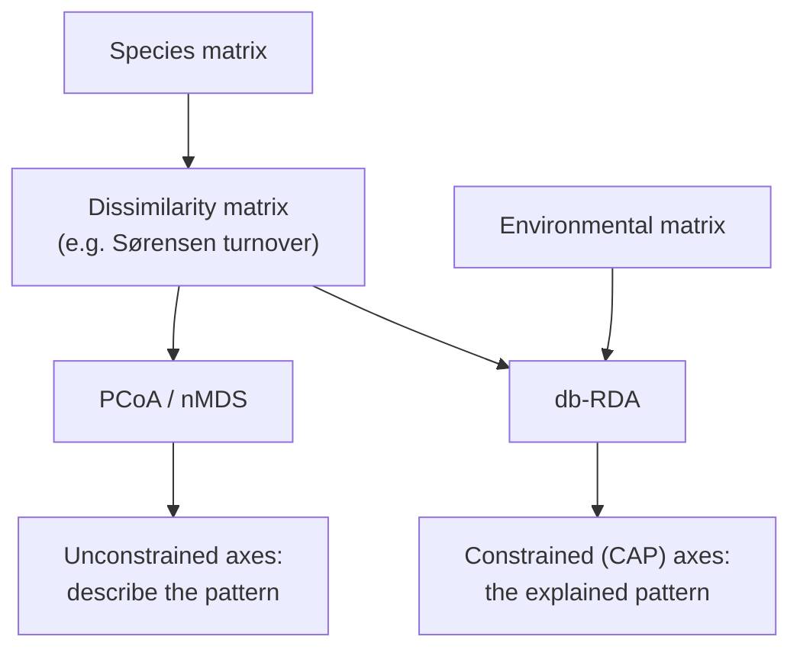
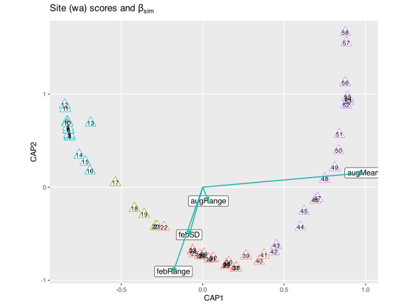
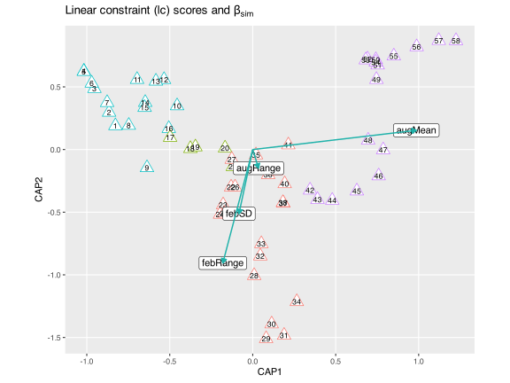
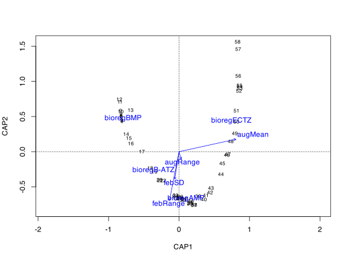
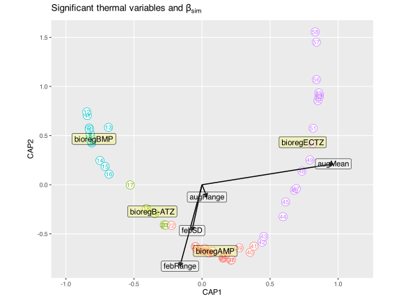

> **TIP:**
>
> | Type | Name | Link |
> |:---|:---|:---|
> | **Slides** | Constrained ordination lecture slides | [💾 `BCB743_12_constrained_ordination.pdf`](../slides/BCB743_12_constrained_ordination.pdf) |
> | **Reading** | Smit et al. (2017) | [💾 `Smit_et_al_2017.pdf`](../docs/Smit_et_al_2017.pdf) |
> |  | Supp. to Smit et al. (2017) | [💾 `Smit_the_seaweed_data.pdf`](../docs/Smit_the_seaweed_data.pdf) |
> | **Data** | The seaweed environmental data | [💾 `SeaweedEnv.RData`](../data/BCB743/seaweed/SeaweedEnv.RData) |
> |  | The seaweed species data | [💾 `SeaweedSpp.csv`](../data/BCB743/seaweed/SeaweedSpp.csv) |
> |  | The bioregions | [💾 `bioregions.csv`](../data/BCB743/seaweed/bioregions.csv) |
> |  | The seaweed coastal section coordinates | [💾 `SeaweedSites.csv`](../data/BCB743/seaweed/SeaweedSites.csv) |

> **IMPORTANT:**
>
> - [Task H 1–6](../BCB743/tasks/Task_H.llms.md)

Up to now I have applied unconstrained ordination or indirect gradient analyses. The lecture slides mention several constrained ordinations and provide some theory for three of them, viz. **Redundancy Analysis (RDA)**, **Canonical Correspondence Analysis (CCA)**, and **distance-based Redundancy Analysis (db-RDA)**. This Chapter introduces all three so that you understand the group they belong to, but I work through only db-RDA in detail, and I give the rationale for that choice below. Constrained ordination is sometimes called ‘direct gradient analysis’ or ‘canonical’ ordination.

Constrained ordination extracts and summarises the variation in a set of response variables (species data in ecology) that some explanatory variables (‘constraints’) can explain, such as measurements of environmental properties at the places where the species data were collected. These analyses relate two (or more) matrices to one another. One is the species table within which the community structure is sought, and the other an explanatory matrix of environmental conditions (or traits, etc.) thought to explain the community patterns. The ecologist can then apply a confirmatory analysis, since methods are available to test the statistical significance of the relationships between explanatory variables and the resultant species composition. Unconstrained ordination offers no such test, so it is descriptive rather than a statistical test in its own right.

> **IMPORTANT:**
>
> A significant constrained ordination confirms that *some relationship* exists between the species matrix and the environmental matrix. It does not establish that the environmental variable *causes* the community pattern, nor that the ecological process you have in mind operates. A strong, significant fit raises the likelihood that a real mechanism is at work, but it remains a starting point. The careful scientist treats it as a hypothesis to confirm with manipulative experiments or independent evidence, not as proof of the mechanism. This is the single most common misinterpretation of a constrained ordination, namely taking *variation explained* for *cause shown*.

Three constrained ordination techniques make up this group, each extending an unconstrained method you have already encountered:

- **RDA** is a direct gradient analysis that highlights linear relationships between components of response variables, i.e. variables that are ‘redundant’ with (i.e. ‘explained’ by) a set of predictors. RDA is an extension of a PCA with a multiple linear regression. The same constraints inherent in a PCA apply to an RDA. Use **vegan**’s `rda()` to perform an RDA.

- **CCA** is the extension of a CA with multiple regression, so it too uses the 𝝌2-metric (dissimilarities). The metric is fixed, and I cannot specify an alternative. CCA performs best when species distribution follows a unimodal model. Use **vegan**’s `cca()` to perform a CCA.

- **db-RDA** can be viewed as the extension of a PCoA with multiple regressions. As with a PCoA, I also benefit from being able to specify any dissimilarity matrix as input, so this approach is more versatile than RDA or CCA. I prefer the db-RDA implemented in **vegan**’s `capscale()`. The help file states: “Distance-based redundancy analysis (dbRDA) is an ordination method similar to Redundancy Analysis (rda), but it allows non-Euclidean dissimilarity indices, such as Manhattan or Bray–Curtis distance.”

Each constrained method extends an unconstrained one you have already encountered, by adding the environmental matrix as a set of predictors:

| Unconstrained (describe) | Constrained (test) | Distance preserved |
|:-------------------------|:-------------------|:-------------------|
| PCA                      | RDA                | Euclidean          |
| CA                       | CCA                | $\chi^2$           |
| PCoA                     | db-RDA             | any dissimilarity  |

### 0.1 Why I focus on db-RDA

I introduce RDA and CCA because you will encounter them throughout the literature and because they clarify what db-RDA does, but this chapter works through **db-RDA** alone. The reasoning is the same one that led me to favour PCoA among the unconstrained methods. RDA inherits the assumptions of PCA, namely that it measures community difference with Euclidean distance and describes linear species responses. That suits environmental tables, but it rarely suits raw community data, where the double-zero problem and unimodal responses dominate. CCA relaxes the linearity assumption to a unimodal one, but it fixes the dissimilarity at the $\chi^2$ metric and gives the analyst no choice, and the $\chi^2$ metric also weights rare species heavily, which is often undesirable. db-RDA removes both restrictions. It accepts *any* dissimilarity, so I can choose the measure that matches the ecological question (here a Sørensen-family turnover index), and it follows directly from the distance-based thinking of the previous chapters.

Concentrating on db-RDA keeps every concept intact, because the other two are special cases of the same constrained logic. RDA is what you obtain when the dissimilarity is Euclidean, and CCA is the same idea carried out under the $\chi^2$ metric. Once you can run and interpret a db-RDA, you can reach RDA by changing a single argument (the distance) and recognise a CCA when you encounter one. The procedure is the one I have used before, with a second matrix added at the end ([Figure 1](#fig-constrained-concept)).



Figure 1: Unconstrained against constrained ordination of community data. Both begin with a dissimilarity matrix; db-RDA adds the environmental matrix and builds axes from the variation those predictors can explain.

> **NOTE:**
>
> - **PCoA** and **nMDS** *describe* the patterns in a dissimilarity matrix.
> - **db-RDA** asks whether a set of measured predictors can *explain* those patterns, and tests it formally.
>
> This chapter develops that single new step, from *what patterns exist?* to *can the environment account for them?*

## 1 The seaweed dataset

For this example I will use the seaweed data of Smit et al. ([2017](#ref-smit2017seaweeds)). Please make sure that you read it! An additional file describing the background to the data is available at the link above (see **The_seaweed_data.pdf**).

I use two data sets. The first, $Y$ (in the file `SeaweedSpp.csv`), comprises distribution records of 847 macroalgal species within each of 58 × 50 km-long sections of the South African coast (updated from Bolton and Stegenga ([2002](#ref-bolton2002seaweed))). This represents *ca*. 90% of the known seaweed flora of South Africa, but excludes some small or rare species for which data are insufficient. The published source reports 846 species, but the teaching file contains 847 species columns because it retains one additional reconciled taxon used in the current data release. The data are from verifiable literature sources and John Bolton and Rob Anderson’s own collections, assembled from information collected by teams of phycologists over three decades ([Bolton 1986](#ref-bolton1986marine); [Stegenga et al. 1997](#ref-stegenga1997seaweeds); [Bolton and Stegenga 2002](#ref-bolton2002seaweed); [De Clerck et al. 2005](#ref-de2005guide)).

The second, $E$ (in `SeaweedEnv.RData`), is a dataset of *in situ* coastal seawater temperatures (Smit et al. 2013) derived from daily measurements over up to 40 years.

## 2 Set-up the analysis environment

``` numberSource
library(tidyverse)
library(betapart)
library(vegan)
library(gridExtra)
library(grid)
library(gridBase)
```

Load the seaweed data:

``` numberSource
spp <- read.csv(here::here("data", "BCB743", "seaweed", "SeaweedSpp.csv"))
spp <- dplyr::select(spp, -1)
dim(spp)
```

    R> [1]  58 847

## 3 Set-up the data

Analysis begins with the species table ($Y$). I compute the Sørensen dissimilarity, which I then decompose into ‘nestedness-resultant’ ($\beta_\text{sne}$) and ‘turnover’ ($\beta_\text{sim}$) components using the `betapart.core()` and `betapart.pair()` functions of the **betapart** package ([Baselga et al. 2018](#ref-baselga2018partitioning)). These are placed into the matrices $Y1$ and $Y2$. Decomposition into $Y1$ and $Y2$ is optional, but I do it here to focus on the turnover component free of any nestedness-resultant influence. Optionally, I can apply a CA, PCoA, or nMDS to $Y$ to find the major patterns in the community data on their own. The formal analysis in this chapter uses the species data in a distance-based redundancy analysis (db-RDA as per **vegan**’s `capscale()` function) by coupling it with $E$.

``` numberSource
Y.core <- betapart.core(spp)
Y.pair <- beta.pair(Y.core, index.family = "sor")

# Let Y1 be the turnover component (beta-sim):
Y1 <- as.matrix(Y.pair$beta.sim)
```

I now load the environmental data and some setup files that partition the 58 coastal sections (and the species and environmental data within them) into bioregions.

The thermal (environmental) data contain many variables, of which I use only some. These data come from many sites along the South African coast, and by interpolation (not shown here) I calculated the thermal properties for each coastal section for which seaweed data are available. The result is a data frame with 58 rows and a column for each thermal metric.

``` numberSource
load(here::here("data", "BCB743", "seaweed", "SeaweedEnv.RData"))
dim(env)
```

    R> [1] 58 18

Note that they have the same number of rows as the seaweed data.

I keep only some thermal variables, having already excluded ones I knew to be collinear (assessed with pairwise correlations). Some multicollinearity remains, but I handle it later, after fitting the constrained ordination (see [Section 5](#sec-multicollinearity)). For more on multicollinearity, refer to the Multiple Regression chapter in The Biostatistics Book.

``` numberSource
E1 <- dplyr::select(
  env,
  febMean,
  febRange,
  febSD,
  augMean,
  augRange,
  augSD,
  annMean,
  annRange,
  annSD
)
```

Next I calculate *z*-scores:

``` numberSource
E1 <- decostand(E1, method = "standardize")
```

Four bioregions are recognised for South Africa by Bolton and Anderson ([2004](#ref-bolton_2004)) (the variable called `bolton`), namely the Benguela Marine Province (`BMP`; coastal sections **1**–**17**), the Benguela-Agulhas Transition Zone (`B-ATZ`; **18**–**22**), the Agulhas Marine Province (`AMP`; **19**–**43**/**44**) and the East Coast Transition Zone (`ECTZ`; **44**/**45**–**58**). My plotting functions partition the data into the bioregions and colour code the figures accordingly so I can see regional patterns in $\beta$-diversity emerging.

``` numberSource
bioreg <- read.csv(here::here("data", "BCB743", "seaweed", "bioregions.csv"))
head(bioreg)
```

    R>   spal.prov spal.ecoreg lombard bolton
    R> 1       BMP          NE   NamBR    BMP
    R> 2       BMP          NE   NamBR    BMP
    R> 3       BMP          NE   NamBR    BMP
    R> 4       BMP          NE   NamBR    BMP
    R> 5       BMP          NE   NamBR    BMP
    R> 6       BMP          NE   NamBR    BMP

Load the geographic coordinates for the coastal sections:

``` numberSource
sites <- read.csv(here::here("data", "BCB743", "seaweed", "SeaweedSites.csv"))
sites <- sites[, c(2, 1)]
head(sites)
```

    R>   Longitude  Latitude
    R> 1  16.72429 -28.98450
    R> 2  16.94238 -29.38053
    R> 3  17.08194 -29.83253
    R> 4  17.25928 -30.26426
    R> 5  17.47638 -30.67874
    R> 6  17.72167 -31.08580

``` numberSource
dim(sites)
```

    R> [1] 58  2

Again, I have 58 rows of data for both the coastal section coordinates and the bioregions. You may omit the dataset with spatial coordinates, since it is not used further below. Can you think of ways to use this dataset to represent the spatial distribution of some environmental or biodiversity data graphically?

## 4 Start the db-RDA

> **NOTE:**
>
> The analysis that follows is a single series of steps:
>
> 1.  State the ecological hypothesis.
> 2.  Build the species dissimilarity matrix.
> 3.  Assemble and standardise the environmental predictors.
> 4.  Fit the full db-RDA and test whether it is significant.
> 5.  Check multicollinearity (VIF) and drop redundant predictors.
> 6.  Refit the reduced (‘final’) model.
> 7.  Test the model, its axes, and the individual terms.
> 8.  Interpret the constrained axes ecologically.

I test the niche difference mechanism as the primary species compositional assembly process operating along South African shores. The thermal gradient along the coast provides a suite of abiotic (thermal) conditions from which species select according to their physiological tolerances, so structuring $\beta$-diversity. The mechanism assumes that all species have equal access to every section along this stretch of coast, following ‘Beijerinck’s Law’ that everything is everywhere but the environment selects ([Sauer 1991](#ref-sauer1991plant)).

I do a db-RDA involving all the thermal variables in $E1$ (the ‘global analysis’ resulting in the full model, `cap_full`). The function to use is called `capscale()` but `dbrda()` achieves something similar. The analysis shown for $Y1$:

``` numberSource
# fit the full model:
cap_full <- capscale(Y1 ~ ., E1) # <1>
# cap_full <- capscale(spp ~., E1, dist = "bray", add = TRUE) # <2>
cap_full
```

1.  Because I am using the pre-calculated turnover component of $\beta$-diversity, the species information is not available in `summary(cap_full)`.
2.  If I use the species data directly, the species scores are available in `summary(cap_full)`. This is useful for interpreting the ordination diagram, and is generally advisable for most ordinations, but because I use the turnover component of $\beta$-diversity, this was not an option for the current analysis.

    R> 
    R> Call: capscale(formula = Y1 ~ febMean + febRange + febSD + augMean +
    R> augRange + augSD + annMean + annRange + annSD, data = E1)
    R> 
    R>               Inertia Proportion Rank
    R> Total          7.5234                
    R> RealTotal      7.8924     1.0000     
    R> Constrained    6.8640     0.8697    8
    R> Unconstrained  1.0284     0.1303   28
    R> Imaginary     -0.3690                
    R> 
    R> Inertia is squared Unknown distance
    R> 
    R> -- NOTE:
    R> Some constraints or conditions were aliased because they were redundant.
    R> This can happen if terms are constant or linearly dependent (collinear):
    R> 'annRange'
    R> 
    R> Eigenvalues for constrained axes:
    R>  CAP1  CAP2  CAP3  CAP4  CAP5  CAP6  CAP7  CAP8 
    R> 5.620 1.155 0.074 0.006 0.004 0.003 0.001 0.001 
    R> 
    R> Eigenvalues for unconstrained axes:
    R>   MDS1   MDS2   MDS3   MDS4   MDS5   MDS6   MDS7   MDS8 
    R> 0.5768 0.1687 0.1096 0.0413 0.0322 0.0243 0.0179 0.0103 
    R> (Showing 8 of 28 unconstrained eigenvalues)

``` numberSource
# summary(cap_full)
# notice that the species scores are missing
# refer to PCoA for why
```

The dissimilarity-matrix calculation discards species information, but if the original matrix of species composition is available, the species scores can be added back into the ordination diagram as weighted means of site scores in which case they occur or as vectors fitted onto the ordination space.

> **NOTE:**
>
> The output reports axes labelled **CAP1, CAP2, …** (and some labelled **MDS**). The distinction is central to constrained ordination. Where PCA, CA, and PCoA build their axes to capture the most variation in the *species data alone*, db-RDA builds its CAP axes to capture the most variation that the *environmental predictors can explain*. A CAP axis is therefore a composite environmental gradient, ranked by how much community turnover it accounts for. The variation the predictors cannot explain is set aside on the unconstrained MDS axes. So CAP1 traces the strongest environmentally-explained gradient in the community.

Is the fit significant? I run a permutation test to check:

``` numberSource
anova(cap_full, parallel = 4) # ... yes!
```

    R> Permutation test for capscale under reduced model
    R> Permutation: free
    R> Number of permutations: 999
    R> 
    R> Model: capscale(formula = Y1 ~ febMean + febRange + febSD + augMean + augRange + augSD + annMean + annRange + annSD, data = E1)
    R>          Df SumOfSqs      F Pr(>F)    
    R> Model     8   6.8640 40.881  0.001 ***
    R> Residual 49   1.0284                  
    R> ---
    R> Signif. codes:  0 '***' 0.001 '**' 0.01 '*' 0.05 '.' 0.1 ' ' 1

Since the fit is significant (the environmental variables capture the variation seen in the species data), I compute the adjusted $R^{2}$:

``` numberSource
cap_full_R2 <- RsquareAdj(cap_full)$adj.r.squared
round(cap_full_R2, 2)
```

    R> [1] 0.85

The inertia accounted for by constraints:

``` numberSource
round(sum(cap_full$CCA$eig), 2)
```

    R> [1] 6.86

The remaining (unconstrained) inertia:

``` numberSource
round(sum(cap_full$CA$eig), 2)
```

    R> [1] 1.03

The total inertia:

``` numberSource
round(cap_full$tot.chi, 2)
```

    R> [1] 7.52

What is the proportion of variation explained by the full set environmental variables?

``` numberSource
round(sum(cap_full$CCA$eig) / cap_full$tot.chi * 100, 2) # this is 6.86398 / 7.52344 * 100 (%)
```

    R> [1] 91.23

The model is significant, the adjusted $R^2$ is about **0.85**, and the constraints account for about **91%** of the turnover inertia. These are high values that deserve a moment of thought.

> **NOTE:**
>
> An adjusted $R^2$ of 0.85, with constraints explaining roughly 91% of the variation, is far above what most community datasets achieve, where values of 0.1 to 0.3 are common. The number is genuine rather than an artefact of overfitting (the adjusted $R^2$ already penalises the predictor count). It reflects the biology of this system. South African seaweed biogeography is dominated by one overriding control, namely the coastal thermal gradient set by the cold Benguela upwelling in the west and the warm Agulhas Current in the east. When a single environmental axis governs turnover this tightly, a set of thermal predictors will explain most of it. Do not carry this number forward as an expectation. Here it reflects an unusually strong thermal structuring of the flora, not a typical result.

## 5 Assess multicollinearity

I check for collinearity using variance inflation factors (VIF), and retain a subset of non-collinear variables to include in the ‘reduced’ or ‘final’ model. A common rule is that values over 10 indicate redundant constraints. I run the VIF procedure iteratively, each time removing the highest VIF and examining the remaining ones until these are mostly below 10.

First on the full model:

``` numberSource
vif.cca(cap_full)
```

    R>    febMean   febRange      febSD    augMean   augRange      augSD    annMean 
    R>  91.129700   6.775959   7.734436  73.090382   8.486631  12.118914 233.400746 
    R>   annRange      annSD 
    R>         NA   5.396343

I assess the output and drop annMean, which has the highest VIF value. I then re-run the VIF procedure on the slightly reduced model (and iterate until all VIFs are below 10).

``` numberSource
E2 <- dplyr::select(E1, -annMean)
cap_sel1 <- capscale(Y1 ~ ., E2)
vif.cca(cap_sel1)
```

    R>   febMean  febRange     febSD   augMean  augRange     augSD  annRange     annSD 
    R> 24.996152  6.149245  7.160637 17.717936  8.066340 10.726117        NA  5.396275

Drop febMean:

``` numberSource
E3 <- dplyr::select(E2, -febMean)
cap_sel2 <- capscale(Y1 ~ ., E3)
vif.cca(cap_sel2)
```

    R>  febRange     febSD   augMean  augRange     augSD  annRange     annSD 
    R>  6.149245  7.160637  1.619233  8.066340 10.726117  5.529971  5.396275

Drop augSD:

``` numberSource
E4 <- dplyr::select(E3, -augSD)
cap_sel3 <- capscale(Y1 ~ ., E4)
vif.cca(cap_sel3)
```

    R> febRange    febSD  augMean augRange annRange    annSD 
    R> 4.140834 5.251011 1.505510 1.230593 5.457323 5.063169

I select $E4$ as the variables to construct the final model (`cap_final`) from.

**Note:** you can switch to the formula interface within `capscale()` and specify the variables to use on the right-hand side of the formula (as shown but not executed). You will no longer analyse only the turnover component of $\beta$-diversity, since you will be using the raw `spp` data that encapsulate both nestedness-resultant and turnover processes, but the result is that you now have species scores. Run this bit of code by yourself and see what the outcome is (the ordiplot is affected, as well as the $R^{2}$, number of significant reduced axes, etc.).

``` numberSource
cap_final <- cap_sel3
# cap_final <- capscale(spp ~ febRange + febSD + augMean + augRange + augSD + annRange + annSD, data = E3, distance = "jaccard")
```

## 6 Assess the model

I calculate the significance of the model, the variance explained by all the constraints (in $E4$) in the final model, as well as the $R^{2}$:

``` numberSource
# is the fit significant?
anova(cap_final, parallel = 4) # ... yes!
```

    R> Permutation test for capscale under reduced model
    R> Permutation: free
    R> Number of permutations: 999
    R> 
    R> Model: capscale(formula = Y1 ~ febRange + febSD + augMean + augRange + annRange + annSD, data = E4)
    R>          Df SumOfSqs      F Pr(>F)    
    R> Model     6   6.8057 53.233  0.001 ***
    R> Residual 51   1.0867                  
    R> ---
    R> Signif. codes:  0 '***' 0.001 '**' 0.01 '*' 0.05 '.' 0.1 ' ' 1

Which axes are significant?

``` numberSource
anova(cap_final, by = "axis", parallel = 4) # ... yes!
```

    R> Permutation test for capscale under reduced model
    R> Forward tests for axes
    R> Permutation: free
    R> Number of permutations: 999
    R> 
    R> Model: capscale(formula = Y1 ~ febRange + febSD + augMean + augRange + annRange + annSD, data = E4)
    R>          Df SumOfSqs        F Pr(>F)    
    R> CAP1      1   5.6128 263.4143  0.001 ***
    R> CAP2      1   1.1129  53.2544  0.001 ***
    R> CAP3      1   0.0722   3.5224  0.221    
    R> CAP4      1   0.0049   0.2417  1.000    
    R> CAP5      1   0.0016   0.0737           
    R> CAP6      1   0.0013   0.0624           
    R> Residual 51   1.0867                    
    R> ---
    R> Signif. codes:  0 '***' 0.001 '**' 0.01 '*' 0.05 '.' 0.1 ' ' 1

Extract the significant variables in $E4$ that drive seaweed community differences among coastal sections:

``` numberSource
(cap_final_axis_test <- anova(cap_final, by = "terms", parallel = 4))
```

    R> Permutation test for capscale under reduced model
    R> Terms added sequentially (first to last)
    R> Permutation: free
    R> Number of permutations: 999
    R> 
    R> Model: capscale(formula = Y1 ~ febRange + febSD + augMean + augRange + annRange + annSD, data = E4)
    R>          Df SumOfSqs        F Pr(>F)    
    R> febRange  1   1.0962  51.4472  0.001 ***
    R> febSD     1   0.1850   8.6810  0.001 ***
    R> augMean   1   5.3815 252.5596  0.001 ***
    R> augRange  1   0.0903   4.2363  0.022 *  
    R> annRange  1   0.0237   1.1102  0.336    
    R> annSD     1   0.0291   1.3641  0.262    
    R> Residual 51   1.0867                    
    R> ---
    R> Signif. codes:  0 '***' 0.001 '**' 0.01 '*' 0.05 '.' 0.1 ' ' 1

The significant variables are:

``` numberSource
cap_final_ax <- which(cap_final_axis_test[, 4] < 0.05)
cap_final_sign_ax <- colnames(E4[, cap_final_ax])
cap_final_sign_ax
```

    R> [1] "febRange" "febSD"    "augMean"  "augRange"

The adjusted $R^{2}$ for the constraints:

``` numberSource
round(cap_final_R2 <- RsquareAdj(cap_final)$adj.r.squared, 2) # %
```

    R> [1] 0.85

The variance explained by reduced (final) model:

``` numberSource
round(sum(cap_final$CCA$eig) / cap_final$tot.chi * 100, 2)
```

    R> [1] 90.46

The biplot scores for constraining variables:

``` numberSource
scores(cap_final, display = "bp", choices = c(1:2))
```

    R>                 CAP1       CAP2
    R> febRange -0.18027862 -0.9059196
    R> febSD    -0.08301835 -0.5120321
    R> augMean   0.98573290  0.1536157
    R> augRange  0.03491819 -0.1485218
    R> annRange  0.41317263 -0.1827419
    R> annSD     0.20377426 -0.5717775
    R> attr(,"const")
    R> [1] 4.550643

These biplot scores will mark the position of the termini of the arrows that indicate the direction and strength of the constraining variables.

## 7 Ordination diagrams

A constrained ordination can be drawn with either of two kinds of site coordinate, and both are worth seeing:

- **Site scores (wa)** place each section at the weighted average of the species recorded there, so they reflect the community composition.
- **Linear constraint scores (lc)** place each section at the position predicted by the fitted environmental model (the linear combination of the constraints), so they reflect what the predictors alone imply.

Both come from the same fitted model. I extract all the scores once and then plot each in turn. First the **site (wa) scores**:

``` numberSource
# use scaling = 1 or scaling = 2 for site and species scaling, respectively
cap_final_scrs <- scores(cap_final, display = c("sp", "wa", "lc", "bp"))
# see ?plot.cca for insight into the use of lc vs wa scores
site_scores <- data.frame(cap_final_scrs$sites) # the wa scores
site_scores$bioreg <- bioreg$bolton
site_scores$section <- seq(1:58)

biplot_scores <- data.frame(cap_final_scrs$biplot)
biplot_scores$labels <- rownames(biplot_scores)
biplot_scores_sign <- biplot_scores[
  biplot_scores$labels %in% cap_final_sign_ax,
]

ggplot(data = site_scores, aes(x = CAP1, y = CAP2, colour = bioreg)) +
  geom_point(size = 5.0, shape = 24, fill = "white") +
  geom_text(aes(label = section), size = 3.0, col = "black") +
  geom_label(
    data = biplot_scores_sign,
    aes(CAP1, CAP2, label = rownames(biplot_scores_sign)),
    colour = "black"
  ) +
  geom_segment(
    data = biplot_scores_sign,
    aes(x = 0, y = 0, xend = CAP1, yend = CAP2),
    arrow = arrow(length = unit(0.2, "cm"), type = "closed"),
    colour = "lightseagreen",
    alpha = 1,
    linewidth = 0.7
  ) +
  xlab("CAP1") +
  ylab("CAP2") +
  ggtitle(expression(paste("Site (wa) scores and ", beta[sim]))) +
  theme_grey() +
  theme(
    panel.grid.minor = element_blank(),
    legend.position = "none",
    aspect.ratio = 0.8
  )
```

[](constrained_ordination_files/figure-html/fig-cap-final-scrs-scores-cap-final-display-1.svg "Figure 2: db-RDA ordination of seaweed turnover drawn with site (wa) scores. Each coastal section sits at the weighted average of the species recorded there, coloured by bioregion and numbered 1 (west) to 58 (east); the arrows mark the four significant thermal constraints.")

Figure 2: db-RDA ordination of seaweed turnover drawn with **site (wa) scores**. Each coastal section sits at the weighted average of the species recorded there, coloured by bioregion and numbered 1 (west) to 58 (east); the arrows mark the four significant thermal constraints.

Now the **linear constraint (lc) scores**, which recreate Figure 2a in Smit et al. ([2017](#ref-smit2017seaweeds)). The biplot arrows are the same constraints; only the section coordinates change, since the sections are now positioned by the fitted thermal model rather than by their species composition:

``` numberSource
lc_scores <- data.frame(cap_final_scrs$constraints) # the lc scores
lc_scores$bioreg <- bioreg$bolton
lc_scores$section <- seq(1:58)

ggplot(data = lc_scores, aes(x = CAP1, y = CAP2, colour = bioreg)) +
  geom_point(size = 5.0, shape = 24, fill = "white") +
  geom_text(aes(label = section), size = 3.0, col = "black") +
  geom_label(
    data = biplot_scores_sign,
    aes(CAP1, CAP2, label = rownames(biplot_scores_sign)),
    colour = "black"
  ) +
  geom_segment(
    data = biplot_scores_sign,
    aes(x = 0, y = 0, xend = CAP1, yend = CAP2),
    arrow = arrow(length = unit(0.2, "cm"), type = "closed"),
    colour = "lightseagreen",
    alpha = 1,
    linewidth = 0.7
  ) +
  xlab("CAP1") +
  ylab("CAP2") +
  ggtitle(expression(paste("Linear constraint (lc) scores and ", beta[sim]))) +
  theme_grey() +
  theme(
    panel.grid.minor = element_blank(),
    legend.position = "none",
    aspect.ratio = 0.8
  )
```

[](constrained_ordination_files/figure-html/fig-cap-final-lc-scores-1.svg "Figure 3: The same db-RDA drawn with linear constraint (lc) scores, recreating Fig. 2a of Smit et al. (2017). Sections are placed by the fitted thermal model rather than by their composition, so the map-like arrangement of the wa plot dissolves while the constraint arrows are unchanged.")

Figure 3: The same db-RDA drawn with **linear constraint (lc) scores**, recreating Fig. 2a of Smit et al. (2017). Sections are placed by the fitted thermal model rather than by their composition, so the map-like arrangement of the wa plot dissolves while the constraint arrows are unchanged.

Comparing the two figures shows the point behind the note. In the **wa-score** plot the sections fall into a crude map of South Africa, ordered by geographical coordinates (N-E-S-W). That arrangement is coincidental, though it can be logically explained, since the thermal gradient is itself geographically ordered. The coenoclines and gradients are discernible, and the west-to-east numbering of sections and the transition of one bioregion into the next are obvious. The map-like arrangement disappears in the **lc-score** plot (which is the version published as Fig. 2a in Smit et al. 2017), where the sections are spaced by the fitted thermal model rather than by their composition. The interpretation of how the thermal drivers structure seaweed biodiversity is the same in both.

### 7.1 Reading the ordination

The diagram shows the ecological result of the whole analysis:

- **CAP1 (about 82% of the constrained variation) is the west-to-east thermal gradient.** The coastal sections line up along it in geographic order, from the cool Benguela sections at one end to the warm subtropical sections of the east coast at the other. The numbering of the sections (1 in the west to 58 in the east) follows CAP1 almost exactly.
- **Winter mean temperature drives CAP1.** The `augMean` arrow (August is austral winter) lies almost along CAP1 and points towards the warm end, and sections with mild winters lie there, while the cold, upwelling-dominated Benguela sections lie at the opposite end.
- **The bioregions separate cleanly along CAP1.** The Benguela Marine Province clusters at the cool end and the East Coast Transition Zone at the warm end, with the Agulhas Province and the two transition zones in between, exactly the order in which they occur along the coast.
- **CAP2 has a secondary signal of thermal variability.** The summer temperature range (`febRange`) and summer variability (`febSD`) load on CAP2 and separate sections by how variable their warm-season temperatures are.

Seaweed turnover along the South African coast is structured first by the mean winter thermal gradient and second by seasonal thermal variability, consistent with the niche-difference mechanism proposed at the outset. The four significant predictors (`febRange`, `febSD`, `augMean`, `augRange`) make the statement that *both the average warmth and the variability of the coastal thermal regime sort the seaweed flora into its regional assemblages*.

> **NOTE:**
>
> The site (wa) scores in [Figure 2](#fig-cap-final-scrs-scores-cap-final-display) fall into a clean arch, so it is fair to ask whether this is the [arch effect](../BCB743/CA.llms.md#sec-arch-effect), the same artefact that appears in distance-based methods as a [horseshoe](../BCB743/PCA.llms.md#sec-horseshoe-effect). An arch *shape* is not automatically the arch *effect*, and here it is some of each.
>
> That the artefact is present is obvious. One gradient dominates, with CAP1 having about 82% of the constrained variation, and Sørensen turnover saturates, because sections at opposite ends of the coast share no species and cannot become any more dissimilar. Ordinating that structure bends the second axis into a parabola. Regressing CAP2 on CAP1 and CAP1$^2$ explains 90% of the wa-score variation, which is the textbook sign of an arch. The bend is mostly a response effect, since the same regression on the lc scores explains only 53%, and that is why the arch flattens in [Figure 3](#fig-cap-final-lc-scores).
>
> CAP2 carries genuine content, however. It is a significant constrained axis (`anova(cap_final, by = "axis")` returns $p = 0.001$) tied to a measured predictor. Summer thermal variability (`febRange`) peaks on the south coast and is lowest in the east, and it is itself a hump-shaped function of the main gradient. The coast is in that sense arched geographically, since mean temperature rises monotonically from west to east while seasonal variability peaks in the middle. The residual curvature of the lc scores, 53%, measures this real secondary gradient, and the further rise to 90% in the wa scores measures the artefact.
>
> A remedy is unnecessary. In a constrained ordination you do not detrend, and DCA-style detrending is in any case discouraged. CAP1 still orders the sites correctly from west to east, and CAP2 still carries a real signal. You must not interpret the up-curled ends of the wa arch as similar, because sections 12 and 58 share almost no species. Interpret the lc scores and the predictor arrows, as I do here, rather than the literal shape of the wa configuration. Working from a distance-based method with an ecological dissimilarity on the turnover component, as this chapter does, already keeps the arch milder than CA or PCA would.

## 8 Factor variables

``` numberSource
# retain only significant variables as per `cap_final_sign_ax`
E5 <- E4[, c(cap_final_sign_ax)]
# append the bioregs after the thermal vars
E5$bioreg <- bioreg$bolton
head(E5)
```

    R>      febRange      febSD   augMean    augRange bioreg
    R> 1 -0.04433865 -0.2713395 -1.376511 -0.47349787    BMP
    R> 2 -0.14318268 -0.1083868 -1.433925 -0.06998551    BMP
    R> 3 -0.39321619 -0.1719978 -1.526950  0.02484832    BMP
    R> 4 -0.60199306 -0.3120605 -1.579735 -0.05076148    BMP
    R> 5 -0.64081940 -0.4095900 -1.546420 -0.09833845    BMP
    R> 6 -0.55083241 -0.4294142 -1.458642 -0.11132528    BMP

``` numberSource
cap_cat <- capscale(Y1 ~ ., E5)
plot(cap_cat)
```

[](constrained_ordination_files/figure-html/fig-e5-e4-c-cap-final-sign-ax-1.svg "Figure 4: Default vegan plot of the db-RDA after adding the bioregions as a categorical constraint. Site scores, the significant thermal arrows, and the bioregion centroids are drawn together, but the elements overlap and are hard to read.")

Figure 4: Default **vegan** plot of the db-RDA after adding the bioregions as a categorical constraint. Site scores, the significant thermal arrows, and the bioregion centroids are drawn together, but the elements overlap and are hard to read.

The default plot is adequate and shows the necessary information, but the site, species, and centroid scores overlap and are hard to distinguish. Plot the class (factor) centroids in `ggplot()`:

``` numberSource
# also extract the factor centroids for the bioregions
cap_cat_scrs <- scores(cap_cat, display = c("sp", "wa", "lc", "bp", "cn"))
site_scores <- data.frame(cap_cat_scrs$site) # the wa scores
site_scores$bioreg <- bioreg$bolton
site_scores$section <- seq(1:58)

biplot_scores <- data.frame(cap_cat_scrs$biplot)
biplot_scores$labels <- rownames(biplot_scores)
biplot_scores_sign <- biplot_scores[
  biplot_scores$labels %in% cap_final_sign_ax,
]

bioreg_centroids <- data.frame(cap_cat_scrs$centroids)
bioreg_centroids$labels <- rownames(bioreg_centroids)

ggplot(data = site_scores, aes(CAP1, CAP2, colour = bioreg)) +
  geom_point(size = 5.2, shape = 21, fill = "white") +
  geom_text(aes(label = section, colour = bioreg), size = 3.0, ) +
  geom_segment(
    data = biplot_scores_sign,
    aes(x = 0, y = 0, xend = CAP1, yend = CAP2),
    arrow = arrow(length = unit(0.2, "cm"), type = "closed"),
    colour = "black",
    alpha = 1,
    linewidth = 0.7
  ) +
  geom_label(
    data = biplot_scores_sign,
    aes(CAP1, CAP2, label = rownames(biplot_scores_sign)),
    colour = "black",
    alpha = 0.2
  ) +
  geom_label(
    data = bioreg_centroids,
    aes(x = CAP1, y = CAP2, label = labels),
    size = 4.0,
    col = "black",
    fill = "yellow",
    alpha = 0.2
  ) +
  xlim(-1.0, 1.15) +
  xlab("CAP1") +
  ylab("CAP2") +
  ggtitle(expression(paste("Significant thermal variables and ", beta[sim]))) +
  theme_grey() +
  theme(
    panel.grid.minor = element_blank(),
    legend.position = "none",
    aspect.ratio = 0.8
  )
```

[](constrained_ordination_files/figure-html/fig-cap-cat-scrs-scores-cap-cat-display-1.svg "Figure 5: The db-RDA with bioregions added as a factor, redrawn in ggplot2. Site (wa) scores are coloured by bioregion, the significant thermal arrows run from the origin, and the yellow labels mark the bioregion centroids in ordination space.")

Figure 5: The db-RDA with bioregions added as a factor, redrawn in **ggplot2**. Site (wa) scores are coloured by bioregion, the significant thermal arrows run from the origin, and the yellow labels mark the bioregion centroids in ordination space.

The bioregion centroids fall in the same west-to-east order along CAP1 as the continuous thermal gradient. db-RDA places continuous predictors (the thermal arrows) and categorical predictors (the bioregion centroids) in one ordination space, so a factor and a gradient can be compared directly within a single framework.

## 9 db-RDA as multivariate regression

Conceptually, **db-RDA is multiple regression performed on community structure**. The response is not a single variable but an entire dissimilarity matrix of species composition, and the predictors are the environmental variables. The tools used to assess it, namely the permutation significance test, the adjusted $R^2$, the term-by-term tests, and the variance inflation factors, are the same tools used in ordinary multiple regression, now applied in a multivariate, distance-based context.

Constrained ordination completes the set of ordination techniques. It brings together $\beta$-diversity, dissimilarity matrices, ordination axes, multicollinearity, significance testing, and environmental gradients into one coherent analysis. This is the first point at which ordination becomes a full inferential framework rather than a way of exploring and visualising patterns. Everything learned here about predictors, collinearity, and explained variation goes directly into [multiple regression](../BCB743/multiple_regression.llms.md) and the model-building chapters, where the same underlying thinking is applied to single response variables.

> **TIP:**
>
> This analysis used the turnover component ($\beta_\text{sim}$) of a Sørensen decomposition as the response. An optional, more advanced follow-up, [Revisiting the β-Diversity Partition](../BCB743/constrained_ordination_v2.llms.md), re-runs the same db-RDA using the Podani-Legendre replacement component instead, and uses Mantel and Procrustes tests to show that the ecological conclusion does not depend on that choice. Read it once you are comfortable with the analysis here.

## 10 References

Baselga A, Orme D, Villéger S, De Bortoli J, Leprieur F, Logez M, Henriques-Silva R (2018) Partitioning beta diversity into turnover and nestedness components.

Bolton J (1986) Marine phytogeography of the Benguela upwelling region on the west coast of southern africa: A temperature dependent approach.

Bolton J, Stegenga H (2002) Seaweed species diversity in South Africa. South African Journal of Marine Science 24:9–18.

Bolton JJ, Anderson RJ (2004) Marine vegetation. In: Cowling RM, Richarson DM (eds) Vegetation of Southern Africa. Cambridge University Press, pp 348–370.

De Clerck O, Bolton J, Anderson R, Coppejans E, Bolton J, Anderson R (2005) Guide to the seaweeds of KwaZulu-Natal.

Sauer JD (1991) Plant migration: The dynamics of geographic patterning in seed plant species. Univ of California Press

Smit AJ, Bolton JJ, Anderson RJ (2017) Seaweeds in two oceans: Beta-diversity. Frontiers in Marine Science 4:404.

Stegenga H, Bolton JJ, Anderson RJ (1997) Seaweeds of the South African west coast. Contributions of the Bolus Herbarium 18:3–637.

## Reuse

[CC BY-NC-SA 4.0](https://creativecommons.org/licenses/by-nc-sa/4.0/)

## Citation

BibTeX citation:

``` quarto-appendix-bibtex
@online{smit2026,
  author = {Smit, A. J.},
  title = {14. {Distance-based} Redundancy Analysis},
  date = {2026-11-06},
  url = {https://tangledbank.netlify.app/BCB743/constrained_ordination.html},
  langid = {en}
}
```

For attribution, please cite this work as:

Smit AJ (2026) 14. Distance-based redundancy analysis. [https://tangledbank.netlify.app/BCB743/constrained_ordination.html.](https://tangledbank.netlify.app/BCB743/constrained_ordination.html)
