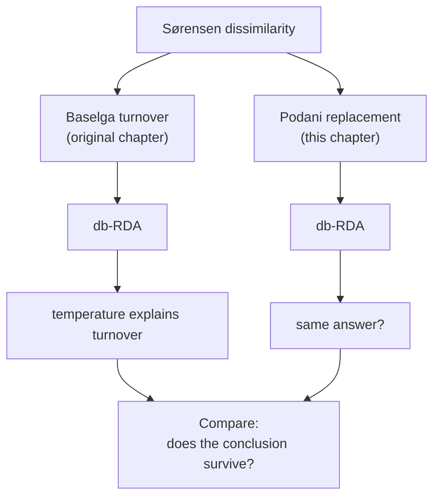
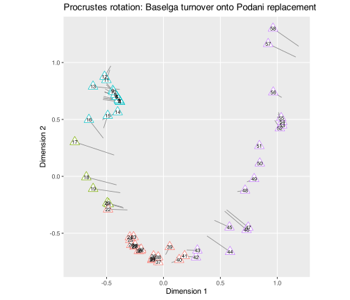
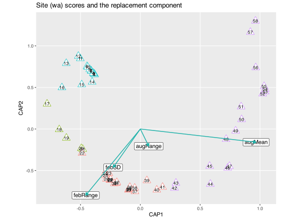

> **TIP:**
>
> | Type | Name | Link |
> |:---|:---|:---|
> | **Slides** | Constrained ordination lecture slides | [💾 `BCB743_12_constrained_ordination.pdf`](../slides/BCB743_12_constrained_ordination.pdf) |
> | **Reading** | Smit et al. (2017) | [💾 `Smit_et_al_2017.pdf`](../docs/Smit_et_al_2017.pdf) |
> |  | Supp. to Smit et al. (2017) | [💾 `Smit_the_seaweed_data.pdf`](../docs/Smit_the_seaweed_data.pdf) |
> | **Data** | The seaweed environmental data | [💾 `SeaweedEnv.RData`](../data/BCB743/seaweed/SeaweedEnv.RData) |
> |  | The seaweed species data | [💾 `SeaweedSpp.csv`](../data/BCB743/seaweed/SeaweedSpp.csv) |
> |  | The bioregions | [💾 `bioregions.csv`](../data/BCB743/seaweed/bioregions.csv) |
> |  | The seaweed coastal section coordinates | [💾 `SeaweedSites.csv`](../data/BCB743/seaweed/SeaweedSites.csv) |

## 1 Why a second version of this chapter?

In the [first version](../BCB743/constrained_ordination.llms.md) of this db_RDA analysis I used the **turnover** component of Sørensen dissimilarity, extracted by the **betapart** package following Baselga ([2010](#ref-Baselga2010)) and Baselga et al. ([2018](#ref-baselga2018partitioning)). That step applied one way of taking community dissimilarity apart, namely splitting the total into a *turnover* part ($\beta_\text{sim}$) and a *nestedness-resultant* part ($\beta_\text{sne}$) and keeping the turnover part. A decade of methodological work has questioned whether splitting $\beta$-diversity in that way is the right one. Here I keep the ecological question, the data, and the db-RDA method exactly as they were, and change only the dissimilarity partition, asking whether the seaweed result changes materially.

> **IMPORTANT:**
>
> If switching to the more defensible partition *changed* the ecological conclusion, then the original seaweed interpretation would have been based on a methodological choice rather than on the data. A result that holds only under one contested partition is weaker than one that survives a reasonable alternative, and this chapter exists to find out which kind of result I have here.

[Figure 1](#fig-v2-concept) summarises the experiment. The original chapter and this one share every step except the partition, and I run both to the end and compare.



Figure 1: The original analysis and this re-analysis share the data, the predictors, and the db-RDA approach; they differ only in which partition of Sørensen dissimilarity becomes the response. Running both to the end and comparing shows whether the ecological conclusion depends on that choice.

What follows states the problem and the fix in plain language, sets out the algebra of the two partitions, and re-runs the analysis with a direct comparison against the original turnover analysis.

> **NOTE:**
>
> The original analysis assumed that Baselga’s $\beta_\text{sim}$ is “pure turnover”, cleanly separated from differences in species richness. That assumption draws two objections. The leftover $\beta_\text{sne}$ does not behave like nestedness ([Almeida-Neto et al. 2012](#ref-almeidaneto2012rethinking)). Separately, $\beta_\text{sim}$ and the total Sørensen dissimilarity are scaled by different denominators, so $\beta_\text{sim}$ is not a fraction of the total on a common scale ([Podani and Schmera 2011](#ref-podani2011new); [Schmera and Podani 2011](#ref-schmera2011comments)). Legendre ([2014](#ref-legendre2014interpreting)) offers an alternative that *is* additive and commensurably scaled, namely a split of dissimilarity into **replacement** and **richness difference**. I rebuild the db-RDA on the replacement component and compare.

## 2 The original assumption

The first version computed Sørensen dissimilarity and decomposed it with **betapart**:

``` numberSource
Y.core <- betapart.core(spp)
Y.pair <- beta.pair(Y.core, index.family = "sor")
Y1 <- as.matrix(Y.pair$beta.sim)   # the turnover component, used as the response
```

The response matrix `Y1` was $\beta_\text{sim}$, the Simpson dissimilarity, on the reasoning that it isolates spatial **turnover** (species replacing one another along the coast) from the **nestedness-resultant** dissimilarity $\beta_\text{sne}$ (assemblages at species-poor sites forming subsets of richer ones). The interpretation in this chapter and in Smit et al. ([2017](#ref-smit2017seaweeds)) depended on $\beta_\text{sim}$ being a clean measure of replacement. That is the assumption now in question.

## 3 Alternative views

**Baselga’s “nestedness” component is not nestedness.** Almeida-Neto et al. ([2012](#ref-almeidaneto2012rethinking)) showed that $\beta_\text{sne}$ (and its multi-site form $\beta_\text{SNE}$) is only loosely related to nestedness. It responds to the size and fill of the data matrix and can rise or fall while the degree of nestedness is held constant, and it can even take large values for matrices with no nestedness at all, so the name overstates what the quantity measures. So, if $\beta_\text{sne}$ is not a clear measurement of nestedness, treating it as “the nestedness component” invites a claim that cannot be supported.

**The components are not commensurably scaled.** Podani and Schmera ([2011](#ref-podani2011new)) and Schmera and Podani ([2011](#ref-schmera2011comments)) make an algebraic point. Baselga’s $\beta_\text{sim}$ is the Simpson index, scaled to its own denominator, while the total Sørensen dissimilarity is scaled to a different one. The two are not fractions of a shared whole, so the partition is not an additive decomposition of the total onto a common scale. As a remedy they decompose presence–absence data into three additive, uniformly scaled fractions, namely shared species (similarity), species **replacement**, and **richness difference**.

**A synthesis with a working implementation.** Legendre ([2014](#ref-legendre2014interpreting)) drew these ideas together and supplied a tidy decomposition for both the Jaccard and Sørensen approaches. He keeps the replacement and richness-difference idea of Podani and Schmera and of Carvalho et al. ([2012](#ref-carvalho2012determining)), and provides it in the **adespatial** package ([Dray et al. 2023](#ref-dray2023adespatial)) as `beta.div.comp()`.

### 3.1 The math behind the dissimilarities

For two sites, write the shared and unique species counts the usual way:

- $a$ = species present at **both** sites,
- $b$ = species unique to the first site,
- $c$ = species unique to the second site.

> **IMPORTANT:**
>
> **Total Sørensen dissimilarity** $$\beta_\text{sor} = \frac{b+c}{2a+b+c}.$$
>
> **Baselga’s equation** (by **betapart**; turnover + nestedness-resultant) $$\beta_\text{sim} = \frac{\min(b,c)}{a+\min(b,c)}, \qquad \beta_\text{sne} = \beta_\text{sor} - \beta_\text{sim}.$$
>
> **Podani’s equation** (done by **adespatial** `coef = "S"`; replacement + richness difference) $$\text{Repl} = \frac{2\,\min(b,c)}{2a+b+c}, \qquad \text{RichDiff} = \frac{\lvert b-c\rvert}{2a+b+c}.$$
>
> The Podani components share the Sørensen denominator $2a+b+c$, so they are commensurable fractions of the same total: $$\text{Repl} + \text{RichDiff} = \frac{2\min(b,c) + \lvert b-c\rvert}{2a+b+c} = \frac{b+c}{2a+b+c} = \beta_\text{sor}.$$
>
> Baselga’s $\beta_\text{sim}$ uses the denominator $a+\min(b,c)$ instead. That choice makes $\beta_\text{sim}$ **independent of the richness difference** $\lvert b-c\rvert$, but it also stops it from being a fraction of $\beta_\text{sor}$ on a shared scale.

### 3.2 Baselga’s defence

Baselga ([2012](#ref-Baselga2012)) argues that independence from richness difference is the property a turnover measure *should* have, since $\beta_\text{sim}$ stays unchanged when sites differ only in how many species they contain, whereas the Podani replacement, with the richness difference in its denominator, still changes with richness gradients. Baselga and Leprieur ([2015](#ref-baselga2015comparing)) extends the argument and compares the indices on simulated and real data. The choice is a trade-off between properties, not a case of one index being wrong.

| Property | Baselga $\beta_\text{sim}$ (betapart) | Podani Repl (adespatial `"S"`) |
|:---|:---|:---|
| Independent of richness difference | **Yes** | No |
| A fraction of $\beta_\text{sor}$ on a common scale | No | **Yes** |
| Partner component tracks true nestedness | Disputed ([Almeida-Neto et al. 2012](#ref-almeidaneto2012rethinking)) | Measures richness difference, not nestedness |
| Additive with its partner | Yes ($\beta_\text{sim}+\beta_\text{sne}=\beta_\text{sor}$) | Yes (Repl + RichDiff $=\beta_\text{sor}$) |

### 3.3 Which One for the db-RDA?

There is no universal answer. The right choice depends on the property you most need. For a db-RDA whose goal is to model how the *whole* community dissimilarity is structured by the environment, the case for the Podani–Legendre approach is justified, since it is a commensurable, additive piece of the total Sørensen dissimilarity whose partner component is named for what it measures. I adopt it here, then check whether the ecological interpretation changes materially.

## 4 Set-up the analysis environment

The only new dependency is **adespatial**. Install it once if needed (`install.packages("adespatial")`).

``` numberSource
library(tidyverse)
library(betapart) # the original Baselga partition
library(adespatial) # the Podani / Legendre partition
library(vegan) # capscale(), anova.cca(), vif.cca(), protest()
```

Load the seaweed species data ($Y$), 58 coastal sections × 847 macroalgal species recorded as presence–absence ([Smit et al. 2017](#ref-smit2017seaweeds)). The published paper reports 846 species, but the teaching file contains 847 species columns because it retains one additional reconciled taxon used in the current data release.

``` numberSource
spp <- read.csv(here::here("data", "BCB743", "seaweed", "SeaweedSpp.csv"))
spp <- dplyr::select(spp, -1)
dim(spp)
```

    R> [1]  58 847

## 5 Two partitions of the same dissimilarity

First the original Baselga turnover, which I keep so that I can compare against it later:

``` numberSource
Y.core <- betapart.core(spp)
Y.pair <- beta.pair(Y.core, index.family = "sor")
beta_sim <- as.matrix(Y.pair$beta.sim) # Baselga turnover (Simpson)
```

Now Podani’s Sørensen decomposition. `beta.div.comp()` returns the replacement matrix (`$repl`), the richness-difference matrix (`$rich`), the total dissimilarity (`$D`), and a summary vector (`$part`):

``` numberSource
Y.comp <- beta.div.comp(spp, coef = "S", quant = FALSE)
repl <- as.matrix(Y.comp$repl) # Podani / Legendre replacement -> the new response
rich <- as.matrix(Y.comp$rich) # richness difference
Dsor <- as.matrix(Y.comp$D) # total Sorensen dissimilarity
Y.comp$part # whole-dataset shares of replacement and richness difference
```

    R>         BDtotal            Repl         RichDif    Repl/BDtotal RichDif/BDtotal 
    R>      0.24779409      0.17081532      0.07697877      0.68934379      0.31065621

**Podani’s partition is additive on a common scale.** Replacement plus richness difference should reproduce the total Sørensen dissimilarity exactly:

``` numberSource
range(repl + rich - Dsor) # both numbers ~ 0
```

    R> [1] -1.110223e-16  1.110223e-16

**Baselga’s is reproduced by `coef = "BS"`.** This isolates the *method*, not the package. Asking **adespatial** for the Baselga Sørensen calculation returns betapart’s $\beta_\text{sim}$ to numerical precision:

``` numberSource
Y.bas <- beta.div.comp(spp, coef = "BS", quant = FALSE)
range(as.matrix(Y.bas$repl) - beta_sim) # ~ 0: BS replacement == betapart beta.sim
```

    R> [1] 0 0

Nothing else differs between the two analyses. The data are the same, one package computes both partitions, and only the partition itself changes. How far apart, then, are the two response matrices? Run a Mantel test to find out:

``` numberSource
mantel(Y.comp$repl, Y.pair$beta.sim)
```

    R> 
    R> Mantel statistic based on Pearson's product-moment correlation 
    R> 
    R> Call:
    R> mantel(xdis = Y.comp$repl, ydis = Y.pair$beta.sim) 
    R> 
    R> Mantel statistic r: 0.9384 
    R>       Significance: 0.001 
    R> 
    R> Upper quantiles of permutations (null model):
    R>    90%    95%  97.5%    99% 
    R> 0.0469 0.0684 0.0854 0.0990 
    R> Permutation: free
    R> Number of permutations: 999

I expect a high correlation, since both numerators are built on $\min(b,c)$, but not equality, because the denominators differ. The test returns $r = 0.938$, i.e., the two response matrices are already nearly the same *before any ordination is performed*, so switching the partition reshuffles the dissimilarities only slightly. Does so small a difference change the db-RDA?

## 6 Environmental predictors and collinearity

The environmental variables are unchanged from the first version. Load the thermal data, keep the same nine variables, and convert to $z$-scores:

``` numberSource
load(here::here("data", "BCB743", "seaweed", "SeaweedEnv.RData"))
E1 <- dplyr::select(
  env,
  febMean,
  febRange,
  febSD,
  augMean,
  augRange,
  augSD,
  annMean,
  annRange,
  annSD
)
E1 <- decostand(E1, method = "standardize")

bioreg <- read.csv(here::here("data", "BCB743", "seaweed", "bioregions.csv"))
```

> **NOTE:**
>
> In RDA and db-RDA the variance inflation factors depend on the **predictor matrix alone**, not on the response. Changing the response from $\beta_\text{sim}$ to the replacement matrix cannot change the VIFs, so the same three variables drop out and I arrive at the same reduced predictor set $E4$. You can confirm this from the VIFs of the full model below, which match the first version.

``` numberSource
vif.cca(capscale(repl ~ ., E1)) # same VIFs as the beta.sim model
```

    R>    febMean   febRange      febSD    augMean   augRange      augSD    annMean 
    R>  91.129700   6.775959   7.734436  73.090382   8.486631  12.118914 233.400746 
    R>   annRange      annSD 
    R>         NA   5.396343

``` numberSource
# iterative drop of annMean, then febMean, then augSD (as in version 1)
E4 <- E1 |>
  dplyr::select(-annMean, -febMean, -augSD)
names(E4)
```

    R> [1] "febRange" "febSD"    "augMean"  "augRange" "annRange" "annSD"

## 7 The db-RDA on the replacement component

I fit the model on the replacement matrix, under the same niche-difference hypothesis, namely that the coastal thermal gradient sorts the seaweed flora by physiological tolerance.

``` numberSource
cap_repl <- capscale(repl ~ ., E4)
cap_repl
```

    R> 
    R> Call: capscale(formula = repl ~ febRange + febSD + augMean + augRange +
    R> annRange + annSD, data = E4)
    R> 
    R>               Inertia Proportion Rank
    R> Total          4.5096                
    R> RealTotal      4.9712     1.0000     
    R> Constrained    3.8122     0.7668    6
    R> Unconstrained  1.1591     0.2332   29
    R> Imaginary     -0.4616                
    R> 
    R> Inertia is squared Unknown distance
    R> 
    R> Eigenvalues for constrained axes:
    R>   CAP1   CAP2   CAP3   CAP4   CAP5   CAP6 
    R> 2.6497 1.0980 0.0538 0.0069 0.0023 0.0014 
    R> 
    R> Eigenvalues for unconstrained axes:
    R>   MDS1   MDS2   MDS3   MDS4   MDS5   MDS6   MDS7   MDS8 
    R> 0.4933 0.2992 0.1138 0.0670 0.0482 0.0321 0.0249 0.0205 
    R> (Showing 8 of 29 unconstrained eigenvalues)

Is the fit significant overall, and which axes have signal?

``` numberSource
anova(cap_repl, parallel = 4) # whole model
```

    R> Permutation test for capscale under reduced model
    R> Permutation: free
    R> Number of permutations: 999
    R> 
    R> Model: capscale(formula = repl ~ febRange + febSD + augMean + augRange + annRange + annSD, data = E4)
    R>          Df SumOfSqs      F Pr(>F)    
    R> Model     6   3.8122 27.957  0.001 ***
    R> Residual 51   1.1591                  
    R> ---
    R> Signif. codes:  0 '***' 0.001 '**' 0.01 '*' 0.05 '.' 0.1 ' ' 1

``` numberSource
anova(cap_repl, by = "axis", parallel = 4) # which CAP axes
```

    R> Permutation test for capscale under reduced model
    R> Forward tests for axes
    R> Permutation: free
    R> Number of permutations: 999
    R> 
    R> Model: capscale(formula = repl ~ febRange + febSD + augMean + augRange + annRange + annSD, data = E4)
    R>          Df SumOfSqs        F Pr(>F)    
    R> CAP1      1  2.64969 116.5898  0.001 ***
    R> CAP2      1  1.09800  49.2607  0.001 ***
    R> CAP3      1  0.05379   2.4599  0.422    
    R> CAP4      1  0.00693   0.3230  0.999    
    R> CAP5      1  0.00232   0.1100  1.000    
    R> CAP6      1  0.00142   0.0624           
    R> Residual 51  1.15906                    
    R> ---
    R> Signif. codes:  0 '***' 0.001 '**' 0.01 '*' 0.05 '.' 0.1 ' ' 1

Which thermal terms are significant?

``` numberSource
(cap_repl_terms <- anova(cap_repl, by = "terms", parallel = 4))
```

    R> Permutation test for capscale under reduced model
    R> Terms added sequentially (first to last)
    R> Permutation: free
    R> Number of permutations: 999
    R> 
    R> Model: capscale(formula = repl ~ febRange + febSD + augMean + augRange + annRange + annSD, data = E4)
    R>          Df SumOfSqs       F Pr(>F)    
    R> febRange  1  1.25359 55.1595  0.001 ***
    R> febSD     1  0.21602  9.5051  0.001 ***
    R> augMean   1  2.14328 94.3069  0.001 ***
    R> augRange  1  0.10175  4.4771  0.015 *  
    R> annRange  1  0.03511  1.5451  0.185    
    R> annSD     1  0.06241  2.7461  0.058 .  
    R> Residual 51  1.15906                   
    R> ---
    R> Signif. codes:  0 '***' 0.001 '**' 0.01 '*' 0.05 '.' 0.1 ' ' 1

``` numberSource
cap_repl_ax <- which(cap_repl_terms[, 4] < 0.05)
cap_repl_sign_ax <- colnames(E4[, cap_repl_ax])
cap_repl_sign_ax
```

    R> [1] "febRange" "febSD"    "augMean"  "augRange"

The adjusted $R^2$ and the share of inertia the constraints explain:

``` numberSource
cap_repl_R2 <- RsquareAdj(cap_repl)$adj.r.squared
round(cap_repl_R2, 2)
```

    R> [1] 0.74

``` numberSource
round(sum(cap_repl$CCA$eig) / cap_repl$tot.chi * 100, 2) # % constrained
```

    R> [1] 84.53

## 8 Does the choice of partition change the result?

To answer this, I refit the **original** turnover model on the same reduced predictors and assess the two side by side.

``` numberSource
cap_sim <- capscale(beta_sim ~ ., E4)
cap_sim_R2 <- RsquareAdj(cap_sim)$adj.r.squared
cap_sim_terms <- anova(cap_sim, by = "terms", parallel = 4)
cap_sim_sign_ax <- colnames(E4[, which(cap_sim_terms[, 4] < 0.05)])
```

``` numberSource
cap_pct <- function(m) sum(m$CCA$eig) / m$tot.chi * 100
cap1_pct <- function(m) m$CCA$eig[1] / sum(m$CCA$eig) * 100

comparison <- tibble::tibble(
  Quantity = c(
    "Adjusted R-squared",
    "Constrained inertia (%)",
    "CAP1 share of constrained (%)",
    "Significant thermal terms"
  ),
  `Baselga's turnover (beta_sim)` = c(
    sprintf("%.2f", cap_sim_R2),
    sprintf("%.1f", cap_pct(cap_sim)),
    sprintf("%.1f", cap1_pct(cap_sim)),
    paste(cap_sim_sign_ax, collapse = ", ")
  ),
  `Podani's replacement (Repl_S)` = c(
    sprintf("%.2f", cap_repl_R2),
    sprintf("%.1f", cap_pct(cap_repl)),
    sprintf("%.1f", cap1_pct(cap_repl)),
    paste(cap_repl_sign_ax, collapse = ", ")
  )
)
knitr::kable(comparison)
```

| Quantity | Baselga’s turnover (beta_sim) | Podani’s replacement (Repl_S) |
|:---|:---|:---|
| Adjusted R-squared | 0.85 | 0.74 |
| Constrained inertia (%) | 90.5 | 84.5 |
| CAP1 share of constrained (%) | 82.5 | 69.5 |
| Significant thermal terms | febRange, febSD, augMean, augRange | febRange, febSD, augMean, augRange |

Once the two ordinations are optimally rotated and scaled onto one another, how well do their site configurations agree? Do a Procrustes test:

``` numberSource
pro <- protest(
  scores(cap_sim, display = "wa", choices = 1:2),
  scores(cap_repl, display = "wa", choices = 1:2),
  permutations = 999
)
pro
```

    R> 
    R> Call:
    R> protest(X = scores(cap_sim, display = "wa", choices = 1:2), Y = scores(cap_repl,      display = "wa", choices = 1:2), permutations = 999) 
    R> 
    R> Procrustes Sum of Squares (m12 squared):        0.02707 
    R> Correlation in a symmetric Procrustes rotation: 0.9864 
    R> Significance:  0.001 
    R> 
    R> Permutation: free
    R> Number of permutations: 999

The numbers differ. The replacement partition explains less constrained variation (adjusted $R^2$ of 0.74 against 0.85 for the turnover model) and produces a less dominant first axis, with CAP1 capturing about 70% of the constrained variation against about 82% under turnover.

What the analysis says about the *ecology* stays the same. The same four thermal terms stay significant, and once the two ordinations are optimally rotated onto one another their site configurations are almost coincident (Procrustes correlation 0.986, $p =$ 0.001). **The ecological conclusion holds under both partitions, even though the ordination is not numerically identical.** Switching to Podani’s scheme changes some numbers but not the answer, and had it changed the answer, that is something I would have wanted to know.

### 8.1 Seeing the rotation

The Procrustes correlation is easier to trust once you can see it. In [Figure 2](#fig-procrustes) I rotate Baselga’s turnover ordination onto Podani’s replacement ordination and draw, for each of the 58 coastal sections, an arrow from its rotated turnover position to its replacement position. A section that the two partitions place identically would not have an arrow at all.

``` numberSource
pro_rot <- procrustes(
  X = scores(cap_repl, display = "wa", choices = 1:2), # Podani replacement = target
  Y = scores(cap_sim, display = "wa", choices = 1:2) # Baselga turnover, rotated onto the target
)

pro_df <- data.frame(
  x_target = pro_rot$X[, 1], # replacement (target) positions
  y_target = pro_rot$X[, 2],
  x_rot = pro_rot$Yrot[, 1], # rotated turnover positions
  y_rot = pro_rot$Yrot[, 2],
  bioreg = bioreg$bolton,
  section = seq_len(58)
)

ggplot(pro_df) +
  geom_segment(
    aes(x = x_rot, y = y_rot, xend = x_target, yend = y_target),
    arrow = arrow(length = unit(0.12, "cm"), type = "closed"),
    colour = "grey55",
    linewidth = 0.4
  ) +
  geom_point(
    aes(x = x_target, y = y_target, colour = bioreg),
    size = 4.5,
    shape = 24,
    fill = "white"
  ) +
  geom_text(
    aes(x = x_target, y = y_target, label = section),
    size = 2.6,
    colour = "black"
  ) +
  coord_equal() +
  xlab("Dimension 1") +
  ylab("Dimension 2") +
  ggtitle("Procrustes rotation: Baselga turnover onto Podani replacement") +
  theme_grey() +
  theme(panel.grid.minor = element_blank(), legend.position = "none")
```

[](constrained_ordination_v2_files/figure-html/fig-procrustes-1.svg "Figure 2: Procrustes rotation of Baselga’s turnover ordination onto Podani’s replacement ordination. Each triangle marks a coastal section at its replacement-ordination position, coloured by bioregion and numbered 1 (west) to 58 (east); the grey arrow runs from the section’s rotated turnover position to its replacement position. The length of an arrow is the residual displacement between the two ordinations for that section.")

Figure 2: Procrustes rotation of Baselga’s turnover ordination onto Podani’s replacement ordination. Each triangle marks a coastal section at its replacement-ordination position, coloured by bioregion and numbered 1 (west) to 58 (east); the grey arrow runs from the section’s rotated turnover position to its replacement position. The length of an arrow is the residual displacement between the two ordinations for that section.

The figure makes the Procrustes correlation of 0.986 visible. The arrows are short over most of the coast, a little longer at the two ends of the gradient, and they point in no single direction. No section relocates to a different part of the ordination, and the bioregions keep their west-to-east order and their separation. The two partitions place the 58 sections in almost the same arrangement, and the small residual movement that remains has no spatial or ecological pattern. So, a change of partition leaves the ecological conclusion unchanged.

## 9 Ordination diagram

I draw the replacement-based model with **site (wa) scores**, coloured by bioregion, with arrows for the significant thermal constraints, using the same conventions as the first version so the two figures can be compared directly.

``` numberSource
cap_repl_scrs <- scores(cap_repl, display = c("wa", "bp"))

site_scores <- data.frame(cap_repl_scrs$sites)
site_scores$bioreg <- bioreg$bolton
site_scores$section <- seq_len(58)

biplot_scores <- data.frame(cap_repl_scrs$biplot)
biplot_scores$labels <- rownames(biplot_scores)
biplot_scores_sign <- biplot_scores[
  biplot_scores$labels %in% cap_repl_sign_ax,
]

ggplot(site_scores, aes(x = CAP1, y = CAP2, colour = bioreg)) +
  geom_point(size = 5.0, shape = 24, fill = "white") +
  geom_text(aes(label = section), size = 3.0, colour = "black") +
  geom_label(
    data = biplot_scores_sign,
    aes(CAP1, CAP2, label = labels),
    colour = "black"
  ) +
  geom_segment(
    data = biplot_scores_sign,
    aes(x = 0, y = 0, xend = CAP1, yend = CAP2),
    arrow = arrow(length = unit(0.2, "cm"), type = "closed"),
    colour = "lightseagreen",
    alpha = 1,
    linewidth = 0.7
  ) +
  xlab("CAP1") +
  ylab("CAP2") +
  ggtitle("Site (wa) scores and the replacement component") +
  theme_grey() +
  theme(
    panel.grid.minor = element_blank(),
    legend.position = "none",
    aspect.ratio = 0.8
  )
```

[](constrained_ordination_v2_files/figure-html/fig-cap-repl-1.svg "Figure 3: db-RDA of the Podani–Legendre replacement component of seaweed dissimilarity, drawn with site (wa) scores. Each coastal section sits at the weighted average of the species recorded there, coloured by bioregion and numbered 1 (west) to 58 (east). Arrows mark the significant thermal constraints.")

Figure 3: db-RDA of the **Podani–Legendre replacement** component of seaweed dissimilarity, drawn with site (wa) scores. Each coastal section sits at the weighted average of the species recorded there, coloured by bioregion and numbered 1 (west) to 58 (east). Arrows mark the significant thermal constraints.

The ecological interpretation is the same one the first version gave:

- **CAP1 is still the west-to-east winter-temperature gradient.** The sections line up along it in geographic order, the bioregions separate cleanly from the cool Benguela sections at one end to the warm east-coast sections at the other, and the `augMean` arrow (August is austral winter) lies almost along the axis. This is the dominant pattern, just as before, though it now accounts for a smaller share of the constrained variation (about 70% rather than 82%), because the replacement partition spreads the structure across the axes a little more evenly.
- **CAP2 still has the seasonal thermal variability.** The summer-range terms (`febRange`, `febSD`) load on the second axis, separating sections by how variable their warm-season temperatures are rather than by their mean.
- **The arrows offer the niche-difference explanation.** Both mean warmth and thermal variability sort the flora into its regional assemblages.

The structure is the same and the drivers are the same, and the only change is how the response variable is defined. Seaweed dissimilarity along the South African coast is structured first by the mean winter thermal gradient and second by seasonal thermal variability.

## 10 Practical guidance

> **NOTE:**
>
> - **Name the partition.** “Turnover” and “replacement” denote different quantities. Name the index (Baselga’s $\beta_\text{sim}$, or Podani/Legendre’s replacement) and the package.
> - **For modelling community dissimilarity** (db-RDA, RDA on a component, variation partitioning), prefer the **Podani–Legendre replacement** (via `adespatial::beta.div.comp(coef = "S")` or `"J"`), which is a commensurable, additive fraction of the total whose partner component is named *richness difference*, for what it measures, rather than *nestedness*.
> - **If strict independence from richness difference is the property you need**, Baselga’s $\beta_\text{sim}$ remains defensible, but do not call its complement *nestedness* without the caveat from Almeida-Neto et al. ([2012](#ref-almeidaneto2012rethinking)).
> - **Check whether the conclusion remains unchanged.** Run both, then compare with a Mantel test on the matrices and a Procrustes test on the ordinations, as above. When the answer is stable, say so. When it is not, the partition has become part of your result and must be reported as such.

## 11 Summary

The first version of this chapter was not wrong so much as it rested on a contested choice that it never flagged. Here I made the choice explicit, set out the critique of the Baselga turnover / nestedness-resultant split ([Podani and Schmera 2011](#ref-podani2011new); [Schmera and Podani 2011](#ref-schmera2011comments); [Almeida-Neto et al. 2012](#ref-almeidaneto2012rethinking)), adopted the additive, commensurably scaled replacement component of Legendre ([2014](#ref-legendre2014interpreting)), and re-ran the db-RDA. The thermal structuring of South African seaweed dissimilarity remains invariant under the change. The partition of β-diversity is a modelling decision, to be made deliberately, reported, and checked against the conclusion.

The broadest lesson is the one to carry into your own work. **An ecological conclusion worth trusting is one that withstands reasonable analytical alternatives.** A result that holds only under a single, contested choice is fragile, whether or not anyone notices. A result that you have tried to break and could not is one you can defend.

## 12 References

Almeida-Neto M, Frensel DMB, Ulrich W (2012) Rethinking the relationship between nestedness and beta diversity: A comment on Baselga (2010). Global Ecology and Biogeography 21:772–777. doi: [10.1111/j.1466-8238.2011.00709.x](https://doi.org/10.1111/j.1466-8238.2011.00709.x)

Baselga A (2010) Partitioning the turnover and nestedness components of beta diversity. Global Ecology and Biogeography 19:134–143.

Baselga A (2012) The relationship between species replacement, dissimilarity derived from nestedness, and nestedness. Global Ecology and Biogeography 21:1223–1232.

Baselga A, Leprieur F (2015) Comparing methods to separate components of beta diversity. Methods in Ecology and Evolution 6:1069–1079. doi: [10.1111/2041-210X.12388](https://doi.org/10.1111/2041-210X.12388)

Baselga A, Orme D, Villéger S, De Bortoli J, Leprieur F, Logez M, Henriques-Silva R (2018) Partitioning beta diversity into turnover and nestedness components.

Carvalho JC, Cardoso P, Gomes P (2012) Determining the relative roles of species replacement and species richness differences in generating beta-diversity patterns. Global Ecology and Biogeography 21:760–771. doi: [10.1111/j.1466-8238.2011.00694.x](https://doi.org/10.1111/j.1466-8238.2011.00694.x)

Dray S, Bauman D, Blanchet G, Borcard D, Clappe S, Guenard G, Jombart T, Larocque G, Legendre P, Madi N, Wagner HH (2023) [adespatial: Multivariate multiscale spatial analysis](https://CRAN.R-project.org/package=adespatial).

Legendre P (2014) Interpreting the replacement and richness difference components of beta diversity. Global Ecology and Biogeography 23:1324–1334. doi: [10.1111/geb.12207](https://doi.org/10.1111/geb.12207)

Podani J, Schmera D (2011) A new conceptual and methodological framework for exploring and explaining pattern in presence–absence data. Oikos 120:1625–1638. doi: [10.1111/j.1600-0706.2011.19451.x](https://doi.org/10.1111/j.1600-0706.2011.19451.x)

Schmera D, Podani J (2011) Comments on separating components of beta diversity. Community Ecology 12:153–160. doi: [10.1556/ComEc.12.2011.2.2](https://doi.org/10.1556/ComEc.12.2011.2.2)

Smit AJ, Bolton JJ, Anderson RJ (2017) Seaweeds in two oceans: Beta-diversity. Frontiers in Marine Science 4:404.

## Reuse

[CC BY-NC-SA 4.0](https://creativecommons.org/licenses/by-nc-sa/4.0/)

## Citation

BibTeX citation:

``` quarto-appendix-bibtex
@online{smit2026,
  author = {Smit, A. J.},
  title = {15. {Distance-based} Redundancy Analysis: Revisiting the
    β-Diversity Partition},
  date = {2026-11-06},
  url = {https://tangledbank.netlify.app/BCB743/constrained_ordination_v2.html},
  langid = {en}
}
```

For attribution, please cite this work as:

Smit AJ (2026) 15. Distance-based redundancy analysis: revisiting the β-diversity partition. [https://tangledbank.netlify.app/BCB743/constrained_ordination_v2.html.](https://tangledbank.netlify.app/BCB743/constrained_ordination_v2.html)
