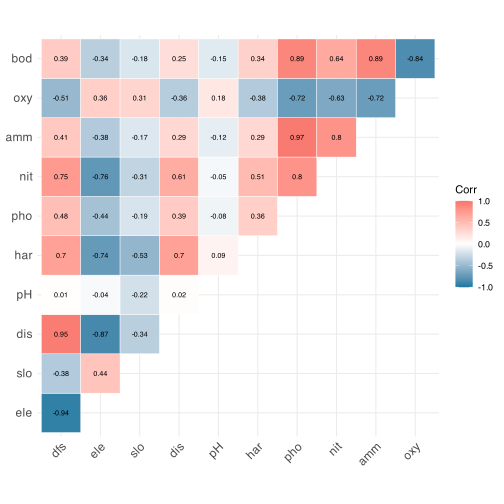
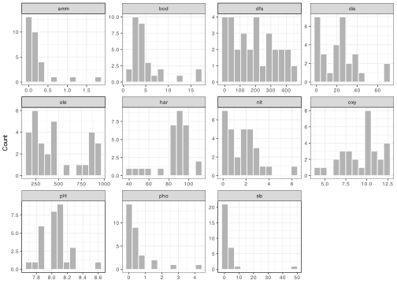
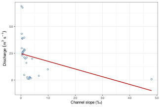

> **TIP:**
>
> | Type | Name | Link |
> |:---|:---|:---|
> | **Slides** | Correlation lecture slides | [💾 `BCB743_06_correlations.pdf`](../slides/BCB743_06_correlations.pdf) |
> | **Data** | The Doubs River data | [💾 `Doubs.RData`](../data/BCB743/NEwR-2ed_code_data/NeWR2-Data/Doubs.RData) |

> **IMPORTANT:**
>
> - [Task A 1–6](../BCB743/tasks/Task_A.llms.md)

> **NOTE:**
>
> - correlations among environmental variables as joint expressions of a river gradient
> - interpreting a correlation matrix, and visualising it as a heatmap
> - collinearity, and why it constrains later regression and ordination
> - Pearson against Spearman when variables are skewed
> - species associations as co-occurrence structure, measured with the Jaccard index

You encountered correlation as an inferential tool in [BCB744, Chapter 9](../BCB744/basic_stats/09-correlation-and-association.llms.md), where a single coefficient summarised the association between one pair of variables at a time. Here I revisit the idea with environmental data and many variables at once. A correlation matrix for a river system is interpreted as an analysis of how one spatial gradient structures the whole dataset, and later ordination and constrained methods build on this.

## 1 Set-up the analysis environment

``` numberSource
library(tidyverse)
library(vegan)
library(Hmisc) # for rcorr()
library(ggcorrplot) # for the correlation heatmap
```

## 2 The Doubs River data

David Zelený describes the background to the data on his excellent [website](https://www.davidzeleny.net/anadat-r/doku.php/en:data:doubs), and further information is presented in the book **Numerical Ecology with R** by Borcard et al. ([2011](#ref-borcard2011numerical)). These data are a beautiful example of how gradients structure biodiversity. Understanding how the environmental factors used as explanatory variables vary along the riverine gradient, from source to terminus, is in your own interest.

The environmental table `env` contains 30 sites (rows) and 11 measured variables (columns). Interpreting the correlation matrix later is much easier once the variable codes are familiar, so I set them out here:

| Code  | Variable                 | Units           |
|:------|:-------------------------|:----------------|
| `dfs` | distance from source     | km              |
| `ele` | elevation                | m a.s.l.        |
| `slo` | channel slope            | ‰               |
| `dis` | mean minimum discharge   | m³ s⁻¹          |
| `pH`  | water pH                 | (dimensionless) |
| `har` | total hardness (calcium) | mg L⁻¹          |
| `pho` | phosphate                | mg L⁻¹          |
| `nit` | nitrate                  | mg L⁻¹          |
| `amm` | ammonium                 | mg L⁻¹          |
| `oxy` | dissolved oxygen         | mg L⁻¹          |
| `bod` | biological oxygen demand | mg L⁻¹          |

``` numberSource
load(here::here(
  "data",
  "BCB743",
  "NEwR-2ed_code_data",
  "NEwR2-Data",
  "Doubs.RData"
))

head(env, 5)
```

    R>    dfs ele  slo  dis  pH har  pho  nit  amm  oxy bod
    R> 1  0.3 934 48.0 0.84 7.9  45 0.01 0.20 0.00 12.2 2.7
    R> 2  2.2 932  3.0 1.00 8.0  40 0.02 0.20 0.10 10.3 1.9
    R> 3 10.2 914  3.7 1.80 8.3  52 0.05 0.22 0.05 10.5 3.5
    R> 4 18.5 854  3.2 2.53 8.0  72 0.10 0.21 0.00 11.0 1.3
    R> 5 21.5 849  2.3 2.64 8.1  84 0.38 0.52 0.20  8.0 6.2

## 3 Correlations between environmental variables

**Correlation** refers to the statistical association between two continuous variables. It measures the extent to which changes in one variable correspond to changes in another, but on its own it does not establish causation. Correlations range from -1 to +1, with -1 a perfect negative correlation, +1 a perfect positive correlation, and 0 no correlation. A positive correlation means that as one variable increases the other also increases. A negative correlation means that as one increases the other decreases. The most common method is the Pearson correlation coefficient, with rank-based alternatives for ordinal variables or monotonic but non-linear patterns. The mechanics of choosing and testing a single coefficient are covered in [BCB744, Chapter 9](../BCB744/basic_stats/09-correlation-and-association.llms.md). Here I use those tools on a whole environmental table.

In a system such as the Doubs River, correlations among environmental variables are mostly joint expressions of a single, spatially ordered gradient that runs from the headwaters to the river mouth, rather than a collection of independent pairwise relationships. Elevation, distance from source, slope, nutrient concentrations, oxygen availability, and organic load are structurally linked through longitudinal transport, cumulative catchment effects, and the downstream integration of physical and biogeochemical processes. Strong correlations here often reflect the coherence of the riverine gradient rather than discrete ecological links between variable pairs. Recognising this shifts interpretation from isolated variable-to-variable associations towards an integrative understanding of how multivariate environmental structure follows from spatial ordering along the river continuum.

> **NOTE:**
>
> - One spatial gradient (source to mouth) orders most of the variables.
> - Variables that track that gradient become mutually correlated as a by-product.
> - A strong correlation is therefore often evidence of shared gradient position, not of a direct link between the two variables.

I do not need to standardise the variables, as one would for Euclidean distances, although in some instances a transformation might be needed:

``` numberSource
env_cor <- round(cor(env), 2)
env_cor
```

    R>       dfs   ele   slo   dis    pH   har   pho   nit   amm   oxy   bod
    R> dfs  1.00 -0.94 -0.38  0.95  0.01  0.70  0.48  0.75  0.41 -0.51  0.39
    R> ele -0.94  1.00  0.44 -0.87 -0.04 -0.74 -0.44 -0.76 -0.38  0.36 -0.34
    R> slo -0.38  0.44  1.00 -0.34 -0.22 -0.53 -0.19 -0.31 -0.17  0.31 -0.18
    R> dis  0.95 -0.87 -0.34  1.00  0.02  0.70  0.39  0.61  0.29 -0.36  0.25
    R> pH   0.01 -0.04 -0.22  0.02  1.00  0.09 -0.08 -0.05 -0.12  0.18 -0.15
    R> har  0.70 -0.74 -0.53  0.70  0.09  1.00  0.36  0.51  0.29 -0.38  0.34
    R> pho  0.48 -0.44 -0.19  0.39 -0.08  0.36  1.00  0.80  0.97 -0.72  0.89
    R> nit  0.75 -0.76 -0.31  0.61 -0.05  0.51  0.80  1.00  0.80 -0.63  0.64
    R> amm  0.41 -0.38 -0.17  0.29 -0.12  0.29  0.97  0.80  1.00 -0.72  0.89
    R> oxy -0.51  0.36  0.31 -0.36  0.18 -0.38 -0.72 -0.63 -0.72  1.00 -0.84
    R> bod  0.39 -0.34 -0.18  0.25 -0.15  0.34  0.89  0.64  0.89 -0.84  1.00

### 3.1 Visualise the matrix

An $11 \times 11$ table of numbers is hard to scan. The same information becomes legible at a glance as a heatmap, where colour encodes the sign and saturation encodes the strength of each correlation ([Figure 1](#fig-env-corr)).

Code

``` numberSource
ggcorrplot(
  env_cor,
  type = "upper",
  outline.col = "white",
  colors = c("#1679a1", "white", "#f8766d"),
  lab = TRUE,
  lab_size = 2.5
)
```

[](correlations_files/figure-html/fig-env-corr-1.svg "Figure 1: Pairwise Pearson correlations among the 11 Doubs River environmental variables. Red marks positive correlations, blue marks negative; colour saturation scales with the magnitude of the coefficient. Only the upper triangle is shown, since the matrix is symmetric.")

Figure 1: Pairwise Pearson correlations among the 11 Doubs River environmental variables. Red marks positive correlations, blue marks negative; colour saturation scales with the magnitude of the coefficient. Only the upper triangle is shown, since the matrix is symmetric.

### 3.2 Reading the matrix

A correlation matrix is only useful once you can interpret it. Four of the strongest entries are worth examining, since each one traces back to the river gradient rather than to a direct relationship between the two variables.

> **NOTE:**
>
> - **`dfs` and `dis` = 0.95.** Distance from source and discharge rise together: the further down the river, the more water the channel carries as tributaries accumulate.
> - **`dfs` and `ele` = -0.94.** Elevation falls as distance from source increases. The river loses height as it runs downstream, so the two are almost mirror images.
> - **`pho` and `amm` = 0.97.** Phosphate and ammonium track each other closely, consistent with nutrients accumulating together in the lower, more enriched reaches.
> - **`oxy` and `bod` = -0.84.** Dissolved oxygen falls as biological oxygen demand rises, consistent with oxygen being consumed as organic load increases downstream.

The correlation in each of these four pairs follows from shared gradient position, not from a direct causal link. Each variable changes monotonically along the river, so any two of them appear correlated simply because both are ordered by position. The same logic explains the block of mutually correlated nutrient variables (`pho`, `nit`, `amm`, `bod`) in the top-left of [Figure 1](#fig-env-corr), since they rise together downstream, and so appear as correlated entries in the matrix.

### 3.3 Collinearity

Because these variables are jointly structured by an altitudinal (or some other geographical) gradient, high pairwise correlations also signal *collinearity* within the environmental dataset, and this has consequences for later analyses. When strongly correlated predictors are treated as independent covariates, as in multiple regression or constrained ordination, their shared variance is hard to disentangle, parameter estimates become unstable, and an apparent effect may reflect gradient position rather than a distinct environmental influence. Understood this way, the correlation matrix is a diagnostic view of the multivariate redundancy that spatial ordering imposes. Spotting that redundancy early shapes decisions about variable selection, dimensional reduction, and whether a modelling framework that assumes near-independent predictors is appropriate at all.

> **NOTE:**
>
> - Strongly correlated predictors share variance.
> - That shared variance cannot be split cleanly between them.
> - Regression and constrained-ordination coefficients become unstable.
> - Dimensional reduction (such as PCA) or variable selection is often preferable.

The same redundancy is treated in detail in [BCB744, Chapter 16](../BCB744/basic_stats/16-collinearity-confounding-measurement-error.llms.md), and its effect on fitted coefficients is shown in [BCB744, Chapter 14](../BCB744/basic_stats/14-multiple-regression-and-model-specification.llms.md). It returns in this course when I reach constrained ordination, where variance inflation factors (VIF) are used to flag and prune collinear predictors.

### 3.4 Pearson or Spearman?

Pearson correlation is used above for convenience and familiarity, but it describes linear association on the original measurement scale and can be strongly affected by skew and leverage. The coefficient itself does not require a distributional assumption as a descriptor. Those assumptions become important when formal tests and confidence intervals are attached to it. Phosphate, ammonium, and biological oxygen demand are right-skewed, with most sites at low values and a few enriched downstream sites having large ones ([Figure 2](#fig-env-dist)). Slope is the most extreme case, dropping from steep headwater reaches to a near-flat lower river.

Code

``` numberSource
env |>
  pivot_longer(everything(), names_to = "variable", values_to = "value") |>
  ggplot(aes(x = value)) +
  geom_histogram(bins = 12, fill = "grey70", colour = "white") +
  facet_wrap(~variable, scales = "free", ncol = 4) +
  labs(x = NULL, y = "Count")
```

[](correlations_files/figure-html/fig-env-dist-1.svg "Figure 2: Distributions of the 11 environmental variables across the 30 sites. Several variables, namely slope, phosphate, ammonium, and biological oxygen demand, are strongly right-skewed, with a long tail set by a small number of downstream sites.")

Figure 2: Distributions of the 11 environmental variables across the 30 sites. Several variables, namely slope, phosphate, ammonium, and biological oxygen demand, are strongly right-skewed, with a long tail set by a small number of downstream sites.

Under skew, Pearson’s *r* mixes the strength of an association with the leverage of a few extreme sites. A rank-based alternative, namely Spearman’s $\rho$, changes the question by measuring the relative ordering of values rather than their magnitudes. Comparing the two is a useful diagnostic as it shows whether a relationship is affected by a monotonic trend along the gradient or by a handful of influential observations. Slope against discharge makes the contrast concrete.

Code

``` numberSource
ggplot(env, aes(x = slo, y = dis)) +
  geom_point(shape = 1, colour = "dodgerblue4") +
  geom_smooth(method = "lm", se = FALSE, colour = "firebrick") +
  labs(x = "Channel slope (‰)", y = expression(Discharge ~ (m^3 ~ s^-1)))
```

[](correlations_files/figure-html/fig-slo-dis-1.svg "Figure 3: Channel slope against mean minimum discharge across the 30 Doubs sites. The fitted line is a visual guide only. Most sites cluster at low slope, with a few steep headwater sites stretching the x-axis.")

Figure 3: Channel slope against mean minimum discharge across the 30 Doubs sites. The fitted line is a visual guide only. Most sites cluster at low slope, with a few steep headwater sites stretching the *x*-axis.

``` numberSource
cor.test(env$slo, env$dis, method = "pearson")
```

    R> 
    R>  Pearson's product-moment correlation
    R> 
    R> data:  env$slo and env$dis
    R> t = -1.9398, df = 28, p-value = 0.06254
    R> alternative hypothesis: true correlation is not equal to 0
    R> 95 percent confidence interval:
    R>  -0.62673732  0.01836381
    R> sample estimates:
    R>        cor 
    R> -0.3441825

``` numberSource
cor.test(env$slo, env$dis, method = "spearman", exact = FALSE)
```

    R> 
    R>  Spearman's rank correlation rho
    R> 
    R> data:  env$slo and env$dis
    R> S = 8195.6, p-value = 2.325e-08
    R> alternative hypothesis: true rho is not equal to 0
    R> sample estimates:
    R>        rho 
    R> -0.8232723

Pearson reports a weak relationship ($r \approx -0.34$), while Spearman reports a strong one ($\rho \approx -0.82$). The two disagree because steep slopes occur only in the upper river where discharge is low, so the ranks line up almost perfectly even though the raw spacing does not. The handful of steep headwater sites flattens the Pearson estimate. The reverse pattern appears for `pho` and `amm`, where Pearson (0.97) far exceeds Spearman (0.72). There the near-perfect Pearson value is partly the leverage of a few high-nutrient downstream sites. The worked Spearman example in [BCB744, Chapter 9](../BCB744/basic_stats/09-correlation-and-association.llms.md#example-2-spearmans-rho-when-the-rank-pattern-is-clearer-than-the-linear-one) follows the same thinking on a single variable pair.

> **NOTE:**
>
> - **Pearson** measures linear co-variation and is pulled by extreme values.
> - **Spearman** measures monotonic co-variation on ranks and resists skew.
> - A large gap between the two flags a relationship driven either by a few influential sites or by a monotonic but curved pattern.

Stating the choice of coefficient in these terms turns the analysis into a considered approach where the shape of the data informs the statistical tool applied to it.

### 3.5 Statistical significance

The matrix can also be returned with *p*-values attached, to establish which correlations are statistically distinguishable from zero:

``` numberSource
rcorr(as.matrix(env))
```

    R>       dfs   ele   slo   dis    pH   har   pho   nit   amm   oxy   bod
    R> dfs  1.00 -0.94 -0.38  0.95  0.01  0.70  0.48  0.75  0.41 -0.51  0.39
    R> ele -0.94  1.00  0.44 -0.87 -0.04 -0.74 -0.44 -0.76 -0.38  0.36 -0.34
    R> slo -0.38  0.44  1.00 -0.34 -0.22 -0.53 -0.19 -0.31 -0.17  0.31 -0.18
    R> dis  0.95 -0.87 -0.34  1.00  0.02  0.70  0.39  0.61  0.29 -0.36  0.25
    R> pH   0.01 -0.04 -0.22  0.02  1.00  0.09 -0.08 -0.05 -0.12  0.18 -0.15
    R> har  0.70 -0.74 -0.53  0.70  0.09  1.00  0.36  0.51  0.29 -0.38  0.34
    R> pho  0.48 -0.44 -0.19  0.39 -0.08  0.36  1.00  0.80  0.97 -0.72  0.89
    R> nit  0.75 -0.76 -0.31  0.61 -0.05  0.51  0.80  1.00  0.80 -0.63  0.64
    R> amm  0.41 -0.38 -0.17  0.29 -0.12  0.29  0.97  0.80  1.00 -0.72  0.89
    R> oxy -0.51  0.36  0.31 -0.36  0.18 -0.38 -0.72 -0.63 -0.72  1.00 -0.84
    R> bod  0.39 -0.34 -0.18  0.25 -0.15  0.34  0.89  0.64  0.89 -0.84  1.00
    R> 
    R> n= 30 
    R> 
    R> 
    R> P
    R>     dfs    ele    slo    dis    pH     har    pho    nit    amm    oxy   
    R> dfs        0.0000 0.0365 0.0000 0.9771 0.0000 0.0076 0.0000 0.0251 0.0040
    R> ele 0.0000        0.0146 0.0000 0.8447 0.0000 0.0144 0.0000 0.0376 0.0493
    R> slo 0.0365 0.0146        0.0625 0.2362 0.0028 0.3067 0.0997 0.3593 0.1006
    R> dis 0.0000 0.0000 0.0625        0.9147 0.0000 0.0355 0.0004 0.1136 0.0522
    R> pH  0.9771 0.8447 0.2362 0.9147        0.6405 0.6619 0.7976 0.5134 0.3494
    R> har 0.0000 0.0000 0.0028 0.0000 0.6405        0.0481 0.0039 0.1191 0.0370
    R> pho 0.0076 0.0144 0.3067 0.0355 0.6619 0.0481        0.0000 0.0000 0.0000
    R> nit 0.0000 0.0000 0.0997 0.0004 0.7976 0.0039 0.0000        0.0000 0.0002
    R> amm 0.0251 0.0376 0.3593 0.1136 0.5134 0.1191 0.0000 0.0000        0.0000
    R> oxy 0.0040 0.0493 0.1006 0.0522 0.3494 0.0370 0.0000 0.0002 0.0000       
    R> bod 0.0309 0.0677 0.3546 0.1770 0.4232 0.0619 0.0000 0.0001 0.0000 0.0000
    R>     bod   
    R> dfs 0.0309
    R> ele 0.0677
    R> slo 0.3546
    R> dis 0.1770
    R> pH  0.4232
    R> har 0.0619
    R> pho 0.0000
    R> nit 0.0001
    R> amm 0.0000
    R> oxy 0.0000
    R> bod

Treat a small *p*-value here as a sign that a pattern is consistent across the 30 sites, not as proof of a separable mechanism linking the two variables. The reason for that caution is set out below, and it becomes important once these variables are subject to ordination or regression.

> **NOTE:**
>
> The *p*-values reported for these correlations must be used carefully. With 30 sites arranged along a strongly ordered riverine gradient, the assumption of *independent observations* that underpins classical significance testing is only weakly met. Many of these variables co-vary not because of distinct pairwise relationships, but because they are jointly structured by position along the continuum. Small *p*-values then arise as a by-product of gradient coherence rather than as evidence for separable or mechanistic links.
>
> Seen this way, the *p*-value works mainly as a descriptive indicator of consistency across sites, not as a hypothesis test in the conventional sense (H₀: there is no statistically significant relationship among a variable pair along the length of the Doubs River). Treating it as a yes/no marker for “significant” against “non-significant” can hide the multivariate dependence that motivates the analysis, and it encourages interpretive habits that mislead once these variables are used in ordination or regression-based frameworks. The same non-independence problem, set out generally, appears in [BCB744, Chapter 9](../BCB744/basic_stats/09-correlation-and-association.llms.md#correlation-and-non-independent-data).

## 4 Associations between species

**Species association** is used here in a strictly statistical sense, to denote patterns of joint occurrence across sampling sites. An association describes whether two species tend to be recorded at the same sites more or less often than expected from their individual distributions, without implying any underlying ecological mechanism.

Such patterns may arise from shared responses to environmental gradients, similar habitat tolerances, or the spatial structuring of sites, as much as from direct biological interactions. The methods used here, based on dissimilarity measures such as the Jaccard index, operate only on presence-absence or abundance patterns, and so cannot distinguish the processes that generate those patterns.

> **NOTE:**
>
> An association matrix summarises co-occurrence structure but does not establish interaction, dependency, or ecological coupling between species. Two species may co-occur because they share a habitat preference, not because either responds to the other.

### 4.1 A worked Jaccard example

Before computing an association matrix for the fish, it helps to see how the Jaccard index turns co-occurrence into a number. Consider two species recorded across five sites, where 1 marks presence and 0 marks absence:

| Site | Species A | Species B |
|:-----|:---------:|:---------:|
| 1    |     1     |     1     |
| 2    |     1     |     0     |
| 3    |     1     |     1     |
| 4    |     0     |     1     |
| 5    |     0     |     0     |

The pair is summarised by three counts, namely the sites where both occur ($a = 2$, sites 1 and 3), the sites where only A occurs ($b = 1$, site 2), and the sites where only B occurs ($c = 1$, site 4). Sites where neither occurs (site 5) are ignored. The binary Jaccard *similarity* is the shared fraction of occupied sites, $a/(a+b+c) = 2/4 = 0.5$, and the Jaccard *distance* is its complement, $1 - 0.5 = 0.5$.

``` numberSource
toy <- data.frame(
  speciesA = c(1, 1, 1, 0, 0),
  speciesB = c(1, 0, 1, 1, 0)
)
# vegdist works row-wise, so transpose to put each species in a row
vegdist(t(toy), method = "jaccard", binary = TRUE)
```

    R>          speciesA
    R> speciesB      0.5

The value 0.5 confirms the hand calculation. Remember that Jaccard is a *dissimilarity* (lower means more alike), and that the “neither present” sites contribute nothing to it.

### 4.2 The fish-species association matrix

The Doubs fish dataset records abundances on a 0-to-5 scale across the 30 sites, and it is insightful to examine the properties of an association matrix:

``` numberSource
head(spe)
```

    R>   Cogo Satr Phph Babl Thth Teso Chna Pato Lele Sqce Baba Albi Gogo Eslu Pefl
    R> 1    0    3    0    0    0    0    0    0    0    0    0    0    0    0    0
    R> 2    0    5    4    3    0    0    0    0    0    0    0    0    0    0    0
    R> 3    0    5    5    5    0    0    0    0    0    0    0    0    0    1    0
    R> 4    0    4    5    5    0    0    0    0    0    1    0    0    1    2    2
    R> 5    0    2    3    2    0    0    0    0    5    2    0    0    2    4    4
    R> 6    0    3    4    5    0    0    0    0    1    2    0    0    1    1    1
    R>   Rham Legi Scer Cyca Titi Abbr Icme Gyce Ruru Blbj Alal Anan
    R> 1    0    0    0    0    0    0    0    0    0    0    0    0
    R> 2    0    0    0    0    0    0    0    0    0    0    0    0
    R> 3    0    0    0    0    0    0    0    0    0    0    0    0
    R> 4    0    0    0    0    1    0    0    0    0    0    0    0
    R> 5    0    0    2    0    3    0    0    0    5    0    0    0
    R> 6    0    0    0    0    2    0    0    0    1    0    0    0

To calculate associations *between species*, I first need to **transpose** the data, so that each row is a species and each column a site:

``` numberSource
spe_t <- t(spe)
```

Now I can calculate the association matrix. The first version uses the abundances directly:

``` numberSource
spe_assoc1 <- vegdist(spe_t, method = "jaccard")
# display only a portion of the data...
as.matrix((spe_assoc1))[1:10, 1:10]
```

    R>           Cogo      Satr      Phph      Babl      Thth      Teso      Chna
    R> Cogo 0.0000000 0.7368421 0.7794118 0.7945205 0.3333333 0.4545455 0.9354839
    R> Satr 0.7368421 0.0000000 0.3108108 0.4705882 0.7368421 0.7333333 0.9583333
    R> Phph 0.7794118 0.3108108 0.0000000 0.2804878 0.7794118 0.7571429 0.9113924
    R> Babl 0.7945205 0.4705882 0.2804878 0.0000000 0.8108108 0.7397260 0.8481013
    R> Thth 0.3333333 0.7368421 0.7794118 0.8108108 0.0000000 0.5833333 0.9000000
    R> Teso 0.4545455 0.7333333 0.7571429 0.7397260 0.5833333 0.0000000 0.8787879
    R> Chna 0.9354839 0.9583333 0.9113924 0.8481013 0.9000000 0.8787879 0.0000000
    R> Pato 0.8918919 0.9078947 0.7948718 0.7307692 0.9210526 0.7500000 0.4827586
    R> Lele 0.8627451 0.8235294 0.7386364 0.6666667 0.9056604 0.7346939 0.6136364
    R> Sqce 0.8360656 0.7978723 0.7346939 0.6562500 0.8730159 0.8281250 0.7017544
    R>           Pato      Lele      Sqce
    R> Cogo 0.8918919 0.8627451 0.8360656
    R> Satr 0.9078947 0.8235294 0.7978723
    R> Phph 0.7948718 0.7386364 0.7346939
    R> Babl 0.7307692 0.6666667 0.6562500
    R> Thth 0.9210526 0.9056604 0.8730159
    R> Teso 0.7500000 0.7346939 0.8281250
    R> Chna 0.4827586 0.6136364 0.7017544
    R> Pato 0.0000000 0.5000000 0.6774194
    R> Lele 0.5000000 0.0000000 0.4531250
    R> Sqce 0.6774194 0.4531250 0.0000000

The second reduces the data to presence and absence (`binary = TRUE`):

``` numberSource
spe_assoc2 <- vegdist(spe_t, method = "jaccard", binary = TRUE)
as.matrix((spe_assoc2))[1:10, 1:10]
```

    R>           Cogo      Satr      Phph      Babl      Thth      Teso      Chna
    R> Cogo 0.0000000 0.5294118 0.6000000 0.6666667 0.2222222 0.4000000 0.8888889
    R> Satr 0.5294118 0.0000000 0.2380952 0.3600000 0.5294118 0.6111111 0.8846154
    R> Phph 0.6000000 0.2380952 0.0000000 0.1666667 0.6000000 0.6000000 0.7692308
    R> Babl 0.6666667 0.3600000 0.1666667 0.0000000 0.6666667 0.6666667 0.6153846
    R> Thth 0.2222222 0.5294118 0.6000000 0.6666667 0.0000000 0.4000000 0.8235294
    R> Teso 0.4000000 0.6111111 0.6000000 0.6666667 0.4000000 0.0000000 0.7500000
    R> Chna 0.8888889 0.8846154 0.7692308 0.6153846 0.8235294 0.7500000 0.0000000
    R> Pato 0.8125000 0.8333333 0.7083333 0.6000000 0.8125000 0.6428571 0.2307692
    R> Lele 0.8181818 0.6538462 0.5384615 0.3846154 0.8181818 0.7000000 0.4210526
    R> Sqce 0.7307692 0.5517241 0.3928571 0.2500000 0.7307692 0.7307692 0.5200000
    R>           Pato      Lele      Sqce
    R> Cogo 0.8125000 0.8181818 0.7307692
    R> Satr 0.8333333 0.6538462 0.5517241
    R> Phph 0.7083333 0.5384615 0.3928571
    R> Babl 0.6000000 0.3846154 0.2500000
    R> Thth 0.8125000 0.8181818 0.7307692
    R> Teso 0.6428571 0.7000000 0.7307692
    R> Chna 0.2307692 0.4210526 0.5200000
    R> Pato 0.0000000 0.3888889 0.5600000
    R> Lele 0.3888889 0.0000000 0.2800000
    R> Sqce 0.5600000 0.2800000 0.0000000

Interpreting these matrices requires attention to what each form of the Jaccard index reflects. On abundance data, `vegdist(method = "jaccard")` uses **vegan**’s quantitative Jaccard distance, $2B/(1+B)$, where $B$ is Bray-Curtis dissimilarity. It is not the same index as the binary set-Jaccard calculated by hand above. It responds both to whether two species co-occur and to how their abundances are distributed across shared sites. Under this specification, species that occur together often but differ greatly in dominance can appear less closely associated than species with similar abundances, even when their occupancy patterns are comparable. The binary version removes abundance information and keeps only shared presence or absence, isolating co-occurrence structure from dominance. Recall that the index is a dissimilarity, namely lower values correspond to stronger co-occurrence and higher values to weaker. Judging an association as “strong” or “weak” therefore depends both on the magnitude of the distance and on how that distance was constructed. Assessing the abundance-weighted and binary matrices side by side shows that association is not an intrinsic property of a species pair, but a consequence of the analytical view applied to it, a distinction that returns when these distances drive clustering and ordination.

### 4.3 Reading the fish matrix

The fish matrix records the same longitudinal gradient as the environmental one, now expressed through which species share sites. Rather than scan all 27 species at once, I pull out six that span the river, from the cool upper reaches to the lowland sites, using the binary matrix:

``` numberSource
gradient_spp <- c("Cogo", "Satr", "Phph", "Abbr", "Blbj", "Anan")
round(as.matrix(spe_assoc2)[gradient_spp, gradient_spp], 2)
```

    R>      Cogo Satr Phph Abbr Blbj Anan
    R> Cogo 0.00 0.53 0.60 1.00 1.00 0.88
    R> Satr 0.53 0.00 0.24 0.96 0.96 0.88
    R> Phph 0.60 0.24 0.00 0.84 0.85 0.76
    R> Abbr 1.00 0.96 0.84 0.00 0.10 0.18
    R> Blbj 1.00 0.96 0.85 0.10 0.00 0.25
    R> Anan 0.88 0.88 0.76 0.18 0.25 0.00

> **NOTE:**
>
> - **`Abbr` and `Blbj` = 0.10.** Common bream and silver bream, two lowland cyprinids, are recorded at almost the same sites: a low distance marks strong co-occurrence.
> - **`Satr` and `Phph` = 0.24.** Brown trout and minnow share the cool upper reaches, so they too co-occur strongly.
> - **`Cogo` and `Abbr` = 1.00.** Bullhead (an upper-river species) and bream (a lowland species) share no site at all, namely the maximum Jaccard distance and complete mutual exclusion.

Seen as blocks, the sub-matrix splits in two. The upper-river species (`Cogo`, `Satr`, `Phph`) show low distances among themselves and high distances from the lowland species (`Abbr`, `Blbj`, `Anan`), which in turn group together. The association matrix therefore recovers the source-to-mouth ordering already seen in the environmental correlations, now expressed in the co-occurrence of species rather than the co-variation of measurements. That two-block structure is what clustering and ordination will formalise in the chapters that follow.

## 5 Bringing it together

The chapter has used four ideas that are easy to conflate, so let me separate them:

| Concept          | What it measures                   | Typical use            |
|:-----------------|:-----------------------------------|:-----------------------|
| Correlation      | relationship between two variables | environmental data     |
| Collinearity     | shared structure among predictors  | regression diagnostics |
| Association      | species co-occurrence pattern      | community ecology      |
| Jaccard distance | species dissimilarity              | ordination, clustering |

## 6 Looking forward

The analyses in this chapter are EDA and diagnostic steps that the later modelling choices build on, although they are also insightful in themselves, since interpreting these matrices gives a deeper feel for the structure of one’s data. Strong correlations among environmental variables indicate redundancy that constrains how the predictors can be used together, namely collinearity inflates variance, destabilises parameter estimates, and undermines attempts to attribute effects to individual covariates. Where that holds, treating each variable as an independent explanatory factor becomes statistically problematic. The correlation matrix is therefore a first step before further analyses, revealing when dimensional reduction or an alternative representation of environmental structure is needed before formal modelling proceeds.

The same applies to species associations. Patterns of co-occurrence summarised in an association matrix anticipate the distributional shape of species in multivariate space. High redundancy among species points to compressed ordination structures, while weak or uneven associations often translate into elongated gradients or dispersed configurations. This will become clear in my first ordination analyses. So, by examining correlations and associations at this early stage, I describe the data and diagnose their effective dimensionality at the same time, which motivates the transition towards ordination, clustering, and constrained multivariate methods in the chapters that follow.

## 7 References

Borcard D, Gillet F, Legendre P, others (2011) Numerical ecology with R. Springer

## Reuse

[CC BY-NC-SA 4.0](https://creativecommons.org/licenses/by-nc-sa/4.0/)

## Citation

BibTeX citation:

``` quarto-appendix-bibtex
@online{smit2026,
  author = {Smit, A. J.},
  title = {2. {Environmental} Correlations and Species Associations},
  date = {2026-11-06},
  url = {https://tangledbank.netlify.app/BCB743/correlations.html},
  langid = {en}
}
```

For attribution, please cite this work as:

Smit AJ (2026) 2. Environmental correlations and species associations. [https://tangledbank.netlify.app/BCB743/correlations.html.](https://tangledbank.netlify.app/BCB743/correlations.html)
