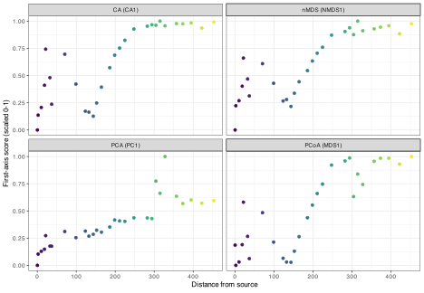
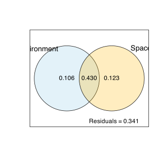
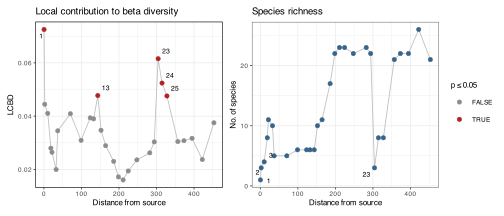
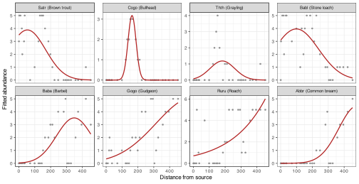

> **TIP:**
>
> | Type | Name | Link |
> |:---|:---|:---|
> | **Data** | The Doubs River data | [💾 `Doubs.RData`](../data/BCB743/NEwR-2ed_code_data/NeWR2-Data/Doubs.RData) |
> | **Packages** | vegan, adespatial, betapart, mvabund, MASS, gt | Install from CRAN before you start (see below) |

> **IMPORTANT:**
>
> - Reproduce the workflow on the Doubs data, then repeat it on a dataset of your own choosing.

Throughout the module the Doubs River fish survey has served as the standing example, examined one method at a time. Here I apply the whole sequence to it at once, from the first unconstrained ordination to methods from outside the core syllabus. Each method has its own chapter, so the interest here is where the methods agree, where they diverge, and what each one adds that the others miss.

The Doubs analyses repeatedly recover the longitudinal river continuum, but the more revealing ecological structure is seen where that continuum breaks down. The chapter also shows that statistical procedures can summarise pattern efficiently, while causal insights must come from ecological interpretation.

Spatial structure enters through Moran eigenvector maps computed by `dbmem()`, also new to the module. The data-driven variable selection of `ordiR2step()` is then compared to a theory-driven alternative, which is a way of thinking rather than a function call. Everything else you have met before, and I cross-reference the chapter where you met it.

> **NOTE:**
>
> Beyond **vegan** and the **tidyverse**, this chapter uses **adespatial** (spatial eigenvectors and beta-diversity contributions), **betapart** (turnover and nestedness), **mvabund** (model-based multivariate GLMs), **MASS** (negative-binomial GLMs), and **gt** (tables). Install any you are missing with `install.packages(c("adespatial", "betapart", "mvabund", "gt"))`. **MASS** ships with R.

## 1 Set-up the analysis environment

``` numberSource
library(tidyverse)
library(vegan)
library(viridis)
library(ggrepel)
library(patchwork)
library(gt) # publication-quality tables
```

I load the Doubs data. The file holds five objects, of which I use the fish abundances (`spe`), the environmental table (`env`), and the spatial coordinates (`spa`).

``` numberSource
load(here::here(
  "data",
  "BCB743",
  "NEwR-2ed_code_data",
  "NEwR2-Data",
  "Doubs.RData"
))
dim(spe)
```

    R> [1] 30 27

``` numberSource
dim(env)
```

    R> [1] 30 11

``` numberSource
dim(spa)
```

    R> [1] 30  2

Site 8 has no fish, so it has no compositional information and breaks the $\chi^2$ and Bray-Curtis geometries (you have seen this problem in the [CA chapter](../BCB743/CA.llms.md)). I drop it from the species-based analyses and keep a matched set of 29 sites. The environmental PCA can use all 30 rows, since it does not depend on the fish. I also standardise the environmental variables to zero mean and unit variance, so that variables measured on different scales (metres of altitude against milligrams of nitrate) contribute comparably.

``` numberSource
keep <- rowSums(spe) > 0 # site 8 is the only FALSE
spe <- spe[keep, ]
env_matched <- env[keep, ]
spa <- spa[keep, ]

E <- as.data.frame(scale(env_matched)) # standardised predictors
spe_hel <- decostand(spe, "hellinger") # Hellinger transform for RDA
site_dfs <- env_matched$dfs # distance from source, the river order
```

### 1.1 A reusable table theme with gt

\[Note: Remove this kind of silly signposting at the start of paragraphs…\] Before the analysis, one piece of infrastructure. The **gt** package builds tables the way **ggplot2** builds figures, by layering components onto a base object with the pipe. A raw `gt()` call already produces a clean HTML table, but setting a personalised style once upfront is worth considering. The helper below fixes the fonts, padding, and rules, and optionally attaches a source note. I apply it to every table in the chapter, as I would apply a `theme_*()` to every figure.

``` numberSource
gt_doubs <- function(df, note = NULL) {
  g <- df |>
    gt() |>
    tab_options(
      table.font.size = px(13),
      column_labels.font.weight = "bold",
      column_labels.background.color = "#f2f2f2",
      data_row.padding = px(4),
      heading.align = "left",
      table.border.top.width = px(2),
      table.border.top.color = "#111111",
      table.border.bottom.width = px(2),
      table.border.bottom.color = "#111111",
      source_notes.font.size = px(10)
    ) |>
    opt_horizontal_padding(1.5)
  if (!is.null(note)) {
    g <- g |> tab_source_note(md(note))
  }
  g
}
```

Let’s start with the environmental table. Each variable has a minimum, median, and maximum, and a correlation with distance from source that shows how tightly it tracks the river order. I compute the summary with `dplyr`, then pipe it to `gt`. Notice `fmt_number()` for consistent decimals and `data_color()`, which shades the correlation column like a heatmap so that the sign and strength of each association can be seen at a glance.

``` numberSource
var_labels <- c(
  dfs = "Distance from source",
  ele = "Altitude",
  slo = "Channel slope",
  dis = "Flow rate",
  pH = "pH",
  har = "Water hardness",
  pho = "Phosphate",
  nit = "Nitrate",
  amm = "Ammonium",
  oxy = "Dissolved oxygen",
  bod = "Biological oxygen demand"
)

env_summary <- tibble(
  Code = names(env),
  Variable = var_labels[names(env)],
  Minimum = map_dbl(env, min),
  Median = map_dbl(env, median),
  Maximum = map_dbl(env, max),
  r_dfs = map_dbl(env, ~ cor(.x, env$dfs))
)

env_summary |>
  gt_doubs(
    note = "Source: `Doubs.RData`. *r* with dfs computed across all 30 sites."
  ) |>
  cols_label(Code = "", r_dfs = "r with dfs") |>
  fmt_number(columns = c(Minimum, Median, Maximum, r_dfs), decimals = 2) |>
  data_color(
    columns = r_dfs,
    palette = c("#2166ac", "#f7f7f7", "#b2182b"),
    domain = c(-1, 1)
  )
```

|  | Variable | Minimum | Median | Maximum | r with dfs |
|----|----|----|----|----|----|
| dfs | Distance from source | 0.30 | 175.20 | 453.00 | 1.00 |
| ele | Altitude | 172.00 | 395.00 | 934.00 | −0.94 |
| slo | Channel slope | 0.20 | 1.20 | 48.00 | −0.38 |
| dis | Flow rate | 0.84 | 22.10 | 69.00 | 0.95 |
| pH | pH | 7.70 | 8.00 | 8.60 | 0.01 |
| har | Water hardness | 40.00 | 89.00 | 110.00 | 0.70 |
| pho | Phosphate | 0.01 | 0.29 | 4.22 | 0.48 |
| nit | Nitrate | 0.15 | 1.60 | 6.20 | 0.75 |
| amm | Ammonium | 0.00 | 0.10 | 1.80 | 0.41 |
| oxy | Dissolved oxygen | 4.10 | 10.20 | 12.40 | −0.51 |
| bod | Biological oxygen demand | 1.30 | 4.15 | 16.70 | 0.39 |
| Source: `Doubs.RData`. *r* with dfs computed across all 30 sites. |  |  |  |  |  |

Table 1: Environmental variables of the Doubs River, their range across the 30 sites, and their Pearson correlation with distance from source.

The heatmap column shows the main pattern. Distance from source, flow, hardness, nitrate, and phosphate rise downstream; altitude, slope, and oxygen fall; pH barely moves. The eleven variables are eleven views of one downstream integration of geomorphology and chemistry rather than independent measurements. The rest of the chapter traces this gradient (and exceptions) through the fish.

## 2 The dominant gradient: unconstrained ordinations

I run each unconstrained ordination method here again and see if they agree. I fit the environmental PCA, the species CA (and its detrended form DCA), and the distance-based PCoA and nMDS.

``` numberSource
set.seed(743)
env_pca <- rda(env, scale = TRUE) # all 30 sites
spe_ca <- cca(spe) # correspondence analysis
spe_dca <- decorana(spe) # detrended CA
spe_pcoa <- capscale(spe ~ 1, distance = "bray") # PCoA on Bray-Curtis
spe_nmds <- metaMDS(
  spe,
  distance = "bray",
  trace = 0,
  autotransform = FALSE,
  trymax = 100
) # nMDS
```

Each method reduces the data to axes under a different geometry. The test of a real gradient is whether the first axis of each ordination aligns with the physical river order. So, I extract the first-axis site scores from all four and correlate them with distance from source. Sign is arbitrary in ordination, so I take absolute correlations.

``` numberSource
first_axis <- function(ord, dfs) {
  s <- scores(ord, display = "sites", choices = 1)
  abs(cor(as.numeric(s), dfs))
}

align <- tibble(
  Ordination = c("PCA (PC1)", "CA (CA1)", "PCoA (MDS1)", "nMDS (NMDS1)"),
  r_with_dfs = c(
    abs(cor(scores(env_pca, display = "sites", choices = 1)[keep], site_dfs)),
    first_axis(spe_ca, site_dfs),
    first_axis(spe_pcoa, site_dfs),
    abs(cor(spe_nmds$points[, 1], site_dfs))
  )
)

# precomputed for inline use (avoids calling vegan functions in inline text)
dca_len <- diff(range(scores(spe_dca, display = "sites", choices = 1)))
```

``` numberSource
align |>
  gt_doubs(
    note = "Absolute Pearson correlation; ordination axis signs are arbitrary."
  ) |>
  cols_label(r_with_dfs = "|r| with dfs") |>
  fmt_number(columns = r_with_dfs, decimals = 3) |>
  data_color(columns = r_with_dfs, palette = "Blues", domain = c(0, 1))
```

| Ordination | \|r\| with dfs |
|----|----|
| PCA (PC1) | 0.857 |
| CA (CA1) | 0.812 |
| PCoA (MDS1) | 0.847 |
| nMDS (NMDS1) | 0.853 |
| Absolute Pearson correlation; ordination axis signs are arbitrary. |  |

Table 2: Correlation of each unconstrained ordination’s first axis with distance from source.

The four correlations range from about 0.81 to 0.85 ([Table 2](#tbl-align)). An axis extracted from the environmental table alone, an axis extracted from the fish alone under the $\chi^2$ metric, and two axes extracted from Bray-Curtis dissimilarity all reconstruct the same upstream-to-downstream order. So, I confirm that the dominant structure is a property of the river rather than of any one method. [Figure 1](#fig-align) shows the same pattern.

Code

``` numberSource
rescale01 <- function(x) {
  x <- x * sign(cor(x, site_dfs)) # orient to increase with dfs
  (x - min(x)) / (max(x) - min(x))
}

axis_scores <- tibble(
  dfs = site_dfs,
  `PCA (PC1)` = rescale01(scores(env_pca, display = "sites", choices = 1)[
    keep
  ]),
  `CA (CA1)` = rescale01(as.numeric(scores(
    spe_ca,
    display = "sites",
    choices = 1
  ))),
  `PCoA (MDS1)` = rescale01(as.numeric(scores(
    spe_pcoa,
    display = "sites",
    choices = 1
  ))),
  `nMDS (NMDS1)` = rescale01(spe_nmds$points[, 1])
) |>
  pivot_longer(-dfs, names_to = "Ordination", values_to = "score")

ggplot(axis_scores, aes(dfs, score, colour = dfs)) +
  geom_point(size = 1.3) +
  facet_wrap(~Ordination) +
  scale_colour_viridis_c(guide = "none") +
  labs(x = "Distance from source", y = "First-axis score (scaled 0-1)")
```

[](doubs_multivariate_AJS_edit_files/figure-html/fig-align-1.svg "Figure 1: First-axis site scores of the four unconstrained ordinations against distance from source. Each ordination recovers the same monotonic river gradient. Scores are scaled to a common range and oriented to increase downstream.")

Figure 1: First-axis site scores of the four unconstrained ordinations against distance from source. Each ordination recovers the same monotonic river gradient. Scores are scaled to a common range and oriented to increase downstream.

\[Note: More signposting\] DCA adds one number worth keeping. Its first-axis length, 3.86 standard-deviation units, is long, which means the fish turn over almost completely from source to mouth. A long gradient is why CA and PCA of these species show an arch, and why the distance-based methods, which do not force a linear response, describe the community more faithfully. That is the reasoning you’ll have seen in the [DCA](../BCB743/DCA.llms.md) and [PCoA](../BCB743/PCoA.llms.md) chapters, and I take it as given here.

## 3 Constrained ordination and variable selection

The unconstrained methods describe the pattern, so with the constrained methods I test whether the measured environment can explain it. I fit all three constrained ordinations, RDA on Hellinger-transformed abundances, CCA on the raw table, and db-RDA on Bray-Curtis dissimilarity, and in each case I let `ordiR2step()` select variables by forward selection from the null model up to the full model. You’ve seen this approach in the [constrained ordination chapter](../BCB743/constrained_ordination.llms.md). Here I run the three in parallel and compare what they keep.

``` numberSource
set.seed(743)

# RDA (linear, Hellinger)
rda_full <- rda(spe_hel ~ ., data = E)
rda_0 <- rda(spe_hel ~ 1, data = E)
rda_sel <- ordiR2step(
  rda_0,
  scope = formula(rda_full),
  R2scope = TRUE,
  trace = FALSE
)

# CCA (unimodal, chi-square)
cca_full <- cca(spe ~ ., data = E)
cca_0 <- cca(spe ~ 1, data = E)
cca_sel <- ordiR2step(
  cca_0,
  scope = formula(cca_full),
  R2scope = TRUE,
  trace = FALSE
)

# db-RDA (any dissimilarity, here Bray-Curtis)
dbrda_full <- capscale(spe ~ ., data = E, distance = "bray")
dbrda_0 <- capscale(spe ~ 1, data = E, distance = "bray")
dbrda_sel <- ordiR2step(
  dbrda_0,
  scope = formula(dbrda_full),
  R2scope = TRUE,
  trace = FALSE
)
```

Before interpreting the models, I check them for collinearity. Variance inflation factors (`vif.cca()`) flag predictors that are redundant with the others, and the full models have VIFs in the hundreds because the river variables are correlated together. Forward selection brings them down to interpretable levels. The selected sets and their adjusted $R^2$ go into a `gt` table. I use `tab_style()` to shade the db-RDA row, the model I trust most for community data, and a helper to extract the selected variable names from each fitted object.

``` numberSource
selected_vars <- function(mod) {
  paste(all.vars(formula(mod))[-1], collapse = ", ")
}

set.seed(743)
model_summary <- tibble(
  Model = c("RDA", "CCA", "db-RDA"),
  Predictors = c(
    selected_vars(rda_sel),
    selected_vars(cca_sel),
    selected_vars(dbrda_sel)
  ),
  adjR2 = c(
    RsquareAdj(rda_sel)$adj.r.squared,
    RsquareAdj(cca_sel)$adj.r.squared,
    RsquareAdj(dbrda_sel)$adj.r.squared
  ),
  maxVIF_full = c(
    max(vif.cca(rda_full)),
    max(vif.cca(cca_full)),
    max(vif.cca(dbrda_full))
  ),
  maxVIF_sel = c(
    max(vif.cca(rda_sel)),
    max(vif.cca(cca_sel)),
    max(vif.cca(dbrda_sel))
  )
)
```

``` numberSource
model_summary |>
  gt_doubs(
    note = "Forward selection by `ordiR2step()`; VIF from `vif.cca()`."
  ) |>
  cols_label(
    adjR2 = "adj. R²",
    maxVIF_full = "max VIF (full)",
    maxVIF_sel = "max VIF (selected)"
  ) |>
  fmt_number(columns = adjR2, decimals = 3) |>
  fmt_number(columns = c(maxVIF_full, maxVIF_sel), decimals = 1) |>
  tab_style(
    style = cell_fill(color = "#eef6ff"),
    locations = cells_body(rows = Model == "db-RDA")
  )
```

| Model | Predictors | adj. R² | max VIF (full) | max VIF (selected) |
|----|----|----|----|----|
| RDA | dfs, oxy, bod | 0.536 | 103.6 | 4.1 |
| CCA | dfs, oxy, ele | 0.497 | 135.3 | 9.0 |
| db-RDA | dfs, bod, oxy | 0.570 | 103.6 | 4.1 |
| Forward selection by `ordiR2step()`; VIF from `vif.cca()`. |  |  |  |  |

Table 3: The three constrained models after forward selection, with adjusted R-squared and the maximum VIF before and after selection.

The three models converge ([Table 3](#tbl-model-summary)). Each keeps a longitudinal-position variable (a proxy variable), `dfs` or `ele` (elevation, the altitude proxy in this dataset), together with `oxy` and a marker of organic loading. The maximum VIF falls from the hundreds in the full models to single digits after selection. The models agree that about half of the community variation is captured by three correlated descriptors of river position. The convergence has more weight than the small differences between the models.

### 3.1 Data-driven and theory-driven variable selection

Here I stop and think, because the selected variables are easy to over-interpret. Forward selection is a statistical procedure, not an ecological hypothesis. It keeps whichever variables most raise adjusted $R^2$, and in these data that is `dfs` with `oxy` and `bod`. A mechanistic account of the same river starts elsewhere. Position sets the physical foundation, since altitude and distance from source drives temperature, slope, and discharge. Land use then enriches the water with dissolved inorganic nitrogen (DIN, namely nitrate plus ammonium) and phosphate. This nutrient load drives primary production and the supply of degradable organic matter, which raises biological oxygen demand, and the respiration that follows draws down oxygen. In this chain nutrients are the upstream press even and oxygen is a downstream consequence.

So if we want a *cause* rather than a *correlate*, we might prefer a nutrient variable over oxygen. I can put that intuition to a direct test by fitting the candidate models by hand and comparing them, which is a good habit whenever a stepwise algorithm returns a set of variables.

``` numberSource
candidates <- list(
  "Forward-selected" = spe_hel ~ dfs + oxy + bod,
  "Position only" = spe_hel ~ dfs,
  "Position + nitrate" = spe_hel ~ dfs + nit,
  "Nutrient loading" = spe_hel ~ ele + nit + amm,
  "Nutrient + phosphate" = spe_hel ~ ele + nit + pho
)

theory_compare <- imap_dfr(candidates, function(f, nm) {
  m <- rda(f, data = E)
  tibble(
    Model = nm,
    Predictors = paste(all.vars(f)[-1], collapse = ", "),
    adjR2 = RsquareAdj(m)$adj.r.squared,
    maxVIF = max(vif.cca(m))
  )
})
```

``` numberSource
theory_compare |>
  gt_doubs(
    note = "adj. R² measures fit; max VIF measures residual collinearity."
  ) |>
  cols_label(adjR2 = "adj. R²", maxVIF = "max VIF") |>
  fmt_number(columns = adjR2, decimals = 3) |>
  fmt_number(columns = maxVIF, decimals = 2) |>
  tab_style(
    style = cell_text(weight = "bold"),
    locations = cells_body(columns = adjR2, rows = adjR2 == max(adjR2))
  )
```

| Model | Predictors | adj. R² | max VIF |
|----|----|----|----|
| Forward-selected | dfs, oxy, bod | 0.536 | 4.12 |
| Position only | dfs | 0.367 | 1.00 |
| Position + nitrate | dfs, nit | 0.388 | 2.20 |
| Nutrient loading | ele, nit, amm | 0.389 | 8.14 |
| Nutrient + phosphate | ele, nit, pho | 0.383 | 6.32 |
| adj. R² measures fit; max VIF measures residual collinearity. |  |  |  |

Table 4: Data-driven and theory-driven candidate models, all fitted as Hellinger RDA, with adjusted R-squared and the maximum VIF of each predictor set.

The numbers are instructive ([Table 4](#tbl-theory-compare)). Distance from source alone reaches adjusted $R^2 \approx 0.37$. Adding nitrate raises it only to about 0.39, whereas adding oxygen and biological oxygen demand increases it to 0.54. The nutrient-loading models stabilise near 0.39 as well. Dropping the oxygen pair forfeits about 0.15 of adjusted $R^2$, a difference too large to ignore. Why does the nutrient model explain so much less, if nutrients are meant to drive the oxygen? The correlation heatmap explains why.

``` numberSource
enrich_vars <- c("dfs", "oxy", "bod", "nit", "amm", "pho")
cor_tab <- cor(env_matched[, enrich_vars]) |>
  round(2) |>
  as.data.frame() |>
  rownames_to_column("Variable")

cor_tab |>
  gt_doubs(
    note = "Pearson correlations; cells shaded from blue (-1) to red (+1)."
  ) |>
  fmt_number(columns = all_of(enrich_vars), decimals = 2) |>
  data_color(
    columns = all_of(enrich_vars),
    palette = c("#2166ac", "#f7f7f7", "#b2182b"),
    domain = c(-1, 1)
  )
```

| Variable | dfs | oxy | bod | nit | amm | pho |
|----|----|----|----|----|----|----|
| dfs | 1.00 | −0.57 | 0.43 | 0.74 | 0.41 | 0.47 |
| oxy | −0.57 | 1.00 | −0.84 | −0.69 | −0.75 | −0.76 |
| bod | 0.43 | −0.84 | 1.00 | 0.68 | 0.90 | 0.91 |
| nit | 0.74 | −0.69 | 0.68 | 1.00 | 0.80 | 0.80 |
| amm | 0.41 | −0.75 | 0.90 | 0.80 | 1.00 | 0.97 |
| pho | 0.47 | −0.76 | 0.91 | 0.80 | 0.97 | 1.00 |
| Pearson correlations; cells shaded from blue (-1) to red (+1). |  |  |  |  |  |  |

Table 5: Pearson correlations among distance from source and the enrichment variables across the 29 matched sites.

Along the clean part of the continuum the enrichment variables are correlated, with several pairwise correlations above 0.7 in absolute value ([Table 5](#tbl-enrich-cor)), so any one can replace others and the choice among them is interpretive. The exception is where the ecology becomes interesting. Nitrate rises almost monotonically with distance from source ($r \approx 0.74$) and tracks the continuum, whereas oxygen and BOD decouple from it at the mid-river reach near sites 23 to 25, where oxygen falls to 4 to 6 mg L⁻¹ and BOD exceeds 12 mg L⁻¹. Forward selection retains oxygen and BOD precisely because they have that local oxygen sag, which a position or nitrate model cannot reproduce.

The interpretation is therefore a bit more complicated than it previously emerged in the earlier chapters. For a management question about nutrient control, DIN is the defensible predictor, and it loses little fit over the continuum. For describing the community that is actually present, oxygen is more than a proxy, and near the polluted sites it is a proximate stressor with a signal of its own. Statistical selection cannot arbitrate between these interpretations, because the variables are collinear over most of the river and diverge only at a handful of sites. The choice is an ecological judgement informed by the correlation structure, not an output of the algorithm. This is what the [constrained ordination chapter](../BCB743/constrained_ordination.llms.md) means by *explanation is not causation*.

## 4 Beyond the core methods

The remaining methods fall outside the standard ordination workflow we have covered. Each re-examines the river-continuum interpretation from an point-of-view the ordinations do not cover, and several focusses it by showing where the smooth-continuum picture breaks down.

### 4.1 Separating environment from space with variation partitioning

Sites that are far downstream are also far along the channel, so environment and space are structurally confounded. Variation partitioning (`varpart()`, which you’ve seen in the [seaweed appendix](../BCB743/two_oceans_appendices.llms.md)) splits the community variation into a part explained uniquely by the environment, a part explained uniquely by spatial position, a part they share, and an unexplained remainder. I describe spatial position with a second-order polynomial of the site coordinates.

``` numberSource
space_poly <- with(
  as.data.frame(scale(spa)),
  data.frame(X, Y, X2 = X^2, Y2 = Y^2, XY = X * Y)
)
E_sel <- E[, all.vars(formula(dbrda_sel))[-1]] # the db-RDA predictors

vp <- varpart(spe_hel, E_sel, space_poly)
vp
```

    R> 
    R> Partition of variance in RDA 
    R> 
    R> Call: varpart(Y = spe_hel, X = E_sel, space_poly)
    R> 
    R> Explanatory tables:
    R> X1:  E_sel
    R> X2:  space_poly 
    R> 
    R> No. of explanatory tables: 2 
    R> Total variation (SS): 14.07 
    R>             Variance: 0.50251 
    R> No. of observations: 29 
    R> 
    R> Partition table:
    R>                      Df R.squared Adj.R.squared Testable
    R> [a+c] = X1            3   0.58597       0.53629     TRUE
    R> [b+c] = X2            5   0.63301       0.55322     TRUE
    R> [a+b+c] = X1+X2       8   0.75669       0.65937     TRUE
    R> Individual fractions                                    
    R> [a] = X1|X2           3                 0.10614     TRUE
    R> [b] = X2|X1           5                 0.12308     TRUE
    R> [c]                   0                 0.43014    FALSE
    R> [d] = Residuals                         0.34063    FALSE
    R> ---
    R> Use function 'rda' to test significance of fractions of interest

Code

``` numberSource
plot(
  vp,
  bg = c("#8ecae6", "#ffb703"),
  Xnames = c("Environment", "Space"),
  digits = 2,
  cutoff = -Inf
)
```

[](doubs_multivariate_AJS_edit_files/figure-html/fig-varpart-1.svg "Figure 2: Venn partition of Hellinger-transformed fish composition between the selected environmental predictors and polynomial spatial position. Values are adjusted R-squared for each fraction.")

Figure 2: Venn partition of Hellinger-transformed fish composition between the selected environmental predictors and polynomial spatial position. Values are adjusted R-squared for each fraction.

The pure environmental and pure spatial fractions are both small (adjusted $R^2 \approx 0.11$ and $0.12$), while the shared fraction reaches about 0.43 ([Figure 2](#fig-varpart)). Most of the explained variation cannot be assigned to environment or to space alone, because in a single river the two are the same axis viewed twice. A large shared fraction here is ecological information, not a nuisance to be removed.

### 4.2 Spatial structure at multiple scales with MEM

Variation partitioning treats space as a smooth trend. Moran eigenvector maps (MEMs) are more flexible (a new tool in this chapter). `dbmem()` turns the site coordinates into a set of orthogonal spatial variables, each describing pattern at its own scale, from a broad upstream-to-downstream trend in the first few to fine alternations between neighbouring reaches in the last. They are the spatial analogue of a Fourier basis, and I use them as predictors in the same way as the environmental variables.

``` numberSource
library(adespatial)

mem <- dbmem(spa, silent = TRUE) # Moran eigenvector maps from coordinates
mem_df <- as.data.frame(mem)

set.seed(743)
mem_full <- rda(spe_hel ~ ., data = mem_df)
mem_0 <- rda(spe_hel ~ 1, data = mem_df)
mem_sel <- ordiR2step(
  mem_0,
  scope = formula(mem_full),
  R2scope = TRUE,
  trace = FALSE
)

mem_vars <- selected_vars(mem_sel)
mem_r2 <- RsquareAdj(mem_sel)$adj.r.squared
mem_vars
```

    R> [1] "MEM2, MEM3, MEM1, MEM4"

``` numberSource
mem_r2
```

    R> [1] 0.5506843

Forward selection keeps MEM2, MEM3, MEM1, MEM4 and reaches an adjusted $R^2$ of about 0.55. The fish assemblage is spatially structured, and the broad-scale MEMs have the same longitudinal signal as distance from source. MEMs do not implicate an environmental cause. They quantify the scale at which structure exists, which is a useful addition to the variation partitioning above and a standard starting point to spatial community ecology.

### 4.3 Comparing whole matrices with Mantel tests

A Mantel test correlates two distance matrices directly, without first reducing either to axes (as in ordinations). I compare the fish Bray-Curtis dissimilarity with a Euclidean distance on the standardised environment, and with the geographic distance between sites. The partial Mantel then keeps one matrix constant while testing the other, which is the matrix-level version of the variation partitioning above.

``` numberSource
D_comm <- vegdist(spe, method = "bray")
D_env <- dist(E)
D_geo <- dist(spa)

set.seed(743)
mantel_tab <- tibble(
  Comparison = c(
    "Community vs environment",
    "Community vs geography",
    "Community vs environment | geography",
    "Community vs geography | environment"
  ),
  r = c(
    mantel(D_comm, D_env)$statistic,
    mantel(D_comm, D_geo)$statistic,
    mantel.partial(D_comm, D_env, D_geo)$statistic,
    mantel.partial(D_comm, D_geo, D_env)$statistic
  ),
  p = c(
    mantel(D_comm, D_env)$signif,
    mantel(D_comm, D_geo)$signif,
    mantel.partial(D_comm, D_env, D_geo)$signif,
    mantel.partial(D_comm, D_geo, D_env)$signif
  )
)
```

``` numberSource
mantel_tab |>
  gt_doubs(
    note = "Mantel *r* with 999 permutations; the vertical bar denotes 'holding constant'."
  ) |>
  fmt_number(columns = r, decimals = 3) |>
  fmt_number(columns = p, decimals = 3) |>
  tab_style(
    style = cell_text(color = "#b2182b", weight = "bold"),
    locations = cells_body(columns = p, rows = p <= 0.05)
  )
```

| Comparison | r | p |
|----|----|----|
| Community vs environment | 0.606 | 0.001 |
| Community vs geography | 0.319 | 0.001 |
| Community vs environment \| geography | 0.564 | 0.001 |
| Community vs geography \| environment | 0.177 | 0.006 |
| Mantel *r* with 999 permutations; the vertical bar denotes ‘holding constant’. |  |  |

Table 6: Mantel and partial Mantel correlations among the fish, environmental, and geographic distance matrices.

The environment is much the stronger match ($r \approx 0.61$ against $0.32$ for geography), and it survives conditioning on space ($r \approx 0.56$) far better than space survives conditioning on environment ($r \approx 0.18$) ([Table 6](#tbl-mantel)). This agrees in direction with the variation partitioning, though the two weight the environment differently, since the Mantel test uses the full eleven-variable distance while the partitioning used three selected predictors. Mantel tests are also known to be conservative, so I treat them as corroboration rather than as a separate estimate of effect size.

### 4.4 Replacement or loss? Beta-diversity partitioning

I have repeatedly called the downstream change a *replacement* of species. Beta-diversity partitioning tests that word. Using **betapart**, I split the total multi-site dissimilarity into a balanced-turnover component, where a gain of one species is matched by a loss of another, and an abundance-gradient component, the nestedness-like part where one assemblage is a thinned version of another.

``` numberSource
library(betapart)
bp <- beta.multi.abund(spe, index.family = "bray")

beta_tab <- tibble(
  Component = c(
    "Total (beta.BRAY)",
    "Balanced turnover (replacement)",
    "Abundance gradient (nestedness-like)"
  ),
  Value = c(bp$beta.BRAY, bp$beta.BRAY.BAL, bp$beta.BRAY.GRA),
  Share = c(1, bp$beta.BRAY.BAL / bp$beta.BRAY, bp$beta.BRAY.GRA / bp$beta.BRAY)
)
```

``` numberSource
beta_tab |>
  gt_doubs(note = "`betapart::beta.multi.abund()`, Bray-Curtis family.") |>
  fmt_number(columns = c(Value, Share), decimals = 3) |>
  tab_style(
    style = cell_fill(color = "#eef6ff"),
    locations = cells_body(
      rows = Component == "Balanced turnover (replacement)"
    )
  )
```

| Component                                           | Value | Share |
|-----------------------------------------------------|-------|-------|
| Total (beta.BRAY)                                   | 0.909 | 1.000 |
| Balanced turnover (replacement)                     | 0.779 | 0.857 |
| Abundance gradient (nestedness-like)                | 0.130 | 0.143 |
| `betapart::beta.multi.abund()`, Bray-Curtis family. |       |       |

Table 7: Multi-site beta-diversity of the fish assemblage, split into balanced turnover and abundance-gradient components (Baselga family, abundance-based).

Turnover dominates, at about 0.86 of the total against 0.14 for the abundance-gradient component ([Table 7](#tbl-betapart)). So, the word *replacement* is justified. The abundance-gradient component is small but present, and it is largest where the assemblage thins to a subset of the fuller lowland fauna, namely at the species-poor headwater and at the polluted mid-river reach. Beta-diversity partitioning recovers both processes and shows which one dominates.

### 4.5 Which sites and species are distinctive? LCBD and SCBD

Local contributions to beta diversity (LCBD) rank the sites by how much each adds to the total variance of the community matrix, and species contributions (SCBD) do the same for the species (`beta.div()` in **adespatial**). A high-LCBD site is ecologically distinctive, and a permutation test shows whether its distinctiveness exceeds chance. This analysis identifies the pollution reach without any prior specification of where to look.

``` numberSource
set.seed(743)
bd <- adespatial::beta.div(spe, method = "hellinger", nperm = 999)

lcbd_tab <- tibble(
  Site = as.integer(rownames(spe)),
  dfs = env_matched$dfs,
  LCBD = as.numeric(bd$LCBD),
  p = as.numeric(bd$p.LCBD)
) |>
  arrange(desc(LCBD)) |>
  slice_head(n = 6)
```

``` numberSource
lcbd_tab |>
  gt_doubs(note = "`adespatial::beta.div()`, Hellinger, 999 permutations.") |>
  fmt_number(columns = dfs, decimals = 1) |>
  fmt_number(columns = LCBD, decimals = 4) |>
  fmt_number(columns = p, decimals = 3) |>
  tab_style(
    style = cell_text(color = "#b2182b", weight = "bold"),
    locations = cells_body(columns = p, rows = p <= 0.05)
  )
```

| Site                                                   | dfs   | LCBD   | p     |
|--------------------------------------------------------|-------|--------|-------|
| 1                                                      | 0.3   | 0.0725 | 0.001 |
| 23                                                     | 304.3 | 0.0616 | 0.001 |
| 24                                                     | 314.7 | 0.0524 | 0.011 |
| 13                                                     | 143.6 | 0.0477 | 0.044 |
| 25                                                     | 327.8 | 0.0476 | 0.037 |
| 2                                                      | 2.2   | 0.0445 | 0.094 |
| `adespatial::beta.div()`, Hellinger, 999 permutations. |       |        |       |

Table 8: The six sites contributing most to total beta diversity, with distance from source and the permutation p-value.

The most distinctive sites are the extreme headwater, a near-monospecific brown-trout reach, and sites 23 to 25 ([Table 8](#tbl-lcbd)). [Figure 3](#fig-lcbd) shows every site’s LCBD and species richness along the river. Richness collapses from 22 species to 3 at the pollution reach, exactly where LCBD peaks, before the assemblage recovers downstream.

Code

``` numberSource
lcbd_plot <- tibble(
  site = as.integer(rownames(spe)),
  dfs = env_matched$dfs,
  LCBD = as.numeric(bd$LCBD),
  p = as.numeric(bd$p.LCBD),
  richness = rowSums(spe > 0)
) |>
  mutate(signif = p <= 0.05)

p1 <- ggplot(lcbd_plot, aes(dfs, LCBD)) +
  geom_line(colour = "grey75", linewidth = 0.4) +
  geom_point(aes(colour = signif), size = 1.8) +
  geom_text_repel(
    data = filter(lcbd_plot, signif),
    aes(label = site),
    size = 2.4
  ) +
  scale_colour_manual(
    values = c("FALSE" = "grey55", "TRUE" = "firebrick"),
    name = "p ≤ 0.05"
  ) +
  labs(
    title = "Local contribution to beta diversity",
    x = "Distance from source"
  )

p2 <- ggplot(lcbd_plot, aes(dfs, richness)) +
  geom_line(colour = "grey75", linewidth = 0.4) +
  geom_point(colour = "steelblue4", size = 1.8) +
  geom_text_repel(
    data = filter(lcbd_plot, richness <= 4),
    aes(label = site),
    size = 2.4
  ) +
  labs(
    title = "Species richness",
    x = "Distance from source",
    y = "No. of species"
  )

p1 + p2 + plot_layout(guides = "collect")
```

[](doubs_multivariate_AJS_edit_files/figure-html/fig-lcbd-1.svg "Figure 3: Local contribution to beta diversity (left) and species richness (right) along distance from source. Firebrick points mark sites significant at p ≤ 0.05.")

Figure 3: Local contribution to beta diversity (left) and species richness (right) along distance from source. Firebrick points mark sites significant at p ≤ 0.05.

### 4.6 A model-based check with manyGLM

Every distance-based method treats the count table through a dissimilarity index. `manyGLM()` in **mvabund**, which you’ve seen’ in the [diatom nMDS chapter](../BCB743/nMDS_diatoms.llms.md), instead fits a negative-binomial GLM to each species and tests the predictors jointly by resampling, so it respects the mean-variance relationship of counts explicitly. It is a useful check that the ordination result does not depend on the Bray-Curtis geometry.

``` numberSource
library(mvabund)
Y <- mvabund(as.matrix(spe))
mg_fit <- manyglm(Y ~ dfs + bod + oxy, data = E, family = "negative.binomial")
set.seed(743)
mg_anova <- anova(mg_fit, p.uni = "none", nBoot = 199, test = "LR")
```

    R> Time elapsed: 0 hr 0 min 1 sec

``` numberSource
mg_anova$table
```

    R>             Res.Df Df.diff      Dev Pr(>Dev)
    R> (Intercept)     28      NA       NA       NA
    R> dfs             27       1 430.2289    0.005
    R> bod             26       1 133.1579    0.005
    R> oxy             25       1 112.2204    0.005

Distance from source, BOD, and oxygen are each significant, and distance from source has much the largest deviance. A method that makes the count distribution explicit reaches the same ranking as the ordinations.

### 4.7 The shape of species responses

The ordinations assume, through the $\chi^2$ and Bray-Curtis geometries, that species rise and fall along the gradient rather than climb without limit. I can check that directly by fitting each species against distance from source with a negative-binomial GLM (`glm.nb()` from the [GLM chapter](../BCB743/glm.llms.md)) that has a linear and a quadratic term. A significant negative quadratic term is a unimodal response with an optimum inside the surveyed reach, and the optimum is the fitted peak.

``` numberSource
library(MASS)
focus <- c("Satr", "Cogo", "Thth", "Babl", "Baba", "Gogo", "Ruru", "Abbr")
sp_names <- c(
  Satr = "Brown trout",
  Cogo = "Bullhead",
  Thth = "Grayling",
  Babl = "Stone loach",
  Baba = "Barbel",
  Gogo = "Gudgeon",
  Ruru = "Roach",
  Abbr = "Common bream"
)
dfs <- env_matched$dfs

response_tab <- map_dfr(focus, function(s) {
  fit <- glm.nb(spe[[s]] ~ dfs + I(dfs^2))
  co <- coef(fit)
  p2 <- summary(fit)$coefficients["I(dfs^2)", "Pr(>|z|)"]
  peak <- if (co[["I(dfs^2)"]] < 0) {
    -co[["dfs"]] / (2 * co[["I(dfs^2)"]])
  } else {
    NA_real_
  }
  in_range <- !is.na(peak) && peak >= min(dfs) && peak <= max(dfs)
  tibble(
    Code = s,
    Species = sp_names[s],
    Optimum = if (in_range) round(peak) else NA_real_,
    quad_p = p2,
    Response = if (in_range && p2 < 0.05) {
      "Unimodal, optimum in survey"
    } else {
      "Increasing, optimum below survey"
    }
  )
})
```

``` numberSource
response_tab |>
  gt_doubs(
    note = "`MASS::glm.nb(y ~ dfs + I(dfs^2))`; optimum in km from source."
  ) |>
  cols_label(quad_p = "quadratic p", Optimum = "optimum (km)") |>
  fmt_number(columns = quad_p, decimals = 3) |>
  sub_missing(columns = Optimum, missing_text = "beyond survey") |>
  tab_style(
    style = cell_fill(color = "#eef6ff"),
    locations = cells_body(rows = str_detect(Response, "Unimodal"))
  )
```

| Code | Species | optimum (km) | quadratic p | Response |
|----|----|----|----|----|
| Satr | Brown trout | 53 | 0.022 | Unimodal, optimum in survey |
| Cogo | Bullhead | 163 | 0.020 | Unimodal, optimum in survey |
| Thth | Grayling | 182 | 0.016 | Unimodal, optimum in survey |
| Babl | Stone loach | 99 | 0.010 | Unimodal, optimum in survey |
| Baba | Barbel | 348 | 0.017 | Unimodal, optimum in survey |
| Gogo | Gudgeon | beyond survey | 0.317 | Increasing, optimum below survey |
| Ruru | Roach | beyond survey | 0.979 | Increasing, optimum below survey |
| Abbr | Common bream | beyond survey | 0.200 | Increasing, optimum below survey |
| `MASS::glm.nb(y ~ dfs + I(dfs^2))`; optimum in km from source. |  |  |  |  |

Table 9: Negative-binomial response models against distance from source, with the fitted optimum and the quadratic-term p-value for each species.

The pattern in [Table 9](#tbl-response) and [Figure 4](#fig-response) is the ecology of the river in one picture. The headwater and mid-river species have clear optima ordered along the channel, from brown trout near 50 km to barbel near 350 km. The lowland species, roach, gudgeon, and common bream, are still climbing at the downstream limit, so their fitted optima lie beyond the sampled reach. This is the expected signature of a gradient sampled from its cold, species-poor source to a lower reach that has not yet reached the true lowland optima, and it is the same truncation that gives the DCA its long first axis.

Code

``` numberSource
grid <- seq(min(dfs), max(dfs), length.out = 200)
pred <- map_dfr(focus, function(s) {
  fit <- glm.nb(spe[[s]] ~ dfs + I(dfs^2))
  tibble(
    code = s,
    dfs = grid,
    fit = as.numeric(predict(fit, tibble(dfs = grid), type = "response"))
  )
})
obs <- map_dfr(focus, ~ tibble(code = .x, dfs = dfs, abundance = spe[[.x]]))
lab <- setNames(paste0(focus, " (", sp_names[focus], ")"), focus)
pred$label <- factor(lab[pred$code], levels = lab[focus])
obs$label <- factor(lab[obs$code], levels = lab[focus])

ggplot(pred, aes(dfs, fit)) +
  geom_point(data = obs, aes(dfs, abundance), colour = "grey55", size = 0.7) +
  geom_line(colour = "firebrick", linewidth = 0.6) +
  facet_wrap(~label, scales = "free_y", ncol = 4) +
  labs(x = "Distance from source", y = "Fitted abundance") +
  theme(strip.text = element_text(size = 6))
```

[](doubs_multivariate_AJS_edit_files/figure-html/fig-response-1.svg "Figure 4: Fitted negative-binomial abundance responses (firebrick) with observed counts (grey) against distance from source. Vertical scales differ between panels.")

Figure 4: Fitted negative-binomial abundance responses (firebrick) with observed counts (grey) against distance from source. Vertical scales differ between panels.

## 5 Synthesis: one continuum and one interruption

These analyses show that the Doubs assemblage is organised primarily by a longitudinal river continuum. The upper sites are high, steep, cool reaches with near-saturated oxygen and little nutrient load, while the lower sites are further from source, warmer, harder, and more enriched. Every method in the chapter (unconstrained or constrained, distance-based or model-based) recovers that one axis as the dominant structure, and the fish follow it as an ordered replacement of trout-zone species by lowland cyprinids. The beta-diversity partition shows that replacement is largely comprised of turnover (about 0.86 of dissimilarity is turnover), and the response models show why (each species occupies a bounded stretch of the gradient).

The continuum is not perfectly smooth, and the most valuable results show where the gradient is interrupted. A short river stretch at sites 23 to 25 has a strong organic-load signal with oxygen falling to 4 mg L⁻¹ and BOD above 12, and the fauna there thins to a few tolerant species before recovering. That stretch is the reason oxygen and BOD survive forward selection where nitrate does not. It has the highest LCBD outside the headwater, it supplies most of the nestedness-like component of beta diversity, and it is visible as the richness minimum in [Figure 3](#fig-lcbd). Overall, the analyses describe two overlaid gradients, a long physical-chemical continuum and a short, sharp oxygen sag, not the single monotonic trend the earlier chapters revealed.

These conclusions are based on correlational evidence, so association is not mechanism, which is why the [selection argument](#sec-selection) did not name a single driver. The gradient is truncated at both ends, so the optima of the most downstream species are situated beyond the survey. Environment and space are confounded along a single channel, which is why the shared fraction of the variation partition is so large. These are properties of one river surveyed once, and they would be relaxed only by more rivers, more seasons, or experimental work.

Code

``` numberSource
sessioninfo::session_info(
  pkgs = c("vegan", "adespatial", "betapart", "mvabund", "gt")
)$packages |>
  as_tibble() |>
  filter(
    package %in% c("vegan", "adespatial", "betapart", "mvabund", "gt", "MASS")
  ) |>
  dplyr::select(package, loadedversion, source)
```

    R> # A tibble: 6 × 3
    R>   package    loadedversion source        
    R>   <chr>      <chr>         <chr>         
    R> 1 adespatial 0.3-29        CRAN (R 4.6.0)
    R> 2 betapart   1.6.1         CRAN (R 4.6.0)
    R> 3 gt         1.3.0         CRAN (R 4.6.0)
    R> 4 MASS       7.3-66        CRAN (R 4.6.2)
    R> 5 mvabund    4.2.8         CRAN (R 4.6.0)
    R> 6 vegan      2.7-5         CRAN (R 4.6.0)

## Reuse

[CC BY-NC-SA 4.0](https://creativecommons.org/licenses/by-nc-sa/4.0/)

## Citation

BibTeX citation:

``` quarto-appendix-bibtex
@online{smit2026,
  author = {Smit, A. J.},
  title = {13c. {A} Complete Multivariate Analysis of the {Doubs}
    {River}},
  date = {2026-11-06},
  url = {https://tangledbank.netlify.app/BCB743/doubs_multivariate_AJS_edit.html},
  langid = {en}
}
```

For attribution, please cite this work as:

Smit AJ (2026) 13c. A complete multivariate analysis of the Doubs River. [https://tangledbank.netlify.app/BCB743/doubs_multivariate_AJS_edit.html.](https://tangledbank.netlify.app/BCB743/doubs_multivariate_AJS_edit.html)
