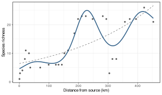
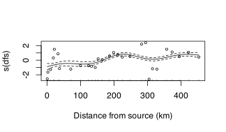
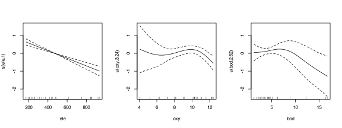
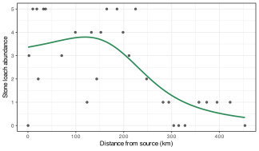

> **TIP:**
>
> | Type | Name | Link |
> |:---|:---|:---|
> | **Prior** | Generalised Linear Models | [GLM](../BCB743/glm.llms.md) |
> | **Data** | The Doubs River data | [💾 `Doubs.RData`](../data/BCB743/NEwR-2ed_code_data/NeWR2-Data/Doubs.RData) |

> **IMPORTANT:**
>
> - [Task M 1–6](../BCB743/tasks/Task_M.llms.md)

A [GLM](../BCB743/glm.llms.md) still draws a straight line, just on the link scale rather than the response scale. That is often wrong for ecological gradients. The whole reason I preferred [correspondence analysis](../BCB743/CA.llms.md) over PCA was that species respond to gradients **unimodally**, with abundance rising to a peak at a preferred position and falling away on either side. A straight line cannot describe a hump. I could add a quadratic term by hand, but that forces a symmetric parabola and still requires me to guess the shape in advance.

A **generalised additive model** (GAM) removes the guesswork. It keeps the error families and link functions of the GLM but replaces each straight-line term $\beta_j x_j$ with a **smooth function** $f_j(x_j)$ whose shape is estimated from the data:

$$g(\mu) = \beta_0 + f_1(x_1) + f_2(x_2) + \dots + f_p(x_p).$$

The model decides for itself whether a predictor acts linearly, as a hump, as a threshold, or as something more complex, while a penalty stops it from chasing noise. You have already used a GAM without knowing it. The `ordisurf()` response surfaces in the ordination chapters fit precisely this kind of smooth onto an ordination diagram.

## 1 What is a smooth?

A smooth $f(x)$ is built as a weighted sum of simple **basis functions**. In `mgcv::gam()`, `s()` uses thin-plate regression splines by default unless another basis is requested with `bs =`, such as cubic regression splines. On its own, a flexible basis would overfit, so a GAM adds a **wiggliness penalty** and chooses the weights by penalised likelihood. The strength of the penalty is selected automatically. I use restricted maximum likelihood (`method = "REML"`), which is the most reliable choice.

The flexibility used by a fitted smooth is summarised by its **effective degrees of freedom** (edf). An edf of 1 means the smooth has collapsed to a straight line, an edf of 2 is roughly a quadratic, and larger values mean more curvature. The edf is the GAM’s main diagnostic because it tells you how non-linear each predictor turned out to be.

``` numberSource
library(tidyverse)
library(vegan)
library(mgcv) # gam(), the reference implementation

load(here::here(
  "data",
  "BCB743",
  "NEwR-2ed_code_data",
  "NEwR2-Data",
  "Doubs.RData"
))
spe <- spe[rowSums(spe) > 0, ]
env <- env[rownames(spe), ]

dat <- data.frame(
  richness = specnumber(spe),
  Babl = spe$Babl, # abundance of the stone loach, Barbatula barbatula
  env
)
```

## 2 A first GAM: the line becomes a curve

In the [GLM chapter](../BCB743/glm.llms.md) I modelled richness against the environment with straight lines on the log scale. Compare a linear Poisson GLM with a GAM in which distance from source appears as a smooth:

``` numberSource
glm_linear <- glm(richness ~ dfs, family = poisson, data = dat)
gam_smooth <- gam(
  richness ~ s(dfs, k = 8),
  family = poisson,
  data = dat,
  method = "REML"
)

AIC(glm_linear, gam_smooth)
```

    R>                  df      AIC
    R> glm_linear 2.000000 209.9142
    R> gam_smooth 7.516463 173.3015

``` numberSource
summary(gam_smooth)
```

    R> 
    R> Family: poisson 
    R> Link function: log 
    R> 
    R> Formula:
    R> richness ~ s(dfs, k = 8)
    R> 
    R> Parametric coefficients:
    R>             Estimate Std. Error z value Pr(>|z|)    
    R> (Intercept)  2.40600    0.05997   40.12   <2e-16 ***
    R> ---
    R> Signif. codes:  0 '***' 0.001 '**' 0.01 '*' 0.05 '.' 0.1 ' ' 1
    R> 
    R> Approximate significance of smooth terms:
    R>          edf Ref.df Chi.sq p-value    
    R> s(dfs) 6.009  6.658  100.9  <2e-16 ***
    R> ---
    R> Signif. codes:  0 '***' 0.001 '**' 0.01 '*' 0.05 '.' 0.1 ' ' 1
    R> 
    R> R-sq.(adj) =  0.741   Deviance explained = 75.6%
    R> -REML = 94.273  Scale est. = 1         n = 29

The GAM’s AIC is far lower, the smooth term is highly significant, and its edf is well above 1, so the richness-gradient relationship is strongly non-linear. The picture makes the difference obvious:

``` numberSource
grid <- data.frame(dfs = seq(min(dat$dfs), max(dat$dfs), length.out = 200))
grid$glm <- predict(glm_linear, grid, type = "response")
grid$gam <- predict(gam_smooth, grid, type = "response")

ggplot(dat, aes(dfs, richness)) +
  geom_point(alpha = 0.6) +
  geom_line(
    data = grid,
    aes(dfs, glm),
    linetype = "dashed",
    colour = "grey40"
  ) +
  geom_line(
    data = grid,
    aes(dfs, gam),
    colour = "steelblue4",
    linewidth = 0.8
  ) +
  labs(x = "Distance from source (km)", y = "Species richness")
```

[](gam_files/figure-html/fig-gam-vs-glm-1.svg "Figure 1: Species richness along the river gradient: the straight-line Poisson GLM (dashed) cannot follow the rise and fall that the GAM smooth (solid) recovers.")

Figure 1: Species richness along the river gradient: the straight-line Poisson GLM (dashed) cannot follow the rise and fall that the GAM smooth (solid) recovers.

Richness climbs steeply in the upper river, plateaus through the middle reaches, and dips near the mouth, a shape the straight line averages away entirely.

## 3 Reading a smooth

A GAM `summary()` has two blocks, namely the parametric terms (the intercept and any ordinary linear predictors) and the **smooth terms**, reported by their edf and an approximate significance test. The smooth itself is best seen in a plot of its **partial effect**, the contribution of that predictor on the link scale with the others held at their averages:

``` numberSource
plot(
  gam_smooth,
  shade = TRUE,
  residuals = TRUE,
  pch = 1,
  cex = 0.6,
  xlab = "Distance from source (km)",
  ylab = "s(dfs)"
)
```

[](gam_files/figure-html/fig-smooth-plot-1.svg "Figure 2: The estimated smooth for distance from source, on the log (link) scale, with a 95% confidence band. The rug shows where the sites lie.")

Figure 2: The estimated smooth for distance from source, on the log (link) scale, with a 95% confidence band. The rug shows where the sites lie.

The *y*-axis is centred on zero because a smooth has no intercept of its own. Interpretation rests on the **shape** and on the regions where the confidence band excludes zero. Wide bands at the ends, where data are sparse, express uncertainty.

## 4 Several smooths at once

Like multiple regression, a GAM can include several predictors, each with its own smooth. The model adds their partial effects:

``` numberSource
gam_multi <- gam(
  richness ~ s(ele, k = 6) + s(oxy, k = 6) + s(bod, k = 6),
  family = poisson,
  data = dat,
  method = "REML"
)
summary(gam_multi)
```

    R> 
    R> Family: poisson 
    R> Link function: log 
    R> 
    R> Formula:
    R> richness ~ s(ele, k = 6) + s(oxy, k = 6) + s(bod, k = 6)
    R> 
    R> Parametric coefficients:
    R>             Estimate Std. Error z value Pr(>|z|)    
    R> (Intercept)  2.36900    0.06196   38.23   <2e-16 ***
    R> ---
    R> Signif. codes:  0 '***' 0.001 '**' 0.01 '*' 0.05 '.' 0.1 ' ' 1
    R> 
    R> Approximate significance of smooth terms:
    R>          edf Ref.df Chi.sq p-value    
    R> s(ele) 1.000  1.000 53.529 < 2e-16 ***
    R> s(oxy) 3.243  3.820 16.013 0.00916 ** 
    R> s(bod) 2.623  3.163  9.075 0.02531 *  
    R> ---
    R> Signif. codes:  0 '***' 0.001 '**' 0.01 '*' 0.05 '.' 0.1 ' ' 1
    R> 
    R> R-sq.(adj) =  0.878   Deviance explained = 87.7%
    R> -REML = 82.521  Scale est. = 1         n = 29

``` numberSource
par(mfrow = c(1, 3))
plot(gam_multi, shade = TRUE)
par(mfrow = c(1, 1))
```

[](gam_files/figure-html/fig-gam-multi-1.svg "Figure 3: Partial smooths for elevation, oxygen, and biological oxygen demand. Elevation collapses to a straight line (edf = 1); the other two are curved.")

Figure 3: Partial smooths for elevation, oxygen, and biological oxygen demand. Elevation collapses to a straight line (edf = 1); the other two are curved.

The elevation smooth has an edf of exactly 1, so the GAM has decided that richness responds **linearly** to elevation and has drawn a straight line of its own accord. This is a safety feature of penalised smooths, i.e., given a linear relationship, a GAM recovers it rather than inventing curvature. Oxygen and biological oxygen demand, by contrast, are non-linear.

## 5 Choosing and checking the basis dimension

The argument `k` sets the **maximum** flexibility (the basis dimension), and the penalty then decides how much of it to use. Rather than tuning `k` to the “right” value, you set it generously and check that it was large enough. `k.check()` (and the fuller `gam.check()`) report, for each smooth, the basis dimension `k'`, the edf used, and a test of whether residual pattern remains:

``` numberSource
k.check(gam_multi)
```

    R>        k'      edf   k-index p-value
    R> s(ele)  5 1.000141 0.3762122  0.0000
    R> s(oxy)  5 3.243444 1.1518184  0.7675
    R> s(bod)  5 2.623360 0.8951831  0.1950

A smooth needs a larger `k` only if its **edf is close to `k'`** *and* the k-index is below 1 with a small *p*-value. Here the oxygen and BOD smooths are well below their basis dimension, so the basis is adequate. The elevation smooth shows a low *p*-value, but because its edf (1) is nowhere near `k'`, the flag is spurious. A linear smooth cannot benefit from a larger basis. `gam.check()` produces residual plots as well, which should be interpreted like those of any GLM.

## 6 Concurvity: the GAM’s multicollinearity

The [multiple regression](../BCB743/multiple_regression.llms.md) chapter warned that correlated predictors destabilise a model, and measured the problem with the VIF. The GAM has the same problem in a more general form, **concurvity**, namely that one smooth can be approximated by a combination of the others, not only linearly but through any curve. The `concurvity()` function measures it on a 0-to-1 scale, where values approaching 1 are dangerous:

``` numberSource
concurvity(gam_multi, full = TRUE)
```

    R>                  para    s(ele)    s(oxy)    s(bod)
    R> worst    3.573937e-22 0.8135761 0.9635900 0.9575216
    R> observed 3.573937e-22 0.4495871 0.5055429 0.6924397
    R> estimate 3.573937e-22 0.4419147 0.8977509 0.8307041

The values here are high, because elevation, oxygen, and biological oxygen demand are all expressions of the same upstream-downstream gradient, which is the same collinearity I diagnosed with the VIF. As with the VIF, high concurvity means the individual smooths cannot be interpreted in isolation. The model still predicts well, but you should not claim that one correlated driver has an ecological effect and another does not.

## 7 Recovering the unimodal response

The motivating idea was that species respond to gradients as humps. I can see a GAM reconstruct one directly. The stone loach occurs at most sites, so its smooth is well supported:

``` numberSource
gam_loach <- gam(
  Babl ~ s(dfs, k = 6),
  family = poisson,
  data = dat,
  method = "REML"
)
summary(gam_loach)$dev.expl
```

    R> [1] 0.4833824

``` numberSource
grid2 <- data.frame(dfs = seq(min(dat$dfs), max(dat$dfs), length.out = 200))
grid2$fit <- predict(gam_loach, grid2, type = "response")

ggplot(dat, aes(dfs, Babl)) +
  geom_point(alpha = 0.6) +
  geom_line(
    data = grid2,
    aes(dfs, fit),
    colour = "seagreen4",
    linewidth = 0.8
  ) +
  labs(x = "Distance from source (km)", y = "Stone loach abundance")
```

[](gam_files/figure-html/fig-gam-species-1.svg "Figure 4: The fitted abundance of the stone loach along the river: a clear unimodal response with an optimum in the upper-middle reaches, the shape that correspondence analysis assumed all along.")

Figure 4: The fitted abundance of the stone loach along the river: a clear unimodal response with an optimum in the upper-middle reaches, the shape that correspondence analysis assumed all along.

The fitted curve rises to a peak partway down the river and declines towards both ends, which is the **unimodal species-response model**. The position of the peak is the species’ gradient **optimum**, and the width of the hump is its **tolerance**, the same quantities that correspondence analysis estimates as weighted averages. A GAM lets me see, for one species at a time, the response shape that ordination summarises for the whole community at once.

## 8 Prediction, overfitting, and smoothing

Predictions come from `predict()`, on the link scale by default or with `type = "response"` for the original units, and a smooth term has a confidence band that widens where data are thin. The penalty restrains the fit, and without it a flexible basis would interpolate the noise. Even a penalised GAM has limits. A smooth with a high edf fitted to few data points can still overfit, so treat dramatic wiggles supported by a handful of observations with suspicion, and lean on REML rather than the older GCV criterion, which can undersmooth. The smooths remain descriptive rather than mechanistic, and a GAM tells you *that* richness peaks in the middle river, not *why*.

## 9 Where GAMs lead

The additive smooth is versatile. Set `bs = "re"` and a smooth becomes a **random effect**, which takes us to the next chapter. A GAM with a random-effect smooth is a generalised additive *mixed* model. The smooth surfaces you fitted with `ordisurf()` in the ordination chapters were GAMs projected onto ordination axes, and the same `mgcv` function underlies spatial models that smooth over geographic coordinates. Once you can interpret an edf and a partial-effect plot, a large part of modern ecological modelling is open to you. The [mixed models](../BCB743/mixed_models.llms.md) chapter takes the final step, adding structure for data that are grouped or non-independent.

## 10 References

## Reuse

[CC BY-NC-SA 4.0](https://creativecommons.org/licenses/by-nc-sa/4.0/)

## Citation

BibTeX citation:

``` quarto-appendix-bibtex
@online{smit2026,
  author = {Smit, A. J.},
  title = {22. {Generalised} Additive Models {(GAM)}},
  date = {2026-11-06},
  url = {https://tangledbank.netlify.app/BCB743/gam.html},
  langid = {en}
}
```

For attribution, please cite this work as:

Smit AJ (2026) 22. Generalised additive models (GAM). [https://tangledbank.netlify.app/BCB743/gam.html.](https://tangledbank.netlify.app/BCB743/gam.html)
