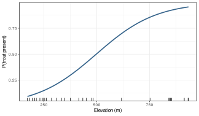
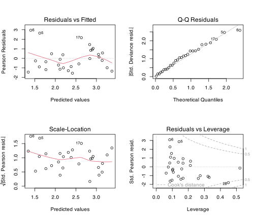

> **TIP:**
>
> | Type | Name | Link |
> |:---|:---|:---|
> | **Prior** | Multiple Linear Regression | [Multiple Regression](../BCB743/multiple_regression.llms.md) |
> | **Data** | The Doubs River data | [💾 `Doubs.RData`](../data/BCB743/NEwR-2ed_code_data/NeWR2-Data/Doubs.RData) |

> **IMPORTANT:**
>
> - [Task L 1–6](../BCB743/tasks/Task_L.llms.md)

The [Multiple Regression](../BCB743/multiple_regression.llms.md) chapter ended by noting that an MLR suits the Doubs data poorly, since species richness is a count bounded below by zero, yet I modelled it with a method that assumes normally distributed errors of constant variance. The model performed adequately for that particular response, but ecological data routinely break the normal-error assumption in ways no transformation fully repairs. Counts cluster near zero and have a variance that grows with the mean. Presence-absence data take only the values 0 and 1. Proportions are confined to the interval $[0, 1]$. A straight line with normal errors can predict negative counts and impossible probabilities, and its *p*-values cannot be trusted when the variance is tied to the mean.

A **generalised linear model** (GLM) keeps the linear-predictor core of multiple regression, replaces the normal error with a distribution chosen to match the response, and adds a **link function** connecting the linear predictor to the mean of that distribution. Everything you learned about partial slopes, multicollinearity, model selection, and reporting applies here too, with only two new ideas.

## 1 The three components of a GLM

Every GLM has three parts:

1.  A **random component**: the probability distribution of the response, chosen from the exponential family (Normal, Poisson, binomial, Gamma, and others). This fixes the mean-variance relationship.
2.  A **systematic component**: the linear predictor $\eta = \beta_0 + \beta_1 x_1 + \dots + \beta_p x_p$, exactly as in multiple regression.
3.  A **link function** $g$ that connects the two, $g(\mu) = \eta$, where $\mu$ is the mean of the response. The link lets a linear predictor that ranges over all real numbers map onto a mean that may be constrained to be positive (counts) or to lie in $[0,1]$ (probabilities).

The common choices in ecology are:

| Response | Distribution | Typical link | Mean constrained to |
|:---|:---|:---|:---|
| Continuous, symmetric | Normal (Gaussian) | identity | all real numbers |
| Counts | Poisson | log | $> 0$ |
| Overdispersed counts | negative binomial | log | $> 0$ |
| Presence-absence, proportions | binomial | logit | $[0, 1]$ |
| Positive, right-skewed (e.g. biomass) | Gamma | log (R’s default is inverse) | $> 0$ |

Ordinary multiple regression is the GLM with a Normal distribution and an identity link, so a GLM is a generalisation rather than a different method.

``` numberSource
library(tidyverse)
library(vegan)
library(performance) # check_overdispersion(), r2()
# negative-binomial models use MASS::glm.nb(); we call it by namespace rather
# than attaching MASS, because MASS::select() would mask dplyr::select()

load(here::here(
  "data",
  "BCB743",
  "NEwR-2ed_code_data",
  "NEwR2-Data",
  "Doubs.RData"
))
spe <- spe[rowSums(spe) > 0, ]
env <- env[rownames(spe), ]

dat <- data.frame(
  richness = specnumber(spe), # a count: number of species per site
  total = rowSums(spe), # total community abundance per site
  trout = as.integer(spe$Satr > 0), # presence-absence of brown trout
  env
)
```

## 2 Poisson regression for counts

I model species richness, the same count response as in the regression chapter, with a Poisson GLM and its default log link:

``` numberSource
pois <- glm(richness ~ ele + oxy + nit + bod, family = poisson, data = dat)
summary(pois)
```

    R> 
    R> Call:
    R> glm(formula = richness ~ ele + oxy + nit + bod, family = poisson, 
    R>     data = dat)
    R> 
    R> Coefficients:
    R>               Estimate Std. Error z value Pr(>|z|)    
    R> (Intercept)  5.4745815  0.6237394   8.777  < 2e-16 ***
    R> ele         -0.0019339  0.0003439  -5.624 1.87e-08 ***
    R> oxy         -0.1562692  0.0513775  -3.042  0.00235 ** 
    R> nit          0.0671302  0.0682937   0.983  0.32563    
    R> bod         -0.1609374  0.0309583  -5.199 2.01e-07 ***
    R> ---
    R> Signif. codes:  0 '***' 0.001 '**' 0.01 '*' 0.05 '.' 0.1 ' ' 1
    R> 
    R> (Dispersion parameter for poisson family taken to be 1)
    R> 
    R>     Null deviance: 154.386  on 28  degrees of freedom
    R> Residual deviance:  38.676  on 24  degrees of freedom
    R> AIC: 169.34
    R> 
    R> Number of Fisher Scoring iterations: 5

The coefficients are on the **log scale**, because the link is the logarithm. Each one measures a change in *log* richness rather than in richness, so it is easiest to interpret after exponentiating:

``` numberSource
exp(coef(pois))
```

    R> (Intercept)         ele         oxy         nit         bod 
    R> 238.5506069   0.9980680   0.8553289   1.0694347   0.8513454

On the response scale the effects are **multiplicative**. Each one-unit increase in a predictor multiplies the expected richness by $e^{\beta}$. A value above 1 means richness increases, below 1 means it decreases. Dissolved oxygen and biological oxygen demand both multiply expected richness by less than 1, so richness falls in cold, highly oxygenated headwaters and at organically polluted sites, the same ecological story the linear model told, now expressed in a way that can never predict a negative richness.

## 3 Overdispersion

The Poisson distribution makes a strong, testable assumption, namely that the variance equals the mean. Real ecological counts are often more variable than that, a condition called **overdispersion**, usually caused by unmeasured heterogeneity among sites or by clustering of individuals. Overdispersion does not bias the coefficients, but it makes the standard errors too small, so *p*-values look more significant than they are. Always check for it.

The quick check is the ratio of the residual deviance to its degrees of freedom, which should be near 1. The **performance** package gives a formal test:

``` numberSource
pois$deviance / pois$df.residual # rule of thumb: should be near 1
```

    R> [1] 1.611507

``` numberSource
check_overdispersion(pois)
```

    R> # Overdispersion test
    R> 
    R>        dispersion ratio =  1.720
    R>   Pearson's Chi-Squared = 41.271
    R>                 p-value =  0.016

The dispersion ratio here is above 1, indicating mild overdispersion worth addressing. The quasi-Poisson family and the negative binomial are the two standard remedies.

### 3.1 Quasi-Poisson

The **quasi-Poisson** family estimates a dispersion parameter from the data and inflates the standard errors by its square root. The coefficients are unchanged, and only their uncertainty grows:

``` numberSource
quasi <- glm(
  richness ~ ele + oxy + nit + bod,
  family = quasipoisson,
  data = dat
)
summary(quasi)$dispersion # the estimated dispersion
```

    R> [1] 1.719635

``` numberSource
coef(summary(quasi))[, c("Estimate", "Std. Error")]
```

    R>                 Estimate   Std. Error
    R> (Intercept)  5.474581476 0.8179397070
    R> ele         -0.001933851 0.0004509401
    R> oxy         -0.156269204 0.0673738330
    R> nit          0.067130215 0.0895568041
    R> bod         -0.160937354 0.0405971027

### 3.2 Negative binomial

The **negative binomial** distribution adds a parameter, $\theta$, that models the extra variance, and unlike the quasi-Poisson it is a proper likelihood, so it can be compared with AIC:

``` numberSource
negbin <- MASS::glm.nb(richness ~ ele + oxy + nit + bod, data = dat)
negbin$theta # large theta => close to Poisson
```

    R> [1] 105.557

``` numberSource
AIC(pois, negbin)
```

    R>        df      AIC
    R> pois    5 169.3352
    R> negbin  6 171.1670

Here $\theta$ is large and the negative binomial AIC does not improve on the Poisson, confirming that the overdispersion is mild and the conclusions do not change under that alternative. That is a good outcome, but one you can establish only by checking it specifically. When the dispersion ratio is large (say above 2) and $\theta$ is small, the negative binomial standard errors are substantially wider than the Poisson ones, and reporting the Poisson model would be an error.

> **NOTE:**
>
> If a count response has far more zeros than a Poisson or negative binomial can produce (many sites where a species is absent for reasons unrelated to abundance), a **zero-inflated** or **hurdle** model is the appropriate tool (`pscl::zeroinfl()`, `glmmTMB()`). Diagnose this by comparing the observed number of zeros with the number the fitted model predicts.

## 4 Offsets: modelling rates rather than counts

Sometimes the count you model was collected over different amounts of effort, area, or time, or you want a count *relative to* some total. Dividing the count to make a rate and then modelling it loses the count structure. The correct device is an **offset**, a predictor whose coefficient is fixed at 1. To model brown-trout abundance as a share of the whole fish community, I offset by the log of total community abundance:

``` numberSource
offset_mod <- glm(
  Satr ~ ele + bod,
  family = poisson,
  offset = log(total),
  data = cbind(dat, Satr = spe$Satr)
)
coef(summary(offset_mod))
```

    R>                 Estimate   Std. Error   z value     Pr(>|z|)
    R> (Intercept) -3.152473997 0.5305267417 -5.942159 2.812932e-09
    R> ele          0.003421698 0.0005145177  6.650301 2.924933e-11
    R> bod         -0.380034906 0.0986347558 -3.852951 1.167026e-04

The model now describes the trout’s expected *share* of the community. That share rises with elevation and falls with organic pollution, which places brown trout in the clean, cool, upstream reaches. Here `total` includes brown trout itself, so this is a proportional-abundance interpretation within the observed community total, not a model of trout relative to all *other* fish. Because total abundance is included through the offset rather than as an ordinary predictor, its coefficient is not estimated, and it rescales each site’s expected count to its community size.

## 5 Logistic regression for presence-absence

When the response is binary, like presence or absence, the binomial family with a **logit link** is the standard tool. I model the presence of brown trout:

``` numberSource
logit <- glm(trout ~ ele + bod, family = binomial, data = dat)
summary(logit)
```

    R> 
    R> Call:
    R> glm(formula = trout ~ ele + bod, family = binomial, data = dat)
    R> 
    R> Coefficients:
    R>              Estimate Std. Error z value Pr(>|z|)  
    R> (Intercept)  1.802472   2.272496   0.793   0.4277  
    R> ele          0.007018   0.003109   2.258   0.0240 *
    R> bod         -1.055975   0.591533  -1.785   0.0742 .
    R> ---
    R> Signif. codes:  0 '***' 0.001 '**' 0.01 '*' 0.05 '.' 0.1 ' ' 1
    R> 
    R> (Dispersion parameter for binomial family taken to be 1)
    R> 
    R>     Null deviance: 39.336  on 28  degrees of freedom
    R> Residual deviance: 18.725  on 26  degrees of freedom
    R> AIC: 24.725
    R> 
    R> Number of Fisher Scoring iterations: 7

Logistic coefficients are **log-odds**. Exponentiating gives **odds ratios**, the factor by which the odds of presence change per unit of predictor:

``` numberSource
exp(coef(logit))
```

    R> (Intercept)         ele         bod 
    R>    6.064618    1.007043    0.347853

Each unit of biological oxygen demand multiplies the odds of finding trout by roughly one third, a strong negative effect of organic pollution, while higher elevation slightly raises the odds. Odds ratios remain hard to interpret, so it is usually clearer to predict on the **probability** scale across a gradient of one predictor:

``` numberSource
newdat <- data.frame(
  ele = seq(min(dat$ele), max(dat$ele), length.out = 100),
  bod = mean(dat$bod)
)
newdat$prob <- predict(logit, newdat, type = "response")

ggplot(newdat, aes(ele, prob)) +
  geom_line(colour = "steelblue4", linewidth = 0.8) +
  geom_rug(data = dat, aes(x = ele), sides = "b", inherit.aes = FALSE) +
  labs(x = "Elevation (m)", y = "P(trout present)")
```

[](glm_files/figure-html/fig-logistic-prediction-1.svg "Figure 1: Predicted probability of brown-trout presence along the elevation gradient, at the mean biological oxygen demand.")

Figure 1: Predicted probability of brown-trout presence along the elevation gradient, at the mean biological oxygen demand.

A useful summary of fit for a logistic model is **Tjur’s coefficient of discrimination**, an $R^2$ analogue that contrasts the mean predicted probability for present and absent sites:

``` numberSource
r2(logit)
```

    R> # R2 for Logistic Regression
    R>   Tjur's R2: 0.568

## 6 Inference and model selection in GLMs

The *t*-tests of multiple regression become *z*-tests (Wald tests) in the `summary()` of a GLM, but Wald tests behave poorly in small samples and for coefficients near separation. The more reliable test compares nested models by the change in **deviance**, which follows a $\chi^2$ distribution. `drop1()` performs these likelihood-ratio tests for each term:

``` numberSource
drop1(logit, test = "Chisq")
```

    R> Single term deletions
    R> 
    R> Model:
    R> trout ~ ele + bod
    R>        Df Deviance    AIC    LRT Pr(>Chi)   
    R> <none>      18.725 24.725                   
    R> ele     1   27.023 31.023 8.2983 0.003968 **
    R> bod     1   25.614 29.614 6.8890 0.008673 **
    R> ---
    R> Signif. codes:  0 '***' 0.001 '**' 0.01 '*' 0.05 '.' 0.1 ' ' 1

Both predictors are significant by the likelihood-ratio test, the more trustworthy finding here. For choosing among non-nested candidate models, **AIC** works exactly as it did for linear models (lower is better), with the same warning against treating automatic stepwise selection as confirmatory rather than exploratory.

## 7 Diagnostics for GLMs

The residuals-vs-fitted method of linear models does not transfer cleanly to GLMs, because the residuals are expected to be heteroscedastic from the outset. Use **deviance residuals** and interpret the plots with that in mind:

``` numberSource
par(mfrow = c(2, 2))
plot(pois)
par(mfrow = c(1, 1))
```

[](glm_files/figure-html/fig-glm-diagnostics-1.svg "Figure 2: Diagnostic plots for the Poisson richness model, based on deviance residuals.")

Figure 2: Diagnostic plots for the Poisson richness model, based on deviance residuals.

The most important GLM-specific checks are the **overdispersion** test shown earlier and, for counts, a comparison of observed and predicted zeros. For binary responses the ordinary residual plots are nearly uninformative (residuals can only take two patterns), so judge a logistic model by its discrimination (Tjur’s $R^2$, or the area under the ROC curve) and by **binned residuals**, which average residuals within groups of similar fitted probability.

> **NOTE:**
>
> The most general GLM diagnostic is the **simulated quantile residual** implemented in the `DHARMa` package. It transforms the residuals of any GLM (or mixed model) onto a uniform scale where the usual visual checks become valid, and it provides direct tests for overdispersion, zero-inflation, and departures from the assumed distribution. If `DHARMa` is available, `DHARMa::simulateResiduals(model)` followed by `plot()` is the recommended check for every GLM in this module.

## 8 Reporting a GLM

Report the error family and link, the coefficients on an interpretable scale (exponentiated for log and logit links, with their confidence intervals), the result of the overdispersion check for counts, a measure of fit (deviance explained, or a pseudo-$R^2$ such as Tjur’s for logistic models), and the likelihood-ratio tests of the terms you discuss. State which family you chose and why. The label “a Poisson GLM with a log link” is more informative than “a regression”.

## 9 Beyond the GLM

A GLM still assumes that each predictor acts as a straight line on the link scale, and that the observations are independent. The next two chapters relax those assumptions in turn. The [GAM](../BCB743/gam.llms.md) replaces the straight line on the link scale with a smooth curve, which is what a species’ unimodal response along a gradient requires. The [mixed model](../BCB743/mixed_models.llms.md) adds random effects for grouped or nested data, and in its generalised form (the GLMM) extends the error families of this chapter to designs where the independence assumption fails.

## 10 References

## Reuse

[CC BY-NC-SA 4.0](https://creativecommons.org/licenses/by-nc-sa/4.0/)

## Citation

BibTeX citation:

``` quarto-appendix-bibtex
@online{smit2026,
  author = {Smit, A. J.},
  title = {21. {Generalised} Linear Models {(GLM)}},
  date = {2026-11-06},
  url = {https://tangledbank.netlify.app/BCB743/glm.html},
  langid = {en}
}
```

For attribution, please cite this work as:

Smit AJ (2026) 21. Generalised linear models (GLM). [https://tangledbank.netlify.app/BCB743/glm.html.](https://tangledbank.netlify.app/BCB743/glm.html)
