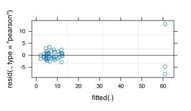

> **TIP:**
>
> | Type | Name | Link |
> |:---|:---|:---|
> | **Prior** | GLM; the Diatom case study | [GLM](../BCB743/glm.llms.md); [nMDS: PERMANOVA (Diatoms)](../BCB743/nMDS_diatoms.llms.md) |
> | **Data** | Mayombo diatom data | [💾 `PB_data_matrix_abrev.csv`](../data/BCB743/diatoms/PB_data_matrix_abrev.csv) |
> |  |  | [💾 `PB_diat_env.csv`](../data/BCB743/diatoms/PB_diat_env.csv) |

> **IMPORTANT:**
>
> - [Task N 1–6](../BCB743/tasks/Task_N.llms.md)

The regression chapters so far have assumed that observations are **independent**, the “I” in the LINE assumptions. Ecological sampling routinely breaks that assumption. Sites are nested within rivers, quadrats within transects, measurements within individuals, and subsamples within a single specimen. Observations that share a group are more alike than observations from different groups, and treating them as independent is **pseudoreplication**. It credits the analysis with more independent information than the design delivered, and it makes *p*-values far too small.

A **mixed model** solves this by adding a **random effect** for the grouping. I return to the same design that the [diatom case study](../BCB743/nMDS_diatoms.llms.md) analysed with blocked PERMANOVA, and now handle its nesting in a univariate model instead.

## 1 The diatom study and the pseudoreplication it creates

Epiphytic diatoms were sampled from kelp blades. The design crosses two fixed factors, **host species** (*Ecklonia* vs *Laminaria*) and **host size** (adult vs juvenile), and from each individual kelp **plant** up to three replicate tissue pieces were taken. Those three pieces are **subsamples of the same blade**, not independent replicates of the treatment. This is why the diatom chapter set `plant` as the permutation block.

``` numberSource
library(tidyverse)
library(vegan)
library(lme4) # lmer(), glmer()
library(performance) # icc(), r2()

spp <- read.csv(
  here::here("data", "BCB743", "diatoms", "PB_data_matrix_abrev.csv"),
  row.names = 1
)
env <- read.csv(
  here::here("data", "BCB743", "diatoms", "PB_diat_env.csv"),
  row.names = 1
)
env <- env |>
  mutate(
    host_spp = factor(host_spp),
    host_size = factor(host_size),
    plant = factor(plant),
    richness = rowSums(spp > 0), # diatom genera per sample
    Gomph = spp[["Gomphoseptatum.spp"]] # the dominant genus, a count
  )

table(plant_samples = table(env$plant)) # how many subsamples per plant
```

    R> plant_samples
    R>  1  2  3 
    R>  1  4 11

Most plants contribute three subsamples, though not all. Four plants contribute two subsamples and one plant contributes only one, so the design has 42 observed subsamples rather than the 48 that a complete 16 × 3 design would contain. Ignoring that structure would treat those 42 correlated subsamples as 42 independent observations.

## 2 Fixed and random effects

A **fixed effect** is a factor whose specific levels are of direct interest and would recur if you repeated the study. Host species and host size are fixed. A **random effect** is a factor whose levels are a *sample* from a population of possible levels and are not themselves of interest. The particular kelp plants are an arbitrary sample of kelp plants, and I care about kelp plants in general, not plant number 7. I model the plant effect not as a set of coefficients but as a single **variance**, namely how much blades differ from one another over and above the treatments.

Written out, a random-intercept model gives each plant $j$ its own deviation $b_j$ from the overall mean,

$$y_{ij} = \beta_0 + \beta_1 x_{ij} + b_j + \varepsilon_{ij}, \qquad b_j \sim N(0, \sigma^2_{\text{plant}}), \quad \varepsilon_{ij} \sim N(0, \sigma^2).$$

The model estimates the two variances rather than 16 separate plant means, which is far more economical and lets the plant deviations “borrow strength” from one another.

## 3 A linear mixed model

I begin with diatom **richness** as a linear mixed model. The fixed part is the host species by host size interaction, and the random part, `(1 | plant)`, gives each blade its own intercept:

``` numberSource
lmm <- lmer(richness ~ host_spp * host_size + (1 | plant), data = env)
summary(lmm)
```

    R> Linear mixed model fit by REML ['lmerMod']
    R> Formula: richness ~ host_spp * host_size + (1 | plant)
    R>    Data: env
    R> 
    R> REML criterion at convergence: 179.8
    R> 
    R> Scaled residuals: 
    R>      Min       1Q   Median       3Q      Max 
    R> -2.20015 -0.44303 -0.07726  0.35348  2.37041 
    R> 
    R> Random effects:
    R>  Groups   Name        Variance Std.Dev.
    R>  plant    (Intercept) 0.478    0.6914  
    R>  Residual             4.829    2.1974  
    R> Number of obs: 42, groups:  plant, 16
    R> 
    R> Fixed effects:
    R>                       Estimate Std. Error t value
    R> (Intercept)             6.0222     0.7489   8.041
    R> host_sppLp             -4.0296     1.0591  -3.805
    R> host_sizeJ             -0.6889     1.0406  -0.662
    R> host_sppLp:host_sizeJ   4.2838     1.5426   2.777
    R> 
    R> Correlation of Fixed Effects:
    R>             (Intr) hst_sL hst_sJ
    R> host_sppLp  -0.707              
    R> host_sizeJ  -0.720  0.509       
    R> hst_sppL:_J  0.486 -0.687 -0.675

The **Random effects** table is new to you. It reports the plant-to-plant standard deviation and the residual (within-plant) standard deviation. Their relative size is captured by the **intraclass correlation coefficient** (ICC), the proportion of the total variance that is between plants:

``` numberSource
icc(lmm)
```

    R> # Intraclass Correlation Coefficient
    R> 
    R>     Adjusted ICC: 0.090
    R>   Unadjusted ICC: 0.060

For richness the ICC is small. Blades of the same plant are only slightly more alike than blades of different plants. The fixed-effect coefficients are interpreted exactly as in an ordinary regression, except that their standard errors now correctly account for the grouping. Note that `lmer()` gives no *p*-values by design, because the degrees of freedom for these tests are not exactly known. I test effects below by comparing models.

> **NOTE:**
>
> `lmer()` fits by **restricted maximum likelihood** (REML) by default, which gives unbiased variance estimates and is what you report. To compare models that differ in their **fixed** effects, however, you must refit with ordinary maximum likelihood (ML), because REML likelihoods of different fixed-effect structures are not comparable. The `anova()` method does this refitting automatically.

## 4 A generalised linear mixed model

Richness is a count, so the correct model is a **generalised linear mixed model** (GLMM), namely the random intercept of a mixed model combined with the Poisson family and log link of a [GLM](../BCB743/glm.llms.md). I model the abundance of the dominant genus, *Gomphoseptatum*:

``` numberSource
glmm <- glmer(
  Gomph ~ host_spp * host_size + (1 | plant),
  family = poisson,
  data = env
)
summary(glmm)
```

    R> Generalized linear mixed model fit by maximum likelihood (Laplace
    R>   Approximation) [glmerMod]
    R>  Family: poisson  ( log )
    R> Formula: Gomph ~ host_spp * host_size + (1 | plant)
    R>    Data: env
    R> 
    R>       AIC       BIC    logLik -2*log(L)  df.resid 
    R>     572.0     580.7    -281.0     562.0        37 
    R> 
    R> Scaled residuals: 
    R>     Min      1Q  Median      3Q     Max 
    R> -7.8117 -1.3080 -0.3768  0.9387 13.0544 
    R> 
    R> Random effects:
    R>  Groups Name        Variance Std.Dev.
    R>  plant  (Intercept) 0.3568   0.5973  
    R> Number of obs: 42, groups:  plant, 16
    R> 
    R> Fixed effects:
    R>                       Estimate Std. Error z value Pr(>|z|)    
    R> (Intercept)             2.1071     0.3173   6.641 3.12e-11 ***
    R> host_sppLp             -0.6122     0.4616  -1.326   0.1847    
    R> host_sizeJ             -0.3249     0.4521  -0.719   0.4724    
    R> host_sppLp:host_sizeJ   1.5384     0.6466   2.379   0.0173 *  
    R> ---
    R> Signif. codes:  0 '***' 0.001 '**' 0.01 '*' 0.05 '.' 0.1 ' ' 1
    R> 
    R> Correlation of Fixed Effects:
    R>             (Intr) hst_sL hst_sJ
    R> host_sppLp  -0.686              
    R> host_sizeJ  -0.701  0.483       
    R> hst_sppL:_J  0.490 -0.713 -0.699

``` numberSource
icc(glmm)
```

    R> # Intraclass Correlation Coefficient
    R> 
    R>     Adjusted ICC: 0.787
    R>   Unadjusted ICC: 0.561

Here the picture differs sharply from the richness model. The ICC is high, so blades differ strongly in their *Gomphoseptatum* counts. That is precisely the situation in which ignoring the nesting does real damage.

## 5 Why? Pseudoreplication

Fit the same fixed-effects model as an ordinary GLM, pretending the subsamples are independent, and compare the standard error of the host-species effect with the GLMM’s:

``` numberSource
naive <- glm(Gomph ~ host_spp * host_size, family = poisson, data = env)

c(
  naive_SE = coef(summary(naive))["host_sppLp", "Std. Error"],
  glmm_SE = coef(summary(glmm))["host_sppLp", "Std. Error"]
)
```

    R>  naive_SE   glmm_SE 
    R> 0.1654262 0.4615640

The naive standard error is roughly a third of the correct one. Pretending that 42 subsamples are 42 independent observations nearly **trebles** the apparent precision and would turn a non-significant effect into a “significant” one. The mixed model spends the degrees of freedom the design earned. This is the single most important reason to use a mixed model, and you cannot know in advance whether the inflation will be small (as for richness) or large (as for *Gomphoseptatum*). You have to fit the random effect to find out.

## 6 Random slopes

A random intercept lets the *baseline* vary between plants. A **random slope** lets a predictor’s *effect* vary between plants as well, written `(1 + host_size | plant)`:

``` numberSource
rs <- lmer(
  richness ~ host_spp * host_size + (1 + host_size | plant),
  data = env
)
summary(rs)$varcor
```

    R>  Groups   Name        Std.Dev. Corr   
    R>  plant    (Intercept) 0.65440         
    R>           host_sizeJ  0.96568  -0.657 
    R>  Residual             2.19751

Use a random slope when there is reason to think the effect of a within-group predictor differs between groups. Random slopes are demanding of data. Each added random term needs enough groups, and enough observations per group, to be estimated. With only sixteen plants and at most three subsamples each, the diatom data can barely support them.

## 7 Singular fits

When a random-effects structure is too complex for the data, or a variance is genuinely near zero, `lmer()` returns a **singular fit**, namely a variance estimated at (or against) the boundary of zero. Modelling total diatom abundance is a clear case:

``` numberSource
sf <- lmer(log1p(rowSums(spp)) ~ host_spp * host_size + (1 | plant), data = env)
VarCorr(sf)
```

    R>  Groups   Name        Std.Dev.
    R>  plant    (Intercept) 0.00000 
    R>  Residual             0.97806

``` numberSource
isSingular(sf)
```

    R> [1] TRUE

The plant variance collapses to zero. For total abundance, blades of the same plant are no more alike than blades of different plants. A singular fit is a warning. The remedies are to simplify the random structure (drop a random slope, or a whole grouping factor that explains nothing), and to report that the grouping contributed no detectable variance, having checked rather than assumed it.

## 8 Testing effects and measuring fit

Fixed effects are tested by a likelihood-ratio test that compares nested models, refitted with ML (which `anova()` handles):

``` numberSource
m_full <- glmer(
  Gomph ~ host_spp * host_size + (1 | plant),
  family = poisson,
  data = env
)
m_red <- glmer(
  Gomph ~ host_spp + host_size + (1 | plant),
  family = poisson,
  data = env
)
anova(m_red, m_full)
```

    R> Data: env
    R> Models:
    R> m_red: Gomph ~ host_spp + host_size + (1 | plant)
    R> m_full: Gomph ~ host_spp * host_size + (1 | plant)
    R>        npar    AIC    BIC  logLik -2*log(L)  Chisq Df Pr(>Chisq)  
    R> m_red     4 574.89 581.84 -283.44    566.89                       
    R> m_full    5 572.01 580.70 -281.00    562.01 4.8788  1    0.02719 *
    R> ---
    R> Signif. codes:  0 '***' 0.001 '**' 0.01 '*' 0.05 '.' 0.1 ' ' 1

A significant result means the interaction is real (it earns its place in the model). For overall fit, a mixed model has **two** $R^2$ values, namely the **marginal** $R^2$ (variance explained by the fixed effects alone) and the **conditional** $R^2$ (fixed and random effects together). The difference between them is the contribution of the grouping:

``` numberSource
r2(glmm)
```

    R> # R2 for Mixed Models
    R> 
    R>   Conditional R2: 0.848
    R>      Marginal R2: 0.287

> **WARNING:**
>
> Testing whether a random effect is needed (is $\sigma^2_{\text{plant}} = 0$?) is not an ordinary likelihood-ratio test, because the null value sits on the boundary of the parameter space, which makes the usual $\chi^2$ reference distribution conservative. In practice, decide whether to include a random effect from the **design** (is there grouping or nesting?) rather than from a significance test. If the design has subsamples within plants, the plant random effect belongs in the model whether or not its variance turns out to be large.

## 9 Diagnostics and reporting

Check a mixed model much as you would a GLM. Plot the residuals against the fitted values, and inspect the distribution of the estimated random intercepts, which should be roughly normal.

``` numberSource
plot(glmm)
```

[](mixed_models_files/figure-html/fig-mm-diagnostics-1.svg "Figure 1: Residuals against fitted values for the Gomphoseptatum GLMM.")

Figure 1: Residuals against fitted values for the Gomphoseptatum GLMM.

When you report a mixed model, give the fixed-effect estimates with their uncertainty, the **variance components** (or the ICC) for every random effect, the marginal and conditional $R^2$, the error family and link for a GLMM, and the structure of the random effects in words (“a random intercept for each kelp plant, to account for the three subsamples taken per blade”). State that the random effect reflects the **design**, not a post-hoc search for effects.

## 10 All these regressions…

These four chapters have lifted the three restrictions of ordinary multiple regression one at a time. The [GLM](../BCB743/glm.llms.md) replaced the normal error with a family matched to the data. The [GAM](../BCB743/gam.llms.md) replaced straight lines with smooths. The mixed model has replaced the independence assumption with explicit terms for grouping and nesting. The same core, a linear predictor of environmental drivers, underlies all of them, as it does the [constrained ordination](../BCB743/constrained_ordination.llms.md) that applies the same logic to whole communities at once. Choosing among them is the subject of the [Model Building](../BCB743/model_building.llms.md) chapter. Match the model to the data you have and the question you are asking, then check that the model you fitted is the model you should report.

## 11 References

## Reuse

[CC BY-NC-SA 4.0](https://creativecommons.org/licenses/by-nc-sa/4.0/)

## Citation

BibTeX citation:

``` quarto-appendix-bibtex
@online{smit2026,
  author = {Smit, A. J.},
  title = {23. {Linear} and Generalised Linear Mixed Models},
  date = {2026-11-06},
  url = {https://tangledbank.netlify.app/BCB743/mixed_models.html},
  langid = {en}
}
```

For attribution, please cite this work as:

Smit AJ (2026) 23. Linear and generalised linear mixed models. [https://tangledbank.netlify.app/BCB743/mixed_models.html.](https://tangledbank.netlify.app/BCB743/mixed_models.html)
