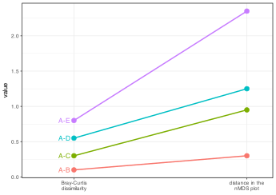
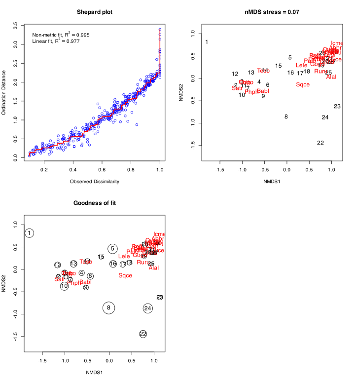
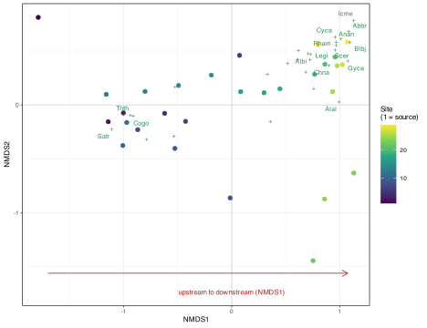
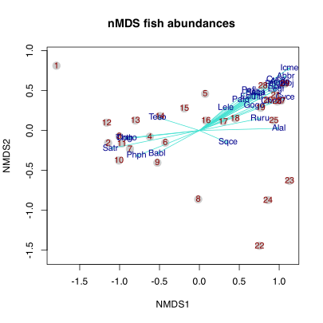
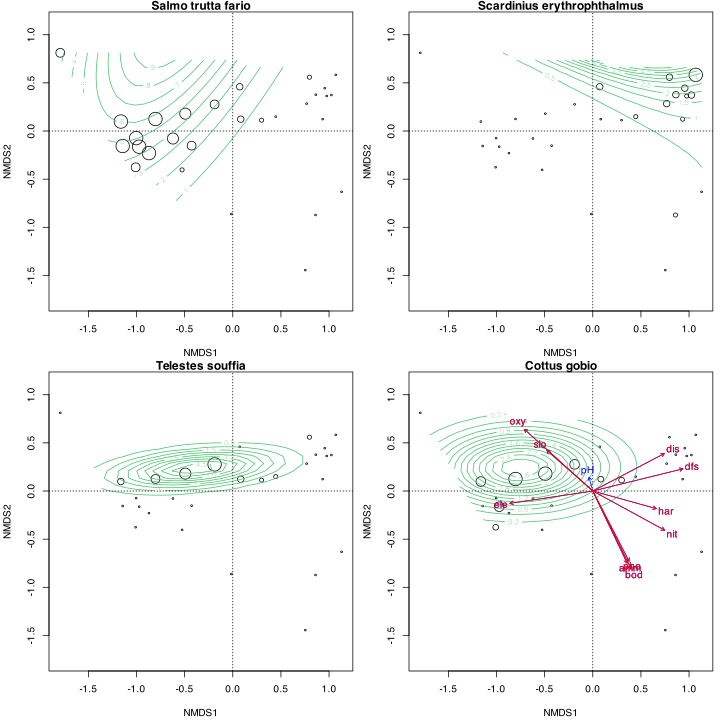

> **TIP:**
>
> | Type | Name | Link |
> |:---|:---|:---|
> | **Theory** | Numerical Ecology with R | See pages 145-151 |
> | **Slides** | nMDS lecture slides | [💾 `BCB743_11_nMDS.pdf`](../slides/BCB743_11_nMDS.pdf) |
> | **Data** | The Doubs River data | [💾 `Doubs.RData`](../data/BCB743/NEwR-2ed_code_data/NeWR2-Data/Doubs.RData) |

> **IMPORTANT:**
>
> - [Task G 1–6](../BCB743/tasks/Task_G.llms.md)

Non-Metric Multidimensional Scaling (nMDS) is a rank-based indirect gradient analysis that takes a distance or dissimilarity matrix as its input (either pre-calculated using `vegdist()` or constructed internal to the `metaMDS()` function via the `dist` argument). Should one supply a ‘raw’ species × site table, the default dissimilarity matrix is Bray-Curtis dissimilarity, but any other dissimilarity index in `vegdist()` can be specified. Unlike other ordination methods such as Principal Component Analysis (PCA) and Correspondence Analysis (CA), which maximise variance or correspondence between sites, nMDS represents the pairwise dissimilarities between sites in an ordination space. It does not use the raw distances or dissimilarities directly. These values are replaced with their ranks, which is why the method is termed “non-metric.”

nMDS is the non-metric equivalent of Principal Coordinates Analysis (PCoA), which is sometimes called metric multidimensional scaling. Both methods produce ordinations of objects from any distance or dissimilarity matrix, but nMDS keeps only the ordering (rank) relationships among objects rather than their exact distances, representing that ordering as accurately as possible on a specified number of axes. This non-linear mapping of dissimilarities onto a low-dimensional ordination space means that the Euclidean distances of points in the ordination space are rank-order similar to the original community dissimilarities.

The two methods differ by a single step, set out in the table below:

| PCoA                          | nMDS                    |
|:------------------------------|:------------------------|
| preserves distances           | preserves ranks         |
| metric                        | non-metric              |
| eigenvalue decomposition      | iterative optimisation  |
| keeps the distance magnitudes | keeps only the ordering |
| diagnostic: eigenvalues       | diagnostic: stress      |

Rank preservation is worth seeing directly. Suppose four pairs of sites have Bray-Curtis dissimilarities of 0.10, 0.30, 0.55, and 0.80. nMDS keeps the pairs in the same order of similarity rather than reproducing those values, so the most similar pair stays closest together in the plot and the least similar pair stays furthest apart ([Figure 1](#fig-nmds-rank)). The spacing is free to change, but the order is not.

Code

``` numberSource
rank_demo <- tibble(
  pair = c("A-B", "A-C", "A-D", "A-E"),
  `Bray-Curtis\ndissimilarity` = c(0.10, 0.30, 0.55, 0.80),
  `distance in the\nnMDS plot` = c(0.30, 0.95, 1.25, 2.35)
) |>
  pivot_longer(-pair, names_to = "stage", values_to = "val") |>
  mutate(
    stage = factor(
      stage,
      levels = c("Bray-Curtis\ndissimilarity", "distance in the\nnMDS plot")
    )
  )

ggplot(rank_demo, aes(stage, val, group = pair, colour = pair)) +
  geom_line(linewidth = 0.7) +
  geom_point(size = 2.6) +
  geom_text(
    data = filter(rank_demo, stage == "Bray-Curtis\ndissimilarity"),
    aes(label = pair),
    hjust = 1.3,
    size = 3
  ) +
  scale_x_discrete(expand = expansion(mult = c(0.3, 0.15))) +
  labs(x = NULL, y = "value") +
  theme(legend.position = "none")
```

[](nMDS_files/figure-html/fig-nmds-rank-1.svg "Figure 1: Rank preservation. Four site pairs are shown by their Bray-Curtis dissimilarity (left) and by the distance between the same pairs in the nMDS plot (right). The lines do not cross, so the order of the pairs is preserved, from most similar (A-B) to least similar (A-E). Their spacing changes, because nMDS keeps only the ordering and is free to stretch or shrink the gaps.")

Figure 1: Rank preservation. Four site pairs are shown by their Bray-Curtis dissimilarity (left) and by the distance between the same pairs in the nMDS plot (right). The lines do not cross, so the order of the pairs is preserved, from most similar (A-B) to least similar (A-E). Their spacing changes, because nMDS keeps only the ordering and is free to stretch or shrink the gaps.

The ordination space in nMDS is metric, but the regression used to fit the dissimilarities to this space is non-metric. Because it uses only the rank order of the dissimilarities, nMDS makes fewer assumptions about the structure of the distances than the eigen-methods do, which helps when ecological data depart from the distributional or geometric forms those methods expect. This is a difference in assumptions, not a claim that nMDS is the better method. PCA remains the right tool for linear, Euclidean structure, and CA for $\chi^2$ structure. Like PCoA, nMDS can in principle take a dissimilarity built from any kind of variable, but in community ecology it is most often applied to species composition through measures such as Bray-Curtis, Jaccard, or Sørensen, and that is the use I develop here.

Stress quantifies the discrepancy between the observed dissimilarities and the distances in the ordination space, a concept the eigen-approaches do not use. It is presented visually as the scatter of observed dissimilarities against the expected monotone regression, and lower stress values indicate a better fit of the data to the ordination space. Rank orders of dissimilarities cannot be exactly preserved by rank-orders of ordination distances in low-dimensional space, so *some* stress cannot be avoided.

Stress is the nMDS counterpart of the goodness measures seen in the earlier chapters, and it runs in the opposite direction, namely lower is better rather than higher. Each method reports how well its low-dimensional picture represents the data, under a different name:

| Method | Goodness measure         |
|:-------|:-------------------------|
| PCA    | variance explained       |
| CA     | inertia explained        |
| PCoA   | eigenvalues              |
| nMDS   | stress (lower is better) |

The rank-based approach discards information about the magnitude of differences between site pairs, a disadvantage when the actual distances are important for interpretation. nMDS can also be computationally intensive with large datasets, or when minimising stress through numerous iterations.

After performing nMDS, I can interpret environmental structure with **vegan**’s `envfit()` and `ordisurf()` functions, as I have already seen in PCA, CA, and PCoA. As before, these functions fit environmental variables onto the ordination. They help show how environmental variables are associated with the species ordination, but they do not turn nMDS into a formal constrained ordination. If I require a statistical framework to assess categorical effects on observed dissimilarities, I can use PERMANOVA (Permutational Multivariate Analysis of Variance). These ideas are shown below.

## 1 Set-up the analysis environment

``` numberSource
library(tidyverse)
library(vegan)
library(viridis)
library(ggrepel) # for tidy biplot labels

# Files will be referenced using here::here() for absolute paths
```

## 2 The Doubs River data

I continue to use the species data:

``` numberSource
load(here::here(
  "data",
  "BCB743",
  "NEwR-2ed_code_data",
  "NEwR2-Data",
  "Doubs.RData"
))
spe <- dplyr::slice(spe, -8)
```

## 3 Do the nMDS

``` numberSource
spe_nmds <- metaMDS(spe, distance = "bray", trace = 0) # <1>
spe_nmds
```

1.  I use `trace = 0` to suppress the output of the iterations.

    R> 
    R> Call:
    R> metaMDS(comm = spe, distance = "bray", trace = 0) 
    R> 
    R> global Multidimensional Scaling using monoMDS
    R> 
    R> Data:     spe 
    R> Distance: bray 
    R> 
    R> Dimensions: 2 
    R> Stress:     0.0737623 
    R> Stress type 1, weak ties
    R> Best solution was not repeated after 20 tries
    R> The best solution was from try 14 (random start)
    R> Scaling: centring, PC rotation, halfchange scaling 
    R> Species: expanded scores based on 'spe'

By default, `metaMDS()` also has `autotransform = TRUE`, so it may transform raw community data before calculating dissimilarities. That is convenient for first-pass ordinations, but when you have already transformed the data or need exact agreement with another analysis, supply a precomputed distance matrix or set `autotransform = FALSE`.

> **NOTE:**
>
> `metaMDS()` finds its axes by iterative search rather than the single step the eigen-methods use. Starting from many random configurations, it keeps the one with the lowest stress, because the optimisation can settle into a local minimum rather than the best available solution. I suppressed the running log with `trace = 0`. Without it, `metaMDS()` prints lines such as `Best solution was from try 7`. The same reason explains why running it again can return a plot that is rotated or mirrored, since the orientation of the axes is arbitrary and only the configuration of points relative to one another carries meaning.

As always, reading the help file (accessible as `?vegan::metaMDS`) is invaluable, as it is for all other ordination techniques.

A summary method is available, but it is not particularly useful, so I do not display its output here:

``` numberSource
summary(spe_nmds)
```

Although `summary(spe_nmds)` does not return anything interesting, the species and site scores are nevertheless available directly through the `scores()` command, and they can be plotted as a layer in **ggplot2** if needed:

``` numberSource
scores(spe_nmds)
```

    R> $sites
    R>          NMDS1       NMDS2
    R> 1  -1.79202761  0.81201577
    R> 2  -1.14369645 -0.15591788
    R> 3  -1.00362633 -0.07403812
    R> 4  -0.62131670 -0.07796721
    R> 5   0.07214686  0.45957250
    R> 6  -0.42770531 -0.15252777
    R> 7  -0.87072569 -0.22975198
    R> 8  -0.01445281 -0.86235806
    R> 9  -0.52657546 -0.40350308
    R> 10 -1.00864727 -0.37640399
    R> 11 -0.97241389 -0.16304855
    R> 12 -1.16252193  0.09822909
    R> 13 -0.80284885  0.12482462
    R> 14 -0.49307049  0.18029130
    R> 15 -0.18894231  0.27644774
    R> 16  0.08279187  0.12281875
    R> 17  0.29912762  0.11282949
    R> 18  0.44609180  0.14927234
    R> 19  0.76760728  0.28438262
    R> 20  0.86276267  0.37736082
    R> 21  0.95572995  0.44468380
    R> 22  0.75331235 -1.44494909
    R> 23  1.12998699 -0.63159276
    R> 24  0.85944537 -0.87246409
    R> 25  0.93373513  0.12316991
    R> 26  0.97563033  0.36320012
    R> 27  1.02411888  0.37353523
    R> 28  0.79646960  0.55868319
    R> 29  1.06961440  0.58320529
    R> 
    R> $species
    R>           NMDS1       NMDS2
    R> Cogo -0.9122388 -0.10344080
    R> Satr -1.1127646 -0.22537092
    R> Phph -0.7891078 -0.32051838
    R> Babl -0.5341392 -0.28929449
    R> Thth -0.9380579 -0.09601588
    R> Teso -0.5248686  0.16501515
    R> Chna  0.9019797  0.36596144
    R> Pato  0.5174215  0.38539810
    R> Lele  0.3304226  0.28589287
    R> Sqce  0.3587117 -0.15470418
    R> Baba  0.7041108  0.47502664
    R> Albi  0.7284128  0.47032700
    R> Gogo  0.6855080  0.30422450
    R> Eslu  0.6097869  0.42166285
    R> Pefl  0.6174640  0.50374304
    R> Rham  0.9670255  0.58271160
    R> Legi  0.9565352  0.50918167
    R> Scer  0.9662242  0.55183956
    R> Cyca  0.9589675  0.62824277
    R> Titi  0.7244749  0.41796717
    R> Abbr  1.0828786  0.67965071
    R> Icme  1.1285493  0.78232788
    R> Gyce  1.0746986  0.40711126
    R> Ruru  0.7596086  0.15131589
    R> Blbj  1.0955064  0.58026513
    R> Alal  0.9938020  0.02708114
    R> Anan  1.0094783  0.61215756

See *Numerical Ecology with R* (pp. 145 to 149) for information about the interpretation of a nMDS and the ordination diagrams shown below.

## 4 Ordination diagrams

I create the ordination diagrams as before, but new concepts introduced here are **stress**, **Shepard plots**, and **goodness of fit** ([Figure 2](#fig-nmds-plots)). The stress indicates the scatter of observed dissimilarities against an expected monotone regression, while a Shepard diagram plots ordination distances against original dissimilarities and adds a monotone or linear fit line to highlight this relationship. The `stressplot()` function also produces two fit statistics. The goodness-of-fit of the ordination is measured as the $R^{2}$ of either a linear or a non-linear regression of the nMDS distances on the original ones.

``` numberSource
opar <- par(no.readonly = TRUE)
par(mfrow = c(2, 2))
stressplot(spe_nmds, main = "Shepard plot")
ordiplot(
  spe_nmds,
  type = "t",
  cex = 1.2,
  main = paste0("nMDS stress = ", round(spe_nmds$stress, 2))
)
gof <- goodness(spe_nmds)
plot(spe_nmds, type = "t", cex = 1.2, main = "Goodness of fit")
points(spe_nmds, display = "sites", cex = gof * 200)
# ...bigger bubbles indicate a worse fit
par(opar)
```

[](nMDS_files/figure-html/fig-nmds-plots-1.svg "Figure 2: nMDS ordination plots of the Doubs River species data showing a Shepard plot (top, left), the ordination diagram (top, right), and goodness of fit (bottom, right).")

Figure 2: nMDS ordination plots of the Doubs River species data showing a Shepard plot (top, left), the ordination diagram (top, right), and goodness of fit (bottom, right).

In the goodness-of-fit panel each site is drawn as a bubble whose size reflects how poorly its dissimilarities to the other sites are reproduced in the ordination. Large bubbles flag sites whose placement is a compromise, so their position should be interpreted with more caution than that of the small-bubble sites.

A good rule of thumb (after Clarke 1993): stress \<0.05 is an excellent representation in reduced dimensions, \<0.1 is good, \<0.2 is usable but only the broad pattern should be trusted, 0.2–0.3 is poor, and stress \>0.3 is close to arbitrary.

> **NOTE:**
>
> Interpret stress as a mismatch between the fitted ordination distances and the monotone relationship to the original dissimilarities, not as a percentage of variance explained. Lower is better, and the thresholds above are rough guides rather than pass marks. A stress of 0.12 is not a failure. It indicates the community is too complex to flatten perfectly into two dimensions. Treat the number as a measure of how far to trust the fine detail of the plot, not as a score to be minimised for its own sake.

### 4.1 How to read this nMDS

The diagnostics indicate the ordination is trustworthy, and the next question is what it means ecologically. [Figure 3](#fig-nmds-interp) redraws the ordination with the sites coloured from source to mouth and the distinctive species labelled. The axis is oriented so that the source lies on the left.

Code

``` numberSource
nmds_sites <- as.data.frame(scores(spe_nmds, display = "sites"))
nmds_sites$site <- as.integer(rownames(nmds_sites))
nmds_spp <- as.data.frame(scores(spe_nmds, display = "species"))
nmds_spp$lab <- rownames(nmds_spp)

# the orientation of nMDS axes is arbitrary; flip so the source (site 1) is on the left
flip <- if (nmds_sites$NMDS1[nmds_sites$site == 1] > 0) -1 else 1
nmds_sites$NMDS1 <- nmds_sites$NMDS1 * flip
nmds_spp$NMDS1 <- nmds_spp$NMDS1 * flip

nmds_spp$d <- sqrt(nmds_spp$NMDS1^2 + nmds_spp$NMDS2^2)
nmds_lab <- nmds_spp[nmds_spp$d > quantile(nmds_spp$d, 0.45), ]

ggplot(nmds_sites, aes(NMDS1, NMDS2)) +
  geom_hline(yintercept = 0, colour = "grey85") +
  geom_vline(xintercept = 0, colour = "grey85") +
  geom_point(aes(colour = site), size = 2) +
  scale_colour_viridis_c(name = "Site\n(1 = source)") +
  geom_point(
    data = nmds_spp,
    aes(NMDS1, NMDS2),
    colour = "seagreen4",
    shape = 3,
    size = 0.8
  ) +
  geom_text_repel(
    data = nmds_lab,
    aes(NMDS1, NMDS2, label = lab),
    colour = "seagreen4",
    size = 2.5,
    max.overlaps = Inf,
    segment.colour = "grey80"
  ) +
  annotate(
    "segment",
    x = min(nmds_sites$NMDS1) * 0.95,
    y = min(nmds_sites$NMDS2) * 1.08,
    xend = max(nmds_sites$NMDS1) * 0.95,
    yend = min(nmds_sites$NMDS2) * 1.08,
    arrow = arrow(length = unit(2.5, "mm")),
    colour = "firebrick"
  ) +
  annotate(
    "text",
    x = 0,
    y = min(nmds_sites$NMDS2) * 1.2,
    label = "upstream to downstream (NMDS1)",
    colour = "firebrick",
    size = 2.7
  ) +
  labs(x = "NMDS1", y = "NMDS2") +
  coord_equal()
```

[](nMDS_files/figure-html/fig-nmds-interp-1.svg "Figure 3: An annotated nMDS (Bray-Curtis) of the Doubs fish data. Points are sites, coloured from the source (dark) to the mouth (yellow); green crosses are species, labelled where they sit away from the crowded centre. The first axis separates the upstream and downstream faunas.")

Figure 3: An annotated nMDS (Bray-Curtis) of the Doubs fish data. Points are sites, coloured from the source (dark) to the mouth (yellow); green crosses are species, labelled where they sit away from the crowded centre. The first axis separates the upstream and downstream faunas.

The interpretation is the gradient recovered in every ordination of these data:

- **The sites fall along the first axis in river order.** `metaMDS()` rotates its solution so that the widest spread lies on NMDS1, and here that spread is the source-to-mouth sequence, recovered from species composition alone.
- **The two faunas separate along NMDS1.** The cool upper river has trout-zone species, namely brown trout (`Satr`), grayling (`Thth`), bullhead (`Cogo`), and minnow (`Phph`). The lower river has lowland species such as bream (`Abbr`), silver bream (`Blbj`), ruffe (`Gyce`), and eel (`Anan`).
- **NMDS1 is the upstream-to-downstream river gradient**, the same gradient recovered by the [PCA](../BCB743/PCA.llms.md), [CA](../BCB743/CA.llms.md), and [PCoA](../BCB743/PCoA.llms.md). The environmental vectors fitted below confirm it, with dissolved oxygen and elevation pointing towards the trout end, and distance from source, nitrate, and organic load towards the lowland end.
- **The low stress (about 0.07) means the two-dimensional picture is faithful**, so the gradient it shows can be trusted.

This ordination is descriptive. When nMDS is used beside PERMANOVA, also check group dispersions with `betadisper()`/PERMDISP, as shown in the [diatom case study](../BCB743/nMDS_diatoms.llms.md), because apparent group separation can reflect differences in spread rather than differences in centroid location.

I can also build ordination plots from scratch to suit specific needs:

``` numberSource
pl <- ordiplot(spe_nmds, type = "none", main = "nMDS fish abundances ")
points(pl, "sites", pch = 21, cex = 1.75, col = "grey80", bg = "grey80")
points(pl, "species", pch = 21, col = "turquoise", arrows = TRUE)
text(pl, "species", col = "blue4", cex = 0.9)
text(pl, "sites", col = "red4", cex = 0.9)
```

[](nMDS_files/figure-html/code-pca-ordiplot-1.svg "nMDS ordination plot of the Doubs River species data assembled from scratch.")

nMDS ordination plot of the Doubs River species data assembled from scratch.

Or I can fit response surfaces using `ordisurf()` and project environmental drivers ([Figure 4](#fig-nmds-ordisurf)):

``` numberSource
palette(viridis(8))
opar <- par(no.readonly = TRUE)
par(mar = c(4, 4, 0.9, 0.5) + .1, mfrow = c(2, 2))

invisible(ordisurf(
  spe_nmds ~ Satr,
  data = spe,
  bubble = 3,
  family = quasipoisson,
  knots = 2,
  col = 6,
  display = "sites",
  main = "Salmo trutta fario"
))
abline(h = 0, v = 0, lty = 3)

invisible(ordisurf(
  spe_nmds ~ Scer,
  data = spe,
  bubble = 3,
  family = quasipoisson,
  knots = 2,
  col = 6,
  display = "sites",
  main = "Scardinius erythrophthalmus"
))
abline(h = 0, v = 0, lty = 3)

invisible(ordisurf(
  spe_nmds ~ Teso,
  data = spe,
  bubble = 3,
  family = quasipoisson,
  knots = 2,
  col = 6,
  display = "sites",
  main = "Telestes souffia"
))
abline(h = 0, v = 0, lty = 3)

invisible(ordisurf(
  spe_nmds ~ Cogo,
  data = spe,
  bubble = 3,
  family = quasipoisson,
  knots = 2,
  col = 6,
  display = "sites",
  main = "Cottus gobio"
))
abline(h = 0, v = 0, lty = 3)

env <- env[-8, ] # because we removed the eighth site in the spp data

# A posteriori projection of environmental variables onto the nMDS
# The last nMDS plot produced must be active
spe_nmds_env <- envfit(spe_nmds, env) # fit environmental vectors onto the ordination
plot(spe_nmds_env)

# Plot significant variables with a different colour
plot(spe_nmds_env, p.max = 0.05, col = "red")
par(opar)
```

[](nMDS_files/figure-html/fig-nmds-ordisurf-1.svg "Figure 4: nMDS ordination plots with species response surfaces of the Doubs River species data emphasising four species of fish: A) Satr, B) Scer, C) Teso, and D) Cogo. D) additionally has the environmental vectors projected on the plot, with the significant vectors shown in red.")

Figure 4: nMDS ordination plots with species response surfaces of the Doubs River species data emphasising four species of fish: A) Satr, B) Scer, C) Teso, and D) Cogo. D) additionally has the environmental vectors projected on the plot, with the significant vectors shown in red.

## 5 Four methods, one goal

PCA, CA, PCoA, and nMDS all seek a low-dimensional picture of multivariate ecological data, and they differ in what they hold fixed. PCA and CA begin with the data matrix and preserve a particular geometry, Euclidean and $\chi^2$ respectively. PCoA begins with a distance matrix and preserves the distances themselves. nMDS also begins with a distance matrix, but preserves only the rank ordering of the distances, trading exact magnitudes for freedom from distributional assumptions. That trade is why nMDS has become one of the most widely used unconstrained ordination methods in community ecology, particularly with Bray-Curtis dissimilarities of species composition.

All four are *unconstrained*, recovering whatever gradients the species or environmental data happen to contain, without testing them against an external hypothesis. The next step asks a sharper question, namely not what gradients exist, but how much of the community pattern a measured set of environmental variables can account for. That is the task of constrained ordination, [Redundancy Analysis (RDA) and Canonical Correspondence Analysis (CCA)](../BCB743/constrained_ordination.llms.md), which follow next.

## 6 References

## Reuse

[CC BY-NC-SA 4.0](https://creativecommons.org/licenses/by-nc-sa/4.0/)

## Citation

BibTeX citation:

``` quarto-appendix-bibtex
@online{smit2026,
  author = {Smit, A. J.},
  title = {11. {Non-metric} Multidimensional Scaling {(nMDS)}},
  date = {2026-11-06},
  url = {https://tangledbank.netlify.app/BCB743/nMDS.html},
  langid = {en}
}
```

For attribution, please cite this work as:

Smit AJ (2026) 11. Non-metric multidimensional scaling (nMDS). [https://tangledbank.netlify.app/BCB743/nMDS.html.](https://tangledbank.netlify.app/BCB743/nMDS.html)
