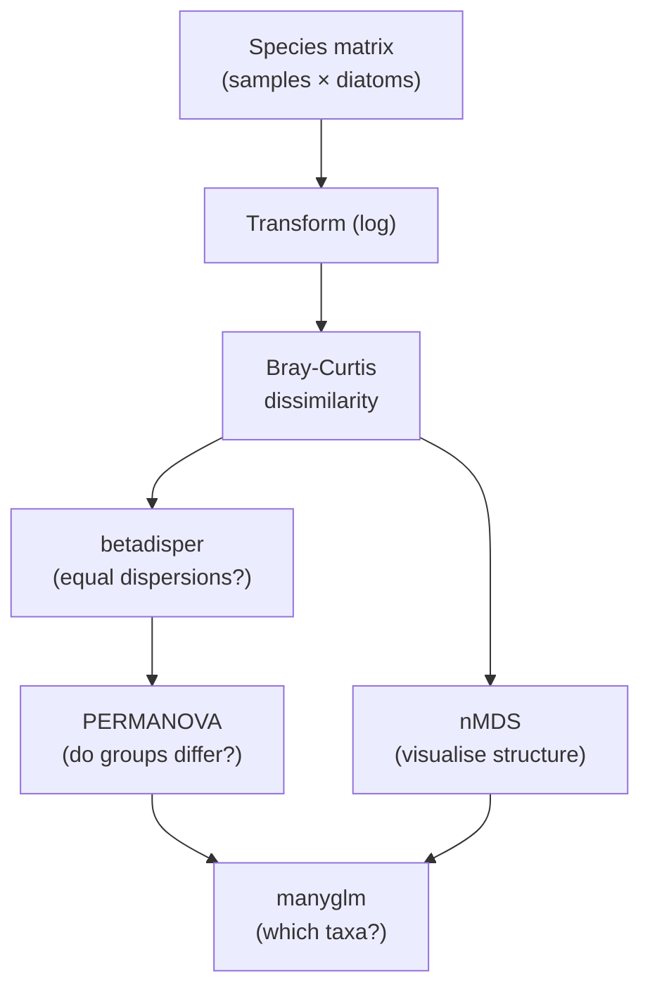
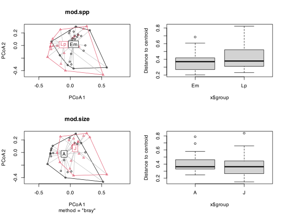
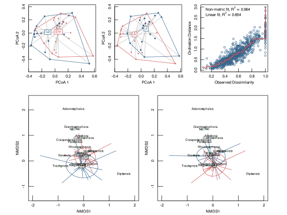
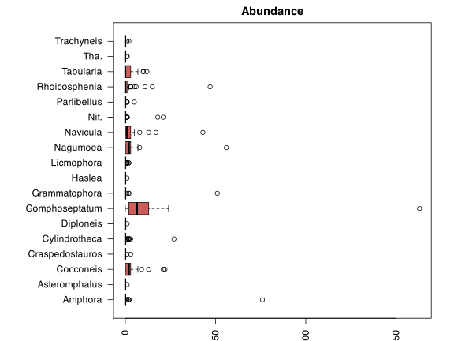
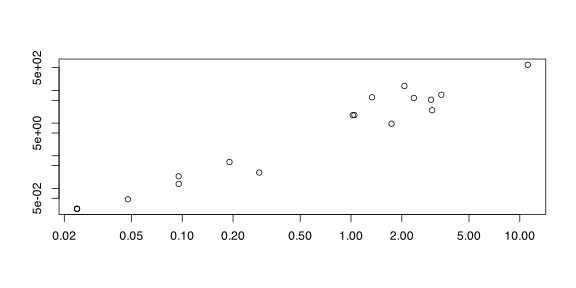
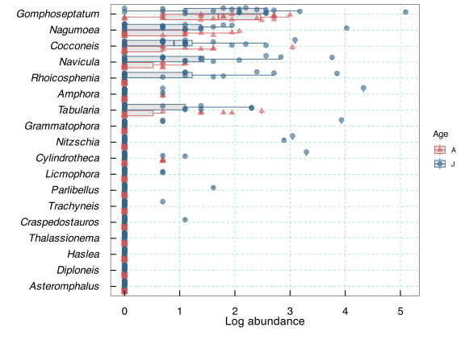
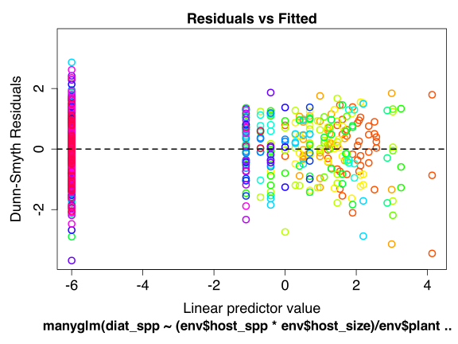

> **TIP:**
>
> | Type | Name | Link |
> |:---|:---|:---|
> | **Reading** | Serge Mayobo’s diatom paper | [💾 `Mayombo_et_al_2019.pdf`](../docs/Mayombo_et_al_2019.pdf) |
> | **Data** | Abbreviated diatom data matrix | [💾 `PB_data_matrix_abrev.csv`](../data/BCB743/diatoms/PB_data_matrix_abrev.csv) |
> |  | Diatoms data matrix | [💾 `PB_data_matrix.csv`](../data/BCB743/diatoms/PB_data_matrix.csv) |
> |  | Diatom environmental data | [💾 `PB_diat_env.csv`](../data/BCB743/diatoms/PB_diat_env.csv) |

Kelp forests host a large biomass of epiphytic fauna and flora, including diatoms, which form the base of aquatic food webs and transfer energy to higher trophic levels. This study investigated the epiphytic diatom assemblages associated with two common species of South African kelps, *Ecklonia maxima* and *Laminaria pallida*. Primary blades of adult and juvenile thalli of both kelp species were sampled at False Bay in July 2017 and analysed using scanning electron microscopy. The diatom community data are here subjected to a suite of multivariate methods to show the structure of the diatom flora as a function of i) kelp species and ii) kelp size. Read Mayombo et al. ([2019](#ref-mayombo2019diatoms)) for more details and the findings of the research.

This chapter is less an nMDS tutorial than a worked case study in how a community-ecology analysis is built, from the sampling design through to species-level interpretation. The nMDS is one step in that sequence. The workflow runs from the species matrix to a statement about which diatoms drive any pattern ([Figure 1](#fig-diatom-workflow)), and each step answers a distinct question.

``` numberSource
flowchart TD
  A["Species matrix<br/>(samples × diatoms)"] --> B["Transform (log)"]
  B --> C["Bray-Curtis<br/>dissimilarity"]
  C --> D["betadisper<br/>(equal dispersions?)"]
  D --> E["PERMANOVA<br/>(do groups differ?)"]
  C --> F["nMDS<br/>(visualise structure)"]
  E --> G["manyglm<br/>(which taxa?)"]
  F --> G
```



Figure 1: The community-analysis workflow followed in this chapter. Each step answers a different question, and the methods are chosen to suit the nested sampling design.

Each method answers one question in that chain:

| Method | Question it answers |
|:---|:---|
| Bray-Curtis dissimilarity | how different is the diatom community between two samples? |
| `betadisper()` | do the groups have equal multivariate spread, a precondition for PERMANOVA? |
| PERMANOVA (`adonis2()`) | do the group means differ in community composition? |
| nMDS | what does the community structure look like in two dimensions? |
| `manyglm()` | which individual diatom taxa drive the differences? |

> **NOTE:**
>
> The study was peer-reviewed, and a reviewer’s comments together with my responses are reproduced here, since they show how statistical choices of this kind are questioned and defended in practice rather than being arbitrary.
>
> **Reviewer 1**
>
> The design of the observational study includes 2 treatments - age (young versus old) and host species (*Laminaria* versus *Ecklonia*), 4 replicates (4 primary blades from each combination of host algae and age), and 3 subsamples from each blade (pseudoreplicates, if treated incorrectly as replicates). The experimental design is analogous to a 2-way ANOVA, but with community data instead of a single individual response variable. This design can evaluate interactive effects between the two treatments (age and species). The authors’ experimental design is most suited to analyses using PERMANOVA, which is the community statistics version of the ANOVA.
>
> Please indicate for the readers why the data were transformed and standardised using the stated procedures. Definitely a good idea to transform data, but the readers need to understand why particular procedures were employed. Please describe the Wisconsin double standardisation:
>
> - row/column standardised by row/column total to produce relative abundance to total and column/row standardised; vs.
> - column/row max–to produce abundance relative to species max abundance.
>
> Why a double standardisation + square-root transformation, as opposed to a single row/column standardisation by row/column total + square-root transformation?
>
> **AJS: About ANOSIM and PERMANOVA**
>
> Overall, Analysis of Similarities (ANOSIM) and the Mantel test were sensitive to heterogeneity in dispersions, with ANOSIM generally being more sensitive than the Mantel test. In contrast, PERMANOVA and Pillai’s trace were mostly unaffected by heterogeneity for balanced designs. \[…\]. PERMANOVA was also unaffected by differences in correlation structure. \[…\] PERMANOVA was generally, but not always, more powerful than the others to detect changes in community structure.
>
> **AJS: About data transformation**
>
> Useful when the range of data values is large. Data are square root transformed, and then submitted to Wisconsin double standardisation, or species divided by their maxima, and stands standardised to equal totals. These two standardisations often improve the quality of ordinations.

## 1 Set-up the analysis environment

``` numberSource
library(tidyverse)
library(vegan)
# library(BiodiversityR)

# Files will be referenced using here::here() for absolute paths
```

## 2 Load and prepare the data

### 2.1 The species data

The diatom species data include the following:

- columns: diatom genera
- rows: samples (samples taken from two species of kelp; equivalent to sites in other species x sites tables)
- row names correspond to combinations of the factors in the columns inside `PB_diat_env.csv`

where `host_size` is `A` for adult kelp plant (host), `J` for juvenile kelp plant (host), `host_spp` is `Lp` for kelp species *Laminaria pallida* (host), `Em` for kelp plant *Ecklonia maxima* (host), `plant` is the unique number identifying a specific kelp plant, and `rep` is the replicate tissue sample from each kelp host plant from which the diatoms were extracted.

``` numberSource
# with shortened name to fix nMDS overplotting
spp <- read.csv(
  here::here("data", "BCB743", "diatoms", "PB_data_matrix_abrev.csv"),
  row.names = "Replicate",
  sep = ",",
  header = TRUE
)
spp[1:6, 1:6]
```

    R>         Amphora.spp Asteromphalus.spp Cocconeis.spp Craspedostauros.spp
    R> APB1LP1           0                 0             0                   0
    R> APB1LP2           0                 0             0                   0
    R> APB1LP3           0                 0             0                   0
    R> APB2LP1           0                 0             0                   0
    R> APB2LP2           0                 0             0                   0
    R> APB2LP3           0                 0             0                   0
    R>         Cylindrotheca.spp Diploneis.spp
    R> APB1LP1                 0             0
    R> APB1LP2                 0             0
    R> APB1LP3                 0             0
    R> APB2LP1                 0             0
    R> APB2LP2                 0             0
    R> APB2LP3                 0             0

``` numberSource
# with full names
spp2 <- read.csv(
  here::here("data", "BCB743", "diatoms", "PB_data_matrix.csv"),
  row.names = "Replicate",
  sep = ",",
  header = TRUE
)
spp2[1:6, 1:6]
```

    R>         Amphora.spp Asteromphalus.spp Cocconeis.spp Craspedostauros.spp
    R> APB1LP1           0                 0             0                   0
    R> APB1LP2           0                 0             0                   0
    R> APB1LP3           0                 0             0                   0
    R> APB2LP1           0                 0             0                   0
    R> APB2LP2           0                 0             0                   0
    R> APB2LP3           0                 0             0                   0
    R>         Cylindrotheca.spp Diploneis.spp
    R> APB1LP1                 0             0
    R> APB1LP2                 0             0
    R> APB1LP3                 0             0
    R> APB2LP1                 0             0
    R> APB2LP2                 0             0
    R> APB2LP3                 0             0

``` numberSource
# remove ".spp" from column header name
colnames(spp) <- str_replace(colnames(spp), "\\.spp", "")
colnames(spp2) <- str_replace(colnames(spp2), "\\.spp", "")
```

Logarithmic transformation as suggested by Anderson ([2006](#ref-anderson2006distance)), namely $log_{b}(x) + 1$ for $x > 0$, where $b$ is the base of the logarithm, with zeros left as zeros. Higher bases give less weight to quantities and more to presences.

``` numberSource
spp.log <- decostand(spp, method = "log")
spp.log.dis <- vegdist(spp.log, method = "bray")
```

By default, `decostand(method = "log")` uses a base-2 logarithm. That choice is fine here because the purpose is to compress dominance before Bray-Curtis distances are calculated, but it should not be confused with a natural-log transformation.

### 2.2 The predictors

The content is described above. These variables are categorical, and although not strictly ‘environmental’ data, they serve the same purpose in the analysis as true environmental data, namely they describe where the samples were taken from.

``` numberSource
env <- tibble(
  read.csv(here::here("data", "BCB743", "diatoms", "PB_diat_env.csv")),
  sep = ",",
  header = TRUE
)
env$plant <- as.factor(env$plant)
env$rep <- as.factor(env$rep)
head(env)
```

    R> # A tibble: 6 × 7
    R>   replicate host_size host_spp plant rep   sep   header
    R>   <chr>     <chr>     <chr>    <fct> <fct> <chr> <lgl> 
    R> 1 APB1LP1   A         Lp       1     1     ,     TRUE  
    R> 2 APB1LP2   A         Lp       1     2     ,     TRUE  
    R> 3 APB1LP3   A         Lp       1     3     ,     TRUE  
    R> 4 APB2LP1   A         Lp       2     1     ,     TRUE  
    R> 5 APB2LP2   A         Lp       2     2     ,     TRUE  
    R> 6 APB2LP3   A         Lp       2     3     ,     TRUE

With the environmental data (factors), the following analyses can be done:

- ✘ Discriminant Analysis (DA)
- ✘ Analysis of Similarities (ANOSIM)
- ✔︎ Permutational Analysis of Variance (PERMANOVA)
- ✘ Mantel test

I will do an nMDS and PERMANOVA.

## 3 Multivariate homogeneity of group dispersions (variances)

Before doing the PERMANOVA (testing differences between means), first check to see if the dispersion is the same. See `?adonis2` for more on this.

**Homogeneity of groups** `betadisper()` evaluates the differences in group homogeneities. I treat it as analogous to Levene’s test of the equality of variances. The null hypothesis evaluated is that the multivariate dispersions (the average distance of group members to their group centroid) are equal across groups. Unfortunately I can only use one factor as an independent variable so it is not yet possible to look for interactions (species × size).

I test the $H_{0}$ that the dispersion (variance) in diatom community structure does not differ between the two host species:

``` numberSource
(mod.spp <- with(env, betadisper(spp.log.dis, host_spp)))
```

    R> 
    R>  Homogeneity of multivariate dispersions
    R> 
    R> Call: betadisper(d = spp.log.dis, group = host_spp)
    R> 
    R> No. of Positive Eigenvalues: 20
    R> No. of Negative Eigenvalues: 21
    R> 
    R> Average distance to median:
    R>     Em     Lp 
    R> 0.3640 0.4391 
    R> 
    R> Eigenvalues for PCoA axes:
    R> (Showing 8 of 41 eigenvalues)
    R>  PCoA1  PCoA2  PCoA3  PCoA4  PCoA5  PCoA6  PCoA7  PCoA8 
    R> 1.9619 1.7968 1.3888 1.0040 0.8491 0.6366 0.3132 0.3008

``` numberSource
anova(mod.spp)
```

    R> Analysis of Variance Table
    R> 
    R> Response: Distances
    R>           Df  Sum Sq  Mean Sq F value Pr(>F)
    R> Groups     1 0.05876 0.058761  2.6087 0.1141
    R> Residuals 40 0.90101 0.022525

There is no difference in dispersion between the diatom communities on the two host species. Apply the same procedure to see if host size has an effect:

``` numberSource
(mod.size <- with(env, betadisper(spp.log.dis, host_size)))
```

    R> 
    R>  Homogeneity of multivariate dispersions
    R> 
    R> Call: betadisper(d = spp.log.dis, group = host_size)
    R> 
    R> No. of Positive Eigenvalues: 20
    R> No. of Negative Eigenvalues: 21
    R> 
    R> Average distance to median:
    R>      A      J 
    R> 0.4005 0.3889 
    R> 
    R> Eigenvalues for PCoA axes:
    R> (Showing 8 of 41 eigenvalues)
    R>  PCoA1  PCoA2  PCoA3  PCoA4  PCoA5  PCoA6  PCoA7  PCoA8 
    R> 1.9619 1.7968 1.3888 1.0040 0.8491 0.6366 0.3132 0.3008

``` numberSource
anova(mod.size)
```

    R> Analysis of Variance Table
    R> 
    R> Response: Distances
    R>           Df  Sum Sq   Mean Sq F value Pr(>F)
    R> Groups     1 0.00141 0.0014134  0.0604 0.8071
    R> Residuals 40 0.93615 0.0234038

No, it does not have an effect either. Make some plots to visualise the patterns:

``` numberSource
par(mfrow = c(2, 2))
plot(mod.spp, sub = NULL)
boxplot(mod.spp)

plot(mod.size)
boxplot(mod.size)
```

[](nMDS_diatoms_files/figure-html/fig-par-mfrow-c-1.svg "Figure 2: ")

Figure 2

Optionally, I can confirm the above analysis with the `permutest()` function. `permutest()` is a permutational ANOVA-like test that tests the $H_{0}$ that there is no difference in the multivariate dispersion of diatom community structure between *Ecklonia maxima* and *Laminaria pallida*, and between adult and juvenile plants:

``` numberSource
permutest(mod.spp) # there is in fact no difference
```

    R> 
    R> Permutation test for homogeneity of multivariate dispersions
    R> Permutation: free
    R> Number of permutations: 999
    R> 
    R> Response: Distances
    R>           Df  Sum Sq  Mean Sq      F N.Perm Pr(>F)  
    R> Groups     1 0.05876 0.058761 2.6087    999  0.099 .
    R> Residuals 40 0.90101 0.022525                       
    R> ---
    R> Signif. codes:  0 '***' 0.001 '**' 0.01 '*' 0.05 '.' 0.1 ' ' 1

``` numberSource
permutest(mod.size) # nope...
```

    R> 
    R> Permutation test for homogeneity of multivariate dispersions
    R> Permutation: free
    R> Number of permutations: 999
    R> 
    R> Response: Distances
    R>           Df  Sum Sq   Mean Sq      F N.Perm Pr(>F)
    R> Groups     1 0.00141 0.0014134 0.0604    999  0.818
    R> Residuals 40 0.93615 0.0234038

It should be enough to do the [`anova()`](https://rdrr.io/r/stats/anova.html), above, though. You can safely ignore the `permutest()`.

## 4 PERMANOVA

Permutational Multivariate Analysis of Variance (PERMANOVA; Anderson and Walsh ([2013](#ref-anderson2013permanova))) uses distance or dissimilarity matrices (Bray-Curtis dissimilarities in this example), whereas ANOSIM uses only ranks of the dissimilarities. The former preserves more information and is the recommended approach to test for differences between multivariate means. PERMANOVA also allows for variation partitioning and permits more complex designs (multiple factors, nested factors, interactions, covariates, etc.). I use `adonis2()` to evaluate the differences in the group means, which makes it analogous to multivariate analysis of variance.

Nestedness should be stated in the blocks (plants): “If you have a nested error structure, so that you do not want your data be shuffled over classes (blocks), you should define blocks in your permutation” (Jari Oksanen).

``` numberSource
# the permutational structure captures the nesting of replicates within plant
perm <- how(nperm = 1000)
setBlocks(perm) <- with(env, plant)

(perm.1 <- adonis2(
  spp.log.dis ~ host_spp * host_size,
  data = env,
  permutations = perm
))
```

    R> Permutation test for adonis under reduced model
    R> Blocks:  with(env, plant) 
    R> Permutation: free
    R> Number of permutations: 1000
    R> 
    R> adonis2(formula = spp.log.dis ~ host_spp * host_size, data = env, permutations = perm)
    R>          Df SumOfSqs      R2      F Pr(>F)
    R> Model     3   1.2444 0.15876 2.3904      1
    R> Residual 38   6.5938 0.84124              
    R> Total    41   7.8381 1.00000

The test returns `Pr(>F) = 1`, which looks alarming but follows directly from the permutation design.

> **NOTE:**
>
> A *p*-value of 1 looks like a broken analysis, but here it is a logical consequence of the blocked permutation. Host species and host size are fixed properties of each whole plant, while the blocks restrict permutations to *within* each plant. Because every sample from a plant shares that plant’s species and size, no within-plant shuffle can change the group labels. The model matrix is identical under every permutation, so every permuted *F* equals the observed *F*, and `Pr(>F)` comes out at exactly 1.
>
> The defensible interpretation is not “there is strong evidence of no effect” but “this design, with permutations correctly restricted to respect the nesting, cannot by itself test a treatment that is applied at the plant level.” Properly testing the species or size effect would mean permuting whole plants between treatment groups, since the plant, not the subsample, is the true unit of replication. The two other results point the same way, and more interpretably. The dispersions are homogeneous (above) and the nMDS groups overlap broadly (below). Together they support the conclusion that the diatom assemblages do not separate clearly by host species or size.

## 5 nMDS

The dispersion test and PERMANOVA asked, numerically, whether the groups differ. The nMDS now shows the community structure those tests were probing, so the number and the picture can be considered together. The two should agree. If the tests find no separation, the ordination should show overlapping groups.

Do the nMDS and assemble the figures:

``` numberSource
spp.nmds <- metaMDS(
  spp.log.dis,
  k = 2,
  trymax = 100,
  trace = 0,
  autotransform = FALSE,
  wascores = FALSE
)
sppscores(spp.nmds) <- spp.log

# not printed as it is too long...
# scores(spp.nmds, display = "species")
# scores(spp.nmds, display = "sites")
```

``` numberSource
col <- c("indianred3", "steelblue4")
pch <- c(17, 19)
opar <- par()
plt1 <- layout(
  rbind(c(1, 1, 2, 2, 3, 3), c(4, 4, 4, 5, 5, 5)),
  heights = c(2, 3),
  respect = TRUE
)

# layout.show(plt1)

par(mar = c(3, 3, 1, 1))

# plot 1
plot(
  mod.spp,
  main = NULL,
  tck = .05,
  mgp = c(1.8, 0.5, 0),
  col = col,
  pch = pch,
  sub = NULL
)

# plot 2
plot(
  mod.size,
  main = NULL,
  tck = .05,
  mgp = c(1.8, 0.5, 0),
  col = col,
  pch = pch,
  sub = NULL
)

# plot 3
stressplot(
  spp.nmds,
  p.col = "steelblue4",
  l.col = "indianred3",
  tck = .05,
  mgp = c(1.8, 0.5, 0)
)

# plot 4
par(mar = c(3, 3, 2, 1))
plot(
  spp.nmds,
  display = "sites",
  type = "n",
  main = NULL,
  tck = .05,
  mgp = c(1.8, 0.5, 0),
  xlim = c(-2, 2),
  ylim = c(-1, 2)
)
with(
  env,
  points(spp.nmds, display = "sites", col = col[host_spp], pch = pch[host_spp])
)
with(env, ordispider(spp.nmds, groups = host_spp, label = TRUE, col = col))
with(env, ordiellipse(spp.nmds, groups = host_spp, col = col, label = FALSE))
points(spp.nmds, display = "species", pch = 1, col = "seagreen")
orditorp(spp.nmds, display = "species", cex = 0.8, col = "black", air = 0.01)

# plot 5
par(mar = c(3, 3, 2, 1))
plot(
  spp.nmds,
  display = "sites",
  type = "n",
  main = NULL,
  tck = .05,
  mgp = c(1.8, 0.5, 0),
  xlim = c(-2, 2),
  ylim = c(-1, 2)
)
with(
  env,
  points(
    spp.nmds,
    display = "sites",
    col = col[host_size],
    pch = pch[host_size]
  )
)
with(env, ordispider(spp.nmds, groups = host_size, label = TRUE, col = col))
with(env, ordiellipse(spp.nmds, groups = host_size, col = col, label = FALSE))
points(spp.nmds, display = "species", pch = 1, col = "seagreen")
orditorp(spp.nmds, display = "species", cex = 0.8, col = "black", air = 0.01)
# dev.off()
par(opar)
```

[](nMDS_diatoms_files/figure-html/fig-col-c-indianred3-steelblue4-1.svg "Figure 3: ")

Figure 3

### 5.1 Reading the ordination

The two bottom panels are the ordinations to interpret, coloured by host species (left) and by host size (right). The spiders join each sample to its group centroid and the ellipses show each group’s spread.

- **The host-species groups overlap almost entirely.** Their centroids sit close together, differing by only about 0.1 on the first axis against a within-group spread of roughly 0.5, and the ellipses are nearly concentric.
- **The adult and juvenile groups overlap to the same degree.** Neither host species nor host size defines a distinct region of the ordination.
- **The picture agrees with the tests.** Broad overlap is what homogeneous dispersions and a PERMANOVA that detects no difference would predict, so the visual and the numerical results agree.
- **Interpret the broad pattern, not the fine detail.** The stress is about 0.19, in the usable range where only the broad pattern should be trusted, so the two-dimensional map is only a moderate summary of the full community structure. The species names placed by `orditorp()` mark roughly where each diatom is most abundant, and their exact positions should not be over-interpreted.

## 6 Multivariate abundance using generalised linear models

> **NOTE:**
>
> PERMANOVA asks whether the communities differ overall. It cannot say which taxa are associated with the difference. `manyglm()` fits a separate generalised linear model to each diatom species and tests them together, so it can identify the individual taxa whose abundances differ among groups. The two methods are complementary, addressing first the community question and then the species question.

What follows is an example of *model-based multivariate analysis*, an alternative to the distance-based methods used above. A full treatment is beyond this chapter. The aim here is to show the kind of question the method answers and to reproduce the analysis from Mayombo et al. ([2019](#ref-mayombo2019diatoms)). For the underlying theory, see Wang et al. ([2012](#ref-wang2012mvabund)) and Wang et al. ([2017](#ref-wang2017mvabund)).

``` numberSource
library(mvabund)
diat_spp <- mvabund(spp2)
```

Look at the spread of the data using the boxplot function. The figure is not used in paper:

``` numberSource
par(mar = c(2, 10, 2, 2)) # adjusts the margins
boxplot(spp, horizontal = TRUE, las = 2, main = "Abundance", col = "indianred")
```

[](nMDS_diatoms_files/figure-html/code-par-mar-c-adjusts-1.svg)

Check the mean-variance relationship:

``` numberSource
meanvar.plot(diat_spp)
```

[](nMDS_diatoms_files/figure-html/fig-meanvar-plot-diat-spp-1.svg "Figure 4: ")

Figure 4

The above plot shows that spp with a high mean also have a high variance.

1.  Are there differences in the species composition of the diatom spp. sampled? *This has already been addressed above, but I can apply an alternative approach below*.
2.  Do some of them specialise on particular spp of kelp, while others are more generalised? *Addressed below*.
3.  Do some occur more on juveniles, while some are on adults, and which ones indiscriminately live across age classes? *Addressed below*.
4.  Which species? *Addressed below*.

Scale manually for `ggplot2()` custom plot. Create a scale function:

``` numberSource
log_fun <- function(x) {
  min_x <- min(x[x != 0], na.rm = TRUE)
  a <- log(x) / min_x
  a[which(!is.finite(a))] <- 0
  return(a)
}
```

Make a plot that shows which diatoms species are responsible for differences between adult and juvenile kelps:

``` numberSource
spp2 %>%
  mutate(host_size = env$host_size) %>%
  gather(key = species, value = abund, -host_size) %>%
  as_tibble() %>%
  group_by(species) %>%
  mutate(log.abund = log_fun(abund)) %>%
  ungroup() %>%
  ggplot(aes(x = fct_reorder(species, abund, .fun = mean), y = log.abund)) +
  geom_boxplot(
    aes(colour = host_size),
    linewidth = 0.4,
    outlier.size = 0,
    fill = "grey90"
  ) +
  geom_point(
    aes(colour = host_size, shape = host_size),
    position = position_dodge2(width = 0.8),
    alpha = 0.6,
    size = 2.5
  ) +
  scale_colour_manual(name = "Age", values = c("indianred3", "steelblue4")) +
  scale_shape_manual(name = "Age", values = c(17, 19)) +
  scale_y_continuous(name = "Log abundance") +
  coord_flip() +
  theme_bw() +
  theme(
    panel.grid.major = element_line(
      linetype = "dashed",
      colour = "seagreen3",
      linewidth = 0.2
    ),
    panel.grid.minor = element_blank(),
    axis.text.x = element_text(
      size = 13,
      colour = "black",
      margin = unit(c(0.5, 0.5, 0.5, 0.5), "cm")
    ),
    axis.text.y = element_text(
      size = 13,
      colour = "black",
      face = "italic",
      margin = unit(c(0.5, 0.5, 0.5, 0.5), "cm")
    ),
    axis.title.x = element_text(size = 14, vjust = 5.75, colour = "black"),
    axis.title.y = element_blank(),
    axis.ticks.length = unit(-0.25, "cm"),
    axis.ticks = element_line(colour = "black", linewidth = 0.5)
  )
```

[](nMDS_diatoms_files/figure-html/fig-spp2-1.svg "Figure 5: ")

Figure 5

I settle on a negative binomial distribution for the species data. This will be provided to the `manyglm()` function:

``` numberSource
size_mod2 <- manyglm(
  diat_spp ~ (env$host_spp * env$host_size) / env$plant,
  family = "negative binomial"
)
plot(size_mod2) # better residuals...
```

[](nMDS_diatoms_files/figure-html/fig-size-mod2-manyglm-diat-spp-env-1.svg "Figure 6: ")

Figure 6

``` numberSource
# anova(size_mod2, test = "wald")
out <- anova(size_mod2, p.uni = "adjusted", test = "wald")
```

    R> Time elapsed: 0 hr 0 min 8 sec

``` numberSource
out$table
```

    R>                                      Res.Df Df.diff     wald Pr(>wald)
    R> (Intercept)                              41      NA       NA        NA
    R> env$host_spp                             40       1 5.227772     0.296
    R> env$host_size                            39       1 7.799205     0.006
    R> env$host_spp:env$host_size               38       1 5.434128     0.007
    R> env$host_spp:env$host_size:env$plant     26      16      NaN     0.001

What is the proportional contribution of some important species to juvenile and adult plants?

``` numberSource
prop.contrib <- data.frame(
  spp = colnames(out$uni.test),
  prop = out$uni.test[3, ],
  row.names = NULL
)
prop.contrib %>%
  mutate(perc = round((prop / sum(prop)) * 100, 1)) %>%
  arrange(desc(perc)) %>%
  mutate(cum = cumsum(perc))
```

    R>                spp       prop perc   cum
    R> 1    Rhoicosphenia 4.05979831 16.7  16.7
    R> 2         Navicula 3.65789127 15.1  31.8
    R> 3        Nitzschia 2.65842186 10.9  42.7
    R> 4          Amphora 2.39874550  9.9  52.6
    R> 5        Cocconeis 2.10936669  8.7  61.3
    R> 6         Nagumoea 1.92435482  7.9  69.2
    R> 7   Gomphoseptatum 1.86301773  7.7  76.9
    R> 8    Cylindrotheca 1.79282759  7.4  84.3
    R> 9      Parlibellus 1.40898477  5.8  90.1
    R> 10      Licmophora 0.83203299  3.4  93.5
    R> 11       Tabularia 0.64240853  2.6  96.1
    R> 12 Craspedostauros 0.40412954  1.7  97.8
    R> 13   Grammatophora 0.14035115  0.6  98.4
    R> 14   Thalassionema 0.09310783  0.4  98.8
    R> 15   Asteromphalus 0.08434341  0.3  99.1
    R> 16       Diploneis 0.07915274  0.3  99.4
    R> 17          Haslea 0.07915274  0.3  99.7
    R> 18      Trachyneis 0.07149347  0.3 100.0

## 7 References

Anderson MJ (2006) Distance-based tests for homogeneity of multivariate dispersions. Biometrics 62:245–253.

Anderson MJ, Walsh DC (2013) PERMANOVA, ANOSIM, and the mantel test in the face of heterogeneous dispersions: What null hypothesis are you testing? Ecological monographs 83:557–574.

Mayombo N, Majewska R, Smit A (2019) Diatoms associated with two south african kelp species: Ecklonia maxima and laminaria pallida. African Journal of Marine Science 41:221–229.

Wang Y, Naumann U, Wright ST, Warton DI (2012) Mvabund–an r package for model-based analysis of multivariate abundance data. Methods in Ecology and Evolution 3:471–474.

Wang Y, Naumann U, Eddelbuettel D, Wilshire J, Warton D, Byrnes J, Santos Silva R dos, Niku J, Renner I, Wright S (2017) Mvabund: Statistical methods for analysing multivariate abundance data.

## Reuse

[CC BY-NC-SA 4.0](https://creativecommons.org/licenses/by-nc-sa/4.0/)

## Citation

BibTeX citation:

``` quarto-appendix-bibtex
@online{smit2026,
  author = {Smit, A. J.},
  title = {12. {Community} Analysis Case Study: {Mayombo’s} Diatom Data},
  date = {2026-11-06},
  url = {https://tangledbank.netlify.app/BCB743/nMDS_diatoms.html},
  langid = {en}
}
```

For attribution, please cite this work as:

Smit AJ (2026) 12. Community analysis case study: Mayombo’s diatom data. [https://tangledbank.netlify.app/BCB743/nMDS_diatoms.html.](https://tangledbank.netlify.app/BCB743/nMDS_diatoms.html)
