> **TIP:**
>
> | Type | Name | Link |
> |:---|:---|:---|
> | **Package** | `spesim` | [ github.com/ajsmit/spesim](https://github.com/ajsmit/spesim) |
> | **Overview** | What spesim is, and is not | [spesim overview](../BCB743/spesim.llms.md) |
> | **Docs** | Vignettes and function reference | [ajsmit.github.io/spesim](https://ajsmit.github.io/spesim/) |
> | **Install** | `remotes::install_github("ajsmit/spesim")` |  |

> **NOTE:**
>
> Unlike the [overview page](../BCB743/spesim.llms.md), where the code is illustrative and is not run, every code block below is executed when this site is built. To reproduce the results in your own session, install **spesim** from GitHub first, namely with `remotes::install_github("ajsmit/spesim")`.

## 1 Why a course on inference needs a simulator

Almost everything in BCB743 is about inference. We start from a site-by-species matrix and an environmental table, we fit an ordination, a clustering, or a regression-type model, and then we reason backwards to the gradients and processes that might have produced the pattern. What *really* assembled the species into a community is hidden, so we can never check the answer against the truth. We can only check it against our expectations.

A simulator reverses that relationship. In **spesim** you set the number of species, their relative abundances, their optima along one or more environmental gradients, the spatial structure, and the sampling design. The package then returns the same objects you would collect in the field, namely a site-by-species abundance matrix and a per-quadrat environmental table. Because you specified the species assembly process (thus far according to only a few options), you can ask the question that observational data rarely answer directly, namely *did the method recover the structure I imposed?* ([Borcard et al. 2011](#ref-borcard2011numerical); [Legendre and Legendre 2012](#ref-legendre2012numerical)).

Below, I will work through six examples. Each simulates a community with a method taught elsewhere in the module, and ends with a comparison between what the method produces and what we know to be true.

## 2 Installing and loading spesim

**spesim** is on GitHub rather than CRAN, so it installs with **remotes**. It compiles a small amount of C++ for its point-process engines, so the first install takes a minute or two.

``` numberSource
# install.packages("remotes")
remotes::install_github("ajsmit/spesim")
```

For the analyses we also use **vegan** for the ordinations ([Oksanen et al. 2022](#ref-oksanen2022vegan)) and the **tidyverse** for handling and plotting.

``` numberSource
library(tidyverse)
library(vegan)
library(patchwork)
library(spesim)
```

## 3 Example 1: The objects BCB743 starts from

Every run begins from a plain-text configuration. We load the packaged basic example, adjust a handful of fields in memory, and run the full workflow. Setting `write_outputs = FALSE` keeps everything in memory, and a fixed `seed` makes the community reproducible.

``` numberSource
P <- load_config(system.file(
  "examples/spesim_init_basic.txt",
  package = "spesim"
))

P$N_SPECIES <- 12L
P$N_INDIVIDUALS <- 3000L
P$SAD_MODEL <- "fisher" # Fisher's log-series
P$SAMPLING_SCHEME <- "random"
P$N_QUADRATS <- 20L
P$SEED <- 42L

res <- spesim_run(P, write_outputs = FALSE, seed = P$SEED, quiet = TRUE)
```

The `res` object contains the landscape, the placed individuals, the quadrats, and the derived tables. A single call maps the domain, the individuals coloured by species, and the quadrats laid over them.

``` numberSource
plot_spatial_sampling(res$domain, res$species_dist, res$quadrats, res$P)
```

[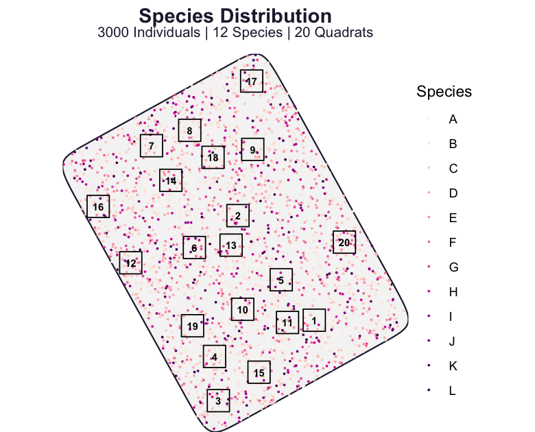](spesim_examples_files/figure-html/fig-map-1.png "Figure 1: The simulated landscape for Example 1. Points are individuals coloured by species; open squares are the 20 randomly placed quadrats that define the sampling. The community, the gradients, and the quadrat positions are all set by the configuration.")

Figure 1: The simulated landscape for Example 1. Points are individuals coloured by species; open squares are the 20 randomly placed quadrats that define the sampling. The community, the gradients, and the quadrat positions are all set by the configuration.

We have seen examples of the two returned tables in most earlier chapters. The first is the site-by-species matrix, namely the counts of each species in each quadrat.

``` numberSource
res$abund_matrix[1:6, 1:9]
```

    R>   site  A B C D E F G H
    R> 1    1  6 1 4 1 1 1 1 1
    R> 2   10 14 5 0 4 0 1 0 1
    R> 3   11  5 4 0 1 2 2 0 0
    R> 4   12  3 2 7 4 1 2 3 0
    R> 5   13  7 6 0 0 1 1 3 2
    R> 6   14  9 9 1 0 4 1 1 1

The second is the per-quadrat environment table, obtained by averaging the gridded gradients within each quadrat. This is equivalent to the Doubs `env` table.

``` numberSource
env <- calculate_quadrat_environment(
  res$env_gradients,
  res$quadrats,
  st_crs(res$domain)
)
head(env)
```

    R>   site temperature elevation  rainfall temperature_C elevation_m rainfall_mm
    R> 1    1   0.6133602 0.5727448 0.2854253     16.400807    1145.490    399.7977
    R> 2   10   0.4519585 0.7423583 0.3785580     11.558755    1484.717    464.9906
    R> 3   11   0.5384815 0.6329544 0.2901739     14.154444    1265.909    403.1218
    R> 4   12   0.2829137 0.5462826 0.6121682      6.487410    1092.565    628.5177
    R> 5   13   0.4850764 0.9631023 0.5002704     12.552293    1926.205    550.1893
    R> 6   14   0.3936325 0.6111770 0.6867166      9.808976    1222.354    680.7016

These two tables, `abund_matrix` and `env`, are where we start with correlation and association, distance and dissimilarity, ordination, and clustering. The difference from a field dataset is that here we also have the recipe that produced them.

## 4 Example 2: short and long gradients, and the horseshoe effect

The horseshoe in a principal component analysis (PCA) is one of the recurring frustrations of the module. It appears when a single long gradient drives a turnover of species with unimodal responses, so that sites far apart on the gradient share no species and a linear ordination arranges them on an arch rather than a straight line ([Whittaker 1967](#ref-Whittaker1967); [Legendre and Legendre 2012](#ref-legendre2012numerical)). With **spesim** we can produce it deliberately, because we control the length of the gradient.

We build two communities that differ in one respect only. In the first, twenty species have optima spread evenly across the whole temperature gradient, so the gradient is long and species turn over completely from one end to the other. In the second, the same twenty optima are packed into a narrow central band, so the gradient is short and every quadrat contains a similar mixture.

``` numberSource
make_gradient <- function(optima_span, seed = 2026L) {
  P <- load_config(system.file(
    "examples/spesim_init_basic.txt",
    package = "spesim"
  ))
  spp <- LETTERS[1:20]
  P$N_SPECIES <- 20L
  P$N_INDIVIDUALS <- 5000L
  P$GRADIENT_SPECIES <- spp
  P$GRADIENT_ASSIGNMENTS <- rep("temperature", 20)
  P$GRADIENT_OPTIMA <- setNames(
    seq(optima_span[1], optima_span[2], length.out = 20),
    spp
  )
  P$GRADIENT_TOLERANCE <- 0.07
  P$SAMPLING_SCHEME <- "systematic"
  P$N_QUADRATS <- 49L
  P$SEED <- seed
  spesim_run(P, write_outputs = FALSE, seed = seed, quiet = TRUE)
}

res_long <- make_gradient(c(0.05, 0.95)) # long gradient: full turnover
res_short <- make_gradient(c(0.42, 0.58)) # short gradient: little turnover
```

Both communities are sampled on the same systematic grid over the same domain, so the maps below differ only in where the species are placed. Enlarging the points and dropping the crowded species legend makes the pattern legible.

``` numberSource
show_map <- function(res, title) {
  res$P$POINT_SIZE <- 0.5
  res$P$POINT_ALPHA <- 0.8
  plot_spatial_sampling(res$domain, res$species_dist, res$quadrats, res$P) +
    guides(colour = "none") +
    labs(title = title, subtitle = NULL)
}

(show_map(res_long, "Long gradient") | show_map(res_short, "Short gradient")) +
  plot_annotation(tag_levels = "a")
```

[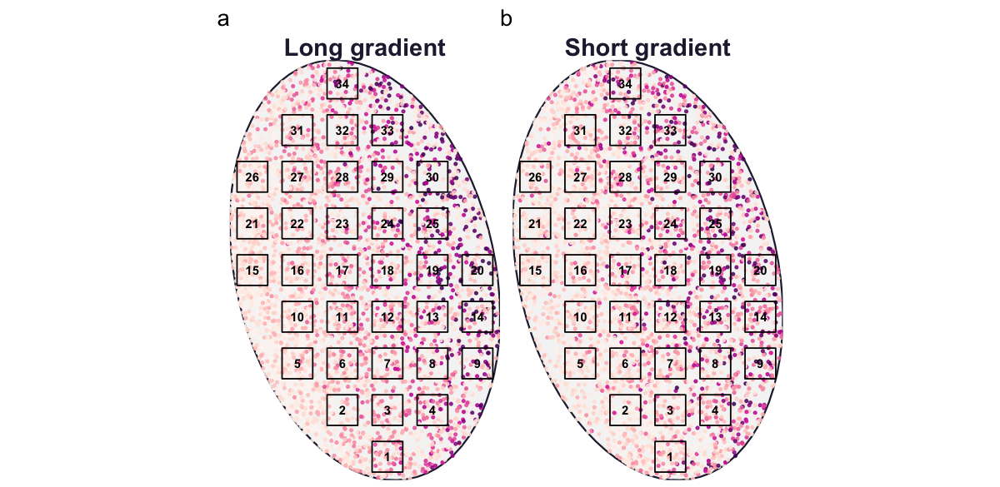](spesim_examples_files/figure-html/fig-landscape-2-1.png "Figure 2: The two Example 2 communities on an identical systematic grid. Points are individuals coloured by species; open squares are quadrats. Under the long gradient (a) the species colours grade across the domain, because each species is placed near its preferred temperature; under the short gradient (b) the same species overlap, because all of them prefer the mid-range.")

Figure 2: The two Example 2 communities on an identical systematic grid. Points are individuals coloured by species; open squares are quadrats. Under the long gradient (a) the species colours grade across the domain, because each species is placed near its preferred temperature; under the short gradient (b) the same species overlap, because all of them prefer the mid-range.

To ordinate each community we take its abundance matrix, drop empty quadrats, apply a Hellinger transformation, and run a PCA. Colouring each quadrat by its known temperature lets us compare the ordination with the gradient we imposed.

``` numberSource
pca_sites <- function(res) {
  spp <- setdiff(colnames(res$abund_matrix), "site")
  Y <- as.matrix(res$abund_matrix[, spp])
  keep <- rowSums(Y) > 0
  Y <- Y[keep, ]
  envq <- calculate_quadrat_environment(
    res$env_gradients,
    res$quadrats,
    st_crs(res$domain)
  )
  temp <- envq$temperature_C[match(res$abund_matrix$site[keep], envq$site)]

  pca <- rda(decostand(Y, method = "hellinger"))
  scr <- as.data.frame(scores(pca, display = "sites", scaling = 1))
  scr$temperature_C <- temp
  var <- round(100 * summary(eigenvals(pca))[2, 1:2], 1)
  list(scores = scr, var = var)
}

L <- pca_sites(res_long)
S <- pca_sites(res_short)
```

``` numberSource
plot_pca <- function(obj, title) {
  ggplot(obj$scores, aes(PC1, PC2, colour = temperature_C)) +
    geom_point(size = 2) +
    scale_colour_viridis_c(option = "mako", end = 0.9, name = "Temp (°C)") +
    coord_equal() +
    labs(
      title = title,
      x = sprintf("PC1 (%.1f%%)", obj$var[1]),
      y = sprintf("PC2 (%.1f%%)", obj$var[2])
    )
}

(plot_pca(L, "Long gradient") | plot_pca(S, "Short gradient")) +
  plot_layout(guides = "collect") +
  plot_annotation(tag_levels = "a")
```

[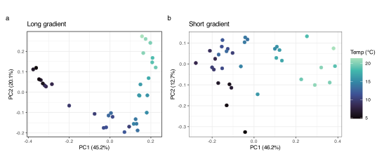](spesim_examples_files/figure-html/fig-horseshoe-1.svg "Figure 3: PCA of two communities that differ only in gradient length. (a) A long temperature gradient produces the classic horseshoe, with temperature graded smoothly around the arch. (b) A short gradient produces a diffuse cloud. Both use the same twenty species, the same sampling grid, and the same seed.")

Figure 3: PCA of two communities that differ only in gradient length. (a) A long temperature gradient produces the classic horseshoe, with temperature graded smoothly around the arch. (b) A short gradient produces a diffuse cloud. Both use the same twenty species, the same sampling grid, and the same seed.

The horseshoe is the expected behaviour of a linear method meeting a long gradient of unimodal responses, and because we set the gradient length ourselves, we know the arch reflects that gradient rather than a fault in the data. Shortening the gradient removes the arch, which is exactly the reasoning behind the gradient-length rule used to choose between linear and unimodal ordination.

## 5 Example 3: did the ordination recover the gradient?

Correspondence analysis (CA) is built for the unimodal case, so its first axis should follow the long temperature gradient where PCA produced an arch. We can test that claim directly, because the true temperature of every quadrat is known. We run CA on the long-gradient community from Example 2 and correlate the first CA axis with the temperature we imposed.

To see what the ordination is being asked to recover, it helps to look at the environmental structure first. We fit a generalised additive model (GAM) to the temperature field, which smooths out the simulation noise, then draw its isotherms, namely the lines of constant temperature. A straight-line fit of temperature on the spatial coordinates gives the bearing of steepest increase, which runs perpendicular to those isotherms.

``` numberSource
library(mgcv)

env <- res_long$env_gradients

# smooth the noisy temperature field, then take its isotherms
temp_gam <- gam(temperature_C ~ s(x, y, k = 60), data = env)

# bearing (compass degrees) of steepest temperature increase
temp_lm <- lm(temperature_C ~ x + y, data = env)
temp_bearing <- (atan2(coef(temp_lm)[["x"]], coef(temp_lm)[["y"]]) *
  180 /
  pi) %%
  360
```

Code

``` numberSource
bb <- st_bbox(res_long$domain)
xmin <- as.numeric(bb["xmin"])
xmax <- as.numeric(bb["xmax"])
ymin <- as.numeric(bb["ymin"])
ymax <- as.numeric(bb["ymax"])

# predict the smoothed surface on a regular grid, then mask to the domain
grid <- expand.grid(
  x = seq(xmin, xmax, length.out = 140),
  y = seq(ymin, ymax, length.out = 140)
)
grid$temperature_C <- as.numeric(predict(temp_gam, newdata = grid))

mask <- st_as_sfc(st_bbox(c(
  xmin = xmin - 1,
  ymin = ymin - 1,
  xmax = xmax + 1,
  ymax = ymax + 1
)))
st_crs(mask) <- st_crs(res_long$domain)
mask <- st_difference(mask, st_union(res_long$domain))

# gradient arrow through the centre, pointing up-temperature
cx <- mean(c(xmin, xmax))
cy <- mean(c(ymin, ymax))
arr_len <- 0.30 * (xmax - xmin)
ax <- arr_len * sin(temp_bearing * pi / 180)
ay <- arr_len * cos(temp_bearing * pi / 180)

ggplot() +
  geom_raster(data = grid, aes(x, y, fill = temperature_C)) +
  geom_contour(
    data = grid,
    aes(x, y, z = temperature_C),
    colour = "white",
    linewidth = 0.3,
    bins = 12
  ) +
  geom_sf(data = mask, fill = "white", colour = NA) +
  geom_sf(
    data = res_long$domain,
    fill = NA,
    colour = "grey30",
    linewidth = 0.4
  ) +
  geom_sf(
    data = res_long$quadrats,
    fill = NA,
    colour = "black",
    linewidth = 0.35
  ) +
  annotate(
    "segment",
    x = cx - ax / 2,
    y = cy - ay / 2,
    xend = cx + ax / 2,
    yend = cy + ay / 2,
    arrow = arrow(length = unit(0.22, "cm")),
    linewidth = 0.7
  ) +
  annotate(
    "text",
    x = cx + ax / 2,
    y = cy + ay / 2,
    label = "gradient",
    hjust = -0.05,
    size = 3
  ) +
  scale_fill_viridis_c(option = "mako", end = 0.9, name = "Temp (°C)") +
  coord_sf(expand = FALSE) +
  labs(x = NULL, y = NULL) +
  theme(axis.text = element_blank(), axis.ticks = element_blank())
```

[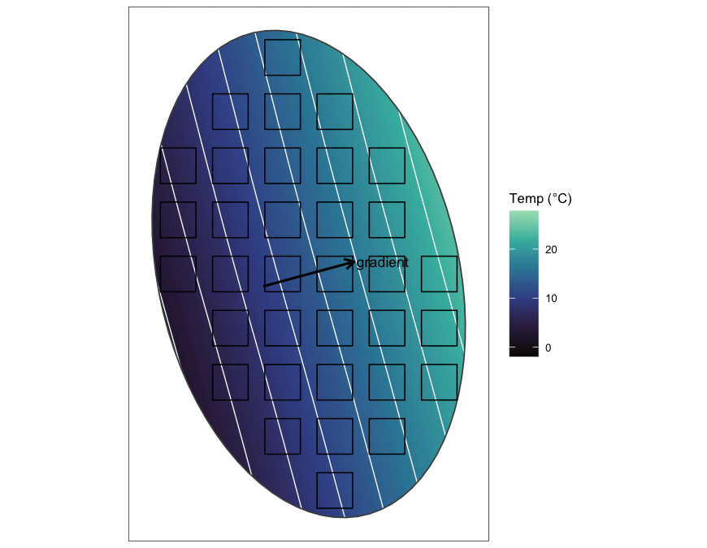](spesim_examples_files/figure-html/fig-isotherms-1.png "Figure 4: The GAM-smoothed temperature field of the long-gradient community, with its isotherms (white lines of constant temperature) and the quadrats of the systematic sample. The arrow marks the bearing of steepest temperature increase, which runs perpendicular to the isotherms.")

Figure 4: The GAM-smoothed temperature field of the long-gradient community, with its isotherms (white lines of constant temperature) and the quadrats of the systematic sample. The arrow marks the bearing of steepest temperature increase, which runs perpendicular to the isotherms.

The systematic grid spans this field from the cold end to the warm end, so each quadrat samples a different point on the axis that the ordination will try to recover.

``` numberSource
spp <- setdiff(colnames(res_long$abund_matrix), "site")
Y <- as.matrix(res_long$abund_matrix[, spp])
keep <- rowSums(Y) > 0
Y <- Y[keep, ]

envq <- calculate_quadrat_environment(
  res_long$env_gradients,
  res_long$quadrats,
  st_crs(res_long$domain)
)
temp <- envq$temperature_C[match(res_long$abund_matrix$site[keep], envq$site)]

ca <- cca(Y)
ca1 <- scores(ca, display = "sites", scaling = 1)[, 1]

round(cor(ca1, temp), 3)
```

    R> [1] -0.909

Before trusting that number, look at the ordination itself. The biplot of the first two CA axes, with the sites coloured by their known temperature, shows whether the arch we saw in the PCA is still present.

``` numberSource
ca_scores <- scores(ca, display = "sites", scaling = 1)
ca_var <- round(100 * summary(eigenvals(ca))[2, 1:2], 1)

tibble(CA1 = ca_scores[, 1], CA2 = ca_scores[, 2], temperature_C = temp) |>
  ggplot(aes(CA1, CA2, colour = temperature_C)) +
  geom_point(size = 2) +
  scale_colour_viridis_c(option = "mako", end = 0.9, name = "Temp (°C)") +
  coord_equal() +
  labs(
    x = sprintf("CA1 (%.1f%%)", ca_var[1]),
    y = sprintf("CA2 (%.1f%%)", ca_var[2])
  )
```

[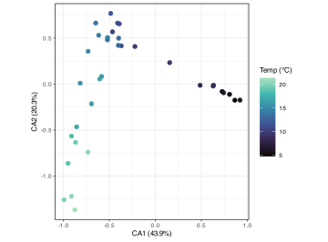](spesim_examples_files/figure-html/fig-ca-biplot-1.svg "Figure 5: Sites of the long-gradient community on the first two correspondence analysis axes, coloured by known temperature. Percentages give each axis’s share of the total inertia.")

Figure 5: Sites of the long-gradient community on the first two correspondence analysis axes, coloured by known temperature. Percentages give each axis’s share of the total inertia.

The arch is still present, in a gentler form. The sites still form a curve rather than a straight line, but their colour grades cleanly along the first axis, so the arch appears on the second axis while the first follows the gradient. This is the arch effect, the correspondence-analysis counterpart of the PCA horseshoe. It is milder than the horseshoe, and because the first axis keeps the sites in gradient order, the gradient is recoverable from it. The second axis is a folded, quadratic function of the same gradient, and detrended correspondence analysis (DCA) removes it by detrending.

Plotting that first axis against the known temperature confirms the recovery directly.

``` numberSource
tibble(temperature_C = temp, CA1 = ca1) |>
  ggplot(aes(temperature_C, CA1)) +
  geom_point(size = 1.8, alpha = 0.85) +
  geom_smooth(method = "lm", se = FALSE, linewidth = 0.5, colour = "black") +
  labs(x = "Known quadrat temperature (°C)", y = "CA axis 1")
```

[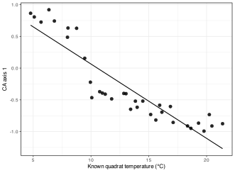](spesim_examples_files/figure-html/fig-recovery-1.svg "Figure 6: The first CA axis plotted against the known quadrat temperature for the long-gradient community. Each point is a quadrat, and the line is a linear fit.")

Figure 6: The first CA axis plotted against the known quadrat temperature for the long-gradient community. Each point is a quadrat, and the line is a linear fit.

The first CA axis is a near-perfect proxy for temperature, with a correlation close to one in absolute value. The sign of the axis is arbitrary, as it always is in ordination, so only the strength and monotonicity of the relationship are informative. In a field study this scatter plot is the most we could produce, and it shows only that the axis is *consistent with* a temperature gradient. Here it shows something stronger, namely that the axis has recovered the gradient we know to be responsible.

## 6 Example 4: rank–abundance and the species-abundance distribution

The species-abundance distribution (SAD) sets how common species are relative to one another, and it underlies the rank–abundance curves and evenness comparisons of the biodiversity review ([Fisher et al. 1943](#ref-fisher1943relation); [Preston 1948](#ref-preston1948commonness)). Because we choose the SAD in the configuration, we can plot the realised community against the distribution we asked for. Here we build a fresh community of fifteen species drawn from Fisher’s log-series and sample it at random.

``` numberSource
P_sad <- load_config(system.file(
  "examples/spesim_init_basic.txt",
  package = "spesim"
))
P_sad$N_SPECIES <- 15L
P_sad$N_INDIVIDUALS <- 3000L
P_sad$SAD_MODEL <- "fisher" # Fisher's log-series
P_sad$SAMPLING_SCHEME <- "random"
P_sad$N_QUADRATS <- 24L
P_sad$SEED <- 11L

res_sad <- spesim_run(
  P_sad,
  write_outputs = FALSE,
  seed = P_sad$SEED,
  quiet = TRUE
)
```

``` numberSource
plot_spatial_sampling(
  res_sad$domain,
  res_sad$species_dist,
  res_sad$quadrats,
  res_sad$P
)
```

[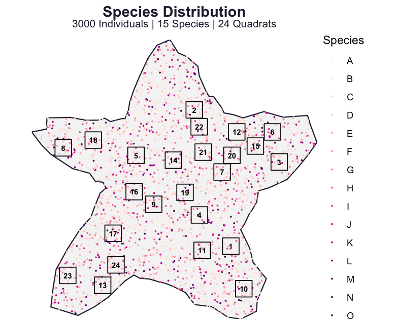](spesim_examples_files/figure-html/fig-landscape-4-1.png "Figure 7: The sampled landscape for Example 4. Fifteen species are placed in an irregular domain, sampled with 24 random quadrats, and coloured by species.")

Figure 7: The sampled landscape for Example 4. Fifteen species are placed in an irregular domain, sampled with 24 random quadrats, and coloured by species.

With the community in hand, `calculate_rank_abundance()` returns both the observed ranking of the placed individuals and the theoretical log-series expectation from the configuration.

``` numberSource
ra <- calculate_rank_abundance(res_sad$species_dist, res_sad$P)
plot_rank_abundance(ra)
```

[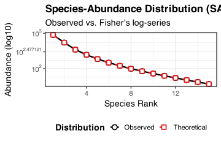](spesim_examples_files/figure-html/fig-ra-1.svg "Figure 8: Rank–abundance of the Example 4 community. The observed curve is the ranking of individuals placed in the domain, and the theoretical curve is the Fisher log-series specified in the configuration.")

Figure 8: Rank–abundance of the Example 4 community. The observed curve is the ranking of individuals placed in the domain, and the theoretical curve is the Fisher log-series specified in the configuration.

The observed and theoretical curves agree, so the simulator realised the log-series we asked for. A few dominant species and a long tail of rare ones is the shape the log-series predicts, and the shape most real assemblages show. Swapping `SAD_MODEL` for `"geometric"`, `"brokenstick"`, or `"lognormal"` changes the steepness of the curve, which makes the abstract idea of evenness something a student can generate and see rather than only read about.

## 7 Example 5: the sampling design changes what you recover

The [Integrative Assignment](../BCB743/tasks/Task_A1.llms.md) and later research projects keep returning to the same practical question, namely which sampling design, and how much effort, is enough. We can answer it in **spesim** by keeping the community fixed and varying only the quadrat scheme. We keep the long-gradient community of Example 2 and sample it six ways, then ask how many quadrats each design actually places, how much of the temperature range it captures, and how strongly the recovered CA axis correlates with the truth.

Two of the six are transects that differ only in orientation. Guided by the isotherms of [Figure 4](#fig-isotherms), one runs across the isotherms, along the bearing of steepest temperature increase, and the other runs along an isotherm at near-constant temperature. The bearing is the `temp_bearing` computed for that figure.

``` numberSource
sample_scheme <- function(scheme, label = scheme, angle = NULL, seed = 2026L) {
  P <- load_config(system.file(
    "examples/spesim_init_basic.txt",
    package = "spesim"
  ))
  spp <- LETTERS[1:20]
  P$N_SPECIES <- 20L
  P$N_INDIVIDUALS <- 5000L
  P$GRADIENT_SPECIES <- spp
  P$GRADIENT_ASSIGNMENTS <- rep("temperature", 20)
  P$GRADIENT_OPTIMA <- setNames(seq(0.05, 0.95, length.out = 20), spp)
  P$GRADIENT_TOLERANCE <- 0.07
  P$N_QUADRATS <- 30L
  P$SAMPLING_SCHEME <- scheme
  P$SEED <- seed

  # a transect is one line of 15 quadrats laid at a given compass bearing
  if (!is.null(angle)) {
    P$N_TRANSECTS <- 1L
    P$N_QUADRATS_PER_TRANSECT <- 15L
    P$TRANSECT_ANGLE <- angle
  }
  requested <- if (is.null(angle)) 30L else 15L

  res <- spesim_run(P, write_outputs = FALSE, seed = seed, quiet = TRUE)
  Y <- as.matrix(res$abund_matrix[, setdiff(
    colnames(res$abund_matrix),
    "site"
  )])
  keep <- rowSums(Y) > 0
  Y <- Y[keep, ]
  envq <- calculate_quadrat_environment(
    res$env_gradients,
    res$quadrats,
    st_crs(res$domain)
  )
  temp <- envq$temperature_C[match(res$abund_matrix$site[keep], envq$site)]

  # only claim a correlation when the sample spans some temperature
  cor_temp <- if (length(temp) >= 3 && sd(temp) > 0) {
    round(
      abs(cor(scores(cca(Y), display = "sites", scaling = 1)[, 1], temp)),
      3
    )
  } else {
    NA_real_
  }

  list(
    res = res,
    metrics = tibble(
      design = label,
      requested = requested,
      realised = nrow(Y),
      temp_range_C = round(diff(range(temp)), 1),
      cor_CA1_temp = cor_temp
    )
  )
}

designs <- list(
  list(scheme = "random"),
  list(scheme = "systematic"),
  list(
    scheme = "transect",
    label = "transect (across isotherms)",
    angle = temp_bearing
  ),
  list(
    scheme = "transect",
    label = "transect (along isotherm)",
    angle = (temp_bearing + 90) %% 360
  ),
  list(scheme = "tiled"),
  list(scheme = "voronoi")
)

runs <- lapply(designs, function(d) do.call(sample_scheme, d))
names(runs) <- vapply(runs, function(r) r$metrics$design, character(1))
comparison <- bind_rows(lapply(runs, `[[`, "metrics"))
```

| One community, six sampling designs |  |  |  |  |
|----|----|----|----|----|
| Sampling design | Requested | Realised | Temp. range (°C) | \|cor(CA1, temp)\| |
| random | 30 | 30 | 17.2 | 0.901 |
| systematic | 30 | 16 | 16.9 | 0.898 |
| transect (across isotherms) | 15 | 15 | 16.7 | 0.952 |
| transect (along isotherm) | 15 | 15 | 0.9 | 0.260 |
| tiled | 30 | 30 | 15.4 | 0.875 |
| voronoi | 30 | 6 | 12.9 | 0.955 |

Mapping each design over the same temperature field shows where those numbers come from. The community is identical in every panel, so only the quadrats differ, and the individuals are left out to keep the placement clear.

``` numberSource
plot_design <- function(res, design) {
  ggplot() +
    geom_raster(
      data = res$env_gradients,
      aes(x, y, fill = temperature_C),
      alpha = 0.9
    ) +
    scale_fill_viridis_c(option = "mako", end = 0.9, name = "Temp (°C)") +
    geom_sf(data = res$domain, fill = NA, colour = "grey30", linewidth = 0.3) +
    geom_sf(data = res$quadrats, fill = NA, colour = "black", linewidth = 0.4) +
    coord_sf(expand = FALSE) +
    labs(title = design, x = NULL, y = NULL) +
    theme(
      axis.text = element_blank(),
      axis.ticks = element_blank(),
      plot.title = element_text(size = 8)
    )
}

wrap_plots(imap(runs, ~ plot_design(.x$res, .y)), ncol = 3, guides = "collect")
```

[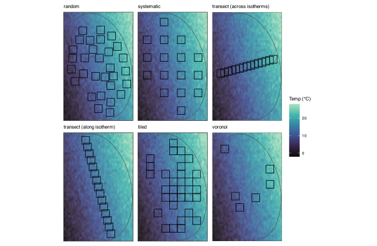](spesim_examples_files/figure-html/fig-landscape-5-1.svg "Figure 9: The same long-gradient community sampled six ways. The surface is temperature, from cold (dark) to warm (light), and black squares are the quadrats each design places. Individuals are omitted.")

Figure 9: The same long-gradient community sampled six ways. The surface is temperature, from cold (dark) to warm (light), and black squares are the quadrats each design places. Individuals are omitted.

The correlations are no longer all high, and the two transects are why. Both are a single line of quadrats on the same domain, differing only in bearing, yet the transect that crosses the isotherms recovers the gradient almost perfectly while the one that runs along an isotherm barely recovers it at all. The gap is explained by the temperature range sampled by each, since crossing the isotherms spans nearly the whole gradient, whereas following an isotherm keeps temperature almost constant, so little signal is left for the ordination to find. The other four designs differ in effort rather than orientation. Random and tiled can accommodate the full request of 30 quadrats, while the systematic grid and the Voronoi design place fewer once the domain boundary has clipped the grid and thinned the centres, and they sample a narrower portion of the range as a result. This lesson would be expensive to learn in the field—the design, and even the direction in which a transect is set-out, determines what you can learn from the data before you set foot in the field.

### 7.1 What each design does to the diagnostic panels

The correlation in the table is one number. The diagnostics that **spesim** bundles into its advanced panel, namely rank–abundance, species–area, distance–decay, rarefaction, and occupancy–abundance, show the same effect in more detail. The rank–abundance of the whole community is a property of the community rather than of the sample, so it is identical across all six designs, because the same individuals are always placed. The other four are computed from the sampled quadrats and change with the design. To bring the rank–abundance into the comparison as well, we plot the pooled sample of each design against that fixed community curve.

``` numberSource
# reuse the six fitted designs in `runs`; every diagnostic below is computed
# from each design's sampled data, so it reflects the quadrat configuration
design_levels <- names(runs)

sampled_sad <- function(am) {
  spp <- setdiff(colnames(am), "site")
  tot <- sort(colSums(am[, spp, drop = FALSE]), decreasing = TRUE)
  tot <- tot[tot > 0]
  tibble(rank = seq_along(tot), abundance = as.numeric(tot))
}

pooled_rarefaction <- function(am) {
  spp <- setdiff(colnames(am), "site")
  pooled <- colSums(am[, spp, drop = FALSE])
  sizes <- unique(round(seq(1, sum(pooled), length.out = 40)))
  tibble(
    SampleSize = sizes,
    RarefiedRichness = as.numeric(rarefy(pooled, sizes))
  )
}

# apply a per-design function and combine the results, tagged by design
by_design <- function(f) {
  bind_rows(lapply(design_levels, function(nm) {
    mutate(f(runs[[nm]]$res), design = nm)
  })) |>
    mutate(design = factor(design, levels = design_levels))
}

sad <- by_design(function(res) sampled_sad(res$abund_matrix))
sar <- by_design(function(res) calculate_species_area(res$abund_matrix))
decay <- by_design(function(res) {
  calculate_distance_decay(res$abund_matrix, res$site_coords)
})
occ <- by_design(function(res) {
  filter(calculate_occupancy_abundance(res$abund_matrix), TotalAbundance > 0)
})
rare <- by_design(function(res) pooled_rarefaction(res$abund_matrix))

# the community rank–abundance is the same for every design (identical individuals)
community_sad <- calculate_rank_abundance(
  runs[[1]]$res$species_dist,
  runs[[1]]$res$P
) |>
  filter(Source == "Observed")
```

Code

``` numberSource
pal <- scale_colour_brewer(palette = "Dark2", name = "Design", drop = FALSE)
noleg <- guides(colour = "none")

p_sad <- ggplot(sad, aes(rank, abundance, colour = design)) +
  geom_line(
    data = community_sad,
    aes(Rank, Abundance),
    inherit.aes = FALSE,
    colour = "grey35",
    linewidth = 0.8,
    linetype = "dashed"
  ) +
  geom_line() +
  geom_point(size = 0.6) +
  scale_y_log10() +
  pal +
  guides(
    colour = guide_legend(override.aes = list(linewidth = 1.1, size = 0))
  ) +
  labs(title = "Rank–abundance (sample)", x = "Rank", y = "Abundance (log)")

p_sar <- ggplot(sar, aes(Sites, Richness, colour = design)) +
  geom_line(linewidth = 0.7) +
  pal +
  noleg +
  labs(title = "Species–area", x = "Sites", y = "Richness")

p_dec <- ggplot(decay, aes(Distance, Dissimilarity, colour = design)) +
  geom_smooth(method = "lm", se = FALSE, linewidth = 0.7) +
  pal +
  noleg +
  labs(title = "Distance–decay", x = "Distance", y = "Dissimilarity")

p_rar <- ggplot(rare, aes(SampleSize, RarefiedRichness, colour = design)) +
  geom_line(linewidth = 0.7) +
  pal +
  noleg +
  labs(title = "Rarefaction (pooled)", x = "Individuals", y = "Species")

p_occ <- ggplot(occ, aes(Occupancy, TotalAbundance, colour = design)) +
  geom_point(size = 1, alpha = 0.8) +
  scale_y_log10() +
  pal +
  noleg +
  labs(
    title = "Occupancy–abundance",
    x = "Occupancy (sites)",
    y = "Abundance (log)"
  )

(p_sad | p_sar | p_dec) /
  (p_rar | p_occ | guide_area()) +
  plot_layout(guides = "collect") &
  theme_bw(base_size = 8) &
  theme(plot.title = element_text(size = 8.5))
```

[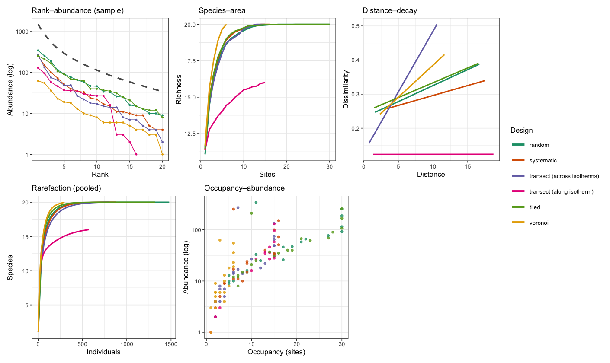](spesim_examples_files/figure-html/fig-advanced-panel-1.png "Figure 10: Five advanced diagnostics, each computed from the sampled quadrats of the six designs (colour). The dashed grey curve in the rank–abundance panel is the community distribution, computed from all placed individuals and therefore common to every design. Lines in the distance–decay panel are linear fits, and abundance axes are logarithmic.")

Figure 10: Five advanced diagnostics, each computed from the sampled quadrats of the six designs (colour). The dashed grey curve in the rank–abundance panel is the community distribution, computed from all placed individuals and therefore common to every design. Lines in the distance–decay panel are linear fits, and abundance axes are logarithmic.

Across the panels, the two transects stay distinct. The one laid along an isotherm (pink) misses four of the twenty species, so its species–area and rarefaction curves plateau below the rest, and its distance–decay is nearly flat, because neighbouring quadrats at the same temperature share much the same community. The one laid across the isotherms (purple) shows the steepest distance–decay of all, since walking along it crosses the whole temperature range. The Voronoi design (yellow), with only six widely spaced quadrats, samples the fewest individuals and is lowest on the rank–abundance curve, yet that same wide spacing lets its species–area curve rise the fastest. Occupancy and abundance remain correlated in every design, the common species being both abundant and widespread, but in the designs that visit fewer sites the points crowd near the origin. The point of the panel is that the community rank–abundance, namely the dashed curve, is fixed, while everything computed from the sample changes with the design. Choosing how to sample is choosing which of these diagnostics you will be able to trust.

## 8 Example 6: reading three gradients off one community

The earlier examples used a single gradient. Real communities respond to several at once, and the newer **spesim** gradient shapes let us build a landscape with structure that a straight plane cannot hold. Here the landscape has three features, namely a **hill** whose elevation falls away from a central peak, a **temperature** gradient that warms towards the east, and **rainfall** that wraps around the hill as a windward-wet, leeward-dry crescent, the orographic pattern of a real range. Twenty-four species sort along the three gradients, eight on each. The question is whether an ordination can recover all three imprints at once, and whether the sampling design decides which of them we can see.

``` numberSource
# rainfall wraps the hill: wettest on the windward (south-west) mid-slopes,
# driest in the north-east rain shadow
rain_fn <- function(x, y) {
  cx <- 0.5
  cy <- 0.5
  ang <- atan2(y - cy, x - cx)
  rad <- sqrt((x - cx)^2 + (y - cy)^2)
  0.5 + 0.5 * cos(ang - (-3 * pi / 4)) * exp(-((rad - 0.30)^2) / (2 * 0.13^2))
}

landscape <- function(
  scheme,
  angle = NULL,
  n_per_transect = NULL,
  seed = 2026L
) {
  P <- load_config(system.file(
    "examples/spesim_init_basic.txt",
    package = "spesim"
  ))
  spp <- LETTERS[1:24]
  P$N_SPECIES <- 24L
  P$N_INDIVIDUALS <- 6000L
  P$SEED <- seed
  P$ENV_DRIVERS <- c("temperature", "elevation", "rainfall")
  P$ENV_SHAPE <- list(
    elevation = "radial",
    temperature = "planar",
    rainfall = "custom"
  )
  P$ENV_SHAPE_PARAMS <- list(
    elevation = list(centre = c(0.5, 0.5)), # the hill
    temperature = list(bearing = 90), # warmer to the east
    rainfall = list(fn = rain_fn) # wraps the hill
  )
  P$ENV_AUTOCORR_RANGE <- 0.10 # realistic small-scale texture
  P$ENV_BOUND <- "rescale"

  # eight species sort along each gradient
  P$GRADIENT_SPECIES <- spp
  P$GRADIENT_ASSIGNMENTS <- c(
    rep("elevation", 8),
    rep("temperature", 8),
    rep("rainfall", 8)
  )
  P$GRADIENT_OPTIMA <- setNames(rep(seq(0.15, 0.85, length.out = 8), 3), spp)
  P$GRADIENT_TOLERANCE <- 0.11

  P$SAMPLING_SCHEME <- scheme
  P$N_QUADRATS <- 40L
  if (!is.null(angle)) {
    P$N_TRANSECTS <- 1L
    P$N_QUADRATS_PER_TRANSECT <- n_per_transect
    P$TRANSECT_ANGLE <- angle
  }
  spesim_run(P, write_outputs = FALSE, seed = seed, quiet = TRUE)
}

ref <- landscape("systematic") # the shared community, sampled on a grid
```

``` numberSource
env <- ref$env_gradients
show_field <- function(v, title) {
  ggplot(env, aes(x, y, fill = .data[[v]])) +
    geom_raster() +
    geom_contour(
      aes(z = .data[[v]]),
      colour = "white",
      linewidth = 0.2,
      bins = 8
    ) +
    scale_fill_viridis_c(option = "mako", end = 0.9, name = NULL) +
    coord_equal() +
    labs(title = title, x = NULL, y = NULL) +
    theme(axis.text = element_blank(), axis.ticks = element_blank())
}
show_field("elevation", "Elevation (the hill)") |
  show_field("temperature", "Temperature") |
  show_field("rainfall", "Rainfall")
```

[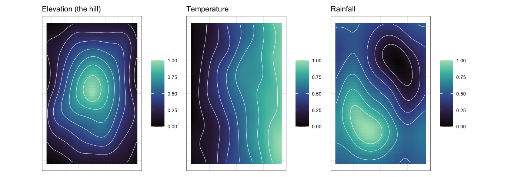](spesim_examples_files/figure-html/fig-ex6-fields-1.png "Figure 11: The three environmental fields of Example 6. Elevation is a radial hill, temperature a plane that warms eastwards, and rainfall an orographic crescent that wraps the hill, wettest on the south-west slopes and driest in the north-east. White lines are contours; a small autocorrelated residual is added to each.")

Figure 11: The three environmental fields of Example 6. Elevation is a radial hill, temperature a plane that warms eastwards, and rainfall an orographic crescent that wraps the hill, wettest on the south-west slopes and driest in the north-east. White lines are contours; a small autocorrelated residual is added to each.

To test recovery we fit a distance-based redundancy analysis (db-RDA), constraining the community by the three known per-quadrat gradients. On the systematic sample the three together explain a modest but significant share of the community variation.

``` numberSource
species <- setdiff(colnames(ref$abund_matrix), "site")
Y <- as.matrix(ref$abund_matrix[, species])
keep <- rowSums(Y) > 0
Y <- Y[keep, ]
E <- calculate_quadrat_environment(
  ref$env_gradients,
  ref$quadrats,
  st_crs(ref$domain)
)
E <- E[match(ref$abund_matrix$site[keep], E$site), ]

dbrda <- capscale(
  Y ~ temperature_C + elevation_m + rainfall_mm,
  data = E,
  distance = "bray",
  add = TRUE
)
round(RsquareAdj(dbrda)$adj.r.squared, 3)
```

    R> [1] 0.339

``` numberSource
sites <- as.data.frame(scores(dbrda, display = "sites", scaling = 2))
sites$elevation_m <- E$elevation_m
arrows <- as.data.frame(scores(dbrda, display = "bp", scaling = 2)) * 2.2
arrows$label <- c("temperature", "elevation", "rainfall")

ggplot(sites, aes(CAP1, CAP2)) +
  geom_hline(yintercept = 0, colour = "grey85") +
  geom_vline(xintercept = 0, colour = "grey85") +
  geom_point(aes(colour = elevation_m), size = 2) +
  scale_colour_viridis_c(option = "mako", end = 0.9, name = "Elevation (m)") +
  geom_segment(
    data = arrows,
    aes(0, 0, xend = CAP1, yend = CAP2),
    arrow = arrow(length = unit(0.18, "cm")),
    linewidth = 0.4
  ) +
  geom_text(
    data = arrows,
    aes(CAP1, CAP2, label = label),
    size = 2.8,
    vjust = -0.5
  ) +
  coord_equal() +
  labs(x = "db-RDA axis 1", y = "db-RDA axis 2")
```

[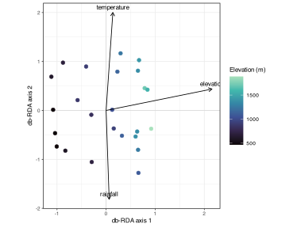](spesim_examples_files/figure-html/fig-ex6-biplot-1.svg "Figure 12: db-RDA of the systematic sample, constrained by the three gradients. Arrows are the fitted environmental vectors; points are quadrats coloured by their elevation. The three arrows point in distinct directions, so each gradient leaves a separable imprint on the community, and the elevation arrow aligns with the colour trend along the first axis.")

Figure 12: db-RDA of the systematic sample, constrained by the three gradients. Arrows are the fitted environmental vectors; points are quadrats coloured by their elevation. The three arrows point in distinct directions, so each gradient leaves a separable imprint on the community, and the elevation arrow aligns with the colour trend along the first axis.

The three arrows separate cleanly, so the ordination reads all three gradients from the one community. That success depends on the sample. To show how, we hold the community fixed and sample it five ways, then measure how strongly each gradient aligns with an unconstrained ordination of that sample, using [`vegan::envfit`](https://vegandevs.github.io/vegan/reference/envfit.html).

``` numberSource
recover <- function(res) {
  sc <- setdiff(colnames(res$abund_matrix), "site")
  Y <- as.matrix(res$abund_matrix[, sc])
  keep <- rowSums(Y) > 0
  Y <- Y[keep, ]
  E <- calculate_quadrat_environment(
    res$env_gradients,
    res$quadrats,
    st_crs(res$domain)
  )
  E <- E[match(res$abund_matrix$site[keep], E$site), ]
  ord <- rda(decostand(Y, "hellinger"))
  ef <- envfit(
    ord,
    E[, c("elevation_m", "temperature_C", "rainfall_mm")],
    permutations = 199
  )
  tibble(
    realised = nrow(Y),
    elevation = round(ef$vectors$r[["elevation_m"]], 2),
    temperature = round(ef$vectors$r[["temperature_C"]], 2),
    rainfall = round(ef$vectors$r[["rainfall_mm"]], 2)
  )
}

designs6 <- list(
  list(label = "random", scheme = "random"),
  list(label = "systematic", scheme = "systematic"),
  list(label = "tiled", scheme = "tiled"),
  list(label = "transect (W–E)", scheme = "transect", angle = 90, n = 20),
  list(label = "transect (S–N)", scheme = "transect", angle = 0, n = 20)
)

runs6 <- lapply(designs6, function(d) {
  res <- landscape(
    d$scheme,
    angle = d$angle %||% NULL,
    n_per_transect = d$n %||% NULL
  )
  list(
    label = d$label,
    res = res,
    metrics = cbind(design = d$label, recover(res))
  )
})
comparison6 <- bind_rows(lapply(runs6, `[[`, "metrics"))
```

[TABLE]

``` numberSource
plot_rain <- function(res, design) {
  ggplot() +
    geom_raster(
      data = res$env_gradients,
      aes(x, y, fill = rainfall),
      alpha = 0.9
    ) +
    scale_fill_viridis_c(option = "mako", end = 0.9, name = "Rainfall") +
    geom_sf(data = res$domain, fill = NA, colour = "grey30", linewidth = 0.3) +
    geom_sf(data = res$quadrats, fill = NA, colour = "black", linewidth = 0.4) +
    coord_sf(expand = FALSE) +
    labs(title = design, x = NULL, y = NULL) +
    theme(
      axis.text = element_blank(),
      axis.ticks = element_blank(),
      plot.title = element_text(size = 8)
    )
}
wrap_plots(
  lapply(runs6, function(r) plot_rain(r$res, r$label)),
  ncol = 3,
  guides = "collect"
)
```

[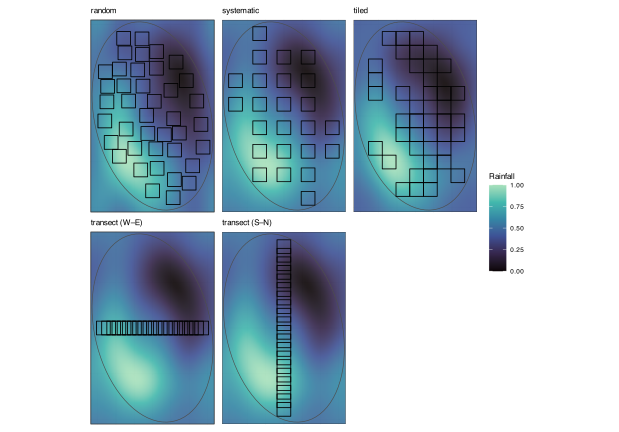](spesim_examples_files/figure-html/fig-ex6-designs-1.svg "Figure 13: Each design’s quadrats over the rainfall field. The two transects place the same 20 quadrats but on different lines: the west-to-east transect crosses the wet-to-dry contrast, while the south-to-north transect runs along it, at nearly constant rainfall.")

Figure 13: Each design’s quadrats over the rainfall field. The two transects place the same 20 quadrats but on different lines: the west-to-east transect crosses the wet-to-dry contrast, while the south-to-north transect runs along it, at nearly constant rainfall.

The rainfall column shows the sharpest lesson. The two transects place the same twenty quadrats and differ only in bearing, yet the west-to-east transect recovers rainfall while the south-to-north transect, running along a line of nearly constant rainfall, is blind to it. Elevation survives in every design because the hill is radial and any line that crosses the domain climbs and descends it. The two-dimensional designs, namely random, systematic and tiled, recover all three gradients because they cover the plane the wrapping rainfall lives on. One caution reads straight off the `realised` column: a single transect of twenty quadrats can report a high alignment for a gradient it happens to run along, and that number is less trustworthy than the same value from a design that spreads forty quadrats across the domain, because a short, one-dimensional sample overfits. Recovering an environmental imprint is as much about where the quadrats sit as about how many there are.

## 9 Using spesim in the module

In all six examples we test a method on data whose structure we know before trusting it on data whose structure is hidden. This is why a simulator belongs in a course about inference. With the simulator, the horseshoe, the arch, the gradient-length rule, the SAD, and the question of sampling effort become results you can vary, and check, rather than assume claims in the BCB743 online textbook as fact.

A natural way to use the package is to reproduce a result from an earlier chapter on simulated data, then change one setting and predict what will happen before re-running. Lengthen or shorten the gradient and watch the horseshoe appear or vanish. Narrow the species tolerances and watch the constrained ordination tighten. Switch the sampling scheme and watch the recovered gradient range shift. Each change is a small, controlled experiment on a method you will later apply to the Doubs river network, the seaweed coastline, and your own project data ([Nekola and White 1999](#ref-nekola1999distance); [Gotelli and Chao 2013](#ref-gotelli2013measuring)).

Two cautions from the [overview page](../BCB743/spesim.llms.md) apply here as well. **spesim** is a single-time-point synthetic generator (*i.e.*, it does not simulate temporal dynamics, spatial processes, or community assembly mechanisms) so it simulates neither demography nor succession nor observation error. A simulation shows only that a method behaves as expected on the structure you imposed. It cannot show how the same method behaves on the messier structure of real communities. Used with those limits in mind, the package is a controlled learning and testing instrument, namely a community whose generating process you specified in accordance with your ecosystem theory knowledge, and a way to see for yourself what each method in BCB743 can and cannot recover.

## 10 References

Borcard D, Gillet F, Legendre P, others (2011) Numerical ecology with R. Springer

Fisher RA, Corbet AS, Williams CB (1943) The relation between the number of species and the number of individuals in a random sample of an animal population. The Journal of Animal Ecology 42–58.

Gotelli NJ, Chao A (2013) Measuring and estimating species richness, species diversity, and biotic similarity from sampling data. Encyclopedia of biodiversity 195–211.

Legendre P, Legendre L (2012) Numerical ecology. Elsevier

Nekola JC, White PS (1999) The distance decay of similarity in biogeography and ecology. Journal of Biogeography 26:867–878.

Oksanen J, Simpson GL, Blanchet FG, Kindt R, Legendre P, Minchin PR, O’Hara RB, Solymos P, Stevens MHH, Szoecs E, Wagner H, Barbour M, Bedward M, Bolker B, Borcard D, Carvalho G, Chirico M, De Caceres M, Durand S, Evangelista HBA, FitzJohn R, Friendly M, Furneaux B, Hannigan G, Hill MO, Lahti L, McGlinn D, Ouellette M-H, Ribeiro Cunha E, Smith T, Stier A, Ter Braak CJF, Weedon J (2022) [vegan: Community Ecology Package](https://CRAN.R-project.org/package=vegan).

Preston FW (1948) The commonness, and rarity, of species. Ecology 29:254–283.

Whittaker RH (1967) Gradient analysis of vegetation. Biological Reviews 42:207–264.

## Reuse

[CC BY-NC-SA 4.0](https://creativecommons.org/licenses/by-nc-sa/4.0/)

## Citation

BibTeX citation:

``` quarto-appendix-bibtex
@online{smit2026,
  author = {Smit, A. J.},
  title = {Spesim in Practice: Simulating Communities to Test Our
    Methods},
  date = {2026-11-06},
  url = {https://tangledbank.netlify.app/BCB743/spesim_examples.html},
  langid = {en}
}
```

For attribution, please cite this work as:

Smit AJ (2026) spesim in practice: simulating communities to test our methods. [https://tangledbank.netlify.app/BCB743/spesim_examples.html.](https://tangledbank.netlify.app/BCB743/spesim_examples.html)
