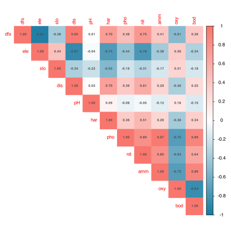

## 1 Practice task

Work through these exercises after reading the [Correlations and Associations](../../BCB743/correlations.llms.md) chapter, using the Doubs River data (`spe` and `env`). Four exercises are hands-on calculations and two are short conceptual questions. A worked answer is given under each exercise; try it yourself before opening it.

1.  Using the Doubs environmental data, compute the pairwise correlation matrix and display it as a correlation plot (for example with [`corrplot::corrplot()`](https://rdrr.io/pkg/corrplot/man/corrplot.html) or [`GGally::ggcorr()`](https://ggobi.github.io/ggally/reference/ggcorr.html)).

> **NOTE:**
>
> ``` numberSource
> library(tidyverse)
> library(vegan)
> library(corrplot)
> library(Hmisc)
>
> load(here::here(
>   "data",
>   "BCB743",
>   "NEwR-2ed_code_data",
>   "NEwR2-Data",
>   "Doubs.RData"
> ))
>
> env_cor <- cor(env)
> corrplot(
>   env_cor,
>   method = "color",
>   type = "upper",
>   addCoef.col = "grey30",
>   number.cex = 0.55,
>   tl.cex = 0.8,
>   col = colorRampPalette(c("#1679a1", "white", "#f8766d"))(200)
> )
> ```
>
> [](Task_A_files/figure-html/task-a-q1-1.svg)
>
> The matrix is dominated by one structure rather than many independent pairs. A block of nutrient and load variables (`pho`, `nit`, `amm`, `bod`) is mutually positive, the spatial variables (`dfs`, `dis`) rise together, and elevation (`ele`) opposes almost everything that increases downstream. This is the longitudinal source-to-mouth gradient expressing itself as correlation: the variables co-vary because they are all ordered by position along the river, not because each pair is mechanistically linked.

2.  Identify the two strongest positive and the two strongest negative *statistically significant* correlations among the environmental variables. Report each coefficient and its $p$-value (use [`cor.test()`](https://rdrr.io/r/stats/cor.test.html), or [`Hmisc::rcorr()`](https://rdrr.io/pkg/Hmisc/man/rcorr.html) / [`psych::corr.test()`](https://rdrr.io/pkg/psych/man/corr.test.html) for the full matrix of $p$-values).

> **NOTE:**
>
> ``` numberSource
> rc <- rcorr(as.matrix(env)) # Pearson r and p for every pair
> ut <- which(upper.tri(rc$r), arr.ind = TRUE)
> pairs <- tibble(
>   var1 = rownames(rc$r)[ut[, 1]],
>   var2 = colnames(rc$r)[ut[, 2]],
>   r = rc$r[ut],
>   p = rc$P[ut]
> )
>
> pairs |> filter(p < 0.05) |> slice_max(r, n = 2) # strongest positive
> ```
>
>     R> # A tibble: 2 × 4
>     R>   var1  var2      r        p
>     R>   <chr> <chr> <dbl>    <dbl>
>     R> 1 pho   amm   0.970 0       
>     R> 2 dfs   dis   0.949 1.33e-15
>
> ``` numberSource
> pairs |> filter(p < 0.05) |> slice_min(r, n = 2) # strongest negative
> ```
>
>     R> # A tibble: 2 × 4
>     R>   var1  var2       r        p
>     R>   <chr> <chr>  <dbl>    <dbl>
>     R> 1 dfs   ele   -0.941 1.18e-14
>     R> 2 ele   dis   -0.869 4.57e-10
>
> The two strongest **positive** correlations are phosphate with ammonium (`pho`-`amm`, $r = 0.97$) and distance-from-source with discharge (`dfs`-`dis`, $r = 0.95$). The two strongest **negative** correlations are distance-from-source with elevation (`dfs`-`ele`, $r = -0.94$) and elevation with discharge (`ele`-`dis`, $r = -0.87$). All four have $p$-values well below $10^{-8}$, so each pattern is consistent across the 30 sites. As the chapter cautions, those tiny $p$-values signal the coherence of the river gradient rather than four separable mechanisms: a single downstream ordering drives all of them (the mechanisms themselves are taken up in Exercise 5).

3.  Reproduce the species **association matrix** from the chapter: transpose the fish table so that species become the rows, then compute the among-species association (the `spe_assoc1` / `spe_assoc2` workflow). Visualise the result.

> **NOTE:**
>
> ``` numberSource
> spe_t <- t(spe) # species become the rows
>
> spe_assoc1 <- vegdist(spe_t, method = "jaccard") # abundance-weighted
> spe_assoc2 <- vegdist(spe_t, method = "jaccard", binary = TRUE) # presence-absence
>
> # six species spanning the river; binary distance (lower = stronger co-occurrence)
> gradient_spp <- c("Cogo", "Satr", "Phph", "Abbr", "Blbj", "Anan")
> round(as.matrix(spe_assoc2)[gradient_spp, gradient_spp], 2)
> ```
>
>     R>      Cogo Satr Phph Abbr Blbj Anan
>     R> Cogo 0.00 0.53 0.60 1.00 1.00 0.88
>     R> Satr 0.53 0.00 0.24 0.96 0.96 0.88
>     R> Phph 0.60 0.24 0.00 0.84 0.85 0.76
>     R> Abbr 1.00 0.96 0.84 0.00 0.10 0.18
>     R> Blbj 1.00 0.96 0.85 0.10 0.00 0.25
>     R> Anan 0.88 0.88 0.76 0.18 0.25 0.00
>
> Transposing makes each **species** an observational unit, so `vegdist()` returns a $27 \times 27$ species-by-species Jaccard matrix; the value in each cell is a *dissimilarity*, so a low number means two species occupy nearly the same sites. The six-species block splits cleanly: the upper-river species (`Cogo`, `Satr`, `Phph`) co-occur with one another and exclude the lowland cyprinids (`Abbr`, `Blbj`, `Anan`), with `Cogo`-`Abbr` at the maximum distance of 1.00 (no shared site at all). The abundance-weighted `spe_assoc1` and the binary `spe_assoc2` differ because the first also responds to how abundances are distributed across shared sites, while the second isolates pure co-occurrence.

4.  Recompute the association on the **un-transposed** species table. What is being correlated now, how do the dimensions of the result differ, and why is this not what we want for a species association? Demonstrate with code.

> **NOTE:**
>
> ``` numberSource
> dim(spe) # 30 sites (rows) x 27 species
> ```
>
>     R> [1] 30 27
>
> ``` numberSource
> dim(t(spe)) # 27 species (rows) x 30 sites
> ```
>
>     R> [1] 27 30
>
> ``` numberSource
> site_assoc <- vegdist(spe, method = "jaccard") # NO transpose
> attr(site_assoc, "Size") # 30 -> a SITE x SITE matrix
> ```
>
>     R> [1] 30
>
> `vegdist()` always treats the **rows** as the units to be compared. With the table transposed (Exercise 3) the rows are species, so the result is the species association we want. Without the transpose the rows are the 30 sites, so the calculation returns a $30 \times 30$ *site* dissimilarity matrix: it answers “how different are these two sites in composition?”, not “how often do these two species co-occur?”. The site matrix is perfectly valid, and it is exactly what ordination and clustering use later, but it is not a species association. (`vegdist` even warns about empty rows here, because two sites with no shared species have an undefined Jaccard value.)

5.  For the strongest environmental correlations you found in Exercise 2, give the mechanistic, ecological reason they covary along the upstream-downstream gradient of the Doubs River.

> **NOTE:**
>
> All four correlations are by-products of the single longitudinal gradient that orders the Doubs from headwaters to mouth:
>
> - **`pho`-`amm` (**$+0.97$): phosphate and ammonium are both products of organic enrichment, which accumulates downstream as the catchment integrates its inputs; the two nutrients therefore rise together in the lower, more enriched reaches.
> - **`dfs`-`dis` (**$+0.95$): discharge grows with distance from source because tributaries progressively add water to the channel, so the further down the river, the more water it carries.
> - **`dfs`-`ele` (**$-0.94$): the river loses elevation as it runs downstream, so distance-from-source and altitude are near mirror images of each other.
> - **`ele`-`dis` (**$-0.87$): elevation falls as the river runs downstream while discharge grows, so high headwater sites carry little water and low-lying sites carry much; the two are inverse images of the same downstream ordering.
>
> A water-chemistry pair is also instructive, even though it is just outside the two strongest negatives: **`oxy`-`bod` (**$-0.84$) — as biological oxygen demand rises with organic load downstream, dissolved oxygen is consumed, so the two move in opposite directions.
>
> In every case the two variables are correlated because each is monotonically ordered by position along the river, not because one directly drives the other. This is why the correlation matrix is read as a diagnostic of collinearity, not as a set of mechanistic links.

6.  Explain what an *association matrix*, a *correlation matrix*, and a species *dissimilarity matrix* each represent and how they differ. What ecological insight does a species association matrix provide that a site-by-site dissimilarity matrix does not?

> **NOTE:**
>
> - A **correlation matrix** measures linear co-variation between continuous *variables* (here the environmental measurements). Each cell is a Pearson (or Spearman) coefficient on the measurement scale, ranging from $-1$ to $+1$.
> - A species **association matrix** measures the joint occurrence of *species* across sites. It is built by transposing the community table and applying a measure such as the Jaccard index, so each cell summarises how similarly two species are distributed, agnostic to the mechanism (shared habitat, common gradient response, or interaction).
> - A site **dissimilarity matrix** measures how different two *sites* (samples) are in composition, and it is the input to ordination and clustering.
>
> The first two are R-mode (relationships among variables or species); the third is Q-mode (relationships among samples). A species association matrix reveals groups of taxa that co-occur or replace one another along a gradient, recovering the source-to-mouth ordering written in the species themselves. A site dissimilarity matrix cannot show that directly: it tells you which sites resemble one another, but not which species drive the resemblance.

## 2 Assessment criteria

This Task is not formally assessed. It is built around four hands-on analyses (Exercises 1–4) and two short conceptual questions (Exercises 5–6); work through all six and bring your annotated Quarto document to class for discussion.

## Reuse

[CC BY-NC-SA 4.0](https://creativecommons.org/licenses/by-nc-sa/4.0/)

## Citation

BibTeX citation:

``` quarto-appendix-bibtex
@online{smit2026,
  author = {Smit, A. J.},
  title = {5. {Correlations} and Associations},
  date = {2026-11-06},
  url = {https://tangledbank.netlify.app/BCB743/tasks/Task_A.html},
  langid = {en}
}
```

For attribution, please cite this work as:

Smit AJ (2026) 5. Correlations and associations. [https://tangledbank.netlify.app/BCB743/tasks/Task_A.html.](https://tangledbank.netlify.app/BCB743/tasks/Task_A.html)
