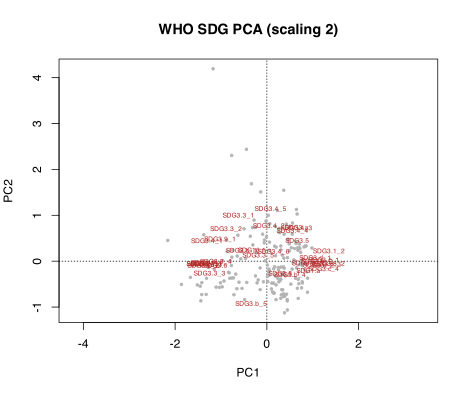
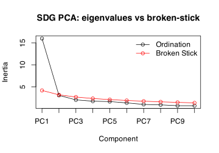

## 1 Practice task

Work through these exercises after reading the [PCA of WHO SDGs](../../BCB743/PCA_SDG_example.llms.md) chapter, reusing the WHO SDG data loaded there. Four exercises are hands-on calculations and two are short conceptual questions. A worked answer is given under each exercise; try it yourself before opening it.

1.  Reproduce the PCA of the WHO SDG data from the chapter: load and scale the data, run the ordination ([`vegan::rda()`](https://vegandevs.github.io/vegan/reference/cca.html) or [`prcomp()`](https://rdrr.io/r/stats/prcomp.html)), and produce the biplot.

> **NOTE:**
>
> ``` numberSource
> library(tidyverse)
> library(vegan)
>
> sdg <- read.csv(here::here("data", "BCB743", "WHO", "SDG_complete.csv"))
> sdg_ind <- sdg |> select(starts_with("SDG")) # the indicator columns
> rownames(sdg_ind) <- make.unique(as.character(sdg$Location))
> sdg_ind <- sdg_ind[complete.cases(sdg_ind), ] # keep countries with full records
>
> pca_sdg <- rda(sdg_ind, scale = TRUE) # correlation PCA (indicators standardised)
>
> plot(pca_sdg, scaling = 2, type = "n", main = "WHO SDG PCA (scaling 2)")
> points(pca_sdg, display = "sites", pch = 19, col = "grey70", cex = 0.5)
> text(pca_sdg, display = "species", col = "firebrick", cex = 0.55)
> ```
>
> [](Task_C_files/figure-html/task-c-q1-1.svg)
>
> After dropping countries with missing indicators, the PCA runs on a standardised country-by-indicator matrix. The biplot shows the indicator arrows fanning out along PC1, with the countries (grey points) spread along the same axis. The first axis is a broad **attainment** gradient: indicators of good health outcomes point one way and indicators of burden or risk point the other, so a country’s position along PC1 summarises where it sits on that composite scale.

2.  Produce a screeplot with the broken-stick criterion, report the variance explained by PC1 and PC2, and state how many components are worth interpreting.

> **NOTE:**
>
> ``` numberSource
> var_sdg <- round(100 * eigenvals(pca_sdg) / sum(eigenvals(pca_sdg)), 1)
> var_sdg[1:6] # % variance, first 6 axes
> ```
>
>     R>  PC1  PC2  PC3  PC4  PC5  PC6 
>     R> 44.5  8.5  5.6  4.8  4.5  3.7
>
> ``` numberSource
> screeplot(
>   pca_sdg,
>   bstick = TRUE,
>   type = "lines",
>   main = "SDG PCA: eigenvalues vs broken-stick"
> )
> ```
>
> [](Task_C_files/figure-html/task-c-q2-1.svg)
>
> PC1 captures 44.5% of the variance and PC2 8.5% (together 53%), so the data are strongly one-dimensional. The broken-stick comparison confirms that the first one or two axes exceed the random expectation, so interpretation should focus on PC1, with PC2 read only as a weak secondary addition. The many trailing axes carry indicator-specific variation and noise.

3.  Examine the variable loadings and identify which SDG indicators load most strongly on PC1 and on PC2. What does each axis represent?

> **NOTE:**
>
> ``` numberSource
> loadings <- scores(pca_sdg, display = "species", choices = 1:2) |>
>   as.data.frame()
> loadings |> arrange(PC1) |> slice(c(1:5, (n() - 4):n())) # most negative & most positive on PC1
> ```
>
>     R>                PC1         PC2
>     R> SDG3.2_3 -1.406351 -0.08061411
>     R> SDG3.2_1 -1.403091 -0.08442038
>     R> SDG3.2_2 -1.384485 -0.12092644
>     R> SDG3.7   -1.366977 -0.06717432
>     R> SDG3.9_3 -1.317152 -0.09198457
>     R> SDG3.c_4  1.237298 -0.19228848
>     R> SDG3.c_1  1.240555  0.00330015
>     R> SDG3.c_3  1.283114 -0.08710845
>     R> SDG3.1_2  1.353637  0.19590231
>     R> SDG3.8_2  1.354642 -0.07720902
>
> The indicators with the largest absolute PC1 loadings define the axis (the single strongest is SDG3.2_3): at one end sit indicators of poor health outcomes and high disease or mortality burden, and at the other end indicators of strong health-system performance and good outcomes. PC1 is therefore an overall health-and-development attainment gradient. PC2 is defined by a smaller set of indicators that distinguish countries with otherwise similar overall attainment, often separating a particular dimension (such as a specific disease burden or a financing measure) from the general pattern; it is a secondary contrast rather than a second major gradient.

4.  Locate South Africa and three or four comparator countries of your choice on the biplot, and describe where they sit relative to the axes.

> **NOTE:**
>
> ``` numberSource
> focus <- c("South Africa", "Nigeria", "Germany", "Brazil", "Norway")
> site_sc <- scores(pca_sdg, display = "sites", choices = 1:2, scaling = 2) |>
>   as.data.frame() |>
>   rownames_to_column("country")
> site_sc |> filter(country %in% focus)
> ```
>
>     R>        country        PC1        PC2
>     R> 1       Brazil  0.3338315 -0.2950017
>     R> 2      Germany  0.8569510  0.3329607
>     R> 3      Nigeria -1.5157883 -0.5176548
>     R> 4       Norway  0.8851571 -0.6758352
>     R> 5 South Africa -0.3362570  1.6863449
>
> The comparator countries spread along PC1 in the order one would expect from their health systems: South Africa sits at PC1 = -0.34, between Norway (0.89) and Nigeria (-1.52) at the two ends of the attainment axis, with Brazil nearby. South Africa’s score should be read against these neighbours rather than against any single raw indicator: countries close together on the biplot share a similar *multivariate* SDG profile, which is exactly the summary PCA is designed to give.

5.  Explain why the SDG indicators must be standardised (scaled) before PCA, and what would happen to the ordination if they were left on their original scales.

> **NOTE:**
>
> PCA decomposes variance, and variance depends on the measurement scale. The SDG indicators are recorded in incompatible units, namely percentages, rates per 100 000, monetary measures, and counts, so their raw variances differ by orders of magnitude. Without standardisation (here `scale = TRUE`, equivalent to a PCA on the correlation matrix), the indicators with the largest numerical spread would dominate the first axis for purely arithmetic reasons, and the ordination would describe which variable happens to be measured on the biggest scale rather than which countries are alike. Scaling each indicator to unit variance puts them on an equal footing so that the axes reflect shared structure across indicators.

6.  Interpret PC1 as an SDG-attainment gradient: what does a country’s score on PC1 tell you, and what are the limitations of collapsing SDG attainment onto a single axis?

> **NOTE:**
>
> A country’s PC1 score is a composite index: it places the country on the dominant axis of co-variation among the health indicators, so a high score means the country tends to score well across the bundle of correlated indicators that define the axis. That single number is a useful, defensible summary because the indicators are strongly correlated. Its limitations are real, though: collapsing many goals onto one axis hides **trade-offs** (a country may do well on some goals and poorly on others), it is sensitive to the **missing-data** decisions made before the PCA, it ignores **within-country inequality**, and the very choice to reduce attainment to one number embeds a value judgement about how the goals should be weighted. PC1 is a starting description, not a verdict.

## 2 Assessment criteria

This Task is not formally assessed. It is built around four hands-on analyses (Exercises 1–4) and two short conceptual questions (Exercises 5–6); work through all six and bring your annotated Quarto document to class for discussion.

## Reuse

[CC BY-NC-SA 4.0](https://creativecommons.org/licenses/by-nc-sa/4.0/)

## Citation

BibTeX citation:

``` quarto-appendix-bibtex
@online{smit2026,
  author = {Smit, A. J.},
  title = {8c. {PCA} of {WHO} {SDGs}},
  date = {2026-11-06},
  url = {https://tangledbank.netlify.app/BCB743/tasks/Task_C.html},
  langid = {en}
}
```

For attribution, please cite this work as:

Smit AJ (2026) 8c. PCA of WHO SDGs. [https://tangledbank.netlify.app/BCB743/tasks/Task_C.html.](https://tangledbank.netlify.app/BCB743/tasks/Task_C.html)
