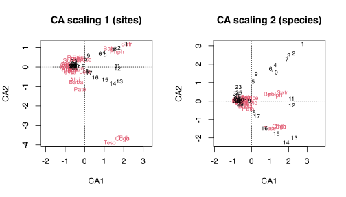
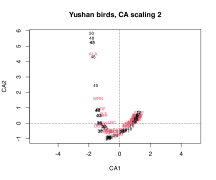
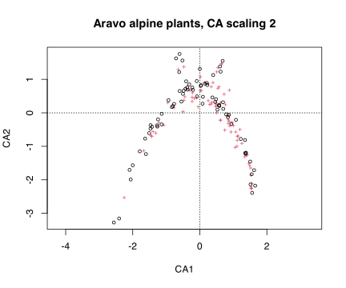
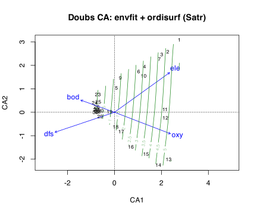
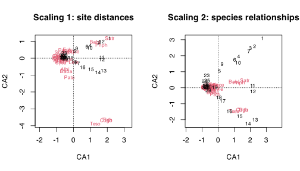

## 1 Practice task

Work through these exercises after reading the [Correspondence Analysis](../../BCB743/CA.llms.md) chapter. Four exercises are hands-on calculations and two are short conceptual questions. A worked answer is given under each exercise; try it yourself before opening it.

1.  Run a CA on the Doubs fish data (`vegan::cca(spe)`); produce biplots under scaling 1 and scaling 2, and report the inertia captured by the first two axes.

> **NOTE:**
>
> ``` numberSource
> library(tidyverse)
> library(vegan)
>
> load(here::here(
>   "data",
>   "BCB743",
>   "NEwR-2ed_code_data",
>   "NEwR2-Data",
>   "Doubs.RData"
> ))
> spe <- spe[rowSums(spe) > 0, ] # drop the empty site (CA needs non-empty rows)
>
> ca_doubs <- cca(spe)
> var_ca <- round(100 * eigenvals(ca_doubs) / sum(eigenvals(ca_doubs)), 1)
> var_ca[1:4] # % inertia per axis
> ```
>
>     R>  CA1  CA2  CA3  CA4 
>     R> 51.5 12.4  9.2  7.1
>
> ``` numberSource
> par(mfrow = c(1, 2))
> plot(ca_doubs, scaling = 1, main = "CA scaling 1 (sites)")
> plot(ca_doubs, scaling = 2, main = "CA scaling 2 (species)")
> ```
>
> [](Task_D_files/figure-html/task-d-q1-1.svg)
>
> CA1 captures 51.5% of the total inertia and CA2 12.4%. Both biplots show the characteristic **arch**: sites curve from one end to the other, with the upper-river species at one tip and the lowland species at the other. The first axis is again the upstream-downstream gradient, now recovered from the species data alone by weighted averaging.

2.  Apply CA to two external datasets — the [bird communities along the elevation gradient in Yushan Mountain, Taiwan](https://www.davidzeleny.net/anadat-r/doku.php/en:data:ybirds) and the [alpine plant communities in Aravo, France](https://www.davidzeleny.net/anadat-r/doku.php/en:data:aravo) — and produce the ordination for each.

> **NOTE:**
>
> ``` numberSource
> # --- Yushan birds ---
> ybirds_spe <- read.table(
>   here::here("data", "BCB743", "ybirds_spe.txt"),
>   header = TRUE,
>   row.names = 1
> )
> ybirds_spe <- ybirds_spe[rowSums(ybirds_spe) > 0, ]
>
> ca_yb <- cca(ybirds_spe)
> var_ca_yb <- round(100 * eigenvals(ca_yb) / sum(eigenvals(ca_yb)), 1)
> var_ca_yb[1:4]
> ```
>
>     R>  CA1  CA2  CA3  CA4 
>     R> 37.2 16.6  9.0  4.7
>
> ``` numberSource
> plot(ca_yb, scaling = 2, main = "Yushan birds, CA scaling 2")
> ```
>
> [](Task_D_files/figure-html/task-d-q2-1.svg)
>
> ``` numberSource
> # --- Aravo alpine plants (from the ade4 package) ---
> data(aravo, package = "ade4")
> aravo_spe <- aravo$spe[rowSums(aravo$spe) > 0, ]
>
> ca_ar <- cca(aravo_spe)
> var_ca_ar <- round(100 * eigenvals(ca_ar) / sum(eigenvals(ca_ar)), 1)
> var_ca_ar[1:4]
> ```
>
>     R>  CA1  CA2  CA3  CA4 
>     R> 15.7 10.0  8.2  7.2
>
> ``` numberSource
> plot(ca_ar, scaling = 2, main = "Aravo alpine plants, CA scaling 2")
> ```
>
> [](Task_D_files/figure-html/task-d-q2-2.svg)
>
> Both external communities give the same kind of CA structure. For the Yushan birds the 50 stations order along the first axis (CA1 = 37.2% of the inertia), corresponding to the elevation gradient up the mountain, with bird species sorting from low- to high-elevation associates. The Aravo alpine plants behave similarly (CA1 = 15.7%), their sites and species spreading along the dominant snowmelt and disturbance gradient of the alpine zone. In each case, as for the Doubs fish, CA recovers a strong unimodal gradient from a species table with many zeros.

3.  Fit environmental variables onto the Doubs CA with `envfit()`, and add a fitted smooth surface for one species with `ordisurf()`; overlay both on the biplot.

> **NOTE:**
>
> ``` numberSource
> env2 <- env[rownames(env) %in% rownames(spe), ] # align env with the non-empty sites
>
> fit <- envfit(ca_doubs ~ ele + oxy + bod + dfs, data = env2, permutations = 999)
> fit
> ```
>
>     R> 
>     R> ***VECTORS
>     R> 
>     R>          CA1      CA2     r2 Pr(>r)    
>     R> ele  0.81159  0.58423 0.8078  0.001 ***
>     R> oxy  0.93352 -0.35854 0.6263  0.001 ***
>     R> bod -0.94094  0.33857 0.2237  0.041 *  
>     R> dfs -0.94799 -0.31830 0.6892  0.001 ***
>     R> ---
>     R> Signif. codes:  0 '***' 0.001 '**' 0.01 '*' 0.05 '.' 0.1 ' ' 1
>     R> Permutation: free
>     R> Number of permutations: 999
>
> ``` numberSource
> plot(
>   ca_doubs,
>   scaling = 2,
>   display = "sites",
>   main = "Doubs CA: envfit + ordisurf (Satr)"
> )
> plot(fit, col = "blue")
> ordisurf(ca_doubs, spe$Satr, add = TRUE, col = "forestgreen") # smooth surface for brown trout (Satr)
> ```
>
> [](Task_D_files/figure-html/task-d-q3-1.svg)
>
>     R> 
>     R> Family: gaussian 
>     R> Link function: identity 
>     R> 
>     R> Formula:
>     R> y ~ s(x1, x2, k = 10, bs = "tp", fx = FALSE)
>     R> 
>     R> Estimated degrees of freedom:
>     R> 2.34  total = 3.34 
>     R> 
>     R> REML score: 35.79439
>
> `envfit` projects each environmental variable as a vector whose length and $r^2$ measure how strongly it aligns with the ordination; here the gradient variables (elevation, oxygen, organic load, distance from source) are all highly significant and point along the first axis. The `ordisurf` contours add a fitted surface for one species (brown trout, `Satr`), showing that its abundance peaks in one region of the ordination and falls away from it, the hump-shaped (unimodal) response that motivates CA in the first place.

4.  Compare the scaling 1 (site-focused) and scaling 2 (species-focused) biplots of the Doubs CA. What does each emphasise, and what changes between them?

> **NOTE:**
>
> ``` numberSource
> par(mfrow = c(1, 2))
> plot(ca_doubs, scaling = 1, main = "Scaling 1: site distances")
> plot(ca_doubs, scaling = 2, main = "Scaling 2: species relationships")
> ```
>
> [](Task_D_files/figure-html/task-d-q4-1.svg)
>
> Both plots show the same arch, but the exact geometry they represent differs. **Scaling 1** scales the site scores by the axis eigenvalues, so distances *between sites* approximate their chi-square dissimilarities: use it to ask which sites resemble one another. **Scaling 2** scales the species scores instead, so the configuration *of species* (and species-site relationships, via the weighted-averaging interpretation) is the one read accurately: use it to ask which species characterise which part of the gradient. The choice is about which set of distances you want to be trustworthy in the picture.

5.  Explain the patterns in the CA biplot — the arch (horseshoe), and how the joint plotting of sites and species follows from the weighted-averaging, unimodal basis of CA.

> **NOTE:**
>
> CA places each site at the weighted average of its species’ scores, and each species at the weighted average of the sites where it occurs. When species respond **unimodally** to one long gradient (each peaking somewhere and declining on both sides), this reciprocal averaging lays the sites out in gradient order along axis 1, and a species sits near the sites where it is most abundant. The **arch** appears because the second axis is forced to be uncorrelated with the first, and for a single dominant gradient the only structure left is a quadratic distortion of it, which bends the configuration into a curve. The arch is therefore a mathematical artefact of representing one curved gradient in two dimensions, not a second ecological pattern, which is exactly the problem detrending (DCA) tries to remove.

6.  When is CA preferred over PCA? Relate your answer to gradient length and to linear versus unimodal species responses.

> **NOTE:**
>
> PCA assumes that variables vary **linearly** with the underlying axes, which suits continuous environmental measurements but not species abundances along a long gradient: a species that is present in the middle and absent at both ends cannot be described by a straight line, and PCA of such data produces the “horseshoe” distortion and treats joint absences as similarity. CA assumes **unimodal** responses and works on chi-square distances, so it handles the many zeros and the hump-shaped abundances of community data along long gradients. The practical rule, made quantitative by the DCA gradient length, is to prefer CA (or CCA) when the first-axis gradient is long (roughly above 3-4 SD units of turnover) and species responses are unimodal, and to prefer PCA (or RDA) when the gradient is short and responses are approximately linear.

## 2 Assessment criteria

This Task is not formally assessed. It is built around four hands-on analyses (Exercises 1–4) and two short conceptual questions (Exercises 5–6); work through all six and bring your annotated Quarto document to class for discussion.

## Reuse

[CC BY-NC-SA 4.0](https://creativecommons.org/licenses/by-nc-sa/4.0/)

## Citation

BibTeX citation:

``` quarto-appendix-bibtex
@online{smit2026,
  author = {Smit, A. J.},
  title = {9a. {Correspondence} Analysis {(CA)}},
  date = {2026-11-06},
  url = {https://tangledbank.netlify.app/BCB743/tasks/Task_D.html},
  langid = {en}
}
```

For attribution, please cite this work as:

Smit AJ (2026) 9a. Correspondence analysis (CA). [https://tangledbank.netlify.app/BCB743/tasks/Task_D.html.](https://tangledbank.netlify.app/BCB743/tasks/Task_D.html)
