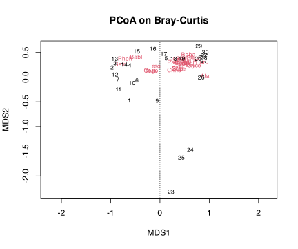
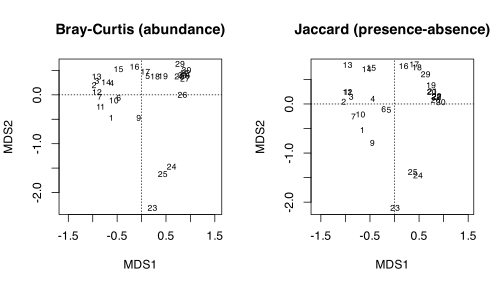
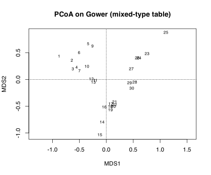
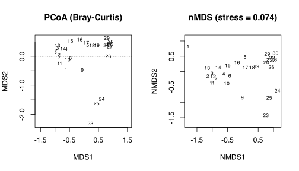

## 1 Practice task

Work through these exercises after reading the [Principal Coordinates Analysis](../../BCB743/PCoA.llms.md) chapter. The point of PCoA is that you choose the dissimilarity, so the task explores how much that choice matters, using the Doubs fish and environmental data. Four exercises are hands-on calculations and two are short conceptual questions. A worked answer is given under each exercise; try it yourself before opening it.

1.  Compute a Bray-Curtis dissimilarity on the Doubs fish data and run a PCoA with `capscale(spe ~ 1, distance = "bray")`. Report the proportion of variation captured by the first two axes, and check the eigenvalues for negative (“imaginary”) values.

> **NOTE:**
>
> ``` numberSource
> library(tidyverse)
> library(vegan)
>
> load(here::here(
>   "data",
>   "BCB743",
>   "NEwR-2ed_code_data",
>   "NEwR2-Data",
>   "Doubs.RData"
> ))
> keep <- rowSums(spe) > 0
> spe <- spe[keep, ]
> env <- env[keep, ]
>
> d_bray <- vegdist(spe, method = "bray")
> pcoa_bray <- capscale(spe ~ 1, distance = "bray") # PCoA (capscale keeps the real axes)
>
> var_pcoa <- round(
>   100 * eigenvals(pcoa_bray)[1:2] / sum(eigenvals(pcoa_bray)),
>   1
> )
> var_pcoa # % variation on MDS1, MDS2 (real axes)
> ```
>
>     R> MDS1 MDS2 
>     R> 52.4 15.6
>
> ``` numberSource
> # the full PCoA spectrum reveals the negative ("imaginary") eigenvalues capscale drops
> eig_full <- cmdscale(d_bray, k = nrow(spe) - 1, eig = TRUE)$eig
> n_neg <- sum(eig_full < -1e-8)
> n_neg # number of negative eigenvalues
> ```
>
>     R> [1] 11
>
> ``` numberSource
> ordiplot(pcoa_bray, type = "text", main = "PCoA on Bray-Curtis")   # sites + species labelled
> ```
>
> [](Task_F_files/figure-html/task-f-q1-1.svg)
>
> MDS1 captures 52.4% of the variation and MDS2 15.6% on the real axes, with MDS1 again ordering the sites along the river. `capscale()` returns only the real axes, but the full PCoA spectrum (from [`cmdscale()`](https://rdrr.io/r/stats/cmdscale.html)) contains 11 **negative** (“imaginary”) eigenvalues: Bray-Curtis is not a Euclidean distance, so it cannot be embedded perfectly in real coordinate space, and the leftover, non-embeddable part shows up as those negative eigenvalues. This is why the proportion of variation from a non-Euclidean PCoA has to be read with care, and why the corrections in Exercise 5 are sometimes applied.

2.  Repeat the PCoA with a presence-absence dissimilarity (Jaccard or Sørensen). Compare the two ordinations: how sensitive is the site configuration to the choice between an abundance-based and a presence-absence dissimilarity?

> **NOTE:**
>
> ``` numberSource
> pcoa_jac <- capscale(spe ~ 1, distance = "jaccard", binary = TRUE)
>
> par(mfrow = c(1, 2))
> ordiplot(pcoa_bray, display = "sites", type = "text", main = "Bray-Curtis (abundance)")
> ordiplot(pcoa_jac, display = "sites", type = "text", main = "Jaccard (presence-absence)")
> ```
>
> [](Task_F_files/figure-html/task-f-q2-1.svg)
>
> Both ordinations recover the same dominant upstream-downstream gradient, so the broad story is robust to the choice of dissimilarity. The configurations differ in detail: the abundance-based Bray-Curtis ordination is pulled by the dominant species and spaces sites by how much their abundant taxa differ, whereas the presence-absence Jaccard ordination weights every species equally and is driven by which species are gained or lost. Sites that share their common species but differ in rare ones move between the two pictures. The choice of dissimilarity is therefore an ecological decision, not a technical default.

3.  Use a Gower dissimilarity (`cluster::daisy(..., metric = "gower")`) on a table that mixes variable types — for example the Doubs environmental data together with one or more categorical variables of your own making. Run a PCoA on the result and explain why PCA and CA could not have analysed this table directly.

> **NOTE:**
>
> ``` numberSource
> env_mixed <- env |>
>   mutate(reach = cut(dfs, breaks = 3, labels = c("upper", "middle", "lower"))) # a categorical variable
>
> gower <- cluster::daisy(env_mixed, metric = "gower")
> pcoa_gower <- capscale(gower ~ 1)
> round(eigenvals(pcoa_gower)[1:2] / sum(abs(eigenvals(pcoa_gower))) * 100, 1)
> ```
>
>     R> MDS1 MDS2 
>     R> 69.3 13.2
>
> ``` numberSource
> ordiplot(
>   pcoa_gower,
>   display = "sites",
>   type = "text",
>   main = "PCoA on Gower (mixed-type table)"
> )
> ```
>
> [](Task_F_files/figure-html/task-f-q3-1.svg)
>
> The Gower coefficient combines standardised numeric variables with the categorical `reach` factor into a single dissimilarity, and PCoA then ordinates that matrix. PCA could not handle this table because it works on Euclidean distances of numeric variables and has no way to use a factor; CA could not either, because it expects a frequency/abundance table of non-negative counts. PCoA’s strength is exactly this flexibility: choose a dissimilarity appropriate to the data (here one that accepts mixed types), and PCoA will ordinate it.

4.  Run an nMDS on the same Bray-Curtis matrix from Exercise 1. Compare the PCoA and nMDS configurations, citing the appropriate goodness measure for each (eigenvalue-based fit for PCoA, stress for nMDS).

> **NOTE:**
>
> ``` numberSource
> nmds_bray <- metaMDS(spe, distance = "bray", trace = FALSE)
> nmds_bray$stress # nMDS goodness: stress
> ```
>
>     R> [1] 0.07376218
>
> ``` numberSource
> par(mfrow = c(1, 2))
> ordiplot(pcoa_bray, display = "sites", type = "text", main = "PCoA (Bray-Curtis)")
> ordiplot(
>   nmds_bray,
>   display = "sites",
>   type = "text",
>   main = paste0("nMDS (stress = ", round(nmds_bray$stress, 3), ")")
> )
> ```
>
> [](Task_F_files/figure-html/task-f-q4-1.svg)
>
> The two configurations are very similar, both showing the river gradient, but they answer different optimisation problems. PCoA finds axes that reproduce the dissimilarities *metrically* and reports its fit through the eigenvalues (the proportion of variation on the first axes). nMDS reproduces only the *rank order* of the dissimilarities and reports its fit through **stress** (here 0.074, indicating a faithful two-dimensional representation). When a low-stress nMDS and a high-variance PCoA agree, as here, that agreement is itself reassuring: the gradient is strong enough that the method choice barely matters.

5.  Explain what negative (“imaginary”) eigenvalues are in PCoA, why they arise from non-Euclidean dissimilarities, and the corrections available (for example the Lingoes or Cailliez adjustments).

> **NOTE:**
>
> PCoA seeks a set of real Euclidean coordinates whose pairwise distances reproduce the input dissimilarities. That is only possible if the dissimilarity is itself Euclidean. Many ecologically sensible measures (Bray-Curtis, Jaccard) are **not** Euclidean: there is no arrangement of points in real space whose straight-line distances equal them exactly. The part that cannot be embedded shows up as **negative eigenvalues**, the “imaginary” axes. Two standard fixes add a constant to the dissimilarities (the **Cailliez** correction) or to their squares (the **Lingoes** correction) so that the adjusted matrix becomes Euclidean and all eigenvalues turn non-negative. The alternative is simply to report proportions against the sum of absolute eigenvalues and to keep the negative values in view, which is what `capscale` does by default.

6.  On the basis of the above, when would you choose PCoA over PCA, CA, or nMDS?

> **NOTE:**
>
> Choose **PCoA** when the dissimilarity measure is the thing you care about and you want a metric, eigenvalue-based ordination of it: it accepts any distance, including non-Euclidean ones (Bray-Curtis, Jaccard) and Gower distances on mixed-type data, which PCA and CA cannot. Choose **PCA** when the data are continuous variables with roughly linear relationships and Euclidean distance is appropriate. Choose **CA** when the data are an abundance table with unimodal species responses along a long gradient. Choose **nMDS** when you care more about preserving the rank order of dissimilarities than about metric axes, and are willing to trade eigenvalue interpretability for a lower-stress, flexible two-dimensional map. PCoA is the natural choice whenever the right description of difference is a specific dissimilarity rather than raw variables.

## 2 Assessment criteria

This Task is not formally assessed. It is built around four hands-on analyses (Exercises 1–4) and two short conceptual questions (Exercises 5–6); work through all six and bring your annotated Quarto document to class for discussion.

## Reuse

[CC BY-NC-SA 4.0](https://creativecommons.org/licenses/by-nc-sa/4.0/)

## Citation

BibTeX citation:

``` quarto-appendix-bibtex
@online{smit2026,
  author = {Smit, A. J.},
  title = {10. {Principal} Coordinates Analysis {(PCoA)}},
  date = {2026-11-06},
  url = {https://tangledbank.netlify.app/BCB743/tasks/Task_F.html},
  langid = {en}
}
```

For attribution, please cite this work as:

Smit AJ (2026) 10. Principal coordinates analysis (PCoA). [https://tangledbank.netlify.app/BCB743/tasks/Task_F.html.](https://tangledbank.netlify.app/BCB743/tasks/Task_F.html)
