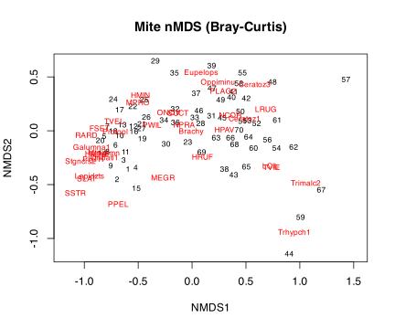
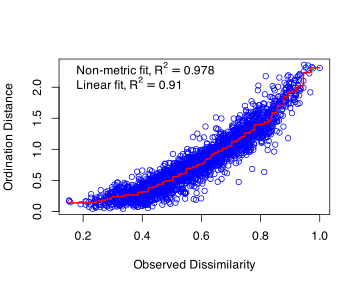
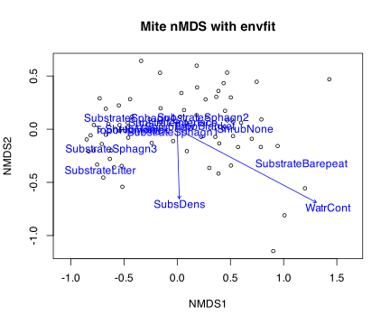
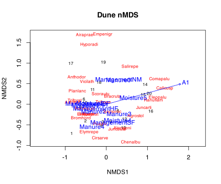

## 1 Practice task

Work through these exercises after reading the [non-Metric Multidimensional Scaling](../../BCB743/nMDS.llms.md) chapter, using the **vegan** mite and dune datasets. Four exercises are hands-on calculations and two are short conceptual questions. A worked answer is given under each exercise; try it yourself before opening it.

1.  Run an nMDS on the mite data (`data(mite)`; `metaMDS()` with a Bray-Curtis dissimilarity); report the stress and produce the ordination plot.

> **NOTE:**
>
> ``` numberSource
> library(tidyverse)
> library(vegan)
>
> data(mite)
> nmds_mite <- metaMDS(mite, distance = "bray", trace = FALSE)
> nmds_mite$stress                                          # the goodness-of-fit measure
> ```
>
>     R> [1] 0.1491318
>
> ``` numberSource
> ordiplot(nmds_mite, type = "text", main = "Mite nMDS (Bray-Curtis)")
> ```
>
> [](Task_G_files/figure-html/task-g-q1-1.svg)
>
> `metaMDS` runs several random starts and keeps the best two-dimensional solution. The stress is 0.149 (well under 0.2 for the 70 mite cores), which means the two-dimensional map reproduces the rank order of the Bray-Curtis dissimilarities faithfully. The ordination spreads the cores out, with sites and species arranged by the strong moisture gradient that structures this community.

2.  Assess the fit: produce a Shepard (stress) plot with `stressplot()` and compare a two-dimensional with a three-dimensional solution. How does the stress change with dimensionality?

> **NOTE:**
>
> ``` numberSource
> stressplot(nmds_mite)                                     # observed dissimilarity vs ordination distance
> ```
>
> [](Task_G_files/figure-html/task-g-q2-1.svg)
>
> ``` numberSource
> nmds_mite_3d <- metaMDS(mite, distance = "bray", k = 3, trace = FALSE)
> c(k2 = nmds_mite$stress, k3 = nmds_mite_3d$stress)        # stress falls as k rises
> ```
>
>     R>        k2        k3 
>     R> 0.1491318 0.1170233
>
> The Shepard plot shows the ordination distances rising monotonically with the observed dissimilarities and clustering tightly around the fitted step line, with a high non-metric $R^2$, confirming a good fit. Adding a third dimension lowers the stress (from 0.149 in two dimensions to 0.117 in three), as it always must, because more dimensions give the algorithm more room to satisfy the rank constraints. The decision is a trade-off: take the extra dimension only if it buys a worthwhile drop in stress, since a 2-D map that is already low-stress is easier to read and less likely to be over-fitted.

3.  Fit the environmental variables onto the mite nMDS with `envfit()` (using `mite.env`); identify which variables significantly structure the community, and overlay the significant ones.

> **NOTE:**
>
> ``` numberSource
> data(mite.env)
> fit_mite <- envfit(nmds_mite, mite.env, permutations = 999)
> fit_mite
> ```
>
>     R> 
>     R> ***VECTORS
>     R> 
>     R>             NMDS1    NMDS2     r2 Pr(>r)    
>     R> SubsDens  0.02937 -0.99957 0.1378  0.007 ** 
>     R> WatrCont  0.88466 -0.46623 0.7010  0.001 ***
>     R> ---
>     R> Signif. codes:  0 '***' 0.001 '**' 0.01 '*' 0.05 '.' 0.1 ' ' 1
>     R> Permutation: free
>     R> Number of permutations: 999
>     R> 
>     R> ***FACTORS:
>     R> 
>     R> Centroids:
>     R>                      NMDS1   NMDS2
>     R> SubstrateSphagn1   -0.0394 -0.0426
>     R> SubstrateSphagn2    0.2430  0.0954
>     R> SubstrateSphagn3   -0.6197 -0.1994
>     R> SubstrateSphagn4   -0.4447  0.0897
>     R> SubstrateLitter    -0.7244 -0.3934
>     R> SubstrateBarepeat   1.1658 -0.3385
>     R> SubstrateInterface -0.0393  0.0555
>     R> ShrubNone           0.6386 -0.0046
>     R> ShrubFew           -0.0703  0.0165
>     R> ShrubMany          -0.4122 -0.0136
>     R> TopoBlanket         0.2529  0.0138
>     R> TopoHummock        -0.4279 -0.0233
>     R> 
>     R> Goodness of fit:
>     R>               r2 Pr(>r)    
>     R> Substrate 0.1994  0.010 ** 
>     R> Shrub     0.3968  0.001 ***
>     R> Topo      0.2484  0.001 ***
>     R> ---
>     R> Signif. codes:  0 '***' 0.001 '**' 0.01 '*' 0.05 '.' 0.1 ' ' 1
>     R> Permutation: free
>     R> Number of permutations: 999
>
> ``` numberSource
> ordiplot(nmds_mite, display = "sites", main = "Mite nMDS with envfit")
> plot(fit_mite, p.max = 0.05)                              # overlay only significant variables
> ```
>
> [](Task_G_files/figure-html/task-g-q3-1.svg)
>
> `envfit` tests each environmental variable against the ordination by permutation. Substrate density and especially **water content** (`WatrCont`) come out as strongly significant, along with the topographic and substrate factors, while any weak variable is left off the plot by the `p.max = 0.05` filter. The significant vectors point along the main axis of the ordination, confirming that the moisture/substrate gradient is what organises the mite community, the same conclusion the GLM and GAM tasks reach with the same data by a different route.

4.  Repeat the nMDS on the dune data and overlay `dune.env`. Briefly compare the structure of the two communities.

> **NOTE:**
>
> ``` numberSource
> data(dune); data(dune.env)
> nmds_dune <- metaMDS(dune, distance = "bray", trace = FALSE)
> nmds_dune$stress
> ```
>
>     R> [1] 0.1183186
>
> ``` numberSource
> ordiplot(nmds_dune, type = "text", main = "Dune nMDS")
> plot(envfit(nmds_dune, dune.env, permutations = 999), p.max = 0.05)
> ```
>
> [](Task_G_files/figure-html/task-g-q4-1.svg)
>
> The dune meadows also give a low-stress (0.118) two-dimensional solution, but the structuring variables differ: moisture and management practice are the significant gradients for the meadows, whereas water content and substrate drive the mites. Both communities are organised by one or two clear environmental gradients, which is why nMDS represents each well in two dimensions; the ecological content of those gradients is simply different.

5.  Explain what nMDS optimises (the rank order of the dissimilarities) and what “stress” measures; what stress values are generally regarded as acceptable?

> **NOTE:**
>
> nMDS does not try to reproduce the dissimilarities themselves, only their **rank order**: it arranges the points so that, as far as possible, the more dissimilar two samples are, the further apart they sit, regardless of the exact distances. **Stress** measures how badly that ordering is violated, namely the scatter of the ordination distances around the monotonic (rank-preserving) fit, so lower is better and zero is a perfect rank match. A common rule of thumb (Clarke’s) treats stress below about 0.05 as excellent, below 0.1 as good, below 0.2 as usable but to be interpreted with care, and above 0.3 as essentially arbitrary. Because nMDS optimises ranks rather than metric distances, it is well suited to ecological dissimilarities whose absolute values are not meant to be taken literally.

6.  Contrast nMDS with the eigenvalue methods (PCA, CA, PCoA): what does nMDS give up, and what does it gain?

> **NOTE:**
>
> The eigenvalue methods (PCA, CA, PCoA) produce a unique solution in one pass, give axes ordered by the variance/inertia they explain, and let you read a meaningful percentage of variation per axis. nMDS **gives up** all of that: there is no unique analytical solution (it is found by iterative optimisation from random starts), the axes are arbitrary and not ordered by importance, and there is no eigenvalue-based “percent explained”. What it **gains** is freedom from a specific distance model and from the linear or unimodal response assumptions: it will accept any dissimilarity, it is not forced to embed it metrically, and by fitting only ranks it usually represents complex community structure in two dimensions with less distortion (no horseshoe) than the eigenvalue methods. The price is the loss of a clean, reproducible, variance-partitioned axis system.

## 2 Assessment criteria

This Task is not formally assessed. It is built around four hands-on analyses (Exercises 1–4) and two short conceptual questions (Exercises 5–6); work through all six and bring your annotated Quarto document to class for discussion.

## Reuse

[CC BY-NC-SA 4.0](https://creativecommons.org/licenses/by-nc-sa/4.0/)

## Citation

BibTeX citation:

``` quarto-appendix-bibtex
@online{smit2026,
  author = {Smit, A. J.},
  title = {11a. {Non-metric} Multidimensional Scaling {(nMDS)}},
  date = {2026-11-06},
  url = {https://tangledbank.netlify.app/BCB743/tasks/Task_G.html},
  langid = {en}
}
```

For attribution, please cite this work as:

Smit AJ (2026) 11a. Non-metric multidimensional scaling (nMDS). [https://tangledbank.netlify.app/BCB743/tasks/Task_G.html.](https://tangledbank.netlify.app/BCB743/tasks/Task_G.html)
