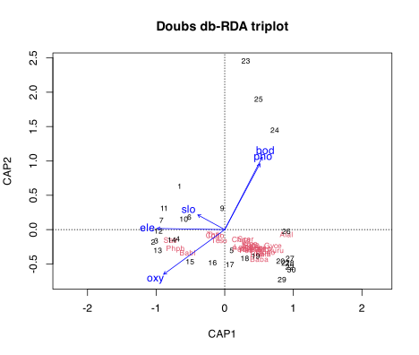

## 1 Practice task

Work through these exercises after reading the [Distance-Based Redundancy Analysis](../../BCB743/constrained_ordination.llms.md) chapter. It rehearses the workflow you will need for the [integrative project](../../BCB743/assessments/BCB743_integrative_assignment.llms.md), here on the familiar Doubs and mite data. Four exercises are hands-on calculations and two are short conceptual questions. A worked answer is given under each exercise; try it yourself before opening it.

1.  Using the Doubs fish data as the response and the Doubs environmental data as predictors, run a db-RDA with `capscale()` on a Bray-Curtis dissimilarity, constraining composition by a sensible subset of the environmental variables. Report the permutation test of the whole model (`anova(...)`), the adjusted $R^2$ (`RsquareAdj()`), and the proportion of positive ordination inertia that is constrained.

> **NOTE:**
>
> ``` numberSource
> library(tidyverse)
> library(vegan)
>
> load(here::here(
>   "data",
>   "BCB743",
>   "NEwR-2ed_code_data",
>   "NEwR2-Data",
>   "Doubs.RData"
> ))
> keep <- rowSums(spe) > 0
> spe <- spe[keep, ]
> env <- env[keep, ]
>
> dbrda <- capscale(
>   spe ~ ele + oxy + bod + dfs + slo + pho,
>   data = env,
>   distance = "bray"
> )
> anova(dbrda) # permutation test of the whole model
> ```
>
>     R> Permutation test for capscale under reduced model
>     R> Permutation: free
>     R> Number of permutations: 999
>     R> 
>     R> Model: capscale(formula = spe ~ ele + oxy + bod + dfs + slo + pho, data = env, distance = "bray")
>     R>          Df SumOfSqs      F Pr(>F)    
>     R> Model     6   5.1819 10.126  0.001 ***
>     R> Residual 22   1.8764                  
>     R> ---
>     R> Signif. codes:  0 '***' 0.001 '**' 0.01 '*' 0.05 '.' 0.1 ' ' 1
>
> ``` numberSource
> adjR <- RsquareAdj(dbrda)$adj.r.squared
> dbrda_summary <- summary(dbrda)
> constrained_axes <- grepl("^CAP", colnames(dbrda_summary$cont$importance))
> prop_constr <- sum(dbrda_summary$cont$importance["Proportion Explained", constrained_axes])
> c(adj_R2 = round(adjR, 3), prop_constrained = round(prop_constr, 3))
> ```
>
>     R>           adj_R2 prop_constrained 
>     R>            0.662            0.734
>
> The whole-model permutation test is highly significant, so the environmental subset explains more of the fish composition than chance would. The adjusted $R^2$ is **0.66** and the constrained inertia is **73.4%** of the positive ordination inertia: a sizeable, real share of compositional variation is attributable to these measured gradients, with the rest left unconstrained (unmeasured drivers and noise).

2.  Check multicollinearity among the predictors with `vif.cca()`. Remove predictors with a VIF above 10 one at a time, refitting after each removal, and report the final predictor set.

> **NOTE:**
>
> ``` numberSource
> vif.cca(dbrda) # variance inflation factors
> ```
>
>     R>       ele       oxy       bod       dfs       slo       pho 
>     R> 14.889057  6.992495 10.024853 16.600973  1.530997  6.143412
>
> ``` numberSource
> # distance from source is collinear with elevation/discharge; drop it and refit
> dbrda2 <- capscale(
>   spe ~ ele + oxy + bod + slo + pho,
>   data = env,
>   distance = "bray"
> )
> vif.cca(dbrda2)
> ```
>
>     R>      ele      oxy      bod      slo      pho 
>     R> 1.521955 3.787681 8.710926 1.342798 6.133499
>
> The first model shows one or more predictors with a VIF above 10, a sign that they share variance with the others (the collinearity diagnosed back in the Correlations chapter). Distance from source is the obvious culprit, since it is almost perfectly correlated with elevation and discharge. Dropping it and refitting brings the remaining VIFs down to acceptable values, leaving a predictor set whose effects can be attributed with more confidence. The model’s explanatory power barely changes, because the dropped variable carried little information that the others did not.

3.  Test the significance of the individual constrained axes (`by = "axis"`) and of the individual terms (`by = "terms"`), and produce and interpret a triplot (sites, species, environmental arrows), relating the constrained axes to the upstream-downstream gradient.

> **NOTE:**
>
> ``` numberSource
> anova(dbrda2, by = "axis") # which constrained axes matter
> ```
>
>     R> Permutation test for capscale under reduced model
>     R> Forward tests for axes
>     R> Permutation: free
>     R> Number of permutations: 999
>     R> 
>     R> Model: capscale(formula = spe ~ ele + oxy + bod + slo + pho, data = env, distance = "bray")
>     R>          Df SumOfSqs       F Pr(>F)    
>     R> CAP1      1   3.1995 35.3929  0.001 ***
>     R> CAP2      1   0.9429 10.8842  0.001 ***
>     R> CAP3      1   0.4386  5.2737  0.003 ** 
>     R> CAP4      1   0.3216  4.0210  0.004 ** 
>     R> CAP5      1   0.0766  0.9954  0.450    
>     R> Residual 23   2.0792                   
>     R> ---
>     R> Signif. codes:  0 '***' 0.001 '**' 0.01 '*' 0.05 '.' 0.1 ' ' 1
>
> ``` numberSource
> anova(dbrda2, by = "terms") # which predictors matter
> ```
>
>     R> Permutation test for capscale under reduced model
>     R> Terms added sequentially (first to last)
>     R> Permutation: free
>     R> Number of permutations: 999
>     R> 
>     R> Model: capscale(formula = spe ~ ele + oxy + bod + slo + pho, data = env, distance = "bray")
>     R>          Df SumOfSqs       F Pr(>F)    
>     R> ele       1  2.22791 24.6454  0.001 ***
>     R> oxy       1  1.07410 11.8819  0.001 ***
>     R> bod       1  1.02419 11.3298  0.001 ***
>     R> slo       1  0.54008  5.9745  0.001 ***
>     R> pho       1  0.11289  1.2488  0.267    
>     R> Residual 23  2.07916                   
>     R> ---
>     R> Signif. codes:  0 '***' 0.001 '**' 0.01 '*' 0.05 '.' 0.1 ' ' 1
>
> ``` numberSource
> plot(dbrda2, scaling = 2, main = "Doubs db-RDA triplot")
> ```
>
> [](Task_H_files/figure-html/task-h-q3-1.svg)
>
> Typically the first constrained axis is strongly significant and accounts for most of the constrained variation, with later axes weaker. The term test shows which individual predictors carry significant effects, usually the oxygen/organic-load and elevation gradients. In the triplot the sites again line up along the first axis from upstream to downstream, the environmental arrows for elevation/oxygen point towards the headwater end and those for nutrients/organic load towards the lowland end, and the species fall where their abundances peak. The constrained ordination thus pins the familiar river gradient to specific, testable environmental variables.

4.  Apply the same workflow to the oribatid mite data (`data(mite); data(mite.env)`); briefly discuss what constrains the mite community.

> **NOTE:**
>
> ``` numberSource
> data(mite)
> data(mite.env)
> dbrda_mite <- capscale(
>   mite ~ SubsDens + WatrCont + Substrate + Shrub + Topo,
>   data = mite.env,
>   distance = "bray"
> )
> anova(dbrda_mite)
> ```
>
>     R> Permutation test for capscale under reduced model
>     R> Permutation: free
>     R> Number of permutations: 999
>     R> 
>     R> Model: capscale(formula = mite ~ SubsDens + WatrCont + Substrate + Shrub + Topo, data = mite.env, distance = "bray")
>     R>          Df SumOfSqs      F Pr(>F)    
>     R> Model    11   7.6855 4.4745  0.001 ***
>     R> Residual 58   9.0565                  
>     R> ---
>     R> Signif. codes:  0 '***' 0.001 '**' 0.01 '*' 0.05 '.' 0.1 ' ' 1
>
> ``` numberSource
> adjR_mite <- RsquareAdj(dbrda_mite)$adj.r.squared
> adjR_mite
> ```
>
>     R> [1] 0.356463
>
> ``` numberSource
> anova(dbrda_mite, by = "terms")
> ```
>
>     R> Permutation test for capscale under reduced model
>     R> Terms added sequentially (first to last)
>     R> Permutation: free
>     R> Number of permutations: 999
>     R> 
>     R> Model: capscale(formula = mite ~ SubsDens + WatrCont + Substrate + Shrub + Topo, data = mite.env, distance = "bray")
>     R>           Df SumOfSqs       F Pr(>F)    
>     R> SubsDens   1   0.5150  3.2981  0.007 ** 
>     R> WatrCont   1   3.6403 23.3134  0.001 ***
>     R> Substrate  6   1.8703  1.9963  0.002 ** 
>     R> Shrub      2   0.9024  2.8895  0.003 ** 
>     R> Topo       1   0.7575  4.8515  0.003 ** 
>     R> Residual  58   9.0565                   
>     R> ---
>     R> Signif. codes:  0 '***' 0.001 '**' 0.01 '*' 0.05 '.' 0.1 ' ' 1
>
> The mite db-RDA is also significant (adjusted $R^2$ = **0.36**), and the term test shows that **water content** is the dominant constraint, with substrate type and the topographic/shrub factors adding smaller, often significant contributions. This matches the unconstrained nMDS of the same data (Task G) and the GLM/GAM analyses (Tasks L and M): every method, constrained or not, identifies the moisture gradient as the primary axis along which the oribatid community is organised.

5.  Contrast what the db-RDA told you with what an unconstrained PCoA or nMDS of the same fish data would have told you. What does the constraint add, and what does it cost?

> **NOTE:**
>
> An unconstrained PCoA or nMDS shows *that* the fish community is organised along a dominant gradient, but it cannot say what drives it: the axes are whatever directions capture the most compositional variation, and any environmental interpretation is added afterwards by eye or by `envfit`. db-RDA **constrains** the ordination to the space spanned by the measured predictors, so its axes are, by construction, the combinations of environmental variables that best explain composition, and it comes with permutation tests and an adjusted $R^2$ that quantify how much they explain. What the constraint **adds** is testable, attributable explanation. What it **costs** is that it can only ever see structure related to the variables you measured: any gradient driven by something you did not record is invisible to it, whereas an unconstrained ordination would still show it. The two are complementary, which is why the workflow runs both.

6.  Why use db-RDA (a constrained ordination on a chosen dissimilarity) rather than classical RDA or CCA for these community data? Relate your answer to the choice of dissimilarity and to the assumptions of RDA and CCA.

> **NOTE:**
>
> Classical **RDA** is a constrained PCA: it works on Euclidean distance and assumes linear species responses, which suits short gradients but distorts the long, zero-rich community gradients seen here. **CCA** is a constrained CA: it assumes unimodal responses and works on chi-square distance, which is better for long gradients but bakes in a specific, sometimes undesirable, weighting of rare species. **db-RDA** decouples the constraint from the distance: it lets you choose an ecologically appropriate dissimilarity (here Bray-Curtis, which handles abundance and joint absences sensibly), turns it into coordinates by PCoA, and then constrains those coordinates by the predictors. So db-RDA is preferred whenever the dissimilarity you trust for the data is neither Euclidean nor chi-square, which is the usual case for abundance community tables; it gives the testable, constrained framework of RDA/CCA without forcing their distance assumptions.

## 2 Assessment criteria

This Task is not formally assessed. It is built around four hands-on analyses (Exercises 1–4) and two short conceptual questions (Exercises 5–6); work through all six and bring your annotated Quarto document to class for discussion.

## Reuse

[CC BY-NC-SA 4.0](https://creativecommons.org/licenses/by-nc-sa/4.0/)

## Citation

BibTeX citation:

``` quarto-appendix-bibtex
@online{smit2026,
  author = {Smit, A. J.},
  title = {13a. {Distance-based} Redundancy Analysis {(db-RDA)}},
  date = {2026-11-06},
  url = {https://tangledbank.netlify.app/BCB743/tasks/Task_H.html},
  langid = {en}
}
```

For attribution, please cite this work as:

Smit AJ (2026) 13a. Distance-based redundancy analysis (db-RDA). [https://tangledbank.netlify.app/BCB743/tasks/Task_H.html.](https://tangledbank.netlify.app/BCB743/tasks/Task_H.html)
