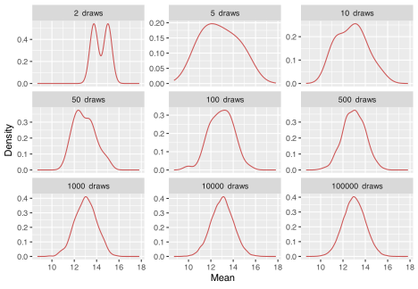
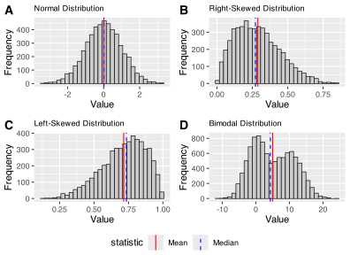
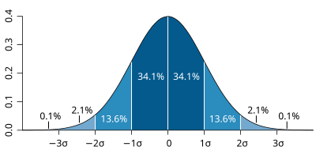
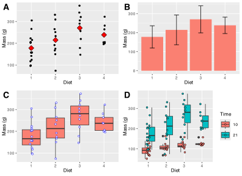

[](../../images/internet_truth.jpg "A reminder that claims need evidence.")

A reminder that claims need evidence.

> *“I think it is much more interesting to live with uncertainty than to live with answers that might be wrong.”*
>
> - — Richard Feynman

> **NOTE:**
>
> - Data summaries
> - Measures of central tendency
> - Measures of dispersal
> - Descriptive statistics by group

> **IMPORTANT:**
>
> - Self-Assessment Task 2-1 **(/3)**
> - Self-Assessment Task 2-2 **(/10)**
> - Self-Assessment Task 2-3 **(/5)**
> - Self-Assessment Task 2-4 **(/10)**
> - Self-Assessment Task 2-5 **(/5)**
> - Self-Assessment Task 2-6 **(/3)**
> - Self-Assessment Task 2-7 **(/2)**
> - [Self-Assessment instructions and full task overview](../../BCB744/tasks/BCB744_Biostats_Self-Assessment.llms.md)

Exploratory data analysis (EDA) establishes what kind of data we actually have before we test hypotheses or fit models. It tells us how many observations we have, what variables were measured, how much variation is present, whether missing values or outliers need attention, and whether the data contain obvious grouping structure. Poor summaries at this stage usually lead to poor inference later.

In this chapter, I introduce the numerical summaries used at the start of that process. I focus on measures of centre, measures of spread, and a small set of tools for inspecting the structure of a dataset. These summaries work alongside the figures in [Chapter 3](../../BCB744/basic_stats/03-visualise.llms.md) and the treatment of distributions and uncertainty in [Chapter 4](../../BCB744/basic_stats/04-distributions-sampling-uncertainty.llms.md).

# 1 Key concepts

The ideas that organise the rest of the chapter are:

- **EDA:** The first analytical pass through a dataset. Its job is to reveal structure, variation, missingness, and potential problems before formal inference begins.
- **Centre and spread:** Most numerical summaries describe either where the data cluster or how widely they vary. They form part of summary (descriptive) statistics.
- **Distribution:** The shape of a distribution determines which summaries describe it well. Symmetric data and skewed data are not best summarised in the same way, and they will be analysed using different tests or models.
- **Grouped summaries:** Biological datasets often contain treatments, species, sites, or times. Summaries by group may reveal structure hidden in pooled data.

# 2 Foundational definitions

A few definitions that recur throughout the module are presented next.

## 2.1 Variables and parameters

A **parameter** is a fixed but usually unknown quantity that describes a population or probability distribution. Examples include the true population mean, variance, or regression slope. A **variable** is the measured characteristic itself: body mass, bill length, temperature, salinity, presence or absence, and so on. We observe variables in a sample and use them to estimate parameters.

## 2.2 Samples and populations

The **population** is the full set of units about which we want to make a claim: all trees in a forest, all quadrats in a marsh, all fish in an estuary, or all patients in a trial. A **sample** is the subset we actually measure. Because we rarely have access to the whole population, we rely on a **random** sample to estimate population-level quantities. The question is therefore whether the sample is informative about the population we care about. As sample size increases, and as the sample better represents the population, the sample mean becomes a more stable estimate of the population mean ([Figure 1](#fig-simul)).

Code

``` numberSource
set.seed(666)

# pre-allocate the tibble
normal_takes_shape <- tibble(number_draws = c(), draws = c())

# simulate increasingly larger samples
for (i in c(2, 5, 10, 50, 100, 500, 1000, 10000, 100000)) {
  draws_i <-
    tibble(
      number_draws = c(rep.int(
        x = paste(as.integer(i), " draws"),
        times = i
      )),
      draws = c(rnorm(
        n = i,
        mean = 13,
        sd = 1
      ))
    )

  normal_takes_shape <- rbind(normal_takes_shape, draws_i)
  rm(draws_i)
}

normal_takes_shape |>
  mutate(number_draws = as_factor(number_draws)) |>
  ggplot(aes(x = draws)) +
  geom_density(colour = "indianred3") +
  theme_grey() +
  facet_wrap(
    vars(number_draws),
    scales = "free_y"
  ) +
  labs(
    x = "Mean",
    y = "Density"
  )
```

[](02-summarise-and-describe_files/figure-html/fig-simul-1.svg "Figure 1: Drawing increasingly larger sample sizes from a population with a true mean of 13 and an SD of 1.")

Figure 1: Drawing increasingly larger sample sizes from a population with a true mean of 13 and an SD of 1.

## 2.3 When is something random?

In statistics, **random** means that outcomes cannot be predicted exactly in advance, even when the process generating them is understood. Random sampling and random assignment use this idea to reduce bias and to justify probability-based inference.

The term **stochastic** is closely related but usually refers to a process rather than to a single outcome. Population growth under fluctuating weather, disease transmission, and dispersal all have deterministic components, but they also include variation that is modelled probabilistically. In practice, both terms point us to the same issue: biological systems often contain uncertainty that must be described rather than ignored.

> **IMPORTANT:**
>
> Run the code for [Figure 1](#fig-simul) and compare the panels for 2, 10, and 10 000 draws in terms of their mean and SD. If you forgot the functions, you can find them below. In two or three sentences, explain what changes as sample size increases and why that is important when we use a sample to estimate a population mean.

# 3 Descriptive statistics

Now to the summaries used most often in EDA. These summaries answer three basic questions: where is the centre of the data, how much do the values vary, and which summaries remain sensible when the data are skewed or contain outliers.

## 3.1 The core equations

The sample mean is:

$$\bar{x} = \frac{1}{n}\sum_{i=1}^{n}x_{i} = \frac{x_{1} + x_{2} + \cdots + x_{n}}{n} \tag{1}$$

In [Equation 1](#eq-mean), $x_{1}, x_{2}, \ldots, x_{n}$ are the observations and $n$ is the sample size. The mean is therefore the total of the observations divided by the number of observations.

The sample variance is:

$$S^{2} = \frac{1}{n-1}\sum_{i=1}^{n}(x_{i}-\bar{x})^{2} \tag{2}$$

Equation [Equation 2](#eq-var) measures the average squared deviation from the sample mean. The divisor is $n - 1$ rather than $n$ because we are estimating population variance from a sample.

The sample standard deviation is the square root of the variance:

$$S = \sqrt{S^{2}} \tag{3}$$

The standard deviation is usually easier to interpret than the variance because it is expressed on the original measurement scale of the data.

For robust summaries, the interquartile range is:

$$\text{IQR} = Q_{3} - Q_{1} \tag{4}$$

In [Equation 4](#eq-iqr), $Q_{1}$ is the first quartile and $Q_{3}$ is the third quartile, so the IQR measures the spread of the middle 50% of the data.

## 3.2 Measures of central tendency

| Statistic | Function                                          | Package   |
|:----------|:--------------------------------------------------|:----------|
| Mean      | [`mean()`](https://rdrr.io/r/base/mean.html)      | **base**  |
| Median    | [`median()`](https://rdrr.io/r/stats/median.html) | **base**  |
| Mode      | **Do it!**                                        |           |
| Skewness  | `skewness()`                                      | **e1071** |
| Kurtosis  | `kurtosis()`                                      | **e1071** |

Measures of central tendency describe where the data cluster. The mean and standard deviation work well when the data are roughly symmetric and not dominated by extreme values. The median and IQR are usually better when the data are skewed or contain outliers.

Before discussing each statistic, I will generate several simple datasets with different shapes. These give us a controlled way to compare the summaries.

Show code

``` numberSource
# Generate random data from a normal distribution
set.seed(666)
n <- 5000 # Number of data points
mean <- 0
sd <- 1
normal_data <- rnorm(n, mean, sd)

# Generate random data from a slightly
# right-skewed beta distribution
alpha <- 2
beta <- 5
right_skewed_data <- rbeta(n, alpha, beta)

# Generate random data from a slightly
# left-skewed beta distribution
alpha <- 5
beta <- 2
left_skewed_data <- rbeta(n, alpha, beta)

# Generate random data with a bimodal distribution
mean1 <- 0
mean2 <- 10
sd1 <- 3
sd2 <- 4

# Generate data from two normal distributions
data1 <- rnorm(n, mean1, sd1)
data2 <- rnorm(n, mean2, sd2)

# Combine the data from both distributions to
# create a bimodal distribution
bimodal_data <- c(data1, data2)

make_hist_plot <- function(x, title, fill_col) {
  stat_lines <- tibble(
    statistic = c("Mean", "Median"),
    xint = c(mean(x), median(x))
  )

  ggplot(tibble(value = x), aes(x = value)) +
    geom_histogram(bins = 30, fill = fill_col, colour = "black", linewidth = 0.3) +
    geom_vline(
      data = stat_lines,
      aes(xintercept = xint, colour = statistic, linetype = statistic),
      linewidth = 0.5,
      show.legend = TRUE
    ) +
    scale_colour_manual(values = c("Mean" = "red", "Median" = "blue")) +
    scale_linetype_manual(values = c("Mean" = "solid", "Median" = "dashed")) +
    labs(
      title = title,
      x = "Value",
      y = "Frequency"
    ) +
    theme_grey() +
    theme(
      legend.position = "bottom",
      plot.title = element_text(size = 9)
    )
}

plt_normal <- make_hist_plot(normal_data, "Normal Distribution", "grey80")
plt_right <- make_hist_plot(right_skewed_data, "Right-Skewed Distribution", "grey80")
plt_left  <- make_hist_plot(left_skewed_data, "Left-Skewed Distribution", "grey80")
plt_bimodal <- make_hist_plot(bimodal_data, "Bimodal Distribution", "grey80")

ggpubr::ggarrange(
  plt_normal, plt_right, plt_left, plt_bimodal,
  ncol = 2, nrow = 2,
  labels = c("A", "B", "C", "D"),
  common.legend = TRUE,
  legend = "bottom"
)
```

[](02-summarise-and-describe_files/figure-html/fig-histos-1.svg "Figure 2: Generated normal, right-skewed, left-skewed, and bimodal distributions, shown in panels A-D, with the mean and median indicated in each panel.")

Figure 2: Generated normal, right-skewed, left-skewed, and bimodal distributions, shown in panels A-D, with the mean and median indicated in each panel.

### 3.2.1 The sample mean

The mean is the arithmetic average of the data. As shown in [Equation 1](#eq-mean), it is calculated by summing the observations and dividing by the sample size.

We calculate it with [`mean()`](https://rdrr.io/r/base/mean.html):

``` numberSource
round(mean(normal_data), 3)
```

    R> [1] 0.009

> **IMPORTANT:**
>
> How would you manually calculate the mean value for the `normal_data` we generated in the lecture? **(/3)**

The mean uses all observed values, which makes it informative but also sensitive to skew and outliers. That sensitivity does not make it invalid for non-normal data, but it does make it a poor summary when a few extreme values dominate the result.

In panel A of [Figure 2](#fig-histos), the normal distribution is centred cleanly around its mean. In panels B and C, tail asymmetry pulls the mean away from the bulk of the data.

### 3.2.2 The median

The median is the middle value after the data have been ordered. With an odd number of observations, it is the single central value. With an even number, it is the mean of the two central values.

The median divides the ordered data into two equal halves. In a symmetric distribution it will often be close to the mean. In skewed data it usually gives a more stable description of the centre because extreme values have little influence on it.

That contrast is visible in panels B and C of [Figure 2](#fig-histos) where the median sits closer to the main cluster of values than the mean does.

We calculate the median with [`median()`](https://rdrr.io/r/stats/median.html):

``` numberSource
round(median(normal_data), 3)
```

    R> [1] 0.017

It is easier to see the calculation on a small dataset:

``` numberSource
set.seed(123) # for reproducibility
small_normal_data <- round(rnorm(11, 13, 3), 1)
sort(small_normal_data)
```

    R>  [1]  9.2 10.9 11.3 11.7 12.3 13.2 13.4 14.4 16.7 17.7 18.1

``` numberSource
median(small_normal_data)
```

    R> [1] 13.2

> **IMPORTANT:**
>
> Use [Figure 2](#fig-histos) to decide which measure of centre you would report for each of the four panels. For each panel, write down either mean or median and give one short reason for your choice.

> **NOTE:**
>
> The median is the 50th percentile, or second quartile ($Q_{2}$). More generally, quantiles divide the ordered data into specified proportions. Quartiles split them into four parts, deciles into ten, and percentiles into one hundred.

### 3.2.3 The mode

The mode is the most frequent value or values in a dataset. It is useful for categorical data and for identifying whether a distribution is unimodal, bimodal, or multimodal. For continuous numerical data, exact repeated values are often less informative, so the mode is usually assessed visually from a histogram or density plot rather than calculated directly.

Panel D of [Figure 2](#fig-histos) shows why visual inspection is useful here: one mean can be calculated, but the figure shows two clear peaks.

Base R does not provide a standard [`mode()`](https://rdrr.io/r/base/mode.html) function for this purpose. In practice, visual inspection is often the more useful route.

### 3.2.4 Skewness

Skewness describes asymmetry in a distribution. A symmetric distribution has skewness close to zero. Positive skewness means the right tail is longer; negative skewness means the left tail is longer.

Skewness is often easiest to understand by comparing the mean and median. In a right-skewed distribution the mean is usually greater than the median. In a left-skewed distribution the mean is usually smaller.

You can see both patterns in [Figure 2](#fig-histos), where panel B has a longer right tail, and panel C has a longer left tail.

``` numberSource
library(e1071)
# Positive skewness
skewness(right_skewed_data)
```

    R> [1] 0.5453162

``` numberSource
# Is the mean larger than the median?
mean(right_skewed_data) > median(right_skewed_data)
```

    R> [1] TRUE

``` numberSource
# Negative skewness
skewness(left_skewed_data)
```

    R> [1] -0.5790834

``` numberSource
# Is the mean less than the median?
mean(left_skewed_data) < median(left_skewed_data)
```

    R> [1] TRUE

### 3.2.5 Kurtosis

Kurtosis describes tail heaviness relative to a normal distribution. A normal distribution has close to zero kurtosis (called mesokurtic). Negative kurtosis indicates data with a thin-tailed (platykurtic) distribution and positive kurtosis indicates a fat-tailed distribution (leptokurtic).

``` numberSource
kurtosis(normal_data)
```

    R> [1] -0.01646261

``` numberSource
kurtosis(right_skewed_data)
```

    R> [1] -0.1898941

``` numberSource
kurtosis(left_skewed_data)
```

    R> [1] -0.1805365

> **IMPORTANT:**
>
> Find the `faithful` dataset and describe both variables in terms of their measures of central tendency. Include graphs in support of your answers (use `ggplot()`), and conclude with a brief statement about the data distribution. **(/10)**

Skewness and kurtosis can be informative, but they do not replace visual inspection or later assumption checks. They give a first numerical impression of distribution shape.

## 3.3 Measures of variance or dispersion around the centre

| Statistic | Function |
|:---|:---|
| Variance | [`var()`](https://rdrr.io/r/stats/cor.html) |
| Standard deviation | [`sd()`](https://rdrr.io/r/stats/sd.html) |
| Minimum | [`min()`](https://rdrr.io/r/base/Extremes.html) |
| Maximum | [`max()`](https://rdrr.io/r/base/Extremes.html) |
| Range | [`range()`](https://rdrr.io/r/base/range.html) |
| Quantile | [`quantile()`](https://rdrr.io/r/stats/quantile.html) |
| Inter Quartile Range | [`IQR()`](https://rdrr.io/r/stats/IQR.html) |

Measures of dispersion describe how widely the values are spread. Two samples can have the same mean but very different biological interpretations if one is tightly clustered and the other highly variable.

### 3.3.1 Variance and standard deviation

Variance and standard deviation are measures of dispersion. The sample variance is given in [Equation 2](#eq-var), and the standard deviation in [Equation 3](#eq-sd). We can calculate them with [`var()`](https://rdrr.io/r/stats/cor.html) and [`sd()`](https://rdrr.io/r/stats/sd.html):

``` numberSource
var(normal_data)
```

    R> [1] 1.002459

``` numberSource
sd(normal_data)
```

    R> [1] 1.001229

> **IMPORTANT:**
>
> Manually calculate the variance and SD for the `normal_data` we generated in the lecture. Make sure your answer is the same as those reported there. **(/5)**

The standard deviation is easier to interpret than the variance because it is measured on the same scale as the data. If temperature is measured in degrees Celsius, the standard deviation is also measured in degrees Celsius.

For roughly normal data, the 68-95-99.7 rule gives a useful approximation: about 68% of observations lie within 1 SD of the mean, about 95% within 2 SD, and about 99.7% within 3 SD ([Figure 3](#fig-expectednormal)).

[](../../images/Standard_deviation_diagram.svg "Figure 3: The idealised Normal distribution showing the proportion of data within 1, 2, and 3SD from the mean.")

Figure 3: The idealised Normal distribution showing the proportion of data within 1, 2, and 3SD from the mean.

Like the mean, the standard deviation is sensitive to extreme values. For skewed data or data with strong outliers, the IQR is often more informative.

### 3.3.2 The minimum, maximum, and range

[`min()`](https://rdrr.io/r/base/Extremes.html), [`max()`](https://rdrr.io/r/base/Extremes.html), and [`range()`](https://rdrr.io/r/base/range.html) give the extremes of the data:

``` numberSource
min(normal_data)
```

    R> [1] -3.400137

``` numberSource
max(normal_data)
```

    R> [1] 3.235566

``` numberSource
range(normal_data)
```

    R> [1] -3.400137  3.235566

[`range()`](https://rdrr.io/r/base/range.html) returns the minimum and maximum as a pair. If we want the numerical width of the range, we subtract the minimum from the maximum:

``` numberSource
range(normal_data)[2] - range(normal_data)[1]
```

    R> [1] 6.635703

These are simple summaries, but they are often the first place to look for impossible values, obvious outliers, or coding errors.

### 3.3.3 Quartiles and the interquartile range

Quartiles divide the ordered data into quarters. The first quartile ($Q_{1}$) marks the point below which 25% of the data fall, the second quartile ($Q_{2}$) is the median, and the third quartile ($Q_{3}$) marks the point below which 75% fall.

The IQR measures the spread of the middle 50% of the data. Because it ignores the tails, it is much less sensitive to outliers than the standard deviation. It is often the better description of spread for skewed data.

We obtain quartiles with [`quantile()`](https://rdrr.io/r/stats/quantile.html):

``` numberSource
# Look at the normal data
quantile(normal_data, p = 0.25)
```

    R>        25% 
    R> -0.6597937

``` numberSource
quantile(normal_data, p = 0.75)
```

    R>       75% 
    R> 0.6840946

``` numberSource
# Look at skewed data
quantile(left_skewed_data, p = 0.25)
```

    R>       25% 
    R> 0.6133139

``` numberSource
quantile(left_skewed_data, p = 0.75)
```

    R>       75% 
    R> 0.8390202

We calculate the IQR with [`IQR()`](https://rdrr.io/r/stats/IQR.html):

``` numberSource
IQR(normal_data)
```

    R> [1] 1.343888

> **IMPORTANT:**
>
> Calculate the range and IQR for `left_skewed_data`. The code is just above [Figure 2](#fig-histos). Then add one very large value to that vector and calculate both summaries again. Which measure changes more, and what does that tell you about when range or IQR is the better description of spread?

> **IMPORTANT:**
>
> Write a few lines of code to demonstrate that the $(0-0.25]$, $(0.25-0.5]$, $(0.5-0.75]$,$(0.75-1]$ quantiles of the `normal_data` we generated in the lecture indeed conform to the formal definition for what quantiles are. I.e., show manually how you can determine that 25% of the observations indeed fall below -0.66 for the `normal_data`. Explain the rationale to your approach. **(/10)**

The choice between mean and SD on the one hand, and median and IQR on the other, depends on the data. Symmetric distributions are often well described by the first pair. Skewed distributions or data with strong extremes are usually better described by the second.

The contrast among panels A-D in [Figure 2](#fig-histos) shows why that choice depends on the distribution rather than on habit.

# 4 The Palmer penguin dataset

The [Palmer penguin dataset](https://apreshill.github.io/palmerpenguins-useR-2022/#/title-slide) in the **palmerpenguins** package is a widely used teaching dataset for data exploration, visualisation, and modelling. It contains measurements from three penguin species in the Palmer Archipelago: Adélie, Chinstrap, and Gentoo.

The variables include bill length (`bill_length_mm`), bill depth (`bill_depth_mm`), flipper length (`flipper_length_mm`), body mass (`body_mass_g`), species, island, and sex. The dataset is rich enough to illustrate grouping structure, missingness, and both numerical and categorical variables without being unnecessarily large.

Let us start by loading the data:

``` numberSource
library(palmerpenguins)
```

# 5 Exploring the data structure

Now we go from statistical definitions to implementation. These functions answer three practical questions: what variables exist, how large the dataset is, and whether the data contain missing values or unexpected structure.

## 5.1 Inspecting type and layout

Several functions give a quick overview of the dataset itself rather than of the values inside it:

| Purpose | Function |
|:---|:---|
| The class of the dataset | [`class()`](https://rdrr.io/r/base/class.html) |
| The head of the dataframe | [`head()`](https://rdrr.io/r/utils/head.html) |
| The tail of the dataframe | [`tail()`](https://rdrr.io/r/utils/head.html) |
| Printing the data | [`print()`](https://rdrr.io/r/base/print.html) |
| Glimpse the data | `glimpse()` |
| Show number of rows | [`nrow()`](https://rdrr.io/r/base/nrow.html) |
| Show number of columns | [`ncol()`](https://rdrr.io/r/base/nrow.html) |
| The column names | [`colnames()`](https://rdrr.io/r/base/colnames.html) |
| The row names | [`row.names()`](https://rdrr.io/r/base/row.names.html) |
| The dimensions | [`dim()`](https://rdrr.io/r/base/dim.html) |
| The dimension names | [`dimnames()`](https://rdrr.io/r/base/dimnames.html) |
| The data structure | [`str()`](https://rdrr.io/r/utils/str.html) |

First, check the class of the object. The `penguins` dataset is a tibble, which is the tidyverse version of a data frame:

``` numberSource
class(penguins)
```

    R> [1] "tbl_df"     "tbl"        "data.frame"

We can convert between tibbles and data frames with [`as.data.frame()`](https://rdrr.io/r/base/as.data.frame.html) and `as_tibble()`:

``` numberSource
penguins_df <- as.data.frame(penguins)
class(penguins_df)
```

    R> [1] "data.frame"

``` numberSource
penguins_tbl <- as_tibble(penguins_df)
class(penguins_tbl)
```

    R> [1] "tbl_df"     "tbl"        "data.frame"

The print methods differ. Data frames print more bluntly; tibbles are more compact and readable:

``` numberSource
print(penguins_df[1:5,])
```

    R>   species    island bill_length_mm bill_depth_mm flipper_length_mm body_mass_g
    R> 1  Adelie Torgersen           39.1          18.7               181        3750
    R> 2  Adelie Torgersen           39.5          17.4               186        3800
    R> 3  Adelie Torgersen           40.3          18.0               195        3250
    R> 4  Adelie Torgersen             NA            NA                NA          NA
    R> 5  Adelie Torgersen           36.7          19.3               193        3450
    R>      sex year
    R> 1   male 2007
    R> 2 female 2007
    R> 3 female 2007
    R> 4   <NA> 2007
    R> 5 female 2007

``` numberSource
print(penguins_tbl)
```

    R> # A tibble: 344 × 8
    R>    species island    bill_length_mm bill_depth_mm flipper_length_mm body_mass_g
    R>    <fct>   <fct>              <dbl>         <dbl>             <int>       <int>
    R>  1 Adelie  Torgersen           39.1          18.7               181        3750
    R>  2 Adelie  Torgersen           39.5          17.4               186        3800
    R>  3 Adelie  Torgersen           40.3          18                 195        3250
    R>  4 Adelie  Torgersen           NA            NA                  NA          NA
    R>  5 Adelie  Torgersen           36.7          19.3               193        3450
    R>  6 Adelie  Torgersen           39.3          20.6               190        3650
    R>  7 Adelie  Torgersen           38.9          17.8               181        3625
    R>  8 Adelie  Torgersen           39.2          19.6               195        4675
    R>  9 Adelie  Torgersen           34.1          18.1               193        3475
    R> 10 Adelie  Torgersen           42            20.2               190        4250
    R> # ℹ 334 more rows
    R> # ℹ 2 more variables: sex <fct>, year <int>

`glimpse()` gives similar information in a horizontal layout:

``` numberSource
glimpse(penguins)
```

    R> Rows: 344
    R> Columns: 8
    R> $ species           <fct> Adelie, Adelie, Adelie, Adelie, Adelie, Adelie, Adel…
    R> $ island            <fct> Torgersen, Torgersen, Torgersen, Torgersen, Torgerse…
    R> $ bill_length_mm    <dbl> 39.1, 39.5, 40.3, NA, 36.7, 39.3, 38.9, 39.2, 34.1, …
    R> $ bill_depth_mm     <dbl> 18.7, 17.4, 18.0, NA, 19.3, 20.6, 17.8, 19.6, 18.1, …
    R> $ flipper_length_mm <int> 181, 186, 195, NA, 193, 190, 181, 195, 193, 190, 186…
    R> $ body_mass_g       <int> 3750, 3800, 3250, NA, 3450, 3650, 3625, 4675, 3475, …
    R> $ sex               <fct> male, female, female, NA, female, male, female, male…
    R> $ year              <int> 2007, 2007, 2007, 2007, 2007, 2007, 2007, 2007, 2007…

## 5.2 Inspecting size and names

Use [`nrow()`](https://rdrr.io/r/base/nrow.html), [`ncol()`](https://rdrr.io/r/base/nrow.html), and [`dim()`](https://rdrr.io/r/base/dim.html) to check dataset size:

``` numberSource
nrow(penguins)
```

    R> [1] 344

``` numberSource
ncol(penguins)
```

    R> [1] 8

``` numberSource
dim(penguins)
```

    R> [1] 344   8

Use [`colnames()`](https://rdrr.io/r/base/colnames.html) to inspect variable names:

``` numberSource
colnames(penguins)
```

    R> [1] "species"           "island"            "bill_length_mm"   
    R> [4] "bill_depth_mm"     "flipper_length_mm" "body_mass_g"      
    R> [7] "sex"               "year"

Tibbles do not use row names in the same way as traditional data frames, but [`row.names()`](https://rdrr.io/r/base/row.names.html) and [`dimnames()`](https://rdrr.io/r/base/dimnames.html) are still worth recognising:

> **IMPORTANT:**
>
> Explain the output of [`dimnames()`](https://rdrr.io/r/base/dimnames.html) when applied to the `penguins` dataset.

> **IMPORTANT:**
>
> 1.  Explain the output of [`dimnames()`](https://rdrr.io/r/base/dimnames.html) when applied to the `penguins` dataset. **(/2)**
> 2.  Explain the output of [`str()`](https://rdrr.io/r/utils/str.html) when applied to the `penguins` dataset. **(/3)**

## 5.3 Previewing the data

[`head()`](https://rdrr.io/r/utils/head.html) and [`tail()`](https://rdrr.io/r/utils/head.html) let us inspect the first and last rows:

``` numberSource
head(penguins)
```

    R> # A tibble: 6 × 8
    R>   species island    bill_length_mm bill_depth_mm flipper_length_mm body_mass_g
    R>   <fct>   <fct>              <dbl>         <dbl>             <int>       <int>
    R> 1 Adelie  Torgersen           39.1          18.7               181        3750
    R> 2 Adelie  Torgersen           39.5          17.4               186        3800
    R> 3 Adelie  Torgersen           40.3          18                 195        3250
    R> 4 Adelie  Torgersen           NA            NA                  NA          NA
    R> 5 Adelie  Torgersen           36.7          19.3               193        3450
    R> 6 Adelie  Torgersen           39.3          20.6               190        3650
    R> # ℹ 2 more variables: sex <fct>, year <int>

``` numberSource
tail(penguins, n = 3)
```

    R> # A tibble: 3 × 8
    R>   species   island bill_length_mm bill_depth_mm flipper_length_mm body_mass_g
    R>   <fct>     <fct>           <dbl>         <dbl>             <int>       <int>
    R> 1 Chinstrap Dream            49.6          18.2               193        3775
    R> 2 Chinstrap Dream            50.8          19                 210        4100
    R> 3 Chinstrap Dream            50.2          18.7               198        3775
    R> # ℹ 2 more variables: sex <fct>, year <int>

You can wrap them in [`print()`](https://rdrr.io/r/base/print.html) if you want more control over display:

``` numberSource
print(head(penguins))
```

    R> # A tibble: 6 × 8
    R>   species island    bill_length_mm bill_depth_mm flipper_length_mm body_mass_g
    R>   <fct>   <fct>              <dbl>         <dbl>             <int>       <int>
    R> 1 Adelie  Torgersen           39.1          18.7               181        3750
    R> 2 Adelie  Torgersen           39.5          17.4               186        3800
    R> 3 Adelie  Torgersen           40.3          18                 195        3250
    R> 4 Adelie  Torgersen           NA            NA                  NA          NA
    R> 5 Adelie  Torgersen           36.7          19.3               193        3450
    R> 6 Adelie  Torgersen           39.3          20.6               190        3650
    R> # ℹ 2 more variables: sex <fct>, year <int>

``` numberSource
print(tail(penguins, n = 3))
```

    R> # A tibble: 3 × 8
    R>   species   island bill_length_mm bill_depth_mm flipper_length_mm body_mass_g
    R>   <fct>     <fct>           <dbl>         <dbl>             <int>       <int>
    R> 1 Chinstrap Dream            49.6          18.2               193        3775
    R> 2 Chinstrap Dream            50.8          19                 210        4100
    R> 3 Chinstrap Dream            50.2          18.7               198        3775
    R> # ℹ 2 more variables: sex <fct>, year <int>

[`str()`](https://rdrr.io/r/utils/str.html) is often the most compact first inspection because it shows object type, variable classes, and a preview of values:

``` numberSource
str(penguins)
```

    R> tibble [344 × 8] (S3: tbl_df/tbl/data.frame)
    R>  $ species          : Factor w/ 3 levels "Adelie","Chinstrap",..: 1 1 1 1 1 1 1 1 1 1 ...
    R>  $ island           : Factor w/ 3 levels "Biscoe","Dream",..: 3 3 3 3 3 3 3 3 3 3 ...
    R>  $ bill_length_mm   : num [1:344] 39.1 39.5 40.3 NA 36.7 39.3 38.9 39.2 34.1 42 ...
    R>  $ bill_depth_mm    : num [1:344] 18.7 17.4 18 NA 19.3 20.6 17.8 19.6 18.1 20.2 ...
    R>  $ flipper_length_mm: int [1:344] 181 186 195 NA 193 190 181 195 193 190 ...
    R>  $ body_mass_g      : int [1:344] 3750 3800 3250 NA 3450 3650 3625 4675 3475 4250 ...
    R>  $ sex              : Factor w/ 2 levels "female","male": 2 1 1 NA 1 2 1 2 NA NA ...
    R>  $ year             : int [1:344] 2007 2007 2007 2007 2007 2007 2007 2007 2007 2007 ...

> **IMPORTANT:**
>
> Explain the output of [`str()`](https://rdrr.io/r/utils/str.html) when applied to the `penguins` dataset.

# 6 Data summaries

Once we understand the structure of the dataset, we summarise the values it contains. The tools in this section automate the numerical descriptions introduced above.

Use them for slightly different purposes:

- [`summary()`](https://rdrr.io/r/base/summary.html) for a quick overview of variable types and basic summaries.
- `skim()` for a broader inspection that includes missingness and type-specific summaries.
- `describe()` for more detailed descriptive statistics on numerical variables.
- `descriptives()` and `dfSummary()` when you want more elaborate tabular output.

| Purpose | Function | Package |
|:---|:---|:---|
| Summary of the data properties | [`summary()`](https://rdrr.io/r/base/summary.html) | **base** |
|  | `describe()` | **psych** |
|  | `skim()` | **skimr** |
|  | `descriptives()` | **jmv** |
|  | `dfSummary()` | **summarytools** |

## 6.1 `summary()`

[`summary()`](https://rdrr.io/r/base/summary.html) is the standard quick overview in base R. For data frames and tibbles, it reports variable classes and a small set of numerical summaries:

``` numberSource
summary(penguins)
```

    R>       species          island    bill_length_mm  bill_depth_mm  
    R>  Adelie   :152   Biscoe   :168   Min.   :32.10   Min.   :13.10  
    R>  Chinstrap: 68   Dream    :124   1st Qu.:39.23   1st Qu.:15.60  
    R>  Gentoo   :124   Torgersen: 52   Median :44.45   Median :17.30  
    R>                                  Mean   :43.92   Mean   :17.15  
    R>                                  3rd Qu.:48.50   3rd Qu.:18.70  
    R>                                  Max.   :59.60   Max.   :21.50  
    R>                                  NAs    :2       NAs    :2      
    R>  flipper_length_mm  body_mass_g       sex           year     
    R>  Min.   :172.0     Min.   :2700   female:165   Min.   :2007  
    R>  1st Qu.:190.0     1st Qu.:3550   male  :168   1st Qu.:2007  
    R>  Median :197.0     Median :4050   NAs   : 11   Median :2008  
    R>  Mean   :200.9     Mean   :4202                Mean   :2008  
    R>  3rd Qu.:213.0     3rd Qu.:4750                3rd Qu.:2009  
    R>  Max.   :231.0     Max.   :6300                Max.   :2009  
    R>  NAs    :2         NAs    :2

> **IMPORTANT:**
>
> Explain the output of [`summary()`](https://rdrr.io/r/base/summary.html) when applied to the `penguins` dataset. **(/3)**

## 6.2 `psych::describe()`

[`psych::describe()`](https://rdrr.io/pkg/psych/man/describe.html) provides a more detailed numerical summary:

``` numberSource
psych::describe(penguins)
```

    R>                   vars   n    mean     sd  median trimmed    mad    min    max
    R> species*             1 344    1.92   0.89    2.00    1.90   1.48    1.0    3.0
    R> island*              2 344    1.66   0.73    2.00    1.58   1.48    1.0    3.0
    R> bill_length_mm       3 342   43.92   5.46   44.45   43.91   7.04   32.1   59.6
    R> bill_depth_mm        4 342   17.15   1.97   17.30   17.17   2.22   13.1   21.5
    R> flipper_length_mm    5 342  200.92  14.06  197.00  200.34  16.31  172.0  231.0
    R> body_mass_g          6 342 4201.75 801.95 4050.00 4154.01 889.56 2700.0 6300.0
    R> sex*                 7 333    1.50   0.50    2.00    1.51   0.00    1.0    2.0
    R> year                 8 344 2008.03   0.82 2008.00 2008.04   1.48 2007.0 2009.0
    R>                    range  skew kurtosis    se
    R> species*             2.0  0.16    -1.73  0.05
    R> island*              2.0  0.61    -0.91  0.04
    R> bill_length_mm      27.5  0.05    -0.89  0.30
    R> bill_depth_mm        8.4 -0.14    -0.92  0.11
    R> flipper_length_mm   59.0  0.34    -1.00  0.76
    R> body_mass_g       3600.0  0.47    -0.74 43.36
    R> sex*                 1.0 -0.02    -2.01  0.03
    R> year                 2.0 -0.05    -1.51  0.04

## 6.3 `skimr::skim()`

`skim()` adds type-specific summaries and a clearer account of missingness:

``` numberSource
library(skimr)
skim(penguins)
```

|                                                  |          |
|:-------------------------------------------------|:---------|
| Name                                             | penguins |
| Number of rows                                   | 344      |
| Number of columns                                | 8        |
| \_\_\_\_\_\_\_\_\_\_\_\_\_\_\_\_\_\_\_\_\_\_\_   |          |
| Column type frequency:                           |          |
| factor                                           | 3        |
| numeric                                          | 5        |
| \_\_\_\_\_\_\_\_\_\_\_\_\_\_\_\_\_\_\_\_\_\_\_\_ |          |
| Group variables                                  | None     |

Data summary {.caption-top .table .table-sm .table-striped .small}

**Variable type: factor**

| skim_variable | n_missing | complete_rate | ordered | n_unique | top_counts |
|:---|---:|---:|:---|---:|:---|
| species | 0 | 1.00 | FALSE | 3 | Ade: 152, Gen: 124, Chi: 68 |
| island | 0 | 1.00 | FALSE | 3 | Bis: 168, Dre: 124, Tor: 52 |
| sex | 11 | 0.97 | FALSE | 2 | mal: 168, fem: 165 |

**Variable type: numeric**

| skim_variable | n_missing | complete_rate | mean | sd | p0 | p25 | p50 | p75 | p100 | hist |
|:---|---:|---:|---:|---:|---:|---:|---:|---:|---:|:---|
| bill_length_mm | 2 | 0.99 | 43.92 | 5.46 | 32.1 | 39.23 | 44.45 | 48.5 | 59.6 | ▃▇▇▆▁ |
| bill_depth_mm | 2 | 0.99 | 17.15 | 1.97 | 13.1 | 15.60 | 17.30 | 18.7 | 21.5 | ▅▅▇▇▂ |
| flipper_length_mm | 2 | 0.99 | 200.92 | 14.06 | 172.0 | 190.00 | 197.00 | 213.0 | 231.0 | ▂▇▃▅▂ |
| body_mass_g | 2 | 0.99 | 4201.75 | 801.95 | 2700.0 | 3550.00 | 4050.00 | 4750.0 | 6300.0 | ▃▇▆▃▂ |
| year | 0 | 1.00 | 2008.03 | 0.82 | 2007.0 | 2007.00 | 2008.00 | 2009.0 | 2009.0 | ▇▁▇▁▇ |

## 6.4 `jmv::descriptives()`

`descriptives()` from **jmv** gives another formatted summary view:

``` numberSource
library(jmv)
descriptives(penguins, freq = TRUE)
```

    R> 
    R>  DESCRIPTIVES
    R> 
    R>  Descriptives                                                                                                                           
    R>  ────────────────────────────────────────────────────────────────────────────────────────────────────────────────────────────────────── 
    R>                          species    island    bill_length_mm    bill_depth_mm    flipper_length_mm    body_mass_g    sex    year        
    R>  ────────────────────────────────────────────────────────────────────────────────────────────────────────────────────────────────────── 
    R>    N                         344       344               342              342                  342            342    333          344   
    R>    Missing                     0         0                 2                2                    2              2     11            0   
    R>    Mean                                             43.92193         17.15117             200.9152       4201.754            2008.029   
    R>    Median                                           44.45000         17.30000             197.0000       4050.000            2008.000   
    R>    Standard deviation                               5.459584         1.974793             14.06171       801.9545           0.8183559   
    R>    Minimum                                          32.10000         13.10000                  172           2700                2007   
    R>    Maximum                                          59.60000         21.50000                  231           6300                2009   
    R>  ────────────────────────────────────────────────────────────────────────────────────────────────────────────────────────────────────── 
    R> 
    R> 
    R>  FREQUENCIES
    R> 
    R>  Frequencies of species                                
    R>  ───────────────────────────────────────────────────── 
    R>    species      Counts    % of Total    Cumulative %   
    R>  ───────────────────────────────────────────────────── 
    R>    Adelie          152      44.18605        44.18605   
    R>    Chinstrap        68      19.76744        63.95349   
    R>    Gentoo          124      36.04651       100.00000   
    R>  ───────────────────────────────────────────────────── 
    R> 
    R> 
    R>  Frequencies of island                                 
    R>  ───────────────────────────────────────────────────── 
    R>    island       Counts    % of Total    Cumulative %   
    R>  ───────────────────────────────────────────────────── 
    R>    Biscoe          168      48.83721        48.83721   
    R>    Dream           124      36.04651        84.88372   
    R>    Torgersen        52      15.11628       100.00000   
    R>  ───────────────────────────────────────────────────── 
    R> 
    R> 
    R>  Frequencies of sex                                 
    R>  ────────────────────────────────────────────────── 
    R>    sex       Counts    % of Total    Cumulative %   
    R>  ────────────────────────────────────────────────── 
    R>    female       165      49.54955        49.54955   
    R>    male         168      50.45045       100.00000   
    R>  ──────────────────────────────────────────────────

## 6.5 `summarytools::dfSummary()`

`dfSummary()` from **summarytools** produces a richer tabular report:

``` numberSource
library(summarytools)
print(dfSummary(penguins, 
                varnumbers   = FALSE, 
                valid.col    = FALSE, 
                graph.magnif = 0.76),
      method = "render")
```

### Data Frame Summary

#### penguins

**Dimensions**: 344 x 8\
**Duplicates**: 0\

[TABLE]

Generated by [summarytools](https://github.com/dcomtois/summarytools) 1.1.5 ([R](https://www.r-project.org/) version 4.6.2)\
2026-11-04

No single tool is best in every situation. The important point is to know what each one is for and to use it deliberately rather than mechanically.

# 7 Descriptive statistics by group

> **IMPORTANT:**
>
> Before looking at the grouped `ChickWeight` summaries, identify the variables that define the grouping structure in that dataset. Then propose one grouped table and one grouped figure that would help you compare chicks in a biologically sensible way.

> **IMPORTANT:**
>
> Why is it important to consider the grouping structures that might be present within our datasets? **(/2)**

Whole-dataset summaries are only a starting point. Biological data are often structured by species, treatment, site, sex, season, or year, and those groupings are often more informative than the overall mean. Once we acknowledge that structure, the descriptive question changes from “What is the average?” to “Average for whom, under what condition, and with what spread?”

The `ChickWeight` data make the point clearly. A single mean across all chicks, all diets, and all sampling days hides the fact that the birds were measured repeatedly and assigned to different diets. It is much more informative to summarise weight within diet groups and at specific time points, for example at the start and end of the experiment. That lets us compare means with standard deviations, medians with interquartile ranges, and then relate those numerical summaries to figures that make the group differences visible.

An analysis of the `ChickWeights` dataset that recognises the effect of diet and time (start and end of experiment) might reveal something like this:

    R> # A tibble: 8 × 10
    R>   Diet   Time mean_wt sd_wt min_wt qrt1_wt med_wt qrt3_wt max_wt  n_wt
    R>   <fct> <dbl>   <dbl> <dbl>  <dbl>   <dbl>  <dbl>   <dbl>  <dbl> <int>
    R> 1 1         0    41.4   1       39    41     41       42      43    20
    R> 2 1        21   178.   58.7     96   138.   166      208.    305    16
    R> 3 2         0    40.7   1.5     39    39.2   40.5     42      43    10
    R> 4 2        21   215.   78.1     74   169    212.     262.    331    10
    R> 5 3         0    40.8   1       39    41     41       41      42    10
    R> 6 3        21   270.   71.6    147   229    281      317     373    10
    R> 7 4         0    41     1.1     39    40.2   41       42      42    10
    R> 8 4        21   239.   43.3    196   204    237      264     322     9

We typically report the measure of central tendency together with the associated variation. So, in a table we would want to include the mean ± SD. For example, this table is almost ready for including in a publication:

| Diet | Time | Mean ± SD    |
|------|------|--------------|
| 1    | 0    | 41.4 ± 1     |
| 1    | 21   | 177.8 ± 58.7 |
| 2    | 0    | 40.7 ± 1.5   |
| 2    | 21   | 214.7 ± 78.1 |
| 3    | 0    | 40.8 ± 1     |
| 3    | 21   | 270.3 ± 71.6 |
| 4    | 0    | 41 ± 1.1     |
| 4    | 21   | 238.6 ± 43.3 |

Table 1: Mean ± SD for the `ChickWeight` dataset as a function of Diet and Time.

Further, we want to supplement this EDA with some figures that visually show the effects. Here I show a few options for displaying the effects in different ways: [Figure 4](#fig-chicks) shows the spread of the raw data, the mean, median or as well as the appropriate accompanying indicators of variation around the mean or median. I will say much more about using figures in EDA in [Chapter 3](../../BCB744/basic_stats/03-visualise.llms.md).

[](02-summarise-and-describe_files/figure-html/fig-chicks-1.svg "Figure 4: The figures represent A) a scatterplot of the mean and raw chicken mass values; B) a bar graph of the chicken mass values, showing whiskers indicating 1 ±SD; C) a box and whisker plot of the chicken mass data; and D) chicken mass as a function of both Diet and Time (10 and 21 days).")

Figure 4: The figures represent A) a scatterplot of the mean and raw chicken mass values; B) a bar graph of the chicken mass values, showing whiskers indicating 1 ±SD; C) a box and whisker plot of the chicken mass data; and D) chicken mass as a function of both `Diet` and `Time` (10 and 21 days).

# 8 Reporting

We want to communicate our EDA in a report or publication. Here is how we would typically do it:

> **NOTE:**
>
> **Methods**
>
> Chicken body mass was summarised descriptively by diet group at the start of the experiment (`Time = 0`) and again at day 21. Group means, standard deviations, and sample sizes were calculated, and complementary figures were used to visualise the spread of raw observations within each diet.
>
> **Results**
>
> At the start of the experiment, mean body mass was similar across diets (about 41 g in all four groups). By day 21, mean mass had increased in every diet group, but the increase differed among diets: Diet 3 had the highest mean final mass (270.3 ± 71.6 g SD, `n = 10`), followed by Diet 4 (238.6 ± 43.3 g, `n = 9`), Diet 2 (214.7 ± 78.1 g, `n = 10`), and Diet 1 (177.8 ± 58.7 g, `n = 16`). The grouped summaries and figures therefore suggest a strong diet-related difference in final body mass, with Diet 3 producing the heaviest chicks in this descriptive comparison.
>
> **Discussion**
>
> This is still a descriptive result rather than a formal inferential test, but it shows what grouped summaries reveal. Once the data are split by diet and time, biologically important differences become visible that would be hidden in a single overall mean.

> **IMPORTANT:**
>
> Select your favourite three conitnuous variables in the BCB7342 field trip set of data. Assess the grouping structure, and apply a full set of descriptive analyses. Describe your data’s distribution in the light of your finding, and provide visual support.

# 9 Conclusion

Numerical summaries are the starting point for any serious data analysis. Measures of centre tell you where a distribution sits; measures of spread tell you how uncertain that location is; quantiles and structure-inspection tools tell you whether the data meet the assumptions you will rely on in later tests. None of these summaries is informative in isolation. For example, a mean without a measure of spread is incomplete, and a spread without context for the sample size can also be misleading. Used together, and always computed within the grouping structures that the study design imposes, they give you a first account of what your data contain.

The numerical summaries covered here are, however, only one half of exploratory data analysis. Tables of means and standard deviations alone can hide the shape of a distribution, mask outliers, and obscure the relationships between variables. [Chapter 3](../../BCB744/basic_stats/03-visualise.llms.md) extends the picture by turning exploratory data analysis into graphical evidence. In that chapter, I will show you how to choose the right plot for each type of question and how to communicate your findings in a form that a scientific audience can immediately interpret.

## Reuse

[CC BY-NC-SA 4.0](https://creativecommons.org/licenses/by-nc-sa/4.0/)

## Citation

BibTeX citation:

``` quarto-appendix-bibtex
@online{smit2026,
  author = {Smit, A. J. and J. Smit, A.},
  title = {2. {Summarising} Biological Data},
  date = {2026-11-06},
  url = {https://tangledbank.netlify.app/BCB744/basic_stats/02-summarise-and-describe.html},
  langid = {en}
}
```

For attribution, please cite this work as:

Smit AJ, J. Smit A (2026) 2. Summarising biological data. [https://tangledbank.netlify.app/BCB744/basic_stats/02-summarise-and-describe.html.](https://tangledbank.netlify.app/BCB744/basic_stats/02-summarise-and-describe.html)
