> **NOTE:**
>
> - What data distributions are and why they matter for statistical analysis
> - How discrete and continuous distributions differ
> - Common discrete distributions: Bernoulli, Binomial, Negative Binomial, Geometric, Poisson
> - Common continuous distributions: Normal, Log-Normal, Gamma, Exponential, Beta
> - Sampling variation and the central limit theorem
> - Standard errors and confidence intervals as measures of uncertainty
> - How to identify the distribution that best describes your data

> **IMPORTANT:**
>
> - None

> **IMPORTANT:**
>
> - All distribution generation and visualisation in this chapter use [`library(TidyDensity)`](https://www.spsanderson.com/TidyDensity/) and [`library(tidyverse)`](https://tidyverse.tidyverse.org). Install `TidyDensity` with `install.packages("TidyDensity")` if needed.

A good grasp of data distributions is a prerequisite for any statistical analysis. Before you can choose an appropriate test, fit a model, or interpret inferential output, you need to understand what kind of variation your data exhibit and what kind of stochastic process most plausibly generated them. Distributions encode biological reality, their shape (seen in a figure) reflects the mechanism behind the data, and therefore choosing the wrong distributional model leads to invalid inference even when every other step of the analysis is correct.

The material in this chapter is the bridge between data description ([Chapter 2](../../BCB744/basic_stats/02-summarise-and-describe.llms.md) and [Chapter 3](../../BCB744/basic_stats/03-visualise.llms.md)) and formal inference ([Chapter 5](../../BCB744/basic_stats/05-inference.llms.md)). I cover three interconnected ideas:

1.  the **distribution of observed data** and how biological processes shape that distribution;
2.  the **distribution of estimates across repeated samples** (sampling distributions); and
3.  the **uncertainty** attached to those estimates, expressed as standard errors and confidence intervals.

# 1 What are data distributions?

A data distribution is a mathematical function that describes how probable each possible value of a variable is. When we collect measurements from any biological system (such as the heights of individuals, counts of organisms in quadrats, the proportion of habitat patches occupied by a species, for example) those values spread across a range and concentrate in particular regions. The pattern of that spread is the distribution, and the type of plot that reveals the shape is called a histogram.

The key questions are “what shape does my histogram have?” and “what kind of process most plausibly generated these values?” A count of animals can only be zero or a positive integer, so distributions that allow negative or fractional values are inappropriate. A proportion is bounded between zero and one. A waiting time cannot be negative. So, the data-generating process constrains the distribution, and recognising that constraint guides model choice.

Distributions fall into two broad categories based on the nature of the variable:

- **Discrete distributions** apply when the variable can only take countable values; they are typically non-negative integers. Examples include counts of events, individuals, or successes are discrete.
- **Continuous distributions** apply when the variable can take any value within an interval. Examples are measurements of length, mass, concentration, or time are continuous.

# 2 Discrete distributions

## 2.1 Mathematical foundations

Discrete random variables have a finite or countable set of possible values. Two constraints govern any valid discrete probability distribution:

- Each probability $P(X = k)$ must lie in the interval $[0, 1]$: no outcome can have negative probability or a probability exceeding certainty.
- The probabilities across all possible outcomes must sum to exactly 1: $\sum_k P(X = k) = 1$.

The **expected value** (mean) of a discrete random variable is the probability-weighted average of all possible outcomes:

$$E(X) = \sum_k k \cdot P(X = k)$$

For a fair six-sided die, each face has probability $\frac{1}{6}$, so $E(X) = 1 \cdot \frac{1}{6} + 2 \cdot \frac{1}{6} + \cdots + 6 \cdot \frac{1}{6} = 3.5$. The die will never land on 3.5, but that is the long-run average over many throws.

## 2.2 The Bernoulli distribution

> **NOTE:**
>
> **The Bernoulli distribution:**
>
> $$P(X = k) = \begin{cases}
>   p,     & k = 1 \text{ (success)} \\
>   1 - p, & k = 0 \text{ (failure)}
> \end{cases}
> \tag{1}$$
>
> $p$ is the probability of success; $1 - p$ is the probability of failure.
>
> **Mean:** $\mu = p$\
> **Variance:** $\sigma^2 = p(1-p)$

The Bernoulli distribution is the simplest discrete distribution. It models a single binary trial with exactly two possible outcomes: success ($X = 1$, with probability $p$) and failure ($X = 0$, with probability $1 - p$). Every more complex trial-based distribution is built on this foundation.

**Biological context.** Any single binary observation follows a Bernoulli distribution when there is a fixed, constant probability of success:

- *Is this particular seed viable?* (germination: yes or no)
- *Is this study site occupied by the focal species?* (occupancy: yes or no)
- *Did this individual survive to the next census?* (survival: yes or no)
- *Does this offspring inherit the dominant allele?* (genetic outcome: yes or no)
- *Did the predator successfully capture its prey in this hunt?* (predation: yes or no)

The Bernoulli distribution itself describes a single event. In practice we nearly always record multiple events and care about the aggregate, which brings us to the Binomial distribution.

## 2.3 The Binomial Distribution

> **NOTE:**
>
> **The Binomial distribution:**
>
> $$P(X = k) = \binom{n}{k} p^k (1-p)^{n-k} \tag{2}$$
>
> $n$ = number of independent trials; $k$ = number of successes; $p$ = probability of success per trial; $\binom{n}{k} = \frac{n!}{k!(n-k)!}$ is the binomial coefficient (the number of ways to arrange $k$ successes in $n$ trials).
>
> **Mean:** $\mu = np$\
> **Variance:** $\sigma^2 = np(1-p)$
>
> *Example:* Planting 50 seeds with germination probability $p = 0.6$. The probability that exactly 35 germinate: $P(X = 35) = \binom{50}{35} (0.6)^{35} (0.4)^{15}$.

The Binomial distribution extends the Bernoulli to $n$ independent trials, each with the same probability of success $p$. It tells us the probability of observing exactly $k$ successes in those $n$ trials. The important assumptions are independence between trials and a constant success probability.

**Biological context.** The Binomial distribution arises whenever we count successes in a fixed number of binary trials:

- **Seed germination:** Plant 100 seeds of a species in a greenhouse experiment. Each seed either germinates or does not, with probability $p$. The number that germinate follows a Binomial distribution. This lets us test whether germination rates differ between seed sources or treatments.

- **Disease prevalence:** A field epidemiologist collects a random sample of 500 individuals from a wildlife population. Each individual is either infected or not. The total number of infected individuals in the sample is Binomially distributed and enables estimation of population-level prevalence.

- **Species occupancy:** During a biodiversity assessment, 40 forest landscape patches are surveyed for the presence of a particular tree frog. If the species occupies each patch independently with probability $p$, the count of occupied patches is Binomially distributed.

- **Mendelian genetics:** In a monohybrid cross, each offspring inherits either the dominant or recessive allele with probabilities following Mendel’s ratios. The number of offspring showing the dominant phenotype in a litter of $n$ is Binomially distributed.

[Figure 1](#fig-binomial) illustrates the Binomial distribution for $p = 0.75$ across 100 trials.

Code

``` numberSource
binom <- tidy_binomial(.n = 40, .num_sims = 10, .prob = 0.75, .size = 100)

pqq <- ggplot(binom, aes(sample = y)) +
  stat_qq_line(colour = "indianred", linewidth = 0.4) +
  stat_qq(colour = "steelblue3", alpha = 0.4, size = 0.8) +
  labs(x = "Normal quantiles", y = "Sample quantiles",
       title = "Normal Q–Q Plot") +
  theme_grey(base_size = 8)

ggarrange(
  tidy_autoplot(binom, .plot_type = "density") + theme_grey(base_size = 8),
  pqq,
  ncol = 2, nrow = 1, labels = "AUTO"
)
```

[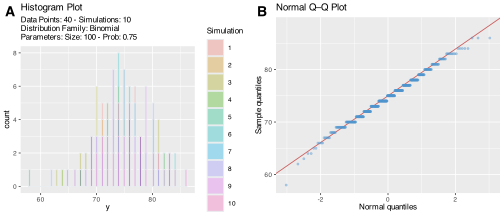](04-distributions-sampling-uncertainty_files/figure-html/fig-binomial-1.svg "Figure 1: Binomial distribution with 40 observations per simulation, 10 simulations, 100 trials, and p = 0.75. This could represent 10 separate germination experiments, each planting 100 seeds with a 75% germination probability. The Normal Q–Q plot reveals the characteristic staircase pattern of a discrete distribution and the mild right-skew: points curve away from the reference line at both ends.")

Figure 1: Binomial distribution with 40 observations per simulation, 10 simulations, 100 trials, and $p = 0.75$. This could represent 10 separate germination experiments, each planting 100 seeds with a 75% germination probability. The Normal Q–Q plot reveals the characteristic staircase pattern of a discrete distribution and the mild right-skew: points curve away from the reference line at both ends.

[Figure 1](#fig-binomial) A shows a near-symmetric, bell-shaped density centred around 75 successes out of 100 trials, consistent with the expected value $np = 100 \times 0.75 = 75$. The spread is modest, reflecting the relatively low variance $np(1-p) = 18.75$.

[Figure 1](#fig-binomial) B reveals the characteristic staircase pattern of a discrete distribution: instead of a smooth curve of points, they fall in horizontal bands corresponding to each integer value. Despite this discreteness, the points track the reference line closely across the bulk of the distribution, indicating that this near-symmetric Binomial is well approximated by a Normal. Minor departures at the tails reflect the finite support of the Binomial.

> **NOTE:**
>
> Each distribution figure in this chapter shows two panels side by side: a **density plot** on the left and a **Normal Q–Q plot** on the right. Together they reveal the shape of the distribution and how far it departs from normality.
>
> ------------------------------------------------------------------------
>
> **Panel A — Density Plot**
>
> This panel shows how values are spread along the x-axis.
>
> - The **x-axis** is the variable (*e.g.*, counts, waiting times, or proportions).
> - The **y-axis** is the probability density — how often values near a given point occur relative to others.
> - A single tall peak indicates that most values cluster around a central value.
> - A long tail to the right (right-skewed) or left (left-skewed) indicates that extreme values are more common in that direction.
> - Multiple lines correspond to independent simulations; if they overlap closely the distribution is stable across runs.
>
> ------------------------------------------------------------------------
>
> **Panel B — Normal Q–Q Plot**
>
> A **Quantile–Quantile plot** (Q–Q plot) compares the *quantiles* of the simulated data against the quantiles of a theoretical Normal distribution. It answers the question: *how closely does this distribution resemble a Normal?*
>
> - The **x-axis** shows the theoretical quantiles you would expect if the data were perfectly Normal.
> - The **y-axis** shows the actual quantiles observed in the simulated data.
> - If the data are approximately Normal, the points will lie along the diagonal reference line (shown in red).
> - Systematic departures from the line indicate non-normality:
>   - Points curving **upward at the right tail** indicate **right skewness** (more large values than a Normal would have).
>   - Points curving **downward at the left tail** indicate **left skewness**.
>   - Points diverging at **both tails** indicate **heavy tails** (more extreme values than a Normal).
>   - A nearly straight line indicates approximate normality, even if the underlying distribution is not Normal by construction.
>
> The Normal distribution is always the **reference** in these Q–Q plots. A distribution that plots as a straight line here can be treated as approximately Normal for the purposes of parametric inference.

In [Figure 1](#fig-binomial) A (density plot), we see a discrete distribution with a clear peak near the expected number of successes. Most values cluster tightly around this peak, with a slight extension toward higher values. This reflects repeated trials with a high success probability: most experiments produce similar counts, with moderate variability.

[Figure 1](#fig-binomial) B (Normal Q–Q plot) shows a stepped pattern rather than a smooth line. This arises because the data are discrete counts rather than continuous values. The mild curvature away from the reference line indicates slight skewness. As the number of trials increases, the points move closer to the line, reflecting that the Binomial becomes approximately Normal for large sample sizes.

So, the distribution is governed by repeated independent trials with fixed probability, producing clustered counts and approximate normality only at larger scales.

Note that both the Bernoulli and Binomial distributions assume independence between trials and a fixed, constant success probability, but in real ecological data these assumptions are not always fully met. I will revisit this in [Chapter 20](../../BCB744/basic_stats/20-generalised-linear-models.llms.md) when we discuss quasi-binomial models for overdispersed proportions.

> **IMPORTANT:**
>
> A marine biologist surveys 30 rock pools. In each pool, she records whether a sea urchin (*Parechinus angulosus*) is present (1) or absent (0). Suppose the true probability of presence is $p = 0.4$.
>
> 1.  What is the expected number of occupied pools? Calculate this by hand: $E(X) = np$.
> 2.  Simulate this scenario in R with `rbinom(1000, size = 30, prob = 0.4)`. Plot a histogram of the 1000 outcomes. Where does the histogram peak? Does it match your calculation?
> 3.  Now change `size` to 5 and then to 100. How does the shape of the distribution change?

## 2.4 The Poisson Distribution

> **NOTE:**
>
> **The Poisson distribution:**
>
> $$P(X = k) = \frac{e^{-\lambda} \lambda^k}{k!} \tag{3}$$
>
> $\lambda > 0$ is the mean rate of occurrence (events per unit time, area, or effort); $k = 0, 1, 2, \ldots$; $e \approx 2.718$ is Euler’s number; $k!$ is the factorial of $k$.
>
> **Mean:** $\mu = \lambda$\
> **Variance:** $\sigma^2 = \lambda$
>
> A defining feature of the Poisson: mean equals variance. When $\text{Var}(X) \gg \lambda$ in your data, the Poisson model is inadequate, use the Negative Binomial instead.

The Poisson distribution models the number of events or counts occurring in a fixed interval of time, area, or effort, given that:

1.  events or counts occur independently of one another,
2.  two events/counts cannot occur simultaneously,
3.  the average rate $\lambda$ is constant over the interval.

**Biological context.** The Poisson distribution arises from processes where events/counts are rare relative to the number of “opportunities” and are spatially or temporally independent:

- **Quadrat counts of randomly distributed organisms:** If individuals are scattered uniformly and randomly across a landscape (no aggregation, no repulsion), the count per quadrat follows a Poisson distribution. In practice, organisms are rarely perfectly random (some level of aggregation is more common), but Poisson remains the baseline model for count data.

- **Mutation rates:** The number of de novo mutations per genome per generation is approximately Poisson when mutations occur independently and at a constant low rate per base pair.

- **Rare events in time:** The number of disease outbreaks per year in a region, the number of storms exceeding a given intensity per decade, or the number of vertebrate extinctions per century are often Poisson-modelled when events are rare and independent.

- **Radioactive decay or photon counts:** In experimental biology, the number of photons detected per time interval in a fluorescence assay follows a Poisson distribution.

[Figure 2](#fig-poisson) shows the Poisson distribution for $\lambda = 2$, a plausible mean density for a moderately common invertebrate species per 1 m² quadrat.

Code

``` numberSource
pois <- tidy_poisson(.n = 50, .lambda = 2, .num_sims = 10)

pqq_pois <- ggplot(pois, aes(sample = y)) +
  stat_qq_line(colour = "indianred", linewidth = 0.4) +
  stat_qq(colour = "steelblue3", alpha = 0.4, size = 0.8) +
  labs(x = "Normal quantiles", y = "Sample quantiles",
       title = "Normal Q–Q Plot") +
  theme_grey(base_size = 8)

ggarrange(
  tidy_autoplot(pois, .plot_type = "density") + theme_grey(base_size = 8),
  pqq_pois,
  ncol = 2, nrow = 1, labels = "AUTO"
)
```

[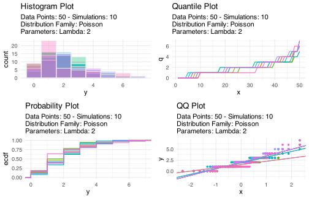](04-distributions-sampling-uncertainty_files/figure-html/fig-poisson-1.svg "Figure 2: Poisson distribution with 50 observations per simulation, 10 simulations, and \lambda = 2. This could represent the expected number of a particular invertebrate species per 1 m² quadrat in a habitat where the mean density is 2 individuals per quadrat.")

Figure 2: Poisson distribution with 50 observations per simulation, 10 simulations, and $\lambda = 2$. This could represent the expected number of a particular invertebrate species per 1 m² quadrat in a habitat where the mean density is 2 individuals per quadrat.

[Figure 2](#fig-poisson) A shows a strongly right-skewed distribution. Most observations are small counts (including zeros), with a rapid decline in frequency as counts increase. This reflects a process where events occur independently at a constant rate: low counts are common, high counts are rare.

In [Figure 2](#fig-poisson) B, we see clear curvature away from the Normal reference line, especially in the upper tail. This indicates that the distribution has more small values and fewer large values than a Normal would predict. The pattern reflects random events occurring in space or time at a constant rate; the strong skewness signals that a Normal model is inappropriate for such data.

## 2.5 The negative binomial distribution

> **NOTE:**
>
> **The Negative Binomial distribution:**
>
> $$P(X = k) = \binom{k + r - 1}{k} p^r (1-p)^k \tag{4}$$
>
> $r$ = number of successes before the experiment stops; $k$ = number of failures; $p$ = probability of success per trial. As a count model, $r$ is a dispersion parameter controlling how much the variance exceeds the mean.
>
> **Mean:** $\mu = \frac{r(1-p)}{p}$\
> **Variance:** $\sigma^2 = \frac{r(1-p)}{p^2}$
>
> Since $\sigma^2 > \mu$ always, the Negative Binomial accommodates **overdispersion**, which is the single most common feature of ecological count data.

In ecology, the Negative Binomial is best understood as a Poisson distribution whose rate parameter $\lambda$ itself varies randomly across observations. When some individuals or patches are intrinsically more likely to accumulate events than others (because of unmeasured heterogeneity), counts become more variable than Poisson. This is called **overdispersion**.

**Biological context.** Overdispersed counts are the rule, not the exception, in field biology:

- **Parasite loads:** Most host individuals carry few or no parasites, while a small number carry very large parasite burdens. This pattern of “aggregation” (*i.e.*, the excess of zeros and a long right tail) is characteristic of the Negative Binomial. The vast majority of helminths, ectoparasites, and pathogens follow this distribution in their hosts.

- **Plant seed bank counts:** Seeds in the soil are clumped near parent plants and in microhabitats that favour retention. Counts per soil core are thus overdispersed relative to Poisson.

- **Insect counts per plant:** Many insect species aggregate on certain host plants due to patch quality, host chemistry, or conspecific attraction. Counts per plant show far more variation than a Poisson model would predict.

- **Gene expression counts in RNA-seq:** Read counts per gene per sample exhibit overdispersion due to biological variability between individuals and makes the Negative Binomial the standard model for RNA-seq differential expression analysis.

[Figure 3](#fig-negbinom) illustrates the characteristic long right tail of the Negative Binomial, reflecting the typical pattern of overdispersed ecological count data.

Code

``` numberSource
negbinom <- tidy_negative_binomial(.n = 50, .size = 5, .prob = 0.7, .num_sims = 10)

pqq_nb <- ggplot(negbinom, aes(sample = y)) +
  stat_qq_line(colour = "indianred", linewidth = 0.4) +
  stat_qq(colour = "steelblue3", alpha = 0.4, size = 0.8) +
  labs(x = "Normal quantiles", y = "Sample quantiles",
       title = "Normal Q–Q Plot") +
  theme_grey(base_size = 8)

ggarrange(
  tidy_autoplot(negbinom, .plot_type = "density") + theme_grey(base_size = 8),
  pqq_nb,
  ncol = 2, nrow = 1, labels = "AUTO"
)
```

[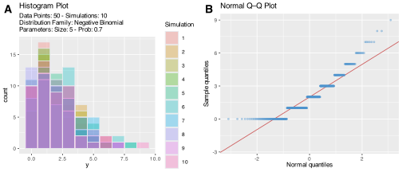](04-distributions-sampling-uncertainty_files/figure-html/fig-negbinom-1.svg "Figure 3: Negative Binomial distribution with 50 observations per simulation, 10 simulations, size parameter r = 5, and p = 0.7. The long right tail reflects the typical pattern of overdispersed ecological count data.")

Figure 3: Negative Binomial distribution with 50 observations per simulation, 10 simulations, size parameter $r = 5$, and $p = 0.7$. The long right tail reflects the typical pattern of overdispersed ecological count data.

[Figure 3](#fig-negbinom) A shows a right-skewed distribution with a longer tail than the Poisson. Many observations are small, but there are more large values than expected under a Poisson process and this indicates aggregation. So, some observations accumulate far more counts than others.

[Figure 3](#fig-negbinom) B shows obvious deviation from the Normal reference line, especially in the upper tail. The spread of points indicates substantial variability beyond what a Normal model would capture and this is consistent with heterogeneous processes where some locations or individuals have higher underlying rates. This is called overdispersion, and it is a property of ecological data.

## 2.6 The geometric distribution

> **NOTE:**
>
> **The Geometric distribution:**
>
> $$P(X = k) = p(1-p)^k \tag{5}$$
>
> $k$ = number of failures before the first success; $p$ = probability of success per trial.
>
> **Mean:** $\mu = \frac{1-p}{p}$\
> **Variance:** $\sigma^2 = \frac{1-p}{p^2}$
>
> The Geometric distribution is a special case of the Negative Binomial with $r = 1$: the number of failures before achieving a *single* success.

The Geometric distribution models the number of failures that occur before the first success in a sequence of independent Bernoulli trials. It is a “waiting time” distribution in the discrete setting.

**Biological context.** The Geometric distribution applies whenever we want to know how many unsuccessful trials we will need to endure before the first success:

- **Rare species detection:** An ecologist surveys forest patches one at a time, searching for evidence of a rare mammal. If the probability of detecting the species in any single patch is $p = 0.15$, the number of patches visited before the first detection follows a Geometric distribution.

- **Pathogen screening:** A scientist tests animals from a herd for a particular infection. If prevalence is 10%, the number of negative tests before the first positive is Geometrically distributed. This information can inform decisions about how many animals need screening.

- **Breeding success:** If a bird pair has probability $p$ of successfully fledging at least one chick per breeding attempt, the number of failed attempts before their first success follows a Geometric distribution.

[Figure 4](#fig-geom) shows the Geometric distribution for $p = 0.7$.

Code

``` numberSource
geom <- tidy_geometric(.n = 50, .prob = 0.7, .num_sims = 10)

pqq_geom <- ggplot(geom, aes(sample = y)) +
  stat_qq_line(colour = "indianred", linewidth = 0.4) +
  stat_qq(colour = "steelblue3", alpha = 0.4, size = 0.8) +
  labs(x = "Normal quantiles", y = "Sample quantiles",
       title = "Normal Q–Q Plot") +
  theme_grey(base_size = 8)

ggarrange(
  tidy_autoplot(geom, .plot_type = "density") + theme_grey(base_size = 8),
  pqq_geom,
  ncol = 2, nrow = 1, labels = "AUTO"
)
```

[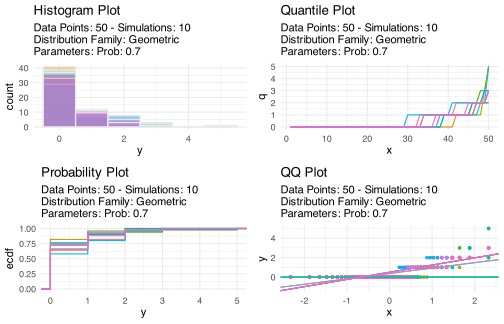](04-distributions-sampling-uncertainty_files/figure-html/fig-geom-1.svg "Figure 4: Geometric distribution with 50 observations per simulation, 10 simulations, and p = 0.7. Most observations cluster near zero (few failures before success), but the long tail captures the occasional run of bad luck.")

Figure 4: Geometric distribution with 50 observations per simulation, 10 simulations, and $p = 0.7$. Most observations cluster near zero (few failures before success), but the long tail captures the occasional run of bad luck.

We see in [Figure 4](#fig-geom) A a sharp concentration of values near zero, but with frequencies dropping quickly as values increase. This indicates that success typically occurs after few failures, but occasional long sequences of failures still occur.

[Figure 4](#fig-geom) B shows strong curvature away from the Normal reference line, which confirms that the distribution is highly skewed with a long right tail. Success often occurs quickly, but infrequent long waits are possible. So, these long waits pull the upper tail far beyond what any Normal model would predict.

# 3 Continuous distributions

Continuous random variables can take any value within a range, and their distributions are described by **probability density functions (PDFs)** rather than probability mass functions. For a continuous variable, $P(X = x) = 0$ for any single point $x$; instead, we work with probabilities over intervals: $P(a \leq X \leq b) = \int_a^b f(x)\,dx$.

## 3.1 The normal distribution

> **NOTE:**
>
> **The Normal distribution:**
>
> $$f(x) = \frac{1}{\sigma\sqrt{2\pi}} \exp\!\left(-\frac{1}{2}\left(\frac{x - \mu}{\sigma}\right)^2\right) \tag{6}$$
>
> $\mu$ = mean (location); $\sigma$ = standard deviation (scale); $\sigma^2$ = variance.
>
> **Support:** $(-\infty, +\infty)$\
> **Symmetric** around $\mu$; tails thin out rapidly.
>
> **Rule of thumb:** approximately 68%, 95%, and 99.7% of observations fall within 1, 2, and 3 standard deviations of the mean, respectively.

> **NOTE:**
>
> [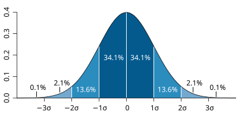](../../images/Standard_deviation_diagram.svg "Figure 5: The idealised Normal distribution showing the proportion of data within 1, 2, and 3 SDs from the mean.")
>
> Figure 5: The idealised Normal distribution showing the proportion of data within 1, 2, and 3 SDs from the mean.

The Normal distribution is the most widely used distribution (and the most desired!) in statistics. The **central limit theorem** (see below) guarantees that averages of large samples tend toward normality regardless of the underlying distribution. It is characterised by its bell shape, perfect symmetry around the mean, and the fact that the mean, median, and mode all coincide (see [Figure 5](#fig-expectednormal) for the idealised proportions).

**Biological context.** The Normal distribution arises from processes where many small, independent factors contribute additively to the outcome:

- **Morphological traits:** Body length, leaf area, wing span, and shell diameter in natural populations are often approximately normally distributed. Each individual’s phenotype is the product of many small genetic and environmental contributions adding together. By the central limit theorem, this additive structure produces approximate normality.

- **Measurement error:** Repeated measurements of the same object differ due to instrument noise and small random errors. These differences are approximately normally distributed around the true value.

- **Physiological variables:** Resting heart rate, core body temperature, and blood oxygen levels in a population of healthy individuals tend to cluster symmetrically around a species-typical mean.

- **Residuals in linear models:** Even when the raw data are not normal, the residuals from a well-specified linear model often are, satisfying a key assumption for inference.

[Figure 6](#fig-normal) shows five simulations of the standard normal ($\mu = 0$, $\sigma = 1$).

Code

``` numberSource
norm <- tidy_normal(.n = 100, .num_sims = 5)

pqq_norm <- ggplot(norm, aes(sample = y)) +
  stat_qq_line(colour = "indianred", linewidth = 0.4) +
  stat_qq(colour = "steelblue3", alpha = 0.4, size = 0.8) +
  labs(x = "Normal quantiles", y = "Sample quantiles",
       title = "Normal Q–Q Plot") +
  theme_grey(base_size = 8)

ggarrange(
  tidy_autoplot(norm, .plot_type = "density") + theme_grey(base_size = 8),
  pqq_norm,
  ncol = 2, nrow = 1, labels = "AUTO"
)
```

[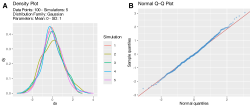](04-distributions-sampling-uncertainty_files/figure-html/fig-normal-1.svg "Figure 6: Normal distribution with 100 observations per simulation and 5 simulations (\mu = 0, \sigma = 1, i.e. the standard normal). In practice, biological variables will have different means and standard deviations, but the symmetric bell shape will be the same. The Q–Q plot points follow the reference line closely, confirming normality.")

Figure 6: Normal distribution with 100 observations per simulation and 5 simulations ($\mu = 0$, $\sigma = 1$, i.e. the standard normal). In practice, biological variables will have different means and standard deviations, but the symmetric bell shape will be the same. The Q–Q plot points follow the reference line closely, confirming normality.

In [Figure 6](#fig-normal) A we see a symmetric, bell-shaped distribution centred around zero. Values are evenly distributed on both sides, with fewer observations in the tails. Multiple simulations overlap closely, which indicates a stable, well-behaved distribution.

[Figure 6](#fig-normal) B shows points lying almost exactly along the reference line. This is what normality looks like. Points track the diagonal smoothly from lower-left to upper-right, with only minor scatter at the extremes. This is the reference pattern against which all other Q–Q plots in this chapter should be compared.

> **NOTE:**
>
> The **central limit theorem (CLT)** states that the sampling distribution of the mean of $n$ independent, identically distributed observations approaches a Normal distribution as $n \to \infty$, regardless of the shape of the underlying population distribution. Three conditions must hold:
>
> - Observations must be **independent**: one observation must not influence another.
> - Observations must come from the **same distribution** with the same finite mean and variance.
> - Sample size must be **sufficiently large**: a common rule of thumb is $n \geq 30$, though heavily skewed or heavy-tailed populations require larger samples.
>
> The CLT is why Normal-based tests and confidence intervals work reasonably well in many practical situations, because we are relying on the behaviour of sample means, not the raw data. It also explains why checking normality of *residuals* matters more than checking normality of the raw response variable in most regression contexts.

> **IMPORTANT:**
>
> Generate 200 observations from a Normal distribution with mean 50 and SD 10 (`rnorm(200, mean = 50, sd = 10)`). Then:
>
> 1.  Compute the mean and median. Are they close? They should be — why?
> 2.  Compute the proportion of observations that fall within 1, 2, and 3 SDs of the mean. Compare to the 68–95–99.7 rule.
> 3.  Make a Q-Q plot ([`qqnorm(); qqline()`](https://rdrr.io/r/stats/qqnorm.html)). Do the points follow the reference line?

## 3.2 The Log-Normal Distribution

> **NOTE:**
>
> **The Log-Normal distribution:**
>
> $$f(x) = \frac{1}{x\sigma\sqrt{2\pi}} \exp\!\left(-\frac{(\ln x - \mu)^2}{2\sigma^2}\right) \tag{7}$$
>
> $\mu$ = mean of $\ln(X)$; $\sigma$ = SD of $\ln(X)$.
>
> **Support:** $(0, +\infty)$\
> **Right-skewed** for most parameter values.
>
> If $X$ is log-normally distributed, then $Y = \ln(X)$ is normally distributed.

If a variable is the product of many small, independent, positive multiplicative factors rather than additive ones, its distribution will be log-normal rather than normal. The log-normal is always positive, always right-skewed, and produces the characteristic pattern of many small values with a long right tail.

**Biological context.** Multiplicative processes occur very frequently in biology and ecology:

- **Body mass and biomass:** Growth over time is fundamentally multiplicative (proportional growth rates), producing right-skewed size distributions. Log-transformation typically normalises mammal body masses across species.

- **Chlorophyll-*a* concentration and phytoplankton biomass:** Nutrient availability, light, temperature, and grazing all interact multiplicatively, producing log-normally distributed algal biomass in lakes and coastal waters. This is why water quality monitoring data are routinely log-transformed.

- **Species abundance distributions:** In most communities, many species are rare (small populations) and a few are very common. Across a community, species abundance values are approximately log-normally distributed.

- **Latency times for diseases:** The incubation periods of many infectious diseases, which depend on multiplicative amplification of pathogens within a host, are log-normally distributed.

[Figure 7](#fig-lognormal) shows the characteristic right-skewed shape of the Log-Normal.

Code

``` numberSource
lnorm <- tidy_lognormal(.n = 100, .meanlog = 0, .sdlog = 0.5, .num_sims = 5)

pqq_ln <- ggplot(lnorm, aes(sample = y)) +
  stat_qq_line(colour = "indianred", linewidth = 0.4) +
  stat_qq(colour = "steelblue3", alpha = 0.4, size = 0.8) +
  labs(x = "Normal quantiles", y = "Sample quantiles",
       title = "Normal Q–Q Plot") +
  theme_grey(base_size = 8)

ggarrange(
  tidy_autoplot(lnorm, .plot_type = "density") + theme_grey(base_size = 8),
  pqq_ln,
  ncol = 2, nrow = 1, labels = "AUTO"
)
```

[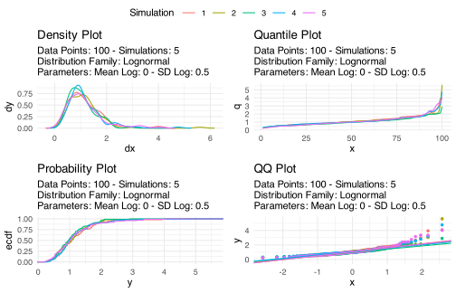](04-distributions-sampling-uncertainty_files/figure-html/fig-lognormal-1.svg "Figure 7: Log-Normal distribution with 100 observations per simulation and 5 simulations (\mu = 0, \sigma = 0.5). The strong right skew in the density plot is echoed by the upward curve of Q–Q points away from the reference line in the upper tail. On a log scale, this distribution becomes Normal.")

Figure 7: Log-Normal distribution with 100 observations per simulation and 5 simulations ($\mu = 0$, $\sigma = 0.5$). The strong right skew in the density plot is echoed by the upward curve of Q–Q points away from the reference line in the upper tail. On a log scale, this distribution becomes Normal.

In [Figure 7](#fig-lognormal) A, we see a strongly right-skewed distribution. There are many small values cluster near zero while a long tail of large values extends to the right. This is typical of multiplicative biological processes such as body mass or chlorophyll-*a* concentration.

In the Normal-QQ plot, seen in [Figure 7](#fig-lognormal) B, there is a clear upward curvature in the upper tail. Large observed values far exceed what a Normal distribution would predict. The left tail falls below the reference line to produce the characteristic S-shape of a positively skewed distribution. Log-transforming the data would collapse this curvature and bring the points onto the reference line.

## 3.3 The gamma distribution

> **NOTE:**
>
> **The Gamma distribution:**
>
> $$f(x) = \frac{x^{\alpha-1} e^{-x/\beta}}{\beta^\alpha \Gamma(\alpha)} \tag{8}$$
>
> $\alpha > 0$ = shape parameter; $\beta > 0$ = scale parameter; $\Gamma(\alpha)$ is the gamma function (a generalisation of the factorial).
>
> **Support:** $(0, +\infty)$\
> **Mean:** $\mu = \alpha\beta$\
> **Variance:** $\sigma^2 = \alpha\beta^2$
>
> When $\alpha = 1$, the Gamma reduces to the Exponential distribution.

The Gamma distribution is a flexible two-parameter family for positive, right-skewed continuous variables. It is the natural model for quantities that represent accumulated waiting times or the sum of independent exponential random variables. The shape parameter $\alpha$ controls the degree of skewness, so as $\alpha$ increases, the distribution becomes more symmetric and approaches a Normal.

**Biological context.**

- **Time until death or recovery:** In survival analysis, the time from infection to death or recovery is often modelled with a Gamma distribution, especially when the hazard rate is not constant.

- **Precipitation and environmental data:** The amount of rainfall per month or per event, and many other right-skewed environmental variables, are frequently modelled with a Gamma distribution.

- **Enzyme kinetics:** The time for an enzyme to complete a catalytic cycle can be modelled as the sum of several Exponential waiting times, giving a Gamma distribution.

- **Individual resource acquisition:** The amount of food ingested or energy harvested per foraging bout, which is always positive and right-skewed, is often Gamma-distributed.

[Figure 8](#fig-gamma) shows the Gamma distribution with shape $\alpha = 1$ (equivalent to an Exponential). Increasing $\alpha$ shifts mass to the right and progressively reduces skewness toward a symmetric, bell-shaped form.

Code

``` numberSource
gam <- tidy_gamma(.n = 100, .shape = 1, .scale = 0.4, .num_sims = 5)

pqq_gam <- ggplot(gam, aes(sample = y)) +
  stat_qq_line(colour = "indianred", linewidth = 0.4) +
  stat_qq(colour = "steelblue3", alpha = 0.4, size = 0.8) +
  labs(x = "Normal quantiles", y = "Sample quantiles",
       title = "Normal Q–Q Plot") +
  theme_grey(base_size = 8)

ggarrange(
  tidy_autoplot(gam, .plot_type = "density") + theme_grey(base_size = 8),
  pqq_gam,
  ncol = 2, nrow = 1, labels = "AUTO"
)
```

[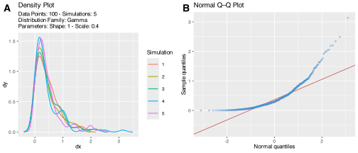](04-distributions-sampling-uncertainty_files/figure-html/fig-gamma-1.svg "Figure 8: Gamma distribution with 100 observations per simulation, 5 simulations, shape \alpha = 1, and scale \beta = 0.4. With \alpha = 1, this reduces to an Exponential distribution. Increasing \alpha shifts the mass rightward and reduces skewness. The Q–Q plot shows the pronounced right-skew departure from normality.")

Figure 8: Gamma distribution with 100 observations per simulation, 5 simulations, shape $\alpha = 1$, and scale $\beta = 0.4$. With $\alpha = 1$, this reduces to an Exponential distribution. Increasing $\alpha$ shifts the mass rightward and reduces skewness. The Q–Q plot shows the pronounced right-skew departure from normality.

We see in [Figure 8](#fig-gamma) A a right-skewed distribution: with $\alpha = 1$, most observations are near small values, with a gradual decline toward larger values. This is identical to the Exponential shape.

[Figure 8](#fig-gamma) B shows consistent deviation from the Normal line, especially in the upper range. The upward curvature confirms positive skewness. As the shape parameter $\alpha$ increases, this curvature would progressively straighten, and the Q–Q plot would approach the reference line.

## 3.4 The exponential distribution

> **NOTE:**
>
> **The Exponential distribution:**
>
> $$f(x) = \lambda e^{-\lambda x} \tag{9}$$
>
> $\lambda > 0$ = rate parameter (events per unit time).
>
> **Support:** $[0, +\infty)$\
> **Mean:** $\mu = \frac{1}{\lambda}$\
> **Variance:** $\sigma^2 = \frac{1}{\lambda^2}$
>
> **Key property:** memorylessness — the probability of waiting an additional time $t$ does not depend on how long you have already waited.

The Exponential distribution models the time between successive events in a Poisson process. It is the only continuous distribution with the memoryless property, meaning past waiting time gives no information about future waiting time.

**Biological context.**

- **Inter-arrival times on camera traps:** If wildlife move through a survey area according to a Poisson process (independently, at a constant rate), the time between successive detections of the same species follows an Exponential distribution.

- **Radioactive decay:** The time until a single radioactive atom decays is exponentially distributed. This principle underlies radiometric dating used in palaeontology and geochronology.

- **Pathogen transmission:** In simple epidemic models (SIR models), the time from infection to becoming infectious is often modelled as Exponential, corresponding to a constant per-unit-time probability of progressing to the infectious stage.

- **Lifespan under constant hazard:** If an organism faces a constant per-unit-time mortality risk (*e.g.*, random predation), its lifespan is exponentially distributed. Most real organisms do not have constant hazard (risk increases with age), so the Weibull or Gamma is more realistic, but the Exponential serves as the simplest baseline.

[Figure 9](#fig-exp) shows the steep decline from zero that is the hallmark of the Exponential.

Code

``` numberSource
expon <- tidy_exponential(.n = 100, .rate = 1, .num_sims = 5)

pqq_exp <- ggplot(expon, aes(sample = y)) +
  stat_qq_line(colour = "indianred", linewidth = 0.4) +
  stat_qq(colour = "steelblue3", alpha = 0.4, size = 0.8) +
  labs(x = "Normal quantiles", y = "Sample quantiles",
       title = "Normal Q–Q Plot") +
  theme_grey(base_size = 8)

ggarrange(
  tidy_autoplot(expon, .plot_type = "density") + theme_grey(base_size = 8),
  pqq_exp,
  ncol = 2, nrow = 1, labels = "AUTO"
)
```

[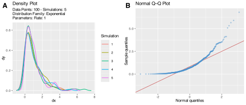](04-distributions-sampling-uncertainty_files/figure-html/fig-exp-1.svg "Figure 9: Exponential distribution with 100 observations per simulation, 5 simulations, and rate \lambda = 1. The steep decline from zero reflects the high probability of short waiting times and the low probability of long ones. The Q–Q plot curves strongly upward, indicating heavy right skewness.")

Figure 9: Exponential distribution with 100 observations per simulation, 5 simulations, and rate $\lambda = 1$. The steep decline from zero reflects the high probability of short waiting times and the low probability of long ones. The Q–Q plot curves strongly upward, indicating heavy right skewness.

[Figure 9](#fig-exp) A shows a steep drop from zero, with most values very small and few large values. This indicates that short waiting times are common and long waiting times are rare. This is a direct consequence of the memoryless property.

In [Figure 9](#fig-exp) B you can see a strong upward curvature away from the Normal line, reflecting extreme right skewness. The departure is among the most pronounced of any distribution in this chapter, reflecting the single-parameter simplicity of the Exponential and its inability to produce anything close to symmetric variation. The lack of symmetry shows that Normal-based methods are unsuitable for raw data of this form.

## 3.5 The beta distribution

> **NOTE:**
>
> **The Beta distribution:**
>
> $$f(x) = \frac{x^{\alpha-1}(1-x)^{\beta-1}}{B(\alpha, \beta)} \tag{10}$$
>
> $\alpha, \beta > 0$ are shape parameters; $B(\alpha, \beta)$ is the beta function.
>
> **Support:** $[0, 1]$\
> **Mean:** $\mu = \frac{\alpha}{\alpha + \beta}$\
> **Variance:** $\sigma^2 = \frac{\alpha\beta}{(\alpha+\beta)^2(\alpha+\beta+1)}$
>
> When $\alpha = \beta = 1$, the Beta distribution is Uniform on $[0, 1]$. When $\alpha = \beta > 1$, it is symmetric and bell-shaped around 0.5.

The Beta distribution is the natural distribution for proportions and probabilities, so this includes any variable strictly bounded between 0 and 1. Unlike the Normal, it can take a wide variety of shapes depending on its two parameters. These include U-shaped, J-shaped, bell-shaped, or uniform, and they are therefore quite flexible.

**Biological context.**

- **Vegetation cover:** Percentage vegetation cover per quadrat is a proportion and cannot be below 0% or above 100%. Beta regression, which uses the Beta distribution as the response distribution, is the appropriate model for cover data.

- **Dietary composition:** The proportion of a predator’s diet comprised by a particular prey type is bounded between 0 and 1 and is well-modelled by a Beta distribution.

- **Allele frequencies:** The frequency of a particular allele in a population is a proportion and, under neutral drift in a finite population, follows a Beta distribution (the Beta being the stationary distribution of the Wright-Fisher diffusion).

- **Survival and detection probabilities:** In mark-recapture models, detection probabilities and apparent survival rates are bounded in $[0, 1]$ and are typically modelled with Beta priors in a Bayesian framework.

[Figure 10](#fig-beta) shows a right-skewed Beta ($\alpha = 2$, $\beta = 5$).

Code

``` numberSource
bet <- tidy_beta(.n = 100, .shape1 = 2, .shape2 = 5, .ncp = 0, .num_sims = 5)

pqq_bet <- ggplot(bet, aes(sample = y)) +
  stat_qq_line(colour = "indianred", linewidth = 0.4) +
  stat_qq(colour = "steelblue3", alpha = 0.4, size = 0.8) +
  labs(x = "Normal quantiles", y = "Sample quantiles",
       title = "Normal Q–Q Plot") +
  theme_grey(base_size = 8)

ggarrange(
  tidy_autoplot(bet, .plot_type = "density") + theme_grey(base_size = 8),
  pqq_bet,
  ncol = 2, nrow = 1, labels = "AUTO"
)
```

[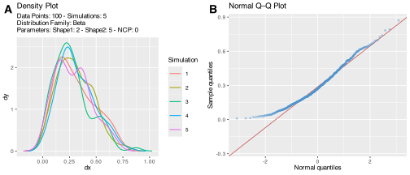](04-distributions-sampling-uncertainty_files/figure-html/fig-beta-1.svg "Figure 10: Beta distribution with 100 observations per simulation, 5 simulations, \alpha = 2, and \beta = 5. This right-skewed shape on the [0,1] interval could represent, for example, occupancy probabilities for a moderately rare species across a set of habitat patches. The Q–Q plot shows moderate departure from normality in the upper tail.")

Figure 10: Beta distribution with 100 observations per simulation, 5 simulations, $\alpha = 2$, and $\beta = 5$. This right-skewed shape on the $[0,1]$ interval could represent, for example, occupancy probabilities for a moderately rare species across a set of habitat patches. The Q–Q plot shows moderate departure from normality in the upper tail.

[Figure 10](#fig-beta) A shows a distribution confined strictly between 0 and 1, with most values concentrated below 0.5, which is consistent with a detection probability that is more often low than high. The bounded support is a important and defining feature. So, unlike the Normal, the Beta cannot produce values outside $[0, 1]$.

[Figure 10](#fig-beta) B shows deviation from the Normal line, particularly in the upper range. This reflects both the mild right skew and the bounded support. The departure is more moderate than for the Exponential or Log-Normal and illustrates that not all non-normal distributions are equally far from normality.

# 4 Identifying your data’s distribution

Traditionally, visualising the data with a histogram, empirical density, empirical CDF, and QQ plot together gives the most comprehensive picture ([Figure 11](#fig-dist-diagnostics)). The QQ plot is especially revealing, because if the data come from the reference distribution, the points should fall on the 45° diagonal line.

Code

``` numberSource
set.seed(123)
y <- rnorm(n = 200, mean = 13, sd = 2)
old_par <- par(mfrow = c(2, 2), mar = c(4, 4, 2, 1))
hist(y,          main = "Histogram",             xlab = "y")
plot(density(y), main = "Kernel density",        xlab = "y")
plot(ecdf(y),    main = "Empirical CDF",         xlab = "y")
z <- (y - mean(y)) / sd(y)
qqnorm(z, main = "Normal QQ plot"); abline(0, 1, col = "red")
par(old_par)
```

[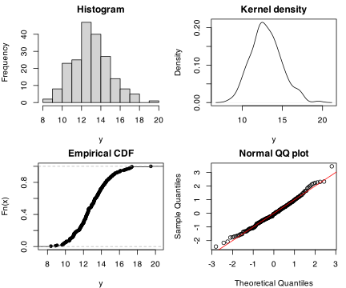](04-distributions-sampling-uncertainty_files/figure-html/fig-dist-diagnostics-1.svg "Figure 11: Four-panel diagnostics for 200 normally distributed observations: histogram, kernel density estimate, empirical CDF, and Normal QQ plot. The close adherence to the 45° line in the QQ plot confirms approximate normality.")

Figure 11: Four-panel diagnostics for 200 normally distributed observations: histogram, kernel density estimate, empirical CDF, and Normal QQ plot. The close adherence to the 45° line in the QQ plot confirms approximate normality.

The red 45° line marks where points should fall if the data are normal. Systematic departures from the line (such as S-curves indicating heavy or light tails, J-curves indicating skew) point toward alternative distributions.

Here is a practical decision guide to finding your data’s distribution. It combines your expert knowledge about the biological process that generated your data with the numerical and visual properties:

**Step 1. Identify the support**

Eliminate the inappropriate candidates:

- integers only → discrete
- strictly positive → Gamma / Log-normal candidates
- bounded \[0,1\] → Beta
- unbounded → Normal candidate

**Step 2. Identify the process**

Most importantly, map the variable to a mechanism:

- counts of independent events → Poisson
- counts with aggregation → Negative Binomial
- repeated success/failure → Binomial
- waiting times → Exponential / Gamma
- multiplicative growth → Log-normal
- additive effects → Normal

**Step 3. Check shape visually**

Use histogram and Q–Q:

- symmetric → Normal plausible
- right-skewed → Gamma / Log-normal
- heavy tails → consider transformations or alternative families
- many zeros → consider zero-inflation or count models

**Step 4. Compare mean–variance relationship (for counts)**

- Poisson: mean ≈ variance
- Negative Binomial: variance \> mean

**Step 5. Consider transformation vs model**

Transform your data to change the scale of the model, if required:

- log-transform → tests whether Log-normal is appropriate
- square-root → stabilises variance in counts

**Step 6. Treat models as approximations**

- no real dataset follows a distribution exactly,
- the goal is compatibility, not exact match.

> **IMPORTANT:**
>
> Select your favourite three conitnuous variables in the BCB7342 field trip set of data.
>
> For each one, identify: (1) whether it is discrete or continuous, (2) what biological process generates it, (3) which distribution from this chapter most plausibly describes it (use visualisations + summary statistics), and (4) what would make that distribution choice wrong (*e.g.*, overdispersion, bounded range, always positive). Share your choices with a partner and see if you agree.
>
> Write up your findings and include them in your Progress Portfolio.

# 5 Inference-related distributions

Three continuous distributions arise primarily in hypothesis testing and confidence interval construction rather than as direct models of biological data-generating processes. You will encounter all three in later chapters, but a short introduction is useful here.

**The Student *t*-distribution** arises when estimating the mean of a normally distributed population with an unknown variance from a small sample. It has heavier tails than the Normal, reflecting increased uncertainty from small samples. As sample size grows, the $t$-distribution converges to the Normal. We use it in [Chapter 7](../../BCB744/basic_stats/07-t_tests.llms.md) for one- and two-sample $t$-tests and in regression to test whether coefficients differ from zero.

**The Chi-squared (**$\chi^2$) distribution is the sum of the squares of $\nu$ independent standard Normal variables. It arises in tests of categorical data ([Chapter 7](../../BCB744/basic_stats/07-t_tests.llms.md)), in comparing variances, and in model goodness-of-fit tests. It is always positive and right-skewed.

**The *F*-distribution** is the ratio of two independent chi-squared variables divided by their degrees of freedom. It arises in ANOVA ([Chapter 8](../../BCB744/basic_stats/08-anova.llms.md)), where we compare a ratio of variances (mean squares) to test whether group means differ. It also appears in the overall $F$-test of regression models.

None of these three distributions is typically used to model raw biological data; they are the theoretical distributions of test statistics under null hypotheses.

# 6 Sampling-level thinking

## 6.1 Samples, populations, and sampling variation

Everything covered so far describes variation in the observed data themselves. Now, instead of asking how individual measurements vary, I ask how a quantity calculated from those measurements (for example, a sample mean, a proportion, a regression slope) varies when we imagine repeating the study many times. This distinction between the variability of raw observations and the variability of derived estimates is what makes statistical inference possible.

Statistical inference depends on the fact that we almost always observe a **sample** rather than the full **population**. Different samples from the same population will differ from one another. This is **sampling variation**, and it is a fact of nature. If we repeatedly sampled the same population and calculated the sample mean each time, those means would themselves form a distribution; this is the **sampling distribution of the mean**.

This distinction matters greatly:

- The **data distribution** describes the values of individual observations.
- The **sampling distribution** describes the values of a statistic (*e.g.*, the mean) across many hypothetical repeated samples.

Most misunderstandings about *p*-values and confidence intervals arise from confusing these two distributions.

## 6.2 The central limit theorem

The **central limit theorem (CLT)** says that the sampling distribution of the sample mean tends toward normality as sample size increases, even when the underlying data are not normal. [Figure 12](#fig-clt) demonstrates this nicely: the underlying population is strongly right-skewed (a Gamma distribution), yet the distribution of sample means becomes progressively more symmetric and bell-shaped as $n$ grows.

Code

``` numberSource
set.seed(42)
population <- tibble(x = rgamma(100000, shape = 2, rate = 1))

simulate_means <- function(sample_n, reps = 4000) {
  set.seed(42)
  tibble(
    n = paste("n =", sample_n),
    mean_x = replicate(reps, mean(sample(population$x, size = sample_n)))
  )
}

bind_rows(
  simulate_means(2),
  simulate_means(5),
  simulate_means(25),
  simulate_means(99)
) |>
  mutate(n = factor(n, levels = c("n = 2", "n = 5", "n = 25", "n = 99"))) |>
  ggplot(aes(x = mean_x)) +
  geom_histogram(bins = 30, fill = "salmon", colour = "white") +
  facet_wrap(~n, scales = "free_y") +
  labs(x = "Sample mean", y = "Count")
```

[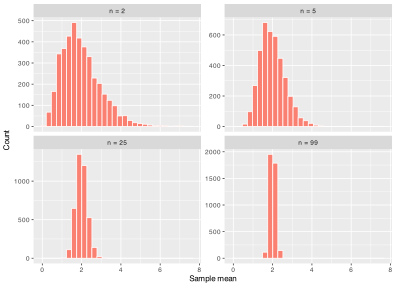](04-distributions-sampling-uncertainty_files/figure-html/fig-clt-1.svg "Figure 12: A simulation demonstrating the central limit theorem. The underlying population is strongly right-skewed (Gamma distribution), yet the sampling distribution of the sample mean becomes increasingly normal as sample size grows from n = 2 to n = 99.")

Figure 12: A simulation demonstrating the central limit theorem. The underlying population is strongly right-skewed (Gamma distribution), yet the sampling distribution of the sample mean becomes increasingly normal as sample size grows from $n = 2$ to $n = 99$.

The CLT is why Normal-based tests work well for means even when raw data are skewed. The important idea is whether the *mean* is approximately normally distributed, not whether the raw data are. Poor experimental design, extreme skewness in very small samples, and non-independence between observations remain real problems that the CLT cannot rescue.

## 6.3 Standard error

The **standard deviation** (SD) describes variability among individual observations in a sample. The **standard error** (SE) describes variability in an estimate (such as the sample mean) across repeated samples.

For the sample mean:

$$SE_{\bar{x}} = \frac{SD}{\sqrt{n}}$$

As sample size $n$ increases, the standard error decreases proportionally to $1/\sqrt{n}$. So, doubling your sample size reduces the SE by a factor of $\sqrt{2} \approx 1.41$. This formalises the intuitive idea that larger samples produce more precise estimates. The SE is not a property of the raw data; it is a property of the estimation procedure.

–\>

## 6.4 Confidence Intervals

A **confidence interval (CI)** gives a range of plausible values for an unknown population parameter. The frequentist interpretation of a 95% CI is precise but often misunderstood: if we were to repeat the same sampling procedure many times and calculate a 95% CI each time, approximately 95% of those intervals would contain the true parameter. The interval either does or does not contain the true value, so the “95%” is a statement about the long-run behaviour of the procedure.

Confidence intervals are more informative than bare *p*-values because they reveal:

- the **scale** of the effect (is the difference biologically meaningful?);
- the **precision** of the estimate (is the interval narrow or wide?);
- **whether biologically important values remain plausible** (does the interval include zero? does it include the value that would matter for management?).

A simple example computing a CI for a small sample:

``` numberSource
x <- c(12.1, 11.8, 12.4, 12.0, 11.9, 12.3, 12.2, 11.7)

n      <- length(x)
mean_x <- mean(x)
sd_x   <- sd(x)
se_x   <- sd_x / sqrt(n)
t_crit <- qt(0.975, df = n - 1)  # two-sided 95% CI uses 97.5th percentile

tibble(
  n      = n,
  mean   = round(mean_x, 3),
  sd     = round(sd_x,   3),
  se     = round(se_x,   3),
  ci_low  = round(mean_x - t_crit * se_x, 3),
  ci_high = round(mean_x + t_crit * se_x, 3)
)
```

    R> # A tibble: 1 × 6
    R>       n  mean    sd    se ci_low ci_high
    R>   <int> <dbl> <dbl> <dbl>  <dbl>   <dbl>
    R> 1     8  12.0 0.245 0.087   11.8    12.3

Read the estimate and its interval together: the mean locates the result while the CI conveys its precision.

# 7 Linking distributions to later chapters

Understanding distributions sits at the junction between data description and formal inference:

- [Chapter 2](../../BCB744/basic_stats/02-summarise-and-describe.llms.md) and [Chapter 3](../../BCB744/basic_stats/03-visualise.llms.md) describe what the data look like numerically and graphically.
- This chapter adds probabilistic structure: why data have the shapes they do and what process likely generated them.
- [Chapter 5](../../BCB744/basic_stats/05-inference.llms.md) uses sampling distributions and uncertainty to formalise hypothesis testing.
- [Chapter 7](../../BCB744/basic_stats/07-t_tests.llms.md) and [Chapter 8](../../BCB744/basic_stats/08-anova.llms.md) assume approximately normal residuals, which is justified by the CLT for means.
- [Chapters 14–15](../../BCB744/basic_stats/14-multiple-regression-and-model-specification.llms.md) extend regression to multiple predictors, where residual distributions remain central.
- [Chapter 20](../../BCB744/basic_stats/20-generalised-linear-models.llms.md) onwards addresses **generalised linear models**, which explicitly relax the normality assumption and model responses using Binomial, Poisson, Negative Binomial, Gamma, or Beta distributions directly.

# 8 Summary

- Distributions describe the pattern of variation in data and reflect the biological processes that generated them.
- **Discrete distributions** (Bernoulli, Binomial, Poisson, Negative Binomial, Geometric) apply to countable outcomes such as presence/absence, counts per quadrat, or trials until success.
- **Continuous distributions** (Normal, Log-Normal, Gamma, Exponential, Beta) apply to measurements that can take any value within a range.
- The Normal distribution arises from additive processes; the Log-Normal arises from multiplicative ones; Gamma and Exponential model waiting times and accumulated events; Beta is the natural choice for bounded proportions.
- Statistical inference depends on **sampling variation**: different samples give different estimates.
- The **central limit theorem** explains why sampling distributions of means are approximately Normal even when raw data are not.
- **Standard errors** quantify precision of estimates; **confidence intervals** express that precision on the scale of the parameter of interest.
- The Cullen-Frey graph and QQ plots help identify which distribution is most compatible with observed data.

## Reuse

[CC BY-NC-SA 4.0](https://creativecommons.org/licenses/by-nc-sa/4.0/)

## Citation

BibTeX citation:

``` quarto-appendix-bibtex
@online{smit2026,
  author = {Smit, A. J.},
  title = {4. {Distributions,} Sampling, and Uncertainty},
  date = {2026-11-06},
  url = {https://tangledbank.netlify.app/BCB744/basic_stats/04-distributions-sampling-uncertainty.html},
  langid = {en}
}
```

For attribution, please cite this work as:

Smit AJ (2026) 4. Distributions, sampling, and uncertainty. [https://tangledbank.netlify.app/BCB744/basic_stats/04-distributions-sampling-uncertainty.html.](https://tangledbank.netlify.app/BCB744/basic_stats/04-distributions-sampling-uncertainty.html)
