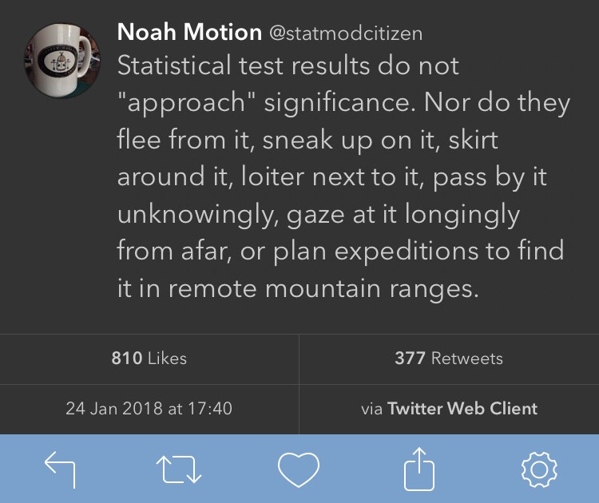

> **NOTE:**
>
> - The concept of inferential statistics
> - Hypothesis testing
> - *p*-values and decision thresholds
> - Assumptions
> - How inferential results are reported in a journal article

> **IMPORTANT:**
>
> - None

In Chapter 5, we arrive at the core purpose of this book: a practical exploration of the *inferential statistics* essential to modern biology. Using this toolkit, we can transform individual data points into broader scientific insights for the best possible explanations for the phenomenon being studied. These statistical methods are fundamental to hypothesis-driven research and provide the means to *generalise findings* from a sample to a population or predict future outcomes. The reasoning is that sample estimates vary from one sample to the next, thus offering only a partial glimpse into the broader population it represents. In Chapter 4 I showed how to describe that variation. Through inferential statistics, we can draw conclusions that extend beyond the sample by assessing how robustly the sample supports hypotheses about biological processes and populations.

Inferential statistics build on the foundation of *exploratory data analysis (EDA)*, which leans heavily on descriptive, or summary, statistics. These initial, descriptive methods summarise the core features of data (their distribution described by a central tendency and spread) and offer a clear, distilled view of the data’s characteristics. Descriptive statistics capture a snapshot of the dataset, but they stop short of allowing us to deduce broader truths about the population from which the data arose. Inferential statistics then takes this groundwork and advances it within the framework of *probability theory*. In doing so, we draw conclusions and quantify the uncertainty around these deductions.

Which probability model best represents a dataset is not an arbitrary choice; it flows from the biological mechanisms that generate the data. Confident, effective use of inferential statistics therefore requires an appreciation of both biological theory and the unique characteristics of the data at hand. The probability distribution of data is closely tied to the natural processes behind it, a connection that is often underappreciated. Biological data are shaped by a multitude of factors, partly deterministic, but very much affected by genetics, environmental variables, and stochastic variations among them, each leaving an imprint on the underlying statistical distribution. For example:

1.  **Plant Height (Normal Distribution):** The heights of individual plants in a population typically follow a *normal distribution*. This distribution arises from the combined effects of genetic factors and environmental conditions that influence plant growth, such as soil quality, light, and water availability.

2.  **Litter Size in Mammals (Poisson Distribution):** In many mammal species, the number of offspring per litter may follow a *Poisson distribution*, which is common for count data. This distribution reflects the biological processes involved in reproduction, where most females have an average litter size, and larger litters are progressively rarer.

In each case, the mechanism that produces the data also determines its distribution, and that distribution is what we assess when constructing probability statements about the world.

The central idea of inference is to ask how surprising our observed result would be if a stated null model were true. Knowing which probability distribution governs data under that null is therefore what makes the comparison meaningful and the conclusion defensible. This thinking is the foundation of hypothesis testing, which structures every analytical step that follows.

# 1 The basic workflow of hypothesis testing

Hypothesis testing is best understood as a sequence of linked steps:

1.  state a **null hypothesis** ($H_{0}$) and an **alternative hypothesis** ($H_{a}$);
2.  calculate a **test statistic** from the sample data;
3.  evaluate how compatible that statistic is with the null model;
4.  compare the result with a chosen decision threshold, usually $\alpha$;
5.  interpret the outcome in scientific context.

This workflow recurs throughout the rest of the module whether we are comparing means, testing associations, or fitting models.

# 2 Hypotheses

Hypothesis testing starts by setting up two competing explanations for the data. The **null hypothesis** ($H_{0}$) usually represents no effect, no difference, or no association. The **alternative hypothesis** ($H_{a}$) represents the pattern we would regard as evidence against that null model. Only one of them can be retained after running the statistical test.

Hypothesis testing evaluates whether the observed data are consistent with the null model. It does not prove a hypothesis true, but it asks whether the evidence is strong enough to reject $H_{0}$.

At the heart of many basic scientific questions is the simple comparison “Is A different from B?” In statistical notation:

$$H_{0}: \text{Group A is not different from Group B}$$ $$H_{a}: \text{Group A is different from Group B}$$

More formally:

$$H_{0}: \bar{A} = \bar{B}$$ $$H_{a}: \bar{A} \neq \bar{B}$$

$$H_{0}: \bar{A} \leq \bar{B}$$ $$H_{a}: \bar{A} > \bar{B}$$

$$H_{0}: \bar{A} \geq \bar{B}$$ $$H_{a}: \bar{A} < \bar{B}$$

> **NOTE:**
>
> The hypothesis pair written with $\ne$ is **two-sided** because it asks whether the two means differ in either direction. The two hypothesis pairs written with $>$ and $<$ are **one-sided** because they specify direction explicitly. This distinction becomes important when we formalise these tests in [Chapter 7](../../BCB744/basic_stats/07-t_tests.llms.md).

We should also be precise about the language of decisions. In frequentist hypothesis testing, we either **reject** $H_{0}$ or **fail to reject** $H_{0}$. We do not “prove” $H_{a}$, and we do not “accept” $H_{0}$ as true.

> **IMPORTANT:**
>
> For each of the following scenarios, write the appropriate null and alternative hypotheses and state whether the test should be one-sided or two-sided. Justify your choice.
>
> 1.  A pharmaceutical company tests whether a new drug *reduces* blood pressure more than a placebo.
> 2.  An ecologist measures whether a marine reserve has *changed* average fish size and abundance (either increased or decreased) after five years.
> 3.  A food scientist checks whether a new preservation method *increases* shelf life beyond the industry standard of 14 days.
>
> After writing your hypotheses, discuss with a partner: why does the directionality matter for the *p*-value you will eventually compute?

# 3 Test statistics, *p*-values, and decision rules

## 3.1 Test statistics

A **test statistic** is a numerical summary of the evidence in the sample. Different methods use different statistics: a *t*-test uses a *t* statistic, ANOVA uses an *F* statistic, correlation uses the correlation coefficients $\rho$ or $\tau$, and regression uses slopes, $R^2$, and related summaries.

The common purpose is that all these statistics reduce the sample evidence to a quantity that can be evaluated under the null model.

## 3.2 The *p*-value

The ***p*-value** is the probability of obtaining a result at least as extreme as the one observed, assuming that $H_{0}$ is true. A *p*-value is *not* the probability that $H_{0}$ is true. It is a measure of how incompatible the data are with the null model. Smaller *p*-values indicate stronger incompatibility.

For example, assume our statistical test results in a *p*-value of 0.03, then, within the standard frequentist interpretation of a *p*-value we say:

“If $H_0$ is true, there is a 3% probability of obtaining a result at least as extreme as ours.”

That statement has two parts.

1.  First, “If $H_0$ is true”. This is the condition. We temporarily assume the null hypothesis is correct. For example, if $H_0$ says there is no treatment effect, no association, or no difference between groups, we calculate probabilities under that assumption.

2.  Second, “a result at least as extreme as ours”. This means not only the exact result we observed, but also any result that would provide *equal or stronger* evidence against $H_0$, according to the test statistic being used. So the *p*-value counts your result and more extreme ones in the tail or tails of the null distribution.

So, for a *p*-value of 0.03, the interpretation is:

If the null hypothesis were true, results this extreme or more extreme would arise about 3 times in 100 repeated samples.

## 3.3 The significance threshold, $\alpha$

Before looking at the result, we usually choose a decision threshold, denoted $\alpha$. In many biological studies, $\alpha = 0.05$ remains conventional. Other values, such as 0.01 or 0.001, may be used when false positives carry greater cost.

Thresholds are conventions that guide decisions. They do not replace expert judgement.

–\>

## 3.4 The decision rule

[](../../images/approaching-significance.jpeg "A reminder that “almost significant” is not significant.")

A reminder that “almost significant” is not significant.

The usual rule is:

- if $p \leq \alpha$, reject $H_{0}$;
- if $p > \alpha$, fail to reject $H_{0}$.

That rule is operational, but it is not the whole interpretation. A result just below 0.05 and one just above 0.05 do not represent radically different biological realities. The threshold helps formalise a decision but it does not remove the need to consider effect size, uncertainty, design quality, and context.

## 3.5 Interpretation

When $p \leq \alpha$, the data are commonly described as statistically significant. When $p > \alpha$, the evidence is not strong enough to reject $H_{0}$ under the chosen threshold.

In neither case does the *p*-value tell us whether the effect is biologically important. That judgement depends on the size of the effect, the uncertainty around it, and the scientific context.

> **NOTE:**
>
> A **Type I error** is the false rejection of $H_{0}$: concluding that there is an effect when there is none. A **Type II error** is the false failure to reject $H_{0}$: missing a real effect.
>
> The threshold $\alpha$ controls the long-run rate of Type I error if the assumptions of the test hold. A smaller threshold is more conservative, but that gain usually comes at a cost: it becomes harder to detect real effects.

# 4 Assumptions

Inferential procedures rely on assumptions about the data, the sampling or experimental design, and the model. For example, many tests assume independence, appropriate distributional form, and constant variance.

Testing these assumptions are part of the process leading to inference. If the assumptions are badly violated, the reported *p*-values, confidence intervals, and test statistics may not mean what we think they mean.

This is the purpose of [Chapter 6](../../BCB744/basic_stats/06-assumptions-and-transformations.llms.md), where I will explain how to check assumptions and what to do when they fail.

# 5 Parametric and non-parametric methods

Many standard inferential procedures are **parametric**. That is, they have assumptions about normality. But this does not mean they require the raw data themselves to be perfectly normal in every case. More often, the assumptions concern the distribution of residuals, the form of the model, or the behaviour of the test statistic under the null hypothesis.

When those assumptions are not reasonable, we often use **non-parametric** or rank-based alternatives. I introduce those alternatives within the relevant method families in [Chapter 7](../../BCB744/basic_stats/07-t_tests.llms.md), [Chapter 8](../../BCB744/basic_stats/08-anova.llms.md), and [Chapter 9](../../BCB744/basic_stats/09-correlation-and-association.llms.md), and then brought together in [Chapter 10](../../BCB744/basic_stats/10-test-selection.llms.md).

# 6 Reporting inferential results

Worked examples in the later chapters end with a `Reporting` section. The purpose of those sections is to demonstrate how the outcome of an analysis would be written in a scientific paper.

In practice, the reporting should follow the normal requirements of a journal article. The details differ from one method to another, but the overall structure remains more-or-less like this:

> **NOTE:**
>
> - In the **Methods**, state what was measured, what the response variable was, what the grouping or predictor variables were, and which statistical test or model was used.
> - In the **Methods**, state any design features that are essential for interpretation, such as pairing, repeated measures, blocking, or the true experimental unit.
> - In the **Methods**, cite the statistical method and, where relevant, the R package used to implement it. Statistical analysis is part of the scholarly record and should be cited as such.
> - In the **Results**, report the main biological pattern in plain language before or alongside the formal test result.
> - In the **Results**, report the core statistical outcome using tKhe relevant quantities for the method at hand, such as a *t* statistic, *F* statistic, correlation coefficient, slope, confidence interval, or similar effect summary.
> - In the **Results**, do not confuse statistical significance with biological importance.
> - In the **Discussion**, explain what the result means biologically rather than merely restating whether $H_{0}$ was rejected.
> - In the **Discussion**, note any important limitation, assumption issue, or caution that affects the interpretation of the result.
> - Keep the reporting concise and readable. A good Results paragraph should sound like a journal article, not like raw statistical output copied from R.

This is the general reporting approach that I apply throughout the rest of the Biostatistics module. So, in [Chapter 7](../../BCB744/basic_stats/07-t_tests.llms.md), [Chapter 8](../../BCB744/basic_stats/08-anova.llms.md), [Chapter 9](../../BCB744/basic_stats/09-correlation-and-association.llms.md), and the later modelling chapters, with each worked example I therefore include a “Reporting” box that separates the **Methods**, **Results**, and **Discussion**.

If you need the correct citation for an R package, ask R for it directly:

``` numberSource
citation()
citation("stats")
citation("ggplot2")
```

[`citation()`](https://rdrr.io/r/utils/citation.html) with no package name gives the citation for R itself. `citation("package_name")` gives the citation for a specific package. Once that reference is in your `.bib` file, you can cite it in Quarto with the usual citation syntax, for example `[@R-base]` or `[@R-ggplot2]`, depending on the citation key in the BibTeX entry.

The method itself should also be named clearly in the prose. A Methods sentence can therefore look like this:

`Bill length was compared between species with Welch's two-sample *t*-test in R [@R-base].`

Or, when a contributed package is central to the analysis:

`Estimated marginal means were obtained with the **emmeans** package [@R-emmeans].`

# 7 Conclusion

Inferential statistics lets us use a sample to say something disciplined about a larger population. In the workflow, we state hypotheses, calculate a test statistic, evaluate it under a null model, apply a decision threshold, and interpret the result in context.

The harder part is expert scientific judgement. We still need to ask whether the design was sound, whether the assumptions were reasonable, and whether the detected effect matters biologically. Those questions remain central in every chapter that follows.

The next five chapters unpack that general logic into specific inferential families. I begin with assumption checking, then move through *t*-tests, ANOVA, and correlation, and finally close the inferential block with a method-selection guide. The goal is that each later method is read as one expression of the same inferential workflow introduced here, not as a separate ritual with its own isolated rules.

## Reuse

[CC BY-NC-SA 4.0](https://creativecommons.org/licenses/by-nc-sa/4.0/)

## Citation

BibTeX citation:

``` quarto-appendix-bibtex
@online{smit2026,
  author = {Smit, A. J.},
  title = {5. {Statistical} Inference},
  date = {2026-11-06},
  url = {https://tangledbank.netlify.app/BCB744/basic_stats/05-inference.html},
  langid = {en}
}
```

For attribution, please cite this work as:

Smit AJ (2026) 5. Statistical inference. [https://tangledbank.netlify.app/BCB744/basic_stats/05-inference.html.](https://tangledbank.netlify.app/BCB744/basic_stats/05-inference.html)
