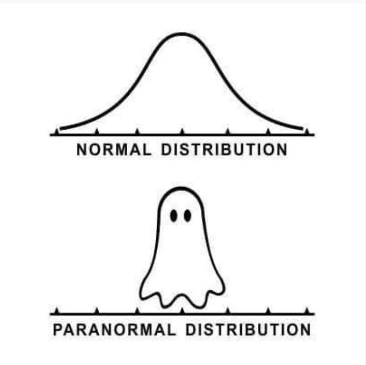
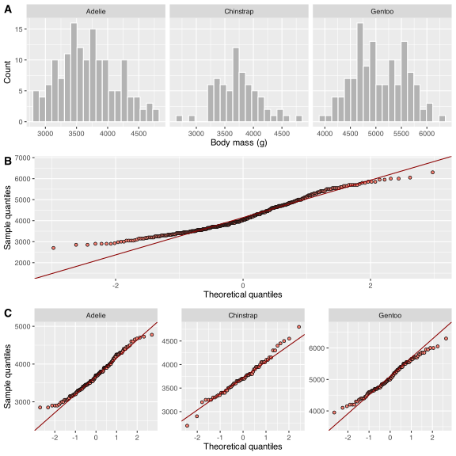
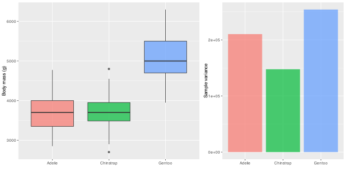
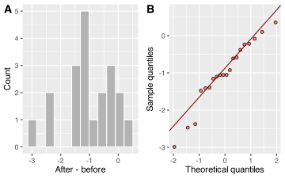
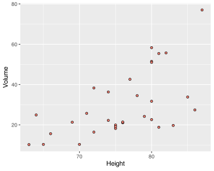
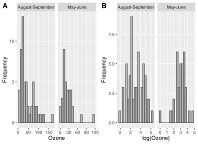

[](../../images/paranormal_distributions.jpeg "Figure 1: A meme about unexpected distributions.")

Figure 1: A meme about unexpected distributions.

The opening meme in [Figure 1](#fig-paranormal-distributions) is a light reminder that distributions are often less cooperative than we hope.

> **NOTE:**
>
> - how assumption checks depend on data structure
> - normality within groups
> - variance across groups
> - paired differences
> - joint structure in associations
> - transformations and what to do when assumptions fail

> **IMPORTANT:**
>
> - None

Inferential statistics can be broadly categorised into *parametric* and *nonparametric* methods. The choice between them hinges on understanding the distribution of our data and the assumptions underlying each method. Parametric methods rely on specific assumptions about the underlying probability distribution of the population from which the sample data are drawn. The two key assumptions are *normality*, that the data follow a normal (Gaussian) distribution, and *homoscedasticity*, which requires equal variances across groups or levels of predictors.

Strictly speaking, the core parametric requirement is not normality per se but that the data follow a *known* probability distribution specified in advance. When the response is a count, a proportion, or a binary outcome, other distributions (Poisson, binomial) apply, and methods such as Generalised Linear Models extend the parametric framework accordingly (Part V). For the tests covered in Parts II and III of the book (*t*-tests, ANOVA, regression, and correlation) the relevant distribution is normal, so normality and homoscedasticity are the assumptions that matter here.

Nonparametric methods offer an alternative when data do not conform to any known distribution, or when assumptions cannot be met and the sample is too small for the Central Limit Theorem (CLT) to compensate. They make fewer assumptions, are more robust to non-standard distributions, and trade a modest reduction in statistical power for greater generality. For most biological datasets of adequate size, a well-chosen parametric test is preferred, but nonparametric alternatives become the more defensible choice when distributional requirements cannot be satisfied.

Choosing between the two approaches requires first assessing whether your data meet parametric assumptions. With larger samples, the CLT means that moderate departures from normality become less important, because the sampling distribution of the mean approaches normality regardless. With small samples, the same violations carry more weight and nonparametric alternatives deserve serious consideration. When assumptions are met, parametric tests are more powerful but when they are violated, that power advantage dissipates.

Assumption checks determine whether a planned inferential method is defensible. In this chapter, I apply those checks to **raw data** rather than to model residuals — residual-based diagnostics belong to the later regression chapters, beginning with [Residuals and Model-Based Diagnostics](../../BCB744/basic_stats/11-residuals-and-model-based-diagnostics.llms.md). My aim here is to prepare you for the tests immediately ahead: [*t*-tests](../../BCB744/basic_stats/07-t_tests.llms.md), [ANOVA](../../BCB744/basic_stats/08-anova.llms.md), and [Correlation and Association](../../BCB744/basic_stats/09-correlation-and-association.llms.md).

The discussion is organised around data structure. Group comparisons require normality checks within groups and homoscedasticity checks across them. Paired designs require checks on the differences. Associations require checks on the joint pattern of both variables.

# 1 Assumption-checking workflow

Assumption checking follows a series of steps:

1.  identify the structure of the analysis;
2.  inspect the raw data visually;
3.  assess the assumptions graphically;
4.  use formal tests to support judgement;
5.  decide whether to proceed, transform, or change method;
6.  re-check if the analysis changes.

Different assumptions often fail together which is why I tie the workflow the analysis rather than to a list of tests.

# 2 Identifying the data structure

Before checking assumptions, identify the structure of the data:

- **Are there groups?** Then check each group separately.
- **Are the measurements paired?** Then check the differences.
- **Are both variables continuous?** Then check the joint pattern of the relationship.

Assumptions apply to the structure implied by the analysis, not to the dataset as a whole. I introduced the grouped-data example earlier in [Comparing Groups](../../BCB744/basic_stats/03-visualise.llms.md#sec-comparing-groups), where I emphasised how plots change once categories are recognised explicitly.

> **NOTE:**
>
> In the regression chapters, I will apply these same ideas to **residuals**, which are the differences between observed values and model predictions, but here I develop the assumptions at the level of raw data. The extension to residuals belongs with the regression series of chapters.

# 3 Group comparisons: normality within groups

I begin with a grouped comparison that prepares directly for [*t*-tests](../../BCB744/basic_stats/07-t_tests.llms.md) and [ANOVA](../../BCB744/basic_stats/08-anova.llms.md).

``` numberSource
peng <- penguins |>
  drop_na(bill_length_mm, body_mass_g, species)
```

I compare bill length across penguin species. The grouping structure is seen in the dataset where you can see observations belonging to several species. This is the same grouped-data idea introduced in [Comparing Groups](../../BCB744/basic_stats/03-visualise.llms.md#sec-comparing-groups), but here the aim is diagnostic rather than descriptive. The assumption applies within each species, not to the pooled data.

## 3.1 Graphical checks

Start with plots. Histograms show the shape within each species. A **Q-Q plot** compares the observed quantiles of the data with the quantiles expected from a normal distribution. If the distribution is close to normal, the points fall roughly along a straight reference line. These grouped and pooled views are shown in [Figure 2](#fig-group-normality).

Code

``` numberSource
plt1 <- ggplot(peng, aes(body_mass_g)) +
  geom_histogram(bins = 20, fill = "grey70", colour = "white") +
  facet_wrap(~species, scales = "free_x") +
  labs(x = "Body mass (g)", y = "Count")

plt2 <- ggplot(peng, aes(sample = body_mass_g)) +
  stat_qq(shape = 21, fill = "salmon", colour = "black") +
  stat_qq_line(colour = "red4") +
  labs(x = "Theoretical quantiles", y = "Sample quantiles")

plt3 <- ggplot(peng, aes(sample = body_mass_g)) +
  stat_qq(shape = 21, fill = "salmon", colour = "black") +
  stat_qq_line(colour = "red4") +
  facet_wrap(~species, scales = "free") +
  labs(x = "Theoretical quantiles", y = "Sample quantiles")

ggarrange(plt1, plt2, plt3, ncol = 1, labels = "AUTO")
```

[](06-assumptions-and-transformations_files/figure-html/fig-group-normality-1.svg "Figure 2: Normality checks for grouped data. A) Histograms of bill length within each penguin species. B) A pooled Q-Q plot that ignores species. C) Q-Q plots drawn separately within species.")

Figure 2: Normality checks for grouped data. A) Histograms of bill length within each penguin species. B) A pooled Q-Q plot that ignores species. C) Q-Q plots drawn separately within species.

In [Figure 2](#fig-group-normality), the pooled Q-Q plot bends because it combines Adelie, Chinstrap, and Gentoo penguins into one mixture distribution. The grouped Q-Q plots are the relevant ones because the comparison is made across species. That is the pattern we carry forward into [Chapter 7](../../BCB744/basic_stats/07-t_tests.llms.md) and [Chapter 8](../../BCB744/basic_stats/08-anova.llms.md).

## 3.2 Formal test

The most commonly used formal test is the **Shapiro-Wilk test**, [`shapiro.test()`](https://rdrr.io/r/stats/shapiro.test.html). Its null hypothesis is that the data are compatible with normality:

$$H_{0}: \text{the distribution is compatible with normality}$$ $$H_{a}: \text{the distribution departs from normality}$$

The test statistic is:

$$W = \frac{(\sum_{i=1}^n a_i x_{(i)})^2}{\sum_{i=1}^n (x_i - \overline{x})^2} \tag{1}$$

Here, $W$ is the Shapiro-Wilk test statistic, $a_i$ are coefficients that depend on the sample size and expected order statistics under normality, $x_{(i)}$ is the $i$-th ordered observation, and $\overline{x}$ is the sample mean.

Run the test within species, not on the pooled sample:

``` numberSource
peng |>
  group_by(species) |>
  summarise(
    shapiro_w = as.numeric(shapiro.test(bill_length_mm)$statistic),
    shapiro_p = as.numeric(shapiro.test(bill_length_mm)$p.value)
  )
```

    R> # A tibble: 3 × 3
    R>   species   shapiro_w shapiro_p
    R>   <fct>         <dbl>     <dbl>
    R> 1 Adelie        0.993    0.717 
    R> 2 Chinstrap     0.975    0.194 
    R> 3 Gentoo        0.973    0.0135

When *p* is greater than 0.05, the test shows no strong evidence against normality. That result does not prove exact normality, but it shows that the observed departure is not strong enough for this test to detect at the sample size available. There is sufficient evidence against the null, suggesting that Gentoo penguins have non-normal data.

That result does not automatically end the analysis, but it does change the next step. First, inspect the plots in [Figure 2](#fig-group-normality) and ask whether the departure is mild or severe. Second, continue to the variance check below, because non-normality and unequal variance often appear together. If one or more groups are clearly non-normal, and especially if variance also differs among groups, the later comparison should use a method that tolerates those features better. In the chapters that follow, that may mean Welch’s version of the test, a rank-based alternative, a transformation followed by a fresh round of checks, or a different model altogether. The decision depends on the size of the departure, the sample sizes, and the biological scale on which you need to interpret the result.

> **IMPORTANT:**
>
> Using the `penguins` dataset (load **palmerpenguins**), run the normality checks for `flipper_length_mm` instead of `bill_length_mm`. For each species, produce a Q-Q plot and apply the Shapiro-Wilk test. Do the conclusions differ from what was found for bill length? Copy the code from above and adapt it. Report your W statistics and *p*-values and describe in one sentence whether you would consider the flipper length data approximately normal within each species.

## 3.3 Other Tests for Normality

Several other tests can be used to assess whether data are compatible with normality:

- **Kolmogorov-Smirnov test** compares the empirical distribution of a sample with a specified theoretical distribution. In R use [`ks.test()`](https://rdrr.io/r/stats/ks.test.html).
- **Anderson-Darling test** is another goodness-of-fit test, available as `ad.test()` in packages such as **nortest**.
- **Lilliefors test** is a modification of the Kolmogorov-Smirnov test for estimated mean and variance. See `lillie.test()`.
- **Jarque-Bera test** is based on skewness and kurtosis. See `jarque.bera.test()` in **tseries**.
- **Cramer-Von Mises test** is another goodness-of-fit approach. See `cvm.test()` in **goftest**.

These tests support the plots. They do not replace them.

> **NOTE:**
>
> In the regression chapters, I check normality with Q-Q plots of residuals rather than with grouped raw-data plots. That extension belongs with fitted models and is introduced in [Chapter 11](../../BCB744/basic_stats/11-residuals-and-model-based-diagnostics.llms.md).

# 4 Group Comparisons: Variance Across Groups

Grouped comparisons also require attention to spread. For methods such as one-way ANOVA, large differences in variance across groups can affect the inferential result.

We use penguin body mass because the spread differs more clearly across species:

Code

``` numberSource
peng_var <- peng |>
  group_by(species) |>
  summarise(sample_var = var(body_mass_g), .groups = "drop")

plt1 <- ggplot(peng, aes(species, body_mass_g, fill = species)) +
  geom_boxplot(show.legend = FALSE, alpha = 0.7) +
  labs(x = "", y = "Body mass (g)")

plt2 <- ggplot(peng_var, aes(species, sample_var, fill = species)) +
  geom_col(show.legend = FALSE, alpha = 0.7) +
  labs(x = "", y = "Sample variance")

ggpubr::ggarrange(plt1, plt2, ncol = 2, widths = c(1.4, 1))
```

[](06-assumptions-and-transformations_files/figure-html/fig-group-variance-1.svg "Figure 3: Variance checks for grouped data. A) Box plots of body mass by penguin species. B) Sample variances by species.")

Figure 3: Variance checks for grouped data. A) Box plots of body mass by penguin species. B) Sample variances by species.

The box plots and variance bars in [Figure 3](#fig-group-variance) show the spread clearly. Large differences in spread suggest heteroscedasticity.

The most commonly used formal test is **Levene’s test**, [`car::leveneTest()`](https://rdrr.io/pkg/car/man/leveneTest.html). Its null hypothesis is that the group variances are equal:

$$H_{0}: \sigma^{2}_{A} = \sigma^{2}_{B}$$ $$H_{a}: \sigma^{2}_{A} \ne \sigma^{2}_{B}$$

The Levene test statistic is:

$$W = \frac{(N-k)}{(k-1)} \cdot \frac{\sum_{i=1}^k n_i (\bar{z}_i - \bar{z})^2}{\sum_{i=1}^k \sum_{j=1}^{n_i} (z_{ij} - \bar{z}_i)^2} \tag{2}$$

Here, $N$ is the total sample size, $k$ is the number of groups, $n_i$ is the sample size in group $i$, $z_{ij}$ is the absolute deviation of observation $j$ in group $i$ from its group centre, $\bar{z}_i$ is the mean of those deviations within group $i$, and $\bar{z}$ is the overall mean deviation.

``` numberSource
car::leveneTest(body_mass_g ~ species, data = peng)
```

    R> Levene's Test for Homogeneity of Variance (center = median)
    R>        Df F value   Pr(>F)   
    R> group   2  5.1203 0.006445 **
    R>       339                    
    R> ---
    R> Signif. codes:  0 '***' 0.001 '**' 0.01 '*' 0.05 '.' 0.1 ' ' 1

A small *p*-value indicates evidence against equal variance. This structure is used directly in [ANOVA](../../BCB744/basic_stats/08-anova.llms.md).

``` numberSource
peng_var
```

    R> # A tibble: 3 × 2
    R>   species   sample_var
    R>   <fct>          <dbl>
    R> 1 Adelie       210283.
    R> 2 Chinstrap    147713.
    R> 3 Gentoo       254133.

## 4.1 Other tests for homogeneity

Several other tests are available for comparing variances:

- **F-test** compares two variances. Use [`var.test()`](https://rdrr.io/r/stats/var.test.html). It assumes normality.
- **Bartlett’s test** compares variances across multiple groups. Use [`bartlett.test()`](https://rdrr.io/r/stats/bartlett.test.html). It also assumes normality.
- **Brown-Forsythe test** is a median-based modification of Levene’s test and is more robust to non-normality.
- **Fligner-Killeen test** is a robust non-parametric variance test available in base R as [`fligner.test()`](https://rdrr.io/r/stats/fligner.test.html).

> **NOTE:**
>
> In the regression chapters, I assess changing variance with residual-versus-fitted plots. That diagnostic belongs with fitted models and is introduced in [Chapter 11](../../BCB744/basic_stats/11-residuals-and-model-based-diagnostics.llms.md).

# 5 Paired designs: check the differences

In paired designs, the assumption applies to the **differences**, not to the raw measurements.

``` numberSource
set.seed(1)
paired <- tibble(
  before = rnorm(20, 10, 2),
  after  = before + rnorm(20, -1, 1)
) |>
  mutate(diff = after - before)
```

The paired structure means that each `after` value belongs to the same unit as one `before` value. The analysis will therefore be built on the differences, which are visualised in [Figure 4](#fig-paired-diff).

Code

``` numberSource
plt1 <- ggplot(paired, aes(diff)) +
  geom_histogram(bins = 12, fill = "grey70", colour = "white") +
  labs(x = "After - before", y = "Count")

plt2 <- ggplot(paired, aes(sample = diff)) +
  stat_qq(shape = 21, fill = "salmon", colour = "black") +
  stat_qq_line(colour = "red4") +
  labs(x = "Theoretical quantiles", y = "Sample quantiles")

ggarrange(plt1, plt2, ncol = 2, labels = "AUTO")
```

[](06-assumptions-and-transformations_files/figure-html/fig-paired-diff-1.svg "Figure 4: Checks for paired data. A) Histogram of paired differences. B) Q-Q plot of paired differences.")

Figure 4: Checks for paired data. A) Histogram of paired differences. B) Q-Q plot of paired differences.

``` numberSource
shapiro.test(paired$diff)
```

    R> 
    R>  Shapiro-Wilk normality test
    R> 
    R> data:  paired$diff
    R> W = 0.94617, p-value = 0.3127

The histogram and Q-Q plot in [Figure 4](#fig-paired-diff) are the relevant diagnostics because the paired *t*-test is built on the differences, not on the raw `before` and `after` values. This is the structure used directly in the paired *t*-test in [Chapter 7](../../BCB744/basic_stats/07-t_tests.llms.md).

# 6 Associations: check the joint structure

Association problems have a different geometry. There are no groups, and there are no paired differences. The main diagnostic is the joint structure of the two variables.

Code

``` numberSource
ggplot(trees, aes(Height, Volume)) +
  geom_point(shape = 21, fill = "salmon", colour = "black") +
  labs(x = "Height", y = "Volume")
```

[](06-assumptions-and-transformations_files/figure-html/fig-trees-scatter-1.svg "Figure 5: Scatter plot of tree height and volume from the base R trees dataset.")

Figure 5: Scatter plot of tree height and volume from the base R `trees` dataset.

In [Figure 5](#fig-trees-scatter), the questions are whether the relationship is approximately linear and whether a few extreme values dominate the pattern. Checking each variable for normality in isolation would miss the main issue. The structure used here leads directly into [Correlation and Association](../../BCB744/basic_stats/09-correlation-and-association.llms.md).

# 7 Independence

Independence is set by design. If repeated measurements are taken on the same individual, or if samples are nested within a site, tank, quadrat, or transect, then the observations are not independent.

Suppose ten leaves are measured from each of three plants, but the analysis treats the thirty leaves as if they came from thirty independent plants. That is **pseudoreplication**. The apparent sample size is inflated, and the inferential result becomes too optimistic because the real experimental unit was the plant, not the leaf.

Check independence by asking:

1.  what is the true experimental unit;
2.  are observations repeated, nested, spatially clustered, or temporally linked;
3.  does the design require a paired test, repeated-measures method, or mixed model.

We return to these issues in [Pseudoreplication](../../BCB744/basic_stats/18-pseudoreplication.llms.md) and [Dependence and Mixed Models](../../BCB744/basic_stats/19-dependence-and-mixed-models.llms.md).

> **IMPORTANT:**
>
> For each scenario below, state whether the observations are independent and identify the potential source of non-independence if there is one:
>
> 1.  You measure oxygen consumption in 20 individual fish, one per tank, across two temperature treatments.
> 2.  You measure body mass in 30 individual fish, but six fish share each of five tanks, and tanks are the actual treatment units.
> 3.  You sample 15 quadrats along a single 100 m transect to estimate cover of an invasive alga.
> 4.  You measure blood pressure in 10 patients before and after a treatment.
>
> Which of these would call for a paired test, a mixed model, or a simple independent-samples test? Discuss with a partner.

# 8 Reporting assumption checks

> **NOTE:**
>
> **Methods**
>
> Penguin body mass was examined by species before any formal group comparison. Normality was assessed within species using histograms, Q-Q plots, and the Shapiro-Wilk test. Homogeneity of variance across species was assessed with box plots, direct comparison of sample variances, and Levene’s test.
>
> **Results**
>
> Body-mass distributions differed among penguin species in both location and spread. The species-specific histograms and Q-Q plots in [Figure 2](#fig-group-normality) gave the relevant diagnostic view because the assumption applied within species rather than to the pooled dataset. The box plots and variance summaries in [Figure 3](#fig-group-variance) reinforced that variance was not uniform across species, so a later comparison of species means would need to take that heterogeneity into account.
>
> **Discussion**
>
> In a journal-style account, these diagnostics justify the choice of inferential method. Here they show that the grouped structure of the penguin data must be respected and that unequal variance among species would need to be handled explicitly in the later analysis.

# 9 Responding to assumption violations

Once assumptions have been checked, the response is usually one of four:

1.  proceed because the departures are minor and the planned method is adequate;
2.  change to a method that matches the data more closely;
3.  transform the response and then re-check the assumptions;
4.  recognise that the design does not support the intended inference.

The best response depends on the structure of the problem. Counts, proportions, and non-independent observations often need a different method rather than a transformed version of the same method.

The non-parametric alternatives for the main inferential methods are introduced within the relevant method chapters: Wilcoxon procedures in [Chapter 7](../../BCB744/basic_stats/07-t_tests.llms.md), Kruskal-Wallis in [Chapter 8](../../BCB744/basic_stats/08-anova.llms.md), and rank-based correlation in [Chapter 9](../../BCB744/basic_stats/09-correlation-and-association.llms.md). [Chapter 10](../../BCB744/basic_stats/10-test-selection.llms.md) then summarises how those choices fit together.

# 10 Why transform data?

Transformations change the scale of the response so that the data are more compatible with the assumptions of the planned method. They are often used to reduce right-skew, stabilise variance, or linearise a relationship.

Use a transformation only when it improves the fit between the data and the method in a way that still supports a clear biological interpretation.

After transformation, quantities such as means and confidence intervals usually need to be back-transformed before reporting. Back-transformed uncertainty is often asymmetric.

> “Torture numbers and they will confess to anything” — Gregg Easterbrook

# 11 Transformation decision guide

| Data problem | Usual response | Comment |
|:---|:---|:---|
| Strong right-skew in positive continuous data | `log(x)` or `log10(x)` | Often useful for multiplicative processes or long right tails |
| Count data with variance increasing with the mean | `sqrt(x)` or a count model | A Poisson or negative-binomial GLM is often better |
| Proportions near 0 or 1 | Usually a binomial GLM | Arcsine transformations are now often unnecessary |
| Severe right-skew with difficult scale | `1/x` in rare cases | Hard to interpret biologically |
| Negative skew | Reflect, then transform if needed | Often suggests that a different model or scale may be better |

If the response has its own natural error structure, such as counts, proportions, presence-absence data, or survival times, a generalised model is often better than transformation.

> **IMPORTANT:**
>
> Use the decision guide above to recommend a transformation (or decide that transformation is not appropriate) for each of the following:
>
> 1.  Seabird nest counts per island (range: 0 to 2500; variance increases with the mean).
> 2.  Percentage cover of lichen on rock surfaces (range: 2% to 98%; most sites around 50%).
> 3.  Salmon body mass in grams (range: 1.5 to 8.2 kg; slight right-skew).
> 4.  Presence or absence of a parasitic worm (binary: 0 or 1).
> 5.  Time-to-death of bacteria exposed to an antibiotic (range: 5 to 240 minutes; strongly right-skewed).
>
> For each, state the transformation or model type you would recommend and give a one-sentence justification.

# 12 Common transformations

## 12.1 Log transformation

A log transformation is often useful for positive, right-skewed data. Use `log(x)` or `log10(x)`. The statistical conclusion does not depend on whether the base is $e$ or 10 because the two scales differ only by a constant factor.

If zeros are present, a constant is sometimes added first, for example `log(x + 1)`. Do that for a clear reason, not mechanically.

## 12.2 Square-root transformation

The square-root transformation, $\sqrt{x}$, is often used for count-like data or for responses where the variance increases with the mean.

## 12.3 Arcsine transformation

The arcsine square-root transformation,

$$y' = \arcsin(\sqrt{y}) \tag{3}$$

was historically used for proportions between 0 and 1. It still appears in older literature, but a binomial GLM is often the better solution because it respects the mean-variance relationship directly.

The back-transformation is:

$$y = \sin(y')^2 \tag{4}$$

## 12.4 Reciprocal transformation

The reciprocal transformation, `1/x`, can reduce strong right-skew, but it often produces a scale that is hard to explain biologically.

## 12.5 Square and cube transformations

Square and cube transformations can be useful after reflecting negatively skewed data, but they also magnify larger values and can make outliers more influential.

## 12.6 Anscombe transformation

For Poisson counts, the Anscombe transformation is:

$$y' = 2\sqrt{x + \frac{3}{8}} \tag{5}$$

It was designed to stabilise variance in count data, but a Poisson or negative-binomial GLM is usually preferable now.

# 13 Worked example with transformations

To demonstrate what a transformation is trying to achieve, I use the built-in `airquality` dataset. Here the response is ozone concentration, and I compare **May-June** with **August-September**. This is a two-group comparison, so the relevant questions are the same ones used earlier in the chapter: are the distributions within groups reasonably well behaved, and are the group variances similar enough for a mean-based comparison?

Code

``` numberSource
ozone_dat <- na.omit(airquality[, c("Ozone", "Month")]) |>
  as_tibble() |>
  filter(Month %in% c(5, 6, 8, 9)) |>
  mutate(
    season = factor(
      ifelse(Month %in% c(5, 6), "May-June", "August-September")
    ),
    log_ozone = log(Ozone)
  )

plt1 <- ggplot(ozone_dat, aes(Ozone)) +
  geom_histogram(bins = 20, fill = "grey70", colour = "grey30") +
  facet_wrap(~season, scales = "free_x") +
  labs(x = "Ozone", y = "Frequency")

plt2 <- ggplot(ozone_dat, aes(log_ozone)) +
  geom_histogram(bins = 20, fill = "grey70", colour = "grey30") +
  facet_wrap(~season, scales = "free_x") +
  labs(x = "log(Ozone)", y = "Frequency")

ggarrange(plt1, plt2, ncol = 2, labels = "AUTO")
```

[](06-assumptions-and-transformations_files/figure-html/fig-transform-demo-1.svg "Figure 6: A real-data example showing how a log transformation changes the distribution of ozone concentrations. A) Raw ozone values by season. B) Log-transformed ozone values by season.")

Figure 6: A real-data example showing how a log transformation changes the distribution of ozone concentrations. A) Raw ozone values by season. B) Log-transformed ozone values by season.

Code

``` numberSource
ozone_dat |>
  group_by(season) |>
  summarise(
    raw_w = unname(shapiro.test(Ozone)$statistic),
    raw_p = shapiro.test(Ozone)$p.value,
    log_w = unname(shapiro.test(log_ozone)$statistic),
    log_p = shapiro.test(log_ozone)$p.value,
    .groups = "drop"
  )
```

    R> # A tibble: 2 × 5
    R>   season           raw_w      raw_p log_w  log_p
    R>   <fct>            <dbl>      <dbl> <dbl>  <dbl>
    R> 1 August-September 0.858 0.0000112  0.973 0.260 
    R> 2 May-June         0.765 0.00000448 0.939 0.0537

Code

``` numberSource
car::leveneTest(Ozone ~ season, data = ozone_dat)
```

    R> Levene's Test for Homogeneity of Variance (center = median)
    R>       Df F value  Pr(>F)  
    R> group  1  6.3393 0.01362 *
    R>       88                  
    R> ---
    R> Signif. codes:  0 '***' 0.001 '**' 0.01 '*' 0.05 '.' 0.1 ' ' 1

Code

``` numberSource
car::leveneTest(log_ozone ~ season, data = ozone_dat)
```

    R> Levene's Test for Homogeneity of Variance (center = median)
    R>       Df F value Pr(>F)
    R> group  1  0.0964 0.7569
    R>       88

Figure [Figure 6](#fig-transform-demo) shows the effect of the transformation directly. The raw ozone values show strong right-skew in both seasons. On the raw scale, both groups depart clearly from normality and the variances differ. On the log scale, the upper tail is compressed, the group spreads are closer, and the Shapiro-Wilk and Levene results are far less problematic. The transformation has changed the scale in a way that makes a mean-based comparison more defensible.

In this chapter, I stop at the diagnostic stage since the inferential step belongs in [Chapter 7](../../BCB744/basic_stats/07-t_tests.llms.md) where the same ozone data are analysed with a two-sample *t*-test on the transformed scale before the result is back-transformed for reporting.

# 14 Check the assumptions again

The data diagnostics do not end after we have transformed the data. The transformed data must be checked again. The second pass decides whether the transformation actually improved the fit between the data and the planned method. It is annoying but necessary.

# 15 When transformation is not the right solution

Transformation is usually the wrong response when:

- the response is fundamentally a count, proportion, presence-absence variable, or survival time with its own natural error structure;
- the observations are not independent;
- the biological interpretation becomes less clear than the original problem;
- a more appropriate method already exists.

> **IMPORTANT:**
>
> The `airquality` dataset (built into R) contains ozone concentrations measured in New York over several months. Run the full assumption-checking workflow on ozone (`Ozone`) split by `Month`:
>
> 1.  Produce histograms and Q-Q plots grouped by month.
> 2.  Apply the Shapiro-Wilk test within each month.
> 3.  Apply Levene’s test for equal variance across months (use [`car::leveneTest()`](https://rdrr.io/pkg/car/man/leveneTest.html)).
> 4.  Based on your diagnostics, would you apply a log transformation? Apply it and re-check.

# 16 Summary

1.  Assumptions apply to the structure implied by the analysis.
2.  Group comparisons require checks within groups and across group variances.
3.  Paired designs require checks on the differences.
4.  Associations require checks on the joint pattern of the variables.
5.  Independence comes from design, not from a formal test.
6.  Transformations should be justified by the data and followed by a second round of diagnostics.

## Reuse

[CC BY-NC-SA 4.0](https://creativecommons.org/licenses/by-nc-sa/4.0/)

## Citation

BibTeX citation:

``` quarto-appendix-bibtex
@online{smit2026,
  author = {Smit, A. J.},
  title = {6. {Raw-data} Assumptions and Transformations},
  date = {2026-11-06},
  url = {https://tangledbank.netlify.app/BCB744/basic_stats/06-assumptions-and-transformations.html},
  langid = {en}
}
```

For attribution, please cite this work as:

Smit AJ (2026) 6. Raw-data assumptions and transformations. [https://tangledbank.netlify.app/BCB744/basic_stats/06-assumptions-and-transformations.html.](https://tangledbank.netlify.app/BCB744/basic_stats/06-assumptions-and-transformations.html)
