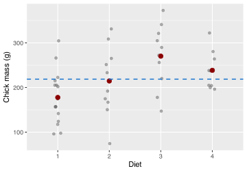
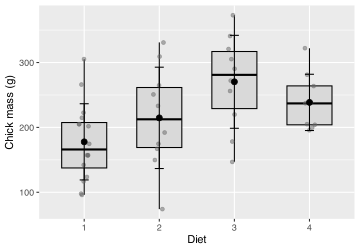
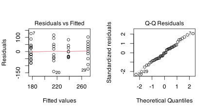
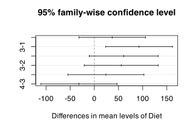

[](../../images/fancy_stats.jpg "A meme about fancy statistics.")

A meme about fancy statistics.

> **NOTE:**
>
> - one-way ANOVA
> - Tukey HSD
> - factorial ANOVA
> - Welch’s one-way ANOVA
> - Kruskal-Wallis rank-sum test

> **NOTE:**
>
> Find here a [Cheatsheet](../../cheatsheets/cheatsheet-inferential-stats.pdf) on statistical methods.

> **IMPORTANT:**
>
> - Self-Assessment Task 8-1 **(/8)**
> - Self-Assessment Task 8-2 **(/6)**
> - Self-Assessment Task 8-3 **(/16)**
> - Self-Assessment Task 8-4 **(/5)**
> - Self-Assessment Task 8-5 **(/5)**
> - Self-Assessment Task 8-6 **(/5)**
> - [Self-Assessment instructions and full task overview](../../BCB744/tasks/BCB744_Biostats_Self-Assessment.llms.md)

``` numberSource
chicks <- as_tibble(ChickWeight)
chicks_day21 <- filter(chicks, Time == 21)
```

> **IMPORTANT:**
>
> As a reminder of what *t*-tests are about, use your BCB742 Bokbaai data, and devise a research question that requires the application of a *t*-test. Work through the entire *t*-test workflow, and produce the Methods, Results, and Discussion as an output (together with the code thhat enabled your analysis).

ANOVA extends the comparison-of-means idea from [Chapter 7](../../BCB744/basic_stats/07-t_tests.llms.md) to more than two groups. The question changes from “do these two means differ?” to “do these group means all come from the same population mean?” The response variable is still continuous and the predictor still categorical, but now we have more than two groups.

Although ANOVA is also a linear model with categorical predictors, this chapter begins with grouped-data displays because they are intuitive and useful for exploratory analyses. Formally, however, the assumptions of ANOVA belong to the model errors and are therefore checked most directly through residuals from the fitted ANOVA model. The later regression chapters, especially [Chapter 11](../../BCB744/basic_stats/11-residuals-and-model-based-diagnostics.llms.md), [Chapter 12](../../BCB744/basic_stats/12-simple-linear-regression.llms.md), and [Chapter 14](../../BCB744/basic_stats/14-multiple-regression-and-model-specification.llms.md), make that linear-model connection clear.

# 1 Why not do multiple *t*-tests?

The first impulse with several groups is often to compare every pair with a separate *t*-test. That is the wrong decision. Each additional test creates another opportunity for a false positive, so the overall Type I error rate rises as the number of pairwise comparisons increases.

In the `chicks` data we have four diets. Pairwise testing would require six null hypotheses:

$$H_{0}: \mu_1 = \mu_2$$ $$H_{0}: \mu_1 = \mu_3$$ $$H_{0}: \mu_1 = \mu_4$$ $$H_{0}: \mu_2 = \mu_3$$ $$H_{0}: \mu_2 = \mu_4$$ $$H_{0}: \mu_3 = \mu_4$$

With each repeated test, the probability of rejecting at least one true null hypothesis increases.

| K   | 0.2  | 0.1  | 0.05 | 0.02 | 0.01 | 0.001 |
|-----|------|------|------|------|------|-------|
| 2   | 0.20 | 0.10 | 0.05 | 0.02 | 0.01 | 0.00  |
| 3   | 0.49 | 0.27 | 0.14 | 0.06 | 0.03 | 0.00  |
| 4   | 0.74 | 0.47 | 0.26 | 0.11 | 0.06 | 0.01  |
| 5   | 0.89 | 0.65 | 0.40 | 0.18 | 0.10 | 0.01  |
| 10  | 1.00 | 0.99 | 0.90 | 0.60 | 0.36 | 0.04  |
| 20  | 1.00 | 1.00 | 1.00 | 0.98 | 0.85 | 0.17  |
| 100 | 1.00 | 1.00 | 1.00 | 1.00 | 1.00 | 0.99  |

Table 1: Probability of at least one Type I error when all pairwise *t*-tests are run among *K* groups.

ANOVA makes this a global question:

$$H_{0}: \mu_1 = \mu_2 = \mu_3 = \dots = \mu_k$$ $$H_{a}: \text{not all group means are equal}$$

If the global null hypothesis is rejected, we then ask which groups differ using a post hoc procedure such as Tukey’s HSD.

> **NOTE:**
>
> Should you insist on doing multiple *t*-tests, Bonferroni correction divides the significance threshold by the number of tests. It reduces the false-positive rate, but it can become very conservative. The better solution, when the scientific question concerns several group means at once, is to fit the appropriate multi-group model, such as an ANOVA, rather than correct a stack of pairwise *t*-tests after the fact.

> **IMPORTANT:**
>
> 1.  Why should we not just apply *t*-tests once per each of the pairs of comparisons we want to make? **(/3)**
>
> 2.  Using the table above, calculate the probability of at least one false positive when comparing five groups ($K = 5$) at $\alpha = 0.05$ using pairwise *t*-tests. How many comparisons would that involve? Then calculate the same probability at $\alpha = 0.01$. Is a Bonferroni correction or a single ANOVA the better solution? Discuss with a partner and be ready to explain your reasoning. **(/5)**

# 2 How ANOVA partitions variation

ANOVA gets to the global question by partitioning the total variation in the response into two components:

- variation among the group means;
- variation within the groups.

If the group means differ more than we would expect from within-group variation alone, the ANOVA result becomes large enough to reject $H_0$. This partition is illustrated in [Figure 1](#fig-anova-decomposition). This partition is illustrated in [Figure 1](#fig-anova-decomposition).

Code

``` numberSource
grand_mean <- mean(chicks_day21$weight)

ggplot(chicks_day21, aes(Diet, weight)) +
  geom_jitter(width = 0.08, alpha = 0.5, size = 1.5, colour = "grey40") +
  stat_summary(fun = mean, geom = "point", size = 2.8, colour = "red4") +
  geom_hline(yintercept = grand_mean, colour = "dodgerblue3", linetype = 2, linewidth = 0.7) +
  labs(x = "Diet", y = "Chick mass (g)")
```

[](08-anova_files/figure-html/fig-anova-decomposition-1.svg "Figure 1: Visual intuition for ANOVA. The dashed blue line is the grand mean. The red points are the diet means. Distance from the red points to the blue line contributes to between-group variation. Distance from observations to their group mean contributes to within-group variation.")

Figure 1: Visual intuition for ANOVA. The dashed blue line is the grand mean. The red points are the diet means. Distance from the red points to the blue line contributes to between-group variation. Distance from observations to their group mean contributes to within-group variation.

> **NOTE:**
>
> Suppose there are $k$ groups, $Y_{ij}$ is the $j$-th observation in group $i$, $\bar{Y}_i$ is the mean of group $i$, and $\bar{Y}$ is the grand mean.
>
> $$SS_{\text{total}} = SS_{\text{among}} + SS_{\text{within}} \tag{1}$$
>
> The total sum of squares is:
>
> $$SS_{\text{total}} = \sum_{i=1}^{k}\sum_{j=1}^{n_i}(Y_{ij} - \bar{Y})^2 \tag{2}$$
>
> The among-groups sum of squares is:
>
> $$SS_{\text{among}} = \sum_{i=1}^{k} n_i(\bar{Y}_i - \bar{Y})^2 \tag{3}$$
>
> The within-groups sum of squares is:
>
> $$SS_{\text{within}} = \sum_{i=1}^{k}\sum_{j=1}^{n_i}(Y_{ij} - \bar{Y}_i)^2 \tag{4}$$
>
> ANOVA converts these to mean squares:
>
> $$MS_{\text{among}} = \frac{SS_{\text{among}}}{k - 1}, \qquad MS_{\text{within}} = \frac{SS_{\text{within}}}{N - k} \tag{5}$$
>
> and compares them with the *F*-ratio:
>
> $$F = \frac{MS_{\text{among}}}{MS_{\text{within}}} \tag{6}$$
>
> Large *F* values indicate that the group means differ more than we would expect from within-group variation alone.

# 3 Data structure and decision rule

Use a one-way ANOVA when:

- the response variable is continuous;
- the predictor is categorical with three or more independent levels;
- the observations are independent;
- the within-group distributions are reasonably well behaved.

Use this decision rule:

- if the group spreads are similar, use classical one-way ANOVA with [`aov()`](https://rdrr.io/r/stats/aov.html);
- if the data are strongly non-normal and a rank-based comparison is more defensible, use Kruskal-Wallis with [`kruskal.test()`](https://rdrr.io/r/stats/kruskal.test.html).

Boxplots with jitter are the first EDA tool to use here. Look for:

- separation in group centres;
- large differences in spread;
- outliers that dominate one group;
- shapes that suggest strong skewness.

These grouped plots are exploratory checks, not the final diagnostic step. In ANOVA itself, the assumptions are about the residual variation left after fitting the group means. I use the grouped plots here because they make the data structure easy to see, but the full residual-based analysis is developed explicitly in [Chapter 11](../../BCB744/basic_stats/11-residuals-and-model-based-diagnostics.llms.md).

> **NOTE:**
>
> You’ve heard this before: Levene’s test and Bartlett’s test are supporting tools, not the main decision pathway. Visual comparison of spread comes first. If the group spreads differ substantially, switch to Welch’s ANOVA rather than treating a non-significant homogeneity test as permission to ignore the problem.

# 4 R functions

The main functions used in this chapter are:

- [`aov()`](https://rdrr.io/r/stats/aov.html) for classical ANOVA;
- [`summary()`](https://rdrr.io/r/base/summary.html) for the ANOVA table;
- [`TukeyHSD()`](https://rdrr.io/r/stats/TukeyHSD.html) for post hoc pairwise comparisons;
- [`oneway.test()`](https://rdrr.io/r/stats/oneway.test.html) for Welch’s one-way ANOVA;
- [`kruskal.test()`](https://rdrr.io/r/stats/kruskal.test.html) for the Kruskal-Wallis rank-sum test.

A further practical point is worth stating now, even though I explain it properly only later. Once an ANOVA model has been fitted, the assumptions are checked most directly on the residuals from that model. In this chapter I still use grouped plots and summaries as the first pass because they are easy to read, but I also show the residual diagnostics briefly so that the workflow is already in place. [Chapter 11](../../BCB744/basic_stats/11-residuals-and-model-based-diagnostics.llms.md) returns to this carefully and explains why residuals become the main object of diagnosis.

# 5 Example 1: Chick masses under four diets

At Day 21, do chicks fed four diets differ in mean body mass?

I set my hypotheses:

$$H_{0}: \mu_1 = \mu_2 = \mu_3 = \mu_4$$ $$H_{a}: \text{not all group means are equal}$$

## 5.1 The one-way design

This is a one-way design because there is one grouping variable, `Diet`, with four levels. The response variable is chick mass.

## 5.2 Do an exploratory data analysis (EDA)

I begin with a boxplot and jittered points so that the distribution within each diet is visible in [Figure 2](#fig-boxwhisker2).

Code

``` numberSource
ggplot(chicks_day21, aes(x = Diet, y = weight)) +
  geom_boxplot(
    width = 0.6,
    fill = "grey85",
    colour = "black",
    outlier.shape = NA
  ) +
  geom_jitter(width = 0.08, alpha = 0.5, size = 1.5, colour = "grey40") +
  stat_summary(
    fun = mean,
    geom = "point",
    size = 2.5,
    colour = "black"
  ) +
  stat_summary(
    fun.data = mean_sdl,
    fun.args = list(mult = 1),
    geom = "errorbar",
    width = 0.12,
    linewidth = 0.5,
    colour = "black"
  ) +
  labs(x = "Diet", y = "Chick mass (g)")
```

[](08-anova_files/figure-html/fig-boxwhisker2-1.svg "Figure 2: Boxplot and jittered observations for chick mass at Day 21 under four diets. Black points show the diet means and the vertical bars show one standard deviation above and below each mean.")

Figure 2: Boxplot and jittered observations for chick mass at Day 21 under four diets. Black points show the diet means and the vertical bars show one standard deviation above and below each mean.

The plot suggests that Diet 3 has the largest mean mass and Diet 1 the smallest. The spreads are not identical, but they are similar enough that a classical one-way ANOVA is plausible.

I support that visual judgement with grouped summaries and a homogeneity test.

``` numberSource
chicks_day21 |>
  group_by(Diet) |>
  dplyr::summarise(
    n = dplyr::n(),
    mean = mean(weight),
    sd = sd(weight),
    shapiro_p = shapiro.test(weight)$p.value,
    .groups = "drop"
  )
```

    # A tibble: 4 × 5
      Diet      n  mean    sd shapiro_p
      <fct> <int> <dbl> <dbl>     <dbl>
    1 1        16  178.  58.7     0.591
    2 2        10  215.  78.1     0.949
    3 3        10  270.  71.6     0.895
    4 4         9  239.  43.3     0.186

``` numberSource
car::leveneTest(weight ~ Diet, data = chicks_day21)
```

    Levene's Test for Homogeneity of Variance (center = median)
          Df F value Pr(>F)
    group  3  1.1597 0.3367
          41               

The Shapiro-Wilk tests show no strong evidence against normality within any diet at Day 21, and Levene’s test shows no strong evidence that the spreads differ. So, there is no strong reason to not apply an ANOVA.

## 5.3 Apply the test

``` numberSource
chicks_aov1 <- aov(weight ~ Diet, data = chicks_day21)
summary(chicks_aov1)
```

                Df Sum Sq Mean Sq F value  Pr(>F)   
    Diet         3  57164   19055   4.655 0.00686 **
    Residuals   41 167839    4094                   
    ---
    Signif. codes:  0 '***' 0.001 '**' 0.01 '*' 0.05 '.' 0.1 ' ' 1

> **NOTE:**
>
> The ANOVA table has one row per source of variation and a `Residuals` row. Here is what each column records, using the chick-diet result as a worked example.
>
> **`Df` (degrees of freedom)** counts the independent pieces of information available to estimate each source of variation.
>
> - `Diet`: $k - 1 = 4 - 1 = 3$, because four diet groups require only three contrasts to fully describe all group-mean differences; once three comparisons are fixed, the fourth is determined.
> - `Residuals`: $N - k = 45 - 4 = 41$, where $N$ is the total number of observations. Once each of the four group means has been estimated, 41 observations remain to estimate within-group scatter.
>
> **`Sum Sq` (sum of squares)** quantifies the total squared deviation attributable to each source ([Equation 3](#eq-anova-ssamong) and [Equation 4](#eq-anova-sswithin) in the *Mathematical Detail* box above).
>
> - `Diet` ($SS_\text{among}$): the weighted sum of squared distances from each group mean to the grand mean — how much the four diet means spread around the overall mean across all chicks.
> - `Residuals` ($SS_\text{within}$): the sum of squared distances from each individual observation to its own group mean — unexplained scatter within each diet group.
>
> **`Mean Sq` (mean square)** converts each sum of squares to an average by dividing by its degrees of freedom. This step places both sources on a comparable per-degree-of-freedom scale so that the between- and within-group variation can be fairly compared.
>
> $$MS_\text{Diet} = \frac{SS_\text{Diet}}{Df_\text{Diet}}, \qquad MS_\text{Residuals} = \frac{SS_\text{Residuals}}{Df_\text{Residuals}}$$
>
> **`F value`** is the ratio of the two mean squares ([Equation 6](#eq-anova-f)).
>
> $$F = \frac{MS_\text{Diet}}{MS_\text{Residuals}}$$
>
> If $H_0$ is true, the diet group means vary only by chance, and both mean squares estimate the same underlying population variance, so $F$ should hover near 1. A large $F$ means the diet means spread far more than would be expected from within-diet scatter alone. Here, $F_{3,\,41} \approx 4.66$, which falls far enough into the right tail of the $F_{3,\,41}$ null distribution that $p < 0.01$. This means that an $F$ this large would arise by chance less than 1% of the time if all four diet means were truly equal.

## 5.4 Brief residual check

Before interpreting the ANOVA table, I take a quick look at the fitted residuals ([Figure 3](#fig-chicks-aov1-diagnostics)). The residual-versus-fitted panel checks whether the spread is broadly stable across the fitted group means, and the Q-Q plot checks whether the residual distribution is close enough to normal for the usual ANOVA inference.

I do not develop these plots fully here because the full thinking behind residual tests belongs to [Chapter 11](../../BCB744/basic_stats/11-residuals-and-model-based-diagnostics.llms.md). For now, the point is simply that ANOVA assumptions are checked on the fitted model as well as through grouped exploratory displays.

Code

``` numberSource
par(mfrow = c(1, 2))
plot(chicks_aov1, which = 1)
plot(chicks_aov1, which = 2)
par(mfrow = c(1, 1))
```

[](08-anova_files/figure-html/fig-chicks-aov1-diagnostics-1.svg "Figure 3: Brief residual diagnostics for the chick-mass ANOVA. The left panel shows residuals versus fitted values and the right panel shows a normal Q-Q plot of the residuals.")

Figure 3: Brief residual diagnostics for the chick-mass ANOVA. The left panel shows residuals versus fitted values and the right panel shows a normal Q-Q plot of the residuals.

For this example, the residuals do not show an alarming departure from the model assumptions. The grouped summaries and the residual diagnostics therefore tell the same broad story: a classical one-way ANOVA is reasonable here.

> **IMPORTANT:**
>
> 1.  What does the outcome say about the chicken masses? Which ones are different from each other? **(/2)**
> 2.  Devise a graphical display of this outcome. **(/4)**

The ANOVA table answers the global question only. A significant result means that at least one diet mean differs from at least one other diet mean.

## 5.5 Identify which groups differ

Once there is enough evidence to no longer accept the global null hypothesis, I use Tukey’s HSD to identify the pairwise differences while controlling the family-wise error rate.

``` numberSource
TukeyHSD(chicks_aov1)
```

      Tukey multiple comparisons of means
        95% family-wise confidence level

    Fit: aov(formula = weight ~ Diet, data = chicks_day21)

    $Diet
             diff        lwr       upr     p adj
    2-1  36.95000  -32.11064 106.01064 0.4868095
    3-1  92.55000   23.48936 161.61064 0.0046959
    4-1  60.80556  -10.57710 132.18821 0.1192661
    3-2  55.60000  -21.01591 132.21591 0.2263918
    4-2  23.85556  -54.85981 102.57092 0.8486781
    4-3 -31.74444 -110.45981  46.97092 0.7036249

Each row in the Tukey output is one pairwise comparison. The `diff` column is the estimated mean difference between the two diets. The `lwr` and `upr` columns give the confidence interval for that difference. If the confidence interval does not cross zero, the two diets differ at the chosen family-wise confidence level. If the interval includes zero, the data do not support a clear difference for that pair. The `p adj` column gives the multiplicity-adjusted *p*-value for the same comparison.

Code

``` numberSource
plot(TukeyHSD(chicks_aov1))
```

[](08-anova_files/figure-html/fig-tukeydiff-1.svg "Figure 4: Tukey HSD comparisons among the four chick diets at Day 21.")

Figure 4: Tukey HSD comparisons among the four chick diets at Day 21.

The pairwise pattern is easier to scan in [Figure 4](#fig-tukeydiff).

> **IMPORTANT:**
>
> Produce a `ggplot2` version of the Tukey result.

> **IMPORTANT:**
>
> Look at the help file for the [`TukeyHSD()`](https://rdrr.io/r/stats/TukeyHSD.html) function to better understand what the output means.
>
> 1.  How does one interpret the results? What does this tell us about the effect that that different diets has on the chicken weights at Day 21? **(/3)**
> 2.  Figure out a way to plot the Tukey HSD outcomes in **ggplot**. **(/10)**
> 3.  Why does the ANOVA return a significant result, but the Tukey test shows that not all of the groups are significantly different from one another? **(/3)**

## 5.6 Interpret the results

The global ANOVA is significant, so I reject $H_0$ and conclude that diet explains some of the variation in chick mass at Day 21. The clearest pairwise difference is between Diet 1 and Diet 3. Diet 3 chicks are about 92.6 g heavier on average than Diet 1 chicks.

The observed diet means are 177.8 g, 214.7 g, 270.3 g, and 238.6 g. Those differences are not all the same size, and the Tukey step shows that only some of them are large enough relative to within-diet variation to be declared significant.

The overall effect size is also worth reporting. For this ANOVA, about 25% of the variation in Day 21 chick mass is associated with diet ($\eta^2 \approx 0.25$).

## 5.7 Reporting

> **NOTE:**
>
> **Methods**
>
> Chick mass at Day 21 was compared among four diet treatments with a one-way ANOVA. The grouped distributions were inspected with boxplots and summary statistics, and group spread was checked before fitting the model. Tukey’s HSD procedure was then used for post hoc pairwise comparisons.
>
> **Results**
>
> At Day 21, mean chick mass differed among diets (one-way ANOVA: $F_{3,41} = 4.66$, $p < 0.01$). Chicks fed Diet 1 had a mean mass of 177.8 g (SD = 58.7), compared with 214.7 g (SD = 78.1) for Diet 2, 270.3 g (SD = 71.6) for Diet 3, and 238.6 g (SD = 43.3) for Diet 4. Tukey’s HSD showed that the clearest pairwise difference was between Diet 1 and Diet 3 ($p < 0.01$), with Diet 3 chicks heavier by 92.6 g on average. Diet accounted for about 25% of the variation in chick mass at Day 21 ($\eta^2 \approx 0.25$).
>
> **Discussion**
>
> The post hoc structure shows selective diet differences rather than universal separation among all four diet means. The global ANOVA detects structure among the means; Tukey’s HSD identifies where that structure lies.

> **IMPORTANT:**
>
> Repeat the ANOVA analysis above using the built-in `PlantGrowth` dataset instead of the `chicks` data. This dataset contains dry weight of plants under a control condition and two treatment conditions.
>
> 1.  Make a box plot of `weight ~ group`.
> 2.  Check the normality assumption within each group (histograms or Shapiro-Wilk).
> 3.  Fit a one-way ANOVA: `aov(weight ~ group, data = PlantGrowth)`.
> 4.  If the global test is significant, apply Tukey’s HSD and identify which groups differ.
> 5.  Write a two-sentence Results statement following the format above.

# 6 Factorial ANOVA

So far, there has been one grouping variable only. I now extend the same idea to more than one factor.

In the `ChickWeight` data, diet is not the only categorical structure. Time also changes chick mass. That gives two distinct questions:

- what is the effect of diet?
- does the effect of diet change through time?

## 6.1 A detour we should avoid

One tempting approach is to run a separate one-way ANOVA at each time point. That repeats the same multiple-testing problem that motivated ANOVA in the first place.

``` numberSource
times <- c(0, 2, 10, 21)
p_values <- numeric(length(times))

for (i in seq_along(times)) {
  time_data <- filter(chicks, Time == times[i])
  fit <- aov(weight ~ Diet, data = time_data)
  p_values[i] <- summary(fit)[[1]][["Pr(>F)"]][1]
}

time_scan <- data.frame(
  Time = times,
  p_value = p_values
)

time_scan
```

      Time      p_value
    1    0 0.3459145928
    2    2 0.0055475424
    3   10 0.0009891053
    4   21 0.0068579588

The results are interpretable, but my method was less than ideal (and not to mention, also repetitive). Each time point gets its own ANOVA, and the family-wise error rate rises again. Separate ANOVAs across time repeat the same multiple-testing problem as separate *t*-tests across diets.

> **IMPORTANT:**
>
> 1.  What do you conclude from the above series of ANOVAs? **(/3)**
> 2.  What problem is associated with running multiple tests in the way that we have done here? **(/2)**

> **IMPORTANT:**
>
> 1.  How is time having an effect? **(/3)**
> 2.  What hypotheses can we construct around time? **(/2)**

## 6.2 Two factors in one model

A two-way ANOVA brings diet and time into the same model. Below, `Time` is converted to a factor because the question is about distinct sampling times. Should I keep time as a continuous covariate, this would change the model into a linear regression, as I show in [Chapter 12](../../BCB744/basic_stats/12-simple-linear-regression.llms.md) and extend in [Chapter 14](../../BCB744/basic_stats/14-multiple-regression-and-model-specification.llms.md).

``` numberSource
chicks_two_way <- filter(chicks, Time %in% c(0, 21)) |>
  mutate(Time = factor(Time))

summary(aov(weight ~ Diet + Time, data = chicks_two_way))
```

                Df Sum Sq Mean Sq F value  Pr(>F)    
    Diet         3  39595   13198   5.987 0.00091 ***
    Time         1 734353  734353 333.120 < 2e-16 ***
    Residuals   90 198402    2204                    
    ---
    Signif. codes:  0 '***' 0.001 '**' 0.01 '*' 0.05 '.' 0.1 ' ' 1

> **NOTE:**
>
> Adding `Time` gives the table a second source row, but the column arithmetic is identical to the one-way case, but applied now to each factor in turn.
>
> **`Df`**: each factor loses one degree of freedom per level estimated.
>
> - `Diet`: $k_\text{Diet} - 1 = 3$.
> - `Time`: $k_\text{Time} - 1 = 1$ (two time points, so one contrast).
> - `Residuals`: $N$ minus one degree of freedom for every group mean estimated across both factors: $N - k_\text{Diet} - k_\text{Time} = N - 4 - 2$.
>
> **`Sum Sq`**: each row measures the variation in chick mass attributable to *that factor alone*, after the variation explained by the other factor has been removed. The two `Sum Sq` values are therefore independent slices of the total variation.
>
> **`Mean Sq`**: each `Sum Sq` divided by its `Df`, as before. There is still only one `Residuals` row, and its `Mean Sq` serves as the shared denominator for both $F$ ratios.
>
> **`F value`**: computed separately for each main effect, but both use the same residual mean square as the denominator.
>
> $$F_\text{Diet} = \frac{MS_\text{Diet}}{MS_\text{Residuals}}, \qquad F_\text{Time} = \frac{MS_\text{Time}}{MS_\text{Residuals}}$$
>
> The large $F$ values for both `Diet` and `Time` confirm that each factor explains variation in chick mass over and above the other — both factors matter independently.

> **IMPORTANT:**
>
> 1.  Write out the hypotheses for this ANOVA. **(/2)**
> 2.  What do you conclude from the above ANOVA? **(/3)**

With this additive model, I ask whether diet and time each have an effect on chick mass, assuming that the diet effect is the same at both time points.

## 6.3 Interaction in factorial ANOVA

If the effect of diet changes with time, the additive model is too simple. We then include an interaction term:

``` numberSource
summary(aov(weight ~ Diet * Time, data = chicks_two_way))
```

                Df Sum Sq Mean Sq F value   Pr(>F)    
    Diet         3  39595   13198   6.839 0.000343 ***
    Time         1 734353  734353 380.521  < 2e-16 ***
    Diet:Time    3  30504   10168   5.269 0.002187 ** 
    Residuals   87 167898    1930                     
    ---
    Signif. codes:  0 '***' 0.001 '**' 0.01 '*' 0.05 '.' 0.1 ' ' 1

> **NOTE:**
>
> Including `Diet * Time` expands the table with a fourth row: `Diet:Time`. Everything about `Df`, `Sum Sq`, `Mean Sq`, and `F value` works exactly as before, but the new row has its own interpretation.
>
> **`Df` for `Diet:Time`**: the product of the two main-effect degrees of freedom.
>
> $$Df_\text{Diet:Time} = (k_\text{Diet} - 1) \times (k_\text{Time} - 1) = 3 \times 1 = 3$$
>
> This reflects the number of independent interaction contrasts: with four diets and two time points there are three independent ways the diet-by-time pattern can deviate from a purely additive structure.
>
> **`Sum Sq` for `Diet:Time`**: the variation not accounted for by the two main effects acting independently. It captures the *extra* structure that emerges only from the combination of diet and time — the part where diet differences at Time 0 do not simply repeat at Time 21.
>
> **`Mean Sq` for `Diet:Time`**: $SS_\text{Diet:Time}$ divided by $Df_\text{Diet:Time} = 3$.
>
> **`F value` for `Diet:Time`**: the interaction mean square divided by the *same* residual mean square used for the main effects.
>
> $$F_\text{Diet:Time} = \frac{MS_\text{Diet:Time}}{MS_\text{Residuals}}$$
>
> A large $F$ here means the diet-related pattern of chick mass is not the same at both time points — the groups diverge differently depending on when they are measured. The `Residuals` `Df` is now smaller than in the additive model because three additional degrees of freedom have been consumed by estimating the interaction.

The interaction addresses the question whether diet-related differences are the same at Time 0 and Time 21. Stated differently, does the effect of diet change depending on when we sample the chicks? In this subset, yes, it depends. The interaction term is significant, so the effect of diet depends on time. [Chapter 15](../../BCB744/basic_stats/15-interaction-effects.llms.md) develops the interpretation of interactions in much more detail.

> **IMPORTANT:**
>
> 1.  What does the interaction term mean biologically in this chick example?
> 2.  Why do we lose information if we fit only separate one-way ANOVAs across time?

# 7 If assumptions fail

Should some of the assumption tests fail, the one-way alternatives you could try are:

- use classical ANOVA when the group spreads are similar and the grouped distributions are reasonably well behaved;
- use Welch’s ANOVA when the main problem is unequal spread across groups;
- use Kruskal-Wallis when a rank-based one-way comparison is more defensible;
- switch to a different model when the real issue is dependence, repeated measurement, or a non-Gaussian response structure.

## 7.1 Welch’s one-way ANOVA

Welch’s ANOVA keeps the same one-way comparison-of-means question but does not assume equal variances.

``` numberSource
oneway.test(weight ~ Diet, data = chicks_day21)
```

        One-way analysis of means (not assuming equal variances)

    data:  weight and Diet
    F = 4.6618, num df = 3.000, denom df = 20.594, p-value = 0.01219

As before, the question is, does at least one group mean differ? The interpretation is also the same as for classical one-way ANOVA. The difference is only that Welch’s test does not pool the within-group variances into one common estimate.

## 7.2 Kruskal-Wallis rank-sum test

If the response is too badly behaved for a mean-based one-way ANOVA, Kruskal-Wallis is the standard one-way rank-based alternative.

``` numberSource
kruskal.test(weight ~ Diet, data = chicks_day21)
```

        Kruskal-Wallis rank sum test

    data:  weight by Diet
    Kruskal-Wallis chi-squared = 10.585, df = 3, p-value = 0.0142

As with one-way ANOVA, a significant Kruskal-Wallis result is global. It tells us that the groups do not all occupy the same part of the rank distribution, but it does not identify which groups differ.

``` numberSource
pairwise.wilcox.test(
  x = chicks_day21$weight,
  g = chicks_day21$Diet,
  p.adjust.method = "holm"
)
```

        Pairwise comparisons using Wilcoxon rank sum exact test 

    data:  chicks_day21$weight and chicks_day21$Diet 

      1     2     3    
    2 0.615 -     -    
    3 0.017 0.573 -    
    4 0.115 0.615 0.615

    P value adjustment method: holm 

Kruskal-Wallis is a one-way method. There is no direct two-way Kruskal-Wallis counterpart that plays the same introductory role for factorial designs. Once the design includes multiple factors, the analysis needs a different modelling strategy rather than a simple rank-based extension of the one-way test.

> **IMPORTANT:**
>
> The `InsectSprays` dataset (built into R) gives counts of insects under six spray treatments. Counts are non-negative integers that may not meet ANOVA’s normality assumption.
>
> 1.  Make a box plot: `boxplot(count ~ spray, data = InsectSprays)`. Is there obvious right-skew or unequal variance?
> 2.  Run the Shapiro-Wilk test within each spray group.
> 3.  Apply the Kruskal-Wallis test: `kruskal.test(count ~ spray, data = InsectSprays)`.
> 4.  If significant, apply the pairwise Wilcoxon test with Holm correction.
> 5.  Compare this result with a log-transformed ANOVA on the same data. Do the conclusions agree?

# 8 What this chapter does not cover

- **ANCOVA** is a linear model with a factor and a continuous covariate. It belongs in [Chapter 14](../../BCB744/basic_stats/14-multiple-regression-and-model-specification.llms.md), where factors and covariates are treated within the same model.
- **Repeated-measures, blocked, or within-individual designs** are dependence problems. Those belong in [Chapter 19](../../BCB744/basic_stats/19-dependence-and-mixed-models.llms.md).
- **Multifactor rank-based procedures** are not a clean introductory counterpart to factorial ANOVA. Once the design reaches that level, it is usually better to rethink the modelling approach directly.

# 9 Conclusion

ANOVA is the multi-group extension of the mean-comparison questions introduced with *t*-tests. The sequence is straightforward: recognise when repeated pairwise testing is inappropriate, ask one global question, inspect the grouped data, fit the model, and then use a post hoc procedure only if the global null hypothesis has been rejected.

The one-way case gives the foundation. Factorial ANOVA adds more than one categorical predictor. Later chapters connect this grouped-data view of ANOVA to the broader linear-model family.

## Reuse

[CC BY-NC-SA 4.0](https://creativecommons.org/licenses/by-nc-sa/4.0/)

## Citation

BibTeX citation:

``` quarto-appendix-bibtex
@online{smit2026,
  author = {Smit, A. J.},
  title = {8. {ANOVA}},
  date = {2026-11-06},
  url = {https://tangledbank.netlify.app/BCB744/basic_stats/08-anova.html},
  langid = {en}
}
```

For attribution, please cite this work as:

Smit AJ (2026) 8. ANOVA. [https://tangledbank.netlify.app/BCB744/basic_stats/08-anova.html.](https://tangledbank.netlify.app/BCB744/basic_stats/08-anova.html)
