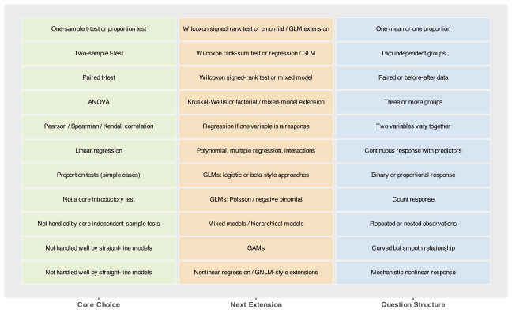

> **NOTE:**
>
> - how two questions about your data narrow the choice to one method family
> - a visual reference grid linking question structure to method
> - when to leave the core tests behind and move into modelling

> **NOTE:**
>
> - Here is a [course synthesis](../../cheatsheets/cheatsheet-course-synthesis.pdf) for BCB744 Biostatistics.
> - Find here a [cheatsheet](../../cheatsheets/cheatsheet-inferential-stats.pdf) on statistical methods.
> - Here is a [study design cheatsheet](../../cheatsheets/cheatsheet-study-design.pdf).

> **IMPORTANT:**
>
> - None

By this point, you have already met the main inferential tools one by one. What is often still missing is a reliable way to navigate among them without treating statistics as a software menu. This chapter closes the inferential block by bringing those separate procedures back under one decision structure.

The important shift is that method choice should follow from the biological question, the response type, and the design structure that produced the data. When those are clear, the correct family of methods narrows quickly. When they are vague, no decision grid can rescue the analysis.

# 1 Two important questions

By now you have met the main tools: *t*-tests, ANOVA, and correlation. Choosing among them, and knowing when none of them is quite right, comes down to two questions about your data.

**Question 1: What kind of response variable do you have?**

Most biological responses are continuous measurements (length, mass, concentration). Some are binary or proportional (success/failure, proportion infected). Others are counts (number of individuals, number of events). The response type determines which model family is even sensible.

**Question 2: What does the explanatory structure look like?**

You are either comparing groups or describing a relationship. If you are comparing groups, how many, and are the observations in each group independent of one another or paired? If you are describing a relationship, is the predictor categorical or continuous?

That is really all you need to start. The method families I introduce in this course each answer one combination of those two questions. [Figure 1](#fig-method-selection-grid) shows the connections at a glance.

[](10-test-selection_files/figure-html/fig-method-selection-grid-1.svg "Figure 1: Links from common biological question types to the main method and the next extension when the problem becomes more complex.")

Figure 1: Links from common biological question types to the main method and the next extension when the problem becomes more complex.

# 2 The core tests

## 2.1 Comparing a single group to a reference

If you have one sample and want to know whether the mean is consistent with some reference value, use a **one-sample *t*-test**. The reference might be a regulatory threshold, a historical baseline, or a theoretical expectation. When the data are too skewed for a mean-based summary to be sensible, the **Wilcoxon signed-rank test** provides a rank-based alternative. Both are in [Chapter 7](../../BCB744/basic_stats/07-t_tests.llms.md).

## 2.2 Comparing two groups

Two independent groups call for a **two-sample *t*-test**. When the same individuals or plots are measured under two conditions, or before and after a treatment, use a **paired *t*-test** instead. Pairing removes background noise and often sharpens the comparison. When group spreads differ noticeably, prefer Welch’s version, which makes no assumption of equal variance. Rank-based alternatives ([`wilcox.test()`](https://rdrr.io/r/stats/wilcox.test.html)) are available when the distributional assumptions fail clearly. All of this is in [Chapter 7](../../BCB744/basic_stats/07-t_tests.llms.md).

## 2.3 Comparing three or more groups

Once there are three or more groups, **ANOVA** replaces the *t*-test. Although the reasoning is the same (we still compare means), ANOVA keeps the false-positive rate in check across all comparisons at once. Factorial ANOVA extends this to two or more categorical factors and their interaction. When group spreads are unequal, Welch’s ANOVA applies. **Kruskal-Wallis** is the rank-based fallback. These are in [Chapter 8](../../BCB744/basic_stats/08-anova.llms.md).

## 2.4 Asking whether two variables move together

When the aim is association between two continuous variables and neither is designated the response, use **correlation**. Pearson’s *r* captures linear association; Spearman’s *ρ* and Kendall’s *τ* work on ranks and are appropriate when the relationship is monotone but not linear, or when the data contain outliers. Correlation says nothing about prediction or cause — if you want a response model, move to regression instead. [Chapter 9](../../BCB744/basic_stats/09-correlation-and-association.llms.md) covers this.

## 2.5 Modelling how one variable responds to another

When one variable is clearly the response and the other is used to explain it, move from correlation to **regression**. The simplest case is **simple linear regression**, where the response changes approximately linearly with the predictor. When the relationship is bendy, extend the model rather than forcing a straight line. **Polynomial regression** describe different ways the mean response can vary with the predictor within the same simple linear regression framework, but other ways to deal with non-linearity sit outside of the “core” group of tests and models. Regression is developed in [Chapter 12](../../BCB744/basic_stats/12-simple-linear-regression.llms.md) and extended in later chapters.

> **IMPORTANT:**
>
> For each research question below, identify the correct method from the five core-test subsections above. Be specific: state whether you would use a one-sample *t*-test, two-sample *t*-test, paired t-test, ANOVA, or correlation, and give a one-sentence justification.
>
> 1.  A marine biologist measures the shell width of 25 mussels and wants to know if it exceeds the minimum harvestable size of 45 mm.
> 2.  A nutritionist checks whether dietary fat intake (g/day) is related to blood cholesterol (mmol/L) in 60 adults.
> 3.  An ecologist compares seed germination rates (%) across four light treatments.
> 4.  A physiologist measures blood glucose in 20 rats before and after an insulin injection.
> 5.  A forester compares the diameter at breast height in a treated forest stand versus an untreated control stand.

# 3 Beyond the core tests

The core tests cover a lot of ground, but they rest on assumptions that do not always hold.

> **NOTE:**
>
> As you move into more advanced methods, some naming patterns start to help:
>
> - **Generalised …** usually means that the basic linear-model idea has been extended to allow response variables that are not continuous Gaussian measurements. For example, a **generalised linear model** lets the response follow distributions such as binomial or Poisson instead of the ordinary normal-error model used in simple linear regression.
> - **Mixed …** usually means that the model contains both **fixed effects** (the main predictors you want to estimate and interpret) and **random effects** (terms that account for grouping, repeated measurements, nesting, or other non-independence in the design). A **linear mixed model** is the standard example.
>
> This terminology is useful because it lets you recognise what kind of complication a method is designed to handle. If you later encounter names such as **generalised additive model**, **generalised linear mixed model**, or **nonlinear mixed model**, the name already tells you something important about the model: whether it is extending the response distribution, the dependence structure, the shape of the relationship, or some combination of these. Learning to read the names of methods in this way will make the more advanced chapters much easier to navigate.

**Use GLMs** when the response is not continuous and Gaussian. Counts, proportions, and binary outcomes each have their own distributional family, and forcing them into a Gaussian model produces unreliable inference. [Chapter 20](../../BCB744/basic_stats/20-generalised-linear-models.llms.md) introduces GLMs.

**Use mixed models** when observations are not independent, such as repeated measurements on the same individual, samples nested within sites, or any design where the experimental unit is not the same as the observational unit. The problem is one of design, not of distribution, and it cannot be fixed by transforming the response. [Chapter 19](../../BCB744/basic_stats/19-dependence-and-mixed-models.llms.md) addresses this.

**Apply GAMs** when the relationship is clearly curved in ways a straight line cannot describe, or use **nonlinear regression** when the shape of the relationship is tied in a mechanistic way to the biological phenomenon. [Chapter 21](../../BCB744/basic_stats/21-generalised-additive-models.llms.md) and [Chapter 22](../../BCB744/basic_stats/22-nonlinear-regression.llms.md) cover these extensions.

> **IMPORTANT:**
>
> Each scenario below clearly breaks the boundary of the core tests. For each one, identify which extension applies (GLM, mixed model, GAM, or nonlinear regression) and explain in one sentence why the standard core test is not adequate:
>
> 1.  You monitor the same 30 fish at four time points and want to compare their growth trajectories.
> 2.  You record the presence/absence of a disease across 200 animals and want to relate it to three continuous predictors.
> 3.  You measure how predation rate changes with prey density and the pattern follows a saturating (Holling Type II) curve.
> 4.  Phytoplankton chlorophyll concentration follows a clearly non-monotonic, hump-shaped relationship with depth.
>
> Maybe revisit these questions once you’ve familiarised yourself with the advanced methods.

# 4 Assumptions: check before you proceed

Every method in the table rests on assumptions. The most consequential one is **independence**: if your observations are not independent of one another (because they come from the same individual, the same site, or a before-after design) no distributional fix will rescue the analysis. This was cast in stone when you designed your sampling campaign or experiment, and the data properties have nothing to do with it.

After independence, check whether the distributional assumptions are roughly plausible. For the core *t*-tests and ANOVA, the concern is strong skew or extreme outliers. Use the checks introduced in [Chapter 6](../../BCB744/basic_stats/06-assumptions-and-transformations.llms.md). If the assumptions fail clearly, there is usually a rank-based alternative or a transformation that gets you back on solid ground.

Do not switch methods without being able to say which assumption failed and why. Choosing a non-parametric test because you have heard it is “safer” is not a reason.

> **IMPORTANT:**
>
> Answer the two questions above for each of the following biological scenarios and decide which method family applies. Write your answers in the format: “Response type: \[X\]. Explanatory structure: \[Y\]. Method: \[Z\].”
>
> 1.  You compare the running speed (m/s) of 40 lizards from a hot habitat versus 40 from a cool habitat.
> 2.  You record whether 200 fish (binary: alive or dead) survived a hypoxia event at three oxygen levels.
> 3.  You measure the growth rate of 30 bacteria colonies (mm/day) and ask whether it is correlated with ambient temperature.
> 4.  You track the mass of 15 individual frogs before and after a cold season.
> 5.  You compare plant height across five fertiliser treatments (12 plants per treatment).
>
> After classifying each, check your answers against the grid above.

> **IMPORTANT:**
>
> Look at the five scenarios listed in the previous. For each one, identify the most likely assumption-checking step you would perform before running the test you selected. Then, for scenario (b) (fish survival, binary response), explain why no amount of checking for normality within groups will help, and what you should do instead.
>
> As a final synthesis exercise, take any dataset you have been working with this semester and classify it using the two questions at the start of this chapter. Map it to the grid, identify the appropriate method, and briefly note which assumption you would check first.

# 5 Conclusion

The purpose of this chapter is to show that a small number of design and data questions do most of the work in narrowing the choice of method. Once you know what the response is, how the explanatory structure is organised, and whether the observations are independent, the inferential landscape becomes much easier to navigate.

This also marks a transition in the course. The chapters so far have focused on named inferential procedures for common question types. From the next chapter onward, I move into models as the main analytical framework. Instead of choosing among isolated tests, I begin to think in terms of fitted mean structure, residuals, diagnostics, and model revision.

## Reuse

[CC BY-NC-SA 4.0](https://creativecommons.org/licenses/by-nc-sa/4.0/)

## Citation

BibTeX citation:

``` quarto-appendix-bibtex
@online{smit2026,
  author = {Smit, A. J.},
  title = {10. {Finding} Your Way on the Statistical Landscape},
  date = {2026-11-06},
  url = {https://tangledbank.netlify.app/BCB744/basic_stats/10-test-selection.html},
  langid = {en}
}
```

For attribution, please cite this work as:

Smit AJ (2026) 10. Finding your way on the statistical landscape. [https://tangledbank.netlify.app/BCB744/basic_stats/10-test-selection.html.](https://tangledbank.netlify.app/BCB744/basic_stats/10-test-selection.html)
