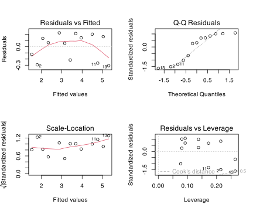
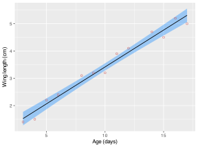
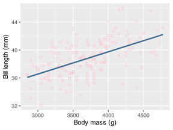
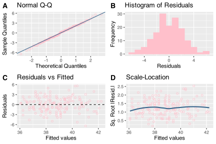
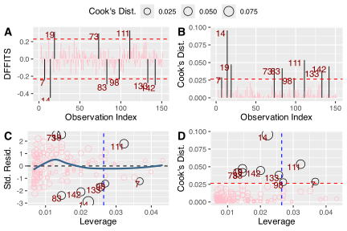
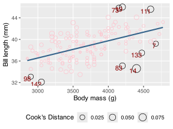
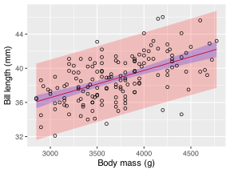

> **NOTE:**
>
> - what a simple linear regression model is;
> - when regression is more appropriate than correlation;
> - the assumptions behind a straight-line model;
> - how to fit a model with [`lm()`](https://rdrr.io/r/stats/lm.html);
> - how to diagnose normality, homoscedasticity, linearity, and outliers;
> - how to interpret slopes, fitted values, confidence intervals, and prediction intervals;
> - how explanatory and predictive uses of the same regression differ;
> - how to report a regression in the style of a Results section.

> **IMPORTANT:**
>
> - Self-Assessment Task 12-1 **(/10)**
> - Self-Assessment Task 12-2 **(/30)**
> - [Self-Assessment instructions and full task overview](../../BCB744/tasks/BCB744_Biostats_Self-Assessment.llms.md)

Linear models are among the most useful statistical tools available to biologists because they describe and quantify how a **response** variable, $Y$, changes as one or more **predictor** variables, $X$, change. In statistics, a model is a mathematical representation of a real process. It is not reality itself, but an idealised description of the part of reality we want to understand. Linear models are especially valuable because they are simple enough to interpret, yet flexible enough to support a large part of modern statistical practice.

In the broadest sense, a linear model is one in which the unknown parameters enter linearly, even if the variables themselves are transformed or combined in more elaborate ways. The most basic member of that family is the **simple linear model**, which is the focus of this chapter. It has one continuous predictor and one continuous response, and it is fitted by **simple linear regression**. The goal may be *explanatory*, where the predictor is hypothesised to influence the response, or *predictive*, where I simply want a formula that estimates likely values of the response from observed values of the predictor. A causal interpretation is therefore common, but it is not required.

Regression analysis is the procedure by which I estimate the model parameters from data. The aim is to fit the model that best captures the observed response-predictor relationship and then interpret the strength, direction, and uncertainty of that relationship. This differs from [correlation](../../BCB744/basic_stats/09-correlation-and-association.llms.md), which quantifies association without imposing a response-predictor structure. When one variable changes systematically with another but neither prediction nor a defensible response-predictor distinction is of interest, correlation is usually the more appropriate tool.

As established in [Chapter 11](../../BCB744/basic_stats/11-residuals-and-model-based-diagnostics.llms.md), every observed response can be written as $Y_i = \hat{Y}_i + e_i$, where $\hat{Y}_i$ is the fitted value and $e_i$ is the residual. In the previous chapter I focused on residuals, fitted values, and the diagnostic thinking used to assess whether a model is behaving adequately. Here I carry that thinking into the first full regression model in the course and show how the equation, the slope, the fitted line, and the diagnostics all belong to one workflow.

Simple linear regression is therefore the entry point to the wider model-based framework. From here I move to [polynomial regression](../../BCB744/basic_stats/13-polynomial-regression.llms.md), where curvature is handled within the linear-model framework; to [multiple regression](../../BCB744/basic_stats/14-multiple-regression-and-model-specification.llms.md), where several predictors act simultaneously; to [interaction terms](../../BCB744/basic_stats/15-interaction-effects.llms.md), where the effect of one predictor depends on another; and later to [generalised linear models](../../BCB744/basic_stats/20-generalised-linear-models.llms.md), where the same modelling thinking is extended to non-normal responses by introducing a link function and a different error distribution. If the response-predictor structure is defensible and a straight-line mean relationship is biologically plausible, simple linear regression is usually the correct place to begin.

# 1 Main concepts

These ideas organise the chapter.

- **Simple linear regression** models one continuous response as a function of one continuous predictor.
- **The response-predictor distinction** is essential because it is not simply putting a line onto a correlation scatter plot.
- **The slope** is usually the main inferential quantity because it describes the expected change in the response for a one-unit change in the predictor.
- **The intercept** is often less biologically interesting, but it is still part of the fitted model.
- **Residuals** are central to assumption checking because they reveal structure that the model has failed to capture.
- **Confidence intervals** and **prediction intervals** answer different questions and should not be confused.

# 2 Nature of the data and assumptions

## 2.1 Requirements before fitting

As the experimenter, you must ensure the following requirements *before* a simple linear regression is fitted:

1.  **A defensible response-predictor structure:** There should be a theoretical or philosophical basis for treating one variable as the predictor and the other as the response. This may be explicitly causal, but it can also be predictive if that distinction is still biologically sensible.

2.  **Independence of observations:** Each measured value of the response must be independent of the others. If repeated measurements, clustered sampling, or temporal dependence are present, a different modelling framework may be required.

    When temporal or spatial order is plausible, plot residuals against the order in which observations were collected. Runs of positive or negative residuals, or systematic cycles, indicate dependence that the model has not captured. For the sparrow and penguin examples you will encounter below, measurements are treated as independent, so this check is not performed here.

3.  **Continuous predictor:** The predictor variable should be continuous.

4.  **Continuous response:** The response variable should also be continuous.

## 2.2 Assumptions to check after fitting

After the model has been fitted, the following assumptions must be checked:

1.  **Normality:** The residuals $e_i$ should be approximately normally distributed.
2.  **Homoscedasticity:** The variance of the residuals $e_i$ should be roughly constant across the fitted values.
3.  **Linearity:** The mean relationship between the predictor and the response should be approximately linear.
4.  **Measurement error in the predictor:** Standard linear regression assumes that the predictor is measured without serious error. In practice this is only approximately true, and we return to this issue in [Chapter 16](../../BCB744/basic_stats/16-collinearity-confounding-measurement-error.llms.md).

As in the earlier inferential chapters, you must pay attention to the workflow. We first inspect the data (EDA and graphically), then fit the model, then examine the residuals (graphically first, then assumption tests if desired), and *only then* interpret the coefficients with confidence.

## 2.3 Assumption and diagnostics

The table below summarises which diagnostic tool targets which assumption and what pattern to watch for.

| Assumption | What it concerns | Main diagnostic | Visual signal to watch for |
|----|----|----|----|
| Linearity | mean structure | residual vs fitted plot | slope or curvature in residuals |
| Constant variance | spread | residual vs fitted / scale-location | funnel or changing vertical spread |
| Normality | residual distribution | residual Q-Q plot | systematic bends away from reference line |
| Independence | relationship among residuals | residuals vs order/time/space | runs, cycles, clusters |

# 3 The model

Simple linear regression is the first statistical method in the work we have done thus far in which we write an explicit equation (the model) for the mean response and then estimate its parameters from data.

The model is:

$$Y_i = \alpha + \beta X_i + \epsilon_i \tag{1}$$

In [Equation 1](#eq-slr-model), $Y_i$ is the response for observation $i$, $X_i$ is the predictor, $\alpha$ is the intercept, $\beta$ is the slope, and $\epsilon_i$ is the error term. Errors $\epsilon_i$ are unobserved theoretical quantities. Residuals $e_i$ are their observed estimates, computed after fitting, and are the objects used for diagnostic checks.

The line is fitted by minimising the sum of squared residuals. This is why ordinary linear regression is often called an **ordinary least squares** method.

The animation below shows the fitted line rotating through the data as the error sum of squares is minimised.

Your browser does not support the video tag.

> **NOTE:**
>
> The model contains errors $\epsilon_i$, which are the unobserved theoretical deviations of each true response from the straight-line mean. In most regression models we assume that the errors are independent and identically distributed (i.i.d.). When the errors are approximately normal this can be written as $\epsilon_i \sim N(0, \sigma^2)$. The requirement of mean zero implies that, on average, the model does not systematically over- or under-predict. Constant variance implies that the spread of errors is roughly similar across the predictor range. Independence implies that errors do not carry systematic structure from one observation to the next.
>
> The residuals $e_i = Y_i - \hat{Y}_i$ are the observed estimates of these unobserved errors. It is the residuals that are available after fitting and that we inspect in diagnostic plots.
>
> Violation of these assumptions can lead to biased or inefficient parameter estimates, poor uncertainty estimates, and misleading inference.

The next section formalises how the line is chosen from the data.

> **IMPORTANT:**
>
> Before fitting any model, take a moment to check whether simple linear regression is the right tool. For each scenario below, decide whether the method is appropriate and identify any requirement that is not met:
>
> | Scenario | Appropriate? | Which requirement, if any, fails? |
> |----|----|----|
> | Plant height (continuous) modelled as a function of rainfall (continuous); one measurement per plant | ? | ? |
> | Blood pressure measured five times on each of 20 patients; modelled as a function of time | ? | ? |
> | Species presence/absence modelled as a function of temperature | ? | ? |
> | Tree diameter (continuous) modelled as a function of stand density (continuous); trees within the same plot share resources | ? | ? |
>
> Discuss your answers with a partner and then read on to check them against the requirements listed above.

# 4 The fitting rule

The least-squares criterion used by [`lm()`](https://rdrr.io/r/stats/lm.html) is to choose $\alpha$ and $\beta$ so that the residual sum of squares is as small as possible:

$$\text{RSS} = \sum_{i=1}^{n}(Y_i - \hat{Y}_i)^2 \tag{2}$$

[Equation 2](#eq-rss) is not a regression model. It is the fitting rule that tells us how the software decides which of all possible straight lines is the best-fitting one.

# 5 R function

The main function used in this chapter is [`lm()`](https://rdrr.io/r/stats/lm.html):

``` numberSource
lm(response ~ predictor, data = df)
```

You can read the formula `response ~ predictor` as “the response is modelled as a function of the predictor.”

The fitted model can then be explored with functions such as:

- [`summary()`](https://rdrr.io/r/base/summary.html) for the coefficients and overall fit;
- [`confint()`](https://rdrr.io/r/stats/confint.html) for confidence intervals around the coefficients;
- `augment()` from **broom** for fitted values and residuals;
- [`predict()`](https://rdrr.io/r/stats/predict.html) for confidence and prediction intervals;
- [`plot()`](https://rdrr.io/r/graphics/plot.default.html) for standard diagnostic plots;
- `bptest()` from **lmtest** for a formal test of heteroscedasticity.

> **IMPORTANT:**
>
> Fit the sparrow model by hand before running [`lm()`](https://rdrr.io/r/stats/lm.html). The least-squares slope is $\hat{\beta} = r \cdot (s_Y / s_X)$ and the intercept is $\hat{\alpha} = \bar{Y} - \hat{\beta}\bar{X}$.
>
> ``` numberSource
> sparrows <- tibble(
>   age  = c(3, 4, 5, 6, 8, 9, 10, 11, 12, 14, 15, 16, 17),
>   wing = c(1.4, 1.5, 2.2, 2.4, 3.1, 3.2, 3.2, 3.9, 4.1, 4.7, 4.5, 5.2, 5.0)
> )
> ```
>
> Then verify your hand-calculated values against `lm(wing ~ age, data = sparrows)`. Do they match? Explain in one sentence why the slope formula involves both the correlation and the ratio of standard deviations.

# 6 Outliers and their impact on simple linear regression

Outliers are data points that deviate substantially from the overall pattern or trend observed in the data. They can have disproportionate effects on a simple linear regression because the fitted line is estimated by minimising squared residuals, as in [Equation 2](#eq-rss). Extreme observations may therefore influence the slope, the intercept, the standard errors, the confidence intervals, and the diagnostic patterns.

This does not mean that unusual observations must automatically be removed. Some are recording errors and should be corrected or excluded. Others are rare but real biological events and may carry important information. The correct response is therefore to identify potentially influential points, inspect them carefully, and decide whether they reveal error, unusual but valid biology, or a more fundamental model problem.

# 7 Example 1: Sparrow wing length and age

> **NOTE:**
>
> 1.  Fit the model with [`lm()`](https://rdrr.io/r/stats/lm.html).
> 2.  Plot residuals versus fitted values then check for curvature (linearity) and changing spread (constant variance).
> 3.  Plot the residual Q-Q plot and check whether the residual distribution is close enough to normal.
> 4.  If temporal or spatial order is plausible, plot residuals against order and check for runs or cycles (independence).
> 5.  Inspect Cook’s distance and leverage and identify observations with disproportionate influence.
> 6.  Revise the model if any diagnostic reveals leftover structure.

I begin with a very small sparrow dataset because it makes the general approach clear. I then go to a fuller worked example using the Adelie penguin data from the `palmerpenguins` package, which is much closer to the style and level of complexity encountered in real biological analyses.

[TABLE]

Table 1: Sparrow wing-length data used in the introductory simple linear regression example.

> **IMPORTANT:**
>
> Before looking at the sparrow scatter plot, sketch what you expect the relationship between age and wing length to look like based on your biological knowledge alone. Then run the code below and compare your sketch with the actual data:
>
> ``` numberSource
> ggplot(sparrows, aes(x = age, y = wing)) +
>   geom_point(shape = 1, colour = "indianred") +
>   labs(x = "Age (days)", y = "Wing length (cm)")
> ```
>
> Does a straight line look like a reasonable summary of this relationship? Are there any obvious outliers or influential-looking points at the extremes of the age range?

## 7.1 Do an exploratory data analysis (EDA)

The sparrow data show the basic form of a simple linear model.

``` numberSource
summary(sparrows)
```

          age          wing      
     Min.   : 3   Min.   :1.400  
     1st Qu.: 6   1st Qu.:2.400  
     Median :10   Median :3.200  
     Mean   :10   Mean   :3.415  
     3rd Qu.:14   3rd Qu.:4.500  
     Max.   :17   Max.   :5.200  

[](12-simple-linear-regression_files/figure-html/fig-sparrow-1.svg "Figure 1: Wing length of sparrows at different ages.")

Figure 1: Wing length of sparrows at different ages.

In [Figure 1](#fig-sparrow), the scatter plot suggests a clear positive linear relationship: older sparrows tend to have longer wings, and the relationship appears close to linear over the range of the data. This example makes the fitted line and the slope easy to understand before we look at a noisier dataset.

## 7.2 State the model question and hypothesis

With the sparrow example, I ask whether wing length changes systematically with age.

The statistic of interest in a simple linear regression is usually the slope in [Equation 1](#eq-slr-model), which quantifies the magnitude and direction of dependence of the response on the predictor:

$$H_{0}: \beta = 0$$ $$H_{a}: \beta \ne 0$$

If the slope is zero (a more-or-less horizontal line), there is no linear relationship between the predictor and the expected value of the response. If the slope differs from zero, then the predictor helps explain variation in the response.

## 7.3 Fit the model

``` numberSource
sparrow_mod <- lm(wing ~ age, data = sparrows)
summary(sparrow_mod)
```

    Call:
    lm(formula = wing ~ age, data = sparrows)

    Residuals:
         Min       1Q   Median       3Q      Max 
    -0.30699 -0.21538  0.06553  0.16324  0.22507 

    Coefficients:
                Estimate Std. Error t value Pr(>|t|)    
    (Intercept)  0.71309    0.14790   4.821 0.000535 ***
    age          0.27023    0.01349  20.027 5.27e-10 ***
    ---
    Signif. codes:  0 '***' 0.001 '**' 0.01 '*' 0.05 '.' 0.1 ' ' 1

    Residual standard error: 0.2184 on 11 degrees of freedom
    Multiple R-squared:  0.9733,    Adjusted R-squared:  0.9709 
    F-statistic: 401.1 on 1 and 11 DF,  p-value: 5.267e-10

> **NOTE:**
>
> `summary(lm())` organises its output into four sections.
>
> **Coefficients table**, one row per estimated parameter.
>
> | Column | What it contains |
> |----|----|
> | `Estimate` | $\hat\beta$ is the fitted value of the coefficient. For the intercept this is the predicted response when $x = 0$; for a slope it is the predicted change in $y$ per one-unit increase in $x$. |
> | `Std. Error` | The standard error of $\hat\beta$, measuring how precisely the coefficient is estimated from these data. |
> | `t value` | $\hat\beta \;/\; \text{Std. Error}$ measures how many standard errors the estimate lies from zero. Large $|t|$ means the coefficient is far from zero relative to its uncertainty. |
> | `Pr(>|t|)` | The two-sided *p*-value for $H_0: \beta = 0$. A small value means the data are unlikely under the assumption that this coefficient is zero. |
>
> **Residual standard error** ($s$) is the square root of the residual mean square:
>
> $$s = \sqrt{\frac{\sum(y_i - \hat{y}_i)^2}{n - p - 1}}$$
>
> where $p$ is the number of predictors (1 for simple regression). It is the typical prediction error in the units of the response and is the regression counterpart of the within-group mean square from ANOVA.
>
> $R^2$ and Adjusted $R^2$: $R^2 = 1 - SS_\text{residual}/SS_\text{total}$ is the proportion of variance in $y$ explained by the model. Adjusted $R^2$ applies a penalty for the number of predictors:
>
> $$R^2_{\text{adj}} = 1 - \frac{(1 - R^2)(n-1)}{n - p - 1}$$
>
> It does not automatically increase when a predictor is added, unlike $R^2$.
>
> $F$-statistic at the bottom of the output is the overall model test. It compares the fitted model against the null model (intercept only) by forming the ratio $MS_\text{model} / MS_\text{residuals}$, with degrees of freedom $p$ and $n - p - 1$. For simple regression ($p = 1$) the overall $F$ equals $t^2$ from the slope row, and the two *p*-values are identical.

> **IMPORTANT:**
>
> 1.  Examine the contents of the regression model object `sparrow_mod`. Explain the main components and how they relate to `summary(sparrow_mod)`. **☐ (/3)**
> 2.  Using values inside the model object, show how to reconstruct the observed response values from the fitted values and residuals. **☐ (/3)**
> 3.  Fit a linear regression through the model residuals and explain the result. **☐ (/2)**
> 4.  Fit a linear regression through the fitted values and explain the result. **☐ (/2)**

> **IMPORTANT:**
>
> Read the [`summary()`](https://rdrr.io/r/base/summary.html) output for `sparrow_mod` carefully. Without using a calculator, answer the following questions from the printed output:
>
> 1.  What is the estimated slope, and what does it tell you about the expected change in wing length per additional day of age?
> 2.  What is the $p$-value for the slope, and what conclusion do you draw about $H_0: \beta = 0$?
> 3.  The residual standard error is printed near the bottom of the summary. What does this number represent in the units of the response variable?
> 4.  What does $R^2 \approx 0.97$ tell you about how much of the variation in wing length the model accounts for?
>
> Discuss your answers with a partner before continuing.

## 7.4 Test the assumptions

Assumptions in regression are checked after fitting the model.

``` numberSource
sparrow_aug <- augment(sparrow_mod)
sparrow_aug |>
  select(age, wing, .fitted, .resid) |>
  head()
```

    # A tibble: 6 × 4
        age  wing .fitted  .resid
      <dbl> <dbl>   <dbl>   <dbl>
    1     3   1.4    1.52 -0.124 
    2     4   1.5    1.79 -0.294 
    3     5   2.2    2.06  0.136 
    4     6   2.4    2.33  0.0655
    5     8   3.1    2.87  0.225 
    6     9   3.2    3.15  0.0548

[](12-simple-linear-regression_files/figure-html/fig-sparrow-diagnostics-1.svg "Figure 2: Standard diagnostic plots for the sparrow simple linear regression. Clockwise from top left: residuals versus fitted values (linearity and constant variance), normal Q-Q plot (residual normality), residuals versus leverage (influential observations), and scale-location plot (homoscedasticity).")

Figure 2: Standard diagnostic plots for the sparrow simple linear regression. Clockwise from top left: residuals versus fitted values (linearity and constant variance), normal Q-Q plot (residual normality), residuals versus leverage (influential observations), and scale-location plot (homoscedasticity).

### 7.4.1 Normality

The Q-Q panel in [Figure 2](#fig-sparrow-diagnostics) shows the sample quantiles of the residuals plotted against the theoretical quantiles of a normal distribution. For these data the points track close to the reference line, indicating that the residuals do not depart strongly from normality.

### 7.4.2 Homoscedasticity

The residuals-versus-fitted panel in [Figure 2](#fig-sparrow-diagnostics) does not reveal a systematic funnel or wedge pattern. The spread of residuals appears reasonably even across the range of fitted values, consistent with the constant-variance assumption.

### 7.4.3 Influential observations

Because the dataset contains only 13 observations, formal influence diagnostics have limited statistical power. No single observation stands out dramatically in the scale-location or Cook’s-distance panels, but conclusions based on such a small sample should be interpreted cautiously.

In [Figure 2](#fig-sparrow-diagnostics), the diagnostic plots suggest that the model is broadly adequate for these data. The residuals do not show severe curvature, the spread is reasonably even, and the Q-Q plot does not suggest a dramatic departure from normality. Because the dataset is small, these plots should be interpreted cautiously, but there is no obvious reason to abandon the linear model.

## 7.5 Interpret the results

Inference applies within the observed range of the predictor. Extrapolation beyond the data is possible but requires explicit justification, because the straight-line form may not hold outside the observed range.

I construct the final model fit as a figure, which I will use in my reporting.

[](12-simple-linear-regression_files/figure-html/fig-sparrow-results-1.svg "Figure 3: Wing length as a function of age in the sparrow example. The straight line is the fitted simple linear regression and the blue shading is the 95% confidence interval.")

Figure 3: Wing length as a function of age in the sparrow example. The straight line is the fitted simple linear regression and the blue shading is the 95% confidence interval.

In [Figure 3](#fig-sparrow-results), the fitted slope is positive, which means that wing length increases with age. In this example, the slope estimate is about 0.27 cm per day, so the model implies that the expected wing length increases by roughly 0.27 cm for each additional day of age across the range of these observations.

The intercept is the expected wing length when age is zero. Here that value is not biologically the main point of interest. It is simply the point where the fitted line crosses the vertical axis.

The model explains a large proportion of the variation in the observed wing lengths ($R^2 \approx 0.97$), and the test of the slope provides very strong evidence that the linear relationship is not zero ($p < 0.001$).

## 7.6 Reporting

> **NOTE:**
>
> **Methods**
>
> The relationship between sparrow wing length and age was assessed with a simple linear regression, with wing length as the response variable and age as the continuous predictor. Model adequacy was evaluated from standard residual diagnostics.
>
> **Results**
>
> Sparrow wing length increased strongly with age in the fitted simple linear regression ($\beta = 0.270$, 95% CI: 0.241 to 0.300; $R^2 = 0.97$; $p < 0.001$) ([Figure 3](#fig-sparrow-results)). Across the observed age range, older birds therefore had consistently longer wings, with the expected wing length increasing by about 0.27 cm for each additional day of age.
>
> **Discussion**
>
> This example is useful because it makes the biological interpretation of the slope very clear: age is associated with a strong increase in wing length over the observed range, and the fitted line captures most of the variation in these simple demonstration data.

> **IMPORTANT:**
>
> Use the sparrow model to generate predictions for two new ages and compare the confidence and prediction intervals:
>
> ``` numberSource
> new_ages <- tibble(age = c(6, 14))
> predict(sparrow_mod, newdata = new_ages, interval = "confidence")
> predict(sparrow_mod, newdata = new_ages, interval = "prediction")
> ```
>
> Answer the following:
>
> 1.  Which interval is wider at each age, and why?
> 2.  Both intervals are wider at age 14 than at age 6 relative to the interval at the mean age. Explain why interval width varies across the predictor range.
> 3.  Would you trust a prediction for age 25? Why or why not?

# 8 Example 2: Adelie penguin bill length and body mass

The following example uses the `penguins` dataset from the `palmerpenguins` package to model bill length as a function of body mass in Adelie penguins.

Although I could also calculate a correlation, I will use a simple linear regression because I want a predictive model that estimates bill length from body mass. This is a defensible use of simple linear regression even though I am not claiming that body mass directly causes bill length.

``` numberSource
Adelie <- penguins[penguins$species == "Adelie", ]
Adelie <- Adelie[-4, ]
```

| Bill length (mm) | Body mass (g) |
|------------------|---------------|
| 39.1             | 3750          |
| 39.5             | 3800          |
| 40.3             | 3250          |
| 36.7             | 3450          |
| 39.3             | 3650          |
| 38.9             | 3625          |

Table 2: Size measurements for adult foraging Adelie penguins near Palmer Station, Antarctica.

## 8.1 Do an exploratory data analysis (EDA)

``` numberSource
dim(Adelie)
```

    [1] 151   8

``` numberSource
summary(Adelie)
```

          species          island   bill_length_mm  bill_depth_mm  
     Adelie   :151   Biscoe   :44   Min.   :32.10   Min.   :15.50  
     Chinstrap:  0   Dream    :56   1st Qu.:36.75   1st Qu.:17.50  
     Gentoo   :  0   Torgersen:51   Median :38.80   Median :18.40  
                                    Mean   :38.79   Mean   :18.35  
                                    3rd Qu.:40.75   3rd Qu.:19.00  
                                    Max.   :46.00   Max.   :21.50  
     flipper_length_mm  body_mass_g       sex          year     
     Min.   :172       Min.   :2850   female:73   Min.   :2007  
     1st Qu.:186       1st Qu.:3350   male  :73   1st Qu.:2007  
     Median :190       Median :3700   NAs   : 5   Median :2008  
     Mean   :190       Mean   :3701               Mean   :2008  
     3rd Qu.:195       3rd Qu.:4000               3rd Qu.:2009  
     Max.   :210       Max.   :4775               Max.   :2009  

We see that the dataset contains many more observations than the sparrow example. I focus here on `body_mass_g` and `bill_length_mm`. Both are continuous, and restricting the analysis to Adelie penguins gives me a relatively coherent biological subset for the example.

## 8.2 Create a plot

Code

``` numberSource
ggplot(Adelie,
       aes(x = body_mass_g, y = bill_length_mm)) +
  geom_smooth(method = "lm", linewidth = 0.4, alpha = 0.4,
              colour = "black", se = TRUE, fill = "dodgerblue") +
  geom_point(shape = 1, colour = "indianred") +
  labs(x = "Body mass (g)", y = "Bill length (mm)")
```

[](12-simple-linear-regression_files/figure-html/fig-penguin-slr-1.svg "Figure 4: Scatter plot of the Palmer Station Adelie penguin data with a best fit line.")

Figure 4: Scatter plot of the Palmer Station Adelie penguin data with a best fit line.

In [Figure 4](#fig-penguin-slr), there is also a clear positive relationship between body mass and bill length despite considerable scatter. This relationship appears linear enough to justify a simple linear model as a first approximation. Creating a publication-quality plot complete with the regression line in place preempts the model fitting, but I can use it later for reporting should it turn out that the model fit is defensible.

## 8.3 State the hypothesis

$$H_{0}: \beta = 0$$ $$H_{a}: \beta \ne 0$$

The null hypothesis is that body mass has no linear association with bill length, while the alternative is that the slope differs from zero.

If the slope is zero, then the predictor does not explain systematic change in the expected response.

## 8.4 Fit the model

``` numberSource
mod1 <- lm(bill_length_mm ~ body_mass_g,
           data = Adelie)
summary(mod1)
```

    Call:
    lm(formula = bill_length_mm ~ body_mass_g, data = Adelie)

    Residuals:
        Min      1Q  Median      3Q     Max 
    -6.4208 -1.3690  0.1874  1.4825  5.6168 

    Coefficients:
                 Estimate Std. Error t value Pr(>|t|)    
    (Intercept) 2.699e+01  1.483e+00  18.201  < 2e-16 ***
    body_mass_g 3.188e-03  3.977e-04   8.015 2.95e-13 ***
    ---
    Signif. codes:  0 '***' 0.001 '**' 0.01 '*' 0.05 '.' 0.1 ' ' 1

    Residual standard error: 2.234 on 149 degrees of freedom
    Multiple R-squared:  0.3013,    Adjusted R-squared:  0.2966 
    F-statistic: 64.24 on 1 and 149 DF,  p-value: 2.955e-13

## 8.5 Test the assumptions

To facilitate assumption checking I use `augment()` from **broom** to add fitted values, residuals, leverage, and related diagnostics to the data.

``` numberSource
mod1_data <- augment(mod1)
```

### 8.5.1 Normality

I use the Shapiro-Wilk test as one formal check of the residual distribution.

``` numberSource
shapiro.test(residuals(mod1))
```

        Shapiro-Wilk normality test

    data:  residuals(mod1)
    W = 0.99613, p-value = 0.9637

The formal test does not flag a serious departure from normality here, but graphical diagnostics are usually more informative than the test alone, especially in moderate samples where the test has limited power to detect mild departures.

Code

``` numberSource
p1 <- ggplot(mod1_data, aes(sample = .resid)) +
  stat_qq(shape = 1, colour = "pink") +
  stat_qq_line(colour = "steelblue4") +
  labs(title = "Normal Q-Q", x = "Theoretical Quantiles", y = "Sample Quantiles") +
  theme_grey()

p2 <- ggplot(mod1_data, aes(x = .resid)) +
  geom_histogram(binwidth = 1, fill = "pink", color = "pink") +
  labs(title = "Histogram of Residuals", x = "Residuals", y = "Frequency") +
  theme_grey()

p3 <- ggplot(mod1_data, aes(x = .fitted, y = .resid)) +
  geom_point(shape = 1, colour = "pink") +
  geom_hline(yintercept = 0, linetype = "dashed") +
  labs(title = "Residuals vs Fitted", x = "Fitted values", y = "Residuals") +
  theme_grey()

p4 <- ggplot(mod1_data, aes(x = .fitted, y = sqrt(abs(.resid)))) +
  geom_point(shape = 1, colour = "pink") +
  geom_smooth(se = FALSE, colour = "steelblue4") +
  labs(title = "Scale-Location", x = "Fitted values", y = "Sq. Root |Resid.|") +
  theme_grey()

ggarrange(p1, p2, p3, p4, nrow = 2, ncol = 2, labels = "AUTO")
```

[](12-simple-linear-regression_files/figure-html/fig-assump-plots-1.svg "Figure 5: Diagnostic plots for the simple linear regression of Adelie penguin bill length on body mass. A) Normal Q-Q plot. B) Histogram of residuals. C) Residuals versus fitted values. D) Scale-location plot.")

Figure 5: Diagnostic plots for the simple linear regression of Adelie penguin bill length on body mass. A) Normal Q-Q plot. B) Histogram of residuals. C) Residuals versus fitted values. D) Scale-location plot.

In [Figure 5](#fig-assump-plots), the Q-Q plot and histogram suggest that the residuals are approximately normally distributed. There is no obvious extreme departure that would make the model immediately unusable.

### 8.5.2 Homoscedasticity

The Breusch-Pagan test is one formal check of constant variance.

``` numberSource
bptest(mod1)
```

        studentized Breusch-Pagan test

    data:  mod1
    BP = 1.6677, df = 1, p-value = 0.1966

The formal test is consistent with the visual impression from the residual plots. Graphical inspection should take precedence: if the scale-location plot shows a clear trend, the spread is not constant regardless of the test p-value. The test does not suggest strong heteroscedasticity, and the residuals-versus-fitted and scale-location panels in [Figure 5](#fig-assump-plots) also indicate that the spread of residuals is reasonably even across the fitted range.

### 8.5.3 Check for outliers

Four complementary diagnostics reveal different facets of how individual observations affect the fitted model ([Figure 6](#fig-penguin-outliers1), [Figure 7](#fig-penguin-outliers2)): DFFITS, Cook’s distance, residuals versus leverage, and Cook’s distance versus leverage.

``` numberSource
cooksd_thresh <- 4 / nrow(mod1_data)
dffits_threshold <- 2 * sqrt(2 / nrow(Adelie))

mod1_data <- mod1_data %>%
  mutate(index = row_number(),
         leverage = hatvalues(mod1),
         dffits = dffits(mod1),
         colour = ifelse(.cooksd > cooksd_thresh, "black", "pink"))
```

Code

``` numberSource
plt1 <- ggplot(mod1_data, aes(x = index, y = dffits)) +
  geom_col(fill = ifelse(abs(mod1_data$dffits) > dffits_threshold, "black", "pink")) +
  geom_hline(yintercept = dffits_threshold, linetype = "dashed", colour = "red") +
  geom_hline(yintercept = -dffits_threshold, linetype = "dashed", colour = "red") +
  geom_text(aes(label = ifelse(abs(dffits) > dffits_threshold, as.character(index), "")),
            hjust = 1.0, vjust = 1.0, colour = "darkred") +
  labs(x = "Observation Index", y = "DFFITS") +
  theme_grey()

plt2 <- ggplot(mod1_data, aes(x = index, y = .cooksd, fill = colour)) +
  geom_col() +
  geom_hline(yintercept = cooksd_thresh, linetype = "dashed", color = "red") +
  geom_text(aes(label = ifelse(.cooksd > cooksd_thresh, as.character(index), "")),
            hjust = 1.2, vjust = 1.0, color = "darkred") +
  labs(x = "Observation Index", y = "Cook's Dist.") +
  scale_fill_identity() +
  theme_grey()

plt3 <- ggplot(mod1_data, aes(x = .hat, y = .std.resid)) +
  geom_point(aes(size = .cooksd, colour = colour), shape = 1) +
  geom_hline(yintercept = 0, linetype = "dashed", colour = "black") +
  geom_vline(xintercept = 2 * mean(mod1_data$.hat), linetype = "dashed", colour = "blue") +
  geom_smooth(method = "loess", se = FALSE, colour = "steelblue4") +
  geom_text(aes(label = ifelse(.cooksd > cooksd_thresh, as.character(index), "")),
            hjust = 1.0, vjust = 1.0, colour = "darkred") +
  labs(x = "Leverage",
       y = "Std. Resid.",
       size = "Cook's Distance") +
  scale_colour_identity() +
  theme_grey() +
  theme(legend.position = "bottom") +
  guides(size = guide_legend("Cook's Dist."))

plt4 <- ggplot(mod1_data, aes(x = .hat, y = .cooksd)) +
  geom_point(aes(size = .cooksd, colour = colour), shape = 1) +
  geom_hline(yintercept = cooksd_thresh, linetype = "dashed", colour = "red") +
  geom_vline(xintercept = 2 * mean(mod1_data$.hat), linetype = "dashed", colour = "blue") +
  geom_text(aes(label = ifelse(.cooksd > cooksd_thresh, as.character(index), "")),
            hjust = 1.0, vjust = 1.0, colour = "darkred") +
  labs(x = "Leverage",
       y = "Cook's Dist.",
       size = "Cook's Distance") +
  scale_colour_identity() +
  theme_grey() +
  guides(size = guide_legend("Cook's Distance"))

ggarrange(plt1, plt2, plt3, plt4, nrow = 2, ncol = 2, labels = "AUTO",
          common.legend = TRUE)
```

[](12-simple-linear-regression_files/figure-html/fig-penguin-outliers1-1.svg "Figure 6: Diagnostic plots for visual inspection of outliers in the Adelie penguin regression. A) DFFITS. B) Cook’s distance. C) Residuals versus leverage. D) Cook’s distance versus leverage. Observations beyond the Cook’s distance threshold are shown in black and labelled by row number.")

Figure 6: Diagnostic plots for visual inspection of outliers in the Adelie penguin regression. A) DFFITS. B) Cook’s distance. C) Residuals versus leverage. D) Cook’s distance versus leverage. Observations beyond the Cook’s distance threshold are shown in black and labelled by row number.

Code

``` numberSource
ggplot(mod1_data, aes(x = body_mass_g, y = bill_length_mm)) +
  geom_point(aes(size = .cooksd, colour = colour), shape = 1) +
  geom_smooth(method = "lm", se = FALSE, colour = "steelblue4") +
  geom_text(aes(label = ifelse(abs(.cooksd) > cooksd_thresh, rownames(mod1_data), "")),
            hjust = 1.0, vjust = 1.0, colour = "darkred") +
  labs(x = "Body mass (g)", y = "Bill length (mm)") +
  scale_colour_identity() +
  theme_grey() +
  theme(legend.position = "bottom") +
  guides(size = guide_legend("Cook's Distance"))
```

[](12-simple-linear-regression_files/figure-html/fig-penguin-outliers2-1.svg "Figure 7: Scatter plot of Adelie penguin bill length against body mass, with observations exceeding the Cook’s distance threshold highlighted.")

Figure 7: Scatter plot of Adelie penguin bill length against body mass, with observations exceeding the Cook’s distance threshold highlighted.

DFFITS (Difference in Fits) shows how much the fitted value *at each observation* changes when that observation is removed, expressed in estimated standard-error units ([Figure 6](#fig-penguin-outliers1) **A**). The dashed lines at $\pm 2\sqrt{p/n}$ mark the threshold beyond which removal would noticeably shift the local prediction. Most bars sit well inside the bounds, and none extends dramatically beyond, so no individual penguin strongly controls its own fitted value.

Cook’s distance measures *overall* influence by showing the total shift in all fitted values when one observation is excluded. The rough threshold $4/n$ (dashed red line; [Figure 6](#fig-penguin-outliers1) **B**) identifies candidates for inspection, but they do not have to be automatically deleted without good justification. A handful of observations approach or just cross the line (shown in black and labelled by row number) but no bar is very much taller than its neighbours and the exceedances are marginal.

[Figure 6](#fig-penguin-outliers1) **C** combines the two sources of concern. Leverage, on the $x$-axis, measures how far an observation’s predictor value sits from the centre of the predictor distribution; a high-leverage point has an unusual $X$ value. The $y$-axis shows standardised residuals, and point size encodes Cook’s distance. The danger zone is upper and lower right: high leverage combined with a large residual means the observation pulls the fitted line toward itself with no counterweight from the rest of the data. The vertical dashed line marks twice the mean leverage. Most points cluster toward the left and within \$\$2 standardised residuals; a few approach the leverage threshold, but none combines unusual predictor position with a large residual.

In [Figure 6](#fig-penguin-outliers1) **D**, leverage is placed on the $x$-axis and Cook’s distance on the $y$-axis, making both dimensions of concern visible at once. Observations in the upper-right region (beyond the horizontal Cook’s threshold *and* the vertical leverage threshold) would be the highest priority to examine. No point occupies that region here.

[Figure 7](#fig-penguin-outliers2) locates the flagged observations in the original scatter. The highlighted penguins are not at the extremes of either variable and are not pulling the line in any obvious direction. Some observations contribute more to the fitted model than others, as is normal, but no single point dominates the result. If a flagged observation turned out to be a data-entry error, I would correct or exclude it; if it represents a genuine biological extreme, I would keep it and document its influence.

## 8.6 Interpret the results

Now that the assumptions appear broadly acceptable, I can interpret the fitted model. The slope of the regression line is positive, so bill length increases with body mass. The coefficient is about $3.2 \times 10^{-3}$ mm/g, meaning that the expected bill length increases by about 0.0032 mm for every additional gram of body mass.

Note that the units of the slope depend directly on the units of both variables. Here the slope is expressed in mm per gram, which produces a small numerical value. Rescaling body mass to kilograms (dividing by 1000) would yield a slope of about 3.2 mm/kg, which is easier to describe verbally. The biological meaning is unchanged.

The multiple $R^2$ is about 0.30, so the model explains roughly 30% of the observed variation in bill length. A biologically informative regression does not *need* to explain nearly all the variation in the response to be worthwhile.

The test of the slope provides strong evidence that the relationship is not zero ($p < 0.001$). I apply an ANOVA on the fitted model and this leads me to the same practical conclusion, which is that the straight-line model explains a meaningful amount of variation in bill length.

Among the diagnostics, the residuals-versus-fitted plot is the most informative here. The spread is reasonably even and there is no clear curvature, which supports the straight-line mean structure for this species subset.

Had the Q-Q plot shown strong tail departures or the residual spread changed markedly across the fitted range, the next step would be to consider a response transformation, a different model family, or the inclusion of additional predictors.

## 8.7 Reporting

> **NOTE:**
>
> **Methods**
>
> The data analysed in this example were drawn from the Palmer Penguins dataset, which contains measurements on penguins sampled in the Palmer Archipelago, Antarctica. For this worked example, only Adelie penguins were retained. Bill length was treated as the response variable and body mass as the continuous predictor.
>
> A simple linear regression model was fitted using [`lm()`](https://rdrr.io/r/stats/lm.html) in R, with bill length modelled as a function of body mass. Model adequacy was assessed by inspecting residual plots, by applying the Shapiro-Wilk test to the residuals, and by using the Breusch-Pagan test to assess homoscedasticity. Influential observations were explored using Cook’s distance, DFFITS, and leverage-based diagnostics.
>
> **Results**
>
> Bill length increased with body mass in the fitted simple linear regression ($\beta = 0.00319$, SE = 0.00040, $t = 8.02$, $p < 0.001$) ([Figure 4](#fig-penguin-slr)). The model explained about 30% of the variation in bill length ($R^2 = 0.30$), indicating that body mass was an informative but incomplete predictor of bill length. The overall model was also strongly supported by the ANOVA ($F = 64.25$, $p < 0.001$, d.f. = 1, 149).
>
> **Discussion**
>
> The worked example supports a positive relationship between body mass and bill length in Adelie penguins, but it also shows the limits of a one-predictor model. Body mass explains part of the variation in bill length, not all of it. A fuller biological account would need additional predictors such as sex, age, or ecological context.

> **IMPORTANT:**
>
> The penguin model explained only about 30% of the variation in bill length. Explore whether restricting the data to females improves the fit.
>
> Compare the $R^2$ and residual standard error from the female-only model with the values from `mod1` (all Adelie penguins combined). Does splitting by sex change the picture? Run the same model for males and compare. What does this tell you about the usefulness of one-predictor models in biology?

# 9 Confidence and prediction intervals

The fitted line gives the expected mean response for a given value of the predictor, but two different kinds of interval are commonly needed. A **confidence interval** describes uncertainty in the estimated mean response, whereas a **prediction interval** describes uncertainty for an individual future observation. The prediction interval is always wider because it must include the scatter of individual observations around the fitted mean.

``` numberSource
new_x <- tibble(age = c(7, 13))
predict(sparrow_mod, newdata = new_x, interval = "confidence")
```

           fit      lwr      upr
    1 2.604698 2.444344 2.765051
    2 4.226072 4.065719 4.386425

``` numberSource
predict(sparrow_mod, newdata = new_x, interval = "prediction")
```

           fit      lwr      upr
    1 2.604698 2.097951 3.111444
    2 4.226072 3.719325 4.732818

I can also visualise the same distinction in the penguin example.

Code

``` numberSource
pred_conf <- as.data.frame(predict(mod1,
                                   newdata = Adelie,
                                   interval = "confidence"))

pred_pred <- as.data.frame(predict(mod1,
                                   newdata = Adelie,
                                   interval = "prediction"))

results <- cbind(Adelie, pred_conf, pred_pred[, 2:3])
names(results)[c(9:13)] <- c("fit", "lwr_conf", "upr_conf",
                             "lwr_pred", "upr_pred")

ggplot(data = results, aes(x = body_mass_g, y = fit)) +
  geom_line(linewidth = 0.4, colour = "red") +
  geom_ribbon(aes(ymin = lwr_pred, ymax = upr_pred),
              alpha = 0.2, fill = "red") +
  geom_ribbon(aes(ymin = lwr_conf, ymax = upr_conf),
              alpha = 0.2, fill = "blue") +
  geom_point(aes(y = bill_length_mm), shape = 1) +
  labs(x = "Body mass (g)", y = "Bill length (mm)") +
  theme_grey()
```

[](12-simple-linear-regression_files/figure-html/fig-penguin-intervals-1.svg "Figure 8: Adelie penguin bill length model with confidence interval (blue) and prediction interval (pink) around the fitted values.")

Figure 8: Adelie penguin bill length model with confidence interval (blue) and prediction interval (pink) around the fitted values.

In [Figure 8](#fig-penguin-intervals), the blue confidence band is narrower because it describes uncertainty around the fitted mean response, whereas the pink prediction band is wider because it must also accommodate the scatter of individual penguins around that mean. Confidence intervals are therefore useful when the primary interest lies in the mean expected response at a given predictor value. Prediction intervals are more relevant when the goal is to anticipate the range in which an individual future observation may fall.

# 10 Prediction versus explanation

The same fitted straight-line model can be used for at least two different scientific purposes. In an **explanatory** analysis, the main interest is usually the slope itself and what it says about the biological relationship between the predictor and the response. A **predictive** analysis, on the other hand, places the emphasis on the fitted values, prediction intervals, and how accurately the model can anticipate new observations.

The sparrow example is mostly explanatory. We care primarily that wing length increases with age and that the slope is clearly positive. The Adelie penguin example is closer to a predictive framing because we have treated body mass as a variable from which bill length might be estimated for new individuals.

The distinction is important because it changes what should be emphasised in a Results section. Explanatory work usually emphasises the slope, its uncertainty, and the biological interpretation of the effect. Predictive work still needs the model coefficients, but it should pay much more attention to fitted values, prediction intervals, and the amount of unexplained variation.

This is also why a model with a highly significant slope is not automatically a good predictive model. A relationship can be biologically real and still leave substantial scatter around the fitted line, as in [Figure 4](#fig-penguin-slr). Conversely, a model that predicts well is not automatically evidence for a causal mechanism. In [Chapter 24](../../BCB744/basic_stats/24-prediction-and-explanation.llms.md), I return to this distinction.

# 11 What to do when assumptions fail

When diagnostic patterns reveals that the assumptions of the linear model are not adequate, the first step is to ask what those patterns are telling you. Residuals that suggest non-linearity indicate that the model has not absorbed all the systematic structure in the data; the remedy is either to transform the response or predictor variables, or to fit a more flexible model. Polynomial regression, mechanistic non-linear models, and Generalised Additive Models (GAMs) can all accommodate curvature. If residual variance changes strongly with fitted values, consider a transformation or a different modelling framework altogether, such as a Generalised Linear Model (GLM).

Outliers require careful judgement. If they arise from data-entry errors or procedural failures, removal is defensible; however, it should be documented and justified, because outliers may be functionally important as they can reveal rare but real extreme events. When you are confident that an outlier is a genuine observation, robust regression techniques such as M-estimation or least trimmed squares (which downweight influential points rather than discarding them) are worth considering. A final option is to apply an appropriate transformation, such as a logarithm or square root, which can compress the scale sufficiently to reduce the leverage of extreme values without removing any data.

# 12 Common mistakes

Common mistakes in simple linear regression include:

- using regression when the relationship is only associative and poorly justified as a response-predictor model;
- ignoring non-independence among observations;
- fitting a straight line to a clearly curved relationship;
- treating statistical significance as biological importance;
- reporting $R^2$ without discussing effect size, uncertainty, or assumptions.

> **IMPORTANT:**
>
> Complete a full simple linear regression analysis using life expectancy as the response and schooling as the predictor. Your job is not only to fit the model, but also to identify and justify the treatment of problematic observations.
>
> Use the dataset [kaggle_life_expectancy_data.csv](../../data/BCB744/kaggle_life_expectancy_data.csv).
>
> You should do the following:
>
> 1.  Prepare the data by selecting the variables needed for the analysis and removing rows with missing values.
> 2.  Fit the initial simple linear regression model.
> 3.  Plot the data and show the fitted regression line.
> 4.  Check the initial model diagnostics graphically.
> 5.  Identify the issue in the dataset.
> 6.  Provide evidence for this issue as a table.
> 7.  Explain why these cases appear problematic for this analysis.
> 8.  Remove the problematic cases and refit the model.
> 9.  Recheck the diagnostics graphically for the revised model.
> 10. Interpret the final model clearly and state whether it is an improvement over the initial fit. Tabulate the important model-fit statistics in support of your conclusion.
> 11. End with a short scientific write-up containing Methods, Results, and Discussion sections.
>
> ## 12.1 Marking rubric
>
> | Component | Marks |
> |----|---:|
> | Data preparation | 3 |
> | Initial model fitting and figure | 3 |
> | Initial model diagnostics | 3 |
> | Identifying and explaining the issue | 3 |
> | Evidence for the issue presented as a table | 4 |
> | Removing the problematic cases appropriately | 2 |
> | Refitting the analysis | 3 |
> | Rechecking the diagnostics | 3 |
> | Interpreting the final model and comparing it with the initial model | 3 |
> | Scientific write-up (Methods, Results, Discussion) | 3 |
>
> **Total: 30 marks**

# 13 Summary

- Simple linear regression models one continuous response as a function of one continuous predictor.
- The slope is usually the main inferential quantity because it describes how the expected response changes with the predictor.
- Regression differs from correlation because it imposes a response-predictor structure.
- Residual diagnostics are essential because they tell us whether the model is adequate.
- Outlier diagnostics help us decide whether unusual observations are errors, influential extremes, or signs of model misspecification.
- Confidence intervals and prediction intervals answer different questions.

I established the workflow for modelling, above. In the next chapter, I extend the same workflow to curved relationships, and in [Chapter 14](../../BCB744/basic_stats/14-multiple-regression-and-model-specification.llms.md) I then move to several predictors at once.

## Reuse

[CC BY-NC-SA 4.0](https://creativecommons.org/licenses/by-nc-sa/4.0/)

## Citation

BibTeX citation:

``` quarto-appendix-bibtex
@online{smit2026,
  author = {Smit, A. J.},
  title = {12. {Simple} Linear Regression},
  date = {2026-11-06},
  url = {https://tangledbank.netlify.app/BCB744/basic_stats/12-simple-linear-regression.html},
  langid = {en}
}
```

For attribution, please cite this work as:

Smit AJ (2026) 12. Simple linear regression. [https://tangledbank.netlify.app/BCB744/basic_stats/12-simple-linear-regression.html.](https://tangledbank.netlify.app/BCB744/basic_stats/12-simple-linear-regression.html)
