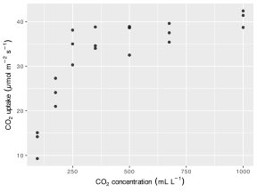
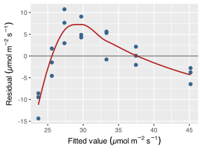
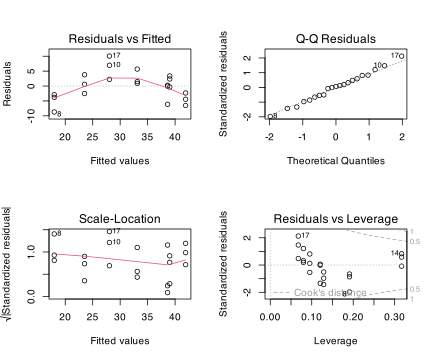
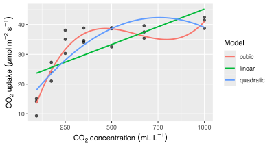

> **NOTE:**
>
> - why polynomial regression remains linear in its parameters while capturing curved responses;
> - how to read residual curvature as a diagnostic signal that motivates polynomial terms;
> - how to fit and compare polynomial models with [`lm()`](https://rdrr.io/r/stats/lm.html);
> - how [`poly()`](https://rdrr.io/r/stats/poly.html) differs from raw powers, and when each is preferable;
> - how to interpret the fitted curve biologically, including direction, turning points, and extrapolation limits;
> - how to report a polynomial regression consistently with earlier chapters.

> **IMPORTANT:**
>
> - None

Residual (left-over) curvature is the diagnostic signal that motivates polynomial regression. When a straight-line model leaves a curved pattern in the residual-versus-fitted plot, the mean structure is incomplete. Adding polynomial terms corrects that structureand keeps the same least-squares fitting approach, but you’ll think about the analysis in the same way as a simple linear regression. The approach to model diagnostics also stays as in in Chapters 11 and 12.

As established in [Chapter 11](../../BCB744/basic_stats/11-residuals-and-model-based-diagnostics.llms.md), every observed response can be decomposed as $Y_i = \hat{Y}_i + e_i$, where $\hat{Y}_i$ is what the current model predicts and $e_i$ is what it fails to explain. If those residuals retain a systematic curved pattern, the model is leaving structure behind. Polynomial regression addresses that by adding powers of the predictor to the mean structure.

The fitted curve may look nonlinear on a scatter plot, but the model remains linear in its coefficients. So, this means ordinary least squares, standard errors, confidence intervals, and the residual diagnostic plots from Chapter 11 all remain valid without modification.

Below, I work through when and why to add polynomial terms, how to choose the lowest-order model that removes residual structure, and how to interpret the resulting curve in biological terms.

# 1 Important concepts

Polynomial regression modifies the mean structure of the linear model without changing the fitting procedure. A **quadratic term** ($X^2$) allows one bend in the response. A **cubic term** ($X^3$) allows a second bend, but interpretation becomes harder and sensitivity to individual observations increases.

Two constraints apply throughout. **Hierarchy** requires that if $X^2$ is in the model then $X$ must also be included; if $X^3$ is included then $X$ and $X^2$ must also be included. Removing lower-order terms distorts the model geometry and is rarely defensible biologically. **Parsimony** requires that the polynomial degree should be as low as possible while still accounting for the residual structure observed in the simpler model.

> **IMPORTANT:**
>
> Before reading the “When This Method Is Appropriate” section, classify each relationship below as likely requiring (a) a straight-line model, (b) a polynomial model, or (c) a mechanistic nonlinear model. Be prepared to justify your choice.
>
> | Biological relationship | Most likely model |
> |----|----|
> | Body length increases roughly proportionally with age in juvenile fish over a short growth window | ? |
> | CO$_2$ uptake in a leaf rises steeply at low light and saturates at high light | ? |
> | Enzyme activity peaks at an optimum temperature and declines on both sides | ? |
> | Daily running distance in mice increases approximately linearly with days of training over 3 weeks | ? |
>
> Discuss: what feature of the data or underlying biology pushes you toward a polynomial rather than a straight line?

# 2 When this method is appropriate

Polynomial regression is appropriate when:

- a straight-line model leaves clear curvature in the residual-versus-fitted plot;
- the biological relationship is smooth and continuous rather than step-like or threshold-driven;
- no mechanistic equation is available, but a curved descriptive model is needed;
- the analysis should remain within the [`lm()`](https://rdrr.io/r/stats/lm.html) workflow.

If the biology implies a specific process, such as a Michaelis-Menten uptake curve or an exponential growth model, a [mechanistic nonlinear model](../../BCB744/basic_stats/22-nonlinear-regression.llms.md) fits that expectation more directly and extrapolates more sensibly. If the curvature is complex and cannot be well described by low-order powers, a [generalised additive model](../../BCB744/basic_stats/21-generalised-additive-models.llms.md) is preferable. Low-order polynomials occupy a useful middle ground because they are more flexible than a straight line and less assumption-laden than a mechanistic model. I have seldom needed to apply one in real-life biological applications, however.

# 3 Nature of the data and assumptions

## 3.1 Requirements before fitting

Polynomial regression uses ordinary least squares and inherits the same data requirements as simple linear regression:

1.  **A defensible response-predictor structure.** There should be a theoretical or biological reason to treat one variable as the response and the other as the predictor.
2.  **Independence of observations.** Each measured value of the response must be independent of the others. Repeated measurements, clustered sampling, or temporal dependence require a different modelling approach.
3.  **Continuous predictor.** The predictor must take values along a continuum over which the polynomial curve can be defined.
4.  **Continuous response.** The response should be continuous. Counts or proportions require a different model family.

## 3.2 Assumptions to check after fitting

After the model is fitted, residuals are used to check whether the assumptions hold:

1.  **Linearity of residuals.** Adding polynomial terms should reduce or remove curvature in the residual-versus-fitted plot. If curvature persists, a higher-order term, a different transformation, or a more flexible model may be needed.
2.  **Constant variance.** The spread of residuals should be roughly uniform across the fitted range. High-order polynomial terms can amplify variance at the extremes of the predictor, making heteroscedasticity more likely there.
3.  **Approximate normality of residuals.** The Q-Q plot should not show systematic departures. High-degree polynomial terms increase sensitivity to extreme observations, so outliers warrant closer attention as model complexity increases.
4.  **Independence.** Residuals should not retain temporal, spatial, or other structured patterns. The check is the same as in Chapter 12: inspect residuals against order, time, or space if those structures are plausible.

## 3.3 Assumption–diagnostic mapping

The same assumption-to-diagnostic mapping used in Chapter 12 applies here:

| Assumption | Main diagnostic | Visual signal to watch for |
|----|----|----|
| Linearity | residual vs fitted plot | slope or curvature in residuals |
| Constant variance | residual vs fitted / scale-location | funnel or changing vertical spread |
| Normality | residual Q-Q plot | systematic bends away from reference line |
| Independence | residuals vs order/time/space | runs, cycles, clusters |

> **IMPORTANT:**
>
> The [`I()`](https://rdrr.io/r/base/AsIs.html) wrapper in R formulas is easy to forget. Run the two lines below and compare what each one actually fits:
>
> ``` numberSource
> data("CO2")
> co2_df <- subset(CO2, Treatment == "chilled" & Type == "Quebec")
>
> # Version A — wrong way to try to fit a quadratic
> fit_a <- lm(uptake ~ conc^2, data = co2_df)
>
> # Version B — correct quadratic
> fit_b <- lm(uptake ~ conc + I(conc^2), data = co2_df)
>
> summary(fit_a)
> summary(fit_b)
> ```
>
> How many terms appear in the coefficient table for each model? Why does `conc^2` without [`I()`](https://rdrr.io/r/base/AsIs.html) not add a squared term? What does `conc^2` mean to R’s formula parser?

# 4 The core equations

What polynomial regression changes is the mean structure. The errors $\varepsilon_i$ and the least-squares fitting rule remain unchanged. A cubic polynomial model is:

$$Y_i = \alpha + \beta_1X_i + \beta_2X_i^2 + \beta_3X_i^3 + \varepsilon_i \tag{1}$$

In [Equation 1](#eq-poly), curvature results from the powers of $X$, but the model is still linear in the coefficients $\alpha, \beta_1, \beta_2, \beta_3$. A quadratic model omits the cubic term. A straight-line model omits both higher-order terms. The hierarchy of models is nested, which means nested-model ANOVA can be used to compare them.

The observed residuals $e_i = Y_i - \hat{Y}_i$ estimate the unobserved errors $\varepsilon_i$ and remain the objects used for all diagnostic checks, exactly as in Chapter 11.

# 5 The fitting rule

Ordinary least squares minimises the residual sum of squares:

$$\text{RSS} = \sum_{i=1}^{n}(Y_i - \hat{Y}_i)^2$$

This criterion is identical to what [`lm()`](https://rdrr.io/r/stats/lm.html) applies in simple linear regression. Adding polynomial terms to the model formula simply changes which $\hat{Y}_i$ is computed.

# 6 Implementation

The model is still fitted with [`lm()`](https://rdrr.io/r/stats/lm.html):

``` numberSource
lm(y ~ x + I(x^2), data = df)                       # quadratic
lm(y ~ x + I(x^2) + I(x^3), data = df)              # cubic
lm(y ~ poly(x, degree = 3), data = df)              # orthogonal polynomial basis
```

**The [`I()`](https://rdrr.io/r/base/AsIs.html) wrapper.** R’s formula language assigns special meaning to `^`. So, `x^2` inside a formula means the interaction of `x` with itself, not the arithmetic square of `x`. The [`I()`](https://rdrr.io/r/base/AsIs.html) function (“as-is”) suppresses that special interpretation and forces R to evaluate the expression inside as ordinary arithmetic. Writing `I(x^2)` therefore passes the squared values of `x` as a new predictor column, which is what the polynomial model requires.

**Raw powers versus [`poly()`](https://rdrr.io/r/stats/poly.html).** When `I(x^2)` and `I(x^3)` are used directly, the model terms are highly correlated with each other and with `x`, especially when `x` is not centred near zero. This collinearity inflates coefficient standard errors and can make the individual estimates hard to interpret or numerically unstable. The [`poly()`](https://rdrr.io/r/stats/poly.html) function constructs orthogonal polynomial contrasts that are uncorrelated by design. Coefficient estimates from [`poly()`](https://rdrr.io/r/stats/poly.html) are therefore more numerically stable, and model-comparison statistics are unaffected by the correlation structure. For teaching and biological interpretation, raw powers are usually easier to explain; for numerical reliability, especially at higher degrees, [`poly()`](https://rdrr.io/r/stats/poly.html) is preferable.

**Centring.** Centring $X$ before computing powers (*i.e.*, replacing $X$ with $(X - \bar{X})$) reduces the correlation between $X$ and $X^2$ when using raw powers, and makes the intercept interpretable as the predicted response at the mean predictor value. When the predictor is far from zero and spans a wide range, centring is worth the small additional step.

# 7 Example: CO$_2$ uptake and curved response

## 7.1 Example dataset

I use the `CO2` dataset from base R. These are measurements of carbon dioxide uptake by chilled Quebec grass plants (*Echinochloa crus-galli*) across increasing ambient CO$_2$ concentrations. Uptake is expected to rise steeply at low concentrations and then decelerate as the carboxylation system approaches saturation, so a straight-line model is likely to underfit the relationship.

A researcher seriously studying this system would fit a rectangular hyperbola (the Michaelis-Menten model) because the kinetics of Rubisco carboxylation are well characterised and that functional form applies sensibly. Here I use a polynomial instead, purely to demonstrate the method on a dataset where curvature is visible and unambiguous. The polynomial model is adequate as a descriptive approximation within the observed concentration range but should not be used for extrapolation or for inferring kinetic parameters. The first ten rows of the filtered dataset are shown in [Table 1](#tbl-co2-data).

``` numberSource
co2_df <- as_tibble(CO2) |>
  filter(Treatment == "chilled", Type == "Quebec")

gt(head(co2_df, 10))
```

| Plant | Type   | Treatment | conc | uptake |
|-------|--------|-----------|------|--------|
| Qc1   | Quebec | chilled   | 95   | 14.2   |
| Qc1   | Quebec | chilled   | 175  | 24.1   |
| Qc1   | Quebec | chilled   | 250  | 30.3   |
| Qc1   | Quebec | chilled   | 350  | 34.6   |
| Qc1   | Quebec | chilled   | 500  | 32.5   |
| Qc1   | Quebec | chilled   | 675  | 35.4   |
| Qc1   | Quebec | chilled   | 1000 | 38.7   |
| Qc2   | Quebec | chilled   | 95   | 9.3    |
| Qc2   | Quebec | chilled   | 175  | 27.3   |
| Qc2   | Quebec | chilled   | 250  | 35.0   |

Table 1: A subset of the `CO2` dataset showing chilled Quebec plants used in the polynomial-regression example.

> **IMPORTANT:**
>
> Before fitting any model, spend a few minutes on the CO$_2$ dataset directly. Run this summary code and answer the questions below:
>
> ``` numberSource
> co2_df <- as_tibble(CO2) |>
>   filter(Treatment == "chilled", Type == "Quebec")
>
> # How many observations?
> nrow(co2_df)
>
> # How many distinct concentration levels?
> co2_df |> count(conc)
>
> # Quick scatter plot
> ggplot(co2_df, aes(x = conc, y = uptake)) +
>   geom_point() +
>   labs(x = expression(CO[2]~concentration~(mL~L^{-1})),
>        y = expression(CO[2]~uptake~(µmol~m^{-2}~s^{-1})))
> ```
>
> 1.  At the lowest concentration level, how variable is uptake across observations?
> 2.  Does the relationship look linear? If not, describe the shape.
> 3.  Based on the scatter plot alone, do you expect a straight-line model to over-predict or under-predict uptake in the middle of the concentration range?

## 7.2 Do an exploratory data analysis (EDA)

``` numberSource
co2_df |>
  summarise(
    n = n(),
    min_conc = min(conc),
    max_conc = max(conc),
    mean_uptake = mean(uptake),
    sd_uptake = sd(uptake)
  )
```

    R> # A tibble: 1 × 5
    R>       n min_conc max_conc mean_uptake sd_uptake
    R>   <int>    <dbl>    <dbl>       <dbl>     <dbl>
    R> 1    21       95     1000        31.8      9.64

Code

``` numberSource
ggplot(co2_df, aes(x = conc, y = uptake)) +
  geom_point(alpha = 0.75) +
  labs(x = expression(CO[2]~concentration~(mL~L^{-1})),
       y = expression(CO[2]~uptake~(µmol~m^{-2}~s^{-1})))
```

[](13-polynomial-regression_files/figure-html/fig-co2-scatter-1.svg "Figure 1: CO_2 uptake in chilled Quebec plants across concentration levels. The pattern is positive but clearly decelerating.")

Figure 1: CO$_2$ uptake in chilled Quebec plants across concentration levels. The pattern is positive but clearly decelerating.

[Figure 1](#fig-co2-scatter) shows a positive relationship with a clear bend: uptake increases steeply at low concentrations and then levels off. Before fitting polynomial terms, I fit a straight-line model and inspect its residuals to confirm the diagnostic signal.

[](13-polynomial-regression_files/figure-html/fig-lin-resid-motivation-1.svg "Figure 2: Residual-versus-fitted plot for the straight-line model. The curved smooth line confirms that the linear mean structure is insufficient.")

Figure 2: Residual-versus-fitted plot for the straight-line model. The curved smooth line confirms that the linear mean structure is insufficient.

[Figure 2](#fig-lin-resid-motivation) shows an obvious arc. The residuals are negative at low and high fitted values and positive in the middle. The straight-line model is systematically wrong across the concentration range, with the curvature motivating adding a quadratic term.

## 7.3 State the model question

The central question is whether adding polynomial terms to the mean structure removes the residual curvature observed above. Polynomial terms are tools for improving model specification, not primarily for testing isolated coefficients.

One useful formal check is whether the quadratic coefficient differs from zero:

$$H_{0}: \beta_2 = 0$$ $$H_{a}: \beta_2 \ne 0$$

If $\beta_2 = 0$ cannot be rejected, the data offer no evidence for the quadratic shape. That test should be read alongside the model comparison statistics and the diagnostic plots, not in isolation.

## 7.4 Fit the model

``` numberSource
mod_lin  <- lm(uptake ~ conc, data = co2_df)
mod_quad <- lm(uptake ~ conc + I(conc^2), data = co2_df)
mod_cub  <- lm(uptake ~ conc + I(conc^2) + I(conc^3), data = co2_df)

summary(mod_lin)
```

    R> 
    R> Call:
    R> lm(formula = uptake ~ conc, data = co2_df)
    R> 
    R> Residuals:
    R>      Min       1Q   Median       3Q      Max 
    R> -14.3773  -3.7712   0.0476   4.8664  10.7414 
    R> 
    R> Coefficients:
    R>              Estimate Std. Error t value Pr(>|t|)    
    R> (Intercept) 21.421041   2.583221   8.292 9.79e-08 ***
    R> conc         0.023750   0.004919   4.828 0.000117 ***
    R> ---
    R> Signif. codes:  0 '***' 0.001 '**' 0.01 '*' 0.05 '.' 0.1 ' ' 1
    R> 
    R> Residual standard error: 6.631 on 19 degrees of freedom
    R> Multiple R-squared:  0.5509, Adjusted R-squared:  0.5273 
    R> F-statistic: 23.31 on 1 and 19 DF,  p-value: 0.0001169

``` numberSource
summary(mod_quad)
```

    R> 
    R> Call:
    R> lm(formula = uptake ~ conc + I(conc^2), data = co2_df)
    R> 
    R> Residuals:
    R>     Min      1Q  Median      3Q     Max 
    R> -8.7023 -2.9023  0.2657  2.3714 10.0540 
    R> 
    R> Coefficients:
    R>               Estimate Std. Error t value Pr(>|t|)    
    R> (Intercept)  1.053e+01  3.269e+00   3.221 0.004740 ** 
    R> conc         8.392e-02  1.511e-02   5.554 2.85e-05 ***
    R> I(conc^2)   -5.542e-05  1.351e-05  -4.102 0.000669 ***
    R> ---
    R> Signif. codes:  0 '***' 0.001 '**' 0.01 '*' 0.05 '.' 0.1 ' ' 1
    R> 
    R> Residual standard error: 4.898 on 18 degrees of freedom
    R> Multiple R-squared:  0.7679, Adjusted R-squared:  0.7421 
    R> F-statistic: 29.78 on 2 and 18 DF,  p-value: 1.954e-06

``` numberSource
summary(mod_cub)
```

    R> 
    R> Call:
    R> lm(formula = uptake ~ conc + I(conc^2) + I(conc^3), data = co2_df)
    R> 
    R> Residuals:
    R>     Min      1Q  Median      3Q     Max 
    R> -6.0662 -2.2950  0.3338  1.6063  6.4848 
    R> 
    R> Coefficients:
    R>               Estimate Std. Error t value Pr(>|t|)    
    R> (Intercept) -5.325e+00  3.792e+00  -1.404    0.178    
    R> conc         2.339e-01  3.128e-02   7.478 9.03e-07 ***
    R> I(conc^2)   -3.970e-04  6.818e-05  -5.822 2.04e-05 ***
    R> I(conc^3)    2.094e-07  4.145e-08   5.051 9.84e-05 ***
    R> ---
    R> Signif. codes:  0 '***' 0.001 '**' 0.01 '*' 0.05 '.' 0.1 ' ' 1
    R> 
    R> Residual standard error: 3.187 on 17 degrees of freedom
    R> Multiple R-squared:  0.9072, Adjusted R-squared:  0.8908 
    R> F-statistic: 55.39 on 3 and 17 DF,  p-value: 5.509e-09

``` numberSource
anova(mod_lin, mod_quad, mod_cub)
```

    R> Analysis of Variance Table
    R> 
    R> Model 1: uptake ~ conc
    R> Model 2: uptake ~ conc + I(conc^2)
    R> Model 3: uptake ~ conc + I(conc^2) + I(conc^3)
    R>   Res.Df    RSS Df Sum of Sq      F    Pr(>F)    
    R> 1     19 835.48                                  
    R> 2     18 431.80  1    403.68 39.746 7.919e-06 ***
    R> 3     17 172.66  1    259.14 25.516 9.844e-05 ***
    R> ---
    R> Signif. codes:  0 '***' 0.001 '**' 0.01 '*' 0.05 '.' 0.1 ' ' 1

``` numberSource
AIC(mod_lin, mod_quad, mod_cub)
```

    R>          df      AIC
    R> mod_lin   3 142.9485
    R> mod_quad  4 131.0877
    R> mod_cub   5 113.8378

The nested-model ANOVA tests whether each additional term reduces the RSS enough to justify its inclusion. It answers, is the improvement statistically supported? The AIC penalises model complexity and asks, across these models, which offers the best trade-off between fit and parsimony? The two tools are complementary. When both point to the same model, deciding on the best model is easy. When they disagree, for example, the ANOVA supports adding a cubic term but AIC favours the quadratic, I prefer the simpler model (the quadratic) unless the biological context provides a strong reason to expect the additional curvature.

The working rule is to choose the lowest-order model that removes residual structure. Start with the linear model, inspect its residuals, add the quadratic term if curvature remains, then check whether the cubic term still improves the residual pattern. Stop as soon as the diagnostic plots show no further systematic structure.

> **IMPORTANT:**
>
> Look at the ANOVA and AIC output from the three-model comparison:
>
> ``` numberSource
> anova(mod_lin, mod_quad, mod_cub)
> AIC(mod_lin, mod_quad, mod_cub)
> ```
>
> Answer the following without running additional code:
>
> 1.  Which model has the lowest AIC? What does that mean in terms of the trade-off between fit and parsimony?
> 2.  The nested-model ANOVA tests whether adding the quadratic term significantly reduces the residual sum of squares. What are the degrees of freedom for that test, and is the result significant?
> 3.  Does adding the cubic term beyond the quadratic produce a significant improvement according to the ANOVA? Does AIC agree?
> 4.  Based on these two pieces of evidence together, which model would you choose and why?

## 7.5 Test assumptions

``` numberSource
quad_aug <- augment(mod_quad)

shapiro.test(residuals(mod_quad))
```

    R> 
    R>  Shapiro-Wilk normality test
    R> 
    R> data:  residuals(mod_quad)
    R> W = 0.9902, p-value = 0.998

``` numberSource
bptest(mod_quad)
```

    R> 
    R>  studentized Breusch-Pagan test
    R> 
    R> data:  mod_quad
    R> BP = 1.3941, df = 2, p-value = 0.498

Code

``` numberSource
par(mfrow = c(2, 2))
plot(mod_quad)
par(mfrow = c(1, 1))
```

[](13-polynomial-regression_files/figure-html/fig-quad-diagnostics-1.svg "Figure 3: Standard diagnostics for the quadratic model.")

Figure 3: Standard diagnostics for the quadratic model.

The graphical diagnostics in [Figure 3](#fig-quad-diagnostics) take priority over the formal tests. The Shapiro-Wilk test and the Breusch-Pagan test are supporting evidence, not the primary decision criterion. The residual-versus-fitted panel should show no remaining arc; the Q-Q plot should show residuals tracking the reference line without systematic departures. Both conditions are broadly met here for the quadratic model, which confirms that adding the quadratic term corrected the diagnostic problem identified in [Figure 2](#fig-lin-resid-motivation).

> **IMPORTANT:**
>
> Examine the four diagnostic panels in [Figure 3](#fig-quad-diagnostics) for the quadratic model. For each panel, write one sentence describing what you see and whether it raises any concern:
>
> | Panel                 | What you see | Concern? |
> |-----------------------|--------------|----------|
> | Residuals vs Fitted   | ?            | ?        |
> | Normal Q-Q            | ?            | ?        |
> | Scale-Location        | ?            | ?        |
> | Residuals vs Leverage | ?            | ?        |
>
> Then compare the quadratic model diagnostics with what you would expect from the straight-line model (recall [Figure 2](#fig-lin-resid-motivation)). Has the quadratic term resolved the main diagnostic problem? Is there any remaining issue worth noting?

## 7.6 Interpret the results

Code

``` numberSource
co2_pred <- tibble(conc = seq(min(co2_df$conc), max(co2_df$conc), length.out = 200)) |>
  mutate(
    linear = predict(mod_lin, newdata = cur_data()),
    quadratic = predict(mod_quad, newdata = cur_data()),
    cubic = predict(mod_cub, newdata = cur_data())
  ) |>
  pivot_longer(cols = c(linear, quadratic, cubic),
               names_to = "model", values_to = "fit")

ggplot(co2_df, aes(x = conc, y = uptake)) +
  geom_point(alpha = 0.65) +
  geom_line(data = co2_pred, aes(y = fit, colour = model), linewidth = 0.9) +
  labs(x = expression(CO[2]~concentration~(mL~L^{-1})),
       y = expression(CO[2]~uptake~(µmol~m^{-2}~s^{-1})),
       colour = "Model")
```

[](13-polynomial-regression_files/figure-html/fig-poly-fits-1.svg "Figure 4: Linear, quadratic, and cubic polynomial fits to the CO_2 uptake data.")

Figure 4: Linear, quadratic, and cubic polynomial fits to the CO$_2$ uptake data.

> **IMPORTANT:**
>
> Look at the three fitted curves in [Figure 4](#fig-poly-fits). Without reading the interpretation text below the figure, answer these questions:
>
> 1.  Where does the straight-line model perform worst relative to the data points?
> 2.  Do the quadratic and cubic curves look noticeably different from each other across the observed concentration range?
> 3.  The quadratic curve does not reverse direction within the observed range. What would it mean biologically if it did reverse?
> 4.  Suppose you wanted to predict CO$_2$ uptake at a concentration of 2000 mL/L (well beyond the observed range). Which model would you trust the least for this extrapolation, and why?
>
> Discuss your answers with a partner.

[Figure 4](#fig-poly-fits) shows the three fitted curves overlaid on the data. Interpreting a polynomial fit means describing the shape of the response and not simply citing the coefficient values. Individual polynomial coefficients are difficult to interpret in isolation since they depend on the scale of the predictor and the degree of the model. So, they should not normally be the primary result reported.

Be systematic. First, identify the **direction of curvature**: is the response accelerating (concave up) or decelerating (concave down) across the predictor range? For this dataset the response is decelerating because uptake increases with CO$_2$ concentration but at a diminishing rate. Second, identify any **turning point** in the fitted curve. A quadratic model has at most one turning point. We see in the curve here that it does not reverse within the observed concentration range, so the relationship remains monotonically positive throughout. Third, relate the shape to a **biological process**. You’d mention that the deceleration is consistent with a carboxylation system that saturates as substrate availability increases, matching the biochemistry of C3 carbon fixation.

Inference applies within the observed predictor range, from the lowest to the highest CO$_2$ concentration in the dataset. Polynomial curves can behave erratically outside that range. A quadratic function will eventually reverse direction, and a cubic will eventually diverge. So, extrapolation beyond the data requires explicit biological justification and should be treated with caution.

Note also that the scale of the predictor affects the slope interpretation. Concentration here is measured in µL/L. A one-unit increase in concentration corresponds to a very small change in the predictor. Rescaling to a biologically natural unit (for example, hundreds of µL/L) would produce larger, easier-to-state coefficients without changing the fitted curve.

## 7.7 Reporting

> **NOTE:**
>
> **Methods**
>
> Carbon dioxide uptake was modelled as a function of ambient CO$_2$ concentration using ordinary least squares regression on the `CO2` plant dataset (chilled Quebec plants). A straight-line model was fitted first and its residual-versus-fitted plot inspected for curvature. Quadratic and cubic polynomial extensions were then fitted, and model selection used nested-model ANOVA and AIC. The lowest-order model that removed residual curvature was selected. Assumptions were assessed from residual diagnostics.
>
> **Results**
>
> The straight-line model left clear curvature in the residual-versus-fitted plot, indicating that the linear mean structure was insufficient. Adding a quadratic term substantially improved fit (nested-model comparison: $p < 0.001$) and removed the residual arc. The cubic extension provided no meaningful additional improvement relative to the quadratic model. The selected quadratic model described a positive and decelerating relationship ([Figure 4](#fig-poly-fits)): CO$_2$ uptake increased with concentration across the observed range but at a diminishing rate, consistent with substrate saturation of the carboxylation system. The model should be interpreted within the observed concentration range.
>
> **Discussion**
>
> A quadratic polynomial provided a parsimonious descriptive model of the concentration-uptake relationship while retaining the [`lm()`](https://rdrr.io/r/stats/lm.html) workflow. The fitted curve is biologically plausible as a first-order approximation of carboxylase saturation, though a mechanistic Michaelis-Menten model would be preferred where the process is to be characterised precisely or extrapolation is required.

# 8 What to do when assumptions fail

Diagnostic outcomes point to different remedies depending on what they show.

If the quadratic model still leaves residual curvature, fitting the cubic extension is the next step. If curvature persists at degree three (or if the degree required to describe the pattern is becoming ridiculously high) the pattern is probably too complex for polynomial terms and a [generalised additive model](../../BCB744/basic_stats/21-generalised-additive-models.llms.md) is better. A GAM estimates the smooth relationship from the data directly without committing to a polynomial form, which makes it more robust to complex or irregular curvature.

If the biology provides a specific mechanistic expectation (*e.g.*, for example, Michaelis-Menten kinetics, logistic population growth, or a Gompertz growth curve) a [nonlinear model](../../BCB744/basic_stats/22-nonlinear-regression.llms.md) embeds that structure directly and extrapolates in a biologically sensible way. Now, the interpretable, biologically-relevant model parameters also become available, such as $V_{max}$ and $K_s$ for the Michaelis-Menten model. Polynomial approximations should not substitute for mechanistic models when the process is understood.

If the residual spread increases markedly at the extremes of the predictor range (a pattern that high-degree polynomials can amplify), consider whether a response transformation (log or square root) stabilises variance before adding polynomial terms. If variance is still unstable after transformation, weighted least squares or a generalised linear model with an appropriate variance function may be needed.

# 9 Summary

Polynomial regression extends simple linear regression to curved responses by adding powers of the predictor to the mean structure. The fitting method, inferential tools, and diagnostic workflow remain unchanged. The choice of polynomial degree should be driven by residual diagnostics, in other words, fit the linear model first, inspect the residual-versus-fitted plot, and add polynomial terms only as long as they remove structure from the residuals. Model comparison using nested ANOVA and AIC supports that decision. Interpretation focuses on the shape of the fitted curve, such as the direction, turning points (if present), and biological plausibility, rather than on individual coefficient values. The fitted curve applies within the observed predictor range; extrapolation from polynomial models requires care.

## Reuse

[CC BY-NC-SA 4.0](https://creativecommons.org/licenses/by-nc-sa/4.0/)

## Citation

BibTeX citation:

``` quarto-appendix-bibtex
@online{smit2026,
  author = {Smit, A. J.},
  title = {13. {Polynomial} Regression},
  date = {2026-11-06},
  url = {https://tangledbank.netlify.app/BCB744/basic_stats/13-polynomial-regression.html},
  langid = {en}
}
```

For attribution, please cite this work as:

Smit AJ (2026) 13. Polynomial regression. [https://tangledbank.netlify.app/BCB744/basic_stats/13-polynomial-regression.html.](https://tangledbank.netlify.app/BCB744/basic_stats/13-polynomial-regression.html)
