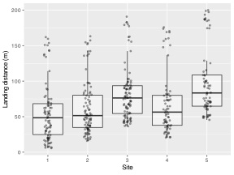
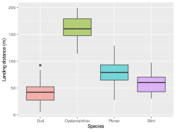
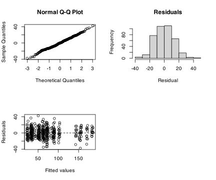

> **NOTE:**
>
> - why non-independence creates misleadingly confident analyses;
> - how grouped and nested sampling structures arise in ecology;
> - the difference between fixed and random effects;
> - how to fit and interpret a simple random-intercept mixed model in R;
> - how to report a mixed model in the same journal style used elsewhere in the course.

> **IMPORTANT:**
>
> - None

Most of the models in the earlier chapters assume that each observation contributes genuinely new information. In ecological sampling that is often false, because measurements taken from the same site, transect, colony, quadrat, or individual tend to resemble one another more than measurements taken from different sampling units.

That is what **dependence** means in practice. So, the observations are not fully independent because they share context, history, or structure.

If we ignore that structure, the analysis becomes overconfident. Standard errors shrink, degrees of freedom are effectively exaggerated, and the model can start reporting strong-looking results that are partly artefacts of the sampling design.

Mixed-effects models provide one of the main solutions to this challenge. They allow us to keep the fixed effects that address the biological question while accounting for variation among grouped sampling units through **random effects**.

# 1 Key concepts

- **Dependence** means observations are not fully independent of one another.
- **Grouped structure** arises when observations are clustered within sites, years, individuals, or other units.
- **Fixed effects** represent systematic effects of direct biological interest.
- **Random effects** represent structured variation among sampling units.
- **A random intercept model** allows each site or group to have its own baseline level.
- **Mixed models are tailored to a specific sampling structure or design**.

# 2 When this method is appropriate

You should start thinking about mixed models when:

- observations are nested within sites, transects, plots, years, or individuals;
- the same unit is measured repeatedly;
- the sampling design clearly has hierarchical structure;
- treating all observations as independent would create pseudoreplication.

Typical cases include:

- quadrats within sites;
- birds sampled within beaches;
- repeated measurements on the same animals;
- monthly observations within monitoring stations.

# 3 Nature of the data and assumptions

Mixed models do not remove the need for ordinary model checking. So, for a Gaussian linear mixed model, the main assumptions are still:

1.  independence **between** higher-level units such as sites or individuals;
2.  approximately normal residuals;
3.  reasonably constant residual variance;
4.  a sensible specification of the random-effects structure.

The important difference is that we now no longer assume independence among observations inside the same group.

# 4 The core equations

A simple random-intercept mixed model can be written as:

$$Y_{ij} = \alpha + \beta_{1}X_{1ij} + \cdots + \beta_{p}X_{pij} + b_{j} + \epsilon_{ij} \tag{1}$$

In [Equation 1](#eq-lmm), $Y_{ij}$ is the response for observation $i$ in group $j$, the $\beta$ terms are the fixed effects, $b_{j}$ is the random intercept for group $j$, and $\epsilon_{ij}$ is the residual error.

The important idea is that the model has two sources of variation:

- **between-group variation**, captured by the random effect $b_j$;
- **within-group variation**, captured by the residual term $\epsilon_{ij}$.

Mixed models help with dependence because the they explicitly allow observations from the same site or individual to share a common baseline.

# 5 R functions

The most common functions are:

- `lmer()` from **lme4** for Gaussian linear mixed models;
- `glmer()` from **lme4** for generalised mixed models;
- [`nlme::lme()`](https://rdrr.io/pkg/nlme/man/lme.html) when more explicit correlation structures are needed.

A simple random-intercept model looks like this:

``` numberSource
lmer(response ~ predictors + (1 | group), data = df)
```

The term `(1 | group)` means that each group has its own intercept.

# 6 Example 1: Shorebird landing distance with site-level dependence

## 6.1 Example dataset

We use the `BeachBirds.csv` dataset from the course data folder. These data contain flight-initiation distances and landing distances for several shorebird species sampled across multiple beach sites. The important point emerging from this example is that observations collected at the same site are likely to be more similar to one another than observations collected at different sites.

Here we model `land.dist` as a function of bird `Species` and `Sex`, while allowing each `Site` to have its own baseline intercept.

``` numberSource
birds <- read_csv(here::here("data", "BCB744", "BeachBirds.csv"),
                  show_col_types = FALSE) |>
  mutate(
    Site = factor(Site),
    Species = factor(Species),
    Sex = factor(Sex)
  )

gt(head(birds, 10))
```

| Site | Species       | Sex    | flush.dist | land.dist |
|------|---------------|--------|------------|-----------|
| 1    | Oystercatcher | Female | 12.8       | 150.9     |
| 1    | Oystercatcher | Male   | 4.4        | 114.1     |
| 1    | Oystercatcher | Female | 9.5        | 153.7     |
| 1    | Oystercatcher | Female | 12.2       | 137.7     |
| 1    | Oystercatcher | Female | 10.1       | 143.3     |
| 1    | Oystercatcher | Male   | 6.6        | 142.8     |
| 1    | Oystercatcher | Male   | 15.4       | 134.1     |
| 1    | Oystercatcher | Male   | 11.3       | 159.5     |
| 1    | Oystercatcher | Male   | 13.8       | 150.4     |
| 1    | Oystercatcher | Female | 12.9       | 161.9     |

A subset of the `BeachBirds.csv` data used in the mixed-model example. {.gt_table .caption-top .table .table-sm .table-striped .small quarto-bootstrap="false"}

## 6.2 Do an exploratory data analysis (EDA)

``` numberSource
birds |>
  summarise(
    n = n(),
    n_sites = n_distinct(Site),
    n_species = n_distinct(Species),
    mean_land = mean(land.dist),
    sd_land = sd(land.dist)
  )
```

    R> # A tibble: 1 × 5
    R>       n n_sites n_species mean_land sd_land
    R>   <int>   <int>     <int>     <dbl>   <dbl>
    R> 1   399       5         4      73.1    44.2

Code

``` numberSource
ggplot(birds, aes(x = Site, y = land.dist)) +
  geom_boxplot(outlier.shape = NA, alpha = 0.4) +
  geom_jitter(width = 0.1, alpha = 0.35, size = 0.8) +
  labs(
    x = "Site",
    y = "Landing distance (m)"
  )
```

[](19-dependence-and-mixed-models_files/figure-html/fig-birds-site-1.svg "Figure 1: Landing distance by beach site for the sampled shorebirds.")

Figure 1: Landing distance by beach site for the sampled shorebirds.

Code

``` numberSource
ggplot(birds, aes(x = Species, y = land.dist, fill = Species)) +
  geom_boxplot(alpha = 0.5, show.legend = FALSE) +
  labs(
    x = "Species",
    y = "Landing distance (m)"
  )
```

[](19-dependence-and-mixed-models_files/figure-html/fig-birds-species-1.svg "Figure 2: Landing distance differs strongly among shorebird species, but values also vary among sites.")

Figure 2: Landing distance differs strongly among shorebird species, but values also vary among sites.

The EDA in [Figure 1](#fig-birds-site) and [Figure 2](#fig-birds-species) already shows why an ordinary model may be too simple. Landing distance differs among species, but there is also clear site-to-site variability. That suggests a grouped structure in which site should not be ignored.

## 6.3 State the model question and hypotheses

The main biological question is whether landing distance differs among species after accounting for the fact that birds were sampled within sites.

For the primary fixed effect, the hypothesis pair is:

$$H_{0}: \text{landing distance does not differ among species once site-level grouping is accounted for}$$ $$H_{a}: \text{landing distance differs among species after accounting for site-level grouping}$$

The random effect is not interpreted through a simple null-hypothesis pair in the same way. Its role is to account for the grouped sampling structure.

## 6.4 Fit the model

We first fit an ordinary linear model that ignores site, and then a mixed model with a random intercept for `Site`.

``` numberSource
fit_lm <- lm(land.dist ~ Species + Sex, data = birds)

fit_lmer <- lmer(land.dist ~ Species + Sex + (1 | Site), data = birds)

summary(fit_lm)
```

    R> 
    R> Call:
    R> lm(formula = land.dist ~ Species + Sex, data = birds)
    R> 
    R> Residuals:
    R>     Min      1Q  Median      3Q     Max 
    R> -51.779 -14.413   0.021  12.883  51.754 
    R> 
    R> Coefficients:
    R>                      Estimate Std. Error t value Pr(>|t|)    
    R> (Intercept)            42.637      1.852  23.028  < 2e-16 ***
    R> SpeciesOystercatcher  120.509      2.938  41.014  < 2e-16 ***
    R> SpeciesPlover          36.942      2.232  16.554  < 2e-16 ***
    R> SpeciesStint           17.228      3.355   5.135 4.45e-07 ***
    R> SexMale                -1.591      1.933  -0.823    0.411    
    R> ---
    R> Signif. codes:  0 '***' 0.001 '**' 0.01 '*' 0.05 '.' 0.1 ' ' 1
    R> 
    R> Residual standard error: 19.15 on 394 degrees of freedom
    R> Multiple R-squared:  0.8139, Adjusted R-squared:  0.812 
    R> F-statistic: 430.8 on 4 and 394 DF,  p-value: < 2.2e-16

``` numberSource
summary(fit_lmer)
```

    R> Linear mixed model fit by REML. t-tests use Satterthwaite's method [
    R> lmerModLmerTest]
    R> Formula: land.dist ~ Species + Sex + (1 | Site)
    R>    Data: birds
    R> 
    R> REML criterion at convergence: 3178.2
    R> 
    R> Scaled residuals: 
    R>     Min      1Q  Median      3Q     Max 
    R> -2.9082 -0.7167 -0.0061  0.6730  3.2716 
    R> 
    R> Random effects:
    R>  Groups   Name        Variance Std.Dev.
    R>  Site     (Intercept) 256.0    16.00   
    R>  Residual             167.9    12.96   
    R> Number of obs: 399, groups:  Site, 5
    R> 
    R> Fixed effects:
    R>                      Estimate Std. Error      df t value Pr(>|t|)    
    R> (Intercept)            43.061      7.265   4.177   5.927  0.00354 ** 
    R> SpeciesOystercatcher  119.638      1.991 390.017  60.089  < 2e-16 ***
    R> SpeciesPlover          37.689      1.515 390.044  24.870  < 2e-16 ***
    R> SpeciesStint           18.858      2.275 390.024   8.290 1.85e-15 ***
    R> SexMale                -2.260      1.311 390.029  -1.724  0.08550 .  
    R> ---
    R> Signif. codes:  0 '***' 0.001 '**' 0.01 '*' 0.05 '.' 0.1 ' ' 1
    R> 
    R> Correlation of Fixed Effects:
    R>             (Intr) SpcsOy SpcsPl SpcsSt
    R> SpcsOystrct -0.074                     
    R> SpeciesPlvr -0.100  0.334              
    R> SpeciesStnt -0.072  0.228  0.300       
    R> SexMale     -0.104  0.045  0.085  0.106

``` numberSource
vc <- as.data.frame(VarCorr(fit_lmer))
site_var <- vc$vcov[vc$grp == "Site"]
resid_var <- vc$vcov[vc$grp == "Residual"]
icc <- site_var / (site_var + resid_var)

tibble(
  model = c("ordinary linear model", "mixed model"),
  AIC = c(AIC(fit_lm), AIC(fit_lmer))
)
```

    R> # A tibble: 2 × 2
    R>   model                   AIC
    R>   <chr>                 <dbl>
    R> 1 ordinary linear model 3495.
    R> 2 mixed model           3192.

``` numberSource
icc
```

    R> [1] 0.603998

## 6.5 Test assumptions / check diagnostics

Code

``` numberSource
par(mfrow = c(2, 2))
# plot(fit_lmer)
qqnorm(residuals(fit_lmer))
qqline(residuals(fit_lmer))
hist(residuals(fit_lmer), main = "Residuals", xlab = "Residual")
plot(fitted(fit_lmer), residuals(fit_lmer),
     xlab = "Fitted values", ylab = "Residuals")
abline(h = 0, lty = 2)
par(mfrow = c(1, 1))
```

[](19-dependence-and-mixed-models_files/figure-html/fig-lmm-diagnostics-1.svg "Figure 3: Standard residual diagnostics for the mixed model.")

Figure 3: Standard residual diagnostics for the mixed model.

In a first-pass mixed-model workflow, the diagnostics in [Figure 3](#fig-lmm-diagnostics) help answer the main questions:

- are the residuals grossly non-normal or strongly patterned;
- does the random effect explain a meaningful share of the variance;
- does the mixed model fit better than the independence-assuming alternative.

Here the random site effect is not trivial. The intra-class correlation is about 0.6, which means that roughly 60% of the variance represented by the model’s variance components is at the site level rather than purely within sites.

## 6.6 Interpret the results

The mixed model fit is clearly better than the ordinary model by AIC, which already suggests that site-level dependence matters.

The species effects are also large. Relative to the reference species, landing distance is substantially greater for Oystercatchers and Plovers, with Stints intermediate. The sex effect is much weaker and does not provide strong evidence for a difference at the conventional 0.05 level.

The ecological finding is that species differ, and those differences should be interpreted **after accounting for site-level dependence**, not before. If site is ignored, the analysis behaves as though all birds were sampled independently from one large homogeneous pool.

## 6.7 Reporting

> **NOTE:**
>
> **Methods**
>
> Landing distance was analysed for shorebirds sampled across multiple beach sites using a linear mixed-effects model. Species and sex were included as fixed effects, and site was included as a random intercept to account for the grouped sampling structure. An ordinary linear model that ignored site was fitted for comparison.
>
> **Results**
>
> The mixed model fit the data better than the ordinary linear model (AIC 3495.2 vs 3192.2), indicating that site-level dependence was important. The estimated site-level variance was substantial, with an intra-class correlation of approximately 0.6. After accounting for this grouped structure, landing distance remained much greater in Oystercatchers ($\beta = 119.64$, $p < 0.001$), Plovers ($\beta = 37.69$, $p < 0.001$), and Stints ($\beta = 18.86$, $p < 0.001$) than in the reference species. The sex effect was weaker and not clearly different from zero ($p > 0.05$).
>
> **Discussion**
>
> Species differed in landing distance, but those differences were estimated while accounting for the non-independence of observations within sites. This makes the inference more defensible and avoids treating site-level similarity as if it were independent replication.

# 7 Example 2: Repeated snake habituation within individuals

The snake habituation dataset used earlier in the module is a better fit for this chapter than for the core ANOVA chapter. Each snake was measured repeatedly across days, so the observations are not independent. Treating `snake` as just another fixed factor in an additive ANOVA misses the main design point: repeated measurements on the same individuals create within-snake dependence.

``` numberSource
snakes <- read_csv(here::here("data", "BCB744", "snakes.csv"),
                   show_col_types = FALSE) |>
  mutate(
    snake = factor(snake),
    day = factor(day)
  )

snakes |>
  group_by(day) |>
  summarise(
    mean_openings = mean(openings),
    sd_openings = sd(openings),
    .groups = "drop"
  )
```

    R> # A tibble: 4 × 3
    R>   day   mean_openings sd_openings
    R>   <fct>         <dbl>       <dbl>
    R> 1 1              63.3        30.5
    R> 2 2              47          12.2
    R> 3 3              34.5        26.0
    R> 4 4              25.3        18.1

## 7.1 Why this is a dependence problem

The biological question is whether the number of box openings required for habituation changes across repeated days. But each snake contributes several observations, one on each day. That means the data have a grouped structure: measurements from the same snake are likely to be more similar to one another than measurements from different snakes.

That grouped structure suggests a random-intercept model with snake identity as the grouping factor.

## 7.2 Fit a naive model and a mixed model

``` numberSource
snakes_lm <- lm(openings ~ day, data = snakes)
snakes_lmer <- lmer(openings ~ day + (1 | snake), data = snakes)

summary(snakes_lm)
```

    R> 
    R> Call:
    R> lm(formula = openings ~ day, data = snakes)
    R> 
    R> Residuals:
    R>     Min      1Q  Median      3Q     Max 
    R> -41.333 -13.833  -3.333  11.500  43.667 
    R> 
    R> Coefficients:
    R>             Estimate Std. Error t value Pr(>|t|)    
    R> (Intercept)   63.333      9.304   6.807 1.28e-06 ***
    R> day2         -16.333     13.158  -1.241   0.2289    
    R> day3         -28.833     13.158  -2.191   0.0404 *  
    R> day4         -38.000     13.158  -2.888   0.0091 ** 
    R> ---
    R> Signif. codes:  0 '***' 0.001 '**' 0.01 '*' 0.05 '.' 0.1 ' ' 1
    R> 
    R> Residual standard error: 22.79 on 20 degrees of freedom
    R> Multiple R-squared:  0.3195, Adjusted R-squared:  0.2174 
    R> F-statistic:  3.13 on 3 and 20 DF,  p-value: 0.04852

``` numberSource
summary(snakes_lmer)
```

    R> Linear mixed model fit by REML. t-tests use Satterthwaite's method [
    R> lmerModLmerTest]
    R> Formula: openings ~ day + (1 | snake)
    R>    Data: snakes
    R> 
    R> REML criterion at convergence: 188.9
    R> 
    R> Scaled residuals: 
    R>     Min      1Q  Median      3Q     Max 
    R> -1.8167 -0.6088 -0.1673  0.4153  1.9075 
    R> 
    R> Random effects:
    R>  Groups   Name        Variance Std.Dev.
    R>  snake    (Intercept)  29.68    5.448  
    R>  Residual             489.73   22.130  
    R> Number of obs: 24, groups:  snake, 6
    R> 
    R> Fixed effects:
    R>             Estimate Std. Error      df t value Pr(>|t|)    
    R> (Intercept)   63.333      9.304  19.806   6.807 1.35e-06 ***
    R> day2         -16.333     12.777  15.000  -1.278  0.22055    
    R> day3         -28.833     12.777  15.000  -2.257  0.03938 *  
    R> day4         -38.000     12.777  15.000  -2.974  0.00946 ** 
    R> ---
    R> Signif. codes:  0 '***' 0.001 '**' 0.01 '*' 0.05 '.' 0.1 ' ' 1
    R> 
    R> Correlation of Fixed Effects:
    R>      (Intr) day2   day3  
    R> day2 -0.687              
    R> day3 -0.687  0.500       
    R> day4 -0.687  0.500  0.500

``` numberSource
tibble(
  model = c("ordinary linear model", "mixed model"),
  AIC = c(AIC(snakes_lm), AIC(snakes_lmer))
)
```

    R> # A tibble: 2 × 2
    R>   model                   AIC
    R>   <chr>                 <dbl>
    R> 1 ordinary linear model  224.
    R> 2 mixed model            201.

The ordinary model behaves as though all snake-day observations are independent. The mixed model recognises that each snake has its own baseline tendency to habituate faster or more slowly.

## 7.3 Interpret the results

The day effect remains the main biological signal: the number of openings required for habituation decreases across repeated days. But the mixed model estimates that change while accounting for repeated observations within snakes.

That is the crucial design lesson. This is not mainly a “two-way ANOVA without replication” problem. It is a repeated-measures problem in which snake identity induces dependence.

## 7.4 Reporting

> **NOTE:**
>
> **Methods**
>
> The number of box openings required for rattlesnakes to habituate was analysed as a repeated-measures problem. Day was included as a fixed effect, and snake identity was included as a random intercept to account for repeated observations on the same individuals.
>
> **Results**
>
> The number of box openings required for habituation declined across repeated days, indicating that snakes habituated more rapidly with repeated exposure to the apparatus. Modelling snake identity as a random effect accounted for the non-independence created by repeated measurements on the same individuals, making the day effect interpretable at the correct design level.
>
> **Discussion**
>
> The important point is not only that habituation changed through time, but that the analysis respected the repeated-measures structure of the experiment. This is why the example belongs with dependence and mixed models rather than as a core factorial ANOVA illustration.

# 8 What to do when assumptions fail / alternatives

- If the response is not Gaussian, move to a generalised mixed model with `glmer()`.
- If repeated measurements through time create autocorrelation, consider a model with explicit correlation structure rather than relying only on a random intercept.
- If the random-effects structure is biologically richer than a simple intercept, extend it cautiously to random slopes where the design supports that.
- If the design is fundamentally pseudoreplicated, a mixed model cannot rescue the study completely; it can only model the dependence that is actually observed.

# 9 Summary

- Mixed models are needed when observations are grouped or otherwise dependent.
- The random effect is not an afterthought; it represents the sampling structure directly.
- In the beach-bird example, site-level dependence was strong enough to improve model fit markedly.
- Species differences in landing distance remained important even after that dependence was accounted for.

## Reuse

[CC BY-NC-SA 4.0](https://creativecommons.org/licenses/by-nc-sa/4.0/)

## Citation

BibTeX citation:

``` quarto-appendix-bibtex
@online{smit2026,
  author = {Smit, A. J.},
  title = {19. {Dependence} and Mixed Models},
  date = {2026-11-06},
  url = {https://tangledbank.netlify.app/BCB744/basic_stats/19-dependence-and-mixed-models.html},
  langid = {en}
}
```

For attribution, please cite this work as:

Smit AJ (2026) 19. Dependence and mixed models. [https://tangledbank.netlify.app/BCB744/basic_stats/19-dependence-and-mixed-models.html.](https://tangledbank.netlify.app/BCB744/basic_stats/19-dependence-and-mixed-models.html)
