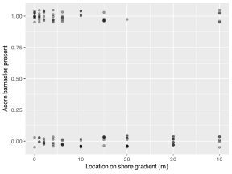
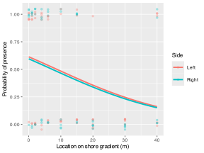
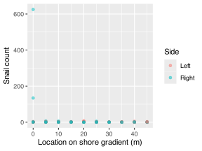
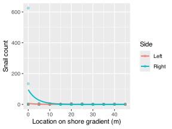

> **NOTE:**
>
> - why ordinary linear models fail for binary, proportional, and count responses;
> - how families and link functions define a generalised linear model;
> - how simple proportion tests connect to the binomial GLM framework;
> - how to fit and interpret a real logistic regression with ecological data;
> - how to detect overdispersion in count data and what it means for interpretation.

> **IMPORTANT:**
>
> - None

Ordinary linear regression assumes a normally distributed response with constant variance. Many ecological responses do not meet those conditions at all. Presence-absence data are binary, proportions are constrained between 0 and 1, and counts are non-negative integers whose variance often changes with the mean.

**Generalised linear models (GLMs)** extend regression to handle those cases while retaining the same basic reasoning:

1.  define the biological question;
2.  choose predictors;
3.  fit a model;
4.  interpret the fitted effects.

The difference is that the response distribution and link function must now match the data structure.

# 1 Key concepts

- **The family** describes the response distribution, such as binomial for binary data or Poisson for counts.
- **The link function** connects the linear predictor to the expected response scale.
- **A GLM still has a linear predictor**, but it acts on the link scale rather than directly on the response scale.
- **Interpretation depends on scale**: a coefficient may describe a change in log-odds or log-counts rather than a direct additive change in the response.
- **Overdispersion** is a warning that the simplest count model may be too optimistic.

# 2 When this method is appropriate

Use a GLM when:

- the response is binary, such as present/absent or alive/dead;
- the response is a proportion derived from successes and failures;
- the response is a count;
- the variance changes with the mean in a way that an ordinary linear model cannot sensibly represent.

In this chapter, I pick up the earlier proportion-testing material and place it inside the broader regression sequence.

# 3 Nature of the data and assumptions

The assumptions depend on the GLM family, but some ideas are common and/or familiar:

1.  observations should be independent;
2.  the response family should match the data-generating structure;
3.  the link function should make biological and statistical sense;
4.  the linear predictor should be appropriately specified.

Unlike ordinary least squares, GLMs do not assume normal residuals with constant variance. Instead, the variance structure is part of the model family itself.

# 4 The core equations

A generalised linear model can be written as:

$$g(\mu_i) = \eta_i = \alpha + \beta_1 X_{1i} + \beta_2 X_{2i} + \cdots + \beta_p X_{pi} \tag{1}$$

In [Equation 1](#eq-glm), $\mu_i$ is the expected response for observation $i$, $g(\cdot)$ is the link function, and $\eta_i$ is the linear predictor.

For binomial logistic regression, the most common link is the logit:

$$\log\left(\frac{p_i}{1-p_i}\right) = \alpha + \beta_1 X_{1i} + \cdots + \beta_p X_{pi} \tag{2}$$

Equation [Equation 2](#eq-logit) says that predictors act linearly on the **log-odds** scale.

For Poisson regression, the most common link is the log link:

$$\log(\mu_i) = \alpha + \beta_1 X_{1i} + \cdots + \beta_p X_{pi} \tag{3}$$

Equation [Equation 3](#eq-poisson) means that predictors act linearly on the **log-count** scale.

# 5 R functions

The main function is [`glm()`](https://rdrr.io/r/stats/glm.html).

``` numberSource
glm(response ~ predictors, family = ..., data = df)
```

Typical uses are:

``` numberSource
glm(binary_response ~ predictors, family = binomial, data = df)
glm(cbind(successes, failures) ~ predictors, family = binomial, data = df)
glm(count ~ predictors, family = poisson, data = df)
glm(count ~ predictors, family = quasipoisson, data = df)
```

# 6 Simple proportion tests as a bridge to GLMs

Before fitting full binomial models with predictors, it is useful to recognise that the simple proportion tests encountered earlier are part of the same broader reasining framework.

If we only want to compare an observed proportion against a null expectation, or compare the proportions of two groups without additional predictors, [`prop.test()`](https://rdrr.io/r/stats/prop.test.html) is still useful.

## 6.1 One-sample proportion tests

For a two-sided one-sample proportion test, the hypotheses are:

$$H_{0}: p = p_{0}$$ $$H_{a}: p \ne p_{0}$$

Here `x` is the number of successes, `n` is the number of trials, and `p` is the hypothesised probability:

``` numberSource
prop.test(x = 45, n = 100, p = 0.5)
```

    R> 
    R>  1-sample proportions test with continuity correction
    R> 
    R> data:  45 out of 100, null probability 0.5
    R> X-squared = 0.81, df = 1, p-value = 0.3681
    R> alternative hypothesis: true p is not equal to 0.5
    R> 95 percent confidence interval:
    R>  0.3514281 0.5524574
    R> sample estimates:
    R>    p 
    R> 0.45

``` numberSource
prop.test(x = 33, n = 100, p = 0.5)
```

    R> 
    R>  1-sample proportions test with continuity correction
    R> 
    R> data:  33 out of 100, null probability 0.5
    R> X-squared = 10.89, df = 1, p-value = 0.0009668
    R> alternative hypothesis: true p is not equal to 0.5
    R> 95 percent confidence interval:
    R>  0.2411558 0.4320901
    R> sample estimates:
    R>    p 
    R> 0.33

## 6.2 Two-sample proportion tests

For a two-sided comparison of two proportions:

$$H_{0}: p_{1} = p_{2}$$ $$H_{a}: p_{1} \ne p_{2}$$

``` numberSource
mosquito <- matrix(c(70, 85, 50, 35), ncol = 2)
colnames(mosquito) <- c("yes", "no")
rownames(mosquito) <- c("Jack", "Jill")
mosquito
```

    R>      yes no
    R> Jack  70 50
    R> Jill  85 35

``` numberSource
prop.test(mosquito)
```

    R> 
    R>  2-sample test for equality of proportions with continuity correction
    R> 
    R> data:  mosquito
    R> X-squared = 3.5704, df = 1, p-value = 0.05882
    R> alternative hypothesis: two.sided
    R> 95 percent confidence interval:
    R>  -0.253309811  0.003309811
    R> sample estimates:
    R>    prop 1    prop 2 
    R> 0.5833333 0.7083333

These tests are useful when the question is simple and there are few or no predictors. Once predictors enter the problem, the binomial GLM becomes the natural extension.

# 7 Example 1: Logistic regression for presence-absence data

## 7.1 Example dataset

We use the `Sessile_Benthic_Invertebrates.csv` dataset from the rocky intertidal course data. These observations were collected along a shore-position gradient (`Location_m`) and from the left and right sides of the shore platform. Here we derive a binary response indicating whether acorn barnacles were present in a sampled unit.

``` numberSource
sessile <- read_csv(
  here::here("data", "BCB744", "Rocky Intertidal Data", "Sessile_Benthic_Invertebrates.csv"),
  show_col_types = FALSE
) |>
  mutate(
    Side = factor(Side),
    acorn_present = as.integer(Acorn.Barnacles > 0)
  )

gt(head(sessile, 10))
```

| Location_m | Acorn.Barnacles | Goose.Neck.Barnacles | Anemones | Mussels | Side | acorn_present |
|----|----|----|----|----|----|----|
| 0 | 2800 | 0 | 240 | 0 | Left | 1 |
| 0 | 2800 | 0 | 480 | 0 | Right | 1 |
| 0 | 0 | 0 | 0 | 0 | Right | 0 |
| 0 | 0 | 0 | 0 | 0 | Left | 0 |
| 0 | 4500 | 0 | 0 | 5 | Left | 1 |
| 0 | 13495 | 0 | 0 | 0 | Right | 1 |
| 0 | 300 | 0 | 0 | 0 | Left | 1 |
| 0 | 342 | 0 | 0 | 0 | Right | 1 |
| 0 | 5000 | 0 | 0 | 0 | Right | 1 |
| 0 | 1152 | 0 | 22 | 0 | Left | 1 |

A subset of the sessile-benthic invertebrate data used for the logistic-regression example. {.gt_table .caption-top .table .table-sm .table-striped .small quarto-bootstrap="false"}

## 7.2 Do an exploratory data analysis (EDA)

``` numberSource
sessile |>
  summarise(
    n = n(),
    n_present = sum(acorn_present),
    prop_present = mean(acorn_present),
    min_loc = min(Location_m),
    max_loc = max(Location_m)
  )
```

    R> # A tibble: 1 × 5
    R>       n n_present prop_present min_loc max_loc
    R>   <int>     <int>        <dbl>   <dbl>   <dbl>
    R> 1   120        NA           NA       0      40

Code

``` numberSource
ggplot(sessile, aes(x = Location_m, y = acorn_present)) +
  geom_jitter(height = 0.05, width = 0, alpha = 0.35) +
  labs(
    x = "Location on shore gradient (m)",
    y = "Acorn barnacles present"
  )
```

[](20-generalised-linear-models_files/figure-html/fig-acorn-presence-1.svg "Figure 1: Presence and absence of acorn barnacles across the shore-position gradient.")

Figure 1: Presence and absence of acorn barnacles across the shore-position gradient.

The response pattern in [Figure 1](#fig-acorn-presence) is binary and clearly unsuitable for ordinary linear regression. That immediately points us to a binomial GLM.

## 7.3 State the model question and hypotheses

The biological question is whether the probability of acorn-barnacle presence changes along the shore-position gradient.

$$H_{0}: \beta_{\text{Location}} = 0$$ $$H_{a}: \beta_{\text{Location}} \ne 0$$

## 7.4 Fit the model

``` numberSource
fit_logistic <- glm(acorn_present ~ Location_m + Side,
                    family = binomial,
                    data = sessile)

summary(fit_logistic)
```

    R> 
    R> Call:
    R> glm(formula = acorn_present ~ Location_m + Side, family = binomial, 
    R>     data = sessile)
    R> 
    R> Coefficients:
    R>             Estimate Std. Error z value Pr(>|z|)   
    R> (Intercept)  0.46201    0.33287   1.388  0.16514   
    R> Location_m  -0.05270    0.01790  -2.944  0.00324 **
    R> SideRight   -0.07575    0.38928  -0.195  0.84572   
    R> ---
    R> Signif. codes:  0 '***' 0.001 '**' 0.01 '*' 0.05 '.' 0.1 ' ' 1
    R> 
    R> (Dispersion parameter for binomial family taken to be 1)
    R> 
    R>     Null deviance: 159.95  on 115  degrees of freedom
    R> Residual deviance: 149.77  on 113  degrees of freedom
    R>   (4 observations deleted due to missingness)
    R> AIC: 155.77
    R> 
    R> Number of Fisher Scoring iterations: 4

## 7.5 Test assumptions / check diagnostics

Code

``` numberSource
new_logistic <- expand.grid(
  Location_m = seq(min(sessile$Location_m), max(sessile$Location_m), length.out = 200),
  Side = levels(sessile$Side)
) |>
  as_tibble() |>
  mutate(prob = predict(fit_logistic, newdata = cur_data(), type = "response"))

ggplot(sessile, aes(x = Location_m, y = acorn_present, colour = Side)) +
  geom_jitter(height = 0.05, width = 0, alpha = 0.3) +
  geom_line(data = new_logistic, aes(y = prob), linewidth = 0.9) +
  labs(
    x = "Location on shore gradient (m)",
    y = "Probability of presence"
  )
```

[](20-generalised-linear-models_files/figure-html/fig-logistic-fit-1.svg "Figure 2: Fitted logistic-regression curves for acorn-barnacle presence along the shore-position gradient.")

Figure 2: Fitted logistic-regression curves for acorn-barnacle presence along the shore-position gradient.

For introductory logistic regression, the most important checks are whether the response family is appropriate and whether the fitted probability pattern in [Figure 2](#fig-logistic-fit) is biologically sensible.

## 7.6 Interpret the results

The fitted location coefficient is negative (`-0.053`, `p < 0.01`), which means the log-odds of acorn-barnacle presence decline as shore position increases. In practical terms, the predicted probability of acorn-barnacle presence declines from about `0.61` near the lower end of the sampled gradient to about `0.16` near the upper end of the gradient.

The side effect is negligible in this example, so the dominant pattern is a decline in occurrence across shore position rather than a left-right platform difference.

## 7.7 Reporting

> **NOTE:**
>
> **Methods**
>
> Acorn-barnacle occurrence was analysed using a binomial generalised linear model with logit link. Presence-absence was modelled as a function of shore position (`Location_m`) and platform side (`Side`) using rocky intertidal observations from the course dataset.
>
> **Results**
>
> The probability of acorn-barnacle presence declined significantly along the shore-position gradient (logit coefficient for `Location_m` = `-0.053`, $z = -2.94$, `p < 0.01`). The fitted probability of presence on the left side of the platform fell from about `0.61` at the low end of the sampled gradient to about `0.16` at the high end. There was no evidence that left and right sides differed strongly once location was accounted for (`p > 0.05`).
>
> **Discussion**
>
> The ecological interpretation is that acorn barnacles became less likely to occur higher along the sampled shore gradient. In a manuscript, it is more helpful to phrase this as a change in probability of occurrence than to leave the result on the log-odds scale alone.

# 8 Example 2: Count data and overdispersion

## 8.1 Example dataset

We now use the `Small_Mobile_Invertebrates.csv` rocky intertidal dataset. Here the response is the count of snails in each sampled unit.

``` numberSource
mobile <- read_csv(
  here::here("data", "BCB744", "Rocky Intertidal Data", "Small_Mobile_Invertebrates.csv"),
  show_col_types = FALSE
) |>
  mutate(Side = factor(Side))

gt(head(mobile, 10))
```

| Location_m | Hermit.Crabs | Chitons | Snails | Limpets | Side  |
|------------|--------------|---------|--------|---------|-------|
| 0          | 0            | 0       | 0      | 0       | Left  |
| 0          | 0            | 0       | 3      | 9       | Right |
| 0          | 0            | 0       | 0      | 0       | Right |
| 0          | 0            | 0       | 0      | 0       | Left  |
| 0          | 0            | 0       | 625    | 0       | Right |
| 0          | 0            | 1       | 0      | 1       | Left  |
| 0          | 0            | 4       | 0      | 27      | Left  |
| 0          | 0            | 0       | 134    | 11      | Right |
| 0          | 0            | 1       | 3      | 31      | Left  |
| 0          | 0            | 0       | 0      | 16      | Left  |

A subset of the small mobile invertebrate data used for the count-data GLM example. {.gt_table .caption-top .table .table-sm .table-striped .small quarto-bootstrap="false"}

## 8.2 Do an exploratory data analysis (EDA)

``` numberSource
mobile |>
  summarise(
    n = n(),
    mean_snails = mean(Snails),
    var_snails = var(Snails),
    max_snails = max(Snails)
  )
```

    R> # A tibble: 1 × 4
    R>       n mean_snails var_snails max_snails
    R>   <int>       <dbl>      <dbl>      <dbl>
    R> 1   120          NA         NA         NA

Code

``` numberSource
ggplot(mobile, aes(x = Location_m, y = Snails, colour = Side)) +
  geom_point(alpha = 0.5) +
  labs(
    x = "Location on shore gradient (m)",
    y = "Snail count"
  )
```

[](20-generalised-linear-models_files/figure-html/fig-snail-counts-1.svg "Figure 3: Snail counts across the shore-position gradient.")

Figure 3: Snail counts across the shore-position gradient.

The counts in [Figure 3](#fig-snail-counts) are non-negative integers and include many zeros together with some very large values. That already suggests we need to be cautious about the simplest Poisson assumptions.

## 8.3 State the model question and hypotheses

The question is whether snail abundance changes along the shore gradient and between the two sides of the shore platform.

$$H_{0}: \beta_{\text{Location}} = 0$$ $$H_{a}: \beta_{\text{Location}} \ne 0$$

## 8.4 Fit the model

``` numberSource
fit_pois <- glm(Snails ~ Location_m + Side,
                family = poisson,
                data = mobile)

fit_qpois <- glm(Snails ~ Location_m + Side,
                 family = quasipoisson,
                 data = mobile)

summary(fit_pois)
```

    R> 
    R> Call:
    R> glm(formula = Snails ~ Location_m + Side, family = poisson, data = mobile)
    R> 
    R> Coefficients:
    R>              Estimate Std. Error z value Pr(>|z|)    
    R> (Intercept)  1.801789   0.141224   12.76   <2e-16 ***
    R> Location_m  -0.249638   0.009117  -27.38   <2e-16 ***
    R> SideRight    2.757775   0.144401   19.10   <2e-16 ***
    R> ---
    R> Signif. codes:  0 '***' 0.001 '**' 0.01 '*' 0.05 '.' 0.1 ' ' 1
    R> 
    R> (Dispersion parameter for poisson family taken to be 1)
    R> 
    R>     Null deviance: 6117.7  on 112  degrees of freedom
    R> Residual deviance: 2921.5  on 110  degrees of freedom
    R>   (7 observations deleted due to missingness)
    R> AIC: 3043.1
    R> 
    R> Number of Fisher Scoring iterations: 8

``` numberSource
summary(fit_qpois)
```

    R> 
    R> Call:
    R> glm(formula = Snails ~ Location_m + Side, family = quasipoisson, 
    R>     data = mobile)
    R> 
    R> Coefficients:
    R>             Estimate Std. Error t value Pr(>|t|)
    R> (Intercept)   1.8018     6.2655   0.288    0.774
    R> Location_m   -0.2496     0.4045  -0.617    0.538
    R> SideRight     2.7578     6.4065   0.430    0.668
    R> 
    R> (Dispersion parameter for quasipoisson family taken to be 1968.325)
    R> 
    R>     Null deviance: 6117.7  on 112  degrees of freedom
    R> Residual deviance: 2921.5  on 110  degrees of freedom
    R>   (7 observations deleted due to missingness)
    R> AIC: NA
    R> 
    R> Number of Fisher Scoring iterations: 8

## 8.5 Test assumptions / check diagnostics

``` numberSource
dispersion <- sum(residuals(fit_pois, type = "pearson")^2) / df.residual(fit_pois)
dispersion
```

    R> [1] 1968.293

Code

``` numberSource
new_count <- expand.grid(
  Location_m = seq(min(mobile$Location_m), max(mobile$Location_m), length.out = 200),
  Side = levels(mobile$Side)
) |>
  as_tibble() |>
  mutate(mu = predict(fit_qpois, newdata = cur_data(), type = "response"))

ggplot(mobile, aes(x = Location_m, y = Snails, colour = Side)) +
  geom_point(alpha = 0.35) +
  geom_line(data = new_count, aes(y = mu), linewidth = 0.9) +
  labs(
    x = "Location on shore gradient (m)",
    y = "Snail count"
  )
```

[](20-generalised-linear-models_files/figure-html/fig-poisson-fit-1.svg "Figure 4: Observed snail counts and fitted quasi-Poisson means across the shore-position gradient.")

Figure 4: Observed snail counts and fitted quasi-Poisson means across the shore-position gradient.

The fitted curves in [Figure 4](#fig-poisson-fit) and the dispersion value of 1968.3 show that the simple Poisson model is much too optimistic. That is exactly the situation in which overdispersion must be acknowledged before interpreting the coefficients.

## 8.6 Interpret the results

The Poisson model suggests that snail counts decline strongly along the shore gradient and differ between sides, but the overdispersion is so extreme that the nominal Poisson standard errors cannot be trusted.

The quasi-Poisson fit keeps the same mean structure but inflates the uncertainty appropriately. Under that more cautious model, the estimated decline with location and the side effect are no longer supported strongly. The biological conclusion therefore changes once overdispersion is taken seriously.

## 8.7 Reporting

> **NOTE:**
>
> **Methods**
>
> Snail counts from rocky intertidal samples were analysed using a count-data GLM with location along the shore gradient and platform side as predictors. A Poisson model was fitted first, and overdispersion was then assessed using the Pearson residual dispersion statistic. Because overdispersion was extreme, a quasi-Poisson model was used for interpretation.
>
> **Results**
>
> The raw count data were highly variable, with the variance far exceeding the mean. The fitted Poisson model showed strong negative and side effects, but the dispersion statistic was approximately 1968.3, indicating severe overdispersion. Under the quasi-Poisson model, the same mean pattern remained but the standard errors were much larger, and neither predictor provided strong evidence for a clear effect (`p > 0.05`).
>
> **Discussion**
>
> The important lesson is not only that snail counts vary along the shore. It is that count-data inference can become misleading if overdispersion is ignored. In practice, the first biologically plausible pattern should always be checked against the adequacy of the assumed count distribution.

# 9 What to do when assumptions fail / alternatives

- If a binary model shows dependence among observations, move to a generalised mixed model rather than forcing independence.
- If a count model is overdispersed, consider quasi-Poisson, negative binomial, or other more appropriate count models.
- If the response is a simple success proportion with no predictors, a proportion test may still be enough.
- If the link-scale coefficients are hard to interpret, translate the results back to probabilities or expected counts on the response scale.

# 10 Summary

- GLMs extend regression to binary, proportional, and count responses.
- The family and link function must match the response structure.
- Simple proportion tests are part of the same broader modelling logic as binomial GLMs.
- In the acorn-barnacle example, the probability of presence declined across the shore gradient.
- In the snail-count example, severe overdispersion changed the inferential conclusion and showed why diagnostics matter in GLMs.

## Reuse

[CC BY-NC-SA 4.0](https://creativecommons.org/licenses/by-nc-sa/4.0/)

## Citation

BibTeX citation:

``` quarto-appendix-bibtex
@online{smit2026,
  author = {Smit, A. J.},
  title = {20. {Generalised} Linear Models},
  date = {2026-11-06},
  url = {https://tangledbank.netlify.app/BCB744/basic_stats/20-generalised-linear-models.html},
  langid = {en}
}
```

For attribution, please cite this work as:

Smit AJ (2026) 20. Generalised linear models. [https://tangledbank.netlify.app/BCB744/basic_stats/20-generalised-linear-models.html.](https://tangledbank.netlify.app/BCB744/basic_stats/20-generalised-linear-models.html)
