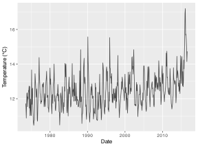
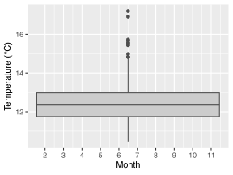
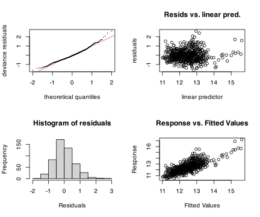
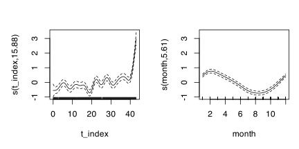
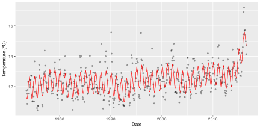

> **NOTE:**
>
> - what a GAM is and why smooth terms are useful in ecology;
> - how GAMs differ from polynomial and mechanistic nonlinear models;
> - how to fit and inspect a Gaussian GAM with [`mgcv::gam()`](https://rdrr.io/pkg/mgcv/man/gam.html);
> - how to interpret smooth terms, effective degrees of freedom, and model output;
> - how to report a GAM in journal style without overclaiming mechanism.

> **IMPORTANT:**
>
> - None

Generalised additive models (GAMs) are often the most practical choice when biological relationships are clearly nonlinear, but the exact shape is unknown. Instead of forcing one global equation, GAMs estimate smooth functions directly from the data while retaining a clear regression structure.

This makes GAMs especially useful in ecology, where responses to environmental gradients are often curved, seasonal, and multi-scale. They are more flexible than low-order polynomials, but less explicitly mechanistic than a dedicated nonlinear process model.

# 1 Key concepts

- **A GAM replaces straight-line terms with smooth functions** such as `s(x)`.
- **Smoothness is penalised** to avoid overfitting; wiggliness is not free.
- **Effective degrees of freedom (edf)** quantify the complexity of each smooth.
- **Inference shifts from individual coefficients to smooth-term significance and shape.**
- **Interpretation remains ecological:** the smooth tells you how the response changes across the predictor gradient.

# 2 When this method is appropriate

Use a GAM when:

- the response-predictor relationship is nonlinear and not well captured by linear or quadratic forms;
- you do not have a single mechanistic process equation to impose;
- you need flexible trend estimation (for example seasonal or long-term environmental patterns);
- the sample size is sufficient to estimate smooths responsibly.

# 3 Nature of the data and assumptions

For Gaussian GAMs, assumptions are conceptually familiar:

1.  independent observations;
2.  approximately normal residuals;
3.  reasonably constant residual variance;
4.  appropriate smooth complexity (not too rigid, not too wiggly).

# 4 The core equations

For a Gaussian response, a GAM can be written as:

$$Y_i = \alpha + f_1(X_{i1}) + f_2(X_{i2}) + \cdots + f_p(X_{ip}) + \epsilon_i \tag{1}$$

In [Equation 1](#eq-gam), each $f_j$ is a smooth function estimated from the data rather than a straight-line coefficient multiplying the predictor directly. This is the key structural change relative to an ordinary linear model.

For introductory purposes, the important idea is that a GAM still has an additive regression structure. What changes is that the effect of a predictor is allowed to bend smoothly instead of being forced into a straight line or a fixed low-order polynomial.

# 5 R functions

The standard implementation is [`mgcv::gam()`](https://rdrr.io/pkg/mgcv/man/gam.html).

``` numberSource
gam(y ~ s(x), data = df, method = "REML")
gam(y ~ s(x1) + s(x2), data = df, method = "REML")
gam(y ~ s(x, bs = "cc"), data = df, method = "REML")  # cyclic smooth
```

`method = "REML"` is a widely-used default for smoothness selection.

# 6 Example 1: Sea-temperature structure through time

## 6.1 Example dataset

We use monthly sea surface temperature records from `data/BCB744/SACTN_day_1.csv` for Port Nolloth on the South African west coast. This is a realistic ecological time series where both long-term structure and within-year seasonality may matter.

``` numberSource
temp_raw <- read_csv(here::here("data", "BCB744", "SACTN_day_1.csv"), show_col_types = FALSE)

temp_df <- temp_raw |>
  filter(site == "Port Nolloth", !is.na(temp)) |>
  mutate(
    date = as.Date(date),
    year = as.numeric(format(date, "%Y")),
    month = as.numeric(format(date, "%m")),
    t_index = as.numeric(date - min(date)) / 365.25
  )

gt(head(temp_df, 10) |> select(site, date, temp, year, month))
```

| site         | date       | temp   | year | month |
|--------------|------------|--------|------|-------|
| Port Nolloth | 1973-07-01 | 11.722 | 1973 | 7     |
| Port Nolloth | 1973-08-01 | 11.534 | 1973 | 8     |
| Port Nolloth | 1973-09-01 | 10.879 | 1973 | 9     |
| Port Nolloth | 1973-10-01 | 11.786 | 1973 | 10    |
| Port Nolloth | 1973-11-01 | 12.308 | 1973 | 11    |
| Port Nolloth | 1973-12-01 | 12.340 | 1973 | 12    |
| Port Nolloth | 1974-01-01 | 11.538 | 1974 | 1     |
| Port Nolloth | 1974-02-01 | 12.105 | 1974 | 2     |
| Port Nolloth | 1974-03-01 | 11.971 | 1974 | 3     |
| Port Nolloth | 1974-04-01 | 12.462 | 1974 | 4     |

A subset of the Port Nolloth temperature time series used in the GAM example. {.gt_table .caption-top .table .table-sm .table-striped .small quarto-bootstrap="false"}

## 6.2 Do an exploratory data analysis (EDA)

``` numberSource
temp_df |>
  summarise(
    n = n(),
    start = min(date),
    end = max(date),
    mean_temp = mean(temp),
    sd_temp = sd(temp)
  )
```

    R> # A tibble: 1 × 5
    R>       n start      end        mean_temp sd_temp
    R>   <int> <date>     <date>         <dbl>   <dbl>
    R> 1   510 1973-07-01 2016-08-01      12.5   0.991

Code

``` numberSource
ggplot(temp_df, aes(x = date, y = temp)) +
  geom_line(alpha = 0.7) +
  labs(x = "Date", y = "Temperature (°C)")
```

[](21-generalised-additive-models_files/figure-html/fig-temp-series-1.svg "Figure 1: Monthly sea temperature at Port Nolloth.")

Figure 1: Monthly sea temperature at Port Nolloth.

Code

``` numberSource
ggplot(temp_df, aes(x = month, y = temp)) +
  geom_boxplot(fill = "grey80", colour = "grey30") +
  scale_x_continuous(breaks = 1:12) +
  labs(x = "Month", y = "Temperature (°C)")
```

[](21-generalised-additive-models_files/figure-html/fig-temp-season-1.svg "Figure 2: Seasonal pattern in monthly temperature (across years).")

Figure 2: Seasonal pattern in monthly temperature (across years).

The data in [Figure 1](#fig-temp-series) and [Figure 2](#fig-temp-season) show clear nonlinearity through time and a strong seasonal cycle. A straight-line model in time is therefore likely to be inadequate.

## 6.3 State the model question and hypotheses

Can sea temperature at Port Nolloth be explained by a flexible long-term trend plus a seasonal smooth cycle?

For smooth terms in GAMs, hypotheses are usually phrased as:

$$H_{0}: f_j(X) = 0$$ $$H_{a}: f_j(X) \ne 0$$

for each smooth term $f_j$. In practice, we inspect smooth-term significance and shape together.

## 6.4 Fit the model

We fit a baseline linear model and then a GAM with:

- a smooth long-term trend in continuous time (`s(t_index)`), and
- a cyclic smooth for month (`s(month, bs = "cc")`) so December and January join naturally.

``` numberSource
mod_lm <- lm(temp ~ t_index + factor(month), data = temp_df)

mod_gam <- gam(
  temp ~ s(t_index, k = 20) + s(month, bs = "cc", k = 12),
  data = temp_df,
  method = "REML"
)

summary(mod_lm)
```

    R> 
    R> Call:
    R> lm(formula = temp ~ t_index + factor(month), data = temp_df)
    R> 
    R> Residuals:
    R>     Min      1Q  Median      3Q     Max 
    R> -1.7770 -0.5217 -0.0540  0.4275  3.3436 
    R> 
    R> Coefficients:
    R>                  Estimate Std. Error t value Pr(>|t|)    
    R> (Intercept)     12.370393   0.131398  94.144  < 2e-16 ***
    R> t_index          0.028353   0.002738  10.354  < 2e-16 ***
    R> factor(month)2   0.342733   0.166124   2.063 0.039621 *  
    R> factor(month)3   0.029053   0.167118   0.174 0.862058    
    R> factor(month)4  -0.170806   0.167121  -1.022 0.307254    
    R> factor(month)5  -0.415614   0.166126  -2.502 0.012677 *  
    R> factor(month)6  -0.722765   0.166128  -4.351 1.65e-05 ***
    R> factor(month)7  -1.117334   0.166129  -6.726 4.82e-11 ***
    R> factor(month)8  -1.206711   0.165178  -7.306 1.11e-12 ***
    R> factor(month)9  -1.259495   0.167114  -7.537 2.30e-13 ***
    R> factor(month)10 -1.020191   0.168138  -6.068 2.58e-09 ***
    R> factor(month)11 -0.617730   0.167111  -3.697 0.000243 ***
    R> factor(month)12 -0.133916   0.167111  -0.801 0.423306    
    R> ---
    R> Signif. codes:  0 '***' 0.001 '**' 0.01 '*' 0.05 '.' 0.1 ' ' 1
    R> 
    R> Residual standard error: 0.7703 on 497 degrees of freedom
    R> Multiple R-squared:  0.4098, Adjusted R-squared:  0.3955 
    R> F-statistic: 28.76 on 12 and 497 DF,  p-value: < 2.2e-16

``` numberSource
summary(mod_gam)
```

    R> 
    R> Family: gaussian 
    R> Link function: identity 
    R> 
    R> Formula:
    R> temp ~ s(t_index, k = 20) + s(month, bs = "cc", k = 12)
    R> 
    R> Parametric coefficients:
    R>             Estimate Std. Error t value Pr(>|t|)    
    R> (Intercept) 12.45935    0.02862   435.3   <2e-16 ***
    R> ---
    R> Signif. codes:  0 '***' 0.001 '**' 0.01 '*' 0.05 '.' 0.1 ' ' 1
    R> 
    R> Approximate significance of smooth terms:
    R>              edf Ref.df     F p-value    
    R> s(t_index) 15.88  17.85 20.14  <2e-16 ***
    R> s(month)    5.61  10.00 32.98  <2e-16 ***
    R> ---
    R> Signif. codes:  0 '***' 0.001 '**' 0.01 '*' 0.05 '.' 0.1 ' ' 1
    R> 
    R> R-sq.(adj) =  0.574   Deviance explained = 59.2%
    R> -REML = 542.09  Scale est. = 0.41773   n = 510

``` numberSource
AIC(mod_lm, mod_gam)
```

    R>               df      AIC
    R> mod_lm  14.00000 1195.935
    R> mod_gam 24.37806 1027.884

## 6.5 Test assumptions / check diagnostics

Code

``` numberSource
par(mfrow = c(2, 2))
gam.check(mod_gam)
```

    R> 
    R> Method: REML   Optimizer: outer newton
    R> full convergence after 7 iterations.
    R> Gradient range [-3.460229e-09,3.399947e-12]
    R> (score 542.0866 & scale 0.4177274).
    R> Hessian positive definite, eigenvalue range [2.683803,254.2529].
    R> Model rank =  30 / 30 
    R> 
    R> Basis dimension (k) checking results. Low p-value (k-index<1) may
    R> indicate that k is too low, especially if edf is close to k'.
    R> 
    R>               k'   edf k-index p-value    
    R> s(t_index) 19.00 15.88    0.63  <2e-16 ***
    R> s(month)   10.00  5.61    1.06    0.86    
    R> ---
    R> Signif. codes:  0 '***' 0.001 '**' 0.01 '*' 0.05 '.' 0.1 ' ' 1

Code

``` numberSource
par(mfrow = c(1, 1))
```

[](21-generalised-additive-models_files/figure-html/fig-gam-check-1.svg "Figure 3: Standard mgcv diagnostic checks for the fitted GAM.")

Figure 3: Standard `mgcv` diagnostic checks for the fitted GAM.

``` numberSource
concurvity(mod_gam, full = TRUE)
```

    R>                  para   s(t_index)    s(month)
    R> worst    3.153452e-23 0.0057595704 0.005759570
    R> observed 3.153452e-23 0.0016454850 0.001803124
    R> estimate 3.153452e-23 0.0007068493 0.001149347

`gam.check()` and the plots in [Figure 3](#fig-gam-check) help assess residual behaviour and whether the chosen basis dimensions (`k`) are adequate.

## 6.6 Interpret the results

Code

``` numberSource
par(mfrow = c(1, 2))
plot(mod_gam, shade = TRUE, pages = 1)
par(mfrow = c(1, 1))
```

[](21-generalised-additive-models_files/figure-html/fig-gam-smooths-1.svg "Figure 4: Estimated smooth terms for the GAM: long-term trend and cyclic monthly seasonality.")

Figure 4: Estimated smooth terms for the GAM: long-term trend and cyclic monthly seasonality.

Code

``` numberSource
temp_df <- temp_df |> mutate(gam_fit = fitted(mod_gam))

ggplot(temp_df, aes(x = date)) +
  geom_point(aes(y = temp), alpha = 0.35, size = 0.8) +
  geom_line(aes(y = gam_fit), colour = "red", linewidth = 0.3) +
  labs(x = "Date", y = "Temperature (°C)")
```

[](21-generalised-additive-models_files/figure-html/fig-gam-fit-1.svg "Figure 5: Observed temperature and fitted GAM values through time.")

Figure 5: Observed temperature and fitted GAM values through time.

The smooths in [Figure 4](#fig-gam-smooths) show that `t_index` captures gradual long-term structure that a single linear slope cannot represent. The cyclic month smooth captures recurring within-year seasonality without forcing identical month effects in each year. The fitted values in [Figure 5](#fig-gam-fit) show how those smooth components reconstruct the observed pattern through time.

The effective degrees of freedom (edf) indicate complexity: edf values close to 1 imply near-linearity; higher values indicate more curvature.

## 6.7 Reporting

> **NOTE:**
>
> **Methods**
>
> Monthly sea surface temperature observations for Port Nolloth were analysed using a Gaussian GAM fitted with [`mgcv::gam()`](https://rdrr.io/pkg/mgcv/man/gam.html) in R. Temperature was modelled as a function of a smooth long-term time index (`s(t_index)`) and a cyclic seasonal smooth for month (`s(month, bs = "cc")`), with smoothness selected by REML. A linear model with month as a factor and a linear time term was used as a baseline comparator.
>
> **Results**
>
> The GAM provided a better fit than the baseline linear model (lower AIC), indicating that nonlinear structure was important. The long-term smooth term was non-zero and captured gradual multi-year variability, while the cyclic month smooth described strong seasonal temperature cycling. Together, these terms reproduced the major temporal structure in observed temperatures without requiring a fixed parametric curve.
>
> **Discussion**
>
> For this ecological time series, a GAM was appropriate because both long-term and seasonal effects were clearly nonlinear. The model is best interpreted as a flexible description of temporal structure, not as a mechanistic oceanographic process model. Where mechanism is the primary goal, process-based nonlinear models should be considered alongside GAMs.

# 7 What to do when assumptions fail / alternatives

- If residuals show strong autocorrelation, move to GAMM frameworks (e.g., correlation structures or random effects).
- If response variance is clearly non-Gaussian, use an appropriate family (e.g., Poisson, negative binomial, binomial).
- If smooths are implausibly wiggly, reduce basis size (`k`) and inspect diagnostics carefully.

# 8 Summary

- GAMs are additive smooth regression models that handle complex nonlinear ecological relationships.
- They are often superior to low-order polynomials when shape is unknown.
- Interpretation focuses on smooth shapes and ecological plausibility rather than mechanistic parameters.
- Diagnostics and smoothness control are essential for responsible use.

## Reuse

[CC BY-NC-SA 4.0](https://creativecommons.org/licenses/by-nc-sa/4.0/)

## Citation

BibTeX citation:

``` quarto-appendix-bibtex
@online{smit2026,
  author = {Smit, A. J.},
  title = {21. {Generalised} Additive Models},
  date = {2026-11-06},
  url = {https://tangledbank.netlify.app/BCB744/basic_stats/21-generalised-additive-models.html},
  langid = {en}
}
```

For attribution, please cite this work as:

Smit AJ (2026) 21. Generalised additive models. [https://tangledbank.netlify.app/BCB744/basic_stats/21-generalised-additive-models.html.](https://tangledbank.netlify.app/BCB744/basic_stats/21-generalised-additive-models.html)
