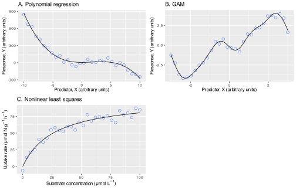
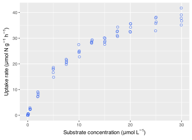
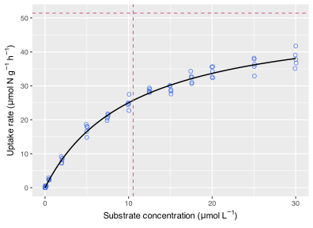
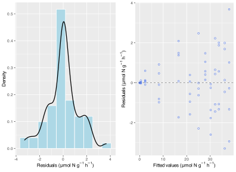
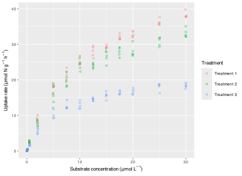
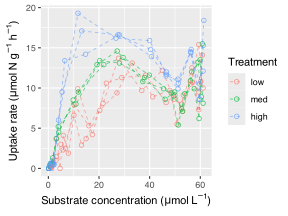
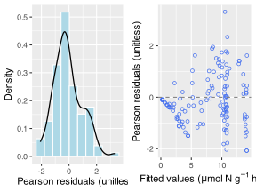
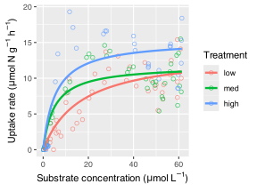

> **NOTE:**
>
> - Why some biological relationships are mechanistically nonlinear
> - How nonlinear regression differs from polynomial and additive models
> - The logic of named nonlinear functions
> - A worked Michaelis-Menten example
> - How nonlinear mixed-effects models extend mechanistic curves to repeated-measures data
> - What to check when fitting nonlinear models

Some relationships are curved because the biology is curved. Growth saturates, enzyme kinetics asymptote, seasonal cycles oscillate, and responses may level off, bend, or change slope across the range of the predictor. In such cases, a straight-line model is often too rigid.

In this chapter, I focus specifically on mechanistic nonlinear regression: models where the response is described by a named nonlinear function whose parameters have scientific meaning. Examples include saturating uptake curves, logistic growth, seasonal sine curves, and other biologically motivated responses.

Polynomial regression and GAMs are covered in their own chapters because they answer a different modelling need. Here the emphasis is narrower and stronger: what to do when the biology suggests the form of the curve itself.

# 1 Key concepts

- **Nonlinearity** often reflects real biological structure rather than unwanted curvature.
- **Flexible regression** can model patterns that a straight line misses.
- **Mechanistic nonlinear models are appropriate when the curve has a biologically motivated form.**
- **Greater flexibility increases the risk of overfitting** if used carelessly.
- **Model choice should follow biological form**, not only convenience or visual preference.

# 2 When this method is appropriate

You should move beyond a simple linear model when:

- the fitted residuals show clear curvature;
- the biology suggests an asymptote, threshold, saturation, or oscillation;
- the response changes differently across the predictor range;
- the question concerns parts of the response distribution other than the mean.

The diagnostic chapters earlier in the sequence already suggested this possibility. This chapter is about what to do next.

# 3 Nature of the data and assumptions

Mechanistic nonlinear regression is still regression, so the familiar concerns about independence, residual spread, and overall model adequacy do not disappear. In many introductory applications, the response variable is continuous and the residuals are assumed to be approximately normally distributed with constant variance.

The key distinction is that the mean structure is explicitly nonlinear and tied to a named function. These models are usually fitted by nonlinear least squares with [`nls()`](https://rdrr.io/r/stats/nls.html), or by mixed-effects extensions when grouped or repeated-measures data are present.

The practical point is that you choose a non-linear model because the straight-line model is inadequate and because the curved alternative matches the biological process or the inferential question more closely. And it looks pretty and complicated.

# 4 The core equation

The general form of a nonlinear regression is:

$$Y_i = f(X_i, \theta) + \epsilon_i \tag{1}$$

In [Equation 1](#eq-nonlinear), $f(\cdot)$ is a biologically chosen nonlinear function and $\theta$ represents the parameter set that defines its shape. This chapter then uses a Michaelis-Menten curve as the main worked example of that general idea.

# 5 R functions

Some of the most useful R functions are:

- [`nls()`](https://rdrr.io/r/stats/nls.html) for nonlinear least-squares models;
- [`nlme::nlme()`](https://rdrr.io/pkg/nlme/man/nlme.html) when nonlinear relationships occur in grouped or repeated-measures data.

Examples:

``` numberSource
lm(response ~ poly(x, degree = 2), data = df)
nls(y ~ Vmax * x / (Km + x), data = df,
    start = list(Vmax = 1, Km = 1))
nlme::nlme(y ~ Vmax * x / (Km + x), data = df, ...)
```

One practical difference from ordinary regression is that [`nls()`](https://rdrr.io/r/stats/nls.html) usually needs sensible starting values. Unlike [`lm()`](https://rdrr.io/r/stats/lm.html), it uses an iterative search for the best-fitting parameter values, and poor starting values can prevent convergence.

# 6 Example 1: Why use a mechanistic nonlinear model?

The first decision is whether the biology gives you a reason to prefer a specific nonlinear function rather than a descriptive curve.

[](22-nonlinear-regression_files/figure-html/fig-main-families-1.svg "Figure 1: Examples of curved models fitted to simulated data. A polynomial can capture modest curvature, a GAM can adapt flexibly to the data, and a mechanistic nonlinear model can represent a known saturating biological response.")

Figure 1: Examples of curved models fitted to simulated data. A polynomial can capture modest curvature, a GAM can adapt flexibly to the data, and a mechanistic nonlinear model can represent a known saturating biological response.

[Figure 1](#fig-main-families) shows three broad situations:

- A polynomial model can describe modest curvature, but it is mainly descriptive.
- A GAM is very useful when the relationship is clearly curved but its exact form is unknown or not informative.
- A mechanistic nonlinear model is most attractive when the biology suggests a specific function, because its parameters can often be interpreted directly.

That last point is important. If we know the process should saturate, as in nutrient uptake kinetics, a mechanistic model tells us more than a flexible smoother. It gives us interpretable parameters such as an asymptote or a half-saturation constant.

# 7 Example 2: Algal nutrient uptake kinetics

We can measure algal nutrient uptake rates using a multiple flask experiment. We prepare a series of flasks, each containing a different initial concentration of the substrate nutrient, and then estimate nutrient uptake rate over a fixed time interval. The result is a set of uptake rates, $V$ ($\mu\mathrm{mol}\ \mathrm{N}\ \mathrm{g}^{-1}\ \mathrm{h}^{-1}$), paired with substrate concentrations, $[S]$ ($\mu\mathrm{mol}\ \mathrm{L}^{-1}$).

If you need a reminder of the biological and experimental context behind these data, refer back to the BDC223 nutrient-uptake material in [Lecture 9a: Nutrient Uptake](../../BDC223/L09a-nutrient_uptake.llms.md), [Lecture 9b: Uptake Kinetics – Michaelis-Menten](../../BDC223/L09b-nutrients_michaelis_menten.llms.md), and [Lab 4: Uptake Kinetics – Michaelis-Menten](../../BDC223/Lab4_nitrogen_uptake.llms.md). Those pages explain the experimental principles of the multiple-flask design in much more detail than is needed here.

Applied to algae, the Michaelis-Menten model assumes an irreversible uptake process that saturates at high substrate concentrations. It effectively quantifies key characteristics of the nutrient uptake system, including the maximum uptake rate and the alga’s affinity for the nutrient:

$$V_i = \frac{V_{max} \cdot [S_i]}{K_m + [S_i]} + \epsilon_i \tag{2}$$

In [Equation 2](#eq-mm):

- $V_i$ is the uptake rate at the $i$-th observation ($\mu\mathrm{mol}\ \mathrm{N}\ \mathrm{g}^{-1}\ \mathrm{h}^{-1}$);
- $V_{max}$ is the maximum nutrient uptake rate achieved ($\mu\mathrm{mol}\ \mathrm{N}\ \mathrm{g}^{-1}\ \mathrm{h}^{-1}$);
- $[S_i]$ is the substrate concentration at the $i$-th observation ($\mu\mathrm{mol}\ \mathrm{L}^{-1}$);
- $K_m$ is the substrate concentration at which uptake reaches half of $V_{max}$ ($\mu\mathrm{mol}\ \mathrm{L}^{-1}$); and
- $\epsilon_i$ is the residual error.

The two parameters are biologically meaningful. $V_{max}$ represents the maximum capacity of the alga to utilise the nutrient and is measured in $\mu\mathrm{mol}\ \mathrm{N}\ \mathrm{g}^{-1}\ \mathrm{h}^{-1}$. $K_m$ describes the affinity of the uptake system for that nutrient and is measured in $\mu\mathrm{mol}\ \mathrm{L}^{-1}$. Lower values of $K_m$ indicate higher affinity.

## 7.1 Do an exploratory data analysis (EDA)

To demonstrate fitting a nonlinear model to $V$ versus $[S]$ data from a multiple flask experiment, I simulate data across a range of substrate concentrations. The dataset consists of five replicate flasks for each of 13 substrate concentrations.

``` numberSource
conc_vec <- c(0, 0.1, 0.5, 2, 5, 7.5, 10, 12.5, 15, 17.5, 20, 25, 30)
n_rep <- 5
Km_vec <- c(10)
Vmax_vec <- c(50)
Km_vec_sd <- c(1.2)
Vmax_vec_sd <- c(0.7)

mf_data <- generate_data(
  n_trt = 1,
  n_rep = n_rep,
  conc_vec = conc_vec,
  Km_vec = Km_vec,
  Vmax_vec = Vmax_vec,
  Km_vec_sd = Km_vec_sd,
  Vmax_vec_sd = Vmax_vec_sd
) |>
  select(rep, S, V)

mf_data |>
  slice(c(1:4, (n() - 3):n())) |>
  gt::gt() |>
  gt::fmt_number(columns = c(S, V), decimals = 2)
```

| rep | S     | V     |
|-----|-------|-------|
| 1   | 0.00  | 0.00  |
| 2   | 0.00  | 0.00  |
| 3   | 0.00  | 0.00  |
| 4   | 0.00  | 0.00  |
| 2   | 30.00 | 35.12 |
| 3   | 30.00 | 39.07 |
| 4   | 30.00 | 37.78 |
| 5   | 30.00 | 36.73 |

Preview of the simulated multiple-flask dataset (first and last four rows). {.gt_table .caption-top .table .table-sm .table-striped .small quarto-bootstrap="false"}

[](22-nonlinear-regression_files/figure-html/fig-mf-eda-1.svg "Figure 2: Plot of uptake rate, V, as a function of substrate concentration, [S], for a multiple flask experiment. The relationship is clearly curved and tends towards saturation.")

Figure 2: Plot of uptake rate, V, as a function of substrate concentration, \[S\], for a multiple flask experiment. The relationship is clearly curved and tends towards saturation.

The plot in [Figure 2](#fig-mf-eda) already suggests that a straight line is not the right model. Uptake increases quickly away from low substrate concentrations and then begins to level off when the concentrations become higher. That is exactly the sort of pattern for which a Michaelis-Menten model was designed.

You will also often see greater spread in uptake rate at higher substrate concentrations. That happens because the high-concentration part of the curve approaches the enzyme-limited region. Once transport and assimilation systems are near saturation, small biological differences among flasks in tissue condition, enzyme capacity, light history, or temperature response can translate into visibly different realised uptake rates. At low concentrations, by contrast, uptake is constrained more strongly by substrate availability itself, so the responses are often pulled into a narrower range.

## 7.2 State the model question

At this point, two related questions arise.

The first is descriptive and mechanistic: can we estimate the uptake parameters $V_{max}$ ($\mu\mathrm{mol}\ \mathrm{N}\ \mathrm{g}^{-1}\ \mathrm{h}^{-1}$) and $K_m$ ($\mu\mathrm{mol}\ \mathrm{L}^{-1}$) from these data?

The second is comparative: does a Michaelis-Menten model fit these data better than a simple linear model?

Those are not the same question. The first is about parameter estimation within a nonlinear biological model. The second is about choosing between two competing mean structures.

## 7.3 Fit the model

The Michaelis-Menten model is fit with [`nls()`](https://rdrr.io/r/stats/nls.html):

``` numberSource
nls_mod <- nls(
  V ~ mm_fun(S, Vmax, Km),
  data = mf_data,
  start = c(Vmax = 30, Km = 5)
)

summary(nls_mod)
```

    R> 
    R> Formula: V ~ mm_fun(S, Vmax, Km)
    R> 
    R> Parameters:
    R>      Estimate Std. Error t value Pr(>|t|)    
    R> Vmax  51.4417     1.1770   43.70   <2e-16 ***
    R> Km    10.5507     0.5975   17.66   <2e-16 ***
    R> ---
    R> Signif. codes:  0 '***' 0.001 '**' 0.01 '*' 0.05 '.' 0.1 ' ' 1
    R> 
    R> Residual standard error: 1.312 on 63 degrees of freedom
    R> 
    R> Number of iterations to convergence: 3 
    R> Achieved convergence tolerance: 8.862e-06

The starting values do not have to be exact, but they should be sensible. Here we know from the plot that the asymptote is probably somewhere around $40$ to $50\ \mu\mathrm{mol}\ \mathrm{N}\ \mathrm{g}^{-1}\ \mathrm{h}^{-1}$, and that the half-saturation constant is likely to be in the single digits of $\mu\mathrm{mol}\ \mathrm{L}^{-1}$.

[](22-nonlinear-regression_files/figure-html/fig-mf-fit-1.svg "Figure 3: Michaelis-Menten model fitted to the uptake data. The dashed lines indicate the estimated Km and Vmax values.")

Figure 3: Michaelis-Menten model fitted to the uptake data. The dashed lines indicate the estimated Km and Vmax values.

## 7.4 Check diagnostics

Because this is a least-squares nonlinear model, residual diagnostics are interpreted much as they are for ordinary regression.

``` numberSource
mf_data <- mf_data |>
  mutate(
    fitted = fitted(nls_mod),
    resid = resid(nls_mod)
  )

shapiro.test(mf_data$resid)
```

    R> 
    R>  Shapiro-Wilk normality test
    R> 
    R> data:  mf_data$resid
    R> W = 0.97225, p-value = 0.1517

[](22-nonlinear-regression_files/figure-html/fig-mf-diagnostics-1.svg "Figure 4: Basic diagnostics for the Michaelis-Menten fit. The residuals show no serious trend with the fitted values, and the distribution is approximately symmetric.")

Figure 4: Basic diagnostics for the Michaelis-Menten fit. The residuals show no serious trend with the fitted values, and the distribution is approximately symmetric.

The diagnostics in [Figure 4](#fig-mf-diagnostics) do not suggest any serious problem. The residual spread is fairly even, and the histogram is approximately symmetric. As always, you should not rely on a single formal test, but the residual behaviour is consistent with a usable fit.

## 7.5 Interpret the results

``` numberSource
lm_mod <- lm(V ~ S, data = mf_data)
model_comp <- anova(lm_mod, nls_mod)
f_stat <- model_comp$F[2]

AIC(lm_mod, nls_mod)
```

    R>         df      AIC
    R> lm_mod   3 395.8491
    R> nls_mod  3 223.6862

``` numberSource
BIC(lm_mod, nls_mod)
```

    R>         df      BIC
    R> lm_mod   3 402.3723
    R> nls_mod  3 230.2094

``` numberSource
model_comp
```

    R> Analysis of Variance Table
    R> 
    R> Response: V
    R>           Df  Sum Sq Mean Sq F value    Pr(>F)    
    R> S          1 10274.8 10274.8  422.59 < 2.2e-16 ***
    R> Residuals 63  1531.8    24.3                      
    R> ---
    R> Signif. codes:  0 '***' 0.001 '**' 0.01 '*' 0.05 '.' 0.1 ' ' 1

The fitted nonlinear model gives estimated values for $V_{max}$ and $K_m$, and these are the biologically meaningful outputs of the analysis. The estimated $V_{max}$ is the asymptotic uptake rate in $\mu\mathrm{mol}\ \mathrm{N}\ \mathrm{g}^{-1}\ \mathrm{h}^{-1}$, while $K_m$ indicates the substrate concentration in $\mu\mathrm{mol}\ \mathrm{L}^{-1}$ at which the uptake rate reaches half of that asymptote.

The model comparison also matters. If the linear and Michaelis-Menten models are both fitted to the same data, the nonlinear model has markedly lower information criteria and a much smaller residual error. That supports the biological interpretation already suggested by the plot; that is, uptake increases with substrate concentration, but it does so in a saturating rather than indefinitely linear way.

## 7.6 Reporting

> **NOTE:**
>
> **Methods**
>
> Nutrient uptake rate was modelled as a function of substrate concentration with a Michaelis-Menten nonlinear regression fitted by nonlinear least squares. The nonlinear model was compared with a simple linear regression using information criteria and nested model comparison to assess whether the saturating form provided a better description of the data.
>
> **Results**
>
> Nutrient uptake increased rapidly with substrate concentration at low concentrations and then approached an asymptote, consistent with Michaelis-Menten kinetics ([Figure 3](#fig-mf-fit)). The fitted nonlinear model estimated a maximum uptake rate of 51.44 $\mu\mathrm{mol}\ \mathrm{N}\ \mathrm{g}^{-1}\ \mathrm{h}^{-1}$ and a half-saturation constant of 10.55 $\mu\mathrm{mol}\ \mathrm{L}^{-1}$. Relative to a simple linear regression, the Michaelis-Menten model provided the better description of the data, with lower AIC and BIC values and a significant improvement in fit (F = NA, `p < 0.05`).
>
> **Discussion**
>
> The main biological point is that uptake is saturating rather than indefinitely linear over the observed concentration range. That matters because the fitted parameters now speak directly to uptake capacity and nutrient affinity.

## 7.7 What if we add treatments?

Experiments are seldom as simple as the one above. Consider an experiment designed to assess whether an experimental treatment, such as light intensity or seawater temperature, affects nutrient uptake kinetics. It is biologically plausible to expect that each treatment will result in unique $V_{max}$ values ($\mu\mathrm{mol}\ \mathrm{N}\ \mathrm{g}^{-1}\ \mathrm{h}^{-1}$) and $K_m$ values ($\mu\mathrm{mol}\ \mathrm{L}^{-1}$).

``` numberSource
mf_data2 <- generate_data(
  n_trt = 3,
  n_rep = 5,
  conc_vec = conc_vec,
  Km_vec = c(10, 8, 6),
  Vmax_vec = c(50, 40, 22),
  Km_vec_sd = c(1.2, 1.1, 1.0),
  Vmax_vec_sd = c(0.7, 1.0, 0.8)
)
```

[](22-nonlinear-regression_files/figure-html/fig-mf-treatment-1.svg "Figure 5: Simulated nutrient uptake curves for three treatments. The pattern suggests treatment-specific nonlinear responses rather than a single shared curve.")

Figure 5: Simulated nutrient uptake curves for three treatments. The pattern suggests treatment-specific nonlinear responses rather than a single shared curve.

The treatment-specific curvature in [Figure 5](#fig-mf-treatment) makes the modelling problem more challenging and exciting. A separate [`nls()`](https://rdrr.io/r/stats/nls.html) fit can be used for each treatment, or a nonlinear mixed-effects model can be used when dependence or grouping must be handled explicitly. That is the nonlinear counterpart of the fixed-effects and mixed-effects logic introduced in [Chapter 19](../../BCB744/basic_stats/19-dependence-and-mixed-models.llms.md). If the response is also non-normal, you are moving towards the broader territory covered in [Chapter 20](../../BCB744/basic_stats/20-generalised-linear-models.llms.md).

The important point is that nonlinear modelling “draws a curve” *and* it chooses a mean structure that matches the process and then extending that structure carefully when treatments, dependence, or more complicated designs are present.

## 7.8 Repeated-measures extension

The next extension appears when the same experimental unit is measured repeatedly across the concentration gradient. For example, you might measure uptake repeatedly on the same thallus, plant, or mesocosm under several substrate concentrations. At that point, the observations within each unit are no longer independent, so a separate [`nls()`](https://rdrr.io/r/stats/nls.html) fit per unit or a pooled [`nls()`](https://rdrr.io/r/stats/nls.html) fit is no longer enough.

The nonlinear mixed-effects version of the model keeps the Michaelis-Menten mean structure but lets one or more parameters vary among experimental units. A common starting point is to allow each unit to have its own `Vmax` ($\mu\mathrm{mol}\ \mathrm{N}\ \mathrm{g}^{-1}\ \mathrm{h}^{-1}$) around a population-level mean:

``` numberSource
nlme::nlme(
  V ~ mm_fun(S, Vmax, Km),
  data = uptake_long,
  fixed = Vmax + Km ~ treatment,
  random = Vmax ~ 1 | individual,
  start = c(...)
)
```

In that formulation, the fixed effects describe how treatment shifts the average kinetic parameters, while the random effect acknowledges that repeated observations from the same individual share the same underlying uptake curve. A full worked example needs a dataset with true repeated measurements on the same biological units and enough observations per unit to estimate the random-effects structure sensibly.

# 8 Example 3: Repeated-measures Michaelis-Menten kinetics

The previous examples treated each flask as an independent unit observed once at each starting concentration. A perturbation experiment is different. The same flask is sampled repeatedly through time as nutrient concentration declines, so the observations from that flask are correlated. This is exactly the kind of dependence problem introduced in [Chapter 19](../../BCB744/basic_stats/19-dependence-and-mixed-models.llms.md), except that the mean structure is now nonlinear rather than linear.

For the BDC223 treatment of this experimental design, including depletion curves and the distinction between perturbation and multiple-flask methods, see [Lecture 9a: Nutrient Uptake](../../BDC223/L09a-nutrient_uptake.llms.md), [Lecture 9b: Uptake Kinetics – Michaelis-Menten](../../BDC223/L09b-nutrients_michaelis_menten.llms.md), and [Lab 4: Uptake Kinetics – Michaelis-Menten](../../BDC223/Lab4_nitrogen_uptake.llms.md). Here we pick up at the point where those experiments become a modelling problem.

## 8.1 Example dataset

These data come from a perturbation experiment on the red seaweed *Gracilaria* sp. Flasks were enriched to approximately 55–60 $\mu M$ nitrate and sampled repeatedly over roughly 2.5 hours. Uptake rates were measured under three levels of water movement (`low`, `med`, `high`), with three replicate flasks per treatment.

``` numberSource
mm_data <- read.csv(here::here("data", "BCB744", "flow_rates.txt"), sep = "") |>
  mutate(
    flask = factor(flask),
    trt = factor(trt, levels = c("low", "med", "high"))
  )

head(mm_data, 8) |>
  gt::gt() |>
  gt::fmt_number(columns = c(V, S), decimals = 2)
```

| flask | trt | V     | S     |
|-------|-----|-------|-------|
| a1    | low | 10.80 | 60.20 |
| a2    | low | 10.00 | 61.10 |
| a3    | low | 14.10 | 60.80 |
| a1    | low | 7.30  | 59.40 |
| a2    | low | 15.40 | 59.40 |
| a3    | low | 9.50  | 59.40 |
| a1    | low | 12.50 | 56.70 |
| a2    | low | 10.50 | 56.20 |

Preview of the perturbation dataset (first eight rows). {.gt_table .caption-top .table .table-sm .table-striped .small quarto-bootstrap="false"}

## 8.2 Do an exploratory data analysis (EDA)

[](22-nonlinear-regression_files/figure-html/fig-mm-eda-1.svg "Figure 6: Repeated-measures uptake data from the perturbation experiment. Each dashed line traces one flask through time as substrate concentration declines.")

Figure 6: Repeated-measures uptake data from the perturbation experiment. Each dashed line traces one flask through time as substrate concentration declines.

The relationship in [Figure 6](#fig-mm-eda) is again saturating, so a Michaelis-Menten mean structure is still sensible. The important difference is that each dashed trajectory comes from the same flask measured repeatedly. That means the residuals are likely to be correlated within flask, and the flasks are nested within treatment.

## 8.3 State the model question

The biological question is whether the Michaelis-Menten parameters differ among water-movement treatments once the repeated-measures structure of the perturbation experiment is taken into account. Here that means asking whether treatment shifts $V_{max}$ ($\mu\mathrm{mol}\ \mathrm{N}\ \mathrm{g}^{-1}\ \mathrm{h}^{-1}$) and/or $K_m$ ($\mu\mathrm{mol}\ \mathrm{L}^{-1}$).

$$H_{0}: V_{max} \text{ and } K_m \text{ are the same across treatments after accounting for flask-level dependence}$$ $$H_{a}: \text{At least one of } V_{max} \text{ or } K_m \text{ differs among treatments after accounting for flask-level dependence}$$

## 8.4 Fit the model

We compare two nonlinear mixed-effects models. The first is a **global** model in which all treatments share the same Michaelis-Menten parameters. The second allows `Vmax` and `Km` to vary by treatment while retaining the same repeated-measures structure.

``` numberSource
num_levels <- nlevels(mm_data$trt)

start_global <- c(
  Vmax = max(mm_data$V),
  Km = median(mm_data$S)
)

start_trt <- list(
  fixed = c(
    Vmax = rep(max(mm_data$V), num_levels),
    Km = rep(median(mm_data$S), num_levels)
  )
)

mm_global <- nlme(
  V ~ mm_fun(S, Vmax, Km),
  data = mm_data,
  fixed = Vmax + Km ~ 1,
  random = Vmax ~ 1 | trt/flask,
  groups = ~ trt/flask,
  correlation = corAR1(form = ~ 1 | trt/flask),
  start = start_global,
  method = "ML"
)

mm_trt <- nlme(
  V ~ mm_fun(S, Vmax, Km),
  data = mm_data,
  fixed = list(Vmax ~ trt, Km ~ trt),
  random = Vmax ~ 1 | trt/flask,
  groups = ~ trt/flask,
  correlation = corAR1(form = ~ 1 | trt/flask),
  start = start_trt,
  method = "ML"
)

mm_comp <- anova(mm_global, mm_trt)

mm_comp
```

    R>           Model df      AIC      BIC    logLik   Test  L.Ratio p-value
    R> mm_global     1  6 656.0306 673.3274 -322.0153                        
    R> mm_trt        2 10 648.1068 676.9348 -314.0534 1 vs 2 15.92387  0.0031

``` numberSource
summary(mm_trt)
```

    R> Nonlinear mixed-effects model fit by maximum likelihood
    R>   Model: V ~ mm_fun(S, Vmax, Km) 
    R>   Data: mm_data 
    R>        AIC      BIC    logLik
    R>   648.1068 676.9348 -314.0534
    R> 
    R> Random effects:
    R>  Formula: Vmax ~ 1 | trt
    R>         Vmax.(Intercept)
    R> StdDev:     0.0001334687
    R> 
    R>  Formula: Vmax ~ 1 | flask %in% trt
    R>         Vmax.(Intercept) Residual
    R> StdDev:     2.572024e-05 2.641716
    R> 
    R> Correlation Structure: AR(1)
    R>  Formula: ~1 | trt/flask 
    R>  Parameter estimate(s):
    R>       Phi 
    R> 0.1539479 
    R> Fixed effects:  list(Vmax ~ trt, Km ~ trt) 
    R>                       Value Std.Error  DF   t-value p-value
    R> Vmax.(Intercept)  13.727753  2.011411 118  6.824938  0.0000
    R> Vmax.trtmed       -1.917486  2.239487 118 -0.856217  0.3936
    R> Vmax.trthigh       1.623586  2.258494 118  0.718880  0.4736
    R> Km.(Intercept)    16.847854  7.413292 118  2.272655  0.0249
    R> Km.trtmed        -11.917482  7.783803 118 -1.531062  0.1284
    R> Km.trthigh       -11.480850  7.623149 118 -1.506051  0.1347
    R>  Correlation: 
    R>                Vm.(I) Vmx.trtm Vmx.trth Km.(I) Km.trtm
    R> Vmax.trtmed    -0.898                                 
    R> Vmax.trthigh   -0.891  0.800                          
    R> Km.(Intercept)  0.923 -0.829   -0.822                 
    R> Km.trtmed      -0.879  0.892    0.783   -0.952        
    R> Km.trthigh     -0.898  0.806    0.877   -0.972  0.926 
    R> 
    R> Standardized Within-Group Residuals:
    R>        Min         Q1        Med         Q3        Max 
    R> -2.0770735 -0.7687045 -0.2436554  0.4550068  3.3221379 
    R> 
    R> Number of Observations: 132
    R> Number of Groups: 
    R>            trt flask %in% trt 
    R>              3              9

Three parts of the specification are important:

- `fixed = ... ~ trt` allows the Michaelis-Menten parameters to differ among treatments.
- `random = Vmax ~ 1 | trt/flask` allows replicate flasks within treatments to vary in baseline uptake capacity.
- `correlation = corAR1(...)` acknowledges that repeated measurements within the same flask are serially correlated.

This is the nonlinear counterpart of the grouped-dependence ideas from Chapter 19. The model still estimates a mechanistic curve, but it now does so in a way that respects repeated measurement on the same experimental unit while keeping the kinetic parameters in their usual units of $\mu\mathrm{mol}\ \mathrm{N}\ \mathrm{g}^{-1}\ \mathrm{h}^{-1}$ ($V_{max}$) and $\mu\mathrm{mol}\ \mathrm{L}^{-1}$ ($K_m$).

## 8.5 Check diagnostics

``` numberSource
mm_data <- mm_data |>
  mutate(
    fitted_nlme = fitted(mm_trt),
    resid_nlme = resid(mm_trt, type = "pearson")
  )

shapiro.test(mm_data$resid_nlme)
```

    R> 
    R>  Shapiro-Wilk normality test
    R> 
    R> data:  mm_data$resid_nlme
    R> W = 0.97547, p-value = 0.01719

[](22-nonlinear-regression_files/figure-html/fig-mm-diagnostics-1.svg "Figure 7: Basic diagnostics for the nonlinear mixed-effects model. The residual pattern is acceptable for a teaching example, with no strong trend against the fitted values.")

Figure 7: Basic diagnostics for the nonlinear mixed-effects model. The residual pattern is acceptable for a teaching example, with no strong trend against the fitted values.

The diagnostics in [Figure 7](#fig-mm-diagnostics) show whether the fitted nonlinear mean structure and the residual assumptions are at least broadly compatible with the data.

## 8.6 Interpret the results

``` numberSource
coef_mm <- fixed.effects(mm_trt)

Vmax_by_trt <- c(
  low = coef_mm["Vmax.(Intercept)"],
  med = coef_mm["Vmax.(Intercept)"] + coef_mm["Vmax.trtmed"],
  high = coef_mm["Vmax.(Intercept)"] + coef_mm["Vmax.trthigh"]
)

Km_by_trt <- c(
  low = coef_mm["Km.(Intercept)"],
  med = coef_mm["Km.(Intercept)"] + coef_mm["Km.trtmed"],
  high = coef_mm["Km.(Intercept)"] + coef_mm["Km.trthigh"]
)

param_tbl <- tibble(
  trt = factor(c("low", "med", "high"), levels = c("low", "med", "high")),
  Vmax = round(unname(Vmax_by_trt), 2),
  Km = round(unname(Km_by_trt), 2)
)

param_tbl
```

    R> # A tibble: 3 × 3
    R>   trt    Vmax    Km
    R>   <fct> <dbl> <dbl>
    R> 1 low    13.7 16.8 
    R> 2 med    11.8  4.93
    R> 3 high   15.4  5.37

[](22-nonlinear-regression_files/figure-html/fig-mm-fit-1.svg "Figure 8: Treatment-specific nonlinear mixed-effects fits for the perturbation experiment.")

Figure 8: Treatment-specific nonlinear mixed-effects fits for the perturbation experiment.

The likelihood-ratio test comparing the shared-parameter model with the treatment-specific model shows that allowing `Vmax` and `Km` to vary by treatment improves fit strongly (`p = 0.0031`). That is the main inferential result. The treatment-specific parameter estimates suggest that the low-flow treatment has the highest fitted `Km` in $\mu\mathrm{mol}\ \mathrm{L}^{-1}$, while the medium and high treatments reach similar uptake behaviour at lower substrate concentrations. The fitted `Vmax` values, measured in $\mu\mathrm{mol}\ \mathrm{N}\ \mathrm{g}^{-1}\ \mathrm{h}^{-1}$, differ less strongly than the `Km` estimates in this example.

In nonlinear mixed-effects work, the global model comparison is often more informative than reading each coefficient one-by-one as though they were ordinary linear-model terms. The treatment effect here is a shift in the shape of the kinetic curve under a repeated-measures design.

## 8.7 Reporting

> **NOTE:**
>
> **Methods**
>
> Nitrate-uptake kinetics were analysed with a Michaelis-Menten nonlinear mixed-effects model fitted to repeated observations from perturbation flasks. Treatment was included as a fixed effect on the Michaelis-Menten parameters (`Vmax` and `Km`), replicate flasks were treated as random effects nested within treatment, and a first-order autoregressive correlation structure was used to account for serial dependence among repeated measurements within each flask. A global model with shared kinetic parameters across treatments was compared with a treatment-specific model using a likelihood-ratio test.
>
> **Results**
>
> Allowing Michaelis-Menten parameters to vary among treatments improved model fit relative to the shared-parameter model (likelihood-ratio test: L.Ratio = 15.92, `p = 0.0031`). The fitted treatment-specific curves differed mainly in the half-saturation constant, with the low-flow treatment showing the highest fitted $K_m$ and the medium- and high-flow treatments reaching high uptake rates at lower substrate concentrations ([Figure 8](#fig-mm-fit)). Estimated parameter values were low flow: $V_{max} =$ 13.73 $\mu\mathrm{mol}\ \mathrm{N}\ \mathrm{g}^{-1}\ \mathrm{h}^{-1}$ and $K_m =$ 16.85 $\mu\mathrm{mol}\ \mathrm{L}^{-1}$; medium flow: $V_{max} =$ 11.81 $\mu\mathrm{mol}\ \mathrm{N}\ \mathrm{g}^{-1}\ \mathrm{h}^{-1}$ and $K_m =$ 4.93 $\mu\mathrm{mol}\ \mathrm{L}^{-1}$; high flow: $V_{max} =$ 15.35 $\mu\mathrm{mol}\ \mathrm{N}\ \mathrm{g}^{-1}\ \mathrm{h}^{-1}$ and $K_m =$ 5.37 $\mu\mathrm{mol}\ \mathrm{L}^{-1}$.
>
> **Discussion**
>
> The biological point is that repeated-measures uptake data can support treatment differences in kinetic behaviour, but only if the dependence structure is modelled explicitly. Ignoring the repeated sampling of the same flasks would treat correlated measurements as independent and would make the inferential result less trustworthy.

# 9 Choosing among flexible models

There are a few practical considerations to keep in mind when choosing a mechanistic nonlinear model. Sometimes different curved models can provide similar fits to the same data, but they have very different implications for interpretation. The reason to prefer a mechanistic nonlinear model is precisely that its parameters mean something biologically. If that interpretability is weak or artificial, a descriptive alternative such as a polynomial regression or GAM may be more honest.

# 10 Practical caution

Flexibility is valuable, but it comes with a cost.

- More flexible models are often harder to interpret.
- They can overfit small datasets.
- They may fit noise rather than structure if the biological logic is weak.
- Nonlinear least-squares models can fail to converge if the functional form or starting values are poor.

This is why flexible regression should be a response to a clear diagnostic or biological need, not just a default preference for curved lines.

# 11 Summary

- Not all biological relationships are well described by straight lines.
- Mechanistic nonlinear models serve a distinct purpose within the broader family of curved-response models.
- Model choice should follow the biology and the inferential goal.
- Mechanistic nonlinear models are especially valuable when their parameters have clear biological meaning.
- Greater flexibility can improve fit, but it also increases interpretive demands and the risk of overfitting.

In the next chapter, I extend the regression sequence in a different direction by asking what happens when the scientific target is another part of the response distribution rather than the mean alone.

## Reuse

[CC BY-NC-SA 4.0](https://creativecommons.org/licenses/by-nc-sa/4.0/)

## Citation

BibTeX citation:

``` quarto-appendix-bibtex
@online{smit2026,
  author = {Smit, A. J.},
  title = {22. {Nonlinear} Regression},
  date = {2026-11-06},
  url = {https://tangledbank.netlify.app/BCB744/basic_stats/22-nonlinear-regression.html},
  langid = {en}
}
```

For attribution, please cite this work as:

Smit AJ (2026) 22. Nonlinear regression. [https://tangledbank.netlify.app/BCB744/basic_stats/22-nonlinear-regression.html.](https://tangledbank.netlify.app/BCB744/basic_stats/22-nonlinear-regression.html)
