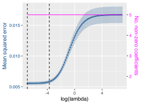
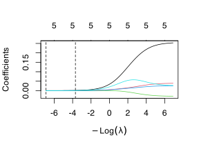
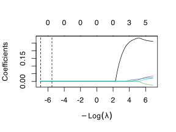
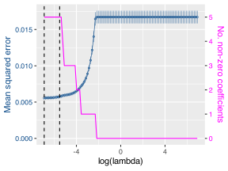
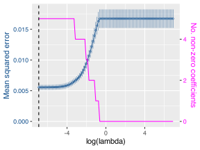

> **NOTE:**
>
> - Why regularisation is useful in high-dimensional or collinear settings
> - The logic of ridge, lasso, and elastic net
> - How coefficient shrinkage changes model behaviour
> - Why cross-validation is needed
> - How regularisation relates to prediction and explanation

> **IMPORTANT:**
>
> - None

Regularisation techniques are useful when ordinary multiple regression starts to struggle under the weight of many predictors, overlapping predictors, or a modelling goal that leans more toward prediction than explanation. In that setting, ordinary least squares can produce unstable coefficients, poor generalisation, and models that appear stronger in the sample than they really are.

Regularisation addresses this by shrinking coefficients towards zero. In some cases, this simply stabilises them. In others, it also removes weak predictors from the model entirely. This makes regularisation relevant when we want to reduce overfitting, manage multicollinearity, or build models that predict more reliably on new data.

In this chapter, I follow directly from the previous one. There I distinguished explanation from prediction. Here I develop one of the main statistical responses to that distinction.

# 1 Key concepts

- **Regularisation** shrinks coefficients to stabilise the model.
- **Ridge regression** shrinks all coefficients continuously towards zero.
- **Lasso regression** can shrink some coefficients exactly to zero.
- **Elastic net** combines ridge and lasso behaviour.
- **Cross-validation** is used to tune the amount of shrinkage.
- **The interpretation** of coefficients is changed by regularisation, which improves model stability, prediction, and objective variable reduction.

# 2 When this method is appropriate

You should consider regularisation when:

- the predictor set is large relative to the amount of data;
- several predictors are strongly correlated;
- ordinary multiple regression produces unstable coefficients;
- prediction on new data matters more than exact coefficient interpretation;
- you want a data-driven complement to the more theory-driven model selection discussed in [Chapter 14](../../BCB744/basic_stats/14-multiple-regression-and-model-specification.llms.md) and the collinearity material in [Chapter 16](../../BCB744/basic_stats/16-collinearity-confounding-measurement-error.llms.md).

Regularisation is not a magic correction for weak scientific questions or poor study design. It is still your responsibility to define sensible predictors and to understand the biology of the system. These methods work best when they extend ecological reasoning rather than replace it.

# 3 Why regularisation matters

Regularisation addresses several common modelling problems.

**Variable selection** becomes difficult when many candidate predictors are available and only some are genuinely useful. Traditional selection procedures often rely on stepwise inclusion or exclusion, or on statistics such as VIF. Regularisation offers an alternative data-driven route.

**Overfitting** occurs when the model begins to fit noise together with the underlying biological signal. Such a model often performs well on the observed data but poorly on new observations.

**Multicollinearity** inflates standard errors and destabilises coefficients when predictors overlap. Regularisation reduces this instability by shrinking coefficients, which usually improves model behaviour even if it introduces some bias.

Regularisation aims to produce a model that is more stable, more generalisable, and more useful for the modelling goal at hand, rather than to recover perfectly unbiased coefficients.

# 4 The core equations

Regularisation methods all start from the ordinary least-squares objective and then add a penalty term. The key teaching point is therefore not to memorise three unrelated formulas, but to see how each method modifies the same underlying fitting problem.

## 4.1 Ridge regression

Ridge regression adds a penalty proportional to the squared size of the coefficients. Large coefficients are penalised more heavily, so the fitted model shrinks them towards zero without setting them exactly to zero:

$$\min_{\beta}\left\{\sum_{i=1}^{n}(Y_i-\hat{Y}_i)^2 + \lambda \sum_{j=1}^{p}\beta_j^2\right\} \tag{1}$$

The practical effect is that all predictors remain in the model, but the most unstable coefficients are tamed. Ridge is therefore especially useful when multicollinearity is the main problem and you do not necessarily want automatic variable removal.

## 4.2 Lasso regression

Lasso regression uses a penalty based on the absolute values of the coefficients:

$$\min_{\beta}\left\{\sum_{i=1}^{n}(Y_i-\hat{Y}_i)^2 + \lambda \sum_{j=1}^{p}|\beta_j|\right\} \tag{2}$$

This has an important consequence: some coefficients can be shrunk all the way to zero.

That means lasso does two jobs at once. It shrinks the model, and it can also perform automatic variable selection. When you have many candidate predictors and suspect that some contribute little to predictive performance, lasso can be attractive.

## 4.3 Elastic net

Elastic net combines the ridge and lasso penalties:

$$\min_{\beta}\left\{\sum_{i=1}^{n}(Y_i-\hat{Y}_i)^2 + \lambda \left[(1-\alpha)\sum_{j=1}^{p}\beta_j^2 + \alpha \sum_{j=1}^{p}|\beta_j|\right]\right\} \tag{3}$$

Equations [Equation 1](#eq-ridge), [Equation 2](#eq-lasso), and [Equation 3](#eq-elastic) all use $\lambda$ to control the strength of shrinkage, while the elastic-net parameter $\alpha$ controls the balance between ridge-like and lasso-like behaviour.

In practice, elastic net is often a strong default when you are unsure whether ridge or lasso is the more appropriate starting point.

# 5 Cross-validation

The amount of shrinkage is controlled by a tuning parameter, usually written as $\lambda$. When $\lambda = 0$, the fitted model behaves like ordinary least squares. As $\lambda$ increases, the penalty grows stronger and coefficients are shrunk more aggressively.

The problem is that we do not know the best value of $\lambda$ in advance. This is where cross-validation becomes central.

In *k*-fold cross-validation, the data are split into *k* subsets. The model is trained repeatedly on *k* - 1 folds and evaluated on the held-out fold. This gives an estimate of how well the model performs away from the data used to fit it. We then choose the tuning parameter that gives the best average predictive performance.

Cross-validation therefore helps us avoid selecting a model that is optimised only for the present sample.

# 6 R functions

In R, the usual introductory function for regularised regression is [`glmnet::cv.glmnet()`](https://glmnet.stanford.edu/reference/cv.glmnet.html):

``` numberSource
glmnet::cv.glmnet(x, y, alpha = 0)   # ridge
glmnet::cv.glmnet(x, y, alpha = 1)   # lasso
glmnet::cv.glmnet(x, y, alpha = 0.5) # elastic net
```

The important practical detail is that `glmnet` expects a predictor matrix rather than the formula interface used by [`lm()`](https://rdrr.io/r/stats/lm.html).

# 7 Example 1: Ridge regression with the seaweed data

The seaweed dataset should now be familiar. We will use the climatic predictors `annMean`, `augMean`, `augSD`, `febSD`, and `febRange` to predict `Y`.

## 7.1 Prepare the data

The response is centred, and the predictors are supplied as a matrix:

``` numberSource
y <- sw |>
  select(Y) |>
  scale(center = TRUE, scale = FALSE) |>
  as.matrix()

X <- sw |>
  select(-X, -dist, -bio, -Y, -Y1, -Y2) |>
  as.matrix()
```

## 7.2 Fit the cross-validated ridge model

``` numberSource
set.seed(123)
ridge_cv <- cv.glmnet(
  X, y,
  alpha = 0,
  lambda = lambdas_to_try,
  standardize = TRUE,
  nfolds = 10
)
```

## 7.3 Inspect the cross-validation curve

[](25-regularisation_files/figure-html/fig-ridge-cv-1.svg "Figure 1: Cross-validation statistics for ridge regression applied to the seaweed data.")

Figure 1: Cross-validation statistics for ridge regression applied to the seaweed data.

The two vertical lines in [Figure 1](#fig-ridge-cv) identify the $\lambda$ that minimises cross-validated error (`lambda.min`) and the larger, more conservative value within one standard error of that minimum (`lambda.1se`). The latter is often chosen when a simpler, more stable model is preferred.

## 7.4 Coefficient paths and the meaning of shrinkage

Cross-validation tells us which value of $\lambda$ is attractive for prediction, but it does not by itself show what the penalty is *doing* to the model. A coefficient-path plot fills that gap. It tracks each fitted coefficient as $\lambda$ changes from very small values (weak penalty) to large values (strong penalty).

For ridge regression, the usual pattern is that all coefficients move smoothly towards zero, but none are dropped completely. For lasso, some coefficients are driven exactly to zero as the penalty strengthens. This is the visual expression of the conceptual difference between the two methods.

[](25-regularisation_files/figure-html/fig-ridge-path-1.svg "Figure 2: Coefficient paths for ridge regression. As the penalty increases, all coefficients are shrunk towards zero, but none are removed completely.")

Figure 2: Coefficient paths for ridge regression. As the penalty increases, all coefficients are shrunk towards zero, but none are removed completely.

In [Figure 2](#fig-ridge-path), each coloured trace is one predictor coefficient. Moving from left to right corresponds to stronger shrinkage. The lines contract towards zero, but ridge keeps every predictor in the model.

The vertical reference lines show where the cross-validation procedure places `lambda.min` and `lambda.1se`. Reading the plot this way helps connect model selection to coefficient behaviour. At `lambda.min`, shrinkage is weaker because the model is allowed to keep more of the original coefficient size. At `lambda.1se`, shrinkage is stronger, so the fitted model is more conservative even though its estimated prediction error is still close to the minimum.

[](25-regularisation_files/figure-html/fig-lasso-path-1.svg "Figure 3: Coefficient paths for lasso regression. As the penalty increases, some coefficients are shrunk all the way to zero.")

Figure 3: Coefficient paths for lasso regression. As the penalty increases, some coefficients are shrunk all the way to zero.

In [Figure 3](#fig-lasso-path), some traces hit the horizontal axis and stay there. Those are the predictors that lasso has excluded. This is why coefficient-path plots are so useful pedagogically: they let you see which variables remain influential across a range of penalties and which ones disappear quickly once shrinkage becomes strong.

## 7.5 Extract the fitted model

``` numberSource
ridge_model <- glmnet(
  X, y,
  alpha = 0,
  lambda = ridge_cv$lambda.min,
  standardize = TRUE
)

ridge_pred <- predict(ridge_model, X)
ridge_rsq <- cor(y, ridge_pred) ^ 2
coef(ridge_model)
```

    R> 6 x 1 sparse Matrix of class "dgCMatrix"
    R>                      s0
    R> (Intercept) -0.12916991
    R> augMean      0.25319971
    R> febRange     0.03884481
    R> febSD       -0.02964465
    R> augSD        0.02599145
    R> annMean      0.02672789

``` numberSource
ridge_model_1se <- glmnet(
  X, y,
  alpha = 0,
  lambda = ridge_cv$lambda.1se,
  standardize = TRUE
)

ridge_pred_1se <- predict(ridge_model_1se, X)
ridge_rsq_1se <- cor(y, ridge_pred_1se) ^ 2
ridge_coef_norm <- sqrt(sum(as.matrix(coef(ridge_model))[-1, 1] ^ 2))
ridge_coef_norm_1se <- sqrt(sum(as.matrix(coef(ridge_model_1se))[-1, 1] ^ 2))
```

## 7.6 Interpret the ridge results

Ridge keeps all predictors in the model, but shrinks them towards zero. This means the coefficients remain interpretable in the broad sense, but their absolute values are biased by design. Ridge is therefore most useful when the main aim is stable prediction or improved behaviour under collinearity, rather than precise coefficient interpretation.

In this seaweed example, the regularised model still retains all climatic predictors, but it reduces their instability and produces a model that is better suited to predictive use than an ordinary unpenalised fit under the same overlap among predictors.

## 7.7 `lambda.min` versus `lambda.1se`

The choice between `lambda.min` and `lambda.1se` is often more important in practice than the choice between two nearby values of $R^2$. These two tuning parameters answer slightly different modelling preferences:

- `lambda.min` gives the value of $\lambda$ with the lowest estimated cross-validated error.
- `lambda.1se` gives the largest value of $\lambda$ whose error is still within one standard error of the minimum.

That means `lambda.1se` accepts a tiny loss in apparent predictive performance in exchange for stronger shrinkage and usually a more stable model. In ridge regression, that means smaller coefficients. In lasso or elastic net, it often means fewer non-zero predictors as well.

``` numberSource
ridge_compare <- tibble(
  lambda_choice = c("lambda.min", "lambda.1se"),
  lambda_value = c(ridge_cv$lambda.min, ridge_cv$lambda.1se),
  training_rsq = c(ridge_rsq, ridge_rsq_1se),
  non_zero = c(
    sum(as.matrix(coef(ridge_model))[-1, 1] != 0),
    sum(as.matrix(coef(ridge_model_1se))[-1, 1] != 0)
  ),
  coefficient_norm = c(ridge_coef_norm, ridge_coef_norm_1se)
) |>
  mutate(
    lambda_value = signif(lambda_value, 3),
    training_rsq = round(training_rsq, 3),
    coefficient_norm = round(coefficient_norm, 3)
  )

ridge_compare
```

    R> # A tibble: 2 × 5
    R>   lambda_choice lambda_value training_rsq non_zero coefficient_norm
    R>   <chr>                <dbl>        <dbl>    <int>            <dbl>
    R> 1 lambda.min          0.001         0.671        5            0.261
    R> 2 lambda.1se          0.0248        0.664        5            0.218

In the seaweed example, ridge keeps all predictors at both tuning values, so the practical difference is not variable inclusion but coefficient size. The `lambda.1se` fit has the smaller coefficient norm, which means the predictor effects have been pulled closer to zero overall. That is the usual ridge trade-off: a small increase in penalty often changes the model by stabilising coefficients rather than by changing which predictors appear in the equation.

## 7.8 Reporting

> **NOTE:**
>
> **Methods**
>
> Ridge regression was fitted to the seaweed climate data using 10-fold cross-validation to select the optimal penalty parameter. The predictors were entered as a matrix and the response was centred prior to fitting.
>
> **Results**
>
> The final ridge model retained all five climatic predictors and explained a substantial proportion of the variation in the response (`R^2` approximately 0.67). The regularised fit reduced coefficient instability while preserving the full predictor set.
>
> **Discussion**
>
> The point of ridge regression is not exact coefficient interpretation. In Discussion, the emphasis would be that shrinkage improved model stability and predictive behaviour under overlapping climatic predictors.

# 8 Example 2: Lasso regression

Lasso uses the same data structure and the same cross-validation logic. The key difference is `alpha = 1`.

``` numberSource
lasso_model <- glmnet(
  X, y,
  alpha = 1,
  lambda = lasso_cv$lambda.min,
  standardize = TRUE
)

lasso_model_1se <- glmnet(
  X, y,
  alpha = 1,
  lambda = lasso_cv$lambda.1se,
  standardize = TRUE
)

lasso_pred <- predict(lasso_model, X)
lasso_rsq <- cor(y, lasso_pred) ^ 2
lasso_pred_1se <- predict(lasso_model_1se, X)
lasso_rsq_1se <- cor(y, lasso_pred_1se) ^ 2
```

[](25-regularisation_files/figure-html/fig-lasso-cv-1.svg "Figure 4: Cross-validation statistics for lasso regression applied to the seaweed data.")

Figure 4: Cross-validation statistics for lasso regression applied to the seaweed data.

``` numberSource
coef(lasso_model)
```

    R> 6 x 1 sparse Matrix of class "dgCMatrix"
    R>                      s0
    R> (Intercept) -0.12886019
    R> augMean      0.26097296
    R> febRange     0.03431981
    R> febSD       -0.02497532
    R> augSD        0.02441380
    R> annMean      0.02021480

The important feature of lasso is that some coefficients can be set exactly to zero. This makes lasso useful when you want the model itself to carry out a degree of variable selection.

In the seaweed example, the chosen penalty reduces the effective model complexity by shrinking weaker coefficients more strongly. The resulting model is easier to simplify than the ridge model because some predictors can be removed altogether.

``` numberSource
lmin_terms <- rownames(coef(lasso_model))[-1][as.matrix(coef(lasso_model))[-1, 1] != 0]
l1se_terms <- rownames(coef(lasso_model_1se))[-1][as.matrix(coef(lasso_model_1se))[-1, 1] != 0]

lasso_compare <- tibble(
  lambda_choice = c("lambda.min", "lambda.1se"),
  lambda_value = c(lasso_cv$lambda.min, lasso_cv$lambda.1se),
  training_rsq = c(lasso_rsq, lasso_rsq_1se),
  non_zero = c(
    sum(as.matrix(coef(lasso_model))[-1, 1] != 0),
    sum(as.matrix(coef(lasso_model_1se))[-1, 1] != 0)
  ),
  retained_predictors = c(
    paste(lmin_terms, collapse = ", "),
    paste(l1se_terms, collapse = ", ")
  )
) |>
  mutate(
    lambda_value = signif(lambda_value, 3),
    training_rsq = round(training_rsq, 3)
  )

lasso_compare
```

    R> # A tibble: 2 × 5
    R>   lambda_choice lambda_value training_rsq non_zero retained_predictors          
    R>   <chr>                <dbl>        <dbl>    <int> <chr>                        
    R> 1 lambda.min         0.001          0.67         5 augMean, febRange, febSD, au…
    R> 2 lambda.1se         0.00404        0.661        5 augMean, febRange, febSD, au…

For lasso, the `lambda.min` versus `lambda.1se` distinction is easiest to explain in terms of retained predictors. `lambda.min` usually gives the lowest estimated prediction error, while `lambda.1se` often keeps fewer predictors and gives a leaner model. If the two fits perform similarly, `lambda.1se` is often preferable when explanation, communication, or field interpretation matters. If prediction is the dominant aim and the larger active set clearly performs better under resampling, `lambda.min` may be the better choice.

## 8.1 Reporting

> **NOTE:**
>
> **Methods**
>
> Lasso regression was fitted to the seaweed climate data, with the amount of shrinkage selected by 10-fold cross-validation. The purpose was to assess whether coefficient shrinkage combined with variable removal could produce a more compact predictive model.
>
> **Results**
>
> The regularised fit reduced model complexity by shrinking weak coefficients strongly and, where appropriate, setting some coefficients to zero. The final model explained substantial variation in the response (`R^2` approximately 0.67) while providing a more compact predictor set than ridge regression.
>
> **Discussion**
>
> Lasso offers a bridge between prediction and variable selection. The simplified model is useful when the goal is not only stability, but also a more compact predictor set.

# 9 Example 3: Elastic net regression

Elastic net introduces a second tuning parameter, `alpha`, which controls the balance between ridge and lasso behaviour.

``` numberSource
cv_results <- lapply(alphas_to_try, function(a) {
  cv.glmnet(
    X, y,
    alpha = a,
    lambda = lambdas_to_try,
    standardize = TRUE,
    nfolds = 10
  )
})

best_result <- which.min(sapply(cv_results, function(x) min(x$cvm)))
best_alpha <- alphas_to_try[best_result]
best_lambda <- cv_results[[best_result]]$lambda.min

elastic_model <- glmnet(
  X, y,
  alpha = best_alpha,
  lambda = best_lambda,
  standardize = TRUE
)

elastic_pred <- predict(elastic_model, X)
elastic_rsq <- cor(y, elastic_pred) ^ 2
```

[](25-regularisation_files/figure-html/fig-elastic-cv-1.svg "Figure 5: Cross-validation statistics for elastic net regression applied to the seaweed data.")

Figure 5: Cross-validation statistics for elastic net regression applied to the seaweed data.

``` numberSource
coef(elastic_model)
```

    R> 6 x 1 sparse Matrix of class "dgCMatrix"
    R>                      s0
    R> (Intercept) -0.12910260
    R> augMean      0.25467960
    R> febRange     0.03797258
    R> febSD       -0.02874393
    R> augSD        0.02568390
    R> annMean      0.02547694

Elastic net is often useful when predictors occur in correlated groups. Lasso may select one predictor and drop the others. Ridge keeps them all. Elastic net often provides a more balanced compromise.

## 9.1 Reporting

> **NOTE:**
>
> **Methods**
>
> Elastic net regression was used to model the seaweed response, with both the mixing parameter and the penalty term selected by cross-validation. This allowed the model to combine ridge-like shrinkage with lasso-like variable reduction.
>
> **Results**
>
> The optimal model combined coefficient shrinkage with variable reduction (`alpha =` 0.2), explained substantial variation in the response (`R^2` approximately 0.67), and provided a stable compromise between ridge and lasso behaviour.
>
> **Discussion**
>
> The value of elastic net is pragmatic balance: it handles correlated predictors more flexibly than lasso alone while still allowing the model to simplify where the data support that.

# 10 Theory-driven and data-driven variable selection

The choice between theory-driven and data-driven variable selection should not be treated as a fight with a single winner. In practice, the strongest ecological modelling often combines both.

Theory-driven selection is central to the scientific method. It uses prior ecological reasoning to define a defensible set of candidate predictors. This keeps the model close to mechanism and strengthens interpretation.

Data-driven methods, including regularisation, can then help assess which predictors contribute most strongly to predictive performance, where redundancy lies, and how strongly coefficients need to be stabilised. They are especially useful in high-dimensional settings or when the predictors are strongly overlapping.

The danger is to let automated variable selection replace ecological thinking. Regularisation can help refine the model, but it cannot tell you what the scientific question ought to be.

# 11 Summary

- Regularisation is useful when predictors are many, overlapping, or likely to produce unstable ordinary regression coefficients.
- Ridge shrinks all coefficients, lasso can remove some, and elastic net blends both behaviours.
- Cross-validation is central to selecting the amount of shrinkage.
- These methods are usually most useful when prediction, stability, and model simplification matter more than exact coefficient interpretation.
- Regularisation should complement, not replace, ecological reasoning and theory-driven model building.

The final chapter now turns from model choice to the workflow required to make the whole analysis transparent and reproducible.

## Reuse

[CC BY-NC-SA 4.0](https://creativecommons.org/licenses/by-nc-sa/4.0/)

## Citation

BibTeX citation:

``` quarto-appendix-bibtex
@online{smit2026,
  author = {Smit, A. J.},
  title = {25. {Regularisation}},
  date = {2026-11-06},
  url = {https://tangledbank.netlify.app/BCB744/basic_stats/25-regularisation.html},
  langid = {en}
}
```

For attribution, please cite this work as:

Smit AJ (2026) 25. Regularisation. [https://tangledbank.netlify.app/BCB744/basic_stats/25-regularisation.html.](https://tangledbank.netlify.app/BCB744/basic_stats/25-regularisation.html)
