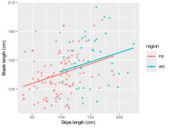

> **NOTE:**
>
> - why reproducibility is part of statistical practice rather than an optional extra;
> - how a Quarto project links data, code, figures, tables, and narrative;
> - what a practical reproducible workflow looks like in this project;
> - how to generate a small report component directly from source data and code;
> - how to write up results in a way that remains traceable to the analysis.

> **IMPORTANT:**
>
> - None

A statistically correct analysis remains incomplete until everyone can see how it was produced. Reproducibility is the workflow that keeps data, code, tables, figures, and written interpretation linked from the beginning rather than cobbled together at the end, as one would do if MS Word is our writing tool of preference.

This final chapter therefore closes the loop opened at the start of the course. Earlier chapters focused on questions, design, assumptions, inference, and models. Here I ask whether the entire analytical chain remains visible and regenerable. If it does not, then even a technically correct analysis becomes harder to trust, revise, and communicate.

In practice, reproducibility means that:

- the data source can be identified;
- the analysis steps can be rerun from code;
- figures and tables are generated from source, not edited by hand;
- the final report remains connected to the analysis that produced it.

This is implicit in maintaining scientific credibility. Quarto gives us this ability.

# 1 Key concepts

- **Reproducibility** means the analysis can be rerun from source.
- **Transparency** means analytical decisions are visible and documented.
- **Traceability** means every reported result has a path back to data and code.
- **Literate analysis** means code, output, and prose are kept close together.
- **Project structure matters** because disorder is one of the main causes of irreproducible work.

# 2 When this method is appropriate

In this chapter, I take a different approach because I focus less on a single statistical test and more on the workflow habits that we must keep in mind **all the time** when:

- exploring data;
- fitting models;
- producing figures and tables;
- writing interpretations;
- revising a report after feedback.

In the earlier chapters, I showed what to analyse and how to do it, but here I focus on how to keep that analysis reproducible from beginning to end.

# 3 Nature of the data and assumptions

Reproducibility has practical assumptions of its own:

1.  data files should live in stable, known locations;
2.  analysis steps should be saved in code rather than performed only interactively;
3.  outputs should be regenerated rather than edited manually;
4.  the report (or scientific publication, even) should be linked directly to the analysis that created it.

If any of those fail, reproducibility begins to collapse, even if the statistical model itself is fine.

# 4 Tools and practice

Reproducibility relies mainly on:

- a stable project structure;
- data stored in known subdirectories such as `data/BCB744/`;
- Quarto source files (`.qmd`);
- R code embedded directly in those source files;
- rendered outputs in `_site/` and cached or frozen outputs in `_freeze/`.

The practical habit to build is, if a figure, table, or result appears in the report, there should be a clear path back to the code and data that generated it.

# 5 Example 1: A reproducible Quarto workflow built from project files

## 5.1 Example dataset

We use the `laminaria.csv` dataset once more because it allows us to demonstrate a complete mini-workflow from source data to rendered output inside the project itself.

``` numberSource
kelp <- read_csv(here::here("data", "BCB744", "laminaria.csv"),
                 show_col_types = FALSE)

gt(head(kelp, 10))
```

| region | site | Ind | blade_weight | blade_length | blade_thickness | stipe_mass | stipe_length | stipe_diameter | digits | thallus_mass | total_length |
|----|----|----|----|----|----|----|----|----|----|----|----|
| WC | Kommetjie | 2 | 1.90 | 160 | 2.00 | 1.50 | 120 | 56.0 | 12 | 3000 | 256 |
| WC | Kommetjie | 3 | 1.50 | 120 | 1.40 | 2.25 | 149 | 68.5 | 12 | 3750 | 269 |
| WC | Kommetjie | 4 | 0.55 | 110 | 1.50 | 1.15 | 97 | 69.0 | 13 | 1700 | 207 |
| WC | Kommetjie | 5 | 1.00 | 159 | 1.50 | 2.60 | 167 | 60.0 | 8 | 3600 | 326 |
| WC | Kommetjie | 6 | 2.30 | 149 | 2.00 | NA | 146 | 73.0 | 15 | 5100 | 295 |
| WC | Kommetjie | 7 | 1.60 | 107 | 1.75 | 2.90 | 161 | 63.0 | 17 | 4500 | 268 |
| WC | Kommetjie | 8 | 0.65 | 104 | 2.00 | 0.75 | 110 | 51.0 | 11 | 1400 | 214 |
| WC | Kommetjie | 10 | 0.95 | 111 | 1.25 | 1.60 | 136 | 56.0 | 11 | 2550 | 247 |
| WC | Kommetjie | 11 | 2.30 | 178 | 2.50 | 4.20 | 176 | 76.0 | 8 | 6500 | 354 |
| FB | Bordjiestif North | 1 | 1.75 | 145 | 1.00 | 0.75 | 82 | 40.0 | 19 | 2500 | 227 |

A subset of the `laminaria.csv` dataset used in the reproducible-workflow example. {.gt_table .caption-top .table .table-sm .table-striped .small quarto-bootstrap="false"}

## 5.2 Do an exploratory data analysis (EDA)

``` numberSource
kelp_summary <- kelp |>
  group_by(region) |>
  summarise(
    n = n(),
    mean_stipe = mean(stipe_length),
    mean_blade = mean(blade_length),
    sd_blade = sd(blade_length),
    .groups = "drop"
  )

gt(kelp_summary)
```

| region | n   | mean_stipe | mean_blade | sd_blade |
|--------|-----|------------|------------|----------|
| FB     | 100 | 96.15      | 135.420    | 21.81843 |
| WC     | 40  | 149.05     | 148.175    | 26.56476 |

Grouped summary statistics for the Laminaria dataset, generated directly from code in the chapter source. {.gt_table .caption-top .table .table-sm .table-striped .small quarto-bootstrap="false"}

Code

``` numberSource
ggplot(kelp, aes(x = stipe_length, y = blade_length, colour = region)) +
  geom_point(alpha = 0.6) +
  geom_smooth(method = "lm", se = FALSE) +
  labs(
    x = "Stipe length (cm)",
    y = "Blade length (cm)"
  )
```

[](26-reproducible-workflow_files/figure-html/fig-kelp-workflow-1.svg "Figure 1: A reproducibly generated figure showing blade length as a function of stipe length in the Laminaria dataset.")

Figure 1: A reproducibly generated figure showing blade length as a function of stipe length in the Laminaria dataset.

Even this small example already illustrates that the table and figure are not separate objects made by hand. The figure in [Figure 1](#fig-kelp-workflow) is generated directly from the dataset by code embedded in the document.

Similarly, you can also write the Introduction, Methods, Discussion, and Conclusion, *i.e.*, all the textual material that comprises the report or paper. I don’t show those here, but the principle is the same. All of it is contained in the *same* Quarto document that accomplishes and reports the analysis.

## 5.3 State the workflow question

The workflow question is not a hypothesis test or even a research question, although it certainly guides the logical steps needed to complete the analysis and write-up. It is:

**Can the reported table and figure be regenerated directly from the project data and source code without manual reconstruction?**

In a good workflow, the answer should always be yes. In fact, an excellent workflow may accommodate the entire report or article, as I have already pointed out.

## 5.4 Generate the outputs

In a Quarto document, the analysis, output, and prose remain connected because the code that generates the result is part of the source document itself.

The practical sequence is:

1.  import the data from a stable relative path;
2.  generate the summary table and figure from code;
3.  write the interpretation next to the code that produced the output;
4.  render the document with Quarto.

Steps 1-3 may also be accompanied by justifications of reasoned decisions or our acknowledgement of any assumptions made. So, a reproducible workflow can double as a research notebook of sorts. It can be read by you in the future, or shared with colleagues.

The render step is a command such as:

``` numberSource
quarto render BCB744/basic_stats/26-reproducible-workflow.qmd
```

That one command rebuilds the chapter from source. If the data or code change, the outputs change with them. In fact, it created the document (website page) you are reading right now.

## 5.5 Check the workflow

The most useful diagnostic questions in a reproducible workflow are:

- are the data paths explicit and stable;
- can the document be rendered from source without manual intervention;
- are the figures and tables generated in code rather than edited after export;
- can another person inspect the source and understand what was done.

For this project, a minimal reproducible structure looks like:

| component       | path                                                    |
|-----------------|---------------------------------------------------------|
| data source     | data/BCB744/laminaria.csv                               |
| chapter source  | BCB744/basic_stats/26-reproducible-workflow.qmd         |
| rendered output | \_site/BCB744/basic_stats/26-reproducible-workflow.html |
| shared styling  | styles/styles.css                                       |

Minimal project components needed to regenerate the chapter from source. {.gt_table .caption-top .table .table-sm .table-striped .small quarto-bootstrap="false"}

The purpose of these components, woven together in the Quarto file, is that the workflow remains legible from source to output.

## 5.6 What this means for us

The result of a reproducible workflow is the scientific conclusion and, as importantly, the fact that the conclusion, table, and figure remain traceable to the same source analysis.

In this mini-example, anyone with the project can:

- locate the source dataset;
- inspect the code used to create the grouped summary and figure;
- rerender the chapter;
- verify that the reported output matches the source.

That makes revision safer, collaboration easier, and error detection more likely.

# 6 Common failures

The most common failures of reproducibility are usually workflow failures rather than advanced technical problems:

- doing the analysis interactively without saving code;
- editing figures by hand after export;
- keeping the final report separate from the analysis that generated it;
- changing data or exclusions without documenting those changes;
- using paths that only work on one computer and are not stable within the project.

# 7 Summary

- Reproducibility links data, code, output, and interpretation.
- In a Quarto-based workflow, the report can be regenerated from source rather than rebuilt manually.
- A reproducible figure or table is more scientifically valuable than a hand-edited one with unclear provenance.
- Good workflow is therefore part of good statistics, not an optional final step.

The statistical workflow now comes full circle. A biological question leads to a design, the design produces data, the data are explored and modelled, the results are interpreted, and the whole chain is documented so that someone else can inspect and rerun it. Reproducibility is what keeps those pieces joined.

## Reuse

[CC BY-NC-SA 4.0](https://creativecommons.org/licenses/by-nc-sa/4.0/)

## Citation

BibTeX citation:

``` quarto-appendix-bibtex
@online{smit2026,
  author = {Smit, A. J.},
  title = {26. {Reproducible} Workflow},
  date = {2026-11-06},
  url = {https://tangledbank.netlify.app/BCB744/basic_stats/26-reproducible-workflow.html},
  langid = {en}
}
```

For attribution, please cite this work as:

Smit AJ (2026) 26. Reproducible workflow. [https://tangledbank.netlify.app/BCB744/basic_stats/26-reproducible-workflow.html.](https://tangledbank.netlify.app/BCB744/basic_stats/26-reproducible-workflow.html)
