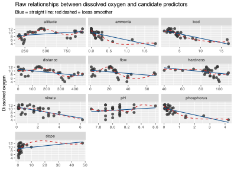
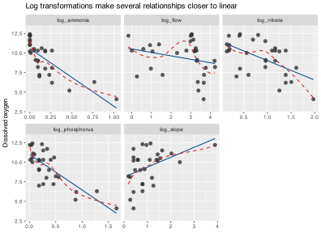
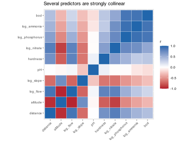
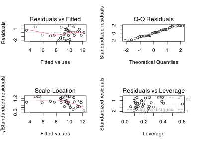

> **NOTE:**
>
> - justify a biologically defensible response-predictor structure;
> - use exploratory plots to decide whether relationships are roughly linear;
> - reduce the predictor set using mechanism and collinearity;
> - fit and diagnose a multiple linear regression model; and
> - write the analysis up as a short Results and Discussion section.

The Doubs River environmental data contain measurements from 30 sites along the river. The variables describe position in the catchment (`dfs`, `alt`, `slo`), hydrology (`flo`), water chemistry (`pH`, `har`), nutrient and pollution load (`pho`, `nit`, `amm`, `bod`), and dissolved oxygen (`oxy`).

For a multiple regression, the variables should not be treated symmetrically. Here I model **dissolved oxygen** (`oxy`) as the **response** because oxygen concentration is an ecological state variable that can plausibly be influenced by channel morphology, flow, and pollution, whereas the reverse is not biologically sensible. For example, biochemical oxygen demand (`bod`) can reduce oxygen, but oxygen concentration does not cause upstream distance or channel slope.

The question is therefore:

> Which environmental variables best explain variation in dissolved oxygen along the Doubs River?

# 1 Data import and preparation

``` numberSource
doubs <- read.csv(here::here("data", "BCB743", "DoubsEnv.csv")) |>
  rename(
    site = X,
    distance = dfs,
    altitude = alt,
    slope = slo,
    flow = flo,
    hardness = har,
    phosphorus = pho,
    nitrate = nit,
    ammonia = amm,
    oxygen = oxy
  ) |>
  mutate(
    log_flow = log(flow),
    log_slope = log1p(slope),
    log_nitrate = log1p(nitrate),
    log_phosphorus = log1p(phosphorus),
    log_ammonia = log1p(ammonia)
  )

glimpse(doubs)
```

    R> Rows: 30
    R> Columns: 17
    R> $ site           <int> 1, 2, 3, 4, 5, 6, 7, 8, 9, 10, 11, 12, 13, 14, 15, 16, …
    R> $ distance       <dbl> 0.3, 2.2, 10.2, 18.5, 21.5, 32.4, 36.8, 49.1, 70.5, 99.…
    R> $ altitude       <int> 934, 932, 914, 854, 849, 846, 841, 792, 752, 617, 483, …
    R> $ slope          <dbl> 48.0, 3.0, 3.7, 3.2, 2.3, 3.2, 6.6, 2.5, 1.2, 9.9, 4.1,…
    R> $ flow           <dbl> 0.84, 1.00, 1.80, 2.53, 2.64, 2.86, 4.00, 1.30, 4.80, 1…
    R> $ pH             <dbl> 7.9, 8.0, 8.3, 8.0, 8.1, 7.9, 8.1, 8.1, 8.0, 7.7, 8.1, …
    R> $ hardness       <int> 45, 40, 52, 72, 84, 60, 88, 94, 90, 82, 96, 86, 98, 98,…
    R> $ phosphorus     <dbl> 0.01, 0.02, 0.05, 0.10, 0.38, 0.20, 0.07, 0.20, 0.30, 0…
    R> $ nitrate        <dbl> 0.20, 0.20, 0.22, 0.21, 0.52, 0.15, 0.15, 0.41, 0.82, 0…
    R> $ ammonia        <dbl> 0.00, 0.10, 0.05, 0.00, 0.20, 0.00, 0.00, 0.12, 0.12, 0…
    R> $ oxygen         <dbl> 12.2, 10.3, 10.5, 11.0, 8.0, 10.2, 11.1, 7.0, 7.2, 10.0…
    R> $ bod            <dbl> 2.7, 1.9, 3.5, 1.3, 6.2, 5.3, 2.2, 8.1, 5.2, 4.3, 2.7, …
    R> $ log_flow       <dbl> -0.1743534, 0.0000000, 0.5877867, 0.9282193, 0.9707789,…
    R> $ log_slope      <dbl> 3.8918203, 1.3862944, 1.5475625, 1.4350845, 1.1939225, …
    R> $ log_nitrate    <dbl> 0.1823216, 0.1823216, 0.1988509, 0.1906204, 0.4187103, …
    R> $ log_phosphorus <dbl> 0.009950331, 0.019802627, 0.048790164, 0.095310180, 0.3…
    R> $ log_ammonia    <dbl> 0.000000000, 0.095310180, 0.048790164, 0.000000000, 0.1…

The transformed variables are used only where the raw scatterplots suggest clear right-skew and mild curvature. I log-transformed `flow`, `slope`, and the nutrient variables to improve linearity and reduce leverage from the largest values.

# 2 Exploratory data analysis

## 2.1 Raw predictor-response relationships

The first task is to inspect each predictor against the response. I show both a straight-line fit and a loess smoother; where they differ strongly, the linearity assumption is weaker on the raw scale.

``` numberSource
raw_long <- doubs |>
  select(site, oxygen, distance, altitude, slope, flow, pH, hardness,
         phosphorus, nitrate, ammonia, bod) |>
  pivot_longer(
    cols = -c(site, oxygen),
    names_to = "predictor",
    values_to = "value"
  )

ggplot(raw_long, aes(value, oxygen)) +
  geom_point(size = 1.8, alpha = 0.8, colour = "grey20") +
  geom_smooth(method = "lm", se = FALSE, linewidth = 0.5, colour = "dodgerblue4") +
  geom_smooth(method = "loess", se = FALSE, linewidth = 0.5, linetype = 2, colour = "firebrick3") +
  facet_wrap(~ predictor, scales = "free_x", ncol = 3) +
  labs(
    x = NULL,
    y = "Dissolved oxygen",
    title = "Raw relationships between dissolved oxygen and candidate predictors",
    subtitle = "Blue = straight line; red dashed = loess smoother"
  )
```

[](doubs-river-multiple-regression_files/figure-html/unnamed-chunk-2-1.svg)

Several patterns are already visible:

- `bod`, `phosphorus`, and `ammonia` each show strong negative associations with oxygen.
- `distance` and `altitude` represent the same longitudinal gradient in opposite directions, so both should not be interpreted as independent drivers.
- `flow`, `slope`, and the nutrient variables are right-skewed, and the loess lines suggest that the raw-scale relationships are not perfectly linear.

## 2.2 Transformed relationships for skewed predictors

``` numberSource
trans_long <- doubs |>
  select(oxygen, log_flow, log_slope, log_nitrate, log_phosphorus, log_ammonia) |>
  pivot_longer(
    cols = -oxygen,
    names_to = "predictor",
    values_to = "value"
  )

ggplot(trans_long, aes(value, oxygen)) +
  geom_point(size = 1.8, alpha = 0.8, colour = "grey20") +
  geom_smooth(method = "lm", se = FALSE, linewidth = 0.5, colour = "dodgerblue4") +
  geom_smooth(method = "loess", se = FALSE, linewidth = 0.5, linetype = 2, colour = "firebrick3") +
  facet_wrap(~ predictor, scales = "free_x", ncol = 3) +
  labs(
    x = NULL,
    y = "Dissolved oxygen",
    title = "Log transformations make several relationships closer to linear"
  )
```

[](doubs-river-multiple-regression_files/figure-html/unnamed-chunk-3-1.svg)

The transformed versions of `flow`, `slope`, and `nitrate` are more suitable for a linear model than their raw versions, so I use those scales below.

# 3 Variable selection

## 3.1 Start with biology, not with `step()`

Model selection should happen inside a biologically defensible candidate set. I therefore begin with variables that could plausibly affect oxygen directly or indirectly:

- `bod`: a proximate measure of organic pollution and oxygen demand;
- `flow` and `slope`: hydrological and geomorphological controls on reaeration;
- `pH` and `hardness`: broad chemical descriptors of water conditions;
- `nitrate`: a nutrient signal associated with enrichment;
- `distance` and `altitude`: longitudinal context variables.

Before fitting anything, I inspect collinearity.

``` numberSource
cor_mat <- doubs |>
  select(distance, altitude, log_flow, log_slope, pH, hardness,
         log_nitrate, log_phosphorus, log_ammonia, bod) |>
  cor()

cor_long <- as.data.frame(as.table(cor_mat)) |>
  rename(var1 = Var1, var2 = Var2, r = Freq)

ggplot(cor_long, aes(var1, var2, fill = r)) +
  geom_tile(colour = "white") +
  scale_fill_gradient2(low = "#b2182b", mid = "white", high = "#2166ac",
                       midpoint = 0, limits = c(-1, 1)) +
  coord_equal() +
  labs(
    x = NULL,
    y = NULL,
    fill = "r",
    title = "Several predictors are strongly collinear"
  ) +
  theme(axis.text.x = element_text(angle = 45, hjust = 1))
```

[](doubs-river-multiple-regression_files/figure-html/unnamed-chunk-4-1.svg)

The heatmap shows two collinearity clusters:

1.  `distance`, `altitude`, and `log_flow` describe the same downstream gradient, so keeping all three would be redundant.
2.  `bod`, `log_phosphorus`, and `log_ammonia` are also tightly associated, indicating a shared pollution signal.

I therefore make the following specification decisions before formal model selection:

- keep `log_flow` rather than `distance` or `altitude` because it is the most direct hydraulic mechanism for oxygenation;
- keep `log_slope` because it captures channel steepness independently of river size;
- keep `bod` as the main organic pollution term because it is most directly tied to oxygen demand;
- keep `log_nitrate` as a broader dissolved nutrient indicator;
- allow `pH` and `hardness` to compete for inclusion;
- drop `log_phosphorus`, `log_ammonia`, `distance`, and `altitude` from the candidate set to avoid redundant predictors.

## 3.2 Candidate models

``` numberSource
mod_global <- lm(oxygen ~ bod + pH + hardness + log_flow + log_slope + log_nitrate,
                 data = doubs)

mod_reduced <- lm(oxygen ~ bod + pH + log_flow + log_slope + log_nitrate,
                  data = doubs)

mod_minimal <- lm(oxygen ~ bod + log_flow + log_slope,
                  data = doubs)

model_comp <- tibble(
  model = c("Global reduced-by-biology set", "Final parsimonious model", "Minimal mechanistic model"),
  formula = c(
    "oxygen ~ bod + pH + hardness + log_flow + log_slope + log_nitrate",
    "oxygen ~ bod + pH + log_flow + log_slope + log_nitrate",
    "oxygen ~ bod + log_flow + log_slope"
  ),
  AIC = c(AIC(mod_global), AIC(mod_reduced), AIC(mod_minimal)),
  adj_R2 = c(summary(mod_global)$adj.r.squared,
             summary(mod_reduced)$adj.r.squared,
             summary(mod_minimal)$adj.r.squared),
  max_VIF = c(max(car::vif(mod_global)), max(car::vif(mod_reduced)), max(car::vif(mod_minimal)))
)

model_comp |>
  mutate(
    AIC = round(AIC, 2),
    adj_R2 = round(adj_R2, 3),
    max_VIF = round(max_VIF, 2)
  ) |>
  gt()
```

| model | formula | AIC | adj_R2 | max_VIF |
|----|----|----|----|----|
| Global reduced-by-biology set | oxygen ~ bod + pH + hardness + log_flow + log_slope + log_nitrate | 96.62 | 0.771 | 6.70 |
| Final parsimonious model | oxygen ~ bod + pH + log_flow + log_slope + log_nitrate | 96.94 | 0.763 | 4.37 |
| Minimal mechanistic model | oxygen ~ bod + log_flow + log_slope | 98.55 | 0.736 | 2.12 |

The model including `hardness` has the lowest AIC, but only by 0.32 units. That difference is negligible. Because the reduced model also lowers the maximum variance inflation factor from 6.7 to 4.37, I prefer the **parsimonious model**:

``` numberSource
final_mod <- mod_reduced
summary(final_mod)
```

    R> 
    R> Call:
    R> lm(formula = oxygen ~ bod + pH + log_flow + log_slope + log_nitrate, 
    R>     data = doubs)
    R> 
    R> Residuals:
    R>      Min       1Q   Median       3Q      Max 
    R> -1.83852 -0.72242  0.06686  0.74290  1.77277 
    R> 
    R> Coefficients:
    R>             Estimate Std. Error t value Pr(>|t|)    
    R> (Intercept) -6.73984   10.53992  -0.639   0.5286    
    R> bod         -0.37158    0.06823  -5.446 1.35e-05 ***
    R> pH           2.00845    1.26213   1.591   0.1246    
    R> log_flow     0.68575    0.30834   2.224   0.0358 *  
    R> log_slope    1.13313    0.41060   2.760   0.0109 *  
    R> log_nitrate -1.22041    0.81632  -1.495   0.1479    
    R> ---
    R> Signif. codes:  0 '***' 0.001 '**' 0.01 '*' 0.05 '.' 0.1 ' ' 1
    R> 
    R> Residual standard error: 1.078 on 24 degrees of freedom
    R> Multiple R-squared:  0.804,  Adjusted R-squared:  0.7632 
    R> F-statistic: 19.69 on 5 and 24 DF,  p-value: 8.621e-08

# 4 Model fit and interpretation

``` numberSource
coef_table <- broom::tidy(final_mod, conf.int = TRUE) |>
  mutate(across(where(is.numeric), ~ round(.x, 3)))

coef_table |>
  gt()
```

| term        | estimate | std.error | statistic | p.value | conf.low | conf.high |
|-------------|----------|-----------|-----------|---------|----------|-----------|
| (Intercept) | -6.740   | 10.540    | -0.639    | 0.529   | -28.493  | 15.013    |
| bod         | -0.372   | 0.068     | -5.446    | 0.000   | -0.512   | -0.231    |
| pH          | 2.008    | 1.262     | 1.591     | 0.125   | -0.596   | 4.613     |
| log_flow    | 0.686    | 0.308     | 2.224     | 0.036   | 0.049    | 1.322     |
| log_slope   | 1.133    | 0.411     | 2.760     | 0.011   | 0.286    | 1.981     |
| log_nitrate | -1.220   | 0.816     | -1.495    | 0.148   | -2.905   | 0.464     |

The fitted model is:

$$\widehat{\mathrm{oxygen}} = -6.74 +
-0.37 \, \mathrm{bod} +
2.01 \, \mathrm{pH} +
0.69 \, \log(\mathrm{flow}) +
1.13 \, \log(1 + \mathrm{slope}) +
-1.22 \, \log(1 + \mathrm{nitrate})$$

Overall, the model explains 80.4% of the variance in dissolved oxygen (`adjusted R^2 = 0.763`; `F_{5,24} = 19.69,`p = 8.62e-08\`).

Among the individual predictors, oxygen declines strongly with increasing `bod`, and increases with both `log_flow` and `log_slope`. The fitted effects of `pH` and `log_nitrate` are weaker and their confidence intervals overlap zero, so they are retained as adjustment terms rather than as strong stand-alone drivers.

# 5 Diagnostics

``` numberSource
par(mfrow = c(2, 2))
plot(final_mod)
```

[](doubs-river-multiple-regression_files/figure-html/unnamed-chunk-8-1.svg)

``` numberSource
par(mfrow = c(1, 1))
```

``` numberSource
diag_tbl <- tibble(
  check = c("Shapiro-Wilk on residuals", "Breusch-Pagan for heteroscedasticity", "Largest Cook's distance", "Cook's rule-of-thumb threshold (4/n)"),
  value = c(
    round(shapiro.test(resid(final_mod))$p.value, 3),
    round(bptest(final_mod)$p.value, 3),
    round(max(cooks.distance(final_mod)), 3),
    round(4 / nrow(doubs), 3)
  )
)

diag_tbl |>
  gt()
```

| check                                | value |
|--------------------------------------|-------|
| Shapiro-Wilk on residuals            | 0.538 |
| Breusch-Pagan for heteroscedasticity | 0.226 |
| Largest Cook's distance              | 0.347 |
| Cook's rule-of-thumb threshold (4/n) | 0.133 |

The residual diagnostics do not show serious departures from normality or constant variance. One site has a Cook’s distance above the rough `4/n` threshold, so I check whether it changes the interpretation materially.

``` numberSource
site23_sensitivity <- lm(oxygen ~ bod + pH + log_flow + log_slope + log_nitrate,
                         data = filter(doubs, site != 23))

bind_rows(
  broom::tidy(final_mod) |> mutate(model = "All sites"),
  broom::tidy(site23_sensitivity) |> mutate(model = "Without site 23")
) |>
  select(model, term, estimate, std.error, p.value) |>
  mutate(across(where(is.numeric), ~ round(.x, 3))) |>
  gt()
```

| model           | term        | estimate | std.error | p.value |
|-----------------|-------------|----------|-----------|---------|
| All sites       | (Intercept) | -6.740   | 10.540    | 0.529   |
| All sites       | bod         | -0.372   | 0.068     | 0.000   |
| All sites       | pH          | 2.008    | 1.262     | 0.125   |
| All sites       | log_flow    | 0.686    | 0.308     | 0.036   |
| All sites       | log_slope   | 1.133    | 0.411     | 0.011   |
| All sites       | log_nitrate | -1.220   | 0.816     | 0.148   |
| Without site 23 | (Intercept) | -1.364   | 10.419    | 0.897   |
| Without site 23 | bod         | -0.453   | 0.078     | 0.000   |
| Without site 23 | pH          | 1.421    | 1.240     | 0.263   |
| Without site 23 | log_flow    | 0.588    | 0.298     | 0.060   |
| Without site 23 | log_slope   | 0.950    | 0.402     | 0.027   |
| Without site 23 | log_nitrate | -1.079   | 0.780     | 0.180   |

Removing site 23 changes the exact coefficient values but not the overall story: `bod` remains strongly negative, `log_slope` remains positive, and `log_flow` stays positive but becomes slightly less certain. I therefore retain the full dataset.

# 6 Results

At 30 sites in the Doubs River, dissolved oxygen was analysed as a function of biochemical oxygen demand, pH, flow, channel slope, and nitrate concentration. Exploratory plots showed that several raw predictors were right-skewed and only approximately linear on the original scale, so `flow`, `slope`, and `nitrate` were log-transformed before modelling. Because longitudinal variables (`distance`, `altitude`, and `flow`) and pollution variables (`bod`, `phosphorus`, and `ammonia`) were strongly collinear, only one representative variable from each cluster was retained in the candidate set.

The final multiple regression model was `oxygen ~ bod + pH + log_flow + log_slope + log_nitrate`. The model explained 80.4% of the variance in dissolved oxygen (`adjusted R^2 = 0.763`; `F_{5,24} = 19.69,`p \< 0.001`). Dissolved oxygen decreased significantly as biochemical oxygen demand increased ($\beta = -0.372, 95% CI -0.512 to -0.231`). Oxygen increased with both `log_flow` ($\beta = 0.686, `p = 0.036`) and `log_slope` ($= 1.133, `p = 0.011`). The fitted effects of pH and nitrate were weaker and not individually significant at the 0.05 level, but they were retained because they modestly improved model fit and helped adjust for background chemical variation. Residual and influence diagnostics did not indicate serious violations of normality or homoscedasticity.

# 7 Discussion

This analysis suggests that dissolved oxygen in the Doubs River is shaped primarily by a balance between **oxygen-consuming pollution** and **physical reaeration**. Sites with high biochemical oxygen demand tended to have lower oxygen concentrations, which is consistent with microbial decomposition consuming oxygen in enriched waters. In contrast, higher flow and steeper channels were associated with higher oxygen, which is biologically sensible because turbulence and faster water movement promote reaeration.

Two lessons about model specification are especially important here. First, the initial exploratory plots showed that some relationships were only roughly linear on the raw scale, so transformation was part of the modelling process rather than an afterthought. Second, several candidate predictors measured nearly the same longitudinal or pollution gradient. If all of them had been entered together, the model would have been harder to interpret and the coefficient estimates would have become unstable. Reducing the predictor set before final fitting therefore improved the analysis more than an automatic selection routine alone could have done.

The model is still observational, so the fitted coefficients should be interpreted as adjusted associations rather than proof of causation. In addition, the sample size is modest and one site had noticeable leverage, which means the exact coefficient values should not be over-interpreted. Even so, the ecological signal is clear: organic pollution is associated with oxygen depletion, while hydraulic conditions partly offset that decline.

## Reuse

[CC BY-NC-SA 4.0](https://creativecommons.org/licenses/by-nc-sa/4.0/)

## Citation

BibTeX citation:

``` quarto-appendix-bibtex
@online{smit2026,
  author = {Smit, A. J.},
  title = {Doubs {River} Worked Example: Multiple Linear Regression},
  date = {2026-11-06},
  url = {https://tangledbank.netlify.app/BCB744/basic_stats/doubs-river-multiple-regression.html},
  langid = {en}
}
```

For attribution, please cite this work as:

Smit AJ (2026) Doubs River worked example: multiple linear regression. [https://tangledbank.netlify.app/BCB744/basic_stats/doubs-river-multiple-regression.html.](https://tangledbank.netlify.app/BCB744/basic_stats/doubs-river-multiple-regression.html)
