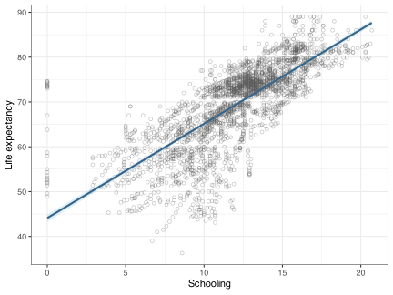
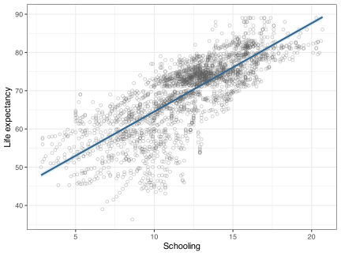

> **IMPORTANT:**
>
> **1. Question:**
>
> Does **life expectancy** increase with **schooling** in the Kaggle life expectancy dataset?
>
> Complete a full simple linear regression analysis using life expectancy as the response and schooling as the predictor. Your job is not only to fit the model, but also to identify and justify the treatment of problematic observations.
>
> You should do the following:
>
> 1.  Prepare the data by selecting the variables needed for the analysis and removing rows with missing values.
> 2.  Fit the initial simple linear regression model.
> 3.  Plot the data and show the fitted regression line.
> 4.  Check the initial model diagnostics graphically.
> 5.  Identify the issue in the dataset.
> 6.  Provide evidence for this issue as a table.
> 7.  Explain why these cases appear problematic for this analysis.
> 8.  Remove the problematic cases and refit the model.
> 9.  Recheck the diagnostics graphically for the revised model.
> 10. Interpret the final model clearly and state whether it is an improvement over the initial fit. Tabulate the important model-fit statistics in support of your conclusion.
> 11. End with a short scientific write-up containing Methods, Results, and Discussion sections.
>
> **2. Marking Rubric**
>
> | Component | Marks |
> |----|---:|
> | Data preparation | 3 |
> | Initial model fitting and figure | 3 |
> | Initial model diagnostics | 3 |
> | Identifying and explaining the issue | 3 |
> | Evidence for the issue presented as a table | 4 |
> | Removing the problematic cases appropriately | 2 |
> | Refitting the analysis | 3 |
> | Rechecking the diagnostics | 3 |
> | Interpreting the final model and comparing it with the initial model | 3 |
> | Scientific write-up (Methods, Results, Discussion) | 3 |
>
> **Total: 30 marks**
>
> **3. Data Preparation**
>
> (x 3) Data preparation: selected the required variables and removed rows with missing values.
>
> I begin by reading the dataset and keeping only the variables needed for this analysis.
>
> ``` numberSource
> life_raw <- read.csv(
>   here::here("data", "BCB744", "kaggle_life_expectancy_data.csv"),
>   check.names = FALSE
> )
>
> life_dat <- life_raw |>
>   transmute(
>     Country,
>     Year,
>     life_expectancy = `Life expectancy`,
>     Schooling
>   ) |>
>   drop_na(life_expectancy, Schooling)
>
> nrow(life_dat)
> ```
>
>     R> [1] 2768
>
> The working dataset contains 2,768 complete observations on life expectancy and schooling.
>
> I now fit the initial simple linear regression:
>
> $$\text{Life expectancy}_i = \beta_0 + \beta_1 \text{Schooling}_i + \varepsilon_i$$
>
> In this model, $\beta_1$ is the expected change in life expectancy associated with a one-unit increase in schooling.
>
> ``` numberSource
> mod_school_full <- lm(life_expectancy ~ Schooling, data = life_dat)
> summary(mod_school_full)
> ```
>
>     R> 
>     R> Call:
>     R> lm(formula = life_expectancy ~ Schooling, data = life_dat)
>     R> 
>     R> Residuals:
>     R>      Min       1Q   Median       3Q      Max 
>     R> -25.8986  -2.8210   0.6186   3.8186  30.4911 
>     R> 
>     R> Coefficients:
>     R>             Estimate Std. Error t value Pr(>|t|)    
>     R> (Intercept) 44.10889    0.43676     101   <2e-16 ***
>     R> Schooling    2.10345    0.03506      60   <2e-16 ***
>     R> ---
>     R> Signif. codes:  0 '***' 0.001 '**' 0.01 '*' 0.05 '.' 0.1 ' ' 1
>     R> 
>     R> Residual standard error: 6.172 on 2766 degrees of freedom
>     R> Multiple R-squared:  0.5655, Adjusted R-squared:  0.5653 
>     R> F-statistic:  3599 on 1 and 2766 DF,  p-value: < 2.2e-16
>
> (x 3) Initial model fitting and figure: fitted the first simple linear regression and displayed the fitted relationship graphically.
>
> **4. Diagnostics for the Initial Model**
>
> (x 3) Initial model diagnostics: assessed the first model graphically using standard regression diagnostic plots.
>
> Regression assumptions should be checked graphically. I therefore inspect residuals versus fitted values, the normal Q-Q plot, the scale-location plot, and residuals versus leverage in [Figure 1](#fig-full-diag).
>
> ``` numberSource
> full_aug <- augment(mod_school_full)
> ```
>
> ``` numberSource
> p_full_1 <- ggplot(full_aug, aes(x = .fitted, y = .resid)) +
>   geom_point(shape = 1, alpha = 0.4) +
>   geom_hline(yintercept = 0, linetype = "dashed", colour = "red") +
>   labs(x = "Fitted values", y = "Residuals", title = "Residuals vs Fitted")
>
> p_full_2 <- ggplot(full_aug, aes(sample = .std.resid)) +
>   stat_qq(shape = 1, alpha = 0.5) +
>   stat_qq_line(colour = "red") +
>   labs(title = "Normal Q-Q", x = "Theoretical quantiles", y = "Standardised residuals")
>
> p_full_3 <- ggplot(full_aug, aes(x = .fitted, y = sqrt(abs(.std.resid)))) +
>   geom_point(shape = 1, alpha = 0.4) +
>   labs(
>     x = "Fitted values",
>     y = "Sqrt(|Standardised residuals|)",
>     title = "Scale-Location"
>   )
>
> p_full_4 <- ggplot(full_aug, aes(x = .hat, y = .std.resid)) +
>   geom_point(shape = 1, alpha = 0.4) +
>   labs(
>     x = "Leverage",
>     y = "Standardised residuals",
>     title = "Residuals vs Leverage"
>   )
>
> (p_full_1 + p_full_2) / (p_full_3 + p_full_4)
> ```
>
> [](kaggle_life_expectancy_files/figure-html/fig-full-diag-1.svg "Figure 1: Diagnostic plots for the simple linear regression of life expectancy on schooling using all complete cases.")
>
> Figure 1: Diagnostic plots for the simple linear regression of life expectancy on schooling using all complete cases.
>
> The initial diagnostics in [Figure 1](#fig-full-diag) suggest that the model captures the broad trend reasonably well, but there is evidence that the extreme low-schooling observations deserve scrutiny. The residual plots are not catastrophic, but the zero-schooling countries create a left-edge concentration that may be exerting unnecessary influence on the fitted line.
>
> **5. Countries With Zero Schooling**
>
> (x 3) Identifying and explaining the issue: identified the zero-schooling cases and explained why they are problematic for this analysis.
>
> Before fitting the model, I inspect the cases where schooling is recorded as zero. A zero value here is biologically and socially unusual for several countries in the dataset, so it is worth checking whether these cases should be treated with caution.
>
> ``` numberSource
> schooling_zero <- life_dat |>
>   filter(Schooling == 0) |>
>   distinct(Country, Year, Schooling) |>
>   arrange(Country, Year)
>
> schooling_zero_counts <- schooling_zero |>
>   count(Country, name = "Zero-schooling years")
>
> zero_countries <- schooling_zero_counts |>
>   pull(Country)
> ```
>
> [Table 1](#tbl-zero-schooling) lists the countries represented by one or more rows where schooling is coded as zero.
>
> | Country                          | Zero-schooling years |
> |----------------------------------|----------------------|
> | Antigua and Barbuda              | 6                    |
> | Bosnia and Herzegovina           | 1                    |
> | Equatorial Guinea                | 1                    |
> | Micronesia (Federated States of) | 1                    |
> | Montenegro                       | 4                    |
> | South Sudan                      | 11                   |
> | Timor-Leste                      | 1                    |
> | Turkmenistan                     | 1                    |
>
> Table 1: Countries with one or more observations in which schooling is coded as zero.
>
> The detailed country-year rows are shown in [Table 2](#tbl-zero-schooling-years).
>
> ``` numberSource
> schooling_zero |>
>   gt()
> ```
>
> | Country                          | Year | Schooling |
> |----------------------------------|------|-----------|
> | Antigua and Barbuda              | 2000 | 0         |
> | Antigua and Barbuda              | 2001 | 0         |
> | Antigua and Barbuda              | 2002 | 0         |
> | Antigua and Barbuda              | 2003 | 0         |
> | Antigua and Barbuda              | 2004 | 0         |
> | Antigua and Barbuda              | 2005 | 0         |
> | Bosnia and Herzegovina           | 2000 | 0         |
> | Equatorial Guinea                | 2000 | 0         |
> | Micronesia (Federated States of) | 2000 | 0         |
> | Montenegro                       | 2000 | 0         |
> | Montenegro                       | 2001 | 0         |
> | Montenegro                       | 2002 | 0         |
> | Montenegro                       | 2003 | 0         |
> | South Sudan                      | 2000 | 0         |
> | South Sudan                      | 2001 | 0         |
> | South Sudan                      | 2002 | 0         |
> | South Sudan                      | 2003 | 0         |
> | South Sudan                      | 2004 | 0         |
> | South Sudan                      | 2005 | 0         |
> | South Sudan                      | 2006 | 0         |
> | South Sudan                      | 2007 | 0         |
> | South Sudan                      | 2008 | 0         |
> | South Sudan                      | 2009 | 0         |
> | South Sudan                      | 2010 | 0         |
> | Timor-Leste                      | 2000 | 0         |
> | Turkmenistan                     | 2000 | 0         |
>
> Table 2: Country-year observations in which schooling is coded as zero.
>
> (x 4) Evidence for the issue presented as a table: documented the problematic cases in tabular form.
>
> Because several of these zero-schooling values are unlikely to be literal population-level measurements, I first fit the model with all complete cases and then refit it after excluding these countries.
>
> **6. Initial Model: All Complete Cases**
>
> The fitted relationship is shown in [Figure 2](#fig-full-fit).
>
> ``` numberSource
> ggplot(life_dat, aes(x = Schooling, y = life_expectancy)) +
>   geom_point(shape = 1, alpha = 0.35, colour = "grey35") +
>   geom_smooth(
>     method = "lm",
>     se = TRUE,
>     colour = "steelblue4",
>     fill = "lightblue"
>   ) +
>   labs(
>     x = "Schooling",
>     y = "Life expectancy"
>   )
> ```
>
> [](kaggle_life_expectancy_files/figure-html/fig-full-fit-1.svg "Figure 2: Life expectancy as a function of schooling using all complete observations. The line shows the fitted simple linear regression and the shaded band shows the 95% confidence interval for the mean fitted response.")
>
> Figure 2: Life expectancy as a function of schooling using all complete observations. The line shows the fitted simple linear regression and the shaded band shows the 95% confidence interval for the mean fitted response.
>
> [Figure 2](#fig-full-fit) shows a clear positive trend: countries with higher schooling values tend to have higher life expectancy. The relationship is not perfectly tight, but it is strong enough to make a simple straight-line model a reasonable first approximation.
>
> **7. Refit After Removing Zero-Schooling Countries**
>
> (x 2) Removing the problematic cases appropriately: excluded the suspect zero-schooling countries using a defensible filtering rule.
>
> I now remove every country that appears in [Table 1](#tbl-zero-schooling) and refit the model. This is a more conservative filtering decision than simply dropping the rows where schooling equals zero, because it assumes that a country with obviously suspect schooling values may contribute additional problematic observations in other years as well.
>
> ``` numberSource
> life_dat_filtered <- life_dat |>
>   filter(!Country %in% zero_countries)
>
> nrow(life_dat_filtered)
> ```
>
>     R> [1] 2640
>
> After this filtering step, 2,640 observations remain.
>
> ``` numberSource
> mod_school_filtered <- lm(life_expectancy ~ Schooling, data = life_dat_filtered)
> summary(mod_school_filtered)
> ```
>
>     R> 
>     R> Call:
>     R> lm(formula = life_expectancy ~ Schooling, data = life_dat_filtered)
>     R> 
>     R> Residuals:
>     R>      Min       1Q   Median       3Q      Max 
>     R> -25.0048  -2.8498   0.7661   3.9261  15.3182 
>     R> 
>     R> Coefficients:
>     R>             Estimate Std. Error t value Pr(>|t|)    
>     R> (Intercept) 41.43868    0.45199   91.68   <2e-16 ***
>     R> Schooling    2.31002    0.03602   64.14   <2e-16 ***
>     R> ---
>     R> Signif. codes:  0 '***' 0.001 '**' 0.01 '*' 0.05 '.' 0.1 ' ' 1
>     R> 
>     R> Residual standard error: 5.871 on 2638 degrees of freedom
>     R> Multiple R-squared:  0.6093, Adjusted R-squared:  0.6091 
>     R> F-statistic:  4113 on 1 and 2638 DF,  p-value: < 2.2e-16
>
> (x 3) Refitting the analysis: fitted the revised model after removing the problematic cases and showed the new fitted relationship.
>
> The refitted relationship is shown in [Figure 3](#fig-filtered-fit).
>
> ``` numberSource
> ggplot(life_dat_filtered, aes(x = Schooling, y = life_expectancy)) +
>   geom_point(shape = 1, alpha = 0.35, colour = "grey35") +
>   geom_smooth(
>     method = "lm",
>     se = TRUE,
>     colour = "steelblue4",
>     fill = "lightblue"
>   ) +
>   labs(
>     x = "Schooling",
>     y = "Life expectancy"
>   )
> ```
>
> [](kaggle_life_expectancy_files/figure-html/fig-filtered-fit-1.svg "Figure 3: Life expectancy as a function of schooling after removing countries with one or more zero-schooling observations.")
>
> Figure 3: Life expectancy as a function of schooling after removing countries with one or more zero-schooling observations.
>
> Compared with [Figure 2](#fig-full-fit), [Figure 3](#fig-filtered-fit) shows a slightly cleaner linear pattern. The slope remains strongly positive, but the fit is less distorted by the extreme left-edge cases.
>
> **8. Diagnostics for the Filtered Model**
>
> (x 3) Rechecking the diagnostics: reassessed the revised model graphically with the same diagnostic framework.
>
> I again inspect the standard regression diagnostics, now for the filtered model ([Figure 4](#fig-filtered-diag)).
>
> ``` numberSource
> filtered_aug <- augment(mod_school_filtered)
> ```
>
> ``` numberSource
> p_fil_1 <- ggplot(filtered_aug, aes(x = .fitted, y = .resid)) +
>   geom_point(shape = 1, alpha = 0.4) +
>   geom_hline(yintercept = 0, linetype = "dashed", colour = "red") +
>   labs(x = "Fitted values", y = "Residuals", title = "Residuals vs Fitted")
>
> p_fil_2 <- ggplot(filtered_aug, aes(sample = .std.resid)) +
>   stat_qq(shape = 1, alpha = 0.5) +
>   stat_qq_line(colour = "red") +
>   labs(title = "Normal Q-Q", x = "Theoretical quantiles", y = "Standardised residuals")
>
> p_fil_3 <- ggplot(filtered_aug, aes(x = .fitted, y = sqrt(abs(.std.resid)))) +
>   geom_point(shape = 1, alpha = 0.4) +
>   labs(
>     x = "Fitted values",
>     y = "Sqrt(|Standardised residuals|)",
>     title = "Scale-Location"
>   )
>
> p_fil_4 <- ggplot(filtered_aug, aes(x = .hat, y = .std.resid)) +
>   geom_point(shape = 1, alpha = 0.4) +
>   labs(
>     x = "Leverage",
>     y = "Standardised residuals",
>     title = "Residuals vs Leverage"
>   )
>
> (p_fil_1 + p_fil_2) / (p_fil_3 + p_fil_4)
> ```
>
> [](kaggle_life_expectancy_files/figure-html/fig-filtered-diag-1.svg "Figure 4: Diagnostic plots for the simple linear regression of life expectancy on schooling after removing countries with zero-schooling observations.")
>
> Figure 4: Diagnostic plots for the simple linear regression of life expectancy on schooling after removing countries with zero-schooling observations.
>
> The filtered-model diagnostics in [Figure 4](#fig-filtered-diag) are more convincing. The residuals remain somewhat scattered, as expected in a large cross-country dataset, but the leverage pattern is less concerning and the model behaves more like a stable simple linear regression.
>
> **9. Comparing the Two Fits**
>
> (x 3) Interpreting the final model and comparing it with the initial model: compared coefficients and fit statistics and explained why the revised model is better.
>
> To make the comparison explicit, I summarise the key coefficients and fit statistics in [Table 3](#tbl-model-compare).
>
> ``` numberSource
> model_compare <- tibble(
>   Model = c("All complete cases", "Zero-schooling countries removed"),
>   N = c(nobs(mod_school_full), nobs(mod_school_filtered)),
>   Intercept = c(coef(mod_school_full)[1], coef(mod_school_filtered)[1]),
>   Slope = c(coef(mod_school_full)[2], coef(mod_school_filtered)[2]),
>   `95% CI lower` = c(confint(mod_school_full)[2, 1], confint(mod_school_filtered)[2, 1]),
>   `95% CI upper` = c(confint(mod_school_full)[2, 2], confint(mod_school_filtered)[2, 2]),
>   `R-squared` = c(summary(mod_school_full)$r.squared, summary(mod_school_filtered)$r.squared)
> )
>
> model_compare |>
>   mutate(
>     Intercept = round(Intercept, 3),
>     Slope = round(Slope, 3),
>     `95% CI lower` = round(`95% CI lower`, 3),
>     `95% CI upper` = round(`95% CI upper`, 3),
>     `R-squared` = round(`R-squared`, 3)
>   ) |>
>   gt()
> ```
>
> | Model | N | Intercept | Slope | 95% CI lower | 95% CI upper | R-squared |
> |----|----|----|----|----|----|----|
> | All complete cases | 2768 | 44.109 | 2.103 | 2.035 | 2.172 | 0.565 |
> | Zero-schooling countries removed | 2640 | 41.439 | 2.310 | 2.239 | 2.381 | 0.609 |
>
> Table 3: Comparison of the simple linear regression fitted before and after removing countries with zero-schooling observations.
>
> [Table 3](#tbl-model-compare) shows that removing the zero-schooling countries increases the estimated slope from about 2.1 to about 2.31 years of life expectancy per unit schooling. At the same time, $R^2$ increases from 0.565 to 0.609, indicating a somewhat tighter linear association after filtering.
>
> **10. Write-up**
>
> (x 3) Scientific write-up: included Methods, Results, and Discussion sections in scientific style.
>
> **10.1 Methods**
>
> I analysed the relationship between life expectancy and schooling using the Kaggle life expectancy dataset. I retained country, year, life expectancy, and schooling, and removed rows with missing values for life expectancy or schooling. I first fitted a simple linear regression using all complete observations, with life expectancy as the response and schooling as the predictor. I then identified countries for which schooling was coded as zero ([Table 1](#tbl-zero-schooling) and [Table 2](#tbl-zero-schooling-years)). Because several of these zero values appeared implausible as literal measurements and were likely to represent coding anomalies or problematic records, I excluded all observations from those countries and refitted the regression. For both models, I examined the fitted relationship graphically ([Figure 2](#fig-full-fit) and [Figure 3](#fig-filtered-fit)) and assessed assumptions using residual-versus-fitted, normal Q-Q, scale-location, and residual-versus-leverage plots ([Figure 1](#fig-full-diag) and [Figure 4](#fig-filtered-diag)). Model coefficients and goodness-of-fit statistics were compared in Table [Table 3](#tbl-model-compare).
>
> **10.2 Results**
>
> Using all complete observations, life expectancy increased strongly with schooling ([Figure 2](#fig-full-fit)). The fitted slope was positive, indicating that countries with greater schooling tended to have higher life expectancy, and the simple linear regression explained a substantial proportion of the variation in life expectancy (\$R^2 = 0.565). Inspection of the data revealed a small group of countries with one or more observations in which schooling was coded as zero ([Table 1](#tbl-zero-schooling) and [Table 2](#tbl-zero-schooling-years)). After removing those countries, the positive relationship remained clear and became slightly stronger ([Figure 3](#fig-filtered-fit)). The estimated slope increased from 2.1 to 2.31, and model fit improved from \$R^2 = 0.565 to \$R^2 = 0.609 ([Table 3](#tbl-model-compare)). The diagnostic plots for the filtered model ([Figure 4](#fig-filtered-diag)) suggested a cleaner and more stable fit than the initial model, with less concern about leverage from extreme low-schooling cases.
>
> **10.3 Discussion**
>
> This analysis indicates a strong positive association between schooling and life expectancy in the dataset, and the relationship is well captured by a simple linear model after removing countries with zero-schooling records. The comparison between the two fits suggests that those zero-schooling cases were influential enough to weaken the apparent linear pattern and reduce overall fit. Their removal produced a steeper slope and more convincing diagnostics, which supports the decision to treat them as questionable observations for this teaching example.
>
> The results should still be interpreted cautiously. These data are observational and cross-national, so the fitted slope should not be read as a direct causal effect of schooling on life expectancy. Many other factors, including wealth, healthcare access, infectious disease burden, governance, and conflict, may contribute to the observed pattern. Even so, the filtered model provides a useful example of simple linear regression because the predictor-response relationship is interpretable, the scatterplot shows a clear trend, and the diagnostics are broadly acceptable.

## Reuse

[CC BY-NC-SA 4.0](https://creativecommons.org/licenses/by-nc-sa/4.0/)

## Citation

BibTeX citation:

``` quarto-appendix-bibtex
@online{smit2026,
  author = {Smit, A. J. and J. Smit, A.},
  title = {Life Expectancy and Schooling},
  date = {2026-11-06},
  url = {https://tangledbank.netlify.app/BCB744/basic_stats/kaggle_life_expectancy.html},
  langid = {en}
}
```

For attribution, please cite this work as:

Smit AJ, J. Smit A (2026) Life expectancy and schooling. [https://tangledbank.netlify.app/BCB744/basic_stats/kaggle_life_expectancy.html.](https://tangledbank.netlify.app/BCB744/basic_stats/kaggle_life_expectancy.html)
