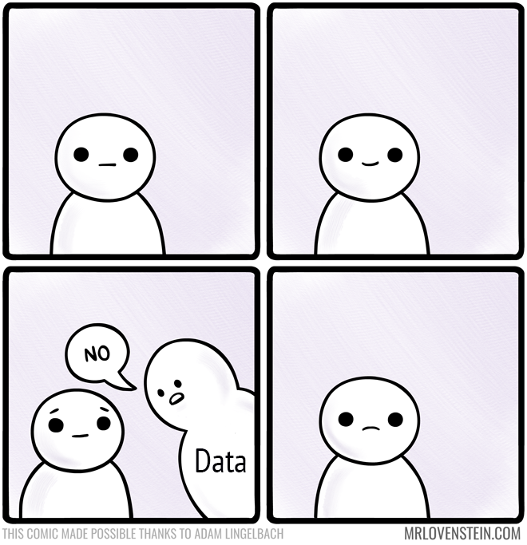
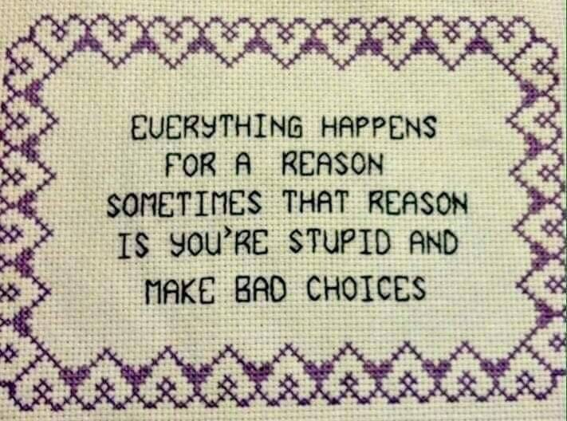

> “*That which can be destroyed by the truth should be.*”
>
> — P.C. Hodgell

> **NOTE:**
>
> - Data as encountered by the statistician
> - Data classes in R
> - Data structures in R

> **IMPORTANT:**
>
> - Task A 1-4

[](../../images/769_life_finds_a_way.png "A reminder that data find a way.")

A reminder that data find a way.

# 1 Introduction

Data classes and data structures determine what R thinks your data are. R does not know what a kelp frond, a quadrat count, or a sampling date means in biological terms. It only knows whether the values were stored as numbers, text, dates, factors, vectors, or data frames.

In biostatistics we will encounter different data types, and comprehending **data classes**, **data structures**, and their **statistical interpretations** is important for several reasons:

- **Correctly identifying the data class** To manipulate, analyse, or visualise data effectively, we must first identify the type of data we are working with. Since different data classes possess distinct properties, we must determine the class of our data to leverage the appropriate functions, operations.

- **Efficient data processing** As biologists using R, we may come across data structures that are not fully compatible with the available functions. For example, when dealing with extensive datasets, employing data structures intended for vectorised operations like arrays and matrices can significantly boost data processing speed. In contrast, other data representations may not perform well when managing large datasets. By becoming familiar with the different data classes and their attributes in R, we can make informed choices about which data structures and functions to use to accomplish their data processing and analysis tasks effectively.

- **Data manipulation and analysis** Different data classes in R have specific methods for manipulating and analysing data. For example, if we are working with character strings, we can use string manipulation functions like [`gsub()`](https://rdrr.io/r/base/grep.html) and [`strsplit()`](https://rdrr.io/r/base/strsplit.html) which do not work on numerical data. If we are working with dates and times, we need to use date and time functions like [`as.Date()`](https://rdrr.io/r/base/as.Date.html) and [`lubridate::ymd()`](https://lubridate.tidyverse.org/reference/ymd.html). By understanding the different data classes in R, we can choose the appropriate functions for manipulating, analysing our data.

- **Data visualisation** Data can be visualised in numerous ways, such as using histograms for numeric data, bar graphs for categorical data, or scatter plots for representing the relationship between two numeric variables. However, the way we provide data to R is critical. By familiarising ourselves with the diverse data classes in R, we can select the most suitable visualisation methods for our data.

In this chapter we move from the thing measured in the field or laboratory, to the variable recorded in the dataset, to the way R stores that variable internally.

# 2 Types of variables common in biology and ecology

Here we cover the first step that translates observations to data. This is where and how empirical phenomena are represented as variables, before any consideration of how the R software may later store or manipulate them.

We will most frequently encounter data arranged in columns of a data file — typically in MS Excel files or CSV files. A column is a variable, and one variable is comprised of one data type. So, when we refer to a variable, we expect that all the data within would be homogeneous, at least in as far as the data’s type.

Further, the type of data that biologists and statisticians work with can influence the statistical techniques and methods they use to analyse and interpret the data. Let us discuss some of the different types of biological and ecological data we are likely to encounter.

Each of the following classes reflects a different way in which R “knows” how values may behave, combine, or fail.

## 2.1 Numeric variables

Numeric data in the context of biostatistics refers to **quantitative data** that can be expressed in numerical form, typically obtained from field and laboratory measurements or from field sampling campaigns. Examples of numeric data in biostatistics include the height and mass of animals, concentrations of nutrients, laboratory test results such as respiration rates, or the number of limpets in a quadrat. Numeric data can be further categorised as **discrete** and **continuous**.

### 2.1.1 Discrete variables

Discrete data are whole (integer) numbers that represent counts of items or events. Integer data usually answer the question, “how many?” For example, in the biological and Earth sciences, discrete data are commonly encountered in the form of counts or integers that represent the presence or absence of certain characteristics or events. For example, the number of individuals of some species in a population, the number of chromosomes in a cell, or the number of earthquakes occurring in a region within a given time frame. Other examples of discrete data in these sciences include the number of mutations in a gene, the number of cells in a tissue sample, or the number of species present in an ecosystem. These types of data are often analysed using statistical techniques such as frequency distributions, contingency tables, and chi-square tests.

### 2.1.2 Continuous variables

Continuous data, on the other hand, are measured on a continuous scale. These usually represent measured quantities such as something’s heat content (temperature, measured in degrees Celsius) or distance (measured in metres or similar). They can be rational numbers including integers and fractions, but typically they have an infinite number of ‘steps’ that depend on rounding (they can even be rounded to whole integers), considerations such as measurement precision and accuracy. Often, continuous data have upper and lower bounds that depend on the characteristics of the phenomenon being studied or the measurement being taken.

## 2.2 Dates

[](../../images/Dates.png "Dates as a data class.")

Dates as a data class.

We often encounter date data when dealing with time-related data. For example, in ecological research, data collection may involve recording the date of a particular observation, sampling event such as the date when a bird was sighted, or when water samples were taken from a stream. The purpose of using date (or time) data in biology, ecology is to enable us to understand and analyse temporal patterns and relationships in their response variables. This can include exploring seasonal trends and understanding the impact of environmental changes over time, or tracking the growth, development of organisms.

By analysing date data, we can gain insights into long-term trends, patterns that may not be apparent when looking at the data in aggregate. They can also use this information to make predictions about future trends and develop more effective management strategies, and identify potential areas for further research.

## 2.3 Character data

Character data are used to describe qualitative variables or descriptive text that are not numerical in nature. Character data can be entered as descriptive character strings, and internally, they are translated into a vector of characters in R. They are often used to represent categorical variables, such as the type of plant species, the colour of a bird’s feathers, or the name of a some gene. Social scientists will sometimes use character data fields to record the names of people, places or other descriptive information, such as a narrative that will later be subjected to, for example, a sentiment analysis. For convenience, I will call these data **narrative style** data to distinguish them from the **qualitative** data that are the main focus of the present discussion.

Since narrative style data are not directly amenable to statistical analsysis, in this module, we will mainly concern ourselves with qualitative data which are typically names of things, or categories of objects, classes of behaviours, properties, characteristics, and so on. Qualitative data typically refer to *non-numeric data* collected from observations, experimental treatment groups, or other sources. They tend to be textual, are often used to describe characteristics or properties of living organisms and ecosystems, or other biological phenomena. Examples may include the colour of flowers, the type of habitat where an animal is found, the behaviour of animals, or the presence, absence of certain traits or characteristics in a population.

Qualitative data can be further classified into **nominal** or **ordinal** data types. Ordinal and nominal data are both amenable to statistical interpretation.

### 2.3.1 Nominal variables

Nominal data are used to describe qualitative variables that do not have any inherent order or ranking. Examples of nominal data in biology may include the type of plant or animal species, or the presence, absence of certain genetic traits. Another term for nominal data is *categorical data*. Because there are well-defined categories or the number of members belonging to each of the category can be counted. For example, there are three red flowers, 66 purple flowers, and 13 yellow flowers.

### 2.3.2 Ordinal variables

Ordinal data refer to a type of data that can be used to describe qualitative categorical variables that have a natural order or ranking. It is used when we need to arrange things in a particular order, such as from worst to best, from least to most. However, the differences between the values cannot be measured or quantified exactly, making them somewhat subjective. Examples of ordinal data include the different stages of development of an organism, the performance of a species to different fertilisers. Ordinal data can be entered as descriptive character strings and internally, they are translated into an ordered vector of integers in R. For example, we can use a scale of `1` for terrible, `2` for ‘so-so’, `3` for average, `4` for good, `5` for brilliant.

## 2.4 Binary variables

Life can be boiled down to a series of binary decisions: should I have pizza for dinner, *yes* or *no*? Should I go to bed early or *TRUE* or *FALSE*? Should I start that new series on Netflix, *accept* or *reject*? Am I *present* or *absent*? You get the gist… This kind of binary decision-making is known as ‘logical’ and in R they can only take on the values of `TRUE` or `FALSE` (remember to mind your case!). In the computing world, logical data are often represented by `1` for `TRUE` and `0` for `FALSE`. So basically, your life’s choices can be summarised as a string of `1`s and `0`s. Who knew it was that simple?

[](../../images/bad_choices.jpg "A meme about binary choices.")

A meme about binary choices.

When it comes down to it, everything in life is either `black` or `white`, `right` or `wrong`, `good` or `bad`. It is like a cosmic game of “Would You Rather?” — and we are all just playing along.

## 2.5 Missing values

It is unfortunate to admit that one of the most reliable aspects of any biological dataset is the presence of missing data (the presence of something that is missing?!). It is a stark reminder of the fragility of life. How can we say that something contains missing data? It seems counter intuitive, as if the data were never there in the first place. However, as we remember the principles of *tidy* data, we see that every observation must be documented in a row, and each column in that row must contain a value. This organisation allows us to create a matrix of data from multiple observations. Since the data are presented in a two-dimensional format, any missing values from an observation will leave a gaping hole in the matrix. We call these ‘missing values.’ It is a somber reality that even the most meticulous collection of data can be marred by the loss of information.

## 2.6 Complex numbers

> *“And if you gaze long enough into an abyss, the abyss will gaze back into you.”*
>
> — Friedrich Nietzsche

I mention complex numbers just to be complete; you will rarely encounter them in applied biological analysis, but knowing about their existence prevents confusion when they emerge indirectly in modelling or numerical methods.

# 3 Data classes in R

Data structures introduce the final layer of data representation; that is, they are containers that organise variables into forms that analysis functions can operate on efficiently and predictably.

Having defined variables in biological terms, we now turn to their representational form in R… that is, how those variables are encoded, constrained, and interpreted by the software itself. To this end, R offers a wide variety of data classes and types to represent different types of information.

The **atomic modes** are `logical`, `integer`, `numeric` (also sometimes called `double`), `complex`, `character` and `raw`. The `Date` class is a specialised form of the `numeric` class. Each atomic mode has its own properties and functions that can be used to manipulate objects of that mode. These atomic modes can be used to make an atomic data structure such as a `vector`, `array`, `matrix`. This knowledge is also important when working with R tabular mixed data structures, such as a `data.frame`, `tibble`, `list`. Please refer to Hadley Wickham’s overview of vectors in [Advanced R, 2nd edition](https://adv-r.hadley.nz/index.html) for more insight presented in an informative yet concise way.

In practice, most analyses rely overwhelmingly on a small subset of these classes: numeric, factor, and logical. They will therefore serve as exemplary cases, while others are introduced for completeness and possible future use.

When results surprise you, inspecting the data’s class and structure is necessary. It is how you check what R thinks the data are. The **data class** can be determined with the [`class()`](https://rdrr.io/r/base/class.html) and [`str()`](https://rdrr.io/r/utils/str.html) commands.

One recurring source of confusion is coercion. Coercion is a decision the language makes to reconcile incompatible representations. When values of different classes are combined or transformed, R silently promotes them to a common class according to fixed rules. So, if the result surprises you, the problem is rarely that R “did something wrong,” but that its representational decision no longer matches your biological or statistical intent.

Now follows a brief overview of some of the main data types in R.

## 3.1 `numeric` (core)

In R, the `numeric` data class represents either **integers** or **floating point** (decimal) values. Numerical data are quantitative in nature as they represent things that can be objectively counted, measured, or calculated. More often than not, these represent the *measured variables*.

Numeric datasets are therefore some of the most common types of data used in statistical and mathematical analysis. In R, numeric data are represented by the class `numeric`, which includes both integers and floating-point numbers. Numeric data can be used in a variety of operations and calculations, including arithmetic operations, statistical analyses, and visualisations. One important feature of the `numeric` data class in R is that it supports vectorisation, which allows for efficient, concise operations on large sets of numeric data. Additionally, R provides a wide range of built-in functions for working with numeric data, including functions for calculating basic statistical measures such as mean, median, and standard deviation.

In R integer (discrete) data are called `int` and `<int>` while continuous data are denoted `num` and `<dbl>`.

**Example of integer data** Suppose you have a dataset of the number of rats in different storm water drains in a neighbourhood. The number of rats is a discrete variable because it can only take on integer values (you cannot own a fraction of a rat).

Here is how you could create a vector of this data in R:

``` numberSource
# Create a vector of the number of pets owned by each household
num_rats <- c(0, 1, 2, 2, 3, 1, 4, 0, 2, 1, 2, 2, 0, 3, 2, 1, 1, 4, 2, 0)
num_rats
```

    R>  [1] 0 1 2 2 3 1 4 0 2 1 2 2 0 3 2 1 1 4 2 0

``` numberSource
class(num_rats)
```

    R> [1] "numeric"

In this example, the data are represented as a vector called `num_rats` of class `numeric` (as revealed by `class(num_rats)`). Each element of the vector represents the number of rats in one storm water drain. For example, the first element of the vector (`num_rats[1]`) is `0`, which means that the first drain in the dataset is free of rats. The fourth element of the vector (`num_rats[4]`) is `2`, indicating that the fourth drain in the dataset is occupied by `2` rats.

One can also explicitly create a vector of integer using the [`as.integer()`](https://rdrr.io/r/base/integer.html) function. Here is a simple example of coercion; in this case, R is not preserving meaning, only enforcing a representational rule (it represents the floating point numbers specifically as integers):

``` numberSource
num_rats_int <- as.integer(num_rats)
num_rats_int
```

    R>  [1] 0 1 2 2 3 1 4 0 2 1 2 2 0 3 2 1 1 4 2 0

``` numberSource
class(num_rats_int)
```

    R> [1] "integer"

Above we *coerced* the class `numeric` data to class `integer`. But we can take floating point numeric and convert them to integers too with the [`as.integer()`](https://rdrr.io/r/base/integer.html) function. As we see, the effect is that the whole part of the number is retained, the rest discarded:

``` numberSource
pies <- pi * seq(1:5)
pies
```

    R> [1]  3.141593  6.283185  9.424778 12.566371 15.707963

``` numberSource
class(pies)
```

    R> [1] "numeric"

``` numberSource
as.integer(pies)
```

    R> [1]  3  6  9 12 15

Effectively, what happened above is more-or-less equivalent to what the [`floor()`](https://rdrr.io/r/base/Round.html) function would return:

``` numberSource
floor(pies)
```

    R> [1]  3  6  9 12 15

Be careful when coercing floating point numbers to integers. If rounding is what you expect, this is not what you will get. For rounding, use [`round()`](https://rdrr.io/r/base/Round.html) instead:

``` numberSource
round(pies, 0)
```

    R> [1]  3  6  9 13 16

> **NOTE:**
>
> Whenever an operation yields an unexpected result, inspect the class before inspecting the values; coercion almost always precedes confusion.

**Example of continuous data** Here are some randomly generated temperature data assigned to an object called `temp_data`:

``` numberSource
# Generate a vector of 50 normally distributed temperature values
set.seed(123)
set.seed(20260313)
temp_data <- round(rnorm(n = 50, mean = 15, sd = 3), 2)
temp_data
```

    R>  [1] 14.35 10.26 16.67 17.76  8.80 15.92 13.04 14.32 17.61 20.91 17.28 18.74
    R> [13] 11.03 12.43 17.21 16.78 14.35 13.74 15.64 22.41 12.72 20.29 19.57 12.68
    R> [25] 10.97 13.74 14.90 11.69 14.36 13.86 15.03 10.69 20.41 11.60 15.52 17.56
    R> [37] 16.64 18.52 13.22 13.71 15.73 15.89 14.49 16.78 10.88 17.51 17.32 13.28
    R> [49] 17.45 14.83

``` numberSource
class(temp_data)
```

    R> [1] "numeric"

## 3.2 `character`

In R, the `character` data class represents textual data such as words, sentences, and paragraphs. Character data can be created using either single or double quotes, and it can include letters, numbers, and other special characters. In addition, character data can be concatenated using the [`paste()`](https://rdrr.io/r/base/paste.html) function or other string manipulation functions.

One important feature of the character data class in R is its versatility in working with textual data. For instance, it can be used to store and manipulate text data, including text-based datasets, text-based files, and text-based visualisations. Additionally, R provides a wide range of built-in functions for working with character data, including functions for manipulating strings, searching for patterns, and formatting output. Overall, the character data class in R is a fundamental data type that is critical for working with textual data in a variety of contexts. You will most frequently use character values to represent labels, names, or descriptions.

## 3.3 `factor` (core)

In R, the `factor` data class is used to represent discrete categorical variables. Factors are often used in statistical analyses to represent class or group belonging. Factor values are categorical data, such as levels and categories of a variable. Factor variables are most commonly also character data, but they can be numeric too if coded correctly as factors. Factor values can be ordered (ordinal) or unordered (categorical or nominal).

Categorical variables take on a limited number of distinct values, often corresponding to different groups and levels. For example, a categorical variable might represent different colours, size classes, or species. Factors in R are represented as integers with corresponding character levels, where each level corresponds to a distinct category. The levels of a factor can be defined explicitly using the [`factor()`](https://rdrr.io/r/base/factor.html) function or automatically using the [`cut()`](https://rdrr.io/r/base/cut.html) function. One important feature of the factor data class in R is that it allows for efficient and effective data manipulation and analysis, particularly when working with large datasets. For instance, factors can be used in statistical analyses such as regression models and ANOVA, and they can also be used to create visualisations such as bar or pie graphs. The `factor` data class in R is a fundamental data type that is critical for representing and working with categorical variables in data analysis and visualisation.

The `factor` data class in an R `data.frame` structure (or in a `tibble`) is indicated by `Factor` (`<fctr>`). Ordered factors are denoted by columns named `Ord.factor` (`<ord>`).

**Nominal data** One example of nominal factor data that ecologists might encounter is the type of vegetation in a particular area, such as ‘grassland’, ‘forest’, or ‘wetland’. Here is an example of how to generate a vector of nominal data in R using the [`sample()`](https://rdrr.io/r/base/sample.html) function:

``` numberSource
# Generate a vector of vegetation types
set.seed(20260313)
vegetation <- sample(c("grassland", "forest", "wetland"), size = 50, replace = TRUE)

# View the vegetation data
vegetation
```

    R>  [1] "forest"    "wetland"   "grassland" "wetland"   "wetland"   "forest"   
    R>  [7] "forest"    "forest"    "forest"    "wetland"   "grassland" "forest"   
    R> [13] "grassland" "grassland" "wetland"   "wetland"   "forest"    "forest"   
    R> [19] "wetland"   "grassland" "forest"    "grassland" "forest"    "forest"   
    R> [25] "grassland" "grassland" "forest"    "grassland" "wetland"   "grassland"
    R> [31] "wetland"   "wetland"   "grassland" "forest"    "forest"    "grassland"
    R> [37] "grassland" "grassland" "grassland" "forest"    "grassland" "wetland"  
    R> [43] "grassland" "wetland"   "wetland"   "forest"    "forest"    "wetland"  
    R> [49] "grassland" "forest"

``` numberSource
class(vegetation)
```

    R> [1] "character"

> **NOTE:**
>
> Note that the [`sample()`](https://rdrr.io/r/base/sample.html) function is not made specifically for nominal data; it can be used on any kind of data class.

**Ordinal data** Here is an example vector of ordinal data in R that could be encountered by ecologists:

``` numberSource
# Vector of ordinal data representing the successional stage of a forest
succession <- c("Early Pioneer", "Late Pioneer",
                "Young Forest", "Mature Forest",
                "Old Growth")
succession
```

    R> [1] "Early Pioneer" "Late Pioneer"  "Young Forest"  "Mature Forest"
    R> [5] "Old Growth"

``` numberSource
class(succession)
```

    R> [1] "character"

``` numberSource
# Convert to ordered factor
succession <- factor(succession, ordered = TRUE,
                     levels = c("Early Pioneer", "Late Pioneer",
                                "Young Forest", "Mature Forest",
                                "Old Growth"))
succession
```

    R> [1] Early Pioneer Late Pioneer  Young Forest  Mature Forest Old Growth   
    R> 5 Levels: Early Pioneer < Late Pioneer < Young Forest < ... < Old Growth

``` numberSource
class(succession)
```

    R> [1] "ordered" "factor"

The ordering here reflects biological reasoning, but R will only respect that ordering if it is made explicit in the data structure.

In this example, the successional stage of a forest is represented by an ordinal scale with five levels ranging from ‘Early Pioneer’ to ‘Old Growth’. The [`factor()`](https://rdrr.io/r/base/factor.html) function is used to convert the vector to an ordered factor, with the `ordered` argument set to `TRUE` and the `levels` argument set to the same order as the original vector. This ensures that the levels are properly represented as an ordered factor.

## 3.4 `logical` (core)

In R, the `logical` data class represents binary or Boolean data. Logical data are used to represent variables that can take on only two possible values, `TRUE` and `FALSE`. In addition to `TRUE` and `FALSE`, logical data can also take on the values of `NA` and `NULL`, which represent missing or undefined values.

Biologically this is presence or absence; in R it is a logical or numeric encoding, and the distinction matters because R responds to the encoding, not the intention.

Logical data can be created using logical operators such as `==`, `!=`, `>`, `<`, `>=`, `<=`. Logical data are commonly used in R for data filtering and selection, conditional statements, and logical operations. For example, logical data can be used to filter a dataset to include only observations that meet certain criteria, to perform logical operations such as AND (`&`) or (`|`). The logical data class in R is a fundamental data type that is critical for representing and working with binary or Boolean variables in data analysis and programming.

**Example logical (binary) data** Here is an example of generating a vector of binary or logical data in R, which represents the presence, absence of a particular species in different ecological sites:

``` numberSource
# Generate a vector of 1s and 0s to represent the presence
# or absence of a species in different ecological sites
set.seed(20260313)
species_presence <- sample(c(0,1), 10, replace = TRUE)
species_presence
```

    R>  [1] 1 1 0 0 1 1 1 0 1 0

We can also make a formal logical class data:

``` numberSource
species_presence_logi <- as.logical(species_presence)
class(species_presence_logi)
```

    R> [1] "logical"

In this example, we again use the [`sample()`](https://rdrr.io/r/base/sample.html) function to randomly generate a vector of 10 values, each either 0, 1 or to represent the presence or absence of a species in 10 different ecological sites. However, it is often not necessary to coerce to class `logical`, as we see in the presence-absence datasets we will encounter in [BCB743: Quantitative Ecology](../../BCB743/BCB743_index.llms.md).

## 3.5 `date`

Date — time handling can become intricate, but most introductory analyses rely on a small number of basic conventions; the distinctions introduced here are intended to make those conventions intelligible… there is no need to master them at this point.

In R, the `POSIXct`, `POSIXlt`, `Date` classes are commonly used to represent date and time data. These classes each have unique characteristics that make them useful for different purposes.

The `POSIXct` class is a date/time class that represents dates and times as a numerical value, *typically* measured in seconds since January 1st, 1970. This class provides a high level of precision, with values accurate to the second. It is useful for performing calculations, data manipulation involving time such as finding the difference between two dates or adding a certain number of seconds to a given time. An example of how to generate a `POSIXct` object in R is as follows:

``` numberSource
my_time <- as.POSIXct("2022-03-10 12:34:56")
class(my_time)
```

    R> [1] "POSIXct" "POSIXt"

``` numberSource
my_time
```

    R> [1] "2022-03-10 12:34:56 SAST"

The `POSIXlt` class, on the other hand, *typically* represents dates, times in a more human-readable format. It stores date and time information as a list of named elements including `year`, `month`, `day`, `hour`, `minute`, `second.` This format is useful for displaying data in a more understandable way and for extracting specific components of a date or time. An example of how to generate a POSIXlt object in R is as follows:

``` numberSource
my_time <- as.POSIXlt("2022-03-10 12:34:56")
class(my_time)
```

    R> [1] "POSIXlt" "POSIXt"

``` numberSource
my_time
```

    R> [1] "2022-03-10 12:34:56 SAST"

The `Date` class is used to represent dates only, without any time information. Dates are *typically* stored as the number of days since January 1st, 1970. This class provides functions for performing arithmetic operations, comparisons between dates. It is useful for working with time-based data that is only concerned with the date component such as daily sales or stock prices. An example of how to generate a Date object in R is as follows:

``` numberSource
my_date <- as.Date("2022-03-10")
class(my_date)
```

    R> [1] "Date"

``` numberSource
my_date
```

    R> [1] "2022-03-10"

To generate a vector of dates in R with daily intervals, we can use the [`seq()`](https://rdrr.io/r/base/seq.html) function to create a sequence of dates, specifying the start, end dates and the time interval. Here is an example:

``` numberSource
# Generate a vector of dates from January 1, 2022 to December 31, 2022
dates <- seq(as.Date("2022-01-01"), as.Date("2022-12-31"), by = "day")

# View the first 10 dates in the vector
head(dates, 10)
```

    R>  [1] "2022-01-01" "2022-01-02" "2022-01-03" "2022-01-04" "2022-01-05"
    R>  [6] "2022-01-06" "2022-01-07" "2022-01-08" "2022-01-09" "2022-01-10"

``` numberSource
class(dates)
```

    R> [1] "Date"

Understanding the characteristics of these date and time classes in R is essential for effective data analysis and manipulation in fields where time-based data is a critical component.

Date and time data in R can be manipulated using various built-in functions and packages such as **lubridate** and **chron**. Additionally, date, time data can be visualised using different types of graphs such as time series plots and heatmaps, and Hovmöller diagrams. The date, time data classes in R are essential for working with temporal data and conducting time-related analyses in various biological and environmental datasets.

## 3.6 Missing values, `NA`

Missing values can be encountered in vectors of all data classes. To demonstrate some data that contains missing values, I will generate a data sequence containing 5% missing values. We can use the [`rnorm()`](https://rdrr.io/r/stats/Normal.html) function to generate a sequence of random normal numbers and then randomly assign 5% of the values as missing using the [`sample()`](https://rdrr.io/r/base/sample.html) function. The indices of the missing values are stored in missing_indices, and we use them to assign `NA` to the corresponding elements of the data sequence. Here is some code to achieve this:

``` numberSource
# Set the length of the sequence
n <- 100

# Generate a sequence of random normal numbers with
# mean 0 and standard deviation 1
set.seed(20260313)
data <- rnorm(n, mean = 0, sd = 1)

# Randomly assign 5% of the values as missing
missing_indices <- sample(1:n, size = round(0.05*n))
data[missing_indices] <- NA
length(data)
```

    R> [1] 100

``` numberSource
data
```

    R>   [1] -0.2157932942 -1.5811706637  0.5568159332  0.9207255079 -2.0663157834
    R>   [6]            NA -0.6545725789 -0.2275052622  0.8702285040  1.9704680874
    R>  [11]  0.7587377000  1.2450128375 -1.3238739536 -0.8572427182  0.7375916767
    R>  [16]  0.5944498578 -0.2178872307 -0.4204178421  0.2123066060  2.4700641833
    R>  [21] -0.7585074110  1.7631935972  1.5231420783 -0.7731229283 -1.3444880804
    R>  [26] -0.4213399510 -0.0343720298 -1.1030688251 -0.2139617740 -0.3807136978
    R>  [31]  0.0114104947 -1.4359970081  1.8020274294 -1.1325272277  0.1730401516
    R>  [36]  0.8526654498  0.5481638427  1.1743178235 -0.5949990626 -0.4296894708
    R>  [41]  0.2430708200  0.2951434405 -0.1709943481  0.5934920696 -1.3723595711
    R>  [46]  0.8354951707  0.7740523136 -0.5724629970  0.8162080355 -0.0581001947
    R>  [51]            NA  1.8349711714  0.2301440263  1.3429486247 -1.2758049044
    R>  [56]  0.3828991941  0.4566222810            NA  1.1871630883  0.0005105918
    R>  [61] -1.6266318878  1.0897160393 -1.3393579565  0.1290601799  0.7428860510
    R>  [66] -0.3068664700 -0.2217819512  0.3136504599  0.0770529274  0.5035938385
    R>  [71]  0.0286213810 -1.4298291928  1.2403954308  0.6719825554  1.7441129054
    R>  [76]  0.5643412449            NA  0.6094792497 -1.3246767644 -1.1963498642
    R>  [81] -0.4157491063  0.3812011392  0.6452404648 -1.5753884017 -0.0380367809
    R>  [86]            NA  0.8792319620 -1.1774559476  0.6963527098 -1.0409909768
    R>  [91]  1.1922894195 -0.4701778818 -1.0564249103 -1.5608971387  2.3730715693
    R>  [96] -1.8569136954  0.6799369313 -1.9209393704 -0.4094561540 -2.0137987700

To remove all `NA`s from the vector of data we can use [`na.omit()`](https://rdrr.io/r/stats/na.fail.html):

``` numberSource
data_sans_na <- na.omit(data)
length(data_sans_na)
```

    R> [1] 95

``` numberSource
data_sans_na
```

    R>  [1] -0.2157932942 -1.5811706637  0.5568159332  0.9207255079 -2.0663157834
    R>  [6] -0.6545725789 -0.2275052622  0.8702285040  1.9704680874  0.7587377000
    R> [11]  1.2450128375 -1.3238739536 -0.8572427182  0.7375916767  0.5944498578
    R> [16] -0.2178872307 -0.4204178421  0.2123066060  2.4700641833 -0.7585074110
    R> [21]  1.7631935972  1.5231420783 -0.7731229283 -1.3444880804 -0.4213399510
    R> [26] -0.0343720298 -1.1030688251 -0.2139617740 -0.3807136978  0.0114104947
    R> [31] -1.4359970081  1.8020274294 -1.1325272277  0.1730401516  0.8526654498
    R> [36]  0.5481638427  1.1743178235 -0.5949990626 -0.4296894708  0.2430708200
    R> [41]  0.2951434405 -0.1709943481  0.5934920696 -1.3723595711  0.8354951707
    R> [46]  0.7740523136 -0.5724629970  0.8162080355 -0.0581001947  1.8349711714
    R> [51]  0.2301440263  1.3429486247 -1.2758049044  0.3828991941  0.4566222810
    R> [56]  1.1871630883  0.0005105918 -1.6266318878  1.0897160393 -1.3393579565
    R> [61]  0.1290601799  0.7428860510 -0.3068664700 -0.2217819512  0.3136504599
    R> [66]  0.0770529274  0.5035938385  0.0286213810 -1.4298291928  1.2403954308
    R> [71]  0.6719825554  1.7441129054  0.5643412449  0.6094792497 -1.3246767644
    R> [76] -1.1963498642 -0.4157491063  0.3812011392  0.6452404648 -1.5753884017
    R> [81] -0.0380367809  0.8792319620 -1.1774559476  0.6963527098 -1.0409909768
    R> [86]  1.1922894195 -0.4701778818 -1.0564249103 -1.5608971387  2.3730715693
    R> [91] -1.8569136954  0.6799369313 -1.9209393704 -0.4094561540 -2.0137987700
    R> attr(,"na.action")
    R> [1]  6 51 58 77 86
    R> attr(,"class")
    R> [1] "omit"

> **NOTE:**
>
> Many functions have specific arguments to deal with `NA`s in data. See for example the `na.rm = TRUE` argument given to [`mean()`](https://rdrr.io/r/base/mean.html), [`median()`](https://rdrr.io/r/stats/median.html), [`min()`](https://rdrr.io/r/base/Extremes.html), [`lm()`](https://rdrr.io/r/stats/lm.html), etc.

# 4 Data structures in R

Data structures can be viewed as the ‘containers’ that hold the different data classes. How are the data arranged in R?

You should be able to identify these structures when you encounter them, understand why they exist, and know where to look when you need them. Eventually, with practice, you will become fluent in identifying them. For now, just becoming familiar with them is sufficient.

Once we reach this this level, we have already decided what the data are. Now we look at how they are arranged, and what operations are permitted to be applied to these data arrangements.

Again, the kind of data structure can be revealed by the [`class()`](https://rdrr.io/r/base/class.html) command.

## 4.1 `vector`, `array`, `matrix`

**Vectors** In R, a vector is a one-dimensional array-like data structure that can hold a sequence of values of the same atomic mode, such as `numeric`, `character`, `logical` values, or `Date` values. A vector can be created using the [`c()`](https://rdrr.io/r/base/c.html) function, which stands for ‘combine’ or ‘concatenate’ and is used to combine a sequence of values into a vector. Vectors can also be created by using the [`seq()`](https://rdrr.io/r/base/seq.html) function to generate a sequence of numbers, or the [`rep()`](https://rdrr.io/r/base/rep.html) function to repeat a value or sequence of values. Here is an example of a numeric vector:

``` numberSource
# create a numeric vector
my_vector <- c(1, 2, 3, 4, 5)

# coerce to vector
my_vector <- as.vector(c(1, 2, 3, 4, 5))
class(my_vector) # but it does not change the class from numeric
```

    R> [1] "numeric"

``` numberSource
# print the vector
my_vector
```

    R> [1] 1 2 3 4 5

> **NOTE:**
>
> The behaviour is such that the output of coercion to vector is that one the atomic modes (the basic data types) is returned.

One of the advantages of using vectors in R is that many of the built-in functions and operations work on vectors, allowing us to easily manipulate, analyse large amounts of data. Additionally, R provides many functions specifically designed for working with vectors, such as [`mean()`](https://rdrr.io/r/base/mean.html), [`median()`](https://rdrr.io/r/stats/median.html), [`sum()`](https://rdrr.io/r/base/sum.html), [`min()`](https://rdrr.io/r/base/Extremes.html), [`max()`](https://rdrr.io/r/base/Extremes.html), and many others.

**Matrices** A matrix (again, this terminology may be different for other languages), on the other hand, is a special case of an array that has two dimensions (rows, columns). It is also a multi-dimensional data structure that can hold elements of the *same data type* but it is specifically designed for handling data in a tabular format. A matrix can be created using the [`matrix()`](https://rdrr.io/r/base/matrix.html) function in R.

``` numberSource
# create a numeric matrix
my_matrix <- matrix(1:6, nrow = 2, ncol = 3)

# print the matrix
my_matrix
```

    R>      [,1] [,2] [,3]
    R> [1,]    1    3    5
    R> [2,]    2    4    6

``` numberSource
class(my_matrix)
```

    R> [1] "matrix" "array"

We can query the size or dimensions of the matrix as follows:

``` numberSource
dim(my_matrix)
```

    R> [1] 2 3

``` numberSource
ncol(my_matrix)
```

    R> [1] 3

``` numberSource
nrow(my_matrix)
```

    R> [1] 2

**Coercion of matrices to vectors** A matrix can be coerced to a vector:

``` numberSource
as.vector(my_matrix)
```

    R> [1] 1 2 3 4 5 6

**Arrays** In R (as opposed to in python or some other languages), an array specifically refers to a multi-dimensional data structure that can hold elements of the *same data type*. It can have any number of dimensions (1, 2, 3, etc.), and its dimensions can be named.

Multi-dimensional arrays are common in modelling and spatial data, but you are unlikely to manipulate them directly in this module.

An array can be created using the [`array()`](https://rdrr.io/r/base/array.html) function in R.

``` numberSource
# create a 2-dimensional array
my_array <- array(1:27, dim = c(3, 3, 3))

# print the array
my_array
```

    R> , , 1
    R> 
    R>      [,1] [,2] [,3]
    R> [1,]    1    4    7
    R> [2,]    2    5    8
    R> [3,]    3    6    9
    R> 
    R> , , 2
    R> 
    R>      [,1] [,2] [,3]
    R> [1,]   10   13   16
    R> [2,]   11   14   17
    R> [3,]   12   15   18
    R> 
    R> , , 3
    R> 
    R>      [,1] [,2] [,3]
    R> [1,]   19   22   25
    R> [2,]   20   23   26
    R> [3,]   21   24   27

``` numberSource
class(my_array)
```

    R> [1] "array"

We can figure something out about the size or dimensions of the array:

``` numberSource
dim(my_array)
```

    R> [1] 3 3 3

``` numberSource
ncol(my_array)
```

    R> [1] 3

``` numberSource
nrow(my_array)
```

    R> [1] 3

**Coercion of arrays to vectors** The array can be coerced to a vector:

``` numberSource
as.vector(my_array)
```

    R>  [1]  1  2  3  4  5  6  7  8  9 10 11 12 13 14 15 16 17 18 19 20 21 22 23 24 25
    R> [26] 26 27

The key difference between vectors, arrays, and a matrices in R is their dimensions. A vector has one dimension, an array can have any number of dimensions, while a matrix is limited to two dimensions. Additionally, a matrix is often used to store data in a tabular format, while an array is used to store multi-dimensional data in general. A commonly encountered kind of matrix is seen in multivariate statistics is a distance, dissimilarity matrix.

*In R, vectors, arrays, and matrices share a common characteristic: they do not have row, column names.* Therefore or to refer to any element, row, or column, one must use their corresponding index. How?

**Accessing elements, rows, columns, and matrices** In R, the square bracket notation is used to access elements, rows, columns, or matrices in arrays. The notation takes the form of `[i, j, k, ...]`, where `i`, `j`, `k`, and so on, represent the indices of the rows, columns, or matrices to be accessed.

Suppose we have the following array:

``` numberSource
set.seed(20260313)
my_array <- array(data = round(rnorm(n = 60, mean = 13, sd = 2), 1),
                  dim = c(5, 4, 3))
my_array
```

    R> , , 1
    R> 
    R>      [,1] [,2] [,3] [,4]
    R> [1,] 12.6 13.6 14.5 14.2
    R> [2,]  9.8 11.7 15.5 12.6
    R> [3,] 14.1 12.5 10.4 12.2
    R> [4,] 14.8 14.7 11.3 13.4
    R> [5,]  8.9 16.9 14.5 17.9
    R> 
    R> , , 2
    R> 
    R>      [,1] [,2] [,3] [,4]
    R> [1,] 11.5 12.2 13.0 14.7
    R> [2,] 16.5 12.9 10.1 14.1
    R> [3,] 16.0 10.8 16.6 15.3
    R> [4,] 11.5 12.6 10.7 11.8
    R> [5,] 10.3 12.2 13.3 12.1
    R> 
    R> , , 3
    R> 
    R>      [,1] [,2] [,3] [,4]
    R> [1,] 13.5 14.7 14.2 13.8
    R> [2,] 13.6 14.5 16.7 13.9
    R> [3,] 12.7 11.9 13.5 15.6
    R> [4,] 14.2 14.6 15.7 15.4
    R> [5,] 10.3 12.9 10.4 13.0

``` numberSource
dim(my_array)
```

    R> [1] 5 4 3

This creates a $5\times4\times3$ array with values from `1` to `60`.

When working with multidimensional arrays, it is possible to omit some of the indices in the square bracket notation. This results in a subset of the array, which can be thought of as a lower-dimensional array obtained by fixing the omitted dimensions. For example, consider a 3-dimensional array `my_array` above with dimensions `dim(my_array) = c(5,4,3)`. If we use the notation `my_array[1,,]`, we would obtain a 2-dimensional array with dimensions `dim(my_array[1,,]) = c(4,3)` obtained by fixing the first index at 1:

``` numberSource
dim(my_array[1,,])
```

    R> [1] 4 3

``` numberSource
my_array[1,,]
```

    R>      [,1] [,2] [,3]
    R> [1,] 12.6 11.5 13.5
    R> [2,] 13.6 12.2 14.7
    R> [3,] 14.5 13.0 14.2
    R> [4,] 14.2 14.7 13.8

Here are some more examples of how to use square brackets notation with arrays in R:

To access a **single element** in the array, use the notation `[i, j, k]`, where `i`, `j`, `k` are the indices along each of the three dimensions, which in combination, uniquely identifies each element. Below we return the element in the second row, third column, and first matrix:

``` numberSource
my_array[2, 3, 1]  
```

    R> [1] 15.5

To access a single row in the array, use the notation `[i, , ]`, where `i` is the index of the row. This will return the second rows and all of the columns of the first matrix:

``` numberSource
my_array[2,,1]
```

    R> [1]  9.8 11.7 15.5 12.6

To access a single column in the array, use the notation `[ , j, ]`, where `j` is the index of the column. Here we will return all the elements in the row of column two and matrix three:

``` numberSource
my_array[ , 2, 3]
```

    R> [1] 14.7 14.5 11.9 14.6 12.9

To access a single matrix in the array, use the notation `[ , , k]`, where `k` is the index of the matrix:

``` numberSource
my_array[ , , 2]
```

    R>      [,1] [,2] [,3] [,4]
    R> [1,] 11.5 12.2 13.0 14.7
    R> [2,] 16.5 12.9 10.1 14.1
    R> [3,] 16.0 10.8 16.6 15.3
    R> [4,] 11.5 12.6 10.7 11.8
    R> [5,] 10.3 12.2 13.3 12.1

To obtain a subset of the array, use the notation `[i, j, k]` with `i`, `j`, `k` omitted to obtain a lower-dimensional array:

``` numberSource
my_array[1, , ]
```

    R>      [,1] [,2] [,3]
    R> [1,] 12.6 11.5 13.5
    R> [2,] 13.6 12.2 14.7
    R> [3,] 14.5 13.0 14.2
    R> [4,] 14.2 14.7 13.8

``` numberSource
my_array[ , 2:3, ]
```

    R> , , 1
    R> 
    R>      [,1] [,2]
    R> [1,] 13.6 14.5
    R> [2,] 11.7 15.5
    R> [3,] 12.5 10.4
    R> [4,] 14.7 11.3
    R> [5,] 16.9 14.5
    R> 
    R> , , 2
    R> 
    R>      [,1] [,2]
    R> [1,] 12.2 13.0
    R> [2,] 12.9 10.1
    R> [3,] 10.8 16.6
    R> [4,] 12.6 10.7
    R> [5,] 12.2 13.3
    R> 
    R> , , 3
    R> 
    R>      [,1] [,2]
    R> [1,] 14.7 14.2
    R> [2,] 14.5 16.7
    R> [3,] 11.9 13.5
    R> [4,] 14.6 15.7
    R> [5,] 12.9 10.4

## 4.2 `data.frame`

A dataframe is perhaps the most commonly-used ‘container’ for data in R because they are so convenient and serve many purposes. A dataframe is *not a data class* — more correctly, it is a form of tabular data (like a table in MS Excel), with each vector (a variable, column) comprising the table sharing the same length. What makes a dataframe versatile is that its variables can be any combination of the atomic data types. It may even include *list columns* (we will not cover list columns in this module). Applying the[`class()`](https://rdrr.io/r/base/class.html) function to a dataframe shows that it belongs to class `data.frame`.

Here is an example of an R `data.frame` with `Date`, `numeric`, `categorical` data classes:

``` numberSource
# Create a vector of dates
dates <- as.Date(c("2022-01-01", "2022-01-02", "2022-01-03",
                   "2022-01-04", "2022-01-05"))

# Create a vector of numeric data
set.seed(20260313)
numeric_data <- rnorm(n = 5, mean = 0, sd = 1)

# Create a vector of categorical data
categorical_data <- c("A", "B", "C", "A", "B")

# Combine the vectors into a data.frame
my_dataframe <- data.frame(dates = dates,
                           numeric_data = numeric_data,
                           categorical_data = categorical_data)

# Print the dataframe
my_dataframe
```

    R>        dates numeric_data categorical_data
    R> 1 2022-01-01   -0.2157933                A
    R> 2 2022-01-02   -1.5811707                B
    R> 3 2022-01-03    0.5568159                C
    R> 4 2022-01-04    0.9207255                A
    R> 5 2022-01-05   -2.0663158                B

``` numberSource
class(my_dataframe)
```

    R> [1] "data.frame"

``` numberSource
str(my_dataframe)
```

    R> 'data.frame':    5 obs. of  3 variables:
    R>  $ dates           : Date, format: "2022-01-01" "2022-01-02" ...
    R>  $ numeric_data    : num  -0.216 -1.581 0.557 0.921 -2.066
    R>  $ categorical_data: chr  "A" "B" "C" "A" ...

``` numberSource
summary(my_dataframe)
```

    R>      dates             numeric_data      categorical_data
    R>  Min.   :2022-01-01   Min.   :-2.0663   Length   :5      
    R>  1st Qu.:2022-01-02   1st Qu.:-1.5812   N.unique :3      
    R>  Median :2022-01-03   Median :-0.2158   N.blank  :0      
    R>  Mean   :2022-01-03   Mean   :-0.4771   Min.nchar:1      
    R>  3rd Qu.:2022-01-04   3rd Qu.: 0.5568   Max.nchar:1      
    R>  Max.   :2022-01-05   Max.   : 0.9207

Dataframes may also have row names:

``` numberSource
rownames(my_dataframe) <- paste(rep("row", 5), seq = 1:5)
my_dataframe
```

    R>            dates numeric_data categorical_data
    R> row 1 2022-01-01   -0.2157933                A
    R> row 2 2022-01-02   -1.5811707                B
    R> row 3 2022-01-03    0.5568159                C
    R> row 4 2022-01-04    0.9207255                A
    R> row 5 2022-01-05   -2.0663158                B

Typically we will create a dataframe by reading in data from a `.csv` file, but it is useful to be able to construct one from scratch.

## 4.3 `tibble`

In R, a dataframe, a tibble are both data structures used to store tabular data. Although tibbles are also dataframes but they differ subtly in several ways.

- A tibble is a relatively new addition to the R language and forms part of the **tidyverse** suite of packages. They are designed to be more user-friendly than traditional data frames and have several additional features, such as more informative error messages, stricter data input, output rules and better handling of `NA`.

- Unlike a dataframe, a tibble never automatically converts strings to factors, changes column names or which can help avoid unexpected behaviour when working with the data.

- A tibble does not have row names.

- A tibble has a slightly different and more compact printing method than a dataframe, which makes them easier to read, work with.

- Finally, a tibble has better performance than dataframes for many tasks, especially when working with large datasets.

While a dataframe is a core data structure in R, a tibble provides additional functionality, are becoming increasingly popular among R users and particularly those working with **tidyverse** packages. Applying the [`class()`](https://rdrr.io/r/base/class.html) function to a tibble revelas that it belongs to the classes `tbl_df`, `tbl` and `data.frame`.

We can convert our dataframe `my_dataframe` to a tibble, and present the output with the [`print()`](https://rdrr.io/r/base/print.html) function that applies nicely to tibbles:

``` numberSource
library(tidyverse) # we need to load the tidyverse package
my_tibble <- as_tibble(my_dataframe)
class(my_tibble)
```

    R> [1] "tbl_df"     "tbl"        "data.frame"

``` numberSource
print(my_tibble)
```

    R> # A tibble: 5 × 3
    R>   dates      numeric_data categorical_data
    R>   <date>            <dbl> <chr>           
    R> 1 2022-01-01       -0.216 A               
    R> 2 2022-01-02       -1.58  B               
    R> 3 2022-01-03        0.557 C               
    R> 4 2022-01-04        0.921 A               
    R> 5 2022-01-05       -2.07  B

This very simple tibble looks identical to a dataframe, but as we start using more complex sets of data you will learn to appreciate the small convenience that tibbles offer.

## 4.4 `list`

I introduce lists here because you will see them often in R outputs, even if you do not construct them routinely yourself.

This is also not actually a data class, but rather another way of representing a collection of objects of different types, all the way from numerical vectors to dataframes. Lists are useful for storing complex data structures, can also be accessed using indexing.

As an example, we create another dataframe:

``` numberSource
dates <- as.Date(c("2022-01-01", "2022-01-02", "2022-01-03",
                   "2022-01-04", "2022-01-05"))

# Create a vector of numeric data
set.seed(20260313)
numeric_data <- rnorm(n = 5, mean = 1, sd = 1)

# Create a vector of categorical data
categorical_data <- c("C", "D", "D", "F", "A")

# Combine the vectors into a data.frame
my_other_dataframe <- data.frame(dates = dates,
                                  numeric_data = numeric_data,
                                  categorical_data = categorical_data)

my_list <- list(A = my_dataframe,
                B = my_other_dataframe)
my_list
```

    R> $A
    R>            dates numeric_data categorical_data
    R> row 1 2022-01-01   -0.2157933                A
    R> row 2 2022-01-02   -1.5811707                B
    R> row 3 2022-01-03    0.5568159                C
    R> row 4 2022-01-04    0.9207255                A
    R> row 5 2022-01-05   -2.0663158                B
    R> 
    R> $B
    R>        dates numeric_data categorical_data
    R> 1 2022-01-01    0.7842067                C
    R> 2 2022-01-02   -0.5811707                D
    R> 3 2022-01-03    1.5568159                D
    R> 4 2022-01-04    1.9207255                F
    R> 5 2022-01-05   -1.0663158                A

``` numberSource
class(my_list)
```

    R> [1] "list"

``` numberSource
str(my_list)
```

    R> List of 2
    R>  $ A:'data.frame':   5 obs. of  3 variables:
    R>   ..$ dates           : Date[1:5], format: "2022-01-01" "2022-01-02" ...
    R>   ..$ numeric_data    : num [1:5] -0.216 -1.581 0.557 0.921 -2.066
    R>   ..$ categorical_data: chr [1:5] "A" "B" "C" "A" ...
    R>  $ B:'data.frame':   5 obs. of  3 variables:
    R>   ..$ dates           : Date[1:5], format: "2022-01-01" "2022-01-02" ...
    R>   ..$ numeric_data    : num [1:5] 0.784 -0.581 1.557 1.921 -1.066
    R>   ..$ categorical_data: chr [1:5] "C" "D" "D" "F" ...

We can access one of the dataframes is the list as follows:

``` numberSource
my_list[[2]]
```

    R>        dates numeric_data categorical_data
    R> 1 2022-01-01    0.7842067                C
    R> 2 2022-01-02   -0.5811707                D
    R> 3 2022-01-03    1.5568159                D
    R> 4 2022-01-04    1.9207255                F
    R> 5 2022-01-05   -1.0663158                A

``` numberSource
my_list[["A"]]
```

    R>            dates numeric_data categorical_data
    R> row 1 2022-01-01   -0.2157933                A
    R> row 2 2022-01-02   -1.5811707                B
    R> row 3 2022-01-03    0.5568159                C
    R> row 4 2022-01-04    0.9207255                A
    R> row 5 2022-01-05   -2.0663158                B

To access a variable within one of the elements of the list we can do something like:

``` numberSource
my_list[["B"]]$numeric_data
```

    R> [1]  0.7842067 -0.5811707  1.5568159  1.9207255 -1.0663158

# 5 The way forward

These are the bread and butter data classes and structures in R. Other data classes and structures also exist, but these may be particular to certain packages. We will encounter some of them in [BCB743: Quantitative Ecology](../../BCB743/BCB743_index.llms.md).

If you remember little else, remember that most of your statistical analyses will consist of numeric measurements grouped by factors and filtered by logical conditions; everything else refines, rather than replaces, this pattern.

As you progress, some of these structures will progress from recognition to routine use, but others will remain part of your background understanding and become useful only when your analyses demand them.

From this point forward, you should be able to look at any dataset and ask three prior questions: what phenomenon it describes, how that description has been encoded, and which structures now govern what can be done with it.

## Reuse

[CC BY-NC-SA 4.0](https://creativecommons.org/licenses/by-nc-sa/4.0/)

## Citation

BibTeX citation:

``` quarto-appendix-bibtex
@online{smit2021,
  author = {Smit, A. J.},
  title = {4. {Data} Classes and Structures},
  date = {2021-01-01},
  url = {https://tangledbank.netlify.app/BCB744/intro_r/04-data-in-R.html},
  langid = {en}
}
```

For attribution, please cite this work as:

Smit AJ (2021) 4. Data classes and structures. [https://tangledbank.netlify.app/BCB744/intro_r/04-data-in-R.html.](https://tangledbank.netlify.app/BCB744/intro_r/04-data-in-R.html)
