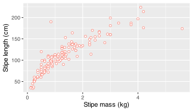
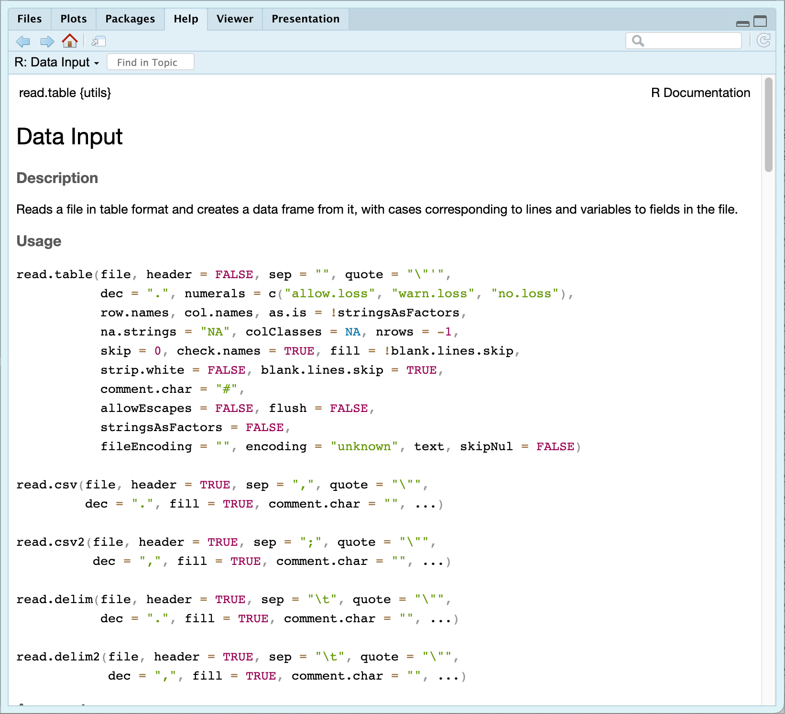

[](../../images/Skulls_meme.jpg "A meme about workflow discipline.")

A meme about workflow discipline.

> “*A dream does not become reality through magic; it takes sweat, determination, hard work.*”
>
> — Colin Powell

> “*Choose a job you love, and you will never have to work a day in your life.*”
>
> — Confucius

# 1 Introduction

In this chapter, a *workflow* refers to the explicit ordering of analytical actions acting on named data objects, recorded in a form (a script) that can be inspected, rerun, and revised. A workflow produces the code itself, and results in outputs; it is the visible trace of how you move data from raw input to the result. Scripts, projects, and saved files matter here because they make assumptions, transformations, and dependencies visible to the user.

We will do a practical example to show you how R makes your life easier.

> **IMPORTANT:**
>
> This exercise requires that you analyse the data provided in `data/BCB744/SACTN_SAWS.csv` within `<that which shall not be named>`.
>
> This dataset contains monthly seawater temperature time series for a selection of sites around the coast of South Africa.
>
> 1.  How many sites are there?
>
> For each of the sites there are monthly mean temperatures for every year the 1970s to the 2000s.
>
> 2.  What is the earliest and latest date for which temperature measurements are available, and which sites do they belong to?
>
> 3.  In this exercise, please create, **for each site**, a *monthly climatology* using all available data in the time series (see box below).
>
> 4.  Plot the monthly climatology for each site as a line graph showing the mean temperature for each month.
>
> 5.  Optionally, you could also calculate the standard deviation of the monthly mean temperatures to represent the variability in temperature within each month. This information can be used to determine the range of typical temperatures for each month.

> **NOTE:**
>
> The World Meteorological Organisation (WMO) provides guidelines for the calculation of climatologies, including monthly, annual climatologies. The WMO guidelines are based on standard meteorological practices and are designed to ensure consistent and accurate calculation of climatological data.
>
> A monthly climatology is a study of the average temperature of seawater (or any environmental variable that is expected to vary over time in a cyclical seasonal manner) over a specified period of time, typically over a year, and broken down by month. Climatologies provide insight into the patterns, trends of weather phenomena and how they vary from one month to another and from year to year.
>
> By analysing long-term data, a monthly climatology can determine the average seawater temperature for each month, the range of temperatures that are typical for each month, as well as finding deviations from expected patterns. This information can be used for a variety of purposes, such as predicting weather patterns, studying the effects of climate change, or understanding the impacts of ocean temperature on marine life.
>
> In essence, a monthly climatology provides a comprehensive, organised overview of the variability and patterns in seawater temperature over a given period of time.
>
> The steps for calculating a monthly climatology according to the WMO guidelines are as follows:
>
> - **Obtain long-term meteorological observations:** The WMO recommends using at least 30 years of data, although longer periods are preferred, to ensure the climatology is representative of the long-term average conditions.
>
> - **Group the observations into months:** The observations should be grouped into months, such as January, February, etc.
>
> - **Calculate the mean value for each month:** For each month over the observation period, the mean value should be calculated as the sum of all the observations for that month divided by the number of observations.
>
> - **Calculate the mean climatology for each month:** The mean climatology for each month is calculated by taking the mean of the monthly mean values for each month over the period of record.
>
> - **Quality control and homogeneity adjustment:** The WMO recommends checking the quality and consistency of the data, and adjusting the data if necessary to correct for inhomogeneities, biases.
>
> The steps for calculating an annual climatology are similar, with the observations being grouped into years rather than months. The WMO guidelines also provide recommendations for the calculation of other types of climatologies, such as seasonal, daily climatologies.
>
> The WMO guidelines are not mandatory, but they are widely used, respected in the meteorological community as the standard for calculating climatologies.

# 2 R scripts

The emphasis at this point is operational, and the goal is to establish a reproducible *sequence of actions* before introducing conventions about how such sequences should be written, named, or judged.

The first step for any project in R is to create a new script. You do this by clicking on the ‘New Document’ button (in the top left and selecting ‘R Script’). This creates an unnamed file in the **Source Editor** pane. Best to save it first of all so you do not lose what you do. ‘File’ \> ‘Save As’ and the Working Directory should come up. Type in `Day_1` as the file name and click ‘Save.’ R will automatically add a `.R` extension.

Now, the script is the authoritative record of the analysis. Commands typed only into the **Console** should be treated as provisional and disposable; analytical work becomes durable only when it is saved.

I recommended that you start your script with some basic information for you to refer back to later. Start with a comment line (the line begins with a `#`) that tells you the name of the script, something about the script, who created it, and the date it was created. In the source editor enter to following lines, save the file again:

``` numberSource
# Day_1.R
# Reads in some data about Laminaria collected along the Cape Peninsula
# Do various data manipulations, analyses and graphs
# <your_name>
# <curent_date>
```

Remember that anything appearing after the `#` is not executed by R as script since it is a comment. What follows after the `#` does change R’s memory. Comments record intent and do not result in effects. No objects exist yet in R’s environment since nothing has been executed.

It is recommend that for each day of the workshop you start a new script (in the **Source Editor**), type in the code as you go along, and only execute the required lines. That way you will have a record of what you have done.

From here onward, any command not saved in a script should be treated as provisional (*i.e.*, they are temporary, and will be lost when you exit R and/or RStudio). Analytical work becomes durable only when its steps are recorded in a form that can be rerun without recollection. Until code has been saved and rerun from the script, it should be regarded as not yet part of the analysis.

Below, you will learn how to import the file `laminaria.csv` into R, assign it to a dataframe named `laminaria`, and spend a while looking it over. These data reflect results of a sampling campaign on one of the species of kelps (*Laminaria pallida*) in the Western Cape designed to find the morphometric properties of populations at different sites. We visited 13 different locations along the Cape Peninsula (`site`), and at each site, collected *ca.* 13 specimens of the largest kelps we could find. We then brought the kelps back to the shore, measured/calculated nine morphometric properties of the plants (*e.g.*, the mass of the fronds (`blade_weight`), the frond length (`blade_length`), *etc.*).

# 3 Reading data into R

You will now see how easy it is to read data into R. R will read in many types of data, including spreadsheets, text files, binary files, files from other statistical packages and software.

> **NOTE:**
>
> Unfortunately in South Africa you are taught from a young age to use commas (`,`) instead of full stops (`.`) for decimal places. This simply will not do when you are working with a computer. You must always use a full stop for a decimal place and never insert commas anywhere into any numbers.

> **NOTE:**
>
> R generally thinks that commas mean the user is telling the computer to separate values. So if you think you are typing a big number like 2,300 you may actually end up with two numbers — especially when working with `.csv` files, where columns are delimited by commas. Therefore, never use commas with numbers.

Before you import anything, your analysis already depends on one assumption: where the files live. If that assumption is wrong, `read_csv()` fails no matter how correct the rest of the script is.

## 3.1 Preparing data for R

Importing data can actually take longer than the statistical analysis itself! In order to avoid as much frustration as possible it is important to remember that for R to be able to analyse your data they need to be in a consistent format, with each variable in a column, each sample in a row. The format within each variable (column) needs to be consistent and is commonly one of the following types: a continuous numeric variable (*e.g.*, and fish length (m): `0.133`, `0.145`); a factor or categorical variable (*e.g.*, Month: `Jan`, `Feb` and `1`, `2`, `…`, `12`); a nominal variable (*e.g.*, algal colour: `red`, `green`, `brown`); or a logical variable (*i.e.*, `TRUE` and `FALSE`). You can also use other more specific formats such as dates and times, and more general text formats.

You will learn more about working with data in R — specifically, you will teach you about the **tidyverse** principles, the distinction between *long* and *wide* format data in more detail on Day 4. For most of our work in R you require our data to be in the long format but Excel users (poor things!) are more familiar with data stored in the wide format.

(The problem with Excel is that it without warning alters data and obscures provenance, making analytical state difficult to reconstruct.)

For now let us bring some data into R and not worry too much about the data being tidy.

## 3.2 Converting data

Before you can read in the *Laminaria* dataset provided for the following exercises, you need to convert the Excel file supplied into a `.csv` file. Open `laminaria.xlsx` in Excel, then select ‘Save As’ from the File menu. In the ‘Format’ drop-down menu, select the option called ‘Comma Separated Values’, then hit ‘Save’. You will get a warning that formatting will be removed, that only one sheet will be exported; simply ‘Continue’. Your working directory should now contain a file called `laminaria.csv`.

## 3.3 Importing data

At this point, successful data import depends on whether the workflow has a fixed point of reference on the file system.

The easiest way to import data into R is by changing your working directory to be the same as the file path where the file(s) are you want to load. A file path is effectively an address. In most operating systems, if you open the folder where your files are you may click on the navigation bar, it will show you the complete file path. Many people develop the nasty habit of squirrelling away their files within folders within folders within folders within folders… within folders within folders. Please do not do that.

The concept of file paths is either one that you are familiar with, or you have never heard of before. There tends to be little middle ground. Happily, RStudio allows us to circumvent this issue. You do this by using the `Intro_R_Workshop.Rproj` that you may find in the files downloaded for this workshop. If you have not already switched to the `Intro_R_Workshop.Rproj` as outlined in Chapter 2, click on the project button in the top right corner your RStudio window. Then navigate to where you saved `Intro_R_Workshop.Rproj` and select it. Notice that your RStudio has changed a bit and all of the objects you may have previously created in your environment have been removed and any tabs in the source editor pane have been closed. That is fine for now, but it may mean you need to re-open the `Day_1.R` script you just created.

Once you have the working directory set, either by doing it manually with [`setwd()`](https://rdrr.io/r/base/getwd.html) (but refrain from doing this unless *absolutely* necessary) or by loading a project, R will now know where to look for the files you want to read. The function `read_csv()` is the most convenient way to read in raw data. There are several other ways to read in data, but for the purposes of this workshop we will stick to this one, for now. To find out what it does, you will go to its help entry in the usual way (*i.e.*, `?read_csv`).

All R Help items are in the same format. A short *Description* (of what it does), *Usage*, *Arguments* (the different inputs it requires), *Details* (of what it does), *Value* (what it returns), *Examples*. Arguments (the parameters that are passed to the function) are the lifeblood of any function and as this is how you provide information to R. You do not need to specify all arguments, as most have appropriate default values for your requirements, and others might not be needed for your particular case.

> **NOTE:**
>
> R has pedantic requirements for naming variables. It is safest to not use spaces, special characters (*e.g.*, commas, semicolons, any of the shift characters above the numbers), or function names (*e.g.*, mean). One can use ‘camelCase’, such as `myFirstVariable`, or simply separate the ‘parts’ of the variable name using an underscore such as in `my_first_variable`. Always make sure to use meaningful names; eventually you will learn to find a balance between meaningfulness and something short that is easy enough to retype repeatedly (although R’s ability to use tab completion helps with not having to type long names to often).

> **NOTE:**
>
> `read_csv()` is simply a ‘wrapper’ (*i.e.*, a command that modifies) a more basic command called `read_delim()`, which itself allows you to read in many types of files besides `.csv`. To find out more, type `?read_delim()`.

## 3.4 Loading a file

To load the `laminaria.csv` file you created, and assign it to an object name in R, you will use the `read_csv()` function from the **tidyverse** package, so let us make sure it is activated.

``` numberSource
library(tidyverse)
```

Depending on the version of Excel you are using, or perhaps the settings within it, the `laminaria.csv` file you created may be corrupted in different ways. Generally Excel likes to replace the `,` between columns in our .csv files with `;`. This may seem like a triviality but sadly it is not. Lucky for use, the **tidyverse** knows about this problem, they have made a plan. Please open your`laminaria.csv` file and look at which character is being used to separate columns. If it is `,` then you will load the data with `read_csv()`. If the columns are separated with `;` you will use `read_csv2()`.

``` numberSource
# Run this if 'laminaria.csv` has columns separated by ','
laminaria <- read_csv(here::here("data", "BCB744", "laminaria.csv"))
# Run this if 'laminaria.csv` has columns separated by ';'
laminaria <- read_csv2(here::here("data", "BCB744", "laminaria.csv"))
```

> **NOTE:**
>
> [`here::here()`](https://here.r-lib.org/reference/here.html) builds a file path from the **project root**, so you do not have to set or guess the working directory. It exists to make your code portable: the same script works on different computers as long as the project folder stays intact.
>
> The default way is to give a plain path string, for example `"data/BCB744/laminaria.csv"`. [`here::here()`](https://here.r-lib.org/reference/here.html) just constructs that path for you. So:
>
> - `here::here("data", "BCB744", "laminaria.csv")`
> - is equivalent to `"data/BCB744/laminaria.csv"`
>
> If you prefer the default style, you can replace any `here::here(...)` call with the plain path string it would build.

The workflow now depends on a single named object in memory. Moving onward, all results depend on the contents, structure, and provenance of `laminaria`.

If one clicks on the newly created `laminaria` object in the **Environment** pane it will open a new panel that shows the information as a spreadsheet. To go back to your script click the appropriate tab in the **Source Editor** pane. With these data loaded you may now perform analyses on them.

At any point when working in R, you can see exactly what objects are in memory in several ways. First, you can look at the **Environment** tab in RStudio, then **Workspace Browser**. Alternatively you can type either of the following:

``` numberSource
ls()
# or
objects()
```

You can delete an object from memory by specifying the [`rm()`](https://rdrr.io/r/base/rm.html) function with the name of the object:

``` numberSource
rm(laminaria)
```

This will of course delete our variable, so you will import it in again using whichever of the following two lines of code matched our Excel situation. The workflow has now lost access to its primary data object. Any subsequent analysis thus depends on recreating it by important the data again.

``` numberSource
laminaria <- read.csv(here::here("data", "BCB744", "laminaria.csv"))
```

> **NOTE:**
>
> It is good practice to remove variables from memory that you are not using, especially if they are large.

The workflow has now reached an important point where the analysis depends, for the first time in the workflow, on a single, named object whose contents, structure, and provenance (origin, history) must remain stable for subsequent steps to be interpretable.

# 4 Working with data

At this stage, the aim is reproducibility and traceability: you should be able to recognise these tools and functions, follow their logic, and rerun your own analysis without any reconstruction.

## 4.1 Examine your data

Once the data are in R, you need to check there are no glaring errors. It is useful to call up the first few lines of the dataframe using the function [`head()`](https://rdrr.io/r/utils/head.html). Add the following lines to your script and run them:

``` numberSource
head(laminaria)
```

    R> # A tibble: 6 × 12
    R>   region site        Ind blade_weight blade_length blade_thickness stipe_mass
    R>   <chr>  <chr>     <dbl>        <dbl>        <dbl>           <dbl>      <dbl>
    R> 1 WC     Kommetjie     2         1.9           160            2          1.5 
    R> 2 WC     Kommetjie     3         1.5           120            1.4        2.25
    R> 3 WC     Kommetjie     4         0.55          110            1.5        1.15
    R> 4 WC     Kommetjie     5         1             159            1.5        2.6 
    R> 5 WC     Kommetjie     6         2.3           149            2         NA   
    R> 6 WC     Kommetjie     7         1.6           107            1.75       2.9 
    R> # ℹ 5 more variables: stipe_length <dbl>, stipe_diameter <dbl>, digits <dbl>,
    R> #   thallus_mass <dbl>, total_length <dbl>

This lists the first six lines of each of the variables in the dataframe as a table. You can similarly retrieve the last six lines of a dataframe by an identical call to the function [`tail()`](https://rdrr.io/r/utils/head.html). of course, this works better when you have fewer than 10, so variables (columns); for larger data sets or things can get a little messy. If you want more or fewer rows in your head or tail, tell R how many rows it is you want by adding this information to your function call. Add the following lines to your script and run them:

``` numberSource
head(laminaria, n = 3)
```

    R> # A tibble: 3 × 12
    R>   region site        Ind blade_weight blade_length blade_thickness stipe_mass
    R>   <chr>  <chr>     <dbl>        <dbl>        <dbl>           <dbl>      <dbl>
    R> 1 WC     Kommetjie     2         1.9           160             2         1.5 
    R> 2 WC     Kommetjie     3         1.5           120             1.4       2.25
    R> 3 WC     Kommetjie     4         0.55          110             1.5       1.15
    R> # ℹ 5 more variables: stipe_length <dbl>, stipe_diameter <dbl>, digits <dbl>,
    R> #   thallus_mass <dbl>, total_length <dbl>

``` numberSource
tail(laminaria, n = 2)
```

    R> # A tibble: 2 × 12
    R>   region site         Ind blade_weight blade_length blade_thickness stipe_mass
    R>   <chr>  <chr>      <dbl>        <dbl>        <dbl>           <dbl>      <dbl>
    R> 1 WC     Rocky Bank    12          2.1          194             1.4       3.75
    R> 2 WC     Rocky Bank    13          1.3          160             1.9       2.45
    R> # ℹ 5 more variables: stipe_length <dbl>, stipe_diameter <dbl>, digits <dbl>,
    R> #   thallus_mass <dbl>, total_length <dbl>

You can also check the structure of your data by using the `glimpse()` function:

``` numberSource
glimpse(laminaria)
```

    R> Rows: 140
    R> Columns: 12
    R> $ region          <chr> "WC", "WC", "WC", "WC", "WC", "WC", "WC", "WC", "WC", …
    R> $ site            <chr> "Kommetjie", "Kommetjie", "Kommetjie", "Kommetjie", "K…
    R> $ Ind             <dbl> 2, 3, 4, 5, 6, 7, 8, 10, 11, 1, 3, 4, 5, 6, 7, 8, 9, 1…
    R> $ blade_weight    <dbl> 1.90, 1.50, 0.55, 1.00, 2.30, 1.60, 0.65, 0.95, 2.30, …
    R> $ blade_length    <dbl> 160, 120, 110, 159, 149, 107, 104, 111, 178, 145, 146,…
    R> $ blade_thickness <dbl> 2.00, 1.40, 1.50, 1.50, 2.00, 1.75, 2.00, 1.25, 2.50, …
    R> $ stipe_mass      <dbl> 1.50, 2.25, 1.15, 2.60, NA, 2.90, 0.75, 1.60, 4.20, 0.…
    R> $ stipe_length    <dbl> 120, 149, 97, 167, 146, 161, 110, 136, 176, 82, 118, 1…
    R> $ stipe_diameter  <dbl> 56.0, 68.5, 69.0, 60.0, 73.0, 63.0, 51.0, 56.0, 76.0, …
    R> $ digits          <dbl> 12, 12, 13, 8, 15, 17, 11, 11, 8, 19, 20, 23, 20, 24, …
    R> $ thallus_mass    <dbl> 3000, 3750, 1700, 3600, 5100, 4500, 1400, 2550, 6500, …
    R> $ total_length    <dbl> 256, 269, 207, 326, 295, 268, 214, 247, 354, 227, 264,…

This very handy function lists the variables in your dataframe by name, tells you what sorts of data are contained in each variable (*e.g.*, continuous number, discrete factor), provides an indication of the actual contents of each.

If you wanted only the names of the variables (columns) in the dataframe, you could use:

``` numberSource
names(laminaria)
```

    R>  [1] "region"          "site"            "Ind"             "blade_weight"   
    R>  [5] "blade_length"    "blade_thickness" "stipe_mass"      "stipe_length"   
    R>  [9] "stipe_diameter"  "digits"          "thallus_mass"    "total_length"

Another option, but by no means the only one remaining, is to install a library called **skimr**, to use the `skim()` function:

``` numberSource
library(skimr)
skim(iris) # using built-in `iris` data
```

|                                                  |      |
|:-------------------------------------------------|:-----|
| Name                                             | iris |
| Number of rows                                   | 150  |
| Number of columns                                | 5    |
| \_\_\_\_\_\_\_\_\_\_\_\_\_\_\_\_\_\_\_\_\_\_\_   |      |
| Column type frequency:                           |      |
| factor                                           | 1    |
| numeric                                          | 4    |
| \_\_\_\_\_\_\_\_\_\_\_\_\_\_\_\_\_\_\_\_\_\_\_\_ |      |
| Group variables                                  | None |

Data summary {.caption-top .table .table-sm .table-striped .small}

**Variable type: factor**

| skim_variable | n_missing | complete_rate | ordered | n_unique | top_counts |
|:---|---:|---:|:---|---:|:---|
| Species | 0 | 1 | FALSE | 3 | set: 50, ver: 50, vir: 50 |

**Variable type: numeric**

| skim_variable | n_missing | complete_rate | mean |   sd |  p0 | p25 |  p50 | p75 | p100 | hist  |
|:--------------|----------:|--------------:|-----:|-----:|----:|----:|-----:|----:|-----:|:------|
| Sepal.Length  |         0 |             1 | 5.84 | 0.83 | 4.3 | 5.1 | 5.80 | 6.4 |  7.9 | ▆▇▇▅▂ |
| Sepal.Width   |         0 |             1 | 3.06 | 0.44 | 2.0 | 2.8 | 3.00 | 3.3 |  4.4 | ▁▆▇▂▁ |
| Petal.Length  |         0 |             1 | 3.76 | 1.77 | 1.0 | 1.6 | 4.35 | 5.1 |  6.9 | ▇▁▆▇▂ |
| Petal.Width   |         0 |             1 | 1.20 | 0.76 | 0.1 | 0.3 | 1.30 | 1.8 |  2.5 | ▇▁▇▅▃ |

## 4.2 **Tidyverse** sneak peek

Before you begin to manipulate our data further I need to briefly introduce you to the [**tidyverse**](https://www.tidyverse.org/). And no introduction can be complete within learning about the *pipe* command, `%>%`. You may type this by pushing the following keys together: **ctrl-shift-m**. The pipe (`%>%`, `|>` if you selected to use the native pipe operator under ‘Global Options’) allows you to perform calculations sequentially, which helps us to avoid making errors.

> **NOTE:**
>
> The **pipe operator** allows you to take the output of one function and pass it directly as the input to the next function. This creates a more intuitive and readable way to string together a series of data operations. Instead of nesting functions inside one another, which can quickly become confusing, hard to read and the pipe operator lets you lay out your data processing steps sequentially. This makes your code cleaner and easier to understand, as it clearly outlines the workflow from start to finish, almost like a step-by-step recipe for your data analysis.

The pipe works best in tandem with the following common functions:

- Arrange observations (rows) with `arrange()`
- Filter observations (rows) with [`filter()`](https://rdrr.io/r/stats/filter.html)
- Select variables (columns) with `select()`
- Create new variables (columns) with `mutate()`
- Summarise variables (columns) with `summarise()`
- Group observations (rows) with `group_by()`

You will cover these functions in more detail on Day 4. For now you will ease ourselves into the code with some simple examples.

## 4.3 Subsetting

Now let us have a look at specific parts of the data. You will likely need to do this in almost every script you write. If you want to refer to a variable, you specify the dataframe then the column name within the `select()` function. In your script type:

``` numberSource
# Note: output NOT assigned to an object (no `<-`):
laminaria %>% # Tell R which dataframe you are using
  select(site, total_length) # Select only specific columns
```

This operation produces a temporary result only. Because it is not assigned to a name, the state of the workflow is unchanged.

If you want to only select values from specific columns you insert one more line of code.

``` numberSource
laminaria %>% 
  select(site, total_length) %>% # Select specific columns first
  slice(56:78)
# what does the '56:78' do? Change some numbers and run the code again. What happens?
```

If you wanted to select only the rows of data belonging to the Kommetjie site, you could type:

``` numberSource
laminaria %>%
  filter(site == "Kommetjie")
```

The function [`filter()`](https://rdrr.io/r/stats/filter.html) has two arguments: the first is a dataframe (we specify `laminaria` in the previous line and the pipe supplies this for us) and the second is an expression that relates to which rows of a particular variable you want to include. Here you include all rows for Kommetjie and you find that in the variable site. It returns a subset that is actually a dataframe itself; it is in the same form as the original dataframe. You could assign that subset of the full dataframe to a new dataframe if you wanted to.

``` numberSource
lam_kom <- laminaria %>% 
  filter(site == "Kommetjie")
```

At this point the workflow has branched. There are now two data objects in memory (the original unmodified `laminaria` and the new `lam_kom`), each with a distinct role and purpose.

## 4.4 Basic stats

Straight out of the box it is possible in R to perform a broad range of statistical calculations on a dataframe. If you wanted to know how many samples you have at Kommetjie, you simply type the following:

``` numberSource
laminaria %>% # Tell R which dataset to use
  filter(site == "Kommetjie") %>% # Filter out only records from Kommetjie
  nrow() # Count the number of remaining rows
```

Or, if you want to select only the row with the greatest total length:

``` numberSource
laminaria %>% # Tell R which dataset to use
  filter(total_length == max(total_length)) # Select row with max total length
```

> **IMPORTANT:**
>
> **Purpose:** to demonstrate that the analysis can be reconstructed from the script alone.
>
> Using pipes, subset the *Laminaria* data to include regions where the blade thickness is thicker than 5 cm, retain only the columns site and region, blade weight, blade thickness. Now exit RStudio. Pretend it is three days later and revisit your analysis. Calculate the number of entries at Kommetjie and find the row with the greatest length. Do this now.

Imagine doing this daily as our analysis grows in complexity. It will very soon become quite repetitive if each day you had to retype all these lines of code. And now, six weeks into the research, attendant statistical analysis and you discover that there were some mistakes and some of the raw data were incorrect. Now everything would have to be repeated by retyping it at the command prompt. Or worse still (and bad for repetitive strain injury) doing all of it in SPSS and remembering which buttons to click and then re-clicking them. A pain. Let us avoid that altogether and do it the right way by writing an R script to automate and annotate all of this.

> **NOTE:**
>
> The `.csv` file format is usually the most robust for reading data into R. Where you have missing data (blanks), the `.csv` format separates these by commas. However, there can be problems with blanks if you read in a space-delimited format file. If you are having trouble reading in missing data as blanks, replace them in your spreadsheet with `NA`, the missing data code in R. In Excel, highlight the area of the spreadsheet that includes all the cells you need to fill with `NA`. Do an Edit/Replace… and leave the ‘Find what:’ textbox blank and in the ‘Replace with:’ textbox enter `NA`, the missing value code. Once imported into R, the `NA` values will be recognised as missing data.

So far you have calculated the mean and standard deviation of some data in the *Laminaria* data set. If you have not, please append those lines of code to the end of your script. You can run individual lines of code by highlighting them, pressing **ctrl-Enter** (**cmd-Enter** on a Mac). Do this.

Your file will now look similar to this one, but of course you will have added your own notes, comments as you went along:

``` numberSource
# Day_1.R
# Reads in some data about Laminaria collected along the Cape Peninsula
# do various data manipulations, analyses and graphs
# AJ Smit
# 9 January 2020

# Find the current working directory (it will be correct if a project was
# created as instructed earlier)
getwd()

# If the directory is wrong because you chose not to use an Rworkspace (project),
# set your directory manually to where the script will be saved and where the data
# are located
# setwd("<insert_path_here>")

# Load libraries
library(tidyverse)

# Load the data
laminaria <- read_csv(here::here("data", "BCB744", "laminaria.csv"))

# Examine the data
head(laminaria, 5) # First five lines
tail(laminaria, 2) # Last two lines
glimpse(laminaria) # A more thorough summary
names(laminaria) # THe names of the columns

# Subsetting data
laminaria %>% # Tell R which dataframe to use
  select(site, total_length) %>% # Select specific columns
  slice(56:78) # Select specific rows

# How many data points do you have at Kommetjie?
laminaria %>%
  filter(site == "Kommetjie") %>%
  nrow()

# The row with the greatest length
laminaria %>% # Tell R which dataset to use
  filter(total_length == max(total_length)) # Select row with max total length
```

Making sure all the latest edits in your R script have been saved, close your R session. Pretend this is now 2019, you need to revisit the analysis. Open the file you created in 2017 in RStudio. All you need to do now is highlight the file’s entire contents and hit **ctrl-Enter**.

> **NOTE:**
>
> There are packages in R to read in Excel spreadsheets (*e.g.*, `.xlsx`), but remember there are likely to be problems reading in formulae, graphs, macros, multiple worksheets. You recommend exporting data deliberately to `.csv` files (which are also commonly used in other programs). This not only avoids complications, but also allows you to unambiguously identify the data you based your analysis on. This last statement should give you the hint that it is good practice to name your `.csv` slightly differently each time you export it from Excel, perhaps by appending a reference to the date it was exported.
>
> Because these transformations are often invisible, downstream results can no longer be unambiguously traced to their source.

> **NOTE:**
>
> Friends do not let friends use Excel.

# 5 Summary of all variables in a dataframe

Import the data into a dataframe called `laminaria` once more (if it is not already in your **Environment**), and check that it is in order. Once we are happy that the data have imported correctly, and that you know what the variables are called, what sorts of data they contain and you can dig a little deeper. Add the following lines to your script and run them:

``` numberSource
summary(laminaria)
```

The output is quite informative. It tabulates variables by name, and for each provides summary statistics. For continuous variables, the name, minimum, maximum, first, second (median), third quartiles and the mean are provided. For factors (categorical variables), a list of the levels of the factor, the count of each level are given. In either case and the last line of the table indicates how many NAs are contained in the variable. The function [`summary()`](https://rdrr.io/r/base/summary.html) is useful to remember as it can be applied to many different R objects (*e.g.*, variables, dataframes, models, arrays, *etc.*), will give you a summary of that object. You will use it liberally throughout the workshop.

## 5.1 Summary statistics by variable

This is all very convenient, but you may want to ask R specifically for just the mean of a particular variable. In this case, you simply need to tell R which summary statistic you are interested in, and to specify the variable to apply it to using `summarise()`. Add the following lines to your script and run them:

``` numberSource
laminaria %>% # Chose the dataframe
  summarise(avg_bld_wdt = mean(blade_length)) # Calculate mean blade length
```

Or, if you wanted to know the mean, standard deviation for the total lengths of all the plants across all sites and do:

``` numberSource
laminaria %>% # Tell R that you want to use the 'laminaria' dataframe
  summarise(avg_stp_ln = mean(total_length), # Create a summary of the mean of the total lengths
            sd_stp_ln = sd(total_length)) # Create a summary of the sd of the total lengths
```

of course, the mean, standard deviation are not the only summary statistic that R can calculate. In your script, execute [`max()`](https://rdrr.io/r/base/Extremes.html), [`min()`](https://rdrr.io/r/base/Extremes.html), [`median()`](https://rdrr.io/r/stats/median.html), [`range()`](https://rdrr.io/r/base/range.html), [`sd()`](https://rdrr.io/r/stats/sd.html) and [`var()`](https://rdrr.io/r/stats/cor.html). Do they return the values you expected? Add the following lines to your script and run them:

``` numberSource
laminaria %>% 
  summarise(avg_stp_ms = mean(stipe_mass))
```

The answer probably is not what you would expect. Why not? Sometimes, you need to tell R how you want it to deal with missing data. In this case, you have NAs in the named variable, and R takes the cautious approach of giving you the answer of `NA`, meaning that there are missing values here. This may not seem useful, but as the programmer, you can tell R to respond differently, and it will. Simply append an argument to your function call, and you will get a different response. Type:

``` numberSource
laminaria %>% 
  summarise(avg_stp_ms = mean(stipe_mass, na.rm = T))
```

The `na.rm` argument tells R to remove (or more correctly ‘strip’) NAs from the data string before calculating the mean. It now returns the correct answer. Although needing to deal explicitly with missing values in this way can be a bit painful, it does make you more aware of missing data, what the analyses in R are doing, and makes you decide explicitly how you will treat missing data.

## 5.2 More complex calculations

Let us say you want to calculate something that is not standard in R, say the standard error of the mean for a variable, rather than just the corresponding standard deviation. How can this be done?

The trick is to remember that R is a calculator, so you can use it to do maths, even complex maths (which you will not do). The formula for standard error is:

$$se = \frac{var}{\sqrt{n}}$$

You know that the variance is given by [`var()`](https://rdrr.io/r/stats/cor.html), so all you need to do is figure out how to get `n` and calculate a square root. The simplest way to determine the number of elements in a variable is a call to the function [`nrow()`](https://rdrr.io/r/base/nrow.html), as you saw previously. You may therefore calculate standard error with one chunk of code, step by step, using the pipe. Furthermore, by using `group_by()` you may calculate the standard error for all sites in one go.

``` numberSource
laminaria %>% # Select 'laminaria'
  group_by(site) %>% # Group the dataframe by site
  summarise(var_bl = var(blade_length), # Calculate variance
            n_bl = n()) %>%  # Count number of values
  mutate(se_bl = var_bl / sqrt(n_bl)) # Calculate se
```

When calculating the mean, you specified that R should strip the NAs, using the argument `na.rm = TRUE`. In the example above, you did not have NAs in the variable of interest. What happens if you *do*?

Unfortunately, the call to the function [`nrow()`](https://rdrr.io/r/base/nrow.html) has no arguments telling R how to treat NAs; instead, they are simply treated as elements of the variable, are therefore counted. The easiest way to resolve this problem is to strip out NAs in advance of any calculations. Add the following lines to your script and run them:

``` numberSource
laminaria %>% 
  select(stipe_mass) %>% 
  summarise(n = n())
```

then:

``` numberSource
laminaria %>% 
  select(stipe_mass) %>% 
  na.omit() %>% 
  summarise(n = n())
```

You will notice that the function [`na.omit()`](https://rdrr.io/r/stats/na.fail.html) removes NAs from the variable that is specified as its argument.

> **IMPORTANT:**
>
> **Purpose:** to demonstrate controlled use of a small family of related functions.
>
> - Using this new information, *calculate* the mean stipe mass, the corresponding standard error.
>
> - Create a new data frame from the *Laminaria* dataset that meets the following criteria: contains only the site column and a new column called `total_length_half` containing values that are half of the `total_length`. In this `total_length_half` column, there are no NAs, all values are less than 100. Hint: think about how the commands should be ordered to produce this data frame!
>
> - Use `group_by()` and `summarise()` to find the [`mean()`](https://rdrr.io/r/base/mean.html), [`min()`](https://rdrr.io/r/base/Extremes.html), [`max()`](https://rdrr.io/r/base/Extremes.html) `blade_length` for each site. Also add the number of observations (hint: see `?n`).
>
> - What was the heaviest stipe measured in each site? Return the columns `site`, `region`, `stipe_length`.

# 6 Saving data

A data format is suitable for reproducible workflows only if its contents can be inspected without invoking the software that created it.

A major advantage of R over many other statistics packages is that you can generate exactly the same answers time and time again by simply re-running saved code. However, there are times when you will want to output data to a file that can be read by a spreadsheet program such as Excel (but try not to… please). The simplest general format is `.csv` (comma-separated values). This format is easily read by Excel, and also by many other software programs. To output a `.csv` type in your script:

``` numberSource
write_csv(site_by_region, path = here::here("data", "BCB744", "kelp_summary.csv"))
```

The first argument is simply the name of an object in R, in this case our table (a data object of class *table*) of counts by region, site (other sorts of data are available and so play around to see what can be done). The second argument is the name of the file you want to write to. This file will always be written to your working directory, unless otherwise specified by including a different path in the file name. Remember that file names need to be within quotation marks. The resultant file can sadly be opened in Excel.

> **IMPORTANT:**
>
> Recreate the **Exercise in frustration** in R. Repeat all the step, but you are welcome to omit making figures of the monthly climatologies.

# 7 Visualisations

R has powerful and flexible graphics capabilities. In this Workshop you will not use the traditional graphics (*i.e.*, *base R graphics* in the graphics package automatically loaded in R). You will instead use a package called **`ggplot2`** that has the ability for extensive customisation (see the examples at the beginning of tomorrow’s section), so it will cover most of the graphs that you will want to produce. You will spend the next two days working on your **`ggplot2`** skills. Here is a quick example of a **`ggplot2`** graphic made from two of the kelp variables to show the relationship between them — paste this script into your workspace and run it:

``` numberSource
ggplot(data = laminaria, aes(x = stipe_mass, y = stipe_length)) +
  geom_point(shape = 21, colour = "salmon", fill = "white") +
  labs(x = "Stipe mass (kg)", y = "Stipe length (cm)")
```

[](05-workflow_files/figure-html/fig-workflow-1-1.svg "Figure 1: Scatterplot of stipe mass vs. stipe length for Laminaria.")

Figure 1: Scatterplot of stipe mass vs. stipe length for Laminaria.

# 8 Clearing the memory

You will be left with many objects after working through these examples. Note that in RStudio when you quit it can save the Environment if you choose, and so it can retain the objects in memory when you start RStudio again. The choice to save the objects resulting from an R Session until next time can be selected in the Global Options menu (‘Tools’ \> ‘Global Options’ \> ‘General’ \> ‘Save workspace to .RData on exit’). Personally, you never save objects as it is preferable to start on a clean slate when one opens RStudio. Either way, to avoid long load times, clogged memory and it is good practice to clear the objects in memory every now and then unless you can think of a compelling reason not to. This may be done by clicking on the broom icon at the top of the **Environment** pane.

of course, you could remove an individual object by placing only its name within the brackets of [`rm()`](https://rdrr.io/r/base/rm.html). Do not use this line of code carelessly in the middle of your script; doing so will mean that you have to go back and regenerate the objects you accidentally removed — this is more of a nuisance than a train smash, especially for long, complicated scripts, as you will have (I hope!) saved the R script from which the objects in memory can be regenerated at any time.

# 9 RStudio projects

So far, your work has relied on the assumption that files can be found when needed and written where expected. That assumption is not guaranteed by R itself. It is guaranteed by the *project context* in which R is running. RStudio Projects exist to make that context explicit and stable.

An RStudio **Project** defines the working directory automatically when it is opened. Scripts, data files, and outputs are then interpreted relative to that fixed location on your computer (which might differ between users). This is why projects are infrastructural and not optional… without a stable context, analyses fail in ways that resemble coding or statistical errors but are in fact file-system problems.

## 9.1 Creating and opening a project

If you have been provided with an `.Rproj` file (for example, `Intro_R_Workshop.Rproj`), activate it as follows:

1.  In RStudio, locate the **Project menu** in the top right corner of the window.
2.  Click the menu and select **Open Project…**
3.  Navigate to the folder containing the `.Rproj` file and select it.

RStudio will restart the session. This is expected behaviour. Any objects previously in memory will be cleared, and previously open scripts may close.

Or, you may navigate to the `.Rproj` file in your file system (Windows Explorer or some other file navigation tool), and simply double click on the file. When you do this, a new RStudio window will open with the active project in focus.

If you are starting a new analysis from scratch:

1.  Select **File → New Project…**
2.  Choose **New Directory**, then **New Project**
3.  Select a location on your computer and give the project a meaningful name
4.  Click **Create Project**

RStudio will create a new folder containing an `.Rproj` file and open it immediately.

## 9.2 Checking that the project is active

You should always verify that a project is active before reading or writing files.

There are three ways to do this:

- **Visual check**: the name of the project appears in the top right corner of the RStudio window.
- **Files pane**: the Files tab shows the contents of the project directory.
- **Console check**: type the following in the Console or script and run it:

``` numberSource
getwd()
```

The returned path should correspond to the folder containing the `.Rproj` file. If it does not, the project is not active.

## 9.3 How projects affect file paths

When a project is active, all relative file paths are interpreted with respect to the project root. This means that code such as

``` numberSource
read_csv(here::here("data", "BCB744", "laminaria.csv"))
```

will work reliably as long as the file exists inside the project directory, regardless of where the project is stored on your computer or whose computer it is run on.

Avoid manually changing the working directory with [`setwd()`](https://rdrr.io/r/base/getwd.html) inside scripts. Doing so introduces hidden state and makes scripts dependent on local file paths. Projects remove the need for this entirely.

> **NOTE:**
>
> - Work inside an **R Project** (open the `.Rproj` and confirm with [`getwd()`](https://rdrr.io/r/base/getwd.html)).
> - Use **project-relative paths** (e.g., `here::here("data", ...)`) rather than hard-coded absolute paths.
> - Do **not** use [`setwd()`](https://rdrr.io/r/base/getwd.html) inside scripts.
> - Keep `install.packages(...)` out of scripts; scripts should start with [`library(...)`](https://rdrr.io/r/base/library.html).
> - When randomness is involved, set a seed (e.g., `set.seed(1)`) and say why.
> - Record your environment when submitting work (e.g., [`sessionInfo()`](https://rdrr.io/r/utils/sessionInfo.html) or [`sessioninfo::session_info()`](https://sessioninfo.r-lib.org/reference/session_info.html)).

## 9.4 What is expected at this stage

At this point, your work will probably not expect you to design elaborate project structures or manage complex dependencies. But you need to recognise R Projects and understand their relationship with the physical location of files on your computer’s file system. You should know how to open a project, confirm that it is active, and understand that scripts and data assume such a context exists. Reproducibility depends on this relationship being fixed.

Later in the your career, you might be expected to understand how projects interact with reporting, version control, and larger workflows. For now, treat the project as the outer container of your analysis, a place where everything that matters should live.

> **NOTE:**
>
> For every R Project, set up a separate directory in your file system that includes the scripts, data files, outputs. You should have your personal, clearly-developed philosophy that dictate where and how you store files on your computer — this is very basic, like managing rooms in your house. Each room has a purpose.

# 10 Help

The help files in R are not readily clear. It requires a bit of work to understand them well, but it is effort worth spending. There is method however to what appears to be madness. Soon you will grasp how sensible they really are. The figure below shows the beginning of a help file for a function in R. Please type `?read.table()` in your console now to bring up this help file in your RStudio GUI.

[](../../images/R_helpfiles.png "R help files")

R help files

The first thing you see at the top of the help file in small font is the name of the function, and the package it comes from in curly braces. After this, in very large text, is a very short description of what the function is used for. After this is the ‘Description’ section, which gives a sentence, two more fully explaining the use(s) of the function. The ‘Usage’ then shows all of the arguments that may be given to the function and what their default settings are. When you write a function in our script you do *not* need to include all of the possible arguments. The help file shows us all of them so that you know what our options are. In some cases a help file will show the usage of several different functions together. This is done, as is the case here, if these functions forma a sort of ‘family’, share many common purposes. The ‘Arguments’ section gives a long explanation for what each individual argument may do. The Arguments section here is particularly verbose. Up next is the ‘Details’ section that gives a more in depth description of what the function does. The ‘Value’ section tells us what sort of output you may expect from the function. Some of the more well documented functions such as this one, will have additional sections that are not a requirement for function documentation. In this case the ‘Memory usage’, ‘Note’ sections are not things one should always expect to see in help files. Also not always present is a ‘References’ section. Should there be actual published documentation for the function or the function has been used in a publication for some other purpose, these references tend to be listed here. There are many functions in the **`vegan`** package that have been used in dozens of publications. If there is additional reading relevant to the function in question, the authors may also have included a ‘See also’ section, but this is not standard. Lastly, any well documented function should end with an ‘Examples’ section. The code is this section is designed to be able to be copy-pasted directly from the help file into the users R script, console and run *as is*. It is perhaps a bad habit but when I am looking up a help file for a function, I tend to look first at the Examples section. And only if I cannot solve my problem with the examples do I actually read the documentation.

# 11 Other data

Many of the R packages that can be installed come with additional datasets that are available for you to use. They can easily be loaded into the workspace, but the trick is finding them first. This [presentation](https://ajsmit.github.io/BCB744/R_datasets.html) shows how to go about doing this, and it focuses in on a few of interesting ones you can use to practice your R skills on. Please explore them — in fact, many exercises in the workshop will require that you find some of you ‘own’ datasets, use them to demonstrate your understanding of important concepts.

# 12 Your progress thus far

Across the exercises you have encountered thus far, success is defined by whether the analysis can be understood, rerun, and trusted. Although we should care about how compact or clever the code appears, this is not going to be the emphasis of this module.

## Reuse

[CC BY-NC-SA 4.0](https://creativecommons.org/licenses/by-nc-sa/4.0/)

## Citation

BibTeX citation:

``` quarto-appendix-bibtex
@online{smit2021,
  author = {Smit, A. J.},
  title = {5. {R} Workflows},
  date = {2021-01-01},
  url = {https://tangledbank.netlify.app/BCB744/intro_r/05-workflow.html},
  langid = {en}
}
```

For attribution, please cite this work as:

Smit AJ (2021) 5. R workflows. [https://tangledbank.netlify.app/BCB744/intro_r/05-workflow.html.](https://tangledbank.netlify.app/BCB744/intro_r/05-workflow.html)
