[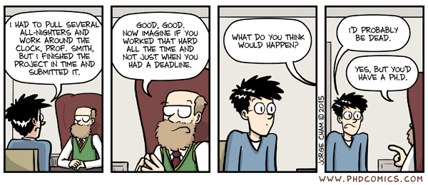](../../images/PhD_comics2.PNG "PhD Comics on data visualisation.")

PhD Comics on data visualisation.

> “*The simple graph has brought more information to the data analyst’s mind than any other device.*”
>
> — John Tukey

> “*If I cannot picture it, I cannot understand it.*”
>
> — Albert Einstein

# 1 Introduction

Though it may have started as statistical software, R has moved far beyond its origins. The language is now capable of a wide range of applications, some of which you have already seen, and some others you will see over the rest of this module. For the second half of Day 2 we are going to jump straight into data visualisation.

R has a diverse library of graphics packages and functions, which allows for creation of various types of plots and graphs for visualising data in meaningful ways. Some of the interesting features of R graphics include:

- **Customisability** Plots can be highly customised, from axis labels and titles to colours, markers, and themes.

- **Wide range of plot types** R offers a variety of plot types, including scatter plots, line plots, bar plots, histograms, density plots, box plots, and more.

- **Integration with data analysis** R graphics integrates well with the data analysis functions in R, making it easy to plot the results of statistical models and analyses.

- **Interactivity** R graphics can be made interactive, allowing users to zoom, pan, and hover over data points to reveal more information.

- **Publication-quality** R graphics can be generated in a high-resolution format suitable for printing or publishing, making it a popular choice for academic and scientific publications.

R comes with its own built-in graphics capabilities, and it is capable of creating an astounding array of figure types. In this module, however, I will use the increasingly popular [**ggplot2**](https://ggplot2.tidyverse.org/) package developed by Hadley Wickham.

# 2 Example figures

Just to whet the appetite, below is provided a small selection of the figures that R and **ggplot2** are capable of producing. These are things that AJ and/or myself have produced for publication or in some cases just for personal interest. Remember, just because we are learning this for work, does not mean we cannot use it for fun, too. The idea of using R for fun may seem bizarre, but perhaps by the end of Day 5 we will have been able to convince you otherwise!

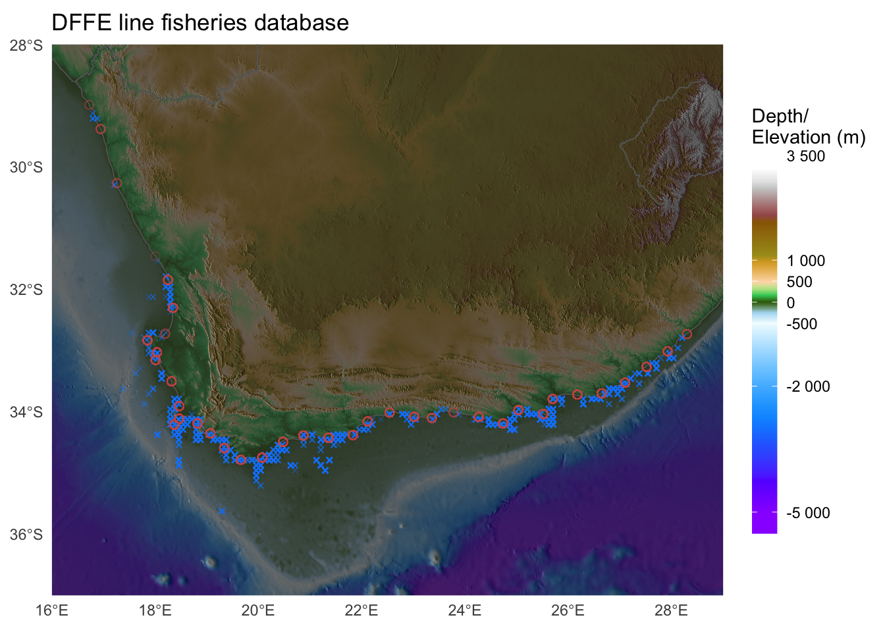

[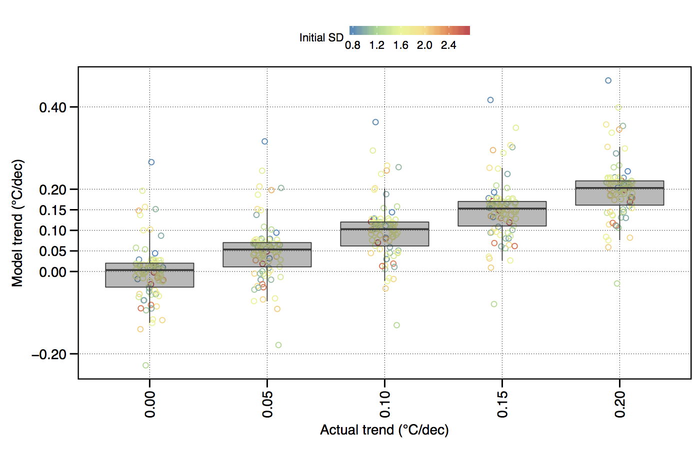](../../images/all_plt0_no_interp_natural.png "The effect of variance (SD) within a temperature time series on the accurate modelling of decadal trends.")

The effect of variance (SD) within a temperature time series on the accurate modelling of decadal trends.

[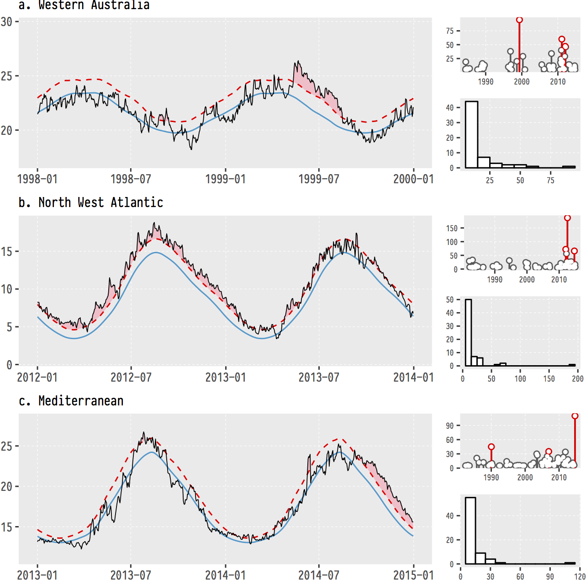](../../images/deeper-infamous-event-plots-1.png "The (currently) three most infamous marine heatwaves (MHWs) around the world.")

The (currently) three most infamous marine heatwaves (MHWs) around the world.

[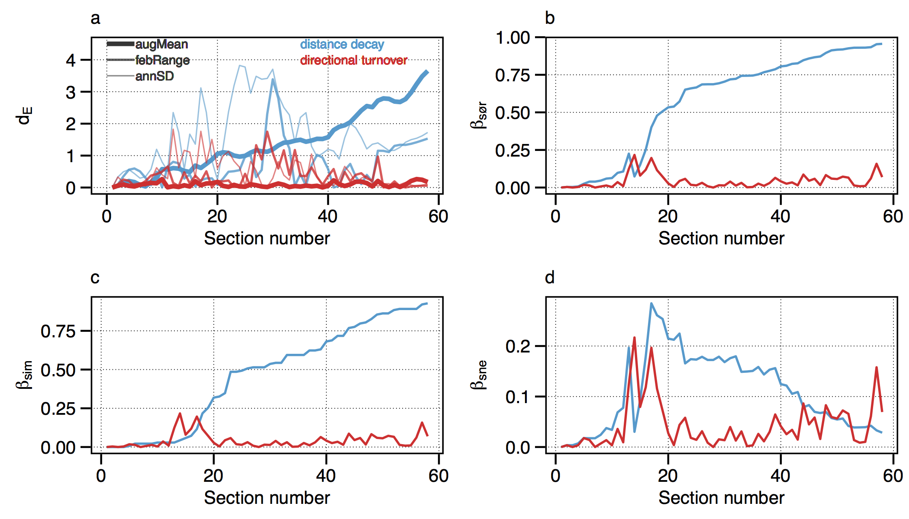](../../images/Ecography_figure5a-d.jpg "Changes in seaweed biodiversity along the South African coastline.")

Changes in seaweed biodiversity along the South African coastline.

[](../../images/insitu_polarPlots_month_v3.2.jpg "Polar plots of monthly temperatures.")

Polar plots of monthly temperatures.

[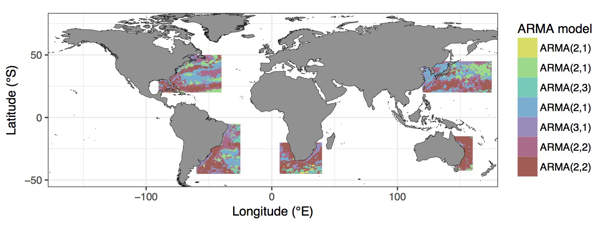](../../images/mo_coef.jpg "Most appropriate autoregressive correlation coefficients for areas around western boundary current.")

Most appropriate autoregressive correlation coefficients for areas around western boundary current.

[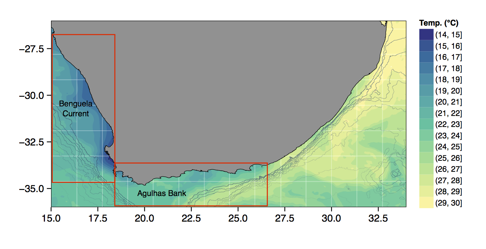](../../images/MUR_bathy_plot_discrete_20090228.jpg "The bathymetry of South Africa with SSTs from the MUR product.")

The bathymetry of South Africa with SSTs from the MUR product.

[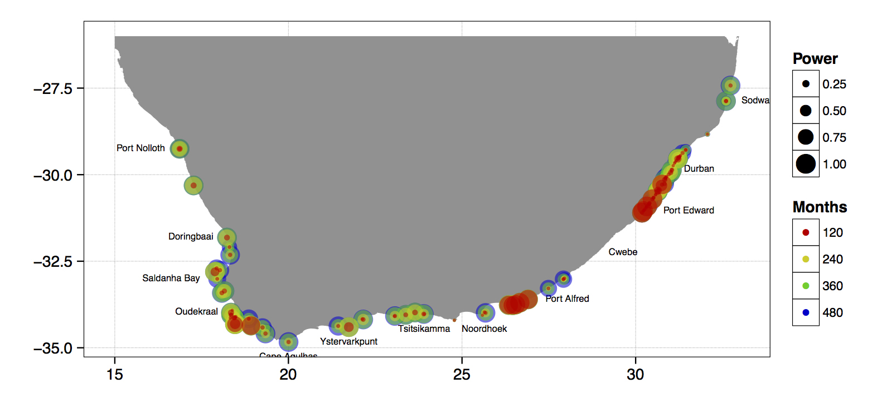](../../images/sw-fig-7-1.jpg "The power of the detected decadal trend at each coastal temperature collection site given a hypothetical number of months.")

The power of the detected decadal trend at each coastal temperature collection site given a hypothetical number of months.

[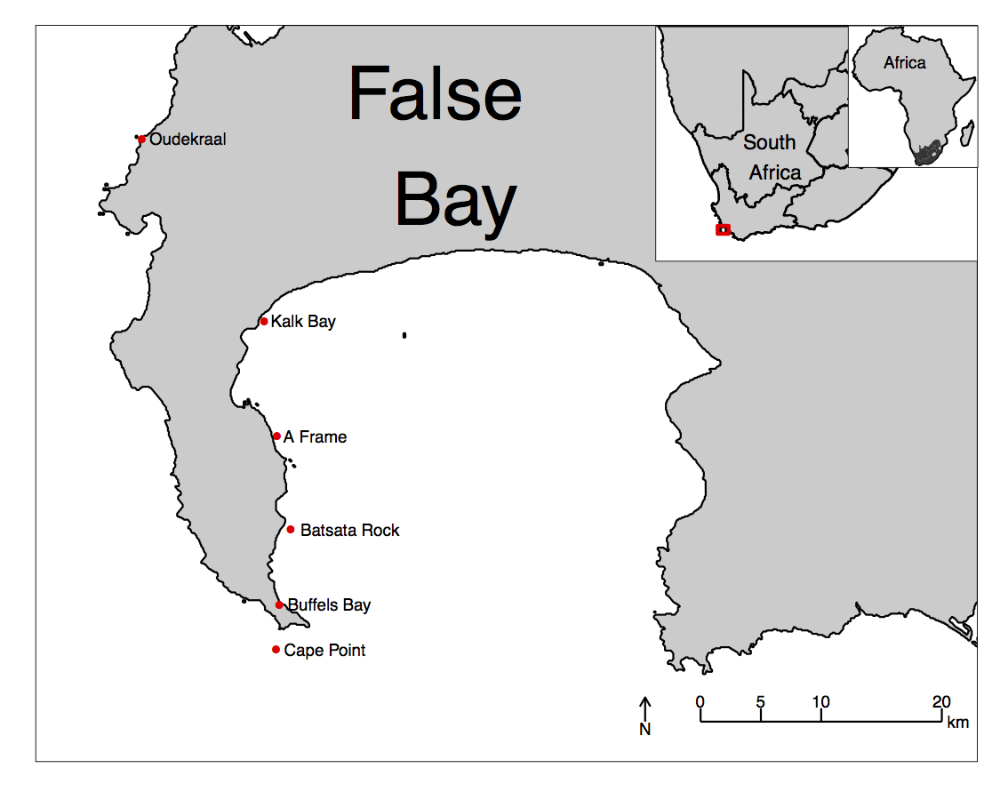](../../images/false_bay_inset_map_labels2.jpg "An inset map of False Bay.")

An inset map of False Bay.

[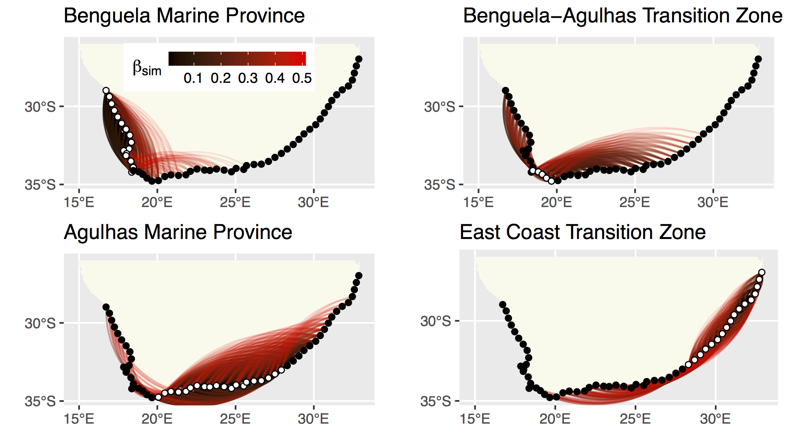](../../images/PLOS_ONE_Fig4.jpg "The strength of the relationship between each site based on their biodiversity.")

The strength of the relationship between each site based on their biodiversity.

[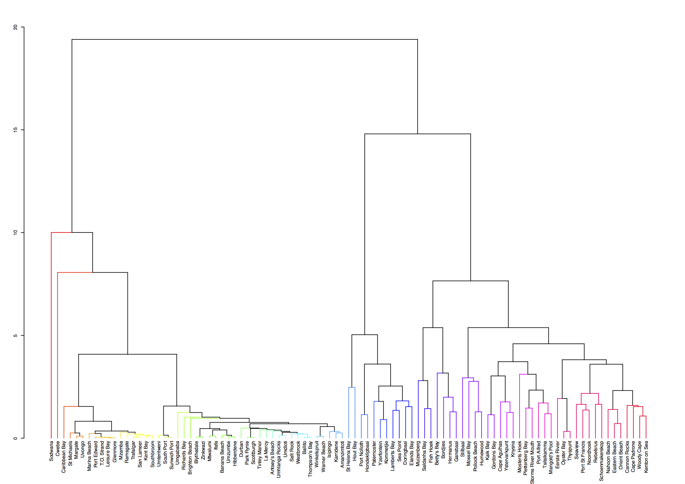](../../images/hierarchical_clustsig.jpg "A hierarchical cluster analysis.")

A hierarchical cluster analysis.

[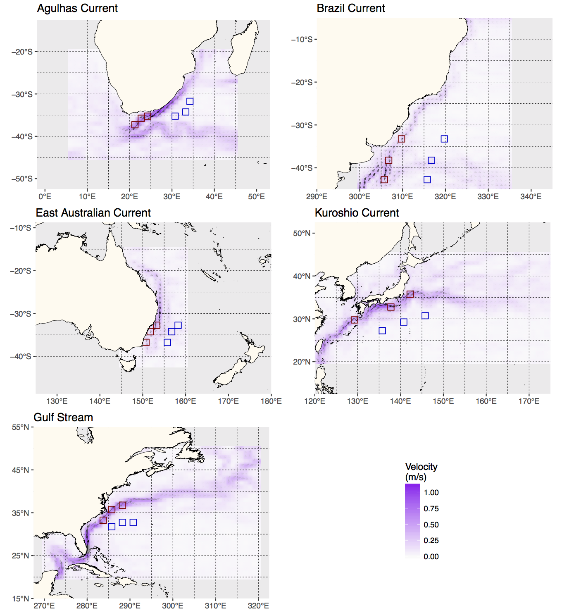](../../images/Fig01_AvisoMeanVelocityMean.png "Current velcoties of Western Boundary Currents.")

Current velcoties of Western Boundary Currents.

# 3 **ggplot2**, ggplot, and `ggplot()`

R comes with basic graphing capability, known colloquially (by nerds like me) as base R graphics. The syntax used for this method of creating graphics is often difficult to interpret as there are few human words in the code. In addition to this issue, base R graphics also does not allow the user enough control over the look of the final product to satisfy the demands of many publishers. This means that the figures tend not to look professional enough (but still much better than Excel). To solve both of these problems, and others, the **ggplot2** package was born. **ggplot2** is a widely used, popular graphics package in R, based on Leland Wilkinson’s [The Grammar of Graphics](https://link.springer.com/book/10.1007/0-387-28695-0).

To avoid confusion, I will distinguish between three related ideas: **ggplot2** (the package), ggplot (the system for building graphics), and `ggplot()` (the function that starts a plot).

Before we dive into syntax, here are three mental models that will keep you oriented as we move through examples:

1.  **ggplot builds plots by accumulation, not transformation.** You start with a base layer and add components.
2.  **Aesthetics are either data-driven or constant — never both.** If it comes from data, it belongs inside `aes()`. If it is a fixed value, it belongs outside.
3.  **Grouping is not decoration; it is data identity.** It tells ggplot which observations belong together.

Although there are many advantages to using **ggplot2** over base R graphics, people do at times raise a few issues with the package. These are criticisms I see mentioned on the internet from time to time, but my opinion differs, and I add my own views in square brackets after each point:

- **Learning curve** The package can have a steep learning curve for beginners, as it employs a different syntax and logic compared to base R graphics. Users may need to invest time and effort to become proficient in using **ggplot2** effectively. \[I think it is mainly long-time R users that hold this view. My view is that for first-time users, it may be easier to learn compared to base R graphics.\]

- **Customisation limitations** Although **ggplot2** provides extensive customisation options, there are certain cases where users might find it difficult to achieve the desired level of customisation for their plots. In some instances, base R graphics or other specialised packages might offer better control over specific plot elements. \[Maybe, in specialised instances only. I will think of a few such instances and put them here. But I think recent development of many add-on packages have largely eliminated many of the shortfalls people experienced early on. See for example the [various extensions](https://exts.ggplot2.tidyverse.org/gallery/) available.\]

- **Performance** Drawing figures made with **ggplot2** (not the coding but the computational speed) can be slower than base R graphics, especially when dealing with large datasets, producing a high number of plots. This may not be ideal for users who require fast, real-time plotting or are working with limited computational resources.

- **Overhead** The package relies on additional packages and dependencies, which can add to the overhead of managing the R environment. Users who prefer a more lightweight approach may find base R graphics more appealing.

- **Less suitable for 3D plotting** It is true that **ggplot2** is primarily designed for creating 2D graphics. It is possible to create 3D plots with some workarounds, but **ggplot2** may not be the best choice for users who frequently work with 3D data visualisation. Other packages, such as **lattice**, **scatterplot3d**, or **rayshader**, may be better suited for these purposes.

- **Layered approach complexity** The layered approach of **ggplot2**, while powerful and flexible, can become complex and verbose when building more intricate plots. This might lead to less readable and maintainable code in some cases. \[I disagree. I personally find the code more readable, and very intuitive to understand. It is true that it can be quite verbose, that simple graphs can be quickly constructed in base R graphics with fewer lines of code.\]

Nevertheless, **ggplot2** remains a highly popular, versatile package for data visualisation in R. Its strengths in creating beautiful (but not always by default!), customisable, and complex graphics often outweigh its limitations. It is also less cluttered with non-nonsensical jargon terms, the vocabulary is easier to understand by mere humans — most of the package’s functions are English verbs. So, let us look at the basic concepts in some detail — I will do so mostly by working through numerous examples.

## 3.1 `geom_*()`, the pipe (`%>%` or `|>`), and the `+` sign

Transition: we now move from ggplot as a system to `ggplot()` as syntax. Keep the first mental model in mind, that is, *ggplot builds plots by accumulation*.

As part of the **tidyverse** (as we saw briefly on Day 1, and will go into in depth on Day 4), the **ggplot2** package endeavours to use a clean, easy for humans to understand syntax that relies heavily on functions that do what they say. For example, the function `geom_point()` makes points on a figure. Need a line plot? `geom_line()` is the way to go! Need both at the same time? No problem. In ggplot we may seamlessly merge a nearly limitless number of objects together to create startlingly sophisticated figures.

Notice the `+` signs. They do a different job from the pipe (`|>` or `%>%`). In `ggplot2`, `+` adds another layer to the same plot: points, then lines, then labels, then a theme. Read the code as a stack.

> **NOTE:**
>
> One may see below that the code naturally indents itself if the previous line ended with a `+` sign. This is because R knows that the top line is the parent line and the indented lines are its children. This is a concept that will come up again when we learn about tidying data. What we need to know now is that a block of code that has `+` signs, like the one below, must be run together. As long as lines of code end in `+`, R will assume that you want to keep adding lines of code (more geometric features). If we are not mindful of what we are doing we may tell R to do something it cannot and we will see in the console that R keeps expecting more `+` signs. If this happens, click inside the console window and press the `Esc` button to cancel the chain of code you are trying to enter.

> **NOTE:**
>
> Most **ggplot2** errors and warnings point to a specific layer or aesthetic. Read them as clues about *which* layer failed and *why*. If the message mentions an unknown aesthetic or object, check spelling and whether the variable exists in your data. If it mentions a problem with a scale, check whether you accidentally mapped a constant inside `aes()` or mixed mapped and constant aesthetics across layers.

## 3.2 `aes()`

Transition: we now move from **accumulation** to **aesthetic mapping**. Keep the second mental model in view: *aesthetics are data-driven or constant*.

Another recurring function within the parent `ggplot()` function or the associated `geom_*()` is `aes()`. The `aes()` function in **ggplot2** is used to specify the mapping between variables in a dataframe and visual properties of a plot. `aes()` stands for ‘aesthetic,’ which refers to the visual elements of a plot, such as colour, size, shape, etc. In ggplot, the aesthetics of a plot are defined inside the `aes()` function, which is passed as an argument to the base `ggplot()` function or its associated geometry.

It helps to separate **positional aesthetics** from **non-positional aesthetics**. Positional aesthetics (`x`, `y`) place data in the coordinate system and always create scales. Non-positional aesthetics (`colour`, `size`, `shape`, `alpha`, `group`) change how the geometry is drawn, and they may or may not create a scale depending on whether you map them to data.

For example, if you have a dataframe with two variables `x` and `y`, you can create a scatterplot of `x` against `y` by calling `ggplot(data, aes(x, y)) + geom_point()`. The `aes(x, y)` function maps the variables (columns) in the dataframe to the *x* and *y* positions of the points in the scatterplot. Similarly, we can map variables in the dataframe to non-positional aesthetics, such as colour (*e.g.*, a colour might be more intense as the magnitude of the values in a column increase), size (larger symbols for bigger values), transparency, or grouping.

# 4 The `ChickWeight` dataset

> **NOTE:**
>
> R has many built-in datasets that are useful for practicing our R skills. To find out which datasets are available to you on your system, execute the following command:
>
> ``` numberSource
> data()
> ```
>
> A new tab will open and the list of datasets will be displayed. For example, the following might be displayed:
>
>     Data sets in package ‘datasets’:
>
>     AirPassengers                       Monthly Airline Passenger Numbers 1949-1960
>     BJsales                             Sales Data with Leading Indicator
>     BJsales.lead (BJsales)              Sales Data with Leading Indicator
>     BOD                                 Biochemical Oxygen Demand
>     CO2                                 Carbon Dioxide Uptake in Grass Plants
>     ChickWeight                         Weight versus age of chicks on different diets
>     DNase                               Elisa assay of DNase
>     EuStockMarkets                      Daily Closing Prices of Major European Stock Indices, 1991-1998
>     Formaldehyde                        Determination of Formaldehyde
>     HairEyeColor                        Hair and Eye Color of Statistics Students
>     Harman23.cor                        Harman Example 2.3
>     [...]
>
> The exact list might vary from user to user, as this depends on which packages have been installed on your system. For example, scrolling all the way to the bottom of the list produced above using the [`data()`](https://rdrr.io/r/utils/data.html) command, you will see the following information and code that can be executed to show all the datasets in all the packages available on your system:
>
>     Use ‘data(package = .packages(all.available = TRUE))’
>     to list the data sets in all *available* packages.
>
> A particular dataset can be loaded as follows:
>
> ``` numberSource
> data(acacia, package = "ade4") # the package name is listed also in the data() display
> ```

The `ChickWeight` dataset can be seen in the list above. Before plotting any dataset, take a quick look at its structure so you know what variables you have and how they are stored. A fast way to do this is `glimpse(ChickWeight)`.

We will load and use it now.

``` numberSource
# Load libraries
library(tidyverse)

# Load data
ChickWeight <- datasets::ChickWeight

# Create a basic figure
ggplot(data = ChickWeight, aes(x = Time, y = weight)) +
  geom_point() +
  geom_line(aes(group = Chick))
```

[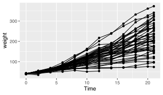](06-graphics_files/figure-html/fig-basic-1-1.svg "Figure 1: Chick weights over time with individual trajectories.")

Figure 1: Chick weights over time with individual trajectories.

## 4.1 How to read this code

Read the plot like a sentence with grammar: **subject → verb → modifiers**. The subject is the data (`ChickWeight`), the verb is the geometric action (`geom_point()` or `geom_line()`), and the modifiers are the aesthetic mappings (`aes(...)`) that tell ggplot *how* to draw. The `ggplot(...)` line sets the stage (data + core mappings), and each `geom_*()` line adds a new clause. The `+` sign means “and then add another clause.”

So what is that code doing? We may see from the figure that it is creating a little black dot for every data point, with the `Time` of sampling on the *x* axis, and the `weight` of the chicken during that time on the *y* axis. It then connects the dots for each chicken in the dataset. Let us break this code down line for line to get a better idea of what it is doing.

As a workflow, it is perfectly normal to build plots incrementally: start with a minimal plot, confirm the axes are correct, then add layers one at a time. Partial plots are not failures; they are thinking tools.

The first line of code is telling R that we want to create a ggplot figure. We know this because we are using the `ggplot()` function. Inside of that function we are telling R which dataframe (or tibble) we want to create a figure from. Lastly, with the `aes()` function we tell R what the necessary parts of the figure will be. This is also known as ‘mapping’ (variables map to the visual appearance and arrangement of figure elements).

The second line of code then takes all of that information and makes points (dots) out of it, added as a layer on the set of axes created by the `aes()` argument provided within `ggplot(...)` — in other words, we add a ‘geometry’ layer, and hence the name of the kind of ‘shape’ we want to plot the data as is prefixed by `geom_`.

The third line takes the same information and creates lines from it — it adds yet another layer on top of the pre-existing one. Notice in the third line that we have provided another mapping argument by telling R to group the data by `Chick`. This is the third mental model: grouping is a statement about data identity, not decoration. It tells ggplot which observations belong together, so it draws an individual line for each chicken rather than one big jagged line.

If you remove `group = Chick`, ggplot defaults to a single group for the whole dataset. That default makes ggplot connect points in the order they appear in the data frame, which produces the jagged line that jumps across different chicks. The problem is not “a bad line,” it is a missing identity rule for the data.

Try running this code without the group argument for `geom_line()` and see what happens.

This figure does not look like much yet. We saw some examples above that show how sophisticated figures may become. This is a remarkably straightforward task. But do not take my word for it, let us see for ourselves. By adding one more aesthetic to the code above we will now show each `Diet` as a different colour.

``` numberSource
ggplot(data = ChickWeight, aes(x = Time, y = weight, colour = Diet)) +
  geom_point() +
  geom_line(aes(group = Chick))
```

[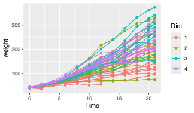](06-graphics_files/figure-html/fig-basic-3-1.svg "Figure 2: Chick weights over time coloured by diet.")

Figure 2: Chick weights over time coloured by diet.

Do any patterns appear to emerge from the data? Perhaps there is a better way to visualise them? With linear models for example?

``` numberSource
ggplot(data = ChickWeight, aes(x = Time, y = weight, colour = Diet)) +
  geom_point() +
  geom_smooth(method = "lm")
```

[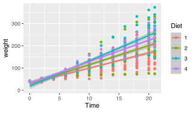](06-graphics_files/figure-html/fig-first-lm-1.svg "Figure 3: Chick weights over time with linear trends by diet.")

Figure 3: Chick weights over time with linear trends by diet.

How is a linear model calculated? What patterns do we see in the data now? If you were a chicken, which feed would you want?

# 5 To `aes()` or not to `aes()`, that is the question

Transition: we now move from **mapping** to **setting**, which explains why legends appear (or disappear). Keep the second mental model in view.

The astute eye will have noticed by now that most arguments we have added to the code have been inside of the `aes()` function. So what exactly is that `aes()` function doing sitting inside of the other functions? The reason for the `aes()` function is that it controls the look of the other functions dynamically based on the variables you provide it. If we want to change the look of the plot by some static value we would do this by passing the argument for that variable to the geom of our choosing *outside* of the `aes()` function. Let us see what this looks like by changing the colour of the dots.

Why does ggplot need this distinction at all? Because it builds a **mapping object** before it draws anything. That mapping object tells ggplot which variables drive scales, legends, and warnings. Mapped aesthetics (inside `aes()`) are treated as data-driven and get scales and legends; constant aesthetics (outside `aes()`) are treated as fixed settings and do not.

``` numberSource
ggplot(data = ChickWeight, aes(x = Time, y = weight)) +
  geom_point(colour = "blue") +
  geom_line(aes(group = Chick, colour = "blue"))
```

[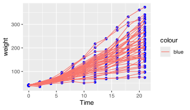](06-graphics_files/figure-html/fig-basic-6-1.svg "Figure 4: Constant colour set outside aes for points and lines.")

Figure 4: Constant colour set outside aes for points and lines.

Why are the points blue, but the lines are salmon with a legend that says they are ‘blue’? We may see that in the line responsible for the points (`geom_point()`) we did not put the colour argument inside of the `aes()` function, but for the lines (`geom_line()`) we did. If we know that we want some aspect of our figure to be a static value we set this value outside of the `aes()` function. If we want some aspect of our figure to reflect some part of the data in our dataframe, we must set that inside of `aes()`. Let us see an example where we set the size of the dots to equal the weight of the chicken and the thickness of the linear model lines to one static value.

> **WARNING:**
>
> - Mixing mapped and constant aesthetics of the same type across layers (*e.g.*, mapping `colour` in one layer and setting `colour = "blue"` in another) often creates duplicated legends, literal labels, or confusing warnings.
> - If a legend appears unexpectedly, check whether you accidentally mapped a constant value inside `aes()` (*e.g.*, `aes(colour = "blue")`).
> - If a legend is missing, check whether you set the aesthetic outside `aes()` when you meant to map it to data.

``` numberSource
ggplot(data = ChickWeight, aes(x = Time, y = weight, colour = Diet)) +
  geom_point(aes(size = weight)) +
  geom_smooth(method = "lm", size = 1.2)
```

[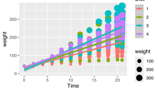](06-graphics_files/figure-html/fig-basic-8-1.svg "Figure 5: Point size mapped to weight with linear trends by diet.")

Figure 5: Point size mapped to weight with linear trends by diet.

Notice that we have set the size of the points and the lines, but one is within `aes()` and the other not. Because the size of our points equals the weight of the chickens, the points become larger the heavier (juicier) the chickens become. But because we set the size of the lines to one static value, all of the lines are the same size and do not change because of any other variables.

# 6 Changing labels

Transition: we now move from **mapping vs setting** to **labels and legends**. Labels are set explicitly; legend titles follow the aesthetics you mapped.

When we use **ggplot2** we have control over every minute aspect of our figures if we so wish. The point of that control is not decoration, but communication. A simple heuristic is: **reduce cognitive friction, make units explicit, and align legend semantics with the mapped variable**. Labels and themes operationalise that heuristic. Clear axis labels remove guesswork, and thoughtful legend placement reduces the effort required to scan the figure.

`labs()` changes the text that explains the figure. `theme()` changes layout and emphasis. When you want to control how values become colours, sizes, or shapes, you use scale functions such as `scale_colour_*()` or `scale_size_*()`. We return to those shortly.

What we want to do next is put the legend on the bottom of our figure with a horizontal orientation and change the axis labels so that they show the units of measurement. To change the labels we will need the `labs()` function. To change the position of the legend we need the `theme()` function as it is within this function that all of the little tweaks are performed. This is best placed at the end of your block of **ggplot2** code.

``` numberSource
ggplot(data = ChickWeight, aes(x = Time, y = weight, colour = Diet)) +
  geom_point() +
  geom_smooth(method = "lm") +
  labs(x = "Days", y = "Mass (g)", colour = "diet type") + # Change the labels
  theme(legend.position = "bottom") # Change the legend position
```

[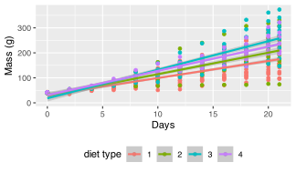](06-graphics_files/figure-html/fig-basic-4-1.svg "Figure 6: Chick weights with linear trends and labelled axes.")

Figure 6: Chick weights with linear trends and labelled axes.

Notice that when we place the legend at the bottom of the figure ggplot automatically makes it horizontal for us. Why do we use ‘colour’ inside of `labs()` to change the legend title?

> **IMPORTANT:**
>
> 1.  With all of this information in hand, please take another five minutes to either improve one of the plots generated or create a beautiful graph of your own. Here are some ideas:
>
>     1.  See if you can change the thickness of the points/lines.
>     2.  Change the shape, colour, fill, and size of each of the points.
>     3.  Can you find a way to change the name of the legend? What about its labels?
>     4.  Explore the different geom functions available. These include `geom_boxplot`, `geom_density`, etc.
>     5.  Try using a different colour palette.
>     6.  Use different themes.

## Reuse

[CC BY-NC-SA 4.0](https://creativecommons.org/licenses/by-nc-sa/4.0/)

## Citation

BibTeX citation:

``` quarto-appendix-bibtex
@online{smit2021,
  author = {Smit, A. J.},
  title = {6. {Graphics} with \textbf{Ggplot2}},
  date = {2021-01-01},
  url = {https://tangledbank.netlify.app/BCB744/intro_r/06-graphics.html},
  langid = {en}
}
```

For attribution, please cite this work as:

Smit AJ (2021) 6. Graphics with **ggplot2**. [https://tangledbank.netlify.app/BCB744/intro_r/06-graphics.html.](https://tangledbank.netlify.app/BCB744/intro_r/06-graphics.html)
