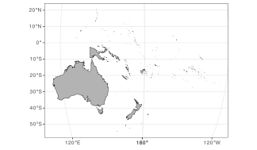
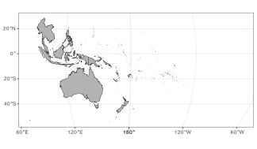
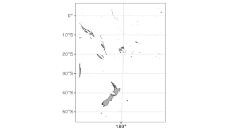
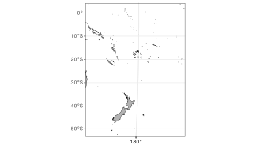
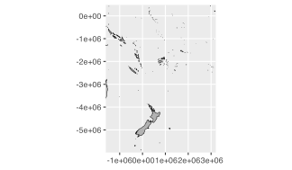
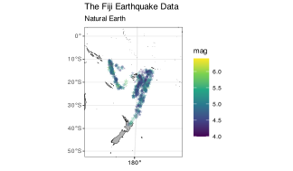

Here I will plot the built-in earthquake dataset ([`datasets::quakes`](https://rdrr.io/r/datasets/quakes.html)).

> **NOTE:**
>
> For a global map of earthquakes, see my plot of the [Kaggle earthquake data](../../pages/kaggle_earthquakes.llms.md).

Two new concepts will be introduced in the chapter:

- Geographic Coordinate Systems
- Projected Coordinate Systems

These are specified to the mapping / plotting functions via the Coordinate Reference System (CRS) through functionality built into the **sf** package.

You will also learn how to deal with polygons that cross the dateline (0° wrapping back onto 360°) or the anti-meridian (-180° folding back onto +180°).

# 1 What will go wrong, and why that’s useful

Before we write any code, here is the promise of this chapter: **things will break, and that breakage is the lesson**. We will:

1.  Start with a sensible map that still hides problems.
2.  Reproject it and watch polygons break at the anti-meridian.
3.  Fix the topology *before* projecting, so the fix sticks.
4.  Compare three zooming strategies and learn when each one helps or hurts.
5.  End with a projection choice that is justified by the question, not habit or because it looks pretty.

If a map looks strange along the way, assume that it is revealing a rule, not a mistake.

# 2 Load packages and data

I will use the [Natural Earth](https://www.naturalearthdata.com/) data and manipulate it with the [**sf**](https://r-spatial.github.io/sf/) package functions. This package integrates well with the [**tidyverse**](https://www.tidyverse.org/).

``` numberSource
library(tidyverse)
library(sf)
library(rnaturalearth)
library(rnaturalearthhires)
```

# 3 Load the Natural Earth map

The **rnaturalearth** package has the `ne_countries()` function which we use to load borders of all the countries in the world. I load the medium resolution dataset and make sure the data are of class **sf**, *i.e.* a *simple features collection*.

> **NOTE:**
>
> - **Medium resolution** is a tradeoff: faster plotting, smaller files, and good enough for regional maps.
> - **Countries** are used here instead of coastlines so that later grouping and region selection are easy.
> - **sf** is chosen over **sp** because it plays well with the tidyverse and `ggplot2`.
> - **`sf_use_s2(FALSE)`** opts out of spherical geometry because we will do explicit projection steps and want predictable topology fixes.

``` numberSource
sf_use_s2(FALSE)

world <- ne_countries(returnclass = 'sf',
  scale = 10, type = "countries") |> 
  select(continent, sovereignt, iso_a3)  
head(world[c('continent')])
```

    R> head(world[c('continent')])
    Simple feature collection with 6 features and 1 field
    Geometry type: MULTIPOLYGON
    Dimension:     XY
    Bounding box:  xmin: -109.4537 ymin: -55.9185 xmax: 140.9776 ymax: 7.35578
    CRS:           +proj=longlat +datum=WGS84 +no_defs +ellps=WGS84 +towgs84=0,0,0
          continent                       geometry
    0          Asia MULTIPOLYGON (((117.7036 4....
    1          Asia MULTIPOLYGON (((117.7036 4....
    2 South America MULTIPOLYGON (((-69.51009 -...
    3 South America MULTIPOLYGON (((-69.51009 -...
    4 South America MULTIPOLYGON (((-69.51009 -...
    5 South America MULTIPOLYGON (((-67.28475 -...

**Make this a habit:** always ask *“What CRS am I in right now?”* You can check any object with `st_crs(world)`. If you skip this, you will eventually crop or measure in the wrong units.

Note that for the Natural Earth data the coordinate reference system (CRS) is **longitude / latitude in degrees**, and it is stored as [WGS84](https://epsg.io/4326). This is the World Geodetic System 1984 commonly used in most GPS devices. The default unit of this CRS is in degrees longitude and latitude.

For more information on CRS, see:

- The [PROJ](https://proj.org/operations/projections/index.html) system. The *proj-string* specified with every map can be used in **sf**; it can be retrieved using `st_crs()` and one can transform between various projections uing `st_transform()`. PROJ is written in C++ and loaded automagically with **sf**.
- The [EPSG](https://epsg.io/) coordinate codes, which provide a convenient shortcut to the longer proj-string. Navigating the a page for a projection — [WGS84](https://epsg.io/4326) known as EPSG:4326 — gives one the various relevant details, and the proj-string can be located in the PROJ.4 tab under Exports.

More information about the map data is available with the `head(world)` function (as seen above), namely that the longitude goes from -180° (180° west of the prime meridian) to +180° (180° east of the prime meridian). This means that the anti-meridian cuts some of the polygons in the Pacific along the line where -180° wraps back onto +180°, and this can be problematic for maps of the Pacific. We will get to this later. The latitude goes from -90° (90° south of the equator) to +90° (90° north of the equator).

A very quick map looks like this:

``` numberSource
ggplot() +
  geom_sf(data = world, colour = "black", fill = "grey70")
```

[](12-mapping_quakes_files/figure-html/fig-ggplot-1.svg "Figure 1: World map in WGS84 using Natural Earth countries.")

Figure 1: World map in WGS84 using Natural Earth countries.

You can see above that Africa is centrally positioned. However, I want to focus on the western Pacific region. I am also going to apply a new projection ([ESRI:53077](https://epsg.io/53077), the Natural Earth projection) to it. The “rotation” is accomplished by setting `lon_0=170` in the proj-string.

``` numberSource
NE_proj <- "+proj=natearth +lon_0=170 "

world_0 <- world |> 
  st_transform(NE_proj)

ggplot() +
  geom_sf(data = world_0, colour = "black", fill = "grey70")
```

[](12-mapping_quakes_files/figure-html/fig-ne-proj-proj-natearth-lon-0-1.svg "Figure 2: Natural Earth projection centred on 170E showing anti-meridian artefacts.")

Figure 2: Natural Earth projection centred on 170E showing anti-meridian artefacts.

The western Pacific is now focal, but the map looks strange to say the least. This is a **topological failure** caused by how polygons cross the anti-meridian.

To separate the ideas:

- **Projection choice:** Natural Earth is reasonable for global context.
- **Central meridian choice:** setting `lon_0 = 170` is intentional to centre the Pacific.
- **Topology failure:** polygons that cross the anti-meridian are now stitched together incorrectly.

This is why we must fix topology *before* projection. I can fix it using `st_break_antimeridian()`, but to do so I must start with unprojected data, and only *then* apply this function.

``` numberSource
world_1 <- ne_countries(returnclass = 'sf',
  scale = 10, type = "countries") |> 
  select(continent, sovereignt, iso_a3) |> 
  st_break_antimeridian(lon_0 = 170) |> 
  st_transform(NE_proj)

ggplot() +
  geom_sf(data = world_1, colour = "black", fill = "grey70")
```

[](12-mapping_quakes_files/figure-html/fig-world-1-ne-countries-returnclass-sf-1.svg "Figure 3: Natural Earth projection after anti-meridian repair.")

Figure 3: Natural Earth projection after anti-meridian repair.

**Reusable rule:** *If polygons cross the anti-meridian, repair topology in geographic coordinates **before** you project.*

**Silent failure warning:** many maps will still look “fine” after a bad projection, but the geometry will be wrong. Always fix topology first, or you will eventually crop, dissolve, or measure the wrong shapes.

# 4 Zooming in

There are three options for focusing in on a particular area of the map (zooming in):

- selecting only certain areas of interest from the spatial dataset (*e.g.*, only certain countries / continent(s) / etc.);
- cropping the geometries in the spatial dataset using `sf_crop()`;
- restricting the display window via `coord_sf()`.

I will look at each in some detail.

Here is the quick decision logic:

| Strategy | Best when… | Risk / downside |
|----|----|----|
| **Select features** | You want to keep whole countries/regions intact. | May exclude necessary context (*e.g.*, partial islands). |
| **Crop geometry (`st_crop`)** | You want a tight, data-driven extent. | You are *modifying* the geometry (not just the view). |
| **View window (`coord_sf`)** | You want to preserve original geometries. | Easy to hide geometry problems and mislead readers. |

# 5 Selecting areas of interest

I am interested only in the “continent” called Oceania, which includes the Pacific Islands, Australia, and New Zealand. More correctly, it is a geographical region, not a continent. It is comprised of Australasia and Melanesia, Micronesia, and Polynesia which span the Eastern and Western Hemispheres.

``` numberSource
oceania <- world_1[world_1$continent == 'Oceania',]
ggplot() +
  geom_sf(data = oceania, colour = "black", fill = "grey70")
```

[](12-mapping_quakes_files/figure-html/fig-oceania-world-1-world-1-continent-1.svg "Figure 4: Oceania subset from the repaired world map.")

Figure 4: Oceania subset from the repaired world map.

Zooming in on only the group of nations included with Oceania reveals another problem. This is, only part of New Guinea is displayed: Papua New Guinea appears on the map but the western side of New Guinea, called Western New Guinea, is absent. This is because Papua New Guinea is part of Micronesia whereas West New Guinea is part of Indonesia (part of the South-eastern Asia region).

There is no easy way to select the countries that constitute Australasia, Melanesia, Micronesia, Indonesia, and Polynesia — unless I create an exhaustive list of these small island nations. But I can use the **countrycode** package to insert an attribute with the geographic [regional classification of the United Nations](https://unstats.un.org/unsd/methodology/m49/) in the `world_1` map. Now all the constituent countries belonging to these regions will be correctly classified to the UN regional classification scheme. Note that I also collapse the countries into their continents by merging all polygons belonging to the same continent (the `group_by()` and `summarise()` functions) — I do this because I do not want to display individual countries.

> **TIP:**
>
> This region + dissolve workflow is *advanced*. You do not need to memorise it. Learn to **recognise** when you need:
>
> - a classification table (UN regions),
> - an attribute join,
> - and a dissolve (`group_by()` + `summarise()`).

``` numberSource
library(countrycode)

world_1$region <- countrycode(world_1$iso_a3, origin = "iso3c",
  destination = "un.regionsub.name")

sw_pacific <- world_1 |> 
  filter(region %in% c("Australia and New Zealand", "Melanesia", "Micronesia",
    "Indonesia", "Polynesia", "South-eastern Asia")) |> 
  group_by(continent) |>
  summarise()

ggplot() +
  geom_sf(data = sw_pacific, colour = "black", fill = "grey70")
```

[](12-mapping_quakes_files/figure-html/fig-library-countrycode-1.svg "Figure 5: Southwest Pacific regions dissolved using UN classifications.")

Figure 5: Southwest Pacific regions dissolved using UN classifications.

As we can see above, by including the South-eastern Asia region I complete the mass of land that is New Guinea.

# 6 Cropping

The above map is good but not perfect. I have in mind zooming in a bit more into the region around Fiji where the earthquake monitoring network is located. One way to do this is to crop the extent of the study region using a bounding box whose boundaries are defined by the extent of the `quakes` datapoints.

To start, I use the earthquake data, extract from there the study domain and increase the edges all round by a given margin — this is so that the stations are not plotted right on the map’s edges.

Important! The coordinates in the `quakes` data are provided in WGS84, so I need to first specify them as such, then transform them to the same coordinate system used by the map.

Why this is a good habit: a data-derived bounding box keeps your map **honest**. It is reproducible, it adapts if the data change, and it prevents you from “hand-drawing” an extent that hides inconvenient points.

``` numberSource
quakes <- as_tibble(datasets::quakes)
margin <- 15.0
xmin <- min(quakes$long) - margin; xmax <- max(quakes$long) + margin
ymin <- min(quakes$lat) - margin; ymax <- max(quakes$lat) + margin

WGS84_proj <- "+proj=longlat +datum=WGS84 +no_defs +ellps=WGS84 +towgs84=0,0,0"

bbox <- st_sfc(st_point(c(xmin, ymin)), st_point(c(xmax, ymax)),
                         crs = WGS84_proj)
bbox_trans <- st_transform(bbox, NE_proj)

sw_pacific_cropped <- sw_pacific |> 
  st_crop(bbox_trans)

ggplot() +
  geom_sf(data = sw_pacific_cropped, colour = "black", fill = "grey70")
```

[](12-mapping_quakes_files/figure-html/fig-quakes-as-tibble-datasets-quakes-1.svg "Figure 6: Data-derived bounding box used to crop the Southwest Pacific map.")

Figure 6: Data-derived bounding box used to crop the Southwest Pacific map.

That looks decent enough, but there is another way to accomplish the same.

# 7 Setting the mapping limits in **ggplot2**

The third approach to get closer to the region of interest is to use the full map extent (the world) loaded at the beginning, but to set the limits of the view window within the `coord_sf()` function in `ggplot()`.

To do this, I start with the `bbox_sf_trans` object, which was obtained by first specifying the coordinates marking the extent of the map in the WGS84 coordinate system, then transforming them to Natural Earth. We can extract the transformed limits with`st_coordinates()` and supply them to the map.

``` numberSource
bbox_trans_coord <- st_coordinates(bbox_trans)

ggplot() +
  geom_sf(data = world_1, colour = "black", fill = "grey70") +
  coord_sf(xlim = bbox_trans_coord[,'X'], ylim = bbox_trans_coord[,'Y'],
    expand = FALSE)
```

[](12-mapping_quakes_files/figure-html/fig-bbox-trans-coord-st-coordinates-bbox-trans-1.svg "Figure 7: World map windowed by transformed bounding box coordinates.")

Figure 7: World map windowed by transformed bounding box coordinates.

Great! This works well. Note that the coordinates on the graticule are in degrees longitude and latitude, the default for WGS84. By setting `datum = NE_proj` ensures the graticule is displayed in Natural Earth coordinate system units, which is meters. This might look strange at first, but it is not wrong.

> **WARNING:**
>
> `coord_sf()` can show *correct* graticule units that are unfamiliar to readers. If your audience expects degrees, a meter-based graticule can mislead even if it is technically correct. Always decide for **communicative clarity**, not just mathematical correctness.

``` numberSource
ggplot() +
  geom_sf(data = world_1, colour = "black", fill = "grey70") +
  coord_sf(xlim = bbox_trans_coord[,'X'], ylim = bbox_trans_coord[,'Y'],
    expand = FALSE, datum = NE_proj)
```

[](12-mapping_quakes_files/figure-html/fig-ggplot-2-1.svg "Figure 8: Natural Earth map with projected graticule via coord_sf.")

Figure 8: Natural Earth map with projected graticule via coord_sf.

# 8 Adding the `quakes` data as points

In order to plot the `quakes` data, I need to create a `sf` object from the quakes data. When converting the dataframe to class `sf`, I must also assign to it the CRS associated of the original dataset. This would be WGS84. Afterwards I will transform it to the Natural Earth CRS.

``` numberSource
quakes_sf <- quakes |> 
  st_as_sf(coords = c("long", "lat"),
    crs = WGS84_proj)
quakes_sf_trans <- st_transform(quakes_sf, NE_proj)
head(quakes_sf_trans)
```

    R> head(quakes_sf_trans)
    Simple feature collection with 6 features and 3 fields
    Geometry type: POINT
    Dimension:     XY
    Bounding box:  xmin: 1047820 ymin: -2923232 xmax: 1361900 ymax: -2017755
    CRS:           +proj=natearth +lon_0=170 
    # A tibble: 6 × 4
      depth   mag stations           geometry
      <int> <dbl>    <int>        <POINT [m]>
    1   562   4.8       41 (1104307 -2293735)
    2   650   4.2       15 (1047820 -2316276)
    3    42   5.4       43 (1323082 -2923232)
    4   626   4.1       19 (1113132 -2017755)
    5   649   4         11 (1136619 -2293735)
    6   195   4         12 (1361900 -2210349)

I am going to make a map of the Fiji region and plot the spatial location of the earthquakes, and scale the points indicating the earthquakes’ magnitude by their intensity (`mag`).

Stylistic choices (these are not defaults):

- **Star shapes** draw attention and visually separate points from land polygons.
- **Colour and size both map to magnitude** to reinforce the same message (redundant encoding).
- **The size legend is suppressed** to avoid repeating the same information twice.

``` numberSource
ggplot() +
  geom_sf(data = sw_pacific_cropped, colour = "black", fill = "grey70") +
  geom_sf(data = quakes_sf_trans, aes(colour = mag, size = mag),
    stat = "sf_coordinates",
    shape = "*", alpha = 0.4) +
  scale_colour_continuous(type = "viridis") +
  guides(size = "none") +
  coord_sf(expand = FALSE) +
  labs(x = NULL, y = NULL,
    title = "The Fiji Earthquake Data",
    subtitle = "Natural Earth")
```

[](12-mapping_quakes_files/figure-html/fig-ggplot-3-1.svg "Figure 9: Fiji region with earthquake points sized and coloured by magnitude.")

Figure 9: Fiji region with earthquake points sized and coloured by magnitude.

Now I apply a more appropriate CRS to the map. This is the **WGS 84 / NIWA Albers** projection ([EPSG:9191](https://epsg.io/9191)), which is designed for the southwestern Pacific and the Southern Ocean around New Zealand.

Why this is a *better* choice here:

- **It is an equal-area projection**, so area comparisons are meaningful.
- **It centres the region of interest**, reducing distortion where we care most.
- **It matches the question** (regional patterns in the SW Pacific), not just global aesthetics.

``` numberSource
NIWA_Albers_proj <- "+proj=aea +lat_0=-22 +lon_0=175 +lat_1=-20 +lat_2=-30 +x_0=0 +y_0=0 +datum=WGS84 +units=m +no_defs +type=crs"

ggplot() +
  geom_sf(data = sw_pacific_cropped, colour = "indianred", fill = "beige") +
  geom_sf(data = quakes_sf_trans, aes(colour = mag, size = mag),
    stat = "sf_coordinates",
    shape = "*", alpha = 0.6) +
  scale_colour_continuous(type = "viridis") +
  guides(size = "none",
    colour = guide_colourbar("Magnitude")) +
  coord_sf(expand = FALSE,
    crs = NIWA_Albers_proj) +
  labs(x = NULL, y = NULL,
    title = "The Fiji Earthquake Data",
    subtitle = "WGS 84 / NIWA Albers") +
  theme_minimal() 
```

[](12-mapping_quakes_files/figure-html/fig-niwa-albers-proj-proj-aea-lat-0-1.svg "Figure 10: Fiji region in NIWA Albers projection with earthquake magnitudes.")

Figure 10: Fiji region in NIWA Albers projection with earthquake magnitudes.

# 9 CRS decision checklist

Before writing mapping code, ask:

- **What is my data’s native CRS?** Check with `st_crs()`.
- **Do I need metric units?** If yes, project before measuring/cropping.
- **What should be preserved?** Area, distance, or shape?
- **Where is my region of interest?** Choose a projection that minimises distortion there.

# 10 Explicit failure modes

These are the mistakes that quietly ruin maps:

- **Mismatched CRS** between layers (data align but are actually offset).
- **Cropping in the wrong CRS** (degree-based bounds applied to projected data).
- **Projection before topology repair** (anti-meridian polygons break).

# 11 Conceptual summary

This chapter is about **reasoning with spatial data**. You learned to:

- check CRS *as a habit*,
- treat projection artefacts as topological problems,
- choose zooming strategies intentionally,
- and justify a projection based on the question you are asking.

# 12 CRS and spatial workflow decision tree

Use this before you write a single line of mapping code:

    Start
     |
     |-- What CRS is my data in? ----> st_crs()
     |        |
     |        |-- Geographic (degrees)? --> If you need metric units, project.
     |        |-- Projected (meters)? ----> Ensure all layers match.
     |
     |-- Do polygons cross the anti-meridian?
     |        |
     |        |-- Yes --> Fix topology in geographic CRS (st_break_antimeridian)
     |        |           THEN project.
     |        |-- No  --> Continue.
     |
     |-- What is my goal?
     |        |
     |        |-- Preserve area? ----> Choose an equal-area projection.
     |        |-- Preserve distance? -> Choose an equidistant projection.
     |        |-- Preserve shape? ----> Choose a conformal projection.
     |
     |-- How to zoom?
     |        |
     |        |-- Need whole features? -> Select features.
     |        |-- Need tight extent? ----> st_crop() (geometry changes).
     |        |-- Need full geometry? ---> coord_sf() (view only).
     |
     |-- Final check
              |
              |-- Are layers aligned? Are units clear to readers?

## Reuse

[CC BY-NC-SA 4.0](https://creativecommons.org/licenses/by-nc-sa/4.0/)

## Citation

BibTeX citation:

``` quarto-appendix-bibtex
@online{smit2021,
  author = {Smit, A. J.},
  title = {12. {The} {Fiji} Earthquake Data},
  date = {2021-01-01},
  url = {https://tangledbank.netlify.app/BCB744/intro_r/12-mapping_quakes.html},
  langid = {en}
}
```

For attribution, please cite this work as:

Smit AJ (2021) 12. The Fiji earthquake data. [https://tangledbank.netlify.app/BCB744/intro_r/12-mapping_quakes.html.](https://tangledbank.netlify.app/BCB744/intro_r/12-mapping_quakes.html)
